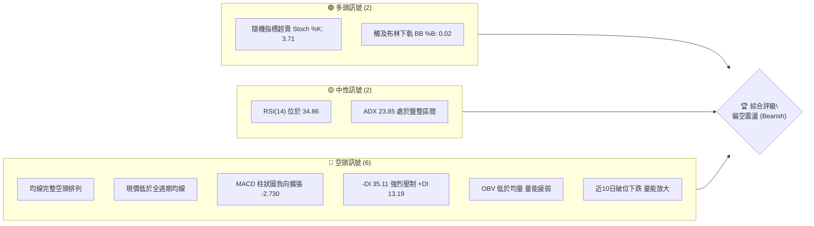
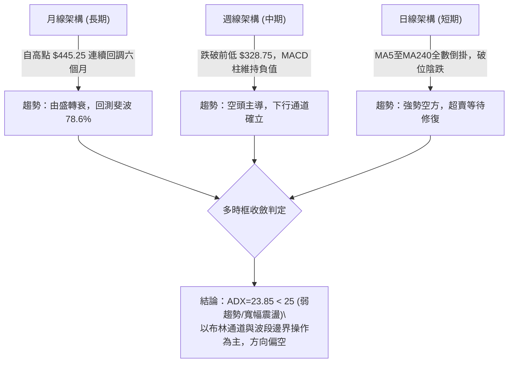
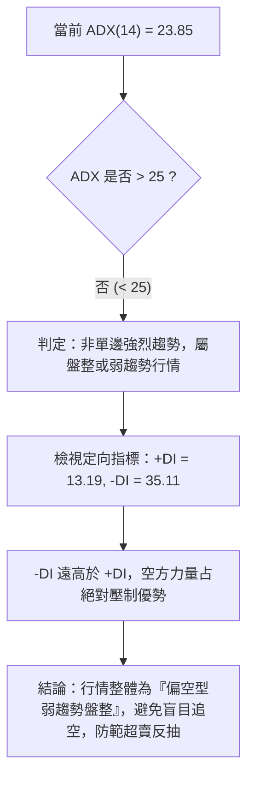
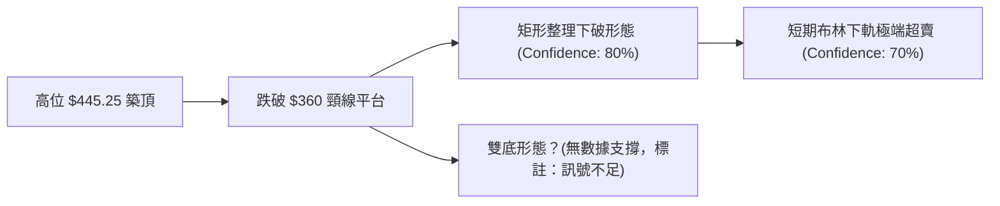
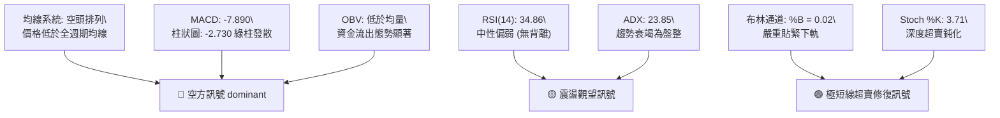
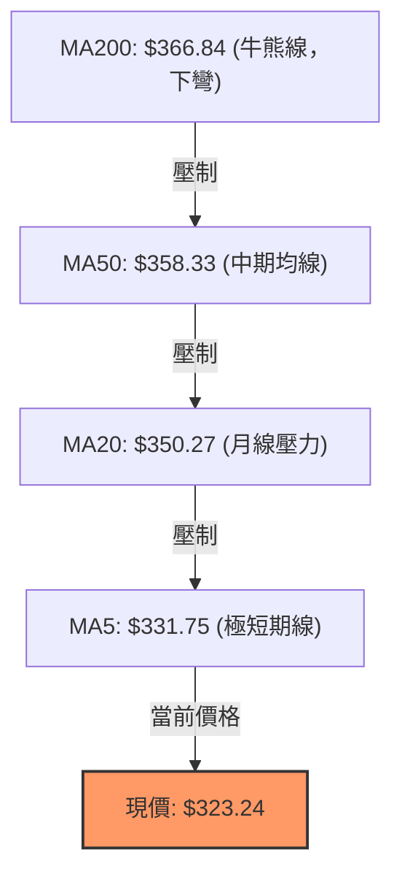
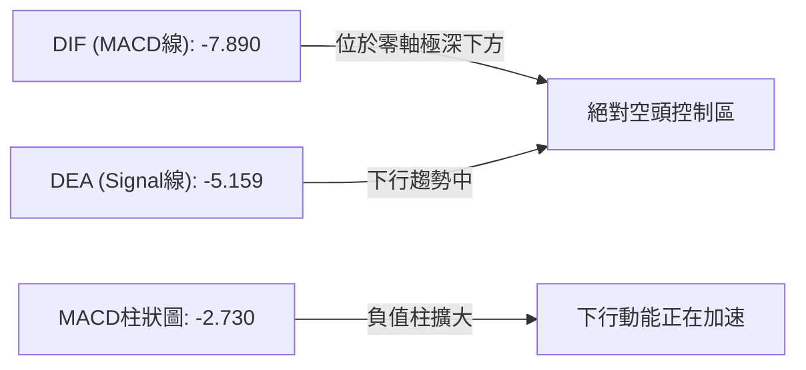
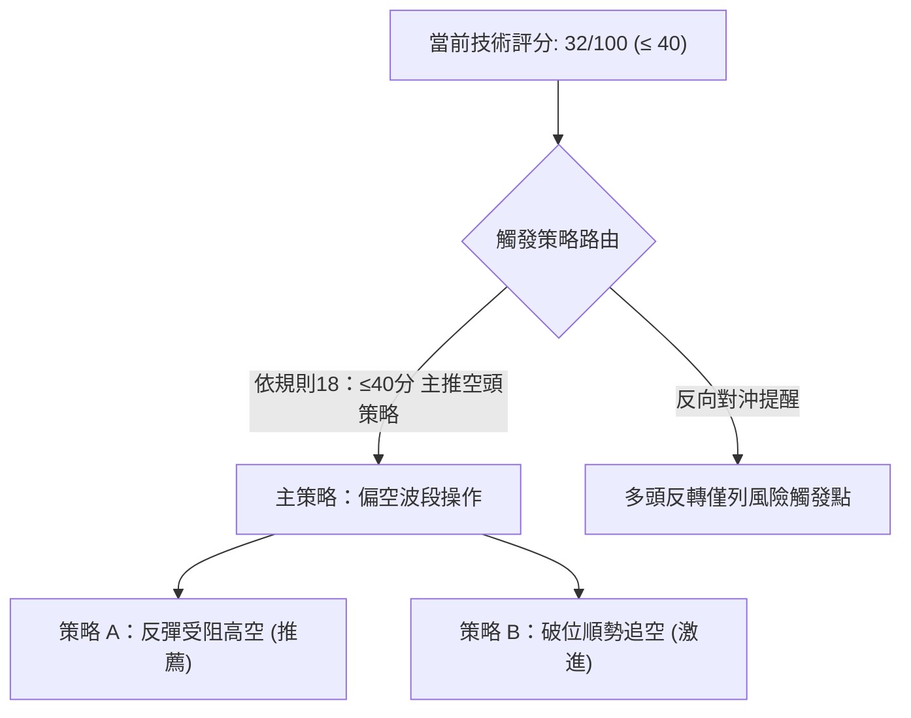
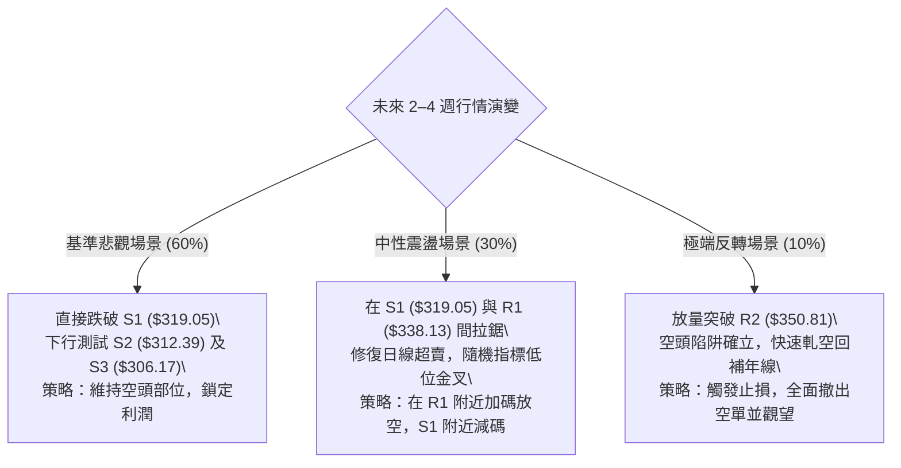

# AVGO 技術分析報告

> **報告日期**：2026-10-23 ｜ **語言**：繁體中文 ｜ **數據來源**：Yahoo Finance ｜ **當前價格**：$323.24

---

## 目錄

| 章節 | 內容 |
|------|------|
| [1. 技術面概覽](#1-技術面概覽) | 訊號儀表板、核心指標、評分卡 |
| [2. 趨勢分析](#2-趨勢分析) | 多時框趨勢、長中短期走勢 |
| [3. 圖表形態分析](#3-圖表形態分析) | 形態識別、K線組合、目標價 |
| [4. 支撐與阻力](#4-支撐與阻力) | 關鍵價位、斐波那契回調 |
| [5. 技術指標深度解讀](#5-技術指標深度解讀) | MA/RSI/MACD/布林/成交量 |
| [6. 動能與波動率](#6-動能與波動率) | 動能評估、ATR、Beta |
| [7. 多時框架總結](#7-多時框架總結) | 時框架評分矩陣 |
| [8. 交易策略建議](#8-交易策略建議) | 多空策略、風險報酬比 |
| [9. 風險提示與監控](#9-風險提示與監控) | 監控指標、風險場景 |

---

## 1. 技術面概覽

### 🎯 技術訊號儀表板



### 📊 核心指標速覽表

| 指標類別 | 指標名稱 | 當前數值 | 訊號 | 解讀 |
|----------|----------|----------|------|------|
| **價格** | 當前價格 | $323.24 | 🔴 | 位於 52 週區間 16.8% 之低檔，逼近波段下緣 |
| **均線** | MA20 | $350.27 | 🔴 | 價格低於 MA20 達 -7.72%，短中期趨勢完全受阻 |
| **均線** | MA50 | $358.33 | 🔴 | 價格顯著受壓於 MA50，中期多頭架構被破壞 |
| **均線** | MA200 | $366.84 | 🔴 | 現價跌破年線關鍵牛熊分水嶺，長期下壓沉重 |
| **動能** | RSI(14) | 34.86 | 🟡 | 位於中性偏弱區間（30–70），未達極端超賣 |
| **動能** | MACD | -7.890 / 柱 -2.730 | 🔴 | 雙線位於零軸下方發散，空方動能強勢主導 |
| **波動** | ATR(14) | $11.55 | 🟡 | 佔現價 3.57%，日內波動偏高，需設置充裕止損 |

### 🏆 技術評分卡

```
╔══════════════════════════════════════════════════════════════════╗
║                技術評分卡 — AVGO (2026-10-23)                    ║
╠══════════════════════════════════════════════════════════════════╣
║ 趨勢強度      ██████░░░░░░░░░░░░░░  30/100  🔴 空頭主導 (-DI壓制)║
║ 動能指標      ███████░░░░░░░░░░░░░  35/100  🔴 MACD負向/Stoch超賣║
║ 支撐穩定度    ████████░░░░░░░░░░░░  40/100  🟡 臨近S1 ($319.05) ║
║ 成交量配合    ██████░░░░░░░░░░░░░░  30/100  🔴 下跌放量/OBV疲弱  ║
║ 形態完整度    ███████░░░░░░░░░░░░░  35/100  🔴 頭部下破/無底形態 ║
║ 均線排列      ████░░░░░░░░░░░░░░░░  20/100  🔴 MA20<50<200 倒掛  ║
╠══════════════════════════════════════════════════════════════════╣
║ 綜合評分      ██████░░░░░░░░░░░░░░  32/100  🔴 偏空架構 (規則18) ║
╚══════════════════════════════════════════════════════════════════╝
```

---

## 2. 趨勢分析

### 🌐 多時框趨勢分析



### 📈 長期趨勢 — 12個月走勢圖（Unicode）

```
AVGO 月線走勢圖（過去12個月：2025-11 至 2026-10）
價格軸 ($)
$450 ┤                             ● (2026-05: $445.25)
$420 ┤                         ● (2026-04: $416.01)
$390 ┤ ● (2025-11: $399.99)                ● (2026-07: $388.57)
$360 ┤             ● (2025-10: $366.90)         ● (2026-08: $369.67)
$330 ┤     ● (2025-12: $344.20) ● (2026-01: $329.48)    ● (2026-09: $351.19)
$300 ┤                     ● (2026-03: $308.46)              ●←現價 ($323.24)
     └─────────────────────────────────────────────────────────────
       11   12   01   02   03   04   05   06   07   08   09   10  (月份)
```

#### 走勢特徵分析表格

| 階段 | 時間區間 | 起始價 / 終止價 | 漲跌幅 | 走勢特徵描述 |
|------|----------|----------------|--------|--------------|
| 第一階段：衝頂回調 | 2025-11 ～ 2026-03 | $399.99 → $308.46 | -22.88% | 衝破高點後獲利回吐，於 $308 形成波段支撐 |
| 第二階段：春季主升 | 2026-03 ～ 2026-05 | $308.46 → $445.25 | +44.35% | AI需求爆發推動強勢單邊拉升，創歷史次高 |
| 第三階段：高位盤整 | 2026-05 ～ 2026-07 | $445.25 → $388.57 | -12.73% | 籌碼在高位換手，寬幅震盪構築多重頂部 |
| 第四階段：破位陰跌 | 2026-07 ～ 2026-10 | $388.57 → $323.24 | -16.81% | 均線相繼失守，成交量漸次萎縮，向52W低點靠攏 |

### 📊 中期趨勢（週線分析）

```
近期週線壓力與支撐示意圖
價格 ($)
$380.84 ┤-------------------------------- (2026-10-09 週高點強阻力)
$361.54 ┤================================ (MA20/週收盤密集阻力區)
$350.27 ┤-------------------------------- (日線 MA20 / 中軌壓力)
$338.75 ┤-------------------------------- (本週開盤價阻力)
$323.24 ┤◄ 現價 ($323.24，週低點 $321.02 上方徘徊)
$319.05 ┤-------------------------------- (S1 支撐位)
$306.17 ┤================================ (S3 中期防守底線)
```

週線指標顯示，2026-10-16 週長黑收於 $328.75，RSI 自 50.2 劇烈下滑至 34.9，MACD 柱由正轉負（-1.993 擴大至 -2.730），確立了中期走勢已跌破 $350–$360 的整理平台，進入空頭主導階段。

### ⚡ 趨勢強度評估（ADX 解讀）



#### ADX 強度對照表

| 指標項目 | 當前數值 | 參考閾值 | 市場狀態評估 | 訊號強度 |
|----------|----------|----------|--------------|----------|
| **ADX(14)** | 23.85 | < 25 (弱趨勢/震盪) | 缺乏爆發性單邊動能，處於弱勢整理 | 🟡 中性偏弱 |
| **+DI** | 13.19 | < 20 (多頭動能枯竭) | 多方無力組織有效反攻 | 🔴 極弱 |
| **-DI** | 35.11 | > 30 (空頭動能亢奮) | 空頭完全掌控日線波動主導權 | 🔴 強空 |
| **DI 差值值** | -21.92 | 負值擴大 | 空方絕對主導，反彈均受賣壓沉重打擊 | 🔴 顯著偏空 |

---

## 3. 圖表形態分析

### 🔍 形態識別系統



#### 形態識別與信心度評估表

| 形態名稱 | 信心度 | 判斷依據（引用數據） | 完成度 | 目標價（附計算式） |
|----------|--------|----------------------|--------|--------------------|
| **矩形箱體破位** | 80% | 9月至10月初在 $352.81–$361.54 震盪，10-16 跌破箱底 | 100% (已破位) | 頸線 $352.81 − 形態高度($361.54 − $352.81 = $8.73) = $344.08 (已達成) |
| **中級下行旗形** | 65% | 10-16 大跌至 $328.75 後，10-19 至 10-21 弱勢反彈受阻於 $339.24 | 85% (再破底) | 旗桿高點 $361.54 − 旗桿底 $328.58 = $32.96；破位點 $334.37 − $32.96 = $301.41 |
| **雙重底形態** | 0% | 數據中未偵測到兩次觸底反彈結構，當前僅為單邊陰跌 | 0% | 訊號不足，僅做指標型解讀 |

### 🕯️ 重要K線形態分析

嚴格依據數據中「近10根日K」與「近8根週K」之開高低收進行客觀解讀：

| 日期（日K/週K） | 開 | 高 | 低 | 收 | K線形態 | 解讀 | 訊號 |
|---|---|---|---|---|---|---|---|
| **2026-10-15 (日)** | 338.34 | 344.70 | 334.61 | 344.33 | 帶長下影中陽線 | 逢低買盤一度介入，收於高點 | 🟢 弱多 |
| **2026-10-16 (日)** | 338.48 | 339.59 | 328.58 | 328.75 | 穿頭破腳大陰線 | 實體大陰線完全吞噬前日陽線，多頭防線瓦解 | 🔴 強空 |
| **2026-10-19 (日)** | 338.75 | 340.20 | 333.82 | 334.59 | 孕線跳空低走陽十字 | 低檔縮量震盪，多空暫時僵持 | 🟡 中性 |
| **2026-10-20 (日)** | 334.00 | 341.10 | 330.80 | 334.37 | 長上影小實體紡錘 | 反彈遭遇空頭於 $341.10 狙擊，上行阻力重重 | 🔴 偏空 |
| **2026-10-21 (日)** | 338.03 | 339.24 | 332.29 | 337.80 | 縮量溫和反彈陽線 | 反彈乏力，未能收復 MA5 ($331.75 之上未站穩均線群) | 🟡 中性 |
| **2026-10-22 (日)** | 326.53 | 330.82 | 321.02 | 323.24 | 跳空低開破位長黑 | 放量 27.82M 跌破前低 $328.58，收於全日低檔 | 🔴 強空 |
| **2026-10-16 (週)** | 359.43 | 360.69 | 328.58 | 328.75 | 光腳破位巨陰週K | 單週大跌逾 30 元，實體破壞所有短期結構 | 🔴 強空 |
| **2026-10-22 (週)** | 338.75 | 341.10 | 321.02 | 323.24 | 破底陰線 (低點下移) | 持續下行創波段新低，下影線短暫考驗 $321.02 | 🔴 強空 |

### 📉 ASCII 走勢形態示意圖

```
日線下行中繼箱體與破位走勢示意圖
價格 ($)
$366.63 ┬─┐ (10-09 波段高點)
        │ └─┐
$354.22 ┤   └──┐ [箱體上邊界 $354.25]
        │      ├──────────┐
$342.82 ┤      │ 箱體震盪 │
        │      └──────────┴─┐ [箱體下邊界破位 $342.82]
$330.80 ┤                   └──┐
        │                      └───┐ [10-19~10-21 弱勢整理平台]
$321.02 ┤                          └──▼ 現價: $323.24 (逼近 S1 $319.05)
        └──────────────────────────────────────────────
         10-09  10-12  10-14  10-16  10-19  10-21  10-22 (日期)
```

### 🎯 形態目標價計算

根據 10月16日展開之「下跌中繼平台破位」計算垂直度量目標：
1. **箱體上限 (阻力點)**：2026-10-14 反彈高點 $354.25
2. **箱體下限 (破位點)**：2026-10-16 平台下邊緣 $334.61
3. **形態垂直高度**：$354.25 − $334.61 = $19.64
4. **度量等幅目標價**：破位點 $334.61 − 形態高度 $19.64 = **$314.97**
   - 該測算目標價與下方波段計算之強支撐 **S2 ($312.39)** 極為接近，高度重合形成共振回測區間。

---

## 4. 支撐與阻力

### 🗺️ 關鍵價位分布圖（Unicode）

```
AVGO 價位結構分布圖 (由 OHLCV 關鍵聚類計算)
═══════════════════════════════════════════════════════════════════
$358.10 ║██████████████████████████████║ 強阻力 R3 (MA50 聚類重合區)
$350.81 ║██████████████████████        ║ 阻力 R2 (MA20 / 布林中軌)
$338.13 ║██████████████                ║ 關鍵阻力 R1 (近3日反彈高點聚類)
$323.24 ╠══════════════════════════════╣ ◄ 當前收盤價 ($323.24)
$319.05 ║▓▓▓▓▓▓▓▓▓▓▓▓▓▓▓▓              ║ 近期波段支撐 S1 (-1.30%)
$312.39 ║██████████████████████        ║ 強支撐 S2 (形態目標共振區)
$306.17 ║██████████████████████████████║ 核心支撐 S3 (年內波段大底邊界)
═══════════════════════════════════════════════════════════════════
```

### 🚧 阻力位分析表

所有阻力數值均直接引用自系統波段高點聚類計算：

| 阻力級別 | 價位 | 形成原因 | 突破難度 | 重要性 |
|----------|------|----------|----------|--------|
| **R1** | $338.13 | 近5個交易日反彈頂部區間（10-19至10-21多次衝高回落均值） | 🟡 中等 | 短線多頭重返反彈軌道之關鍵關卡 |
| **R2** | $350.81 | MA20 ($350.27) 與布林中軌共振處，為此前下破平臺之頸線位 | 🔴 困難 | 中期強弱轉換分水嶺，若無法越過則空頭格局不變 |
| **R3** | $358.10 | MA50 ($358.33) 附近密集套牢籌碼峰，空頭均線下壓防線 | 🔴 極難 | 多頭波段反轉的核心樞紐點 |

### 🛡️ 支撐位分析表

所有支撐數值均直接引用自系統波段低點聚類計算：

| 支撐級別 | 價位 | 形成原因 | 守住機率 | 重要性 |
|----------|------|----------|----------|--------|
| **S1** | $319.05 | 近期波段低點聚類，距現價僅 -1.30%，直面空方下殺衝擊 | 🟡 50% | 短線防守第一道屏障，失守將直奔整數關卡 |
| **S2** | $312.39 | 形態度量目標價 ($314.97) 與年內回調密集低點重疊區 | 🟢 65% | 具備較強技術買盤支撐，為重要防禦陣地 |
| **S3** | $306.17 | 2026-03 波段起漲大底 ($308.46) 之聚類下限，年內多頭底線 | 🟢 80% | 52W 低點前最後堡壘，跌破將引發系統性恐慌 |

### 📐 斐波那契回調位分析

依據 52 週絕對極值區間（最低 $288.98 → 最高 $493.32）之精確斐波那契回調位：

```
斐波那契回調水平梯形圖
0.0%  (52W High) ── $493.32
23.6% ────────────── $445.09
38.2% ────────────── $415.26
50.0% ────────────── $391.15
61.8% ────────────── $367.03  (黃金分割位，已失守)
78.6% ────────────── $332.71  (深度防守位，當前已有效跌破)
==================== 現價 $323.24 處於 78.6% 至 100.0% 弱勢區間 ====================
100.0%(52W Low)  ── $288.98
```

- **位置意義解讀**：
  現價 $323.24 已實質跌破 78.6% 回調位 ($332.71)，代表自 2026 年春季以來整輪 AI 多頭行情的回撤幅度已超過極限防守位。在技術分析定義中，回調跌破 78.6% 意味著先前的上升趨勢已被徹底破壞，當前走勢為測試 100.0% 起漲點（$288.98）的尋底階段。

---

## 5. 技術指標深度解讀

### 🎛️ 指標訊號總覽



### 📈 移動平均線排列分析



#### 各週期移動平均線偏離統計

| 均線名稱 | 數值 | 距現價價差 | 乖離率 (BIAS) | 排列特徵與解讀 |
|----------|------|------------|---------------|----------------|
| **MA5** | $331.75 | -$8.51 | -2.57% | 短期下殺速率過快，呈現空頭加速態勢 |
| **MA10** | $342.29 | -$19.05 | -5.57% | 兩週內進場者全數套牢，構成首道換手阻力 |
| **MA20** | $350.27 | -$27.03 | -7.72% | 跌破月均線且負乖離擴大，中期趨勢向下 |
| **MA60** | $366.97 | -$43.73 | -11.92% | 季線下穿長期均線，構成死亡交叉壓力 |
| **MA120** | $383.45 | -$60.21 | -15.70% | 半年線持續下行，中期籌碼成本嚴重虧損 |
| **MA200** | $366.84 | -$43.60 | -11.88% | 跌破年線，技術面正式進入空頭熊市循環 |

### 📉 RSI(14) 分析

- **當前數值**：34.86 (Wilder 計算法)
  ```
  RSI(14) 強度計: [0 ─── 30 ────── 50 ────── 70 ─── 100]
  當前讀數: 34.86  ███████░░░░░░░░░░░░░ (位於超賣臨界值 30 上方)
  ```
- **背離分析判斷**：
  比較近 20 根 K 棒走勢，價格自 2026-10-09 高點 $366.63 跌至 10-22 低點 $321.02，創出波段新低；同期間 RSI 亦由 50.2 下探至 34.86，指標與價格同步下行。**數據未顯示任何底背離或頂背離現象**，確認當前跌勢為動能推動之實質下瀉，並非虛假破位。

### 📊 MACD(12/26/9) 訊號解讀


- **指標互動狀態**：
  MACD 柱狀圖讀數為 -2.730，連續多日維持負向發散。DIF (-7.890) 距離零軸極遠且遠低於 Signal (-5.159)，表明空頭趨勢在日線級別仍處於加速釋放過程中，未出現任何柱狀圖收斂金叉的止跌信號。

### 📦 布林通道分析

```
日線布林通道 (Bollinger Bands 20, 2) 結構圖
────────────────────────────────────────────────────
$378.49 ┬  上軌 (Upper Band)
        │
$350.27 ┼  中軌 (MA20)
        │
$323.24 ┼  現價 (BB %B = 0.02) ── 極度緊貼下軌
$322.05 ┴  下軌 (Lower Band)
────────────────────────────────────────────────────
```
- **通道位置與頻寬解讀**：
  現價 $323.24 緊貼布林下軌 $322.05，%B 指標僅為 **0.02**（0 代表觸及下軌，0.5 為中軌）。當 %B 小於 0.05 時，屬於統計學意義上的「極端超賣區域」。在 ADX < 25 的震盪市場中，此類訊號往往觸發回歸中軌的技術性修復反彈；然而在 -DI 高達 35.11 的壓制下，更常表現為「沿下軌向下開口」的鈍化現象。

### 💹 成交量分析（量價配合度）

1. **量比分析**：
   最新日成交量為 **27,823,100**，相對於 20 日均量 (21,683,930) 的量比達 **1.28x**。在 10 月 22 日價格大跌 -4.3% 的背景下放量，呈現典型的「放量破位下跌」特徵，顯示機構盤在關鍵阻力下方進行了堅決的止損拋售。
2. **OBV (能量潮) 走勢**：
   數據明確標示「**OBV < MA → 量能疲弱**」。OBV 長期維持於其均線下方，說明資金呈現持續淨流出狀態，每一次反彈過程中的成交量均呈現萎縮，量價關係高度不配合（價跌量增，價漲量縮），完全確認了價格下行趨勢的真實性。

---

## 6. 動能與波動率

### ⚡ 動能評估四象限

| 象限 | 動能狀態 (RSI / MACD) | 波動率狀態 (ATR / BBW) | 當前判定 | 特徵與操作指導 |
|---|---|---|---|---|
| **第一象限 (Q1)** | 強勢多頭 | 低波動 (積累期) | — | 絕佳右側買點，突破拉升在即 |
| **第二象限 (Q2)** | 弱勢偏空 | 低波動 (窄幅整理) | — | 盤整等待，方向未明 |
| **第三象限 (Q3)** | 強勢多頭 | 高波動 (主升浪) | — | 高風險高報酬，趨勢跟隨 |
| **第四象限 (Q4)** | **弱勢空頭 (MACD柱 -2.73)** | **高波動 (ATR 3.57%, 放量)** | **✓ [當前定位]** | **空頭釋放期，震盪下挫，切忌盲目摸底** |

### 📊 ATR 波動率分析

```
╔══════════════════════════════════════════════════════════════════╗
║                     ATR (14) 波動率風險計量                      ║
╠══════════════════════════════════════════════════════════════════╣
║ 當前 ATR(14) 絕對值：$11.55 (Wilder 平滑法)                     ║
║ 波動率佔股价比率   ：3.57% (處於歷史中高波動分位)                ║
╠══════════════════════════════════════════════════════════════════╣
║ 建議日間噪音容忍幅度：1.0 × ATR = $11.55                         ║
║ 建議趨勢止損保護距離：1.5 × ATR = $17.33                         ║
║ 建議寬幅防守止損距離：2.0 × ATR = $23.10                         ║
╚══════════════════════════════════════════════════════════════════╝
```
- **交易意義**：由於單日預期波動區間超過 11 美元，任何低於 1.0 ATR ($11.55) 的過窄止損設置，在當前市場結構中均有極高概率被隨機噪音掃出場。

### 📐 Beta 與市場相關性

- **Beta 係數**：**1.476**
- **市場屬性解讀**：
  AVGO 具備高度進攻性與槓桿特徵（高 Beta 屬性）。當納斯達克或費城半導體指數下跌 1% 時，AVGO 平均回落幅度約為 1.48%。在當前半導體行業週期調整與大盤弱勢背景下，高 Beta 特性加劇了該股的下跌乘數效應。

---

## 7. 多時框架總結

### 📋 時框架評分表

| 時框架 | 趨勢方向 | 動能狀態 | 均線排列 | 形態結構 | 綜合評分 | 操作建議 |
|--------|----------|----------|----------|----------|----------|----------|
| **月線 (長期)** | 🟡 中性回調 | 轉弱 (自高位持續回撤) | 仍位於MA240上方 | 頂部回吐 78.6% | 45/100 | 長期部位減碼觀望 |
| **週線 (中期)** | 🔴 確立下行 | 負向擴張 (MACD負值) | 跌破所有中短期均線 | 旗形跌破下尋支撐 | 28/100 | 順勢偏空，逢反彈賣出 |
| **日線 (短期)** | 🔴 單邊陰跌 | 超賣鈍化 (BB %B 0.02) | 完美空頭排列倒掛 | 階梯式跳空破位 | 23/100 | 超賣防反彈，主策略做空 |

### 🔲 綜合訊號矩陣

```
時框與指標維度訊號矩陣
┌──────────────┬─────────────┬─────────────┬─────────────┐
│ 分析維度     │ 短期 (日線) │ 中期 (週線) │ 長期 (月線) │
├──────────────┼─────────────┼─────────────┼─────────────┤
│ 均線系統     │  🔴 強空    │  🔴 偏空    │  🟡 中性    │
│ 擺動指標     │  🟢 超賣    │  🔴 偏空    │  🟡 轉弱    │
│ 趨勢強度     │  🟡 盤整    │  🔴 偏空    │  🟡 弱化    │
│ 資金成交量   │  🔴 疲弱    │  🔴 賣壓    │  🟡 縮量    │
└──────────────┴─────────────┴─────────────┴─────────────┘
一致性分析：日線與週線高度收斂偏空，僅日線擺動指標出現超賣雜音。
```

### ⚖️ 多時框收斂結論

依據多時框收斂優先級規則（規則 14）：
1. **趨勢/盤整判定**：當前 ADX(14) 數值為 **23.85**（小於 25），在定義上屬於**盤整行情（弱趨勢行情）**。
2. **操作核心依據**：在盤整行情中，依規則應以日線布林通道上下軌及近期波段低點聚類為主要交易區間。
3. **主導方向收斂**：雖然 ADX < 25，但定向指標 -DI (35.11) 呈壓倒性優勢，且週線中期均線與日線全週期均線皆呈完整空頭排列。
4. **唯一方向性結論**：**【偏空觀望，逢反彈佈局空單】**。日線布林下軌的超賣僅視為「空頭行情中的技術性減速」，絕非多頭反轉訊號。此結論與第 8 章之空頭主策略完全一致。

---

## 8. 交易策略建議

### 🗺️ 策略決策流程圖



### 🧭 策略路由

> **當前主策略方向 = 【主推空頭策略】（依評分卡綜合評分 32/100，嚴格屬於 ≤40 偏空分流）**
> 
> 本報告絕不進行兩頭下注，多頭訊號僅作為極短線技術修復參考或空單止盈依據，不主推多頭開倉。

### 🎯 價格情境階梯（Price Scenarios）

所有價位均嚴格引用第 4 章及數據源關鍵價位計算結果：

| 觸發條件 | 下一目標 | 後續延伸 | 情境含義 |
|----------|----------|----------|----------|
| **突破 R1 $338.13** | R2 $350.81 | R3 $358.10 | 短線超賣引發強烈回補，空單全面離場，回測月均線 |
| **站穩現價區間 ($323.24)** | R1 $338.13 | S1 $319.05 | 處於布林下軌與前低間縮量弱勢拉鋸 |
| **跌破 S1 $319.05** | S2 $312.39 | S3 $306.17 | 中期支撐崩解，向下尋找年內大底支撐 |

### 📊 情境機率分佈

| 情境劇本 | 機率 | 主要依據 |
|----------|------|----------|
| **劇本一：回落再探底 (跌破S1)** | **60%** | MACD 綠柱持續擴散 (-2.730)，均線全面死叉倒掛，量比 1.28x 具實質拋壓 |
| **劇本二：弱勢區間震盪 (S1~R1)** | **30%** | ADX 23.85 < 25 意味單邊動能有限，Stoch %K (3.71) 與布林下軌具技術抵抗 |
| **劇本三：強勢反彈向上 (上碰R2)** | **10%** | -DI 35.11 居高不下，上方套牢籌碼沉重，短期缺乏資金與多頭形態確認 |

### 🟢 主策略詳情（空頭交易策略）

各策略參數及風險報酬比嚴格按規則計算：
- **風險報酬比計算公式**：`做空 RR = (進場價 − 目標價 T1) ÷ (止損價 − 進場價)`
- 進場價若為區間，以區間中點計算並註明。

| 策略要素 | 策略 A（反彈高空 — 穩健型） | 策略 B（破位追空 — 激進型） |
|----------|----------------------------|----------------------------|
| **進場條件** | 股價弱勢反抽至 R1 阻力位受阻滯漲 | 股價放量有效跌穿 S1 關鍵支撐位 |
| **進場價格** | **$338.13** (精確以 R1 為準) | **$318.00** (跌破S1 $319.05後確認點) |
| **目標價 T1** | **$319.05** (支撐位 S1) | **$306.17** (支撐位 S3) |
| **目標價 T2** | **$312.39** (強支撐 S2) | **$288.98** (52W 極端低點) |
| **止損價格** | **$346.50** (位於近期高點與R2下方) | **$323.24** (以當前收盤價為反抽止損) |
| **風險報酬比 (T1)** | **1 : 2.28**（以 T1 計）<br>*(338.13-319.05)/(346.50-338.13) = 19.08/8.37* | **1 : 2.26**（以 T1 計）<br>*(318.00-306.17)/(323.24-318.00) = 11.83/5.24* |
| **風險報酬比 (T2)** | **1 : 3.07**（以 T2 計）<br>*(338.13-312.39)/(346.50-338.13) = 25.74/8.37* | **1 : 5.54**（以 T2 計）<br>*(318.00-288.98)/(323.24-318.00) = 29.02/5.24* |
| **勝率估計** | 65% | 55% |
| **建議倉位** | 10% - 15% 總資金倉位 | 5% - 8% 輕倉試探 |

### 🔴 反向風險觸發點（對沖提示）

若出現以下情境，則本報告之空頭架構被證偽，應立即無條件平倉觀望或反手對沖：
1. **價格突破點**：日線收盤價強勢突破 **R2 ($350.81)** 並站穩布林中軌上方。
2. **指標轉折點**：日線 MACD 出現零下金叉且柱狀圖翻紅，同時 RSI 越過 55 進入多頭區。
3. **動態對沖建議**：若現價直接拉升越過 R1 ($338.13)，空頭部位應立即減半；越過 $346.50 則全面止損離場。

### ⭐ 整體訊號強度評星

```
做多訊號強度：★☆☆☆☆  (1/5星 — 僅超賣技術指標抵抗，無形態支持)
做空訊號強度：★★★★☆  (4/5星 — 均線倒掛、破位放量、量價背離)
整體可信度：  ★★★★☆  (4/5星 — 歷史聚類支撐明確，多時框共振)
```

---

## 9. 風險提示與監控

### ✅ 關鍵監控指標 Checklist

```
╔══════════════════════════════════════════════════════════════════╗
║               AVGO 技術面日常監控 Checklist (每日必檢)            ║
╠══════════════════════════════════════════════════════════════════╣
║ [ ] 監控項 1: 收盤價是否跌破 S1 ($319.05) ── 破位確認標誌       ║
║ [ ] 監控項 2: 日成交量是否超越 24M ── 機構是否在低位持續倒貨    ║
║ [ ] 監控項 3: RSI(14) 是否跌破 30 進入極端鈍化，抑或回升突破40   ║
║ [ ] 監控項 4: MACD 柱狀圖是否開始收斂（數值由 -2.730 向上收窄）   ║
║ [ ] 監控項 5: 反彈高點是否受制於 MA5 ($331.75) 與 R1 ($338.13)    ║
║ [ ] 監控項 6: 布林帶寬是否持續張開（下軌 $322.05 是否被持續擊穿）║
╚══════════════════════════════════════════════════════════════════╝
```

### ⚠️ 風險場景分析



### 🛡️ 風險管理重要提醒

1. **ATR 浮動止損保護**：AVGO 當前 ATR 達到 **$11.55**，日內波動劇烈。嚴格禁止重倉扛單，任何做空交易止損點必須設定於有效技術阻力位外側至少 1.0 ATR 以上（例如策略 A 之止損設於 $346.50，高於 R1 達 $8.37）。
2. **重大財報與產業消息風險**：半導體板塊受巨頭資本開支及宏觀半導體週期影響巨大。儘管技術面嚴重偏空，若產業鏈傳出利好，高 Beta (1.476) 特質極易產生單日 5–8% 的軋空暴拉，須隨時注意事件驅動風險。
3. **倉位管控軍規**：在綜合評分僅 32/100 的弱勢環境中，單筆交易總承擔風險資金不得超過整體帳戶淨值的 **1.5%**。

---

## 📋 報告總結

```
AVGO 技術分析報告總結
══════════════════════════════════════════════════════════════════
報告日期：2026-10-23
當前價格：$323.24
分析評級：🔴 偏空弱勢格局 (綜合評分: 32/100)

關鍵結論：
├─ 長期趨勢：🟡 月線自 $445.25 連跌6個月，跌破斐波 78.6% 回調位
├─ 中期趨勢：🔴 週線大陰線跌破 $350 密集平台，下行通道形成
├─ 短期趨勢：🔴 日線均線全空頭倒掛排列，破位放量，直逼 $319.05
├─ 關鍵支撐：S1: $319.05  │  S2: $312.39  │  S3: $306.17
├─ 關鍵阻力：R1: $338.13  │  R2: $350.81  │  R3: $358.10
└─ 分析師目標：華爾街平均目標價 $527.59 (基本面長期看好但技術面短期背離)

最優策略組合：
1. 🥇 最佳機會：策略 A — 反抽 R1 ($338.13) 受阻逢高佈局空單 (RR 1:2.28)
2. 🥈 次選機會：策略 B — 跌破 S1 ($319.05) 放量破位追空至 S3 (RR 1:2.26)
3. 🥉 保守選擇：空倉觀望，靜待日線於 S2/S3 築出雙底形態且 MACD 金叉後再行進場
══════════════════════════════════════════════════════════════════
```

---

> ⚠️ **免責聲明**：本報告為技術分析研究，所有數據、圖表及推算均基於歷史量價資訊客觀呈現。本報告**僅供研究與學術參考**，**不構成任何要約、招攬或投資建議**。市場具有高度不確定性，投資人應獨立評估風險並自行承擔交易盈虧。

---

*報告生成時間：2026-10-23 ｜ 數據來源：Yahoo Finance ｜ 分析框架：多時框技術分析體系*