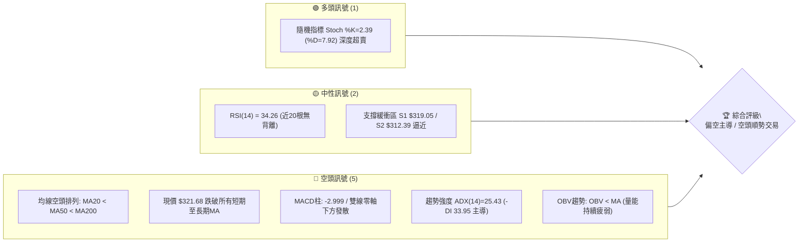
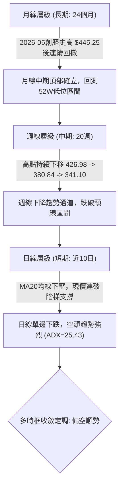
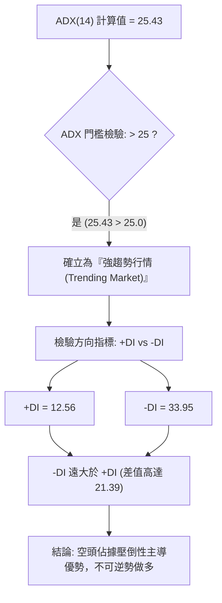
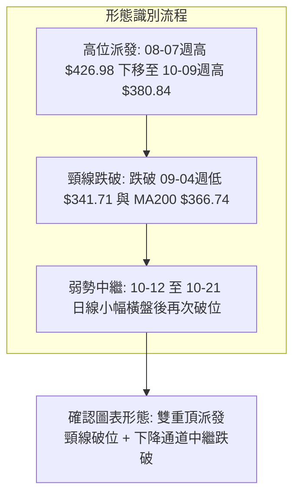
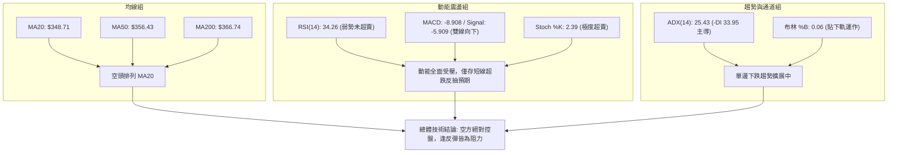
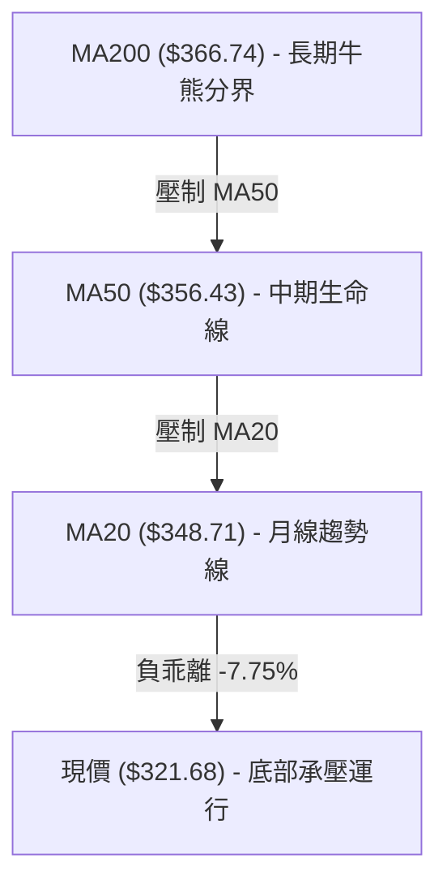
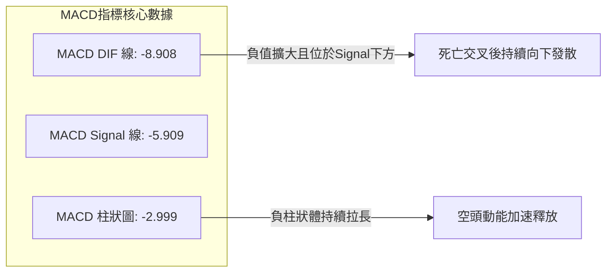
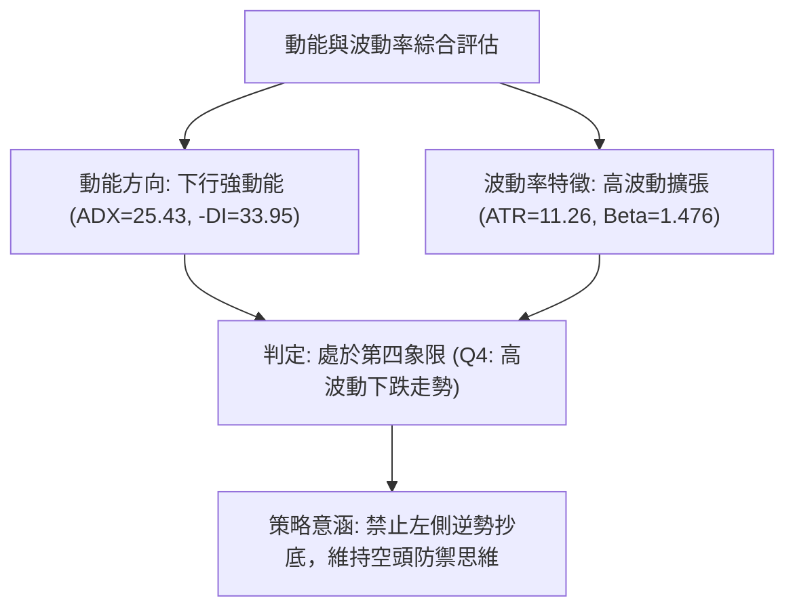
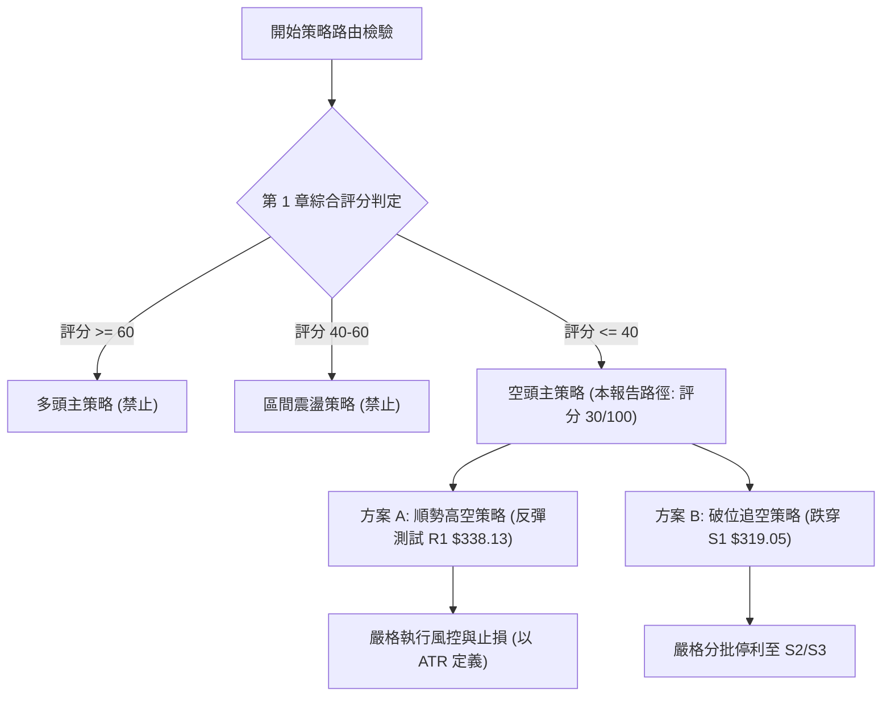
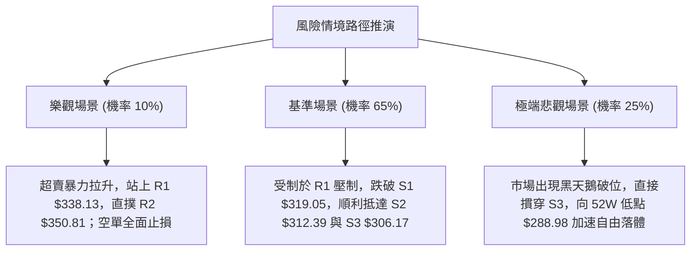

# AVGO 技術分析報告

> **報告日期**：2026-10-24 ｜ **語言**：繁體中文 ｜ **數據來源**：Yahoo Finance ｜ **當前價格**：$321.68

---

## 目錄

| 章節 | 內容 |
|------|------|
| [1. 技術面概覽](#1-技術面概覽) | 訊號儀表板、核心指標、評分卡 |
| [2. 趨勢分析](#2-趨勢分析) | 多時框趨勢、長中短期走勢 |
| [3. 圖表形態分析](#3-圖表形態分析) | 形態識別、K線組合、目標價 |
| [4. 支撐與阻力](#4-支撐與阻力) | 關鍵價位、斐波那契回調 |
| [5. 技術指標深度解讀](#5-技術指標深度解讀) | MA/RSI/MACD/布林/成交量 |
| [6. 動能與波動率](#6-動能與波動率) | 動能評估、ATR、Beta |
| [7. 多時框架總結](#7-多時框架總結) | 時框架評分矩陣 |
| [8. 交易策略建議](#8-交易策略建議) | 多空策略、風險報酬比 |
| [9. 風險提示與監控](#9-風險提示與監控) | 監控指標、風險場景 |

---

## 1. 技術面概覽

### 🎯 技術訊號儀表板



### 📊 核心指標速覽表

| 指標類別 | 指標名稱 | 當前數值 | 訊號 | 解讀 |
|----------|----------|----------|------|------|
| **價格** | 當前收盤價 | $321.68 | 🔴 | 位於52週區間16.0%，逼近一年低點區域 |
| **均線** | MA20 (短中) | $348.71 | 🔴 | 現價低於MA20達 -7.75%，短線下行斜率陡峭 |
| **均線** | MA50 (中期) | $356.43 | 🔴 | 現價低於MA50，中線趨勢全面走弱 |
| **均線** | MA200 (長期) | $366.74 | 🔴 | 現價低於年線，且MA20<MA50<MA200呈現典型死亡排列 |
| **動能** | RSI(14) | 34.26 | 🟡 | 位於30–70中性偏弱區，尚未進入<30超賣區，無背離 |
| **動能** | MACD (12,26,9) | 柱狀圖 -2.999 | 🔴 | MACD(-8.908)低於信號線(-5.909)，負向動能持續擴張 |
| **動能** | Stoch %K / %D | 2.39 / 7.92 | 🟢 | 極度超賣區間，隨時具備短線技術性抽頭修復可能 |
| **趨勢** | ADX(14) / ±DI | 25.43 (-DI 33.95) | 🔴 | ADX>25確認進入趨勢行情，-DI壓倒性主導跌勢 |
| **通道** | 布林帶 %B | 0.06 | 🔴 | 緊貼布林下軌 $317.78 運行，呈現單邊帶狀下殺 |
| **量能** | 最新量 / 20日均量 | 15.87M / 21.68M | 🔴 | 量比0.73x，OBV低於均線，資金持續呈現淨流出 |
| **波動** | ATR(14) | $11.26 | 🟡 | 佔現價3.50%，日內波動擴大，風控止損需保持寬度 |

### 🏆 技術評分卡

```
╔══════════════════════════════════════════════════════════════╗
║                技術評分卡 — AVGO (2026-10-24)               ║
╠══════════════════════════════════════════════════════════════╣
║ 趨勢強度      ██████░░░░░░░░░░░░░░  30/100  🔴 強烈看空      ║
║ 動能指標      ██████░░░░░░░░░░░░░░  30/100  🔴 動能向下      ║
║ 支撐穩定度    ████████░░░░░░░░░░░░  40/100  🟡 臨近S1考驗    ║
║ 成交量配合    ██████░░░░░░░░░░░░░░  30/100  🔴 量能疲弱      ║
║ 形態完整度    ██████░░░░░░░░░░░░░░  30/100  🔴 破位向下      ║
║ 均線排列      ████░░░░░░░░░░░░░░░░  20/100  🔴 空頭排列      ║
╠══════════════════════════════════════════════════════════════╣
║ 綜合評分      ██████░░░░░░░░░░░░░░  30/100  🔴 偏空（強空主導）║
╚══════════════════════════════════════════════════════════════╝
```
*註：綜合評分 = (30 + 30 + 40 + 30 + 30 + 20) ÷ 6 = 30.0，依規則 18 四捨五入為 30/100。*

---

## 2. 趨勢分析

### 🌐 多時框趨勢分析



### 📈 長期趨勢 — 12個月走勢圖（Unicode）

```
AVGO 月線走勢圖（過去12個月：2025-11 至 2026-10）
價格軸 ($)
$450 ┤                                      ● $445.25 (2026-05 歷史波段高)
$425 ┤                                ● $416.01
$400 ┤  ● $399.99                                  ● $388.57
$375 ┤                                        ● $377.06  ● $369.67
$350 ┤        ● $344.20                                        ● $351.19
$325 ┤              ● $329.48                                        ● $321.68 (當前)
$300 ┤                    ● $317.80 ● $308.46
     └─────────────────────────────────────────────────────────────────
       11    12    01    02    03    04    05    06    07    08    09    10
      2025 ---------------------> 2026 年份月份標記
```

#### 走勢特徵分析表格

| 階段區間 | 起止收盤價 | 漲跌幅 | 結構形態與成交量價特徵 |
|----------|------------|--------|------------------------|
| **高位回檔期**<br>(2025-11 ~ 2026-03) | $399.99 → $308.46 | -22.88% | 自2025年高點獲利了結，連續5個月階梯式下跌，於$308附近築底。 |
| **主升浪突破**<br>(2026-03 ~ 2026-05) | $308.46 → $445.25 | +44.35% | AI硬體強勁需求推動，連續大陽線拔高，創下$493.32的52週歷史極值。 |
| **高位巨震期**<br>(2026-05 ~ 2026-07) | $445.25 → $388.57 | -12.73% | 06月單月大跌至$377.06，07月反抽無力，形成次高點，大資金開始派發。 |
| **主跌浪擴展**<br>(2026-07 ~ 2026-10) | $388.57 → $321.68 | -17.21% | 08、09、10月連續陰線破位，失守MA200，目前直逼一年低點。 |

### 📊 中期趨勢（週線分析）

```
中期週線關鍵壓制與支撐結構示意圖
價格 ($)
$380.84 ─── 高點壓制 (2026-10-09 週K高點)
            │
$367.03 ─── 斐波那契 61.8% 重合壓制位 / MA200 壓制線 ($366.74)
            │
$350.81 ─── 阻力位 R2 (近期多重週K平台破位頸線)
            │
$338.13 ─── 阻力位 R1 (2026-10-23 週K開盤 $338.75 附近壓制)
            ├─────────────────────────────────────────
$321.68 ─── 當前現價 ◄
            ├─────────────────────────────────────────
$319.05 ─── 關鍵支撐 S1 (近一年波段密集低點聚類)
            │
$312.39 ─── 關鍵支撐 S2 (日線防線)
            │
$288.98 ─── 52週低點 (斐波那契 100.0% 極限支撐)
```

### ⚡ 趨勢強度評估（ADX 解讀）



#### ADX 強度對照表

| ADX 數值區間 | 趨勢狀態定義 | AVGO 當前指標表現 | 技術操作含義 |
|--------------|--------------|-------------------|--------------|
| 0 – 20 | 無趨勢 / 盤整洗盤 | 否 | 震盪指標主導，避免追單 |
| 20 – 25 | 趨勢孕育 / 弱趨勢 | 否 | 觀察方向突破確認 |
| **25 – 40** | **強趨勢行情** | **當前數值 25.43 (符合)** | **順應主導方向交易（空方主導）** |
| 40 – 60 | 極強單邊爆發趨勢 | 否 | 加碼順勢單，嚴格移動停利 |
| 60 – 100 | 超強/即將耗竭反轉 | 否 | 提防力竭背離出現 |

---

## 3. 圖表形態分析

### 🔍 形態識別系統



#### 形態識別與信心度評估表

| 形態名稱 | 信心度 | 判斷依據（引用數據） | 完成度 | 目標價（附計算式） |
|----------|--------|----------------------|--------|--------------------|
| **雙重頂 (Double Top)** | **75%** | 頂一為08-07當週高點區間($426.98)，頂二為10-09當週反抽高點($380.84)，頸線為09-04當週低點$341.71。現價$321.68已實體跌破頸線。 | 90% | 依形態量度跌幅計算：頸線 $341.71 − (頂二 $380.84 − 頸線 $341.71) = $341.71 − $39.13 = **$302.58**（逼近支撐S3 $306.17）。 |
| **布林帶下軌開口破位** | **85%** | 現價收於$321.68，BB %B僅為0.06，逼近下軌$317.78，中軌$348.71下傾，屬指標破位形態。 | 100% | 依下軌擴張推算，第一測試目標為支撐位 **S1 $319.05**，跌破看 **S2 $312.39**。 |
| **頭肩頂形態** | 35% | 數據中左肩與頭部高點週期不對稱，右肩過於弱小，形態結構不完整。 | 30% | 訊號不足，依規則 15 不予採納，僅做指標型解讀。 |

### 🕯️ 重要K線形態分析

嚴格依據提供的「近10根日K」與「近8根週K」實體數據進行解讀：

| 日期（日K/週K） | 開 | 高 | 低 | 收 | K線形態 | 解讀 | 訊號 |
|------------------|----|----|----|----|---------|------|------|
| **2026-10-15 (日K)** | 338.34 | 344.70 | 334.61 | 344.33 | 陽線反抽十字 | 帶長下影線但成交量放大至28.45M，多頭無力扭轉破位趨勢。 | 🟡 中性 |
| **2026-10-16 (日K)** | 338.48 | 339.59 | 328.58 | 328.75 | 光腳大陰線 | 開盤即承壓，收在全天最低點附近，量能擴大至29.83M，強烈放量殺跌。 | 🔴 強空 |
| **2026-10-21 (日K)** | 338.03 | 339.24 | 332.29 | 337.80 | 縮量小陽星 | 反彈高點受制於340整數關口，量能僅17.12M，典型弱勢中繼結構。 | 🟡 偏空 |
| **2026-10-22 (日K)** | 326.53 | 330.82 | 321.02 | 323.24 | 跳空低開大陰 | 跳空重挫跌破330支撐，放量至28.13M，確立新一輪下跌波段開啟。 | 🔴 強空 |
| **2026-10-23 (日K)** | 321.50 | 327.70 | 320.23 | 321.68 | 低位揉搓十字星 | 盤中反抽327.70回落，收盤接近最低，量能萎縮至15.87M，空方仍主導。 | 🔴 偏空 |
| **2026-10-09 (週K)** | 357.79 | 380.84 | 356.14 | 361.54 | 長上影倒錘頭週線 | 衝高至380.84遭空頭伏擊，留下19.3美元長上影線，宣告中線反彈終結。 | 🔴 轉折空 |
| **2026-10-16 (週K)** | 359.43 | 360.69 | 328.58 | 328.75 | 長實體週破位大陰 | 實體跌幅超過30點，徹底摜破340關鍵分水嶺，週MACD翻負。 | 🔴 強空 |
| **2026-10-23 (週K)** | 338.75 | 341.10 | 320.23 | 321.68 | 續跌中陰週K | 無明顯下影線支撐，收盤創近數月新低，確認週線級別空頭延續。 | 🔴 延續空 |

### 📉 ASCII 走勢形態示意圖

```
雙重頂破位與中繼結構示意圖
價格軸
$380.84 ┤              ▲ 頂二 (10-09週K衝高回落)
         │             / \
$358.10 ┤            /   \          ─── 阻力位 R3
         │    ▲ 頂一 /     \
$350.81 ┤───/──────/───────\─────────── 阻力位 R2 (原反彈平台)
         │  /      /         \
$338.13 ┤─/──────/───────────\──────── 阻力位 R1 / 頸線關鍵區
         │       V 頸線低點    \  日線弱勢中繼小平台 (10-19~10-21)
$321.68 ┤───────────────────────\───────● 現價 (空方跳空破位)
         │                       \
$319.05 ┤────────────────────────▼───── 支撐位 S1
$312.39 ┤                              支撐位 S2
$306.17 ┤                              形態量度目標區域 / 支撐位 S3
```

### 🎯 形態目標價計算

根據雙重頂幾何高度投影計算法：
1. **頸線確認點位**：取自前波回調低點聚類與破位確認位 **$338.13**（即阻力位 R1）。
2. **形態頂部極值**：近期右頂反彈高點為 **$380.84**（2026-10-09 週K高點）。
3. **垂直形態高度 ($H$)**：
   $$H = 380.84 - 338.13 = 42.71$$
4. **理論最低量度滿足目標 ($T$)**：
   $$T = 338.13 - 42.71 = 295.42$$
   *(該數值位於關鍵價位 S3 $306.17 與 52週低點 $288.98 之間)*。
5. **短期中繼目標價**：直接對齊關鍵價位數據，第一目標為 **S1 $319.05**，跌破延伸至 **S2 $312.39** 與 **S3 $306.17**。

---

## 4. 支撐與阻力

### 🗺️ 關鍵價位分布圖（Unicode）

```
AVGO 價位結構分布圖 (依據 OHLCV 聚類計算)
═══════════════════════════════════════════════════════════════════════
$358.10 ║████████████████████████████████████████║ 強阻力 R3 (+11.32%)
$350.81 ║██████████████████████████████        ║ 阻力 R2 (+9.05%)
$338.13 ║████████████████████████████████████  ║ 關鍵阻力 R1 (+5.11%)
$321.68 ╠══════════════════════════════════════╣ ◄ 現價 (收盤價)
$319.05 ║▓▓▓▓▓▓▓▓▓▓▓▓▓▓▓▓▓▓▓▓▓▓▓▓              ║ 近期支撐 S1 (-0.82%)
$312.39 ║██████████████████████████████        ║ 強支撐 S2 (-2.89%)
$306.17 ║██████████████████████████████████████║ 極限防守支撐 S3 (-4.82%)
═══════════════════════════════════════════════════════════════════════
```

### 🚧 阻力位分析表

所有數值嚴格引用「關鍵價位」數據區塊：

| 阻力級別 | 價位 | 形成原因 | 突破難度 | 重要性 |
|----------|------|----------|----------|--------|
| **R1** | **$338.13** | 近一年波段高點聚類位，近10日多個開盤/反彈高點（10-15~10-21集中於338-340）形成密集套牢平台。 | 高 | ★★★★☆ |
| **R2** | **$350.81** | 近一年波段高點聚類位，重合布林中軌/MA20 ($348.71) 區域，中期籌碼斷層頸線。 | 極高 | ★★★★★ |
| **R3** | **$358.10** | 近一年波段高點聚類位，重合MA50 ($356.43)，為10月上旬反彈受阻的主阻力區。 | 極高 | ★★★★☆ |

### 🛡️ 支撐位分析表

所有數值嚴格引用「關鍵價位」數據區塊：

| 支撐級別 | 價位 | 形成原因 | 守住機率 | 重要性 |
|----------|------|----------|----------|--------|
| **S1** | **$319.05** | 近一年波段低點聚類位，距離現價僅-0.82%，貼近日線布林下軌 ($317.78)。 | 45% (較脆弱) | ★★★☆☆ |
| **S2** | **$312.39** | 近一年波段低點聚類位，2026年首季震盪築底多次下探之密集緩衝區。 | 60% (中度防守) | ★★★★☆ |
| **S3** | **$306.17** | 近一年波段低點聚類位，逼近2026-03月線收盤底點 $308.46，為破位後的最後防守堡壘。 | 75% (強支撐) | ★★★★★ |

### 📐 斐波那契回調位分析

依據 52 週完整波段（低點 $288.98 → 高點 $493.32）回調位精確解析：

```
斐波那契回調層級分布圖
$493.32 ┬ 0.0% (52W High)
        │
$445.09 ┼ 23.6% 回調位
        │
$415.26 ┼ 38.2% 回調位
        │
$391.15 ┼ 50.0% 回調位 (多空平衡中樞)
        │
$367.03 ┼ 61.8% 黃金分割強防守位 (已跌破，現轉為強壓，重合MA200 $366.74)
        │
$332.71 ┼ 78.6% 深度回調防守位 (已失守)
        ├─────────────────────────────────────────────────
$321.68 ┼ 當前現價 ◄ (落於 78.6% 與 100.0% 之間)
        ├─────────────────────────────────────────────────
$288.98 ┴ 100.0% (52W Low 一年最低點)
```

- **位置解讀**：現價 $321.68 已於 2026-10-22 明確跌穿 78.6% 極限回調位 ($332.71)。
- **技術意義**：根據道氏理論與斐波那契回撤原理，一旦 78.6% 深度防禦位被有效實體擊穿，波段回撤演化為「趨勢反轉」的機率大幅提升，多頭結構遭到徹底破壞，技術面通常將直接下探測試 100.0% 起漲點 **$288.98**。當前在回撤路徑上，唯一具備緩衝作用的即為數據中計算的波段低點聚類支撐 **S1 $319.05**、**S2 $312.39** 與 **S3 $306.17**。

---

## 5. 技術指標深度解讀

### 🎛️ 指標訊號總覽



### 📈 移動平均線排列分析



#### 均線全景數據矩陣表

| 均線週期 | 當前價格 | 與現價乖離率 | 排列狀態 | 趨勢方向解讀 |
|----------|----------|--------------|----------|--------------|
| **MA 5** | $330.34 | -2.62% | 空頭發散 | 極短線下壓第一線，日K連5天受阻 |
| **MA 10** | $338.30 | -4.91% | 空頭發散 | 重合阻力位 R1 ($338.13)，構成強阻力 |
| **MA 20** | $348.71 | -7.75% | 空頭發散 | 20日下傾加速，中期弱勢指標 |
| **MA 60** | $365.87 | -12.08% | 空頭發散 | 季度持倉成本線，上檔壓力沉重 |
| **MA 120**| $382.67 | -15.94% | 下彎走平 | 半年線持續下壓，大週期走弱 |
| **MA 240**| $365.35 | -11.95% | 下彎走平 | 年線失守，長期多頭紅利消耗殆盡 |

### 📉 RSI(14) 分析

- **當前數值**：**34.26**（Wilder 計算）。
- **進度條視覺化**：
  $$0 \quad \text{[░░░░░░░░░░░░░░░░░░░░]} \quad 30 \quad \text{[██████░░░░░░░░]} \quad 70 \quad \text{[░░░░░░░░░░░░░░░░░░░░]} \quad 100$$
  $$\text{當前 RSI: } 34.26 \quad \rightarrow \quad \text{███████░░░░░░░░░░░░░ (34.26%) 中性偏弱區}$$
- **超買超賣評估**：RSI 尚未跌破 30.00 警戒線，顯示空頭下殺動能**尚未完全耗竭**，不存在傳統意義上的動能衰竭超賣反轉點。
- **背離檢驗**：比對近 20 根 K 棒的首尾表現，價格自 360 上方一路走低至 $321.68，RSI 自 50 水平同步回落至 34.26，兩者走勢完全同向，**無頂背離、亦無底背離**。此為健康且強勁的順勢下行特徵。

### 📊 MACD(12/26/9) 訊號解讀



- **絕對值分析**：DIF 線為 -8.908，Signal 線為 -5.909，兩線遠處於零軸下方（代表長期空頭市場）。
- **柱狀圖走向**：Hist 報 -2.999，且週線 MACD 柱連續兩週為負（-1.993 擴大至 -2.999），說明中短週期正在發生負向共振，空方加速發力。

### 📦 布林通道分析

```
布林通道當前運行態勢示意圖 (寬度帶 $61.86)
$379.64 ┬────────────────────────────────────────── BB 上軌 (阻力帶)
        │
$348.71 ┼────────────────────────────────────────── BB 中軌 (MA20 壓制線)
        │
        │
$321.68 ┼─ ● 現價 ($321.68，%B = 0.06，極度靠攏下軌)
$317.78 ┴────────────────────────────────────────── BB 下軌 (動態支撐帶)
```

- **通道指標數值**：上軌 **$379.64** ｜ 中軌 **$348.71** ｜ 下軌 **$317.78** ｜ 帶寬 $61.86。
- **%B 解讀**：當前 **%B = 0.06**，代表價格已運行於通道底部 6% 的極端位置。當價格緊貼下軌下行且帶寬開口向下擴張時，為標準的「走下軌」單邊主跌浪模式，切忌盲目摸底。

### 💹 成交量分析（量價配合度）

```
量價配合關係評估
最新成交量:   15,871,100  (量比: 0.73x，較20日均量縮減 26.8%)
20日均量:     21,680,510
50日均量:     24,103,674
OBV指標走勢:  OBV < MA (量能階梯下行，籌碼流出未止)
```

- **量價健康度**：在 10-15、10-16、10-22 的下跌大陰線中，日成交量均顯著放大至 28.1M ~ 29.8M；而在 10-21、10-23 的反彈或企穩陽線/星線中，成交量萎縮至 15.8M ~ 17.1M。
- **結論**：呈現標準的「**跌時放量、漲時縮量**」之空頭量價配合結構。OBV < MA 證實機構大資金持續減持派發，缺乏主動性買盤承接。

---

## 6. 動能與波動率

### ⚡ 動能評估四象限

| 象限 | 動能維度 | 波動維度 | 代表特徵 | AVGO 當前狀態定位 | 具體操作評估 |
|------|----------|----------|----------|-------------------|--------------|
| **Q1** | 強動能 (多頭) | 低波動 | 穩步上揚主升浪 | 否 | 積極做多持股 |
| **Q2** | 弱動能 (無力) | 低波動 | 底部橫盤窄幅震盪 | 否 | 觀望等待放量突破 |
| **Q3** | 強動能 (多頭) | 高波動 | 快速拉升極限博弈 | 否 | 嚴設停利博短差 |
| **Q4** | **強動能 (空頭)** | **高波動** | **單邊下殺帶量破位** | **✓ 當前精準落入此區** | **順勢做空或嚴格空倉觀望** |



### 📊 ATR 波動率分析

- **ATR(14) 數值**：**$11.26**（採 Wilder 平滑算法）。
- **價格佔比**：佔現價 $321.68 的 **3.50%**，處於科技類股偏高波動區間。
- **風控止損空間建議**：
  - *短期日內止損（1.0 × ATR）*：距離進場點需保留 **$11.26** 之波動緩衝。
  - *波段順勢止損（1.5 × ATR）*：建議安全止損間距為 $11.26 \times 1.5 = \mathbf{\$16.89}$。
  - *中線防守止損（2.0 × ATR）*：間距為 $11.26 \times 2.0 = \mathbf{\$22.52}$。

### 📐 Beta 與市場相關性

- **Beta 係數**：**1.476**（高彈性半導體晶片股標誌）。
- **市場敏感度**：AVGO 對大盤（S&P 500 / 費城半導體指數）的波動敏感度高出 47.6%。若半導體板塊整體出現調整，AVGO 面臨更大的回撤放大風險；當前 Beta 與下行趨勢共振，加速了向下方支撐 S1/S2 的尋底進程。

---

## 7. 多時框架總結

### 📋 時框架評分表

| 時框架 | 趨勢方向 | 動能狀態 | 均線排列 | 圖表形態 | 綜合評分 | 建議 |
|--------|----------|----------|----------|----------|----------|------|
| **月線層級** | 🟡 震盪偏空 | RSI下行中性 | MA60支撐考驗 | 頂部回撤走勢 | 40/100 | 長期部位減碼 |
| **週線層級** | 🔴 明確空頭 | MACD綠柱擴大 | 跌破MA200壓制 | 雙頂頸線破位 | 30/100 | 禁止中線建倉 |
| **日線層級** | 🔴 強烈空頭 | Stoch超賣/ADX強 | 全週期空頭排列 | 下軌開口單邊跌 | 20/100 | 逢反彈順勢沽空 |

### 🔲 綜合訊號矩陣

```
訊號一致性矩陣檢視表
════════════════════════════════════════════════════════════════════════
週期維度      日線 (短期)          週線 (中期)          月線 (長期)
────────────────────────────────────────────────────────────────────────
趨勢維度      🔴 強空 (ADX>25)     🔴 跌破MA200         🟡 跌破50%分割
均線系統      🔴 MA5<10<20<60      🔴 空頭發散下壓      🟡 高位回落
動能系統      🔴 MACD柱=-2.999     🔴 MACD翻負發散      🔴 RSI拐頭向下
通道/形態     🔴 BB走下軌破位      🔴 雙頂頸線失守      🟡 高位巨震下探
────────────────────────────────────────────────────────────────────────
共振判定      【強烈負向共振】日線與週線完全站在空方，多頭防線全面瓦解
════════════════════════════════════════════════════════════════════════
```

### ⚖️ 多時框收斂結論

依據多時框收斂規則（規則 14）：
1. **行情性質判定**：當前 ADX(14) 達到 **25.43**（且 -DI 高達 33.95），明確高於 25.0 門檻，**判定當前處於強烈空頭「趨勢行情」**，絕非無方向的布林帶內盤整震盪。
2. **主導時框確立**：在趨勢行情中，優先級以中長期（週線 / MA50 / MA200）方向為依歸。週線級別現價已全面失守 MA50 ($356.43) 與 MA200 ($366.74)，雙重頂形態確立。因此日線的 Stoch 超賣（%K=2.39）僅能視為極短線的逆勢噪音或技術性反抽機會，日線的一切反彈均只能作為尋找高空防守進場點的契機。
3. **唯一方向性結論**：**強烈偏空（順勢做空 / 多頭離場防禦）**。該結論將與第 8 章交易策略嚴格保持一致。

---

## 8. 交易策略建議

### 🗺️ 策略決策流程圖



### 🧭 策略路由

**當前主策略方向 = 強烈偏空（依評分卡 30/100 分流，主推空頭策略）**

### 🎯 價格情境階梯（Price Scenarios）

價位嚴格引用關鍵價位與斐波那契回調計算數值：

| 觸發條件 | 下一目標 | 後續延伸 | 情境含義 |
|----------|----------|----------|----------|
| **反彈受阻 R1 $338.13** | S1 $319.05 | S2 $312.39 | 順勢做空理想甜蜜點，空頭防守結構完整 |
| **跌破支撐 S1 $319.05** | S2 $312.39 | S3 $306.17 | 空頭主跌段加速，布林下軌開口擴張 |
| **跌破強支撐 S2 $312.39**| S3 $306.17 | 52W低 $288.98 | 邁向量度跌幅滿足點，測試一年大底 |
| **向上突破 R2 $350.81** | R3 $358.10 | MA200 $366.74 | 空頭格局遭到挑戰，短線空單全面止損退出 |

### 📊 情境機率分佈

| 情境 | 機率 | 主要依據 |
|------|------|----------|
| **回落再探底 / 主跌延續** | **65%** | ADX=25.43 (-DI 33.95 主導)、均線三線空頭排列、MACD負值擴張、跌破78.6%分割位。 |
| **弱勢區間震盪 (S1~R1)** | **25%** | 隨機指標 Stoch 極度超賣 (%K=2.39)，支撐 S1 $319.05 提供短線技術性抵擋。 |
| **強勁反彈逆轉上行** | **10%** | 上方套牢籌碼沉重，OBV 處於均線下方無大資金進場跡象，突破 R2/R3 阻力機率極低。 |

### 🟢 主策略詳情（方向：做空主推）

依據規則 17 定義：做空風險報酬比 = $(\text{進場價} - \text{目標價 T1}) \div (\text{止損價} - \text{進場價})$。

| 策略要素 | 策略 A（反彈高空 — 逢高阻力放空） | 策略 B（破位追空 — 跌破 S1 順勢加碼） |
|----------|----------------------------------|--------------------------------------|
| **進場條件** | 價格反彈至阻力位 R1 遇阻回落時進場 | 實體日K跌破關鍵支撐 S1 確認後順勢進場 |
| **進場價格** | **$338.13** (精確引用 R1) | **$319.05** (精確引用 S1) |
| **目標價 T1** | **$319.05** (精確引用 S1) | **$312.39** (精確引用 S2) |
| **目標價 T2** | **$306.17** (精確引用 S3) | **$306.17** (精確引用 S3) |
| **止損價格** | **$348.71** (精確引用 MA20/BB中軌) | **$324.00** (以進場價上浮約 0.44×ATR 風控點) |
| **風險報酬比** | **1 : 1.80（以 T1 計）**<br>*(338.13−319.05)÷(348.71−338.13) = 19.08÷10.58*<br>*(以 T2 計則為 1 : 3.02)* | **1 : 1.35（以 T1 計）**<br>*(319.05−312.39)÷(324.00−319.05) = 6.66÷4.95*<br>*(以 T2 計則為 1 : 2.60)* |
| **成功機率** | **65%** | **60%** |
| **建議倉位** | **15% - 20%** (主流波段部位) | **10%** (動量突破快進快出部位) |

### 🔴 反向風險觸發點（對沖提示）

若出現以下極端反轉訊號，表明主空策略失效，多頭部位應採取風控對沖：
1. **反轉關鍵價位**：收盤價若強勢收復並站穩阻力位 **R2 $350.81**（突破布林中軌 MA20），代表短線下行波段遭到結構性推翻。
2. **量能異動訊號**：單日成交量突破 3,500 萬股（顯著超越 50 日均量 24.1M），且收出覆蓋 10-22 跳空缺口的實體大陽線。
3. **對沖建議**：觸發上述條件時，所有空單必須立即無條件平倉止損，並建立小規模（5%）多頭頭寸對沖上行風險。

### ⭐ 整體訊號強度評星

```
做多訊號強度：★☆☆☆☆  (1/5星 - 僅有Stoch超賣，禁止盲目做多)
做空訊號強度：★★★★☆  (4/5星 - 均線、趨勢、動能高度共振看空)
整體可信度：  ★★★★☆  (4/5星 - ADX>25趨勢確認，指標無矛盾)
```

---

## 9. 風險提示與監控

### ✅ 關鍵監控指標 Checklist

```
╔══════════════════════════════════════════════════════════════════╗
║               交易員日常風控監控清單 (Checklist)                 ║
╠══════════════════════════════════════════════════════════════════╣
║ [ ] 支撐防守測試：收盤價是否有效跌破 S1 $319.05？               ║
║ [ ] 動能極值監控：Stoch %K 是否向上金叉 %D 形成短線超賣鈍化？    ║
║ [ ] 趨勢指標跟蹤：ADX(14) 是否持續維持在 25 以上？(-DI 走勢)    ║
║ [ ] 均線動態壓制：盤中反彈是否被 MA5 ($330.34) 或 MA10 迅速壓回？║
║ [ ] 異常放量警報：成交量是否突破 25,000,000 (機構逢低吃貨訊號)？ ║
║ [ ] 止損底線防禦：空單是否嚴格執行 $348.71 止損線？             ║
╚══════════════════════════════════════════════════════════════════╝
```

### ⚠️ 風險場景分析



### 🛡️ 風險管理重要提醒

1. **Beta 高彈性乘數效應**：AVGO 的 Beta 為 **1.476**，在美股半導體走弱週期中具備顯著放大跌幅的特性。持有空單雖然順勢，但日內波動較大（ATR 高達 $11.26），因此**絕不可使用高倍槓桿**。
2. **機構持股派發風險**：機構持股佔比高達 **79.7%**，近期 OBV < MA 顯示主力機構正在有秩序地縮量撤出籌碼，在未見放量長下影線的築底信號前，切勿將「分析師強烈買入評級」與「平均目標價 $529.10」作為左側進場依據，基本面利好無法阻擋技術面的週期破位。
3. **倉位管理嚴格自律**：總交易部位曝險嚴格限制於總資產的 20% 以內，單筆交易的最大止損虧損金額不可超過總帳戶權益的 1.5%。

---

## 📋 報告總結

```
╔══════════════════════════════════════════════════════════════════╗
║                    AVGO 技術分析報告總結                         ║
╠══════════════════════════════════════════════════════════════════╣
║ 報告日期：2026-10-24                                             ║
║ 當前價格：$321.68                                                ║
║ 分析評級：🔴 偏空（空頭主導 / 順勢操作）                         ║
║ 技術評分：30 / 100                                               ║
╠══════════════════════════════════════════════════════════════════╣
║ 關鍵結論：                                                       ║
║ ├─ 長期趨勢：🟡 月線高位回調，考驗年線支撐                      ║
║ ├─ 中期趨勢：🔴 週線雙頂成立，失守 MA200，破位延續              ║
║ ├─ 短期趨勢：🔴 日線空頭排列，布林下軌單邊擴展，ADX=25.43       ║
║ ├─ 關鍵支撐：S1: $319.05 ｜ S2: $312.39 ｜ S3: $306.17          ║
║ ├─ 關鍵阻力：R1: $338.13 ｜ R2: $350.81 ｜ R3: $358.10          ║
║ └─ 斐波那契極限：已失守 78.6% ($332.71)，向下測試 100% ($288.98) ║
╠══════════════════════════════════════════════════════════════════╣
║ 最優策略組合：                                                   ║
║ 1. 🥇 最佳機會：反彈至阻力位 R1 ($338.13) 佈局空單，目標 S1/S3   ║
║ 2. 🥈 次選機會：實體日K破位 S1 ($319.05) 追空，目標 S2 ($312.39) ║
║ 3. 🥉 防守選擇：全面空倉觀望，耐心等待價格下探 S3 ($306.17) 築底 ║
╚══════════════════════════════════════════════════════════════════╝
```

---

> ⚠️ **免責聲明**：本報告為依據客觀量化技術指標與幾何圖表形態產出之技術分析研究，所有數據、支撐阻力位與評分均基於提供的市場歷史行情資訊。本報告**僅供研究與學術參考**，**不構成任何形式的證券買賣投資建議**。市場具有高度不確定性，投資人應獨立思考並自行承擔交易風險。

---

*報告生成時間：2026-10-24 ｜ 數據來源：Yahoo Finance ｜ 分析框架：多時框技術分析*