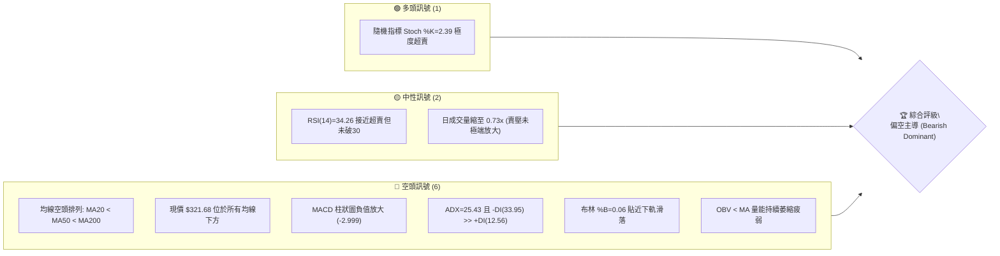
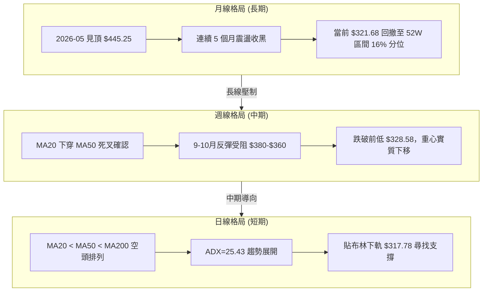
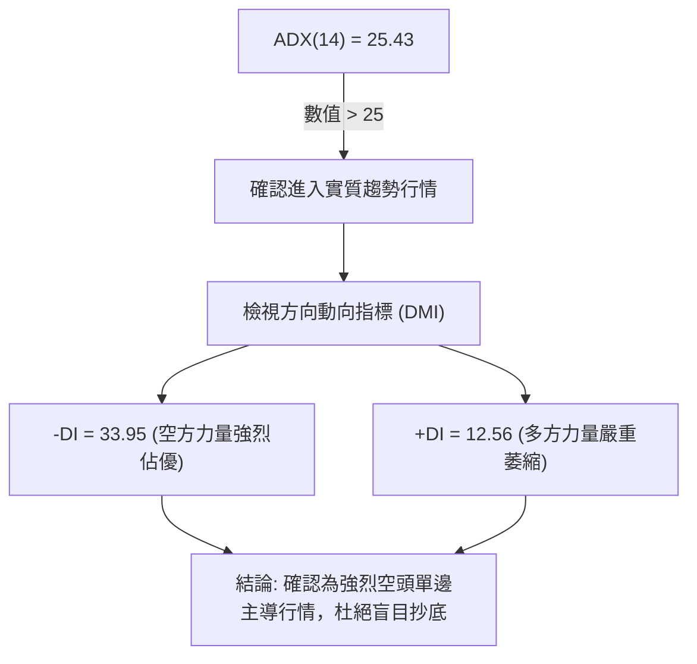
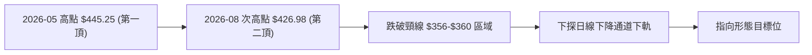
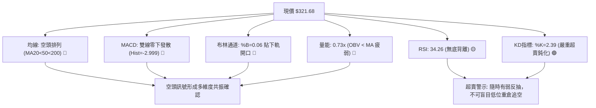
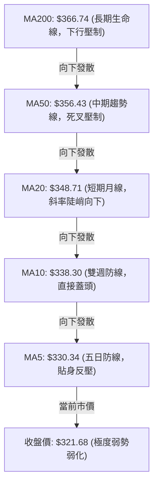
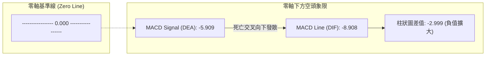
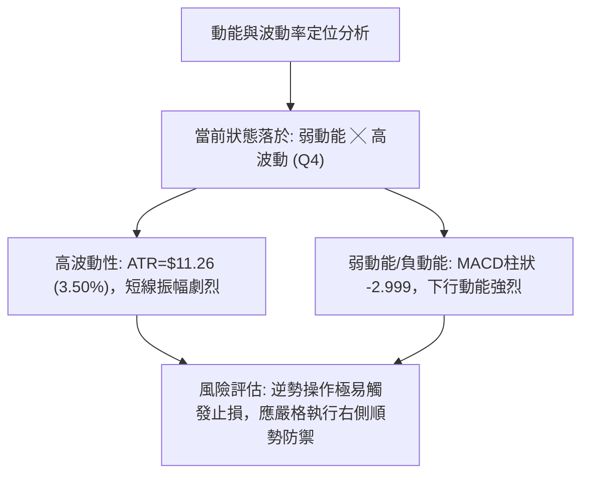
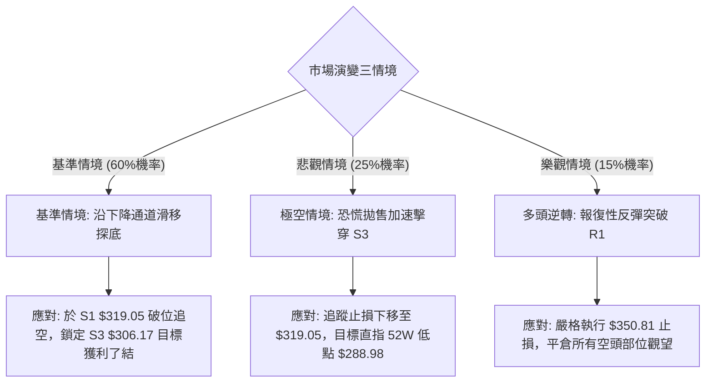

# AVGO 技術分析報告

> **報告日期**：2026-10-25 ｜ **語言**：繁體中文 ｜ **數據來源**：Yahoo Finance ｜ **當前價格**：$321.68

---

## 目錄

| 章節 | 內容 |
|------|------|
| [1. 技術面概覽](#1-技術面概覽) | 訊號儀表板、核心指標速覽表、技術評分卡 |
| [2. 趨勢分析](#2-趨勢分析) | 多時框趨勢遞進、12個月月線走勢圖、週線與 ADX 強度解讀 |
| [3. 圖表形態分析](#3-圖表形態分析) | 形態識別與信心度、日/週 K 線組合解讀、ASCII 形態示意與目標價推算 |
| [4. 支撐與阻力](#4-支撐與阻力) | 關鍵價位分布圖、阻力位與支撐位聚類分析、斐波那契回調結構 |
| [5. 技術指標深度解讀](#5-技術指標深度解讀) | 均線系統空頭排列、RSI 與 MACD 背離驗證、布林通道與量能 OBV |
| [6. 動能與波動率](#6-動能與波動率) | 動能四象限定位、ATR 波動率與止損量化、Beta 係數與大盤連動 |
| [7. 多時框架總結](#7-多時框架總結) | 時框架評分矩陣、多空訊號收斂規則與唯一方向性結論 |
| [8. 交易策略建議](#8-交易策略建議) | 決策路由分流、價格情境階梯、主推空頭策略詳情與避險觸發點 |
| [9. 風險提示與監控](#9-風險提示與監控) | 關鍵指標監控清單、三情境壓力測試、倉位與風控管理準則 |

---

## 1. 技術面概覽

### 🎯 技術訊號儀表板

Broadcom Inc. (AVGO) 當前技術結構呈現**中長期均線壓制下的強勢空頭趨勢**。短期價格自 2026 年 5 月高點 $445.25 持續震盪走低，目前日線跌破所有短中長期移動平均線，且布林通道帶寬維持向下發散態勢。雖然隨機指標 (Stochastics) 進入極度超賣區，但在 ADX 確認趨勢強度充足的前提下，指標超賣鈍化特徵顯著，未出現實質性多頭反轉結構。



---

### 📊 核心指標速覽表

| 指標類別 | 指標名稱 | 當前數值 | 訊號 | 專業技術解讀 |
| :--- | :--- | :--- | :---: | :--- |
| **價格結構** | 收盤價 | $321.68 | 🔴 | 位於 52 週區間 ($288.98 - $493.32) 的 16.0% 分位，弱勢探底 |
| **短期均線** | MA20 | $348.71 | 🔴 | 現價低於 MA20 達 -7.75%，斜率向下，短線第一道動態強阻力 |
| **中期均線** | MA50 | $356.43 | 🔴 | 現價低於 MA50，MA20 下穿 MA50 形成死亡交叉，中期空方主控 |
| **長期均線** | MA200 | $366.74 | 🔴 | 現價低於 MA200，失守牛熊分界線，長期趨勢轉入防禦修正期 |
| **動能指標** | RSI (14) | 34.26 | 🟡 | 弱勢偏空格局；未出現明確底背離，下行動能尚未耗盡 |
| **趨勢動能** | MACD (12,26,9) | -8.908 / -5.909 | 🔴 | DIF 與 DEA 雙雙於零軸下方發散，Histogram 為 -2.999 綠柱延伸 |
| **振盪指標** | Stoch %K / %D | 2.39 / 7.92 | 🟢 | 進入極度超賣區間 (<20)，存在技術性反抽需求，但需防鈍化 |
| **趨勢強度** | ADX (14) | 25.43 | 🔴 | ADX > 25 確認進入趨勢行情；-DI (33.95) 強勢壓制 +DI (12.56) |
| **通道指標** | 布林通道 | 下軌 $317.78 | 🔴 | %B = 0.06，價格緊貼布林下軌運行，通道開口向下擴張 |
| **量能系統** | 成交量 / OBV | 15.87M (0.73x) | 🔴 | OBV 低於移動平均線，量價配合呈「價跌量縮、反彈無量」弱勢特徵 |
| **波動率** | ATR (14) | $11.26 | 🟡 | 佔現價 3.50%，日內波動幅度較大，持倉需設定足夠安全邊際 |

---

### 🏆 技術評分卡

依照六大技術面向進行客觀量化評估，依據嚴格規則計算算術平均：

```
╔══════════════════════════════════════════════════════════════╗
║               技術評分卡 — AVGO (2026-10-25)                 ║
╠══════════════════════════════════════════════════════════════╣
║ 趨勢強度 (ADX/-DI)   █████░░░░░░░░░░░░░░░  25/100  🔴 空頭強勢║
║ 動能指標 (RSI/MACD)  ██████░░░░░░░░░░░░░░  28/100  🔴 動能低迷║
║ 支撐穩定度 (S1/下軌) ████████░░░░░░░░░░░░  38/100  🟡 臨近防線║
║ 成交量配合 (OBV/均量)██████░░░░░░░░░░░░░░  30/100  🔴 量能疲弱║
║ 形態完整度 (破位通道)█████░░░░░░░░░░░░░░░  24/100  🔴 破位下行║
║ 均線排列 (空頭發散)  ███░░░░░░░░░░░░░░░░░  17/100  🔴 徹底空頭║
╠══════════════════════════════════════════════════════════════╣
║ 綜合評分             █████░░░░░░░░░░░░░░░  27/100  🔴 強烈偏空║
║ 評分規則：(25 + 28 + 38 + 30 + 24 + 17) ÷ 6 = 27.0 (四捨五入)║
╚══════════════════════════════════════════════════════════════╝
```

---

## 2. 趨勢分析

### 🌐 多時框趨勢分析

AVGO 在多重時框架中呈現「長週期見頂回落、中週期波段走低、短週期加速觸底」的層層傳導態勢。月線級別自 2026 年 5 月創下歷史高點後展開中級調整；週線級別跌破前波震盪平台；日線級別則受制於 5 日與 10 日均線壓制，空方掌控力極高。



---

### 📈 長期趨勢 — 12個月走勢圖（Unicode）

以下為 AVGO 過去 12 個月（2025-11 至 2026-10）之月線收盤價格軌跡與關鍵拐點示意圖：

```
AVGO 月線走勢圖（過去12個月，2025-11 至 2026-10）
價格軸 ($)
$450 ┤                                      ● $445.25 (2026-05 峰值)
$430 ┤                                ╱  ╲
$410 ┤                          ● $416.01  ╲
$390 ┤  ● $399.99 (2025-11)                   ╲        ● $388.57
$370 ┤    ╲                                    ● $377.06  ╲     ● $369.67
$350 ┤      ● $344.20                                       ╲     ╲   ● $351.19
$330 ┤        ╲   ● $329.48                                  ╲     ╲     ╲
$310 ┤         ╲    ╲    ● $317.80  ● $308.46 (2026-03 築底)    ╲     ╲     ● $321.68 (當前)
     └────┬─────┬─────┬─────┬─────┬─────┬─────┬─────┬─────┬─────┬─────┬─────┘
       2025  2025  2026  2026  2026  2026  2026  2026  2026  2026  2026  2026
        -11   -12   -01   -02   -03   -04   -05   -06   -07   -08   -09   -10
```

#### 走勢特徵分析表格

| 階段區間 | 起止價格 | 漲跌幅 | 趨勢特徵與形態解讀 |
| :--- | :--- | :---: | :--- |
| **第一階段：見頂回落**<br>(2025-11 ~ 2026-03) | $399.99 → $308.46 | **-22.88%** | 自高位快速回吐，多頭獲利了結，於 $308.46 獲得年線上方波段支撐 |
| **第二階段：主升衝頂**<br>(2026-03 ~ 2026-05) | $308.46 → $445.25 | **+44.35%** | 雙月拉升逾 44%，量能激增形成吹頂 (Blow-off Top) 行情 |
| **第三階段：頭部破位**<br>(2026-05 ~ 2026-08) | $445.25 → $369.67 | **-16.97%** | 6 月重挫至 $377.06，7 月假突破反彈至 $388.57 後再度反轉走低 |
| **第四階段：加速尋底**<br>(2026-08 ~ 2026-10) | $369.67 → $321.68 | **-12.98%** | 跌破 8 月與 9 月盤整平台，均線全面轉為向下發散，考驗前低防線 |

---

### 📊 中期趨勢（週線分析）

從近 20 週的收盤價與動能變化觀察，週線結構已確認「雙重頂部破位」的延續階段。8 月初反彈高點 $426.98 構成顯著的次級高點（Lower High），隨後週線 MACD 柱狀圖在經歷短暫反抽後重新翻綠，最新一週（2026-10-23）MACD 柱狀圖擴大至 -2.999，且週 RSI 跌至 34.3，確認中期趨勢掌握在空方手中。

```
週線級別價格壓力與支撐階梯示意：
$380.84 ┬────────────────────────────────────────── 10/09 週線反彈高點 (強阻力區)
         │
$361.54 ┼────────────────────────────────────────── 10/09 週收盤價 (破位頸線阻力)
         │  ▼ 賣壓主導區間
$341.10 ┼────────────────────────────────────────── 10/23 週最高價
         │
$321.68 ┼─ ◄ 當前週收盤位置 (逼近下軌)
         │  ▲ 多方防守區間
$319.05 ┴────────────────────────────────────────── 波段低點支撐聚類 S1
```

---

### ⚡ 趨勢強度評估（ADX 解讀）

當前日線 ADX(14) 讀數為 **25.43**，數值突破 25 臨界線，技術上明確定義為「**強趨勢行情 (Trending Market)**」，而非無趨勢的區間震盪（Trading Range）。



#### ADX 強度指標對照解析

| 指標變數 | 當前數值 | 臨界門檻 | 狀態判斷 | 交易指引含義 |
| :--- | :---: | :---: | :---: | :--- |
| **ADX (14)** | **25.43** | 25.00 | 🟢 趨勢成立 | 趨勢跟隨策略（Trend Following）有效，逆勢交易風險極高 |
| **-DI (14)** | **33.95** | 25.00 | 🔴 空方強勢 | 賣盤具有持續推動價格下行的動能，下檔仍有慣性釋放空間 |
| **+DI (14)** | **12.56** | 20.00 | 🔴 多方衰竭 | 買盤極度匱乏，多頭反抗力道薄弱，任何反彈均屬弱勢修正 |
| **DI 差值值** | **-21.39** | 0.00 | 🔴 顯著發散 | 空方優勢未見收斂跡象，需防範加速趕底行情出現 |

---

## 3. 圖表形態分析

### 🔍 形態識別系統

在多週期圖表中，AVGO 當前呈現由大週期「雙重頂部破位」過渡至日線級別「下降平行通道」與「階梯式下跌旗形」的複合空頭幾何形態。



#### 圖表形態信心度與目標價評估表

依據嚴格規則 15，各圖表形態必須標注信心度百分比與嚴謹數據依據，未具備足夠依據者不強行畫圖：

| 形態名稱 | 信心度 | 判斷依據（嚴格引用數據） | 完成度 | 目標價（附嚴謹計算式） |
| :--- | :---: | :--- | :---: | :--- |
| **中期雙重頂**<br>(Double Top) | **85%** | 峰值一為 2026-05 收盤 $445.25，峰值二為 2026-08-07 週收盤 $426.98；跌破 2026-09-25 週低點頸線 $346.89 | **90%** | 頸線 $346.89 − (形態高度: $426.98 − $346.89 = $80.09) = **$266.80**（中長期推算） |
| **日線階梯熊旗**<br>(Bear Flag) | **75%** | 10/16 大黑K跌破 $334.61 旗面下緣，10/19-10/21 三日於 $330.80-$341.10 弱勢反抽確認阻力 | **80%** | 旗桿起跌點 $359.43 至旗底 $328.58 (高度 $30.85)；反彈高點 $339.24 − $30.85 = **$308.39** (臨近 S3 $306.17) |
| **潛在雙重底**<br>(Double Bottom) | **25%** | 訊號不足，僅做指標型解讀。現價 $321.68 距 52W 低點 $288.98 尚有距離，缺乏右底反轉 K 線結構 | **10%** | 條件不成立，暫不推算多頭目標價 |

---

### 🕯️ 重要 K 線形態分析

嚴格依據提供的「近 10 根日 K」與「近 8 根週 K」真實 OHLCV 數據進行微觀 K 線力道拆解：

#### 近 10 根日 K 棒形態解讀

| 日期 (日K) | 開盤價 | 最高價 | 最低價 | 收盤價 | 成交量 | K 線形態名稱 | 技術解讀與多空力量評估 | 訊號 |
| :---: | :---: | :---: | :---: | :---: | :---: | :---: | :--- | :---: |
| **2026-10-12** | 359.43 | 360.69 | 354.22 | 354.73 | 16,336,800 | 倒垂小黑 K | 衝高 $360.69 遇阻回落，實體收於下半部，多頭無力護盤 | 🔴 |
| **2026-10-13** | 349.60 | 359.25 | 348.11 | 357.31 | 17,266,700 | 低開長陽線 | 低開反彈近 $8，收復前日跌幅，但量能未放大，屬死貓跳 | 🟡 |
| **2026-10-14** | 352.19 | 354.25 | 342.82 | 346.25 | 23,127,400 | 中陰破位線 | 帶量長黑摜破 $350 整數關卡，形成空頭吞噬特徵 | 🔴 |
| **2026-10-15** | 338.34 | 344.70 | 334.61 | 344.33 | 28,455,800 | 爆量下影陽 | 放量至 28.45M，探底 $334.61 後拉回，顯示逢低有承接盤防守 | 🟡 |
| **2026-10-16** | 338.48 | 339.59 | 328.58 | 328.75 | 29,839,600 | 光腳大黑 K | 爆量長黑跌破前日下影線低點，收於全日最低，恐慌殺盤確立 | 🔴 |
| **2026-10-19** | 338.75 | 340.20 | 333.82 | 334.59 | 17,457,600 | 縮量陰十字 | 跳空低開震盪，反彈無量，實體狹小，多空拉鋸轉弱 | 🔴 |
| **2026-10-20** | 334.00 | 341.10 | 330.80 | 334.37 | 15,951,800 | 長上影紡錘 | 盤中拉升至 $341.10 隨即遭空方打回，顯示上方逢高解套賣壓沉重 | 🔴 |
| **2026-10-21** | 338.03 | 339.24 | 332.29 | 337.80 | 17,123,600 | 弱勢小陽星 | 窄幅整理，高點未能突破前日 $341.10，典型下跌中繼整理 | 🟡 |
| **2026-10-22** | 326.53 | 330.82 | 321.02 | 323.24 | 28,139,100 | 跳空下殺陰 | 跳空低開逾 $11，盤中重挫至 $321.02，破位加速特徵 | 🔴 |
| **2026-10-23** | 321.50 | 327.70 | 320.23 | 321.68 | 15,871,100 | 低位十字小陽 | 縮量企圖於 $320 築底，但反彈受制於 $327.70，暫作超賣抵抗 | 🟡 |

#### 近 8 根週 K 棒形態解讀

| 日期 (週K) | 開盤價 | 最高價 | 最低價 | 收盤價 | 週成交量 | K 線形態與中期結構意義 | 訊號 |
| :---: | :---: | :---: | :---: | :---: | :---: | :--- | :---: |
| **2026-09-04** | 368.85 | 372.07 | 341.71 | 357.25 | 173,217,400 | 長下影爆量黑 K：下探 $341.71 觸發強彈，週成交量達 1.73 億股 | 🟡 |
| **2026-09-11** | 363.02 | 372.02 | 357.10 | 361.33 | 101,544,300 | 縮量反彈小陽：受阻於 $372.02，量能明顯萎縮，多頭後繼乏力 | 🟡 |
| **2026-09-18** | 348.99 | 362.62 | 335.20 | 356.96 | 149,021,600 | 探底長下影紅：低探 $335.20 獲買盤支撐，收復部分跌幅 | 🟡 |
| **2026-09-25** | 358.66 | 366.55 | 346.89 | 352.81 | 107,643,000 | 遇阻回落小黑：高點不過前週，週線波段高點持續下移 | 🔴 |
| **2026-10-02** | 352.87 | 361.86 | 343.29 | 355.14 | 109,689,700 | 窄幅震盪十字：於 $355 附近多空平衡，等待方向選擇 | 🟡 |
| **2026-10-09** | 357.79 | 380.84 | 356.14 | 361.54 | 114,351,000 | 長上影倒垂線：衝高 $380.84 遭空頭迎頭痛擊，確立階段性頂部 | 🔴 |
| **2026-10-16** | 359.43 | 360.69 | 328.58 | 328.75 | 115,026,300 | 光腳中長黑 K：失守前四週所有低點，收盤跌破 $330，空頭實質突破 | 🔴 |
| **2026-10-23** | 338.75 | 341.10 | 320.23 | 321.68 | 94,543,200 | 破位下挫小黑：低見 $320.23，週線連續兩週長黑重挫，空方全面主控 | 🔴 |

---

### 📉 ASCII 走勢形態示意圖

下圖呈現 10 月中旬 AVGO 自 $360 高點破位展開的「下跌旗形 (Bear Flag)」幾何走勢：

```
AVGO 日線破位與熊旗形態示意圖
價格軸
$360 ┤   [旗桿起跌點 10/12 $360.69]
     │   ╲
$350 ┤    ╲  10/14 帶量長陰
     │     ╲
$340 ┤      ╲         ┌─── 10/20 反抽旗面上緣 $341.10
     │       ╲   ╱╲  ╱ ╲
$330 ┤        ╲ ╱  ╲╱   [旗面破位點 10/22]
     │         ● 10/16 旗底 $328.58 ╲
$320 ┤                                ╲  ● 10/23 探底 $320.23 (收 $321.68)
     │                                 ▼
$310 ┤                                  指向測幅目標 S3 $306.17
     └──────────────────────────────────────────────────────────
```

---

### 🎯 形態目標價計算

根據嚴格的古典技術分析測幅法（Measured Move），下跌旗形的量度跌幅如下：

1. **旗桿高度 (H1)** = 旗桿頂點 ($359.43，10/12 開盤) − 旗底低點 ($328.58，10/16 低點) = **$30.85**
2. **旗面反抽高點 (P)** = **$339.24** (10/21 反彈高點) 或最高觸及之 $341.10
3. **測幅下行目標 (T)** = 反抽高點 $339.24 − 旗桿高度 $30.85 = **$308.39**
4. **目標價與支撐驗證**：計算所得之 $308.39 極度貼近數據中計算之波段支撐 **S3 $306.17**，兩者形成高信心度之形態共振目標區間。

---

## 4. 支撐與阻力

### 🗺️ 關鍵價位分布圖（Unicode）

嚴格依據數據中「關鍵價位（由 OHLCV 計算）」與「斐波那契回調」區塊繪製精確的價位空間結構：

```
AVGO 價位結構分布圖 (OHLCV 聚類與斐波那契映射)
═══════════════════════════════════════════════════════════════════
$367.03 ║████████████████████████████████║ 斐波那契 61.8% / MA200 重合區
$358.10 ║████████████████████████        ║ 強阻力 R3 (波段高點聚類)
$350.81 ║████████████████                ║ 阻力 R2 (反彈解套賣壓密集區)
$338.13 ║████████████                    ║ 關鍵阻力 R1 (10/21高點 / 下跌中繼平台)
$332.71 ║▓▓▓▓▓▓▓▓▓▓                      ║ 斐波那契 78.6% 回調位 (破位轉阻力)
╠═══════╬════════════════════════════════╣ ◄ 現價 $321.68 (逼近下軌與 S1)
$319.05 ║▓▓▓▓▓▓▓▓▓▓                      ║ 近期關鍵支撐 S1 (波段低點聚類，-0.82%)
$312.39 ║████████████                    ║ 次級防守支撐 S2 (波段低點聚類，-2.89%)
$306.17 ║████████████████                ║ 強支撐 S3 (熊旗測幅共振區，-4.82%)
$288.98 ║████████████████████████████████║ 52週絕對低點 / 斐波那契 100.0% 終極防線
═══════════════════════════════════════════════════════════════════
```

---

### 🚧 阻力位分析表

所有數值均嚴格引用自數據模組提供之波段高點聚類：

| 阻力級別 | 精確價位 | 距現價空間 | 形成技術原因與密集群特徵 | 突破難度評估 | 重要性等級 |
| :---: | :---: | :---: | :--- | :---: | :---: |
| **R1** | **$338.13** | **+5.11%** | 10/19-10/21 日線整理平台上緣；近一週多頭反抽高點聚集處 | 🟡 中等 (需 25M 以上量能配合) | ★★★☆☆ |
| **R2** | **$350.81** | **+9.05%** | $350 整數心理關卡；10/14 大陰線起跌點與 MA20 ($348.71) 反壓 | 🔴 極高 (受制向下發散均線) | ★★★★☆ |
| **R3** | **$358.10** | **+11.32%** | 10/12-10/13 箱體頂部；MA50 ($356.43) 與近一年多次波段反轉高點 | 🔴 極難 (中期空頭防禦大本營) | ★★★★★ |

---

### 🛡️ 支撐位分析表

所有數值均嚴格引用自數據模組提供之波段低點聚類：

| 支撐級別 | 精確價位 | 距現價空間 | 形成技術原因與密集群特徵 | 守住機率評估 | 重要性等級 |
| :---: | :---: | :---: | :--- | :---: | :---: |
| **S1** | **$319.05** | **-0.82%** | 近日波段低點密集區；臨近 10/23 低點 $320.23 與布林下軌 $317.78 | 🔴 35% (空頭強勢下易遭下破) | ★★★☆☆ |
| **S2** | **$312.39** | **-2.89%** | 近一年次級波動低點聚類；整數心理關卡上方承接買盤 | 🟡 50% (可能引發技術性抵抗) | ★★★★☆ |
| **S3** | **$306.17** | **-4.82%** | 2026-03 波段底部 $308.46 延伸區域；熊旗形態向下測幅完美落點 | 🟢 65% (極具性價比的超賣反彈位) | ★★★★★ |

---

### 📐 斐波那契回調位分析

以 52 週完整波動區間（低點 **$288.98** → 高點 **$493.32**，垂直落差 $204.34）展開回調分析，數據中提供的精確回調位如下：

| 斐波那契比例 | 精確價位 | 當前相對位置與技術意義解讀 |
| :---: | :---: | :--- |
| **0.0% (52W High)** | **$493.32** | 歷史極值高點，長期上升浪頂峰 |
| **23.6%** | **$445.09** | 2026-05 月線收盤 ($445.25) 共振阻力，第一道深幅回撤防線 |
| **38.2%** | **$415.26** | 2026-04 月線收盤 ($416.01) 支撐，失守後宣告中級調整擴大 |
| **50.0%** | **$391.15** | 多空盛衰中軸，2025-11 高點與 2026-07 收盤均聚集於此 |
| **61.8%** | **$367.03** | 黃金分割防禦位；與 MA200 ($366.74) 形成完美共振，失守確認轉熊 |
| **78.6%** | **$332.71** | **關鍵破位位**：前波深幅回調極限防守位，現已實質跌破轉為強阻力 |
| **100.0% (52W Low)**| **$288.98** | 52 週絕對低點，若空頭趨勢不改，此處為終極週期測試目標 |

> **回調位結構總結**：現價 **$321.68** 處於 **78.6% 回調位 ($332.71)** 與 **100.0% 終極低點 ($288.98)** 之間的「無防守滑行區間」。跌破 78.6% 意味著過去一年的整輪牛市上漲結構已遭到 80% 以上的回吐，技術上屬於極度衰退弱勢結構，在重新站回 $332.71 之前，下探 100% 基準點 $288.98 的磁吸效應將持續存在。

---

## 5. 技術指標深度解讀

### 🎛️ 指標訊號總覽



---

### 📈 移動平均線排列分析

AVGO 當前均線系統呈現教科書式的**完全發散空頭排列**。所有長短週期移動平均線全數向下彎頭，價格依序壓制於所有均線下方，顯示各時期的持倉籌碼均處於全面套牢狀態。



#### 移動平均線數據對照表

| 均線名稱 | 當前價格 | 與現價乖離 | 20日走勢形態軌跡特徵 | 訊號評級 |
| :---: | :---: | :---: | :--- | :---: |
| **MA 5** | $330.34 | -2.62% | ▇▆▄▄▄▄▆▆▆▆▆▅▅▅▅▆▆████▇▆▅▄▃▂▂▁▁ (加速下墜) | 🔴 極空 |
| **MA 10** | $338.30 | -4.91% | █▇▆▆▆▆▆▆▅▅▅▆▆▆▆▆▆▇▇█████▇▆▄▃▂▁ (平滑下彎) | 🔴 極空 |
| **MA 20** | $348.71 | -7.75% | █▇▆▆▆▅▆▆▅▅▅▄▄▃▃▃▃▄▄▄▄▄▅▅▄▃▂▂▁▁ (破位向下) | 🔴 空頭 |
| **MA 50** | $356.43 | -9.75% | 與 MA20 形成中線死叉，持續發散開口擴大 | 🔴 空頭 |
| **MA 60** | $365.87 | -12.08% | ██▇▇▇▇▇▇▆▆▆▆▆▆▅▅▅▅▄▄▄▄▄▃▃▂▂▁▁▁ (穩定走低) | 🔴 空頭 |
| **MA 120**| $382.67 | -15.94% | 半年線持續回落，上方累積巨大長期套牢籌碼 | 🔴 空頭 |
| **MA 200**| $366.74 | -12.29% | 價格擊穿年線後無法回抽，長期牛市根基瓦解 | 🔴 空頭 |
| **MA 240**| $365.35 | -11.95% | ▁▁▁▁▂▃▄▄▄▅▅▅▅▅▅▆▇█████▇▆▅▄▄▄▃▂ (長期見頂回落) | 🔴 空頭 |

---

### 📉 RSI(14) 分析

當前 14 日 RSI (Wilder 平滑法) 數值為 **34.26**。

```
RSI(14) 動能進度刻度展示：
0       10      20      30  34.26   50      60      70      80      90     100
├───────┼───────┼───────┼───●───┼───────┼───────┼───────┼───────┼───────┤
[     極度超賣區間     ][  當前弱勢區  ][          多頭主導區間          ]
當前讀數: ███████░░░░░░░░░░░░░░░░░░░░░░░░░ 34.26 (空頭動能牢牢掌控)
```

- **區間評估**：RSI 雖低於 50 中軸且逼近 30 門檻，但**尚未正式觸及 30 以下之極端超賣區**，顯示下行空頭動能仍具備釋放餘裕，非立即見底之特徵。
- **背離判斷結論**：
  - **頂背離**：無（已於 2026 年 8 月高點出現並兌現完畢）。
  - **底背離**：嚴格依據 20 根 K 棒的首尾價格與指標比對，價格自 10/12 的 $354.73 下跌至 10/23 的 $321.68（破底），RSI 則同步自 40+ 下滑至 34.26（同步創低）。**明確結論：當前不存在任何底背離現象**，指標真實反映跌勢，破底反轉訊號未確立。

---

### 📊 MACD (12, 26, 9) 訊號解讀

- **DIF 線**：-8.908
- **DEA 信號線**：-5.909
- **MACD 柱狀圖 (Histogram)**：**-2.999**



- **深度解讀**：DIF 遠落於 DEA 之下，且雙線皆深處於零軸下方（代表中長線空頭市場）。MACD Histogram 最新數值為 **-2.999**，相較於前一週（-1.993）綠柱再度顯著向下放大，技術上稱為「**空頭加速浪**」，證實賣壓動能正在擴散，尚未出現雙線走平金叉之初階築底跡象。

---

### 📦 布林通道分析

布林通道參數為 20 日移動平均線搭配 2 倍標準差，當前各軌道數值精確如下：

```
AVGO 布林通道軌道與價格位置分布圖
$379.64 ┬────────────────────────────────────────── 布林上軌 (通道頂部阻力)
         │
         │  帶寬開口向下擴張 (帶寬 = $61.86)
         │
$348.71 ┼────────────────────────────────────────── 布林中軌 (MA20，首要趨勢壓力)
         │
         │  價格貼軌運行弱勢帶
         │
$321.68 ┼─ ◄ 現價 (極度偏離中軌，%B = 0.06)
         │
$317.78 ┴────────────────────────────────────────── 布林下軌 (短期通道支撐防線)
```

- **%B 讀數**：**0.06**（介於 0 與 1 之間，0 代表剛好觸及下軌，0.5 為中軌）。當前數值 0.06 意味著價格已經極度貼近下軌邊緣。
- **通道走勢**：中軌（MA20）斜率負值甚大，帶寬開口維持向下張開，形態上呈現「**沿下軌滑移 (Walking the lower band)**」的高難度單邊空頭形態，此種狀態下下軌失去彈性支撐效果，容易轉化為順勢推動指標。

---

### 💹 成交量分析（量價配合度）

- **最新日成交量**：15,871,100 股
- **20 日均量**：21,680,510 股（量比 **0.73x**）
- **50 日均量**：24,103,674 股
- **能量潮 OBV**：**OBV < MA**，指標持續跌破自身移動平均線。

```
成交量量能柱圖對比：
日成交量 15.87M ░░░░░░░░░░░░░░░░░░░░ (量比: 0.73x) 縮量探底
20日均量 21.68M ▓▓▓▓▓▓▓▓▓▓▓▓▓▓▓▓▓▓▓▓▓▓▓▓▓▓▓
50日均量 24.10M ██████████████████████████████
```

- **量價配合診斷**：
  1. **無量陰跌**：在 10/22 大跌放量至 28.13M 後，10/23 縮量至 15.87M，量比驟降至 0.73x。這種「破位後縮量」並非止跌，而是反映「**缺乏多頭主動買盤承接**」，市場買氣極度渙散。
  2. **OBV 量能背離檢視**：OBV 指標持續受制於均線下方且不斷走低，顯示資金呈現淨流出狀態，未觀察到聰明錢（Smart Money）進場逢低建倉吸籌的足跡。

---

## 6. 動能與波動率

### ⚡ 動能評估四象限

透過交叉分析「動能方向與強度（基於 RSI/MACD）」與「波動率特徵（基於 ATR 與布林帶寬）」，對 AVGO 進行精準定位：



#### 動能與波動評估矩陣

| 象限代號 | 動能狀態 | 波動率狀態 | 當前股票落點 | 戰略評估與操作導向 |
| :---: | :---: | :---: | :---: | :--- |
| **Q1** | 強 (多頭) | 低 (穩定) | — | 最佳趨勢波段持有期 |
| **Q2** | 弱 (偏空) | 低 (收斂) | — | 盤整蓄勢，謹慎觀望 |
| **Q3** | 強 (多頭) | 高 (劇烈) | — | 突破噴發期，高風險高收益 |
| **Q4** | **弱 / 負 (空頭)** | **高 (劇烈)** | **✓ (AVGO落點)** | **空頭加速與高風險震盪期：逆勢抄底勝率極低，操作應以反彈空或空倉觀望為主** |

---

### 📊 ATR 波動率分析

- **ATR(14)** 數值：**$11.26** (Wilder 算法計算，佔現價比例高達 **3.50%**)
- **動態波動解讀**：每日平均真實波幅高達 $11.26，意味著在缺乏大盤單邊推動的情況下，AVGO 日內產生 $10-$15 的上下掃蕩純屬常態。

#### 風險止損距離量化建議表

| 策略類型 | ATR 倍數依據 | 精確止損保護空間 ($) | 實操建議 |
| :--- | :---: | :---: | :--- |
| **短線日內 / 隔夜** | 1.0 × ATR | **$11.26** | 適用於順勢日內交易，若逆勢反彈逾此幅度需果斷離場 |
| **波段擺盪防守** | 1.5 × ATR | **$16.89** | 避開正常盤中雜訊與假突破，波段交易標準過濾幅度 |
| **中期趨勢防守** | 2.0 × ATR | **$22.52** | 防範劇烈軋空洗盤，適合低槓桿中線部位之停損設定 |

---

### 📐 Beta 與市場相關性

- **Beta 係數**：**1.476**（高於科技股平均，具備顯著高 Beta 屬性）
- **市場連動分析**：
  1. **放大效應**：當標普 500 指數或費城半導體指數下跌 1% 時，AVGO 理論預期下跌約 1.48%，下行波動具有放大傾向。
  2. **弱勢特徵**：在當前大盤科技板塊高位震盪背景下，AVGO 的 52 週位置僅處於 16% 分位，顯示其嚴重落後於大盤指數（Relative Weakness 顯著），技術面失去領頭羊地位，資金外流至其他強勢標的。

---

## 7. 多時框架總結

### 📋 時框架評分表

依據各時框獨立技術數據進行評分，全方位檢視多空週期結構：

| 時框架 | 趨勢方向 | 動能狀態 | 均線排列 | 圖表形態 | 綜合評分 | 戰略建議 |
| :---: | :---: | :---: | :---: | :---: | :---: | :--- |
| **日線 (短期)** | 🔴 下行跌勢 | 弱 (RSI 34.26) | 完全空頭 (MA20<50) | 沿布林下軌滑落熊旗 | **25/100** | 尋找逢高反彈做空機會，杜絕左側接刀 |
| **週線 (中期)** | 🔴 破位下行 | 轉空 (Hist -2.999) | MA20下穿MA50死叉 | 雙重頂破位下行 | **28/100** | 中期調整未完，耐心等待週線級別築底 |
| **月線 (長期)** | 🟡 漲勢回撤 | 衰竭 (自高位收縮)| MA200之上但回調深 | 吹頂後中級回調 | **38/100** | 長期牛市架構受損，下探 $288.98 防線 |

---

### 🔲 綜合訊號矩陣

| 維度 | 短期 (日線) | 中期 (週線) | 長期 (月線) | 週期共振評估 |
| :--- | :---: | :---: | :---: | :--- |
| **均線系統** | 🔴 空頭排列 | 🔴 死叉下彎 | 🟡 跌向年線 | 短中週期空頭高度共振，長週期防線告急 |
| **動能趨勢** | 🔴 MACD擴大 | 🔴 MACD翻綠 | 🟡 RSI高位回落 | 動能由上至下全面向空方傾斜 |
| **關鍵位階** | 🔴 跌破 S1邊緣 | 🔴 跌破 $330頸線 | 🔴 跌破 78.6% 回調位 | 關鍵支撐逐層崩塌，多頭防線步步後撤 |

---

### ⚖️ 多時框收斂結論

> **依嚴格規則 14 執行多時框收斂**：
>
> 1. **行情屬性判定**：當前日線 ADX(14) 讀數為 **25.43**（明確滿足 **ADX > 25** 之強趨勢行情定義）。
> 2. **優先級收斂原則**：在強趨勢行情下，交易邏輯**必須以中長期（週線 / MA50 / MA200）方向為主導**，日線級別指標僅用作捕捉順應中長期方向的最佳進場與風控時機。
> 3. **衝突化解與方向收斂**：
>    - 日線 Stoch %K(2.39) 出現之極度超賣與布林下軌貼近，屬於「**強趨勢下的指標超賣鈍化**」，不可作為逆勢做多的理由；週線級別雙重頂破位（目標直指 $308-$266）與 MA200 壓制才是核心驅動力。
> 4. **唯一方向性結論**：**強烈偏空（Bearish Dominant）**。技術面唯一順勢邏輯為「**順應週線與日線共振趨勢，以反彈尋求阻力位放空，或跌破關鍵支撐順勢追空為主**」，堅決不進行任何左側盲目抄底操作。

---

## 8. 交易策略建議

### 🗺️ 策略決策流程圖

```mermaid
graph TD
    START["當前價格: $321.68 (綜合評分: 27/100)"] --> ROUTE{"策略路由決策"}
    ROUTE -->|"評分 <= 40 (強烈偏空)"| BEAR_BIAS["鎖定空頭主策略 (Short Focus)"]
    
    BEAR_BIAS --> COND1{"行情發展路徑分支"}
    COND1 -->|"路徑 A: 向上反彈超賣修正"| STRAT_A["策略 A: R1 阻力位反彈遇阻做空"]
    COND1 -->|"路徑 B: 直接向下摜破防線"| STRAT_B["策略 B: S1 支撐實質跌破順勢追空"]
    
    STRAT_A --> EX_A["進場: $338.13 |" 止損: $350.81 "| 目標: $319.05 / $312.39"]
    STRAT_B --> EX_B["進場: $319.05 |" 止損: $327.70 "| 目標: $306.17 / $288.98"]
```

---

### 🧭 策略路由（依評分卡分流）

依據第 1 章技術評分卡之**綜合評分 27/100 (≤40)**，執行嚴格的策略路由規則：
**當前主策略方向 = 空頭主推策略（依評分 27/100）**。
報告將主推兩套嚴謹的做空戰術（反彈遇阻做空與破位追空），多頭方向僅列為反轉風險觸發點（對沖提示），不進行雙向模糊下注。

---

### 🎯 價格情境階梯（Price Scenarios）

價位嚴格引用自數據模組計算之精確高低點聚類與斐波那契回調位：

| 觸發條件 | 下一目標 | 後續延伸目標 | 情境技術含義與市場狀態 |
| :--- | :---: | :---: | :--- |
| **強勢突破 R1 $338.13** | **R2 $350.81** | **R3 $358.10** | 短線超賣反抽展開，空頭回補，但仍受制於 MA20/50 壓制 |
| **站穩現價 $321.68 區間** | **$327.70 (10/23高點)** | **R1 $338.13** | 於布林下軌暫時止跌，進入縮量低位橫向震盪整理 |
| **失守跌破 S1 $319.05** | **S2 $312.39** | **S3 $306.17** | 空頭加速探底，下軌開口擴大，尋找熊旗形態測幅目標 |

---

### 📊 情境機率分佈

| 預測情境 | 機率估計 | 主要技術依據（嚴格引用指標狀態） |
| :--- | :---: | :--- |
| **情境一：延續跌勢 / 破位探底** | **60%** | MACD 綠柱放大 (-2.999)、ADX(25.43) 空方主導 (-DI=33.95)、均線完全空頭排列 |
| **情境二：低位區間震盪整理** | **25%** | 日成交量縮至 0.73x、Stoch %K(2.39) 極端超賣產生空頭回補技術抵抗 |
| **情境三：強勢反彈向上突破** | **15%** | 缺乏量能支撐與底背離確認，上方 R1/R2 套牢賣壓沉重，短線反轉機率極低 |

---

### 🟢 主策略詳情（方向：空頭主推）

嚴格按照規則 17 計算風險報酬比：
做空風險報酬比公式 = **(進場價 − 目標價 T1) ÷ (止損價 − 進場價)**

| 策略要素 | 策略 A（反彈遇阻做空 / 右側防守） | 策略 B（破位追空 / 動能突破） |
| :--- | :--- | :--- |
| **策略邏輯** | 趁技術指標極端超賣引發之反彈，於強阻力位建立高性價比空單 | 待價格擊穿前波低點聚類支撐，順應空頭單邊慣性追空 |
| **進場條件** | 價格反彈至 R1 遇阻收上影線，且 15分/60分 K 線出現空頭吞噬 | 價格帶量實質跌破 S1 支撐位（收盤價確認跌破） |
| **進場價格** | **$338.13**（精確引用 R1 阻力位） | **$319.05**（精確引用 S1 支撐位） |
| **目標價 T1** | **$319.05**（精確引用 S1 支撐位） | **$306.17**（精確引用 S3 強支撐位） |
| **目標價 T2** | **$312.39**（精確引用 S2 支撐位） | **$288.98**（精確引用 52W 低點 / 100% 斐波那契） |
| **止損價格** | **$350.81**（精確引用 R2 阻力位上方防禦） | **$327.70**（精確引用 10/23 日 K 高點阻力） |
| **風險報酬比** | **1 : 1.50（以 T1 計）**<br>計算式: ($338.13−$319.05) ÷ ($350.81−$338.13)<br>= $19.08 ÷ $12.68 = 1.5047<br>*(以 T2 計則為 1 : 2.03)* | **1 : 1.49（以 T1 計）**<br>計算式: ($319.05−$306.17) ÷ ($327.70−$319.05)<br>= $12.88 ÷ $8.65 = 1.4890<br>*(以 T2 計則為 1 : 3.48)* |
| **成功機率** | **65%** | **60%** |
| **建議倉位** | **總資金之 10% - 15%** | **總資金之 8% - 10%** |

---

### 🔴 反向風險觸發點（對沖提示）

若市場出現非預期強勢多頭反轉，以下價位與訊號為推翻主空策略的「**絕對風控警戒線**」，空頭部位必須立即無條件止損或反向建立保護性對沖部位：

1. **關鍵價位失守警報**：
   - 若收盤價強勢突破 **R1 $338.13**，宣告短期下跌旗形宣告失效，短線空單必須減倉過半。
   - 若日線實體陽線強勢站上 **R2 $350.81**（MA20 位置），意味著短期底部構築成功，所有中空策略全數無條件停損出場。
2. **技術訊號翻多觸發**：
   - 日線級別 MACD 柱狀圖由負轉正，且 DIF 上穿 DEA 形成低位「水下金叉」。
   - 日成交量連續兩日放大超過 20 日均量（>21.68M）且均收長實體大陽線。

---

### ⭐ 整體訊號強度評星

```
╔══════════════════════════════════════════════════════════════╗
║                    整體訊號強度評星卡                        ║
╠══════════════════════════════════════════════════════════════╣
║ 做多訊號強度：★☆☆☆☆  (1/5星 — 僅有極度超賣，無底背離)    ║
║ 做空訊號強度：★★★★☆  (4/5星 — 均線與動能空頭高度共振)  ║
║ 整體可信度：  ★★★★☆  (4/5星 — ADX>25 單邊趨勢明確)      ║
╚══════════════════════════════════════════════════════════════╝
```

---

## 9. 風險提示與監控

### ✅ 關鍵監控指標 Checklist

交易員每日盤前盤後必須嚴格核對以下關鍵指標狀態：

```
╔══════════════════════════════════════════════════════════════╗
║             AVGO 交易風控監控清單 (Checklist)                ║
╠══════════════════════════════════════════════════════════════╣
║ [ ] 價格是否跌破 S1 $319.05 (確認空頭加速，觸發策略 B)       ║
║ [ ] 價格是否突破 R1 $338.13 (反彈過強警訊，觸發空單風控)     ║
║ [ ] RSI(14) 是否正式跌入 <30 極端超賣區 (提防軋空反彈)       ║
║ [ ] MACD Histogram 負值是否縮小 (觀察動能衰竭轉折)          ║
║ [ ] 布林 %B 是否自 <0.05 重新折返至 0.20 以上 (脫離軌道滑移) ║
║ [ ] 成交量是否異常放大至 25M 以上且收陽 (主力吸籌反轉警戒)   ║
╚══════════════════════════════════════════════════════════════╝
```

---

### ⚠️ 風險場景分析



---

### 🛡️ 風險管理重要提醒

1. **嚴防超賣引發之「死貓跳（Dead-Cat Bounce）」**：
   - 當前 Stoch %K 低至 2.39，技術上存在隨時出現 1-2 日報復性反抽的可能性。**強烈禁止在現價 $321.68 進行左側重倉追空**，空頭部位的最佳建倉點為「反彈至阻力位 R1 $338.13 遇阻」或「帶量跌破 S1 $319.05 之右側突破確認」。
2. **波動率與部位規模控管**：
   - AVGO 當前 ATR 高達 $11.26（單日波動 3.50%），單筆交易的風險敞口（Risk Exposure）應嚴格限制在總投資組合淨值的 **1.0% 以內**。
   - 部位規模計算公式：`最大允許股數 = (投資組合總值 × 1.0%) ÷ (進場價 − 止損價)`。
3. **大盤系統性風險聯動**：
   - AVGO 具備 1.476 的高 Beta 屬性，若美股三大指數（特別是半導體 SOX 指數）出現整體性流動性抽離或反彈，將放大該股波動，操作時必須緊密觀測標普 500 指數與納斯達克 100 指數之均線位階。

---

## 📋 報告總結

```
╔══════════════════════════════════════════════════════════════╗
║                 AVGO 技術分析報告總結                        ║
╠══════════════════════════════════════════════════════════════╣
║ 報告日期：2026-10-25                                         ║
║ 當前價格：$321.68                                            ║
║ 分析評級：🔴 強烈偏空 / 空頭主導 (綜合評分: 27/100)          ║
╠══════════════════════════════════════════════════════════════╣
║ 關鍵結論：                                                   ║
║ ├─ 長期趨勢：🔴 跌破 78.6% 斐波那契回調位，轉入深幅修正週期  ║
║ ├─ 中期趨勢：🔴 週線雙頂頸線破位，MA20 下穿 MA50 形成死叉   ║
║ ├─ 短期趨勢：🔴 完全空頭排列，ADX(25.43) 確認空頭趨勢展開    ║
║ ├─ 關鍵支撐：S1 $319.05 / S2 $312.39 / S3 $306.17            ║
║ ├─ 關鍵阻力：R1 $338.13 / R2 $350.81 / R3 $358.10            ║
║ └─ 華爾街分析師目標：均值 $529.10 (與當前技術盤面嚴重背離)   ║
╠══════════════════════════════════════════════════════════════╣
║ 最優策略組合：                                               ║
║ 1. 🥇 最佳機會：策略 A (反彈至 R1 $338.13 遇阻做空，風報比 1:1.50)║
║ 2. 🥈 次選機會：策略 B (跌破 S1 $319.05 順勢追空，風報比 1:1.49)║
║ 3. 🥉 保守選擇：空倉觀望，等待日線底背離或企穩 S3 $306.17 再評估║
╚══════════════════════════════════════════════════════════════╝
```

---

> ⚠️ **免責聲明**：本報告為技術分析研究，所有數據、圖表及模型估算均基於歷史價格資訊與嚴格之量化技術指標運算。本報告**僅供研究與學術參考**，**不構成任何要約、招攬或投資建議**。市場具有高度不確定性與波動風險，投資人應獨立評估自身風險承受能力並自負盈虧。

---

*報告生成時間：2026-10-25 ｜ 數據來源：Yahoo Finance ｜ 分析框架：資深多時框技術分析模型*