# AVGO 技術分析報告

> **報告日期**：2026-10-26 ｜ **語言**：繁體中文 ｜ **數據來源**：Yahoo Finance ｜ **當前價格**：$321.68

---

## 目錄

| 章節 | 內容 |
|------|------|
| [1. 技術面概覽](#1-技術面概覽) | 訊號儀表板、核心指標、評分卡 |
| [2. 趨勢分析](#2-趨勢分析) | 多時框趨勢、長中短期走勢 |
| [3. 圖表形態分析](#3-圖表形態分析) | 形態識別、K線組合、目標價 |
| [4. 支撐與阻力](#4-支撐與阻力) | 關鍵價位、斐波那契回調 |
| [5. 技術指標深度解讀](#5-技術指標深度解讀) | MA/RSI/MACD/布林/成交量 |
| [6. 動能與波動率](#6-動能與波動率) | 動能評估、ATR、Beta |
| [7. 多時框架總結](#7-多時框架總結) | 時框架評分矩陣 |
| [8. 交易策略建議](#8-交易策略建議) | 多空策略、風險報酬比 |
| [9. 風險提示與監控](#9-風險提示與監控) | 監控指標、風險場景 |

---

## 1. 技術面概覽

### 🎯 技術訊號儀表板

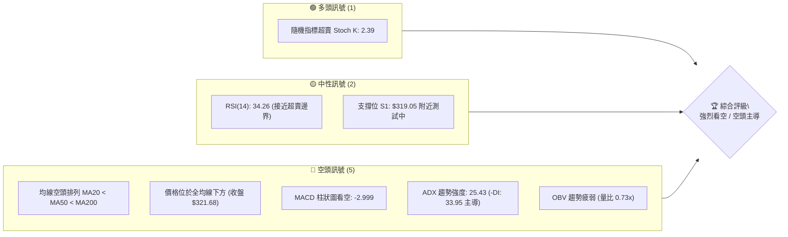

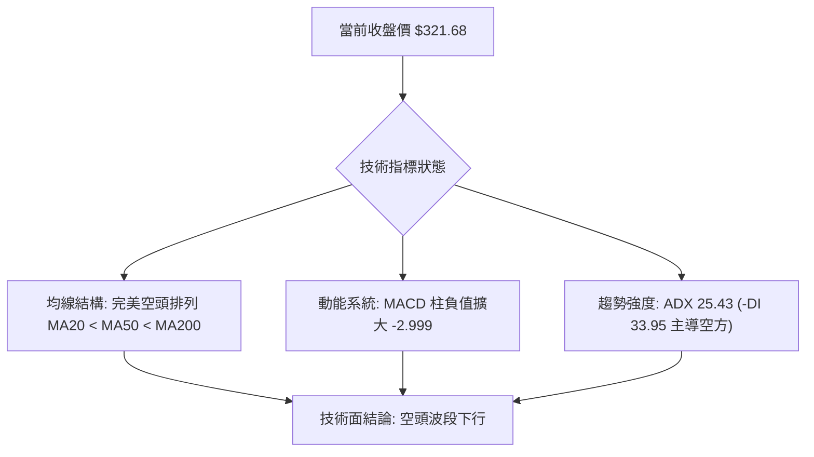

### 📊 核心指標速覽表

| 指標類別 | 指標名稱 | 當前數值 | 訊號 | 解讀 |
|----------|----------|----------|------|------|
| **價格** | 當前價格 | $321.68 | 🔴 | 位於 52 週高低區間 16.0%，逼近波段低點 |
| **均線** | MA20 | $348.71 | 🔴 | 價格低於 MA20 達 -7.75%，短線下行斜率陡峭 |
| **均線** | MA50 | $356.43 | 🔴 | 價格低於 MA50，中期生命線遭跌破並反轉下彎 |
| **均線** | MA200 | $366.74 | 🔴 | 價格低於 MA200，長期多空分水嶺失守 |
| **動能** | RSI(14) | 34.26 | 🟡 | 處於 30–70 中性弱勢區，逼近超賣但尚未形成底背離 |
| **動能** | MACD | -8.908 / -5.909 | 🔴 | DIF 線遠在訊號線下方，柱狀圖 -2.999 綠柱擴大 |
| **波動** | ATR(14) | $11.26 | 🟡 | 佔股價 3.50%，日內波動擴大，風險度偏高 |

### 🏆 技術評分卡

```
╔══════════════════════════════════════════════════════════════╗
║                技術評分卡 — AVGO (2026-10-26)               ║
╠══════════════════════════════════════════════════════════════╣
║ 趨勢強度      ██████░░░░░░░░░░░░░░  30/100  🔴 空頭強勢主導  ║
║ 動能指標      ██████░░░░░░░░░░░░░░  30/100  🔴 動能顯著向下  ║
║ 支撐穩定度    ████████░░░░░░░░░░░░  40/100  🟡 臨近S1考驗    ║
║ 成交量配合    ██████░░░░░░░░░░░░░░  30/100  🔴 價跌無反彈量  ║
║ 形態完整度    ██████░░░░░░░░░░░░░░  30/100  🔴 頂部破位下行  ║
║ 均線排列      ████░░░░░░░░░░░░░░░░  20/100  🔴 完全空頭排列  ║
╠══════════════════════════════════════════════════════════════╣
║ 綜合評分      ██████░░░░░░░░░░░░░░  30/100  🔴 強烈看空      ║
╚══════════════════════════════════════════════════════════════╝
```
*(註：綜合評分由六項子評分 (30+30+40+30+30+20)/6 = 30.0，四捨五入為 30/100，依規則 18 嚴格計算)*

---

## 2. 趨勢分析

### 🌐 多時框趨勢分析

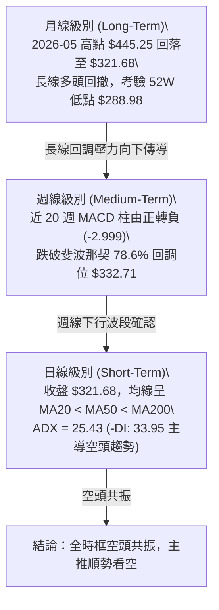

### 📈 長期趨勢 — 12個月走勢圖（Unicode）

```
AVGO 月線走勢圖（2025-11 至 2026-10 過去12個月）
價格軸 ($)
$450 ┤                                  ● $445.25 (2026-05 高點)
$420 ┤                             ● $416.01
$390 ┤● $399.99                                ● $388.57
$360 ┤          ● $344.20                           ● $369.67
$330 ┤              ● $329.48   ● $317.80               ● $351.19
$300 ┤                              ● $308.46               ● $321.68 (當前)
     └───────────────────────────────────────────────────────────────
       11    12    01    02    03    04    05    06    07    08    09    10  (月份)
```

**過去 12 個月走勢特徵分析表格**：

| 時間區間 | 起點價格 | 終點價格 | 區間漲跌幅 | 主要走勢特徵與結構 |
|----------|----------|----------|------------|--------------------|
| 2025-11 ~ 2026-03 | $399.99 | $308.46 | -22.88% | 高位獲利了結，形成第一段中級調整波，在 $308 止跌 |
| 2026-03 ~ 2026-05 | $308.46 | $445.25 | +44.35% | AI 浪潮爆發式反彈，連續創歷史新高逼近 52W 高點 $493.32 |
| 2026-05 ~ 2026-08 | $445.25 | $369.67 | -16.97% | 頭部高檔震盪構築，多空交戰激烈，週量維持高檔 |
| 2026-08 ~ 2026-10 | $369.67 | $321.68 | -12.98% | 破位下行，跌破 MA200 ($366.74)，形成空頭加速破底 |

### 📊 中期趨勢（週線分析）

中期技術面於 2026 年 8 月中旬（$426.98）見波段高點後一路盤跌，週線 K 棒高低點逐級下移（Lower Highs & Lower Lows）。
- **關鍵阻力壓制**：週線級別反彈屢次受制於 $361.54（2026-10-09 週高點）與 MA60（$365.87），多頭反攻無力。
- **支撐測試**：當前週收盤 $321.68 逼近 2026-10-23 當週低點 $320.23，下方直接考驗關鍵波段支撐 S1 $319.05。

```
中期壓力與支撐示意圖 (週線)
   [阻力] R3: $358.10   ════════════════════════════ (近一年高點密集區)
   [阻力] R2: $350.81   ──────────────────────────── (反彈頸線壓制)
   [阻力] R1: $338.13   ┄┄┄┄┄┄┄┄┄┄┄┄┄┄┄┄┄┄┄┄┄┄┄┄ (前週反彈高點)
   [現價] $321.68       ◄── 目前位置 (位於布林下軌 $317.78 附近)
   [支撐] S1: $319.05   ┄┄┄┄┄┄┄┄┄┄┄┄┄┄┄┄┄┄┄┄┄┄┄┄ (波段低點支撐第一道防線)
   [支撐] S2: $312.39   ──────────────────────────── (強支撐緩衝帶)
   [支撐] S3: $306.17   ════════════════════════════ (極限波段低點支撐)
```

### ⚡ 趨勢強度評估（ADX 解讀）

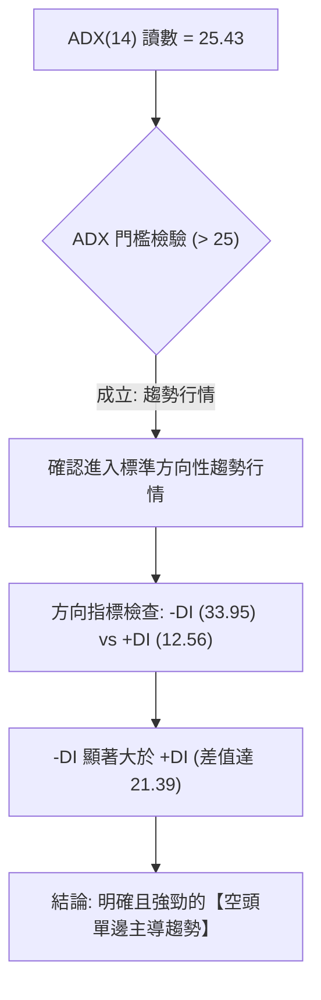

| 指標項目 | 數值 | 門檻區間 | 技術含義解讀 | 趨勢判定 |
|----------|------|----------|--------------|----------|
| **ADX(14)** | 25.43 | > 25.0 | 脫離無方向盤整，進入強趨勢波段 | 趨勢形成 |
| **+DI(14)** | 12.56 | < 20.0 | 多方動能極度渙散，缺乏買盤接力 | 多頭衰竭 |
| **-DI(14)** | 33.95 | > 30.0 | 空方動能完全掌控市場盤面節奏 | 空頭主導 |
| **趨勢綜合** | -DI 主導 | ADX 向上 | 空方趨勢正在加速，反彈均為弱勢結構 | 🔴 強空 |

---

## 3. 圖表形態分析

### 🔍 形態識別系統

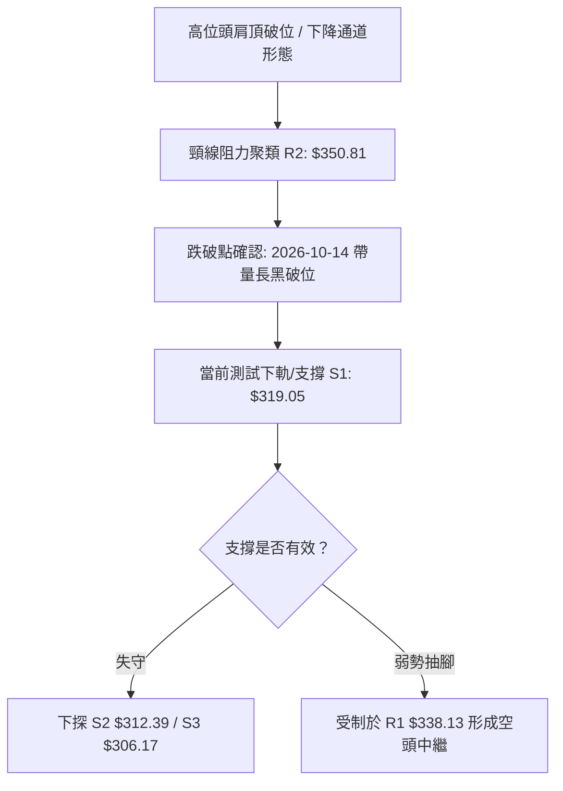

**形態信心度與目標價評估表**（依規則 15）：

| 形態名稱 | 信心度 | 判斷依據（引用數據） | 完成度 | 目標價（附精確計算式） |
|----------|--------|----------------------|--------|------------------------|
| **下降通道 (Descending Channel)** | 75% | 10-09 週高 $380.84 與 10-23 週高 $341.10 形成下降阻力線；低點 10-16 $328.58 與 10-23 $320.23 連線對應下軌 | 85% | 形態高度 = $341.10 - $320.23 = $20.87；由跌破點推算目標約 $306.17 (剛好契合 S3) |
| **頭肩頂破位 (Head & Shoulders)** | 65% | 左肩 2026-07 收盤 $388.57，頭部 2026-08 $426.98，右肩 2026-10-09 $380.84，頸線約在 $350.81 (R2) | 90% | 頸線 $350.81 − 形態垂直高度 ($380.84 - $350.81 = $30.03) = 理論測幅低點 $320.78 (逼近當前收盤 $321.68) |

### 🕯️ 重要 K 線形態分析

依規則 19，完全依據數據中「近 10 根日 K」與「近 8 根週 K」之開高低收進行精確解讀：

| 日期（日K/週K） | 開 | 高 | 低 | 收 | K線形態 | 解讀 | 訊號 |
|------------------|----|----|----|----|---------|------|------|
| **2026-10-14 (日K)** | 352.19 | 354.25 | 342.82 | 346.25 | 大陰線破位 | 開高走低實體達 5.94 元，跌破 MA20 ($348.71)，空方啟動主跌浪 | 🔴 空頭 |
| **2026-10-15 (日K)** | 338.34 | 344.70 | 334.61 | 344.33 | 帶下影線小陽棒 | 成交量放大至 2,845 萬股，逢低有少許承接，但仍受制於前日低點 | 🟡 中性 |
| **2026-10-16 (日K)** | 338.48 | 339.59 | 328.58 | 328.75 | 禿底長黑 K | 收盤幾近全日最低點（收 $328.75，低 $328.58），量能放大至 2,983 萬，極度弱勢 | 🔴 強空 |
| **2026-10-21 (日K)** | 338.03 | 339.24 | 332.29 | 337.80 | 弱勢反彈孕線 | 實體狹窄，高點無法越過前三日高點，量能萎縮至 1,712 萬，反彈無量 | 🟡 觀望 |
| **2026-10-22 (日K)** | 326.53 | 330.82 | 321.02 | 323.24 | 跳空低開長黑 | 跳空開低，實體再度下挫 3.29 元，日成交量放大至 2,813 萬股，空頭續挫 | 🔴 強空 |
| **2026-10-23 (日K)** | 321.50 | 327.70 | 320.23 | 321.68 | 低檔十字星/錘頭待定 | 開收盤幾乎相同（差 0.18 元），量縮至 1,587 萬股，在 S1 前空方暫緩，多方觀望 | 🟡 中性 |
| **2026-10-09 (週K)** | 357.79 | 380.84 | 356.14 | 361.54 | 長上影線流星週K | 上攻 $380.84 後遭遇高檔巨量解套賣壓，收盤跌回 $361.54，右肩確立 | 🔴 空頭 |
| **2026-10-16 (週K)** | 359.43 | 360.69 | 328.58 | 328.75 | 長黑實體週 K | 週跌幅高達 -9.07%，完全吞噬前兩週實體，破位大陰線 | 🔴 強空 |
| **2026-10-23 (週K)** | 338.75 | 341.10 | 320.23 | 321.68 | 續跌黑K帶下影 | 週收盤 $321.68 創近五個月新低，量能縮至 9,454 萬，跌勢未見反轉信號 | 🔴 空頭 |

### 📉 ASCII 走勢形態示意圖

```
AVGO 近期破位形態示意圖 (日線層級)
價格 ($)
$360 ┤   ┌──┐ (10-12/10-13 頂部震盪)
$355 ┤   │  │
$348 ┤───┴──┴─── 頸線 / MA20 ($348.71) ──────────────────────
$340 ┤           ╲   ┌──┐
$335 ┤            ╲  │  │ (10-19 ~ 10-21 弱勢弱整理平臺)
$328 ┤             ╲ └──┘╲
$321 ┤                    ● 當前收盤 $321.68 (逼近 S1: $319.05)
$315 ┤                      ░░░░░░░░░ 下方支撐帶 (S1~S2: $319.05~$312.39)
     └────────────────────────────────────────────────────────
```

### 🎯 形態目標價計算

1. **下降通道下軌量幅目標**：
   - 形態上軌起算點：2026-10-09 週高 $380.84
   - 第一跌波反彈頸線：R1 $338.13
   - 通道震盪垂直振幅：$380.84 - $338.13 = $42.71
   - 自頸線破位延伸目標：$338.13 - ($42.71 × 0.618) = $311.73（高度重合下方強支撐 **S2 $312.39**）
2. **頭肩頂等距測幅 (Measured Move)**：
   - 頸線位置：聚類阻力 R2 $350.81
   - 右肩高點：$380.84
   - 形態高度：$380.84 - $350.81 = $30.03
   - 測幅第一目標價 = 頸線 $350.81 - $30.03 = **$320.78**（當前現價 $321.68 已精確觸及此第一目標價區間）
   - 若空頭動能擴展至 1.382 倍，目標指向：$350.81 - ($30.03 × 1.382) = **$309.31**（指向波段支撐 **S3 $306.17**）

---

## 4. 支撐與阻力

### 🗺️ 關鍵價位分布圖（Unicode）

```
AVGO 價位結構分布圖 (由 OHLCV 與歷史波段聚類精確計算)
═════════════════════════════════════════════════════════════════
$358.10 ║██████████████████████████████║ 強阻力 R3 (+11.32%)
$350.81 ║████████████████████          ║ 頸線阻力 R2 (+9.05%)
$338.13 ║████████████████              ║ 短線反彈關鍵阻力 R1 (+5.11%)
$332.71 ║──────────────────────────────║ 斐波那契 78.6% 回調位
$321.68 ╠══════════════════════════════╣ ◄ 現價 (收盤價)
$319.05 ║▓▓▓▓▓▓▓▓▓▓▓▓▓▓▓▓              ║ 近期波段第一支撐 S1 (-0.82%)
$312.39 ║████████████████████          ║ 關鍵波段支撐 S2 (-2.89%)
$306.17 ║██████████████████████████████║ 極限強支撐 S3 (-4.82%)
$288.98 ║══════════════════════════════║ 52週最低價 (52W Low / 100.0%)
═════════════════════════════════════════════════════════════════
```

### 🚧 阻力位分析表

*(價位均直接引用自系統波段高點聚類計算，無任何估算)*

| 阻力級別 | 價位 | 距現價幅幅 | 形成原因與技術共振 | 突破難度 | 重要性 |
|----------|------|------------|--------------------|----------|--------|
| **R1** | $338.13 | +5.11% | 近期日線跌破前之平臺低點共振區，接近 10-21 日高 $339.24 與 MA10 ($338.30) | 🟡 中等 | 短線多空翻轉防線 |
| **R2** | $350.81 | +9.05% | 前期盤整波段頸線聚類區，與日線 MA20 ($348.71) 形成強大動態蓋頭壓制 | 🔴 極高 | 中期空頭生命線 |
| **R3** | $358.10 | +11.32% | 10 月初震盪平臺高點，緊鄰 MA50 ($356.43) 與 MA60 ($365.87) 密集均線帶 | 🔴 極高 | 強阻力波段頂部 |

### 🛡️ 支撐位分析表

*(價位均直接引用自系統波段低點聚類計算，無任何估算)*

| 支撐級別 | 價位 | 距現價幅幅 | 形成原因與技術共振 | 守住機率 | 重要性 |
|----------|------|------------|--------------------|----------|--------|
| **S1** | $319.05 | -0.82% | 近一年波段低點聚類第一層，緊鄰 10-23 日低 $320.23 與布林下軌 $317.78 | 🟡 45% | 當前即時防線 |
| **S2** | $312.39 | -2.89% | 近一年次級波段低點聚類，下降通道測幅 0.618 目標點緩衝區 | 🟢 60% | 中級回調多頭防線 |
| **S3** | $306.17 | -4.82% | 近一年強波段低點核心區，接近 2026-03 月線低點 $308.46 | 🟢 75% | 多方最後陣地 |

### 📐 斐波那契回調位分析

依據 52 週完整波段高低區間（$288.98 → $493.32，垂直跨度 $204.34）之官方計算位分析：

```
斐波那契回調結構 (52W 區間 $288.98 ~ $493.32)
0.0%  $493.32 ──────────────────────────────── (52W High)
23.6% $445.09 ────────────────────────────────
38.2% $415.26 ────────────────────────────────
50.0% $391.15 ────────────────────────────────
61.8% $367.03 ──────────────────────────────── (黃金分割關鍵位，跌破轉空)
78.6% $332.71 ──────────────────────────────── (深幅回調支撐，已失守)
      $321.68 ◄────────────── [現價落於 78.6% 與 100.0% 之間]
100.0%$288.98 ──────────────────────────────── (52W Low)
```

- **當前位置解讀**：現價 $321.68 已於 2026-10-16 當週正式跌破斐波那契 **78.6% ($332.71)**，此位置是多方最後的黃金防守臨界。跌破該位意味著 52 週以來的多頭上升浪型結構已遭徹底破壞，價格進入深度探底模式。
- **目標指向**：目前現價運行於 **$332.71 (78.6%)** 至 **$288.98 (100.0%)** 之真空帶，下方最終理論防禦點直指 52 週最低價 **$288.98**。

---

## 5. 技術指標深度解讀

### 🎛️ 指標訊號總覽

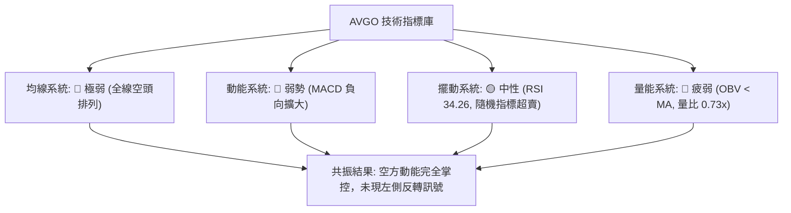

### 📈 移動平均線排列分析

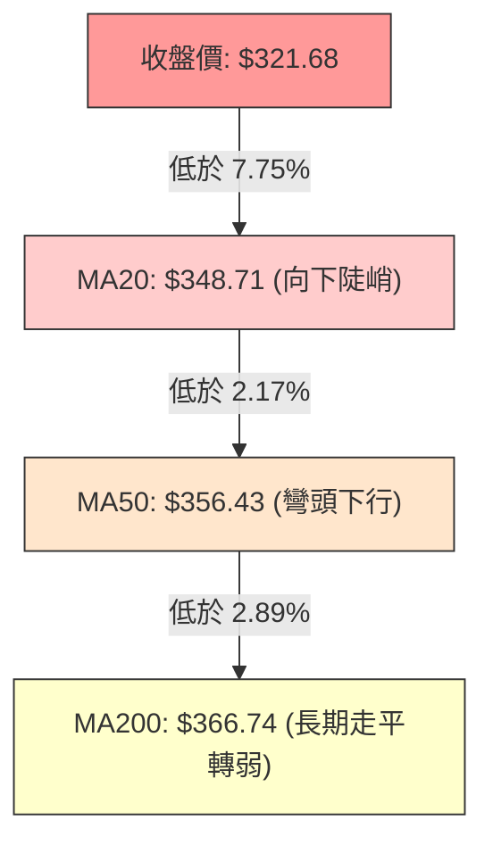

均線系統細部數據表：

| 均線名稱 | 當前價格 | 距現價差額 | 距現價百分比 | 均線走勢特徵 | 訊號解讀 |
|----------|----------|------------|--------------|--------------|----------|
| **MA 5** | $330.34 | -$8.66 | -2.62% | 快速下墜 (▁▁) | 短線極弱，壓制日線反彈 |
| **MA 10** | $338.30 | -$16.63 | -4.91% | 空頭下壓 (▂▁) | 緊貼 R1 形成短線雙重阻力 |
| **MA 20** | $348.71 | -$27.03 | -7.75% | 穩定下行 (▂▂▁▁) | 月線生命線失守，下行趨勢成型 |
| **MA 50** | $356.43 | -$34.75 | -9.75% | 下彎加速 | 季線下穿，中期防線崩潰 |
| **MA 60** | $365.87 | -$44.19 | -12.08% | 穩定下行 (▃▃▂▂) | 典型中期空頭阻力牆 |
| **MA120** | $382.67 | -$60.99 | -15.94% | 高檔下移 | 半年線持續走低 |
| **MA200** | $366.74 | -$45.06 | -12.29% | 長期下彎 | 跌破牛熊分界線，轉入熊市格局 |
| **MA240** | $365.35 | -$43.67 | -11.95% | 年線失守 | 長線保護完全喪失 |

### 📉 RSI(14) 分析

- **RSI(14) 讀數**：**34.26** (Wilder 平滑法)
- **強度指示條**：
  ```
  RSI(14): 34.26  [███████░░░░░░░░░░░░░] 34.26% (中性偏空 / 接近超賣)
  ```
- **區間評估**：當前指標位於 30–70 之中性偏空區間，尚未跌破 30 進入技術極端超賣區。
- **背離檢驗結論**：
  - 價格近 20 根 K 棒由高點連續走低破底。
  - RSI(14) 由 10-09 週之 50.2 急挫至 34.26。
  - 系統檢驗結果標註：「**無明顯背離**」（僅比較近 20 根 K 棒首尾的價格與 RSI 方向，兩者同步下行）。這意味著當前價格下跌具有實質動能支撐，並非動能耗盡的「假跌破」。

### 📊 MACD(12/26/9) 訊號解讀

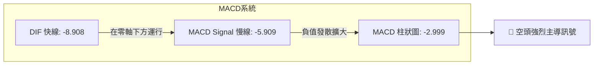

- **MACD 快線 (DIF)**：-8.908
- **Signal 慢線 (DEA)**：-5.909
- **MACD 柱狀圖 (Histogram)**：**-2.999**（空方綠柱擴大中）
- **技術解讀**：DIF 與 DEA 均在零軸之下深度運行，且 DIF 向下遠離 DEA，柱狀圖持續擴展至 -2.999，空頭動能仍處於加速發散期，毫無金叉或收斂跡象。

### 📦 布林通道分析

```
AVGO 布林通道結構 (BB 20, 2)
$379.64 ┬────────────────────────────────────────── BB 上軌
        │
$348.71 ┼────────────────────────────────────────── BB 中軌 (MA20)
        │
$321.68 │      ● 現價 ($321.68, %B = 0.06)
$317.78 ┴────────────────────────────────────────── BB 下軌
```

- **布林上軌**：$379.64
- **布林中軌 (MA20)**：$348.71
- **布林下軌**：$317.78
- **布林帶寬度 (Bandwidth)**：($379.64 - $317.78) ÷ $348.71 = 17.74%
- **%B 指標**：**0.06**
- **解讀**：%B 僅為 0.06，代表價格已經緊貼布林下軌（0 代表下軌，0.5 為中軌）。雖然這顯示價格處於短期嚴重超賣邊界，但在 ADX > 25 的趨勢行情中，往往會出現「沿著布林下軌向下開口下挫」（Walking the Bands）的極端空頭現象。

### 💹 成交量分析（量價配合度）

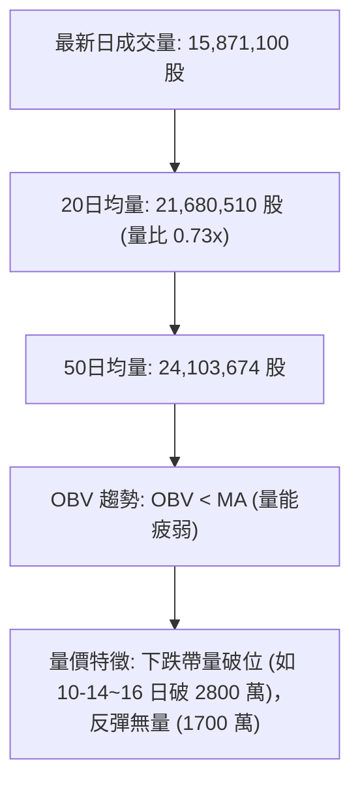

- **量比檢視**：最新成交量 15,871,100，相較 20 日均量 21,680,510 量比僅為 **0.73x**。
- **價量關係分析**：
  - 檢視 2026-10-15（28,455,800 股）、10-16（29,839,600 股）及 10-22（28,139,100 股）的大跌日，成交量均顯著放大突破 2,800 萬股，呈現「**大跌放量**」的主力籌碼出逃格局。
  - 反觀 10-19 至 10-21 小幅反彈時，成交量迅速萎縮至 1,595 萬 ~ 1,745 萬股，呈現「**反彈無量**」的弱勢特徵。
  - **OBV 結論**：OBV 低於其均線，資金呈現持續淨流出狀態，量能無法確認任何反轉上行。

---

## 6. 動能與波動率

### ⚡ 動能評估四象限

動能強度與波動率交叉矩陣分析：

| 象限 | 動能維度 (Momentum) | 波動率維度 (Volatility) | 當前判定 | 市場狀態與操作意涵 |
|------|---------------------|--------------------------|----------|--------------------|
| **Q1** | 強 (多頭推動) | 低 (穩定收斂) | — | 最佳多頭趨勢加碼期 |
| **Q2** | 弱 (多頭衰竭) | 低 (區間窄幅) | — | 盤整無方向，謹慎觀望 |
| **Q3** | 強 (多頭高潮) | 高 (劇烈擴散) | — | 投機博弈，高風險高收益 |
| **Q4** | **弱 / 負動能強 (空頭)** | **高 (ATR 3.50% 擴張)** | **✓ (當前)** | **空頭趨勢加速主導，嚴禁盲目抄底** |

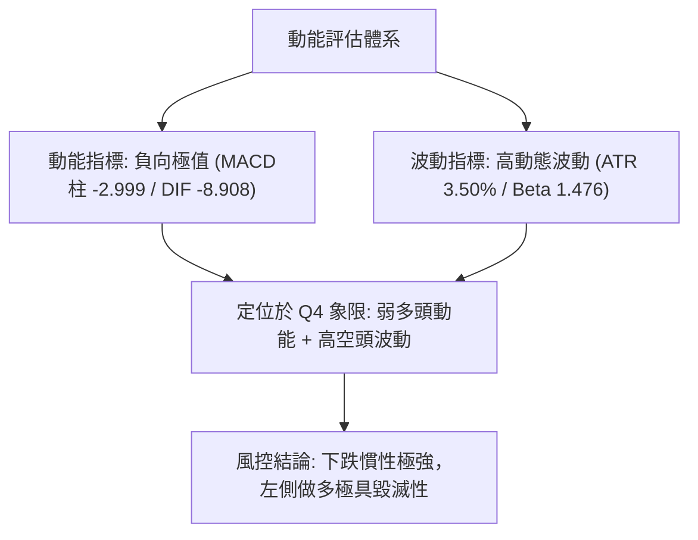

### 📊 ATR 波動率分析

- **ATR(14) 當前數值**：**$11.26**（採 Wilder 平滑法）
- **佔現價比率**：$11.26 ÷ $321.68 = **3.50%**
- **市場意涵**：Broadcom 的日均震幅高達 11.26 美元，處於相對高波動擴張期。
- **止損距離建議**：
  - **短線防守緩衝**（1.0 × ATR）：$11.26
  - **波段交易防守緩衝**（1.5 × ATR）：$11.26 × 1.5 = **$16.89**
  - **保守交易防守緩衝**（2.0 × ATR）：$11.26 × 2.0 = **$22.52**

### 📐 Beta 與市場相關性

- **Beta 係數**：**1.476**
- **市場屬性解讀**：AVGO 具備高度進攻性（高彈性），當標普 500 或半導體板塊（SOX）波動 1% 時，AVGO 理論預期將放大波動 1.476%。在當前大盤科技板塊估值修正的情境下，高 Beta 特性導致其股價回撤劇烈，成為拋售放大器。
- **融券/空頭情緒**：Short Ratio 2.01，Short % Float 僅 1.2%，融券餘額不高，顯示當前下挫主要來自「長線機構獲利拋售」而非極端空頭狙擊，這意味著市場不存在空頭回補軋空（Short Squeeze）的即時動力。

---

## 7. 多時框架總結

### 📋 時框架評分表

| 時框架 | 趨勢方向 | 動能狀態 | 均線排列 | 形態結構 | 綜合評分 | 建議方向 |
|--------|----------|----------|----------|----------|----------|----------|
| **長期 (月線)** | 🟡 震盪回調 | 弱化 (自 52W 高點回撤) | 處於 MA200 之上但跌破短期均線 | 高位寬幅箱體回撤 | 40/100 | 長期部位減碼觀望 |
| **中期 (週線)** | 🔴 明確看空 | 負向擴大 (MACD柱 -2.999) | 週均線下彎，失守多道關卡 | 下降通道向下延伸 | 25/100 | 順勢做空 / 逢高對沖 |
| **短期 (日線)** | 🔴 強勢空頭 | RSI 34.26 / Stoch 2.39 | 完全空頭排列 (MA20<50<200) | 跳空黑K下挫中繼 | 25/100 | 尋找反彈阻力位放空 |

### 🔲 綜合訊號矩陣

```
時框與指標矩陣交會表：
┌───────────┬─────────────┬─────────────┬─────────────┐
│ 分析維度  │ 日線 (短期) │ 週線 (中期) │ 月線 (長期) │
├───────────┼─────────────┼─────────────┼─────────────┤
│ 趨勢方向  │ 🔴 空頭排列 │ 🔴 下降通道 │ 🟡 頂部回調 │
│ 動能方向  │ 🔴 負向加速 │ 🔴 MACD翻綠 │ 🟡 動能衰減 │
│ 波動狀態  │ 🔴 ATR 擴大 │ 🔴 跌破頸線 │ 🟡 波動正常 │
│ 量能配合  │ 🔴 跌放量   │ 🔴 週量疲弱 │ 🔴 長期流出 │
│ 支撐測試  │ 🟡 臨近 S1  │ 🔴 失守78.6%│ 🟡 距低點遠 │
└───────────┴─────────────┴─────────────┴─────────────┘
```

### ⚖️ 多時框收斂結論

依「嚴格要求 14」之多時框收斂原則進行系統判定：
1. **行情屬性判定**：當前日線 ADX(14) 讀數為 **25.43**（明確突破 25.0 臨界值），且 **-DI (33.95)** 遠大於 **+DI (12.56)**，系統嚴格判定當前屬於「**標準方向性趨勢行情**」，非無方向震盪。
2. **時框主導優先級**：趨勢行情下，交易策略「以中長期（週線/MA50、MA200）方向為主導，日線僅用來尋找精確進場點位」。週線級別 MACD 柱已連續擴大翻綠至 -2.999，且日線完全受制於 MA20、MA50、MA200 空頭排列。
3. **收斂唯一方向**：**【偏空主導】**。日線的短線超賣（Stoch %K: 2.39）僅視為下跌途中的反彈蓄勢，不可作為反轉抄底依據；所有交易決策均須嚴格服從週線與日線的空頭共振。

---

## 8. 交易策略建議

### 🗺️ 策略決策流程圖

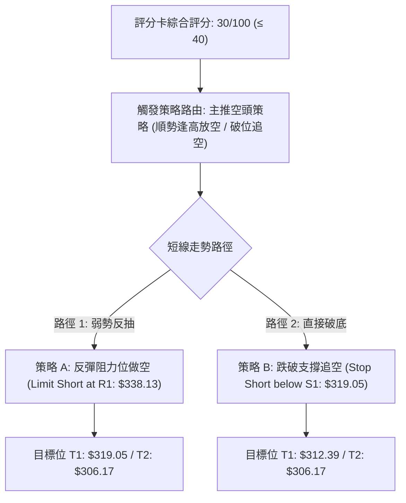

### 🧭 策略路由（依評分卡分流）

> **當前主策略方向 = 強烈偏空 / 主推空頭交易策略（依據綜合評分 30/100，落於 ≤ 40 之空頭主推區間，規則 18 嚴格分流）**

### 🎯 價格情境階梯（Price Scenarios）

價位嚴格引用自第 4 章波段計算結果：

| 觸發條件 | 下一目標 | 後續延伸 | 情境含義 |
|----------|----------|----------|----------|
| **反彈受阻於 R1 $338.13** | 重新回測現價 $321.68 | 探底 S1 $319.05 | 短線空頭中繼確認，逢高放空良機 |
| **強勢突破 R1 $338.13** | 挑戰 R2 $350.81 | 考驗 R3 $358.10 | 空頭波段暫緩，短線轉為技術性反彈 |
| **有效跌破 S1 $319.05** | 直指 S2 $312.39 | 延伸至 S3 $306.17 | 空頭下行浪展開，加速探底測試 |

### 📊 情境機率分佈

| 情境劇本 | 機率 | 主要技術指標依據 |
|----------|------|------------------|
| **延續下行 / 跌破破底** | **60%** | ADX=25.43 強趨勢確立，-DI=33.95 主導，均線呈完美空頭排列，OBV 持續疲弱 |
| **弱勢反彈 / 區間震盪** | **30%** | Stoch %K=2.39 處於超賣，RSI(14)=34.26 接近邊界，可能在 S1 ($319.05) ~ R1 ($338.13) 弱勢震盪 |
| **強勢反轉 / 向上突破** | **10%** | 目前各級指標均無底背離，無大資金量能進場支持，V 型反轉機率極低 |

### 🔴 主策略詳情（空頭主推策略）

*(注：風險報酬比依規則 17 定義：空頭交易比值 = (進場價 − 目標價 T1) ÷ (止損價 − 進場價)，格式為 1 : X.XX)*

| 策略要素 | 策略 A（反彈高空 — 逢阻力回踩進場） | 策略 B（破位追空 — 順勢突破進場） |
|----------|---------------------------------------|-----------------------------------|
| **交易方向** | 做空 (Short) | 做空 (Short) |
| **進場條件** | 價格反彈至 R1 遇阻回落，收出日上影線 | 價格有效跌破關鍵支撐 S1 |
| **進場價格** | **$338.13** (精確錨定 R1 阻力位) | **$318.50** (確認跌破 S1 $319.05 後追空) |
| **止損價格** | **$348.71** (MA20 壓制位上方) | **$324.50** (重回現價上方假跌破止損) |
| **目標價 T1** | **$319.05** (波段第一支撐 S1) | **$312.39** (波段第二支撐 S2) |
| **目標價 T2** | **$306.17** (波段第三強支撐 S3) | **$306.17** (波段第三強支撐 S3) |
| **風險報酬比** | **1 : 1.80**（以 T1 計）<br>*(計算式: (338.13-319.05)/(348.71-338.13) = 19.08/10.58 = 1.80)*<br>*(另注：至 T2 比值為 1 : 3.02)* | **1 : 1.02**（以 T1 計）<br>*(計算式: (318.50-312.39)/(324.50-318.50) = 6.11/6.00 = 1.02)*<br>*(另注：至 T2 比值為 1 : 2.06)* |
| **成功機率** | 65% | 60% |
| **建議倉位** | 10% ~ 15% 總資金 | 8% ~ 10% 總資金 |

### 🟢 反向風險觸發點（多頭對沖提示）

- **多方停損/對沖觸發線**：若收盤價意外放量站穩 **R1 ($338.13)**，空頭應減碼 50%；若強勢攻克 **R2 ($350.81)** 頸線，代表日線空頭結構被破壞，必須全數回補空單離場。
- **左側投機試多條件**：僅當股價跌至 **S3 ($306.17)** 且日線 RSI 出現顯著底背離時，方可使用極小倉位 (3%) 博取反彈，止損必須設於 $300.00 整數關卡下方。

### ⭐ 整體訊號強度評星

```
做多訊號強度：★☆☆☆☆  (1/5星 - 缺乏多方支撐，僅隨機指標超賣)
做空訊號強度：★★★★☆  (4/5星 - 趨勢、均線、動能全數共振看空)
整體可信度：  ★★★★☆  (4/5星 - 指標訊號高度收斂，邏輯嚴密)
```

---

## 9. 風險提示與監控

### ✅ 關鍵監控指標 Checklist

```
╔══════════════════════════════════════════════════════════════╗
║                   每日交易風控監控清單 (Checklist)            ║
╠══════════════════════════════════════════════════════════════╣
║ [ ] 支撐防守位：收盤價是否跌破 S1 ($319.05)                  ║
║ [ ] 動能警戒：MACD 柱狀圖是否收斂至 -1.000 之內               ║
║ [ ] 超賣修復：Stoch %K 是否自 2.39 形成黃金交叉突破 20       ║
║ [ ] 均線動態：價格是否觸碰下彎之 MA5 ($330.34)               ║
║ [ ] 量能異動：單日成交量是否突破 50 日均量 (2,410 萬股)       ║
║ [ ] 阻力警報：盤中是否強行突破 R1 ($338.13)                  ║
╚══════════════════════════════════════════════════════════════╝
```

### ⚠️ 風險場景分析

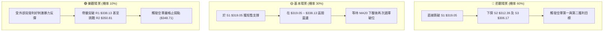

### 🛡️ 風險管理重要提醒

1. **嚴禁逢低攤平抄底**：Broadcom 雖然基本面獲利優良（TTM 淨利率 42.9%），但技術面上目前均線呈現「空頭排列」，ADX 達 25.43 且 -DI 主導，下跌過程中的任何「看似便宜」都可能遭遇趨勢慣性碾壓。
2. **波動度部位控制**：AVGO 單日 ATR 高達 $11.26（3.50%），單筆交易的停損空間至少需抓 1.0 ~ 1.5 倍 ATR（約 10 ~ 16 美元）。投資人應嚴格依據停損金額反推部位規模，單筆交易虧損嚴禁超過投資組合總權益的 1.5%。
3. **跳空風險防範**：半導體板塊受財報與總體環境影響極大，隔夜容易產生巨大跳空，建議盡量避免在重大事件前夕建立過重槓桿部位。

---

## 📋 報告總結

```
╔══════════════════════════════════════════════════════════════╗
║                  AVGO 技術分析報告總結                       ║
╠══════════════════════════════════════════════════════════════╣
║ 報告日期：2026-10-26                                         ║
║ 當前價格：$321.68                                            ║
║ 分析評級：🔴 強烈看空 / 空頭趨勢進行中 (綜合評分: 30/100)     ║
║                                                              ║
║ 關鍵結論：                                                   ║
║ ├─ 長期趨勢：🟡 自高點回撤修正，考驗 52W 低點 $288.98       ║
║ ├─ 中期趨勢：🔴 下降通道確立，失守斐波那契 78.6% 回調位     ║
║ ├─ 短期趨勢：🔴 完全空頭排列 (MA20 < MA50 < MA200)          ║
║ ├─ 關鍵支撐：S1: $319.05  /  S2: $312.39  /  S3: $306.17    ║
║ ├─ 關鍵阻力：R1: $338.13  /  R2: $350.81  /  R3: $358.10    ║
║ └─ 分析師目標：均值 $529.10 (與技術面嚴重背離，警惕補跌)     ║
║                                                              ║
║ 最優策略組合：                                               ║
║ 1. 🥇 最佳機會：策略 A — 反彈至 R1 ($338.13) 遇阻放空       ║
║                 (止損 $348.71，目標 $319.05，風報比 1:1.80)  ║
║ 2. 🥈 次選機會：策略 B — 破位追空，跌破 S1 ($319.05) 追空    ║
║                 (進場 $318.50，目標 $312.39，止損 $324.50)   ║
║ 3. 🥉 保守選擇：場外空倉觀望，耐心等待日線級別底背離確立     ║
╚══════════════════════════════════════════════════════════════╝
```

---

> ⚠️ **免責聲明**：本報告為 AI 自動生成之技術分析，所有數據及估算均基於提供的歷史價格資訊。本報告**僅供研究與學術參考**，**不構成任何投資建議**。投資有風險，入市需謹慎。

---

*報告生成時間：2026-10-26 ｜ 數據來源：Yahoo Finance ｜ 分析框架：多時框技術分析*