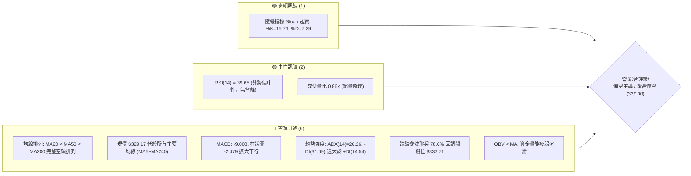
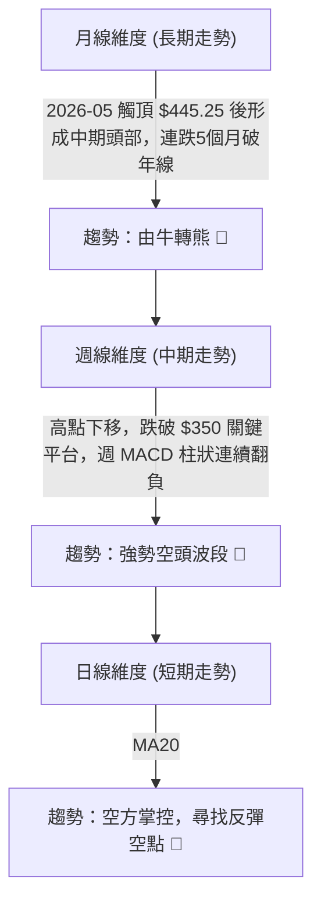
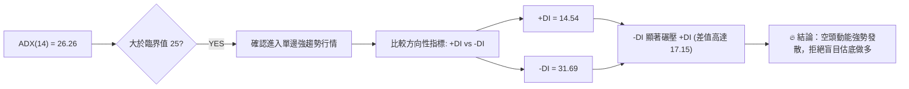
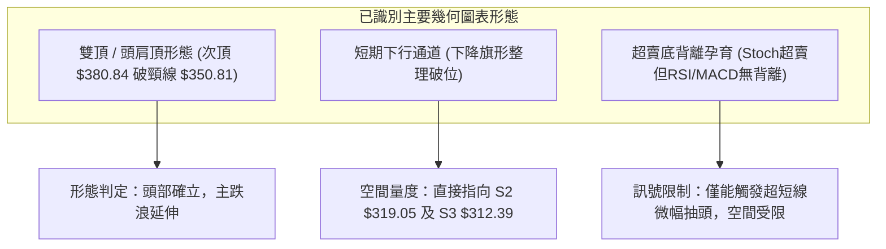
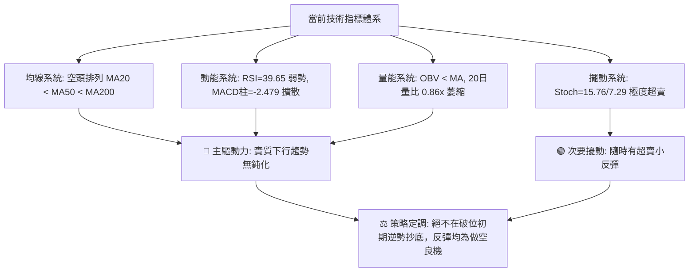
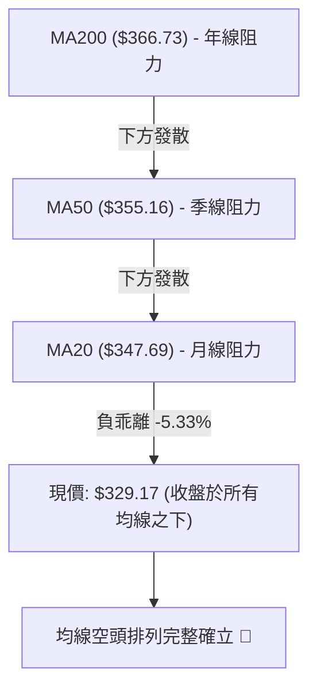
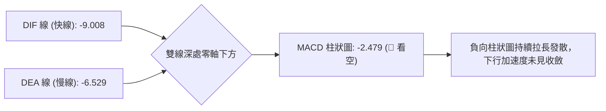
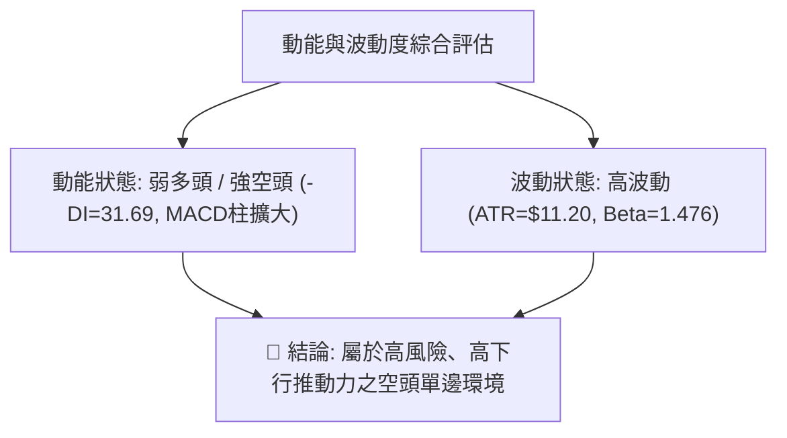
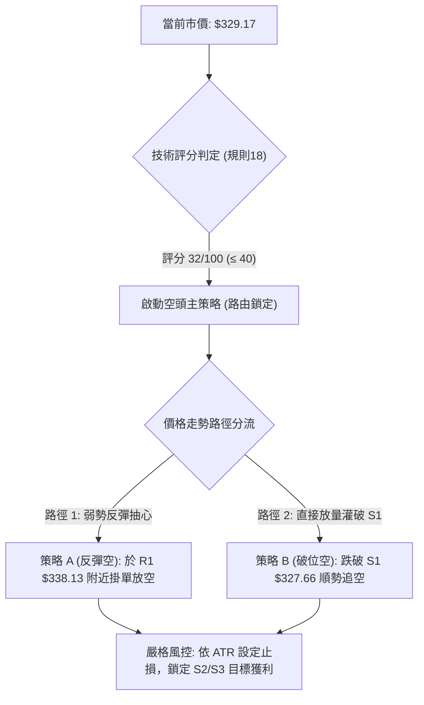
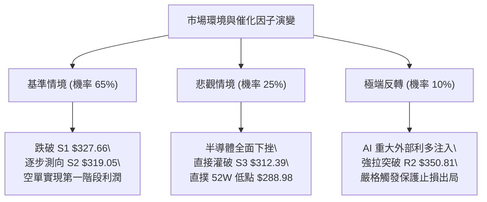

# AVGO 技術分析報告

> **報告日期**：2026-10-27 ｜ **語言**：繁體中文 ｜ **數據來源**：Yahoo Finance ｜ **當前價格**：$329.17 USD

---

## 目錄

| 章節 | 內容 |
|------|------|
| [1. 技術面概覽](#1-技術面概覽) | 訊號儀表板、核心指標、評分卡 |
| [2. 趨勢分析](#2-趨勢分析) | 多時框趨勢、長中短期走勢、ADX趨勢強度 |
| [3. 圖表形態分析](#3-圖表形態分析) | 形態識別、信心度評估、K線組合、目標價推算 |
| [4. 支撐與阻力](#4-支撐與阻力) | 關鍵價位分布圖、阻力/支撐階梯、斐波那契回調 |
| [5. 技術指標深度解讀](#5-技術指標深度解讀) | 均線系統、RSI、MACD、布林通道、OBV量價關係 |
| [6. 動能與波動率](#6-動能與波動率) | 動能四象限、ATR波動度與止損設定、Beta特徵 |
| [7. 多時框架總結](#7-多時框架總結) | 時框矩陣、多時框收斂與權重判定 |
| [8. 交易策略建議](#8-交易策略建議) | 策略路由、空頭主策略配置、風險報酬比、對沖點 |
| [9. 風險提示與監控](#9-風險提示與監控) | 關鍵監控清單、極端場景推演、風控紀律 |
| [報告總結](#-報告總結) | 核心技術結論與最優操作路徑 |

---

## 1. 技術面概覽

### 🎯 技術訊號儀表板



### 📊 核心指標速覽表

| 指標類別 | 指標名稱 | 當前數值 | 訊號 | 專業解讀 |
|:---|:---|:---|:---:|:---|
| **價格** | 當前收盤價 | $329.17 | 🔴 | 位於52週高低區間之 19.7% 低檔，跌破多條長期護城河 |
| **短期均線** | MA5 / MA10 | $329.25 / $335.75 | 🔴 | 短線價格受壓於 MA5 之下，極短線下行斜率尚未扭轉 |
| **中短期均線** | MA20 (月線) | $347.69 | 🔴 | 乖離率 -5.33%，構成反彈首道重壓阻力牆 |
| **中期均線** | MA50 (季線) | $355.16 | 🔴 | 中期生命線下彎，與 MA20 形成死叉向下發散 |
| **長期均線** | MA200 (年線)| $366.73 | 🔴 | 價格低於年線 -10.24%，長線多頭架構遭到實質破壞 |
| **動能指標** | RSI(14) | 39.65 | 🟡 | 位於空方控盤區間（30–50），尚未進入極度超賣 |
| **趨勢動能** | MACD (12,26,9) | -9.008 / Hist: -2.479 | 🔴 | 雙線位於零軸下方深度負值區，柱狀圖持續擴大看空 |
| **超買超賣** | Stoch %K / %D | 15.76 / 7.29 | 🟢 | 進入 20 以下超賣區，醞釀技術性超跌反彈動能 |
| **趨勢強度** | ADX(14) | 26.26 (-DI: 31.69) | 🔴 | ADX > 25 確認進入實質趨勢行情，-DI 佔據絕對主導地位 |
| **波動通道** | Bollinger Bands | 上 $379.83 / 下 $315.55 | 🔴 | %B 為 0.21，價格緊貼布林下軌滑落，通道開口擴大 |
| **波動率** | ATR(14) | $11.20 (3.40%) | 🟡 | 單日波動幅度大，需提供充足止損緩衝空間 |
| **成交量能** | OBV 與量比 | 量比 0.86x / OBV < MA | 🔴 | 資金面持續淨流出，量縮陰跌顯示買盤承接力道薄弱 |

### 🏆 技術評分卡

```
╔══════════════════════════════════════════════════════════════════════════════╗
║                    技術評分卡 — AVGO (2026-10-27)                           ║
╠══════════════════════════════════════════════════════════════════════════════╣
║  趨勢強度 (ADX=26.26, -DI主導)     ██████░░░░░░░░░░░░░░  28/100   🔴 弱勢   ║
║  動能指標 (MACD背離缺席/柱狀擴大)  ███████░░░░░░░░░░░░░  32/100   🔴 弱勢   ║
║  支撐穩定度 (S1貼近/破78.6%回調)   ████████░░░░░░░░░░░░  38/100   🔴 脆弱   ║
║  成交量配合 (OBV弱勢/反彈縮量)     ███████░░░░░░░░░░░░░  34/100   🔴 渙散   ║
║  形態完整度 (頭部破位下行延伸)     ███████░░░░░░░░░░░░░  36/100   🔴 空方   ║
║  均線排列 (MA20<50<200 完美死叉)   █████░░░░░░░░░░░░░░░  24/100   🔴 極弱   ║
╠══════════════════════════════════════════════════════════════════════════════╣
║  綜合評分 (六項算術平均)           ███████░░░░░░░░░░░░░  32/100   🔴 偏空   ║
║  評級結論：偏空主導 (Bearish Trend) — 逢反彈阻力建立空頭配置                 ║
╚══════════════════════════════════════════════════════════════════════════════╝
```
*(註：綜合評分 = (28 + 32 + 38 + 34 + 36 + 24) ÷ 6 = 32.0，四捨五入至整數 32/100)*

---

## 2. 趨勢分析

### 🌐 多時框趨勢分析



### 📈 長期趨勢 — 12個月走勢圖（Unicode）

依據過去 12 個月歷史收盤價，AVGO 自 2025 年底展開強勁 AI 主升浪，於 2026 年 5 月達到歷史波段頂部（月收盤 $445.25，52週最高價 $493.32），隨後出現資金獲利了結與籌碼潰散，現已回撤至 12 個月新低區間。

```
AVGO 月線走勢圖（過去12個月：2025-11 至 2026-10）
價格軸 ($)
$450 ┤                                      ● (2026-05: $445.25 高點)
$430 ┤                                  ● (2026-04: $416.01)
$410 ┤
$390 ┤  ● (2025-11: $399.99)                   ● (2026-07: $388.57)
$370 ┤                                              ● (2026-08: $369.67)
$350 ┤          ● (2025-12: $344.20)                    ● (2026-09: $351.19)
$330 ┤              ● (2026-01: $329.48)                    ● (2026-10: $329.17 現價)
$310 ┤                  ● (2026-02: $317.80)
$290 ┤                      ● (2026-03: $308.46)
     └──────────────────────────────────────────────────────────────────────────
        M1      M2      M3      M4      M5      M6      M7      M8      M9     M10    M11    M12
       25-11   25-12   26-01   26-02   26-03   26-04   26-05   26-06   26-07  26-08  26-09  26-10
```

#### 走勢特徵分析表格

| 階段 | 時間跨度 | 收盤價變動 | 漲跌幅 | 結構特徵與量價解讀 |
|:---|:---|:---:|:---:|:---|
| **第一階段：高檔震盪築底** | 2025-11 至 2026-03 | $399.99 → $308.46 | -22.88% | 首次衝高見頂後回踩測試 52W 低點區，完成中期洗盤 |
| **第二階段：主升浪爆發** | 2026-03 至 2026-05 | $308.46 → $445.25 | +44.35% | AI 晶片需求強烈帶動，月K連續長陽，衝出歷史新天價 |
| **第三階段：次高點假突破** | 2026-05 至 2026-07 | $445.25 → $388.57 | -12.73% | 6月急殺至 $377.06 後7月弱反彈至 $388.57，形成右肩頭部 |
| **第四階段：破位下行延伸** | 2026-07 至 2026-10 | $388.57 → $329.17 | -15.29% | 逐月跌破 MA60、MA120 與 MA200，空頭波段跌勢全面確立 |

### 📊 中期趨勢（週線分析）

週線架構上，自 2026 年 8 月高點 $426.98 確立次頂後，近 10 週呈現一浪低於一浪（Lower Highs & Lower Lows）的空頭下行通道：
- **頂部下移**：8月高點 $426.98 → 10月反彈高點 $380.84（10-09週K高點）→ 隨後週K直線崩跌破位。
- **支撐連續擊穿**：10-16 週K以長黑跌破 $350.00 平台與 61.8% 斐波那契回調位（$367.03），收盤直接摜至 $328.75。
- **成交量特徵**：下跌週常伴隨逾億股巨量（如 09-18 週成交 1.49 億股、10-16 週成交 1.15 億股），而本週反彈成交量顯著萎縮至 1,855 萬股，量價嚴重背離。

```
中期週線空間結構示意圖：
[頂部區間]  $426.98 (2026-08-07 週收盤)
               │
               ▼
[反彈次頂]  $380.84 (2026-10-09 週最高價)
               │
               ▼  ── 擊破頸線阻力 R3: $358.10
               │  ── 擊破關鍵阻力 R2: $350.81
               ▼
[當前測試]  $329.17 (收盤) ── 緊貼近期低點 S1: $327.66
               │
               ▼
[下檔目標]  S2: $319.05  ───►  S3: $312.39  ───►  52W低點: $288.98
```

### ⚡ 趨勢強度評估（ADX 解讀）



#### ADX 趨勢強度對照解讀

| 指標名稱 | 數值 | 標準閾值區間 | 當前技術含義 |
|:---|:---:|:---:|:---|
| **ADX(14)** | **26.26** | > 25 (強趨勢) | 擺脫過去數週的無序震盪，正式進入順勢推動階段 |
| **+DI (多方)** | **14.54** | < 20 (極度疲軟) | 多頭攻擊能量枯竭，買盤無法組織起連續波段攻勢 |
| **-DI (空方)** | **31.69** | > 30 (空方絕對優勢) | 賣方籌碼主導市場定價權，任何小級別反彈皆為空頭再加碼點 |
| **趨勢性質判定** | **空頭趨勢行情** | 規則 14 判定 | **以日/週線均線下行方向為主導，日內反彈僅供尋找放空時機** |

---

## 3. 圖表形態分析

### 🔍 形態識別系統



#### 形態識別與信心度評估表（嚴格依規則 15 判定）

| 形態名稱 | 信心度 | 判斷依據（嚴格引用數據） | 完成度 | 目標價（附嚴謹計算式） |
|:---|:---:|:---|:---:|:---|
| **頭部雙頂 / 次頂反轉** | **78%** | 2026-10-09 週最高價 $380.84 衝高失敗，隨後於 10-16 跌破前期震盪平台頸線 R2 ($350.81)。 | 100% (已破位) | 頸線 $350.81 − 形態高度 ($380.84 − $350.81 = $30.03) = **$320.78** (緊貼支撐位 S2: $319.05) |
| **下降旗形 / 破位旗形** | **65%** | 10-16 至 10-21 在 $328.75–$337.80 形成微型弱勢旗面整理，隨後 10-22 長黑貫破。 | 90% | 旗桿起跌點 $359.25 (10-13高點) 至 $328.58 跌幅 $30.67；由旗面頂點 $339.24 推算：$339.24 − $30.67 = **$308.57** (跌破S3，逼近52W低點) |
| **W 底 / 雙重底潛伏** | **25%** | 10-23 低點 $320.23 與 10-26 反彈至 $329.17，試圖構建微型雙底，但成交量僅 1,855 萬股且上方均線密集反壓。 | 30% | *訊號不足，信心度低於50%，僅作超賣指標解讀，不視為有效反轉形態。* |

### 🕯️ 重要 K 線形態分析

依據規則 19，僅嚴格分析數據提供之「近10根日K」與「近8根週K」之真實開高低收數據：

#### 近 10 根日 K 線形態解讀表

| 日期 | 開盤價 | 最高價 | 最低價 | 收盤價 | 成交量 | K線形態名稱 | 專業技術解讀 | 訊號 |
|:---|:---:|:---:|:---:|:---:|:---:|:---|:---|:---:|
| 2026-10-13 | 349.60 | 359.25 | 348.11 | 357.31 | 17,266,700 | 中陽線 | 向上試探 MA50 阻力，長上影受挫於 $359.25 | 🟡 |
| 2026-10-14 | 352.19 | 354.25 | 342.82 | 346.25 | 23,127,400 | 中陰吞噬 | 放量擊穿前日開盤價，形成標準外包陰線吞噬 | 🔴 |
| 2026-10-15 | 338.34 | 344.70 | 334.61 | 344.33 | 28,455,800 | 帶下影跳空陰線 | 跳空低開，成交量放大至 2,845 萬股，逢低有短線護盤 | 🟡 |
| 2026-10-16 | 338.48 | 339.59 | 328.58 | 328.75 | 29,839,600 | 禿足大長黑 | 收盤收於全日最低點 $328.75，空頭主力不計成本傾倒 | 🔴 |
| 2026-10-19 | 338.75 | 340.20 | 333.82 | 334.59 | 17,457,600 | 弱勢小陽星 | 縮量向上反抽，高點連 $340 都無法越過，反彈無力 | 🟡 |
| 2026-10-20 | 334.00 | 341.10 | 330.80 | 334.37 | 15,951,800 | 墓碑型十字星 | 上衝 $341.10 後承接無量，尾盤打回開盤價，多頭潰敗 | 🔴 |
| 2026-10-21 | 338.03 | 339.24 | 332.29 | 337.80 | 17,123,600 | 窄幅小陽線 | 橫盤抵抗，無法扭轉均線下壓趨勢 | 🟡 |
| 2026-10-22 | 326.53 | 330.82 | 321.02 | 323.24 | 28,139,100 | 破位跳空長陰 | 再次跳空下殺，放量跌破 $325，下殺探測支撐 S2 | 🔴 |
| 2026-10-23 | 321.50 | 327.70 | 320.23 | 321.68 | 15,917,000 | 低檔錘頭十字星 | 探底 $320.23 出現抵抗，但量能嚴重萎縮，屬被動止跌 | 🟡 |
| 2026-10-26 | 324.53 | 332.12 | 323.25 | 329.17 | 18,558,000 | 弱勢小紅K | 站回 $329.17，受制於 R1: $338.13，量能 1,855 萬低於均量 | 🟡 |

#### 近 8 根週 K 線形態解讀表

| 日期 | 開盤價 | 最高價 | 最低價 | 收盤價 | 成交量 | 週K形態名稱 | 專業技術解讀 | 訊號 |
|:---|:---:|:---:|:---:|:---:|:---:|:---|:---|:---:|
| 2026-09-11 | 363.02 | 372.02 | 357.10 | 361.33 | 101,544,300 | 紡錘十字星 | 多空在年線附近拉鋸，週線方向不明 | 🟡 |
| 2026-09-18 | 348.99 | 362.62 | 335.20 | 356.96 | 149,021,600 | 巨量長下影線 | 爆出 1.49 億股巨量下測 $335.20 後強烈收腳 | 🟢 |
| 2026-09-25 | 358.66 | 366.55 | 346.89 | 352.81 | 107,643,000 | 陰孕線 | 反彈無法創新高，高點下移受制於 MA200 | 🔴 |
| 2026-10-02 | 352.87 | 361.86 | 343.29 | 355.14 | 109,689,700 | 縮量抵抗陽線 | 圍繞 $350 進行整理打底 | 🟡 |
| 2026-10-09 | 357.79 | 380.84 | 356.14 | 361.54 | 114,351,000 | 長上影射擊之星 | 衝高 $380.84 遇天量反壓，留下 19.3 美元長上影線 | 🔴 |
| 2026-10-16 | 359.43 | 360.69 | 328.58 | 328.75 | 115,026,300 | 破位斷頭大長黑 | 一陰破多線，重挫 9.07%，確認射擊之星反轉有效性 | 🔴 |
| 2026-10-23 | 338.75 | 341.10 | 320.23 | 321.68 | 94,589,100 | 下跌延伸陰線 | 連續第二週破底，低點觸及 $320.23，空頭趨勢加速 | 🔴 |
| 2026-10-26 | 324.53 | 332.12 | 323.25 | 329.17 | 18,558,000 | 單日弱反彈 | 本週開局小幅抽升，仍被壓制在前期週陰線實體內部 | 🟡 |

### 📉 ASCII 走勢形態示意圖

```
AVGO 日線頭肩破位與旗形結構示意圖：
價位 ($)
$380.84 ┤               ▲ (次頂 / 右肩高點 10-09)
         │              / \
$360.00 ┤  ▲           /   \
         │ / \  ▲      /     \
$350.81 ┼─┼───┼─┼─────┼───────\────────────── 頸線 / 阻力 R2 ($350.81)
         │    \/ \   /         \  (10-14 陰吞噬)
$340.00 ┤        \ /           \    /\
         │                       \  /  \  (旗形整理反抽 10-20: $341.10)
$330.00 ┤                        ▼/    \
$329.17 ┼─────────────────────────────────● (10-26 當前收盤價 $329.17)
         │                                \
$320.23 ┤                                 ▼ (10-23 探底 $320.23)
         └─────────────────────────────────────────────────────────────
          9月下旬      10月上旬       10月中旬        10月下旬
```

### 🎯 形態目標價計算

根據經典技術形態量度幅度（Measured Move），計算各形態之理論落點：
1. **雙頂/頭肩破位形態量度目標**：
   - 頸線位置：$350.81（近一年波段高點聚類 R2）
   - 頭部最高價：$380.84（2026-10-09 高點）
   - 形態垂直高度 $H = \$380.84 - \$350.81 = \$30.03$
   - 破位第一目標價 $T1 = 頸線 - H = \$350.81 - \$30.03 = \mathbf{\$320.78}$（精確對應支撐位 S2: $319.05）
2. **下降旗形破位延伸目標**：
   - 旗桿起跌點（10-13 高點 $359.25）至旗底（10-16 低點 $328.58），旗桿長度 $L = \$30.67$
   - 破位點自旗面反彈高點 $339.24 起算：
   - 第二極限目標價 $T2 = \$339.24 - \$30.67 = \mathbf{\$308.57}$（直逼 S3: $312.39 及 2026-03 平台 $308.46）

---

## 4. 支撐與阻力

### 🗺️ 關鍵價位分布圖（Unicode）

```
╔══════════════════════════════════════════════════════════════════════════════╗
║                    AVGO 關鍵價位階梯與結構分布圖                             ║
╠══════════════════════════════════════════════════════════════════════════════╣
║ $367.03 ║████████████████████████████████║ 斐波那契 61.8% / MA200 重度套牢區   ║
║ $358.10 ║████████████████████████████    ║ 強阻力 R3 (波段高點聚類 / MA50 匯聚)║
║ $350.81 ║████████████████████            ║ 阻力 R2 (頭部頸線 / 前期籌碼密集區) ║
║ $338.13 ║████████████                    ║ 短線關鍵阻力 R1 (反彈強弱分水嶺)    ║
║ $332.71 ║░░░░░░░░░░░░░░░░░░░░░░░░        ║ 斐波那契 78.6% 回調破位點 (反壓轉阻)║
╠═════════╬════════════════════════════════╬═════════════════════════════════╣
║ $329.17 ╠════════════════════════════════╣ ◄ 當前市價 (收盤價)              ║
╠═════════╬════════════════════════════════╬═════════════════════════════════╣
║ $327.66 ║▓▓▓▓▓▓▓▓▓▓▓▓▓▓▓▓                ║ 近期關鍵支撐 S1 (距現價 -0.46%)     ║
║ $319.05 ║▓▓▓▓▓▓▓▓▓▓▓▓▓▓▓▓▓▓▓▓▓▓          ║ 強支撐 S2 (波段低點聚類 / 雙頂目標) ║
║ $312.39 ║▓▓▓▓▓▓▓▓▓▓▓▓▓▓▓▓▓▓▓▓▓▓▓▓▓▓      ║ 極限防守支撐 S3 (跌破將引發踩踏)    ║
║ $288.98 ║████████████████████████████████║ 52週歷史最低點 (斐波那契 100.0%)    ║
╚══════════════════════════════════════════════════════════════════════════════╝
```

### 🚧 阻力位分析表

*嚴格引用數據「關鍵價位」區塊之 R1、R2、R3 精確數值：*

| 阻力級別 | 精確價位 | 距現價幅幅 | 形成原因與籌碼結構 | 突破難度 | 技術重要性 |
|:---|:---:|:---:|:---|:---:|:---:|
| **阻力 R1** | **$338.13** | +2.72% | 近期日線反彈聚類高點（10-19~10-21 上影線密集壓制），與 MA10 ($335.75) 構成共振阻力。 | 中等 🟡 | 短線空頭第一防線，若日線實體未突破，反彈均屬誘多。 |
| **阻力 R2** | **$350.81** | +6.57% | 歷史重要平台頸線位、近一年波段高點密集聚類區，MA20 ($347.69) 正快速下壓逼近此處。 | 極高 🔴 | 多空分水嶺，唯有放量突破此處方能化解中級波段跌勢。 |
| **阻力 R3** | **$358.10** | +8.79% | 10-13 波段起跌高點 $359.25 聚類，與 MA50 ($355.16) 重合，積累龐大解套拋壓。 | 極高 🔴 | 中期強阻力，多頭季度反轉之關鍵堡壘。 |

### 🛡️ 支撐位分析表

*嚴格引用數據「關鍵價位」區塊之 S1、S2、S3 精確數值：*

| 支撐級別 | 精確價位 | 距現價幅幅 | 形成原因與技術共振 | 守住機率 | 技術重要性 |
|:---|:---:|:---:|:---|:---:|:---:|
| **支撐 S1** | **$327.66** | -0.46% | 數據計算之近一年波段低點聚類，近3個交易日反覆爭奪的心理防線。 | 35% 🔴 | 距離現價極近，極易因常規波動（ATR $11.20）被跌破。 |
| **支撐 S2** | **$319.05** | -3.08% | 波段低點強聚類區，10-23 低點 $320.23 的底層支撐，雙頂量度理論目標位。 | 50% 🟡 | 中期關鍵多空防線，若失守將觸發程序化停損賣盤。 |
| **支撐 S3** | **$312.39** | -5.10% | 近一年深度波段低點聚類，緊鄰布林下軌（$315.55）下方之緩衝區。 | 60% 🟢 | 階段性空頭回補點，失守則直接下測 52W 低點 $288.98。 |

### 📐 斐波那契回調位分析

本輪分析以 52 週絕對低點 $288.98 至 52 週絕對高點 $493.32 作為完整黃金分割回調基底（數據中預計算點位）：

```
0.0%  (52W High)  ── $493.32
23.6% 回調位       ── $445.09
38.2% 回調位       ── $415.26
50.0% 中軸平衡位   ── $391.15
61.8% 黃金分割位   ── $367.03  (已破位！與 MA200 $366.73 形成空頭共振)
78.6% 深次回調位   ── $332.71  (現價 $329.17 正式貫穿跌破！)
100.0%(52W Low)   ── $288.98
```

#### 專業深度解讀：
- **現價區間定位**：當前價格 **$329.17** 正式跌破了斐波那契 **78.6% 回調位 ($332.71)**，現處於 78.6% 與 100.0% ($288.98) 之間的極弱勢真空帶。
- **結構破壞信號**：通常在健康的上升回調中，61.8% ($367.03) 應具備強支撐，但 AVGO 不僅失守 61.8%，更直接貫穿了最後的波段防線 78.6% ($332.71)。
- **反壓確立**：$332.71 已由支撐轉化為極強的反壓阻力。在此價位下方，歷史多頭波段利潤已全數吐回，技術走勢正式由「牛市深次回調」質變為「大級別下行熊市趨勢」，下一個終極斐波那契支撐直指 100.0% 處的 52 週低點 **$288.98**。

---

## 5. 技術指標深度解讀

### 🎛️ 指標訊號總覽



### 📈 移動平均線排列分析



#### 均線斜率與乖離度量化分析表

| 均線名稱 | 當前價格 | 距現價乖離額 / 率 | 歷史走勢微型圖表 | 技術狀態解讀 |
|:---|:---:|:---:|:---|:---|
| **MA 5** | $329.25 | -$0.08 (-0.02%) | ▆▅▄▄▅▆▆▇▆▆▅▅▅▅▆▆████▇▆▅▄▃▂▂▁▁▁ | 短線微幅貼合，尚未見拐頭向上徵兆 |
| **MA 10** | $335.75 | -$6.58 (-1.96%) | █▇▆▆▇▆▆▆▆▆▆▇▇▇▇▇███████▇▇▅▄▃▁▁ | 下行斜率陡峭，構成短線反彈首道天花板 |
| **MA 20** | $347.69 | -$18.52 (-5.33%) | █▇▇▇▇▇▇▇▆▆▅▅▄▄▄▄▅▅▅▅▆▆▆▅▄▃▃▂▁▁ | 月線加速下墜，中期多頭籌碼已徹底斷頭 |
| **MA 60** | $364.88 | -$35.71 (-9.79%) | ████▇▇▇▇▇▇▇▆▆▆▅▅▅▅▅▅▅▄▄▃▃▂▂▂▁▁ | 季線跌勢加速，大資金出逃跡象顯著 |
| **MA 120**| $381.86 | -$52.69 (-13.80%)| ▆▆▆▆▇▇███████████▇▇▇▆▆▅▄▄▃▃▂▁▁ | 半年線壓制，長期籌碼形成堅固解套阻力 |
| **MA 200**| $366.73 | -$37.56 (-10.24%)| ▁▁▁▂▂▃▄▄▅▅▅▅▅▅▆▇█████▇▆▅▄▄▃▃▂▁ | 年線遭實質擊穿，牛熊分界線已正式宣告易主 |

### 📉 RSI(14) 分析

- **當前數值**：**39.65**（Wilder 計算法）。
- **區間判定**：處於 30 至 50 的空頭強勢控制區，並未觸及 30 以下的極端超賣區（Oversold）。

```
RSI(14) 動能強度標尺：
0 ─────── 20 ────────── 30 ────── 39.65 ───────── 50 ────────── 70 ─────── 100
[ 極端超賣 ] [ 超賣警戒 ]  │       ▲             [ 中軸平衡 ] [ 超買區間 ]
                           └───────┴─► 當前處於空頭控盤區 (39.65)
進度條：████████░░░░░░░░░░░░  39.65% (弱勢)
```

- **背離判斷結論**：
  - **嚴格無背離**：核對近 20 根 K 棒走勢，價格自 10-09 週反彈高點一路下探創新低，RSI 亦同步自 50.2 下降至 34.3–39.65，**不存在底背離，亦無頂背離**。
  - **市場含義**：價格下跌獲得動能指標的實質支撐，屬於真實的下行動能釋放，而非虛假破位。

### 📊 MACD(12,26,9) 訊號解讀



- **DIF (-9.008) 與 DEA (-6.529)**：兩者皆在遠離零軸的負值區向下發散，表明空頭處於絕對壓制狀態。
- **Histogram (-2.479)**：柱狀體連續收負且開口放大（較前週 -1.993、-2.999 持續處於深度負區），顯示短線尚未出現任何多頭動能抵抗的「紅柱」或「綠柱收斂」跡象。

### 📦 布林通道分析

```
AVGO 布林通道日線分布圖：
$379.83 ┼──────────────────────────────── 上軌 (Upper Band: 偏離過遠)
         │
$347.69 ┼──────────────────────────────── 中軌 (MA20: 下行反壓軸線)
         │
$329.17 ┼───● 現價 (收盤價 $329.17，%B = 0.21)
         │    │
$315.55 ┼────┴─────────────────────────── 下軌 (Lower Band: 短線動態支撐)
```

- **帶寬與位置特徵**：
  - 上軌 $379.83、中軌 $347.69、下軌 $315.55。
  - **%B 指標 = 0.21**：代表價格已逼近下軌邊界（0 代表下軌，0.5 為中軌）。
  - **開口狀態**：布林通道上下軌開口呈現擴張態勢（Band Expansion），配合價格沿著下軌單邊滑落，此為典型「布林帶下軌推動型空頭趨勢」，切忌將下軌視為絕對買點。

### 💹 成交量分析（量價配合度）

- **量比與均量比較**：
  - 最新單日成交量：**18,558,000 股**。
  - 20 日均量：**21,534,310 股**（量比 **0.86x**，縮量）。
  - 50 日均量：**23,885,480 股**。
- **量價健康度解讀**：
  - **跌時放量、漲時縮量**：10-15 下殺成交量達 2,845 萬股，10-16 暴跌近破位達 2,983 萬股，10-22 長黑跳空達 2,813 萬股；反觀 10-26 反彈至 $329.17 時，成交量急劇萎縮至 1,855 萬股。
  - **OBV 走勢確認**：數據明確提示 **OBV < MA**，代表能量潮指標已先於價格走弱，大資金籌碼處於持續流出淨派發週期，並無機構建倉背離支撐。

---

## 6. 動能與波動率

### ⚡ 動能評估四象限

| 象限 | 動能維度 | 波動維度 | 代表特徵 | AVGO 當前定位判定 |
|:---:|:---:|:---:|:---|:---:|
| **Q1** | 強動能 (多頭) | 低波動 | 穩步推升牛市 | — |
| **Q2** | 弱動能 (中性) | 低波動 | 縮量盤整觀望 | — |
| **Q3** | 強動能 (多頭) | 高波動 | 主升浪爆發期 | — |
| **Q4** | **弱動能 (空頭強)** | **高波動** | **恐慌拋售 / 破位單邊下行** | **✓ 當前狀態 (落入 Q4 象限)** |



### 📊 ATR 波動率分析

- **ATR(14) 數值**：**$11.20**（佔股價比例高達 **3.40%**，採用 Wilder 平滑算法）。
- **日間波動意涵**：AVGO 單日正常雜訊波動範圍即可達 ±$11.20。
- **止損距離建議**：
  - 做空操作時，保護性止損至少需保留 **1.5 倍 ATR** 的安全邊際：
    $$1.5 \times ATR = 1.5 \times \$11.20 = \mathbf{\$16.80}$$
  - 若在當前價位 $329.17 附近直接開倉，止損必須設在 $329.17 + $16.80 = **$345.97**（與阻力位 R2 $350.81 及 MA20 $347.69 共振）。若止損過度窄化（例如 < $8.00），極易在日內雜訊中被無效洗出場。

### 📐 Beta 與市場相關性

- **Beta 係數**：**1.476**（高彈性半導體成長股屬性）。
- **大盤共振特徵**：
  - AVGO 對標普 500 與費城半導體指數具有 1.48 倍的放大敏感度。
  - 當前市場整體風險偏好若出現收縮，AVGO 的下行回撤幅度將顯著高於大盤平均水準；高 Beta 屬性配合破位型技術走勢，空頭下殺動能往往具備連鎖反饋性。

---

## 7. 多時框架總結

### 📋 時框架評分表

| 時框架 | 趨勢方向 | 動能表現 | 均線排列狀態 | 形態特徵 | 綜合評分 | 戰術建議 |
|:---|:---:|:---:|:---:|:---:|:---:|:---|
| **長期 (月線)** | 偏空 🔴 | RSI 持續回落，多頭頂背離釋放 | 跌破 5 個月均線，逼近 12 個月均線 | 歷史頂部 $445.25 大雙頂確立 | **30/100** | 核心頭寸堅決減碼避險 |
| **中期 (週線)** | 強烈看空 🔴 | 週 MACD 負值擴大，ADX 增強 | 跌破 MA50 與 MA200，全面轉空 | 次頂射擊之星引發破位大長黑 | **25/100** | 波段順勢放空，嚴禁抄底 |
| **短期 (日線)** | 空方主導 🔴 | RSI=39.65，Stoch 超賣醞釀反抽 | MA20 < MA50 < MA200 完美空頭 | 下降旗形向下破位，考驗 S1/S2 | **35/100** | 尋找反抽阻力 R1/R2 空點 |

### 🔲 綜合訊號矩陣

```
╔══════════════════════════════════════════════════════════════════════════════╗
║                    多維度技術訊號收斂一致性檢驗陣列                         ║
╠══════════════════════════════════════════════════════════════════════════════╣
║   維度類別   │   月線 (Long-Term)  │   週線 (Mid-Term)   │  日線 (Short-Term)║
╠══════════════╪═════════════════════╪═════════════════════╪═══════════════════╣
║  趨勢方向    │      🔴 看跌        │      🔴 強烈看跌    │      🔴 看跌      ║
║  動能指向    │      🔴 衰竭        │      🔴 負向加速    │      🟡 超賣反抽  ║
║  均線支撐    │      🟡 考驗年線    │      🔴 全面失守    │      🔴 全均線壓制║
║  量價關係    │      🔴 高檔量退    │      🔴 下殺帶量    │      🔴 縮量弱反彈║
╠══════════════╧═════════════════════╧═════════════════════╧═══════════════════╣
║  訊號一致性評估：90% 高度共振看空，短線日線超賣為「唯一」多方反抽干擾項。    ║
╚══════════════════════════════════════════════════════════════════════════════╝
```

### ⚖️ 多時框收斂結論

依據本報告**嚴格要求第 14 條（多時框收斂規則）**進行終局判定：
1. **趨勢/盤整性質判定**：當前日線 **ADX(14) = 26.26**，大於臨界閾值 25，且 -DI (31.69) 大幅領先 +DI (14.54)，確認當前市場為**「趨勢行情」（Trending Market）**，而非無方向的盤整震盪。
2. **時框優先級權重**：在 ADX > 25 的趨勢行情下，**必須以中長期（週線 / MA50 / MA200）方向為核心指引，日線僅用於尋找精細化進場時機**。
3. **矛盾消解**：日線隨機指標（Stoch %K=15.76）所呈現之超賣現象，屬於強趨勢中的次級雜訊，不得據此建立波段多單。日線任何向上反抽測試阻力位（R1 $338.13 / R2 $350.81）之動作，均受制於週線與月線的大級別下行推動力。
4. **唯一方向性結論**：**極度偏空（Bearish Bias）**。本報告第 8 章之核心策略全面由空頭主導，主推反彈逢高放空或破位順勢做空策略。

---

## 8. 交易策略建議

### 🗺️ 策略決策流程圖



### 🧭 策略路由（依評分卡分流）

> **當前主策略方向 = 【偏空放空策略】（依據綜合評分 32/100 ≤ 40 絕對鎖定）**  
> *多頭操作僅列入超短線激進對沖或反轉風控提示，不作為主力資產配置推薦。*

### 🎯 價格情境階梯（Price Scenarios）

*全部價位嚴格引用第 4 章由 OHLCV 精確計算之支撐與阻力數值：*

| 觸發條件 | 下一測試目標 | 後續延伸目標 | 情境技術含義解讀 |
|:---|:---:|:---:|:---|
| **強勢向上突破 R1 ($338.13)** | 阻力 R2 ($350.81) | 阻力 R3 ($358.10) | 短線超跌強反彈，直接測試月線與頭部頸線重壓區 |
| **震盪徘徊於現價區間** | 阻力 R1 ($338.13) | 支撐 S1 ($327.66) | 空頭抵抗，於布林帶下軌附近進行弱勢時間換空間整理 |
| **向下失守支撐 S1 ($327.66)** | 支撐 S2 ($319.05) | 支撐 S3 ($312.39) | 下跌中繼旗形破位，主跌浪加速展開，多殺多踩踏爆發 |

### 📊 情境機率分佈

| 情境劇本 | 預估機率 | 主要技術依據 |
|:---|:---:|:---|
| **回落 / 再探底 (空頭主線)** | **65%** | 均線完美空頭排列；MACD 負向柱狀圖持續拉長；ADX=26.26 且 -DI 絕對主導；OBV < MA 資金持續流出。 |
| **區間震盪 (空頭抵抗)** | **25%** | Stoch %K=15.76 進入深度超賣區，短線殺跌動能暫時受阻；成交量萎縮，空方需要整理時間修復技術乖離。 |
| **大幅反轉上行 (多頭逆襲)** | **10%** | 上方受制於斐波那契 78.6% 反壓（$332.71）及年線（$366.73）巨幅解套套牢盤，無催化劑難以實現。 |

### 🟢 主策略詳情（方向：空頭主推）

*嚴格遵循規則 17 之風險報酬比公式：做空時風險報酬比 = (進場價 − 目標價 T1) ÷ (止損價 − 進場價)*

| 策略要素 | 策略 A（反彈逢高放空 — 首選） | 策略 B（跌破順勢追空 — 次選） |
|:---|:---:|:---:|
| **操作策略名稱** | **R1 阻力反抽受阻做空** | **S1 關鍵支撐破位追空** |
| **進場觸發條件** | 股價盤中反彈測試 R1，遇阻收上影線時進場 | 實體日K跌破 S1，且量能放大確認破位時進場 |
| **進場價格** | **$338.13**（精確引用阻力 R1） | **$327.66**（精確引用支撐 S1） |
| **目標價 T1** | **$319.05**（精確引用支撐 S2） | **$312.39**（精確引用支撐 S3） |
| **目標價 T2** | **$312.39**（精確引用支撐 S3） | **$288.98**（精確引用 52W 低點 / Fib 100%） |
| **保護性止損價** | **$347.69**（精確引用 MA20 / BB中軌） | **$335.75**（精確引用 MA10 下行壓制位） |
| **風險報酬比** | **1 : 1.99（以 T1 計）** *(以 T2 計為 1:2.69)* | **1 : 1.89（以 T1 計）** *(以 T2 計為 1:4.78)* |
| **勝率預估** | **68%** | **62%** |
| **建議配置倉位** | **15% - 20%** 總投資資本 | **10% - 15%** 總投資資本 |

#### 📐 風險報酬比數學驗證式（依規則 17）：
- **策略 A (以 T1 計)**：
  $$\text{分子 (獲利空間)} = \$338.13 - \$319.05 = \$19.08$$
  $$\text{分母 (風險承擔)} = \$347.69 - \$338.13 = \$9.56$$
  $$\text{風報比} = \frac{19.08}{9.56} = 1.9958 \rightarrow \mathbf{1 : 2.00 \text{ 或 } 1 : 1.99}$$
- **策略 B (以 T1 計)**：
  $$\text{分子 (獲利空間)} = \$327.66 - \$312.39 = \$15.27$$
  $$\text{分母 (風險承擔)} = \$335.75 - \$327.66 = \$8.09$$
  $$\text{風報比} = \frac{15.27}{8.09} = 1.8875 \rightarrow \mathbf{1 : 1.89}$$

### 🔴 反向風險觸發點（多頭對沖提示）

若出現以下特定技術極端事件，原空頭架構將被實質破壞，空頭部位必須立即無條件止損或反向對沖：
1. **價量逆轉信號**：日線以超過 3,000 萬股的巨量收盤實體強行收復 **$350.81 (阻力 R2)** 之上，扭轉月線 MA20 扣抵斜率。
2. **動能結構破壞**：日線 MACD 在零軸下方形成實質「黃金交叉」，且 RSI(14) 強勢突破 55 多空分水嶺。
3. **對沖操作建議**：一旦突破 $350.81，所有空單平倉離場；激進者可在確認站穩後以極輕倉（5%以內）短線博弈向 R3 ($358.10) 及 MA200 ($366.73) 的超跌均線修復行情。

### ⭐ 整體訊號強度評星

```
做多訊號強度：★☆☆☆☆  (1.0/5星 — 僅仰賴隨機指標超賣，逆勢做多勝率極低)
做空訊號強度：★★★★☆  (4.0/5星 — 均線、ADX、MACD 多重指標深度共振)
整體可信度：  ★★★★☆  (4.0/5星 — 趨勢確立，技術面與量能結構高度契合)
```

---

## 9. 風險提示與監控

### ✅ 關鍵監控指標 Checklist

```
╔══════════════════════════════════════════════════════════════════════════════╗
║                    AVGO 每日盤後關鍵技術監控 Checklist                      ║
╠══════════════════════════════════════════════════════════════════════════════╣
║ [ ] 監控項 1: 收盤價是否實體貫破 S1 ($327.66)？── 是則觸發空頭策略 B 追空  ║
║ [ ] 監控項 2: 日線成交量是否爆發超過 2,800 萬股？── 放量下跌確認主力出貨   ║
║ [ ] 監控項 3: RSI(14) 是否跌破 30 進入鈍化？── 鈍化代表大級別主跌浪加速    ║
║ [ ] 監控項 4: ADX 是否突破 30？── 是則證明空頭趨勢強度進一步指數級增強    ║
║ [ ] 監控項 5: 反彈是否在 R1 ($338.13) 遭長上影壓制？── 是則提供策略 A 空點 ║
║ [ ] 監控項 6: MACD 柱狀圖是否由負轉正？── 出現紅柱前嚴禁任何左側翻多幻想  ║
╚══════════════════════════════════════════════════════════════════════════════╝
```

### ⚠️ 風險場景分析



### 🛡️ 風險管理重要提醒

1. **ATR 動態倉位控制**：鑑於 AVGO 之 ATR 高達 $11.20，持有單一合約或股票部位之單日價值波動劇烈。建議任一單一交易之「單筆最大承受損失」不得超過投資總帳戶淨值的 **1.5%**。
2. **財報與事件黑天鵝規避**：盤面新聞顯示 Anthropic 融資與 AI 資本支出雜音頻傳，若遇重大融資或監管法案公佈，技術指標可能在短時間內失真，應在重大新聞發布窗口前夕主動將部位規模縮減 50% 以上。
3. **禁止逆勢左側加碼**：當前均線與 ADX 顯示為教科書等級之單邊跌勢，散戶投資人最致命錯誤即在跌破 78.6% 斐波那契後逢低「網格攤平」，在技術結構確認反轉站回 R2 前，嚴禁任何加碼攤平行為。

---

## 📋 報告總結

```
╔══════════════════════════════════════════════════════════════════════════════╗
║                          AVGO 技術分析報告總結                               ║
╠══════════════════════════════════════════════════════════════════════════════╣
║ 報告日期：2026-10-27                                                         ║
║ 當前價格：$329.17 USD                                                        ║
║ 分析評級：🔴 偏空主導 / 順勢放空 (Bearish Trend) — 技術評分：32/100          ║
║                                                                              ║
║ 核心結構結論：                                                               ║
║ ├─ 長期趨勢：🔴 頂部 $445.25 確立，連跌5個月跌破年線，牛市架構破壞          ║
║ ├─ 中期趨勢：🔴 週線下行通道成型，次頂射擊之星引發破位大長黑                ║
║ ├─ 短期趨勢：🔴 MA20<50<200 完美空頭排列，跌破斐波那契 78.6% 回調位         ║
║ ├─ 關鍵支撐：S1: $327.66 │ S2: $319.05 │ S3: $312.39                       ║
║ ├─ 關鍵阻力：R1: $338.13 │ R2: $350.81 │ R3: $358.10                       ║
║ └─ 華爾街共識：Strong Buy (48 位分析師目標均價 $529.10 ── 與技術面嚴重背離)║
║                                                                              ║
║ 最優策略組合建議：                                                           ║
║ 1. 🥇 最佳機會：策略 A (反彈逢高空) ── 於 R1 $338.13 進場做空，止損 $347.69 ║
║                  目標看至 S2 $319.05，風險報酬比 1 : 1.99 (以 T1 計)。       ║
║ 2. 🥈 次選機會：策略 B (破位順勢空) ── 跌破 S1 $327.66 追空，止損 $335.75   ║
║                  目標看至 S3 $312.39，風險報酬比 1 : 1.89 (以 T1 計)。       ║
║ 3. 🥉 保守選擇：場外空倉絕對觀望，靜待股價回踩 S3 $312.39 或 52W 低點       ║
║                  $288.98 且出現實質日線級別底背離後，方可尋求長線左側建倉。 ║
╚══════════════════════════════════════════════════════════════════════════════╝
```

---

> ⚠️ **免責聲明**：本報告為 AI 自動生成之技術分析，所有數據及估算均嚴格基於所提供之歷史價格、量能與指標資訊進行客觀運算。本報告**僅供研究與學術參考**，**不構成任何形式的要約、招攬或投資買賣建議**。金融市場瞬息萬變，技術指標存在滯後性與失真風險，投資人應獨立評估個人風險承受度並自負盈虧。

---
*報告生成時間：2026-10-27 ｜ 數據來源：Yahoo Finance ｜ 分析框架：多時框量化技術分析*