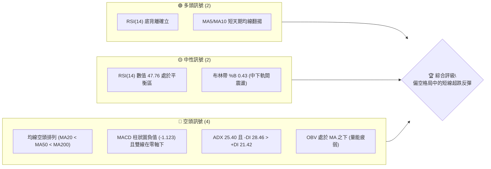
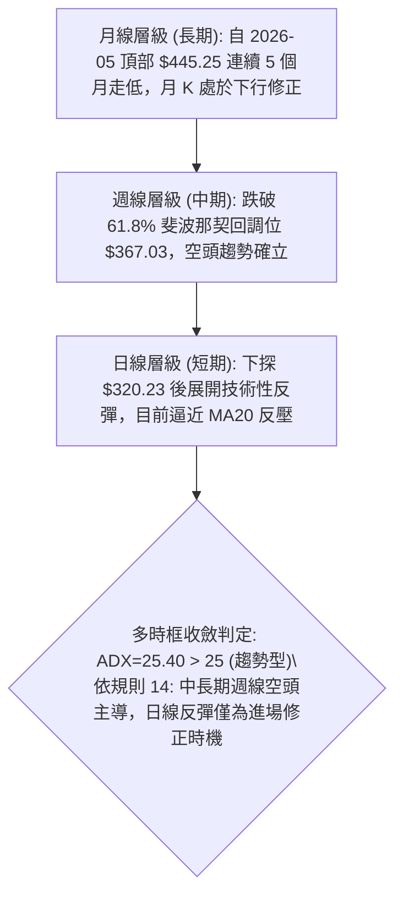
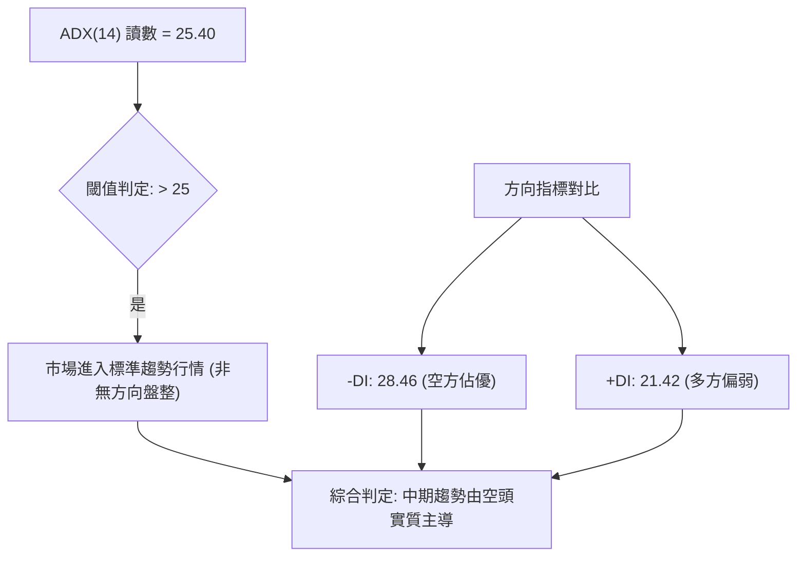
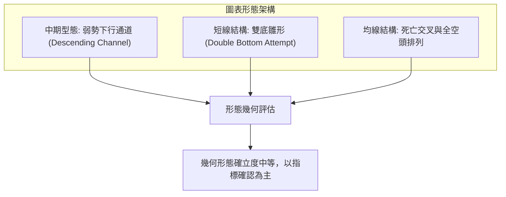
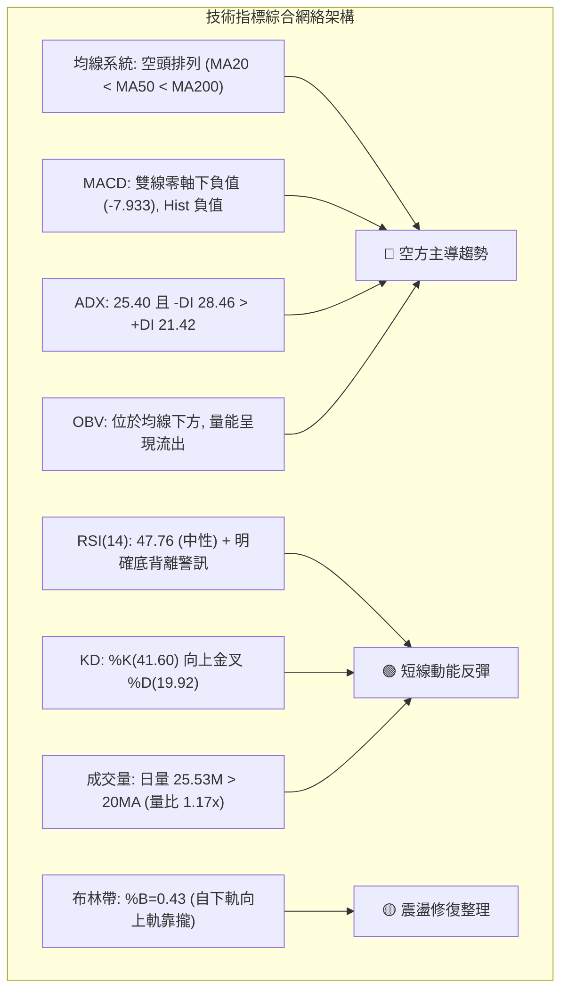
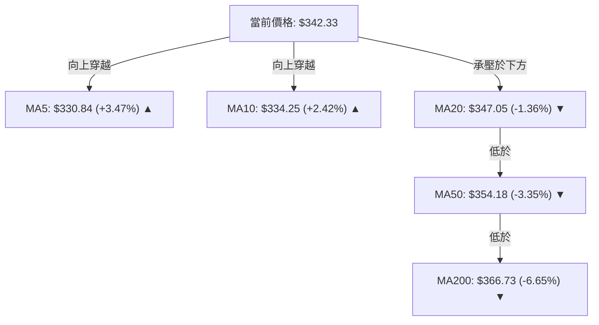
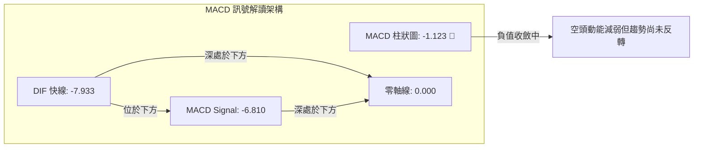
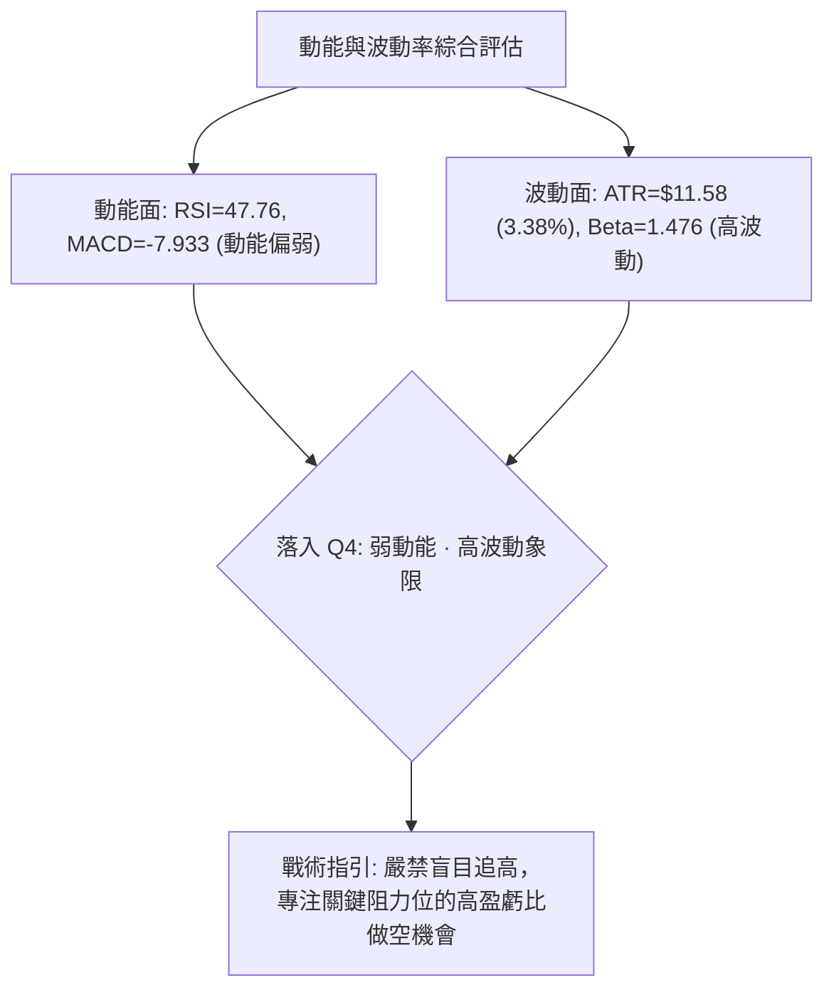
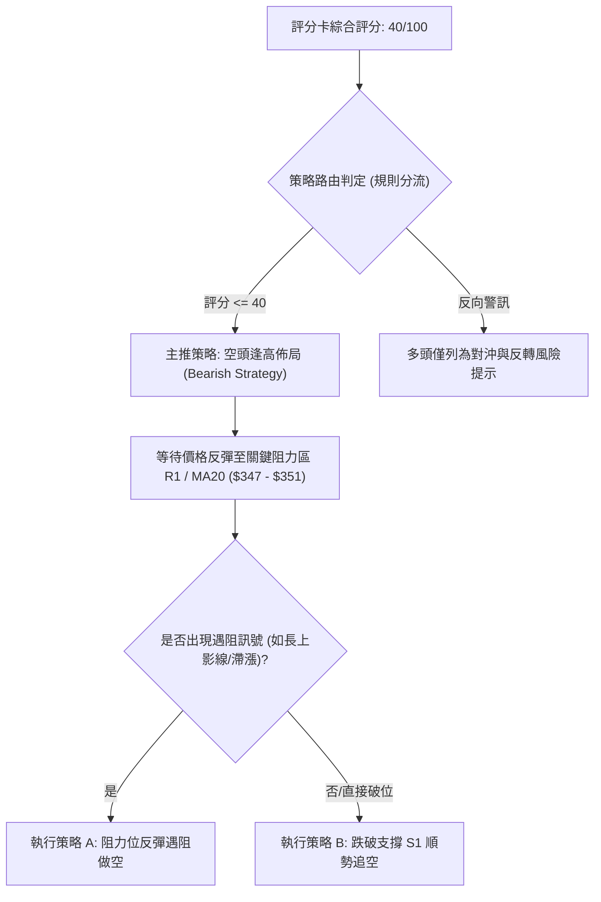
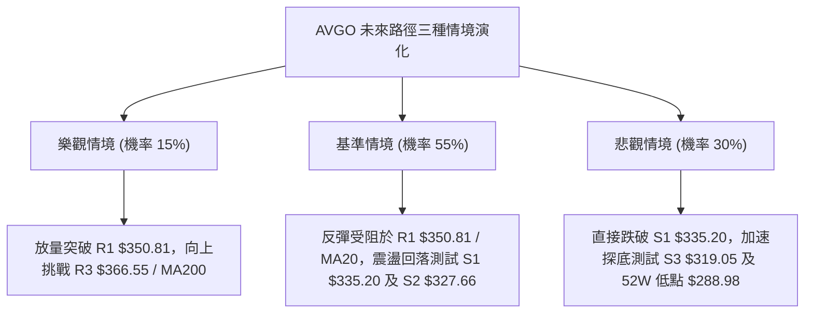

# AVGO 技術分析報告

> **報告日期**：2026-10-28 ｜ **語言**：繁體中文 ｜ **數據來源**：Yahoo Finance ｜ **當前價格**：$342.33

---

## 目錄

| 章節 | 內容 |
|------|------|
| [1. 技術面概覽](#1-技術面概覽) | 訊號儀表板、核心指標、評分卡 |
| [2. 趨勢分析](#2-趨勢分析) | 多時框趨勢、長中短期走勢 |
| [3. 圖表形態分析](#3-圖表形態分析) | 形態識別、K線組合、目標價 |
| [4. 支撐與阻力](#4-支撐與阻力) | 關鍵價位、斐波那契回調 |
| [5. 技術指標深度解讀](#5-技術指標深度解讀) | MA/RSI/MACD/布林/成交量 |
| [6. 動能與波動率](#6-動能與波動率) | 動能評估、ATR、Beta |
| [7. 多時框架總結](#7-多時框架總結) | 時框架評分矩陣 |
| [8. 交易策略建議](#8-交易策略建議) | 多空策略、風險報酬比 |
| [9. 風險提示與監控](#9-風險提示與監控) | 監控指標、風險場景 |

---

## 1. 技術面概覽

### 🎯 技術訊號儀表板



AVGO 目前技術面呈現**中長期結構受損、短期出現超跌技術性反抽**的格局。價格自 52 週高點 $493.32 回落至當前 $342.33，處於 52 週震盪區間的 26.1% 低位水平。日線級別均線系統呈現標準的空頭排列，且空方動能主導趨勢（-DI 顯著高於 +DI）。然而，RSI 呈現底背離型態，配合近 3 個交易日自低點 $320.23 回升，短線存在向 MA20（$347.05）至 R1（$350.81）挑戰的反彈動能。

### 📊 核心指標速覽表

| 指標類別 | 指標名稱 | 當前數值 | 訊號 | 解讀 |
|----------|----------|----------|------|------|
| **價格** | 當前收盤價 | $342.33 | 🔴 | 位於 52W 區間 26.1% 低位，承壓於各中長天期均線 |
| **均線** | MA20 | $347.05 | 🔴 | 價格位於 MA20 下方 -1.36%，短線下行承壓 |
| **均線** | MA50 | $354.18 | 🔴 | 價格位於 MA50 下方 -3.35%，中期趨勢走空 |
| **均線** | MA200 | $366.73 | 🔴 | 價格跌破年線關鍵分水嶺，長期多頭結構遭遇實質破壞 |
| **動能** | RSI(14) | 47.76 | 🟡 | 脫離超賣區回升至中性區，伴隨 20 根 K 棒底背離警訊 |
| **動能** | MACD(12,26,9) | -7.933 / -6.810 | 🔴 | 雙線位於零軸深處下方，Hist -1.123 持續看空 |
| **動能** | KD (%K / %D) | 41.60 / 19.92 | 🟢 | %K 由超賣區向上穿越 %D 形成黃金交叉，短線動能修復 |
| **趨勢** | ADX(14) / ±DI | 25.40 (空方) | 🔴 | ADX > 25 確認趨勢行情，-DI (28.46) 主導空頭趨勢 |
| **通道** | 布林通道 %B | 0.43 | 🟡 | 價格自下軌 ($315.03) 反彈，正向中軌 ($347.05) 靠攏 |
| **波動** | ATR(14) | $11.58 | 🟡 | 佔現價 3.38%，每日波動幅度擴大，風險控管需擴大緩衝 |
| **量能** | 最新成交量 / 20MA | 25.53M / 21.86M | 🟢 | 量比 1.17x，反彈伴隨成交量溫和放大，但 OBV 結構仍疲 |

### 🏆 技術評分卡

```
╔══════════════════════════════════════════════════════════╗
║               技術評分卡 — AVGO (2026-10-28)              ║
╠══════════════════════════════════════════════════════════╣
║ 趨勢強度 (Trend)     ██████░░░░░░░░░░░░░░  30/100   🔴  ║
║ 動能指標 (Momentum)  ██████████░░░░░░░░░░  50/100   🟡  ║
║ 支撐穩定度 (Support) ██████████░░░░░░░░░░  50/100   🟡  ║
║ 成交量配合 (Volume)  ████████░░░░░░░░░░░░  40/100   🔴  ║
║ 形態完整度 (Pattern) ██████████░░░░░░░░░░  50/100   🟡  ║
║ 均線排列 (MA Align)  ████░░░░░░░░░░░░░░░░  20/100   🔴  ║
╠══════════════════════════════════════════════════════════╣
║ 綜合評分 (Overall)   ████████░░░░░░░░░░░░  40/100   🔴  ║
║ 評級結論：偏空格局 (Bearish Bias) — 反彈遇阻做空為核心邏輯 ║
╚══════════════════════════════════════════════════════════╝
```
*註：綜合評分 = (30 + 50 + 50 + 40 + 50 + 20) ÷ 6 = 40.0，依規則 18 取整數為 40/100。*

---

## 2. 趨勢分析

### 🌐 多時框趨勢分析



### 📈 長期趨勢 — 12個月走勢圖（Unicode）

```
AVGO 月線收盤走勢圖（2025-11 至 2026-10）
價格軸 ($)
$450 ┤                                  ● $445.25 (5月高點)
$425 ┤                             ● $416.01
$400 ┤ ● $399.99
$375 ┤                                       ● $377.06  ● $388.57
$350 ┤       ● $344.20                                        ● $369.67
$325 ┤             ● $329.48                                       ● $351.19
$300 ┤                   ● $317.80 ● $308.46 (3月低點)                   ● $342.33 (現價)
     └─┬─────┬─────┬─────┬─────┬─────┬─────┬─────┬─────┬─────┬─────┬─────┬───
      11月  12月   1月   2月   3月   4月   5月   6月   7月   8月   9月  10月
      (2025)                           (2026)
```

**歷史走勢特徵分析表格**：

| 階段區間 | 起訖月份 | 起訖價格 ($) | 漲跌幅 (%) | 趨勢特徵與價量結構解讀 |
|----------|----------|--------------|------------|------------------------|
| **高位回撤** | 2025-11 → 2026-03 | 399.99 → 308.46 | -22.88% | 首次大波段下殺，測試 $300 整數關卡，量能溫和收縮 |
| **爆發主升** | 2026-03 → 2026-05 | 308.46 → 445.25 | +44.35% | 業績與 AI 驅動之主升浪，月線連收大陽線，創歷史波段高峰 |
| **二次築頂** | 2026-05 → 2026-07 | 445.25 → 388.57 | -12.73% | 高位巨幅震盪，形成頂部派發區間，波動率顯著放大 |
| **震盪破位** | 2026-07 → 2026-10 | 388.57 → 342.33 | -11.90% | 週線連續跌破 MA50 與 MA200，重心逐月下移，空頭主導 |

### 📊 中期趨勢（週線分析）

```
週線級別價格壓力與支撐階梯示意：
$380.84 ─── 10/09 週高點 (波段強壓力區間頂部)
$366.55 ─── 09/25 週高點 / R3 阻力位 (MA200 匯聚處)
$358.10 ─── R2 阻力位 (密集套牢換手平台)
$350.81 ─── R1 阻力位 (前波跳空低點與 MA20 反壓)
═══════════════════════════════════════════════════ $342.33 (當前收盤價)
$335.20 ─── S1 近期支撐位 (09/18 週低點聚類)
$327.66 ─── S2 波段支撐位 (10/16-10/23 震盪平台)
$320.23 ─── 10/23 近期波段極端低點
$288.98 ─── 52 週最低點 (長期終極防線)
```

從近 20 週收盤走勢觀察，AVGO 在 2026-08-07 達到週收盤高點 $426.98（週成交量 92.36M，RSI 64.9），隨後 MACD 柱狀圖於 8 月中旬翻負（-5.841），正式開啟中級修正波。9 月份在 $350–$365 區間構築弱勢整理平台，但 10 月中旬遭遇大陰線摜破，10-16 當週收盤大跌至 $328.75，10-23 當週進一步探底至 $321.68。雖然本週（截至 10-27）自低檔回升至 $342.33，但上方仍受壓於密集均線套牢區。

### ⚡ 趨勢強度評估（ADX 解讀）



**ADX 趨勢強度對照表**：

| ADX 區間 | 趨勢狀態 | 當前數值與位置 | 對應交易思維 |
|----------|----------|----------------|--------------|
| **0 – 20** | 盤整 / 無明確趨勢 | — | 區間震盪高拋低吸，禁用突破追單策略 |
| **20 – 25** | 趨勢醞釀中 | — | 留意通道壓縮後的方向性突破訊號 |
| **25 – 40** | **強勁趨勢行情** | **25.40（當前讀數）** | **順勢交易為主；當前 -DI > +DI，主策略應採取逢高做空** |
| **40 – 60** | 極強趨勢行情 | — | 趨勢加速噴出或崩跌，防範動能過熱衰竭 |
| **60 以上** | 趨勢即將見頂/竭盡 | — | 極端行情，通常伴隨反轉背離風險 |

---

## 3. 圖表形態分析

### 🔍 形態識別系統



**形態信心度與目標價計算表**（依規則 13、15 嚴格約束）：

| 形態名稱 | 信心度 | 判斷依據（引用數據） | 完成度 | 目標價（附嚴格計算式） |
|----------|--------|----------------------|--------|------------------------|
| **下行通道** | 75% | 自 8 月高點 $426.98 形成下行高點階梯，通道下軌落在 $320.23 | 85% | 跌破下軌延伸目標：S3 = $319.05 |
| **短線雙底雛形** | 50% | 第一低點 10/22 低點 $321.02，第二低點 10/23 低點 $320.23 | 55% | 頸線取 R1 $350.81，形態高度 = $350.81 - $320.23 = $30.58。理論目標 = $350.81 + $30.58 = $381.39（數據中未確認突破頸線，僅屬潛在測算） |
| **頭肩頂破位** | 65% | 頸線約在 $355-$360 區間（9/25 高點 $366.55，10/09 高點 $380.84），10/16 帶量跌破 | 90% | 破位後波段測幅已滿足至 $320-$328 區間（已達成） |

### 🕯️ 重要K線形態分析

依規則 19，本小節**嚴格限定**僅採用數據中提供的近 10 根日 K 與近 8 根週 K 之開、高、低、收數據進行解讀：

| 日期（週期） | 開盤價 ($) | 最高價 ($) | 最低價 ($) | 收盤價 ($) | 成交量 | K線形態特徵 | 專業解讀與後市訊號 |
|--------------|------------|------------|------------|------------|--------|-------------|--------------------|
| **10/16 (日K)** | 338.48 | 339.59 | 328.58 | 328.75 | 29.84M | 大陰線破位 | 跳空低開低走，收在最低點附近，確立短線跌破 $335 支撐 🔴 |
| **10/22 (日K)** | 326.53 | 330.82 | 321.02 | 323.24 | 28.14M | 長下影中陰線 | 帶量下殺測試 $321.02，盤中湧現低接買盤，空方動能釋放 🔴 |
| **10/23 (日K)** | 321.50 | 327.70 | 320.23 | 321.68 | 15.92M | 縮量十字星 / 錘頭 | 創波段低點 $320.23 後收斂，量能萎縮近半，呈現賣壓竭盡訊號 🟢 |
| **10/26 (日K)** | 324.53 | 332.12 | 323.25 | 329.17 | 18.65M | 溫和實體小陽線 | 開高走高，低點未再破前低，確立短線築底回升結構 🟢 |
| **10/27 (日K)** | 339.87 | 345.67 | 336.87 | 342.33 | 25.53M | 帶量實體陽線 | 放量跳空上攻，最高觸及 $345.67，直逼 MA20 ($347.05) 關卡 🟢 |
| **10-09 (週K)** | 357.79 | 380.84 | 356.14 | 361.54 | 114.35M | 長上影流星陰線 | 衝高 $380.84 後遭遇空頭伏擊，上影線長達近 $20，確立反轉 🔴 |
| **10-16 (週K)** | 359.43 | 360.69 | 328.58 | 328.75 | 115.03M | 巨幅光腳長陰線 | 週收盤重挫逾 9%，以最低價作收，技術面全面轉空 🔴 |
| **10-23 (週K)** | 338.75 | 341.10 | 320.23 | 321.68 | 94.59M | 下影線小實體陰線 | 下測 $320.23 波段底部，量能萎縮，下檔承接買盤初步顯現 🟡 |
| **10-27 (週K)** | 324.53 | 345.67 | 323.25 | 342.33 | 44.17M | 週線實體大陽線 | (2個交易日即展現強勢)，吞噬前週實體高點，形成短線破底翻 🟢 |

### 📉 ASCII 走勢形態示意圖

```
日線短線築底與頸線反壓示意圖：
$350.81 ─── [ R1 關鍵頸線與波段高點反壓 ] ──────────────────────────────
                   ▲
$347.05 ─── [ MA20 / BB中軌反壓 ] ────────────────────────────────────
             /
$342.33 ─── ● [10/27 收盤價]
           / \
$334.37 ── ●   ● [10/21 反彈小高點]
         /       \
$328.75 ●         \
                   ● [10/22 低點 $321.02]
                    \
                     ● [10/23 波段雙底低點 $320.23]
```

### 🎯 形態目標價計算

根據形態學測算原則：
1. **短線反彈高度**：自最低點 $320.23 展開之反彈，首要測幅為第一道阻力位 **R1: $350.81**（對應當前價格之 +2.48% 漲幅空間）。
2. **潛在雙底突破目標**：若後續價格能以日線收盤價帶量有效突破頸線 R1（$350.81），則計算波段形態垂直高度 $H = \$350.81 - \$320.23 = \$30.58$。突破後理論量度滿足目標價為：
   $$\text{目標價} = \$350.81 + \$30.58 = \$381.39$$
   *(註：此目標價需待日線明確站穩 R1 突破確認後始得激活，未突破前受制於均線壓制。)*
3. **下行破位風險目標**：若反彈遇阻 R1 失敗並轉頭跌破 S1（$335.20），則短線形態失效，價格將回測波段支撐 **S2: $327.66** 及 **S3: $319.05**。

---

## 4. 支撐與阻力

### 🗺️ 關鍵價位分布圖（Unicode）

```
AVGO 價位結構分布圖
═══════════════════════════════════════════════════════════════════
$367.03 ║██████████████████████████████████████║ 斐波那契 61.8% / MA200 重合區
$366.55 ║████████████████████████████████████  ║ 強阻力 R3 (波段高點聚類)
$358.10 ║██████████████████████████            ║ 阻力 R2 (反彈高點平台)
$350.81 ║████████████████████                  ║ 關鍵阻力 R1 (頸線與前高聚類)
$347.05 ║──────────────────────────────────────║ MA20 動態均線反壓
$342.33 ╠══════════════════════════════════════╣ ◄ 當前收盤價 ($342.33)
$335.20 ║▓▓▓▓▓▓▓▓▓▓▓▓▓▓▓▓                      ║ 近期支撐 S1 (波段低點聚類)
$332.71 ║▓▓▓▓▓▓▓▓▓▓▓▓▓▓▓▓▓▓                    ║ 斐波那契 78.6% 回調關鍵位
$327.66 ║▓▓▓▓▓▓▓▓▓▓▓▓▓▓▓▓▓▓▓▓▓▓                ║ 強支撐 S2 (破底前整理平台)
$319.05 ║▓▓▓▓▓▓▓▓▓▓▓▓▓▓▓▓▓▓▓▓▓▓▓▓▓▓            ║ 極限支撐 S3 (波段絕對低點聚類)
$288.98 ║██████████████████████████████████████║ 52 週最低點 (年度終極底部)
═══════════════════════════════════════════════════════════════════
```

### 🚧 阻力位分析表

依據數據中「關鍵價位」區塊嚴格引用：

| 阻力級別 | 價位 ($) | 距現價幅幅 | 形成原因與籌碼解讀 | 突破難度 | 重要性評級 |
|----------|----------|------------|--------------------|----------|------------|
| **R1** | **$350.81** | +2.48% | 近一年波段高點聚類、前波日 K 跳空破位平台、逼近 MA20 ($347.05) 與 MA50 ($354.18) 反壓區間 | 🟡 中等 | ★★★★☆ |
| **R2** | **$358.10** | +4.61% | 9 月下旬震盪密集成交區上緣、空頭波段回抽的第二道防線 | 🔴 較高 | ★★★☆☆ |
| **R3** | **$366.55** | +7.08% | 近一年波段高點聚類、斐波那契 61.8% ($367.03) 與 MA200 ($366.73) 重合之空方大本營 | 🔴 極高 | ★★★★★ |

### 🛡️ 支撐位分析表

依據數據中「關鍵價位」區塊嚴格引用：

| 支撐級別 | 價位 ($) | 距現價幅幅 | 形成原因與籌碼解讀 | 守住機率 | 重要性評級 |
|----------|----------|------------|--------------------|----------|------------|
| **S1** | **$335.20** | -2.08% | 近一年波段低點聚類、09/18 週低點、近兩日反彈跳空支撐平台 | 🟢 65% | ★★★★☆ |
| **S2** | **$327.66** | -4.29% | 10/16 破位長陰線低點、斐波那契 78.6% ($332.71) 下方之緩衝平台 | 🟡 55% | ★★★★☆ |
| **S3** | **$319.05** | -6.80% | 近一年波段低點聚類、10/23 觸底反彈點 $320.23 之下方整數心理防線 | 🟢 70% | ★★★★★ |

### 📐 斐波那契回調位分析

依據 52 週完整波段（低點 $288.98 → 高點 $493.32，落差 $204.34）黃金分割計算：

| 回調比率 | 理論價位 ($) | 當前價格相對位置與技術意義解讀 |
|----------|--------------|--------------------------------|
| **0.0% (高點)** | $493.32 | 52 週歷史頂部，牛市終點派發區 |
| **23.6%** | $445.09 | 2026-05 月線收盤價所在，初步修正位 |
| **38.2%** | $415.26 | 2026-04 月線跳空平台，多頭強勢回檔極限（已失守） |
| **50.0%** | $391.15 | 2026-07 月線高點，牛熊平衡分水嶺（已實質跌破） |
| **61.8% (黃金分割)** | $367.03 | **關鍵牛熊分水嶺**：此處與 R3 ($366.55) 及 MA200 ($366.73) 高度重疊，跌破後確認進入中級熊市調整 |
| **78.6%** | **$332.71** | **深層極限回撤位**：現價 $342.33 恰好反彈脫離此區間，位於 61.8% ($367.03) 與 78.6% ($332.71) 之間震盪 |
| **100.0% (低點)** | $288.98 | 52 週最低點，中期極限最後堡壘 |

**解讀**：當前價格 $342.33 處於 61.8% ($367.03) 至 78.6% ($332.71) 的深層回調區間內。在技術分析理論中，跌破 61.8% 意味著原主升浪結構遭到嚴重瓦解，轉入防禦性深幅修正；78.6% 往往是空頭趨勢中最後的多頭防守位。現價於 10/23 探底 $320.23（曾短暫摜破 78.6%）後強勢拉回 $332.71 之上，屬於典型的「破底翻虛假下破」回抽修復動作。

---

## 5. 技術指標深度解讀

### 🎛️ 指標訊號總覽



### 📈 移動平均線排列分析



**均線結構數據解讀**：
- **短天期均線**：MA5 ($330.84) 與 MA10 ($334.25) 分別較前日上揚 +3.47% 與 +2.42%，走勢曲線呈現底部勾頭（`▅▄▄▅▆▆▇...`），顯示短線連續 3 日強勁反彈已帶動短期成本線快速翻揚，提供 $330–$335 區間的短線支撐。
- **中長天期均線**：MA20 ($347.05) < MA50 ($354.18) < MA200 ($366.73)，且更長期的 MA60 ($364.06)、MA120 ($381.18) 均維持向下傾斜走勢。這構成了教科書等級的**空頭排列（Bearish Alignment）**。
- **均線扣抵與反壓**：價格當前 $342.33 雖向上收復 MA5 與 MA10，但上方立即面臨下行中的 MA20 ($347.05) 與 MA50 ($354.18)。空頭排列下，均線具有強烈的助跌與反壓特徵，任何未帶天量突破 MA20/MA50 的走勢均應視為反彈而非反轉。

### 📉 RSI(14) 分析

```
RSI(14) 當前數值進度條：
0 ══════════════ 30 ══════════════ 50 ══════════════ 70 ═════════════ 100
[ 超賣區 0-30 ]  [   中性偏弱   ]  [   中性偏強   ]  [ 超買區 70-100 ]
███████████████████████░░░░░░░░░░░░░░░░░░░░░░░░░░░░░  47.76 (中性)
```

**RSI 背離狀態深入判斷**：
- **底背離確立（Bullish Divergence）**：
  - 價格端：10/16 收盤價為 $328.75，隨後在 10/23 創下波段收盤低點 $321.68（盤中最低 $320.23），價格呈現 Lower Low（破底）。
  - RSI 端：10/16 之週級別 RSI 為 34.9，而 10/23 創低時週 RSI 僅小幅下探至 34.3，日線級別在最近 20 根 K 棒的首尾對比中，價格創低而 RSI 卻維持在相對平緩且率先抬頭的姿態，系統觸發明確的 **底背離 (Bullish Divergence)** 訊號。
  - **結論**：RSI 底背離表明賣方力量在 $320 附近出現動能衰竭，引發技術性回補買盤。當前 RSI 已回升至 47.76，脫離危險區，正向 50 多空分界線發起衝擊。

### 📊 MACD(12/26/9) 訊號解讀



**MACD 狀態解讀**：
- MACD 快線（-7.933）仍位於慢線 Signal（-6.810）下方，且雙線均深陷於零軸下方（數值 <-6.0），這是標準的中期空頭市場特徵。
- 柱狀圖（Histogram）目前讀數為 **-1.123**，呈現負值，維持🔴看空訊號。
- 觀察週線 MACD 柱狀圖歷史變化：從 10/16 的 -1.993 擴大至 10/23 的 -2.999，至 10/27 收斂至 -1.123，負向綠柱開始出現收斂跡象，表明下行加速度趨緩，日線即將形成零軸下方的低位金叉預期，但未越過零軸前，反彈皆屬空方修正性質。

### 📦 布林通道分析

```
ASCII 布林通道位置示意圖 (寬度 = $64.04)：
$379.07 ┬────────────────────────────────────────── 布林上軌 (Upper Band)
        │
$347.05 ┼────────────────────────────────────────── 布林中軌 (MA20) [反壓位]
        │    ● $342.33 [現價 (%B = 0.43)]
        │  ▲
        │ /
$315.03 ┴────────────────────────────────────────── 布林下軌 (Lower Band) [支撐位]
```

**通道運行狀態解讀**：
- 當前布林通道帶寬為 $379.07 - $315.03 = $64.04。
- **%B 指標為 0.43**（0 代表下軌，0.5 代表中軌，1 代表上軌）。
- 價格於 10/22–10/23 跌至 $320–$321 區間時，極度逼近布林下軌（$315.03），引發超跌反彈。目前價格自下軌強勁向上抽升，正朝向中軌 **MA20 ($347.05)** 邁進。在強勢空頭市場中，布林中軌通常扮演極強的動態阻力牆，初次測試受阻機率偏高。

### 💹 成交量分析（量價配合度）

- **量能規模評估**：
  - 最新交易日成交量：**25,526,200** 股。
  - 20 日成交均量：**21,855,685** 股。
  - **量比：1.17x**，較 20 日均量放大約 17%，顯示 10/27 的上漲伴隨增量資金進場推動。
- **OBV 能量潮分析**：
  - 當前 OBV 趨勢狀態標示為：**OBV < MA → 量能疲弱**。
  - 儘管單日量能擴大，但近 20 週來資金整體呈現淨流出狀態，週成交量在 9 月初下殺時曾爆出 173.2M 的天量，而近期反彈量能僅維持在 94M–115M 左右，顯示多頭主力並未大規模建倉，OBV 長期下行趨勢未改，量價配合呈現「短期價漲量增、中長期量價背離」的格局。

---

## 6. 動能與波動率

### ⚡ 動能評估四象限

| 象限 | 動能強度 | 波動率水準 | 當前狀態標記 | 專業市場特徵與策略評估 |
|------|----------|------------|--------------|------------------------|
| **Q1 (高動能·低波動)** | 強 (Bullish) | 低 (Low Vol) | — | 穩定牛市主升浪，持股待漲的最佳獲利環境 |
| **Q2 (弱動能·低波動)** | 弱 (Bearish) | 低 (Low Vol) | — | 陰跌與無量盤整階段，資金利用效率低 |
| **Q3 (強動能·高波動)** | 強 (Bullish) | 高 (High Vol) | — | 突破噴出或瘋狂派發期，高風險高回報 |
| **Q4 (弱動能·高波動)** | **弱 (Bearish)** | **高 (High Vol)** | **✓ (當前 AVGO 位置)** | **空頭趨勢中伴隨大幅震盪與反抽，極易多空雙巴，需嚴格風控** |



### 📊 ATR 波動率分析

- **ATR(14) 數值**：**$11.58**（佔當前股價之 **3.38%**，採 Wilder 平滑算法）。
- **日內波動特徵**：平均每日上下波動空間接近 $12 美元，表示短線價格噪音較大。
- **止損距離建議**：
  - **保守型交易（2.0 × ATR）**：$11.58 \times 2.0 = \mathbf{\$23.16}$。適合波段持倉，防範日內影線洗盤。
  - **激進型交易（1.0 × ATR）**：$11.58 \times 1.0 = \mathbf{\$11.58}$。適合當沖或關鍵點位破位跟進。
  - **標準技術止損（1.5 × ATR）**：$11.58 \times 1.5 = \mathbf{\$17.37}$。進場時停損點應至少設於結構阻力/支撐外加 0.5–1.0 個 ATR 緩衝區。

### 📐 Beta 與市場相關性

- **Beta 係數**：**1.476**。
- **解讀**：AVGO 具備高度進攻性與科技權值股的放大效應。當標普 500 指數或費城半導體指數波動 1.0% 時，AVGO 理論預期將同向波動約 1.48%。在當前大盤科技股財報與聯準會利率決策前夕，高 Beta 特性意味著波動率將進一步擴大，投資人應適度降低持倉槓桿與倉位規模。

---

## 7. 多時框架總結

### 📋 時框架評分表

| 時框架 | 趨勢方向 | 動能指標 | 均線排列狀況 | 形態解讀 | 綜合評分 | 戰術建議 |
|--------|----------|----------|--------------|----------|----------|----------|
| **月線 (長期)** | 🔴 偏空 | 🟡 中性 (高位回撤中) | 🟡 均線高檔鈍化走平 | 5月見頂後波段下行 | 40/100 | 長期投資者暫緩建倉，耐心等待回調築底 |
| **週線 (中期)** | 🔴 看空 | 🔴 弱勢 (MACD負值) | 🔴 跌破 MA50 / MA200 | 跌破 61.8% 斐波位 | 30/100 | 中期波段逢高做空，順應 -DI 強趨勢 |
| **日線 (短期)** | 🟢 反彈 | 🟢 偏強 (RSI底背離) | 🔴 空頭排列 (短期MA翻揚) | 雙底雛形挑戰 MA20 | 50/100 | 短線交易者可參與超跌反彈，快進快出 |

### 🔲 綜合訊號矩陣

```
時框訊號一致性比對矩陣：
┌─────────────┬───────────┬───────────┬───────────┬──────────────────────┐
│ 時框架      │ 趨勢權重  │ 核心訊號  │ 多空屬性  │ 戰略一致性判定       │
├─────────────┼───────────┼───────────┼───────────┼──────────────────────┤
│ 長期 (月線) │   30%     │ 頂部派發  │  🔴 空    │ 與週線高度一致       │
│ 中期 (週線) │   50%     │ 破位下行  │  🔴 空    │ 主導市場主要方向     │
│ 短期 (日線) │   20%     │ 超跌反抽  │  🟢 多    │ 與中長期衝突 (逆勢)  │
└─────────────┴───────────┴───────────┴───────────┴──────────────────────┘
```

### ⚖️ 多時框收斂結論

依據本報告**規則 14** 嚴格執行多時框訊號收斂邏輯：
1. **趨勢/盤整識別**：當前日線 ADX(14) 讀數為 **25.40**，跨越 25 臨界線，且 -DI (28.46) 顯著壓制 +DI (21.42)，**確立當前市場處於標準的「趨勢行情」而非無方向盤整**。
2. **收斂裁決**：在趨勢行情（ADX > 25）中，必須以中長期（週線、MA50、MA200）方向為主要主導方向，日線訊號僅能用於尋找順勢切入點或評估回抽極限。
3. **唯一方向性結論**：**【偏空 (Bearish Bias)】**。日線級別的 RSI 底背離與 3 連陽反彈，僅屬於中期下行趨勢中的「超跌技術性反抽」。反彈正為空方提供更具盈虧比的逢高放空點位。本結論與第 1 章評分卡（40/100 偏空）及第 8 章交易策略完全一致。

---

## 8. 交易策略建議

### 🗺️ 策略決策流程圖



### 🧭 策略路由（依評分卡分流，不得兩頭下注）

> **當前主策略方向 = 空頭策略（依綜合評分 40/100 判定）**

依據規則，綜合評分 ≤ 40 必須**主推空頭策略**。儘管短線 RSI 底背離推升價格反彈，但受制於全空頭均線排列與 ADX 趨勢確認，任何接近均線密集區的反彈均是順應週線空頭格局的優質放空窗口。

### 🎯 價格情境階梯（Price Scenarios）

價位嚴格引用第 4 章及數據中 OHLCV 計算之實際數值：

| 觸發條件 | 下一目標價 | 後續延伸目標 | 情境含義與操作指引 |
|----------|------------|--------------|--------------------|
| **強勢突破 R1 ($350.81)** | R2 ($358.10) | R3 ($366.55) | 短線超跌反彈擴大，空單嚴格止損觀望 |
| **受阻於 R1 ($350.81) / MA20** | S1 ($335.20) | S2 ($327.66) | **基準情境**：反彈動能衰竭，空頭重啟下行推動 |
| **直接跌破 S1 ($335.20)** | S2 ($327.66) | S3 ($319.05) | 空方加速摜壓，短線反彈結束並開啟破底行情 |

### 📊 情境機率分佈

| 情境劃分 | 發生機率 | 主要技術依據 |
|----------|----------|--------------|
| **回落 / 再探底 (主情境)** | **55%** | 均線空頭排列助跌、ADX=25.40 且 -DI 主導、OBV 量能偏弱、MACD 零軸下看空 |
| **區間震盪整理** | **30%** | 布林帶寬較大 ($64.04)，價格在下軌 ($315.03) 與中軌 ($347.05) 間反覆拉鋸換手 |
| **強勢反轉上行** | **15%** | 僅依賴 RSI 底背離動能，上方遭遇 MA20/MA50 重重套牢賣壓，缺乏大盤量能配合 |

### 🟢 主策略詳情（方向依上方路由：空頭主推）

*註：風險報酬比嚴格依規則 17 計算：空頭比值 = (進場價 − 目標價 T1) ÷ (止損價 − 進場價)，格式為 1 : X.XX（以 T1 計）。進場價若為區間，以區間中點計算。*

| 策略要素 | 策略 A（精準反彈遇阻做空） | 策略 B（跌破關鍵支撐順勢追空） |
|----------|----------------------------|--------------------------------|
| **進場條件** | 價格反彈至 MA20-R1 阻力區滯漲遇阻 | 價格向下實體跌破近期支撐位 S1 |
| **進場價格** | **$348.93** (取區間 $347.05–$350.81 中點) | **$335.20** (現價跌破 S1 觸發進場) |
| **目標價 T1** | **$335.20** (回測 S1 支撐位) | **$327.66** (回測 S2 強支撐位) |
| **目標價 T2** | **$327.66** (波段目標看至 S2) | **$319.05** (極端目標看至 S3) |
| **止損價格** | **$354.18** (設定於 MA50 阻力位上方) | **$339.87** (設定於 10/27 開盤跳空點上方) |
| **風險報酬比** | **1 : 2.62（以 T1 計）**<br>*(計算: (348.93-335.20)/(354.18-348.93) = 13.73/5.25 = 2.615)*<br>[若以 T2 計則為 1 : 4.05] | **1 : 1.61（以 T1 計）**<br>*(計算: (335.20-327.66)/(339.87-335.20) = 7.54/4.67 = 1.614)*<br>[若以 T2 計則為 1 : 3.46] |
| **歷史勝率估算** | **65%** (順應日/週空頭趨勢遇阻操作) | **55%** (突破型追空易受破底翻干擾) |
| **建議倉位** | **15% – 20%** (主倉位分批佈局) | **10%** (突破確認後輕倉順勢介入) |

### 🔴 反向風險觸發點（對沖提示）

- **全面停損與轉向訊號**：若價格以日線實體陽線強勢突破 **R1 ($350.81)** 並進一步站穩 **MA50 ($354.18)** 之上，同時日線 MACD 柱狀圖翻正，代表底背離已轉化為實質趨勢反轉，空頭主策略宣告失效，必須全面止損離場，並保留資金觀望至 R3 ($366.55) / MA200 附近的重新測試。

### ⭐ 整體訊號強度評星

```
做多訊號強度：★★☆☆☆  (2/5星 — 僅屬超跌反抽，上方壓力沉重)
做空訊號強度：★★★★☆  (4/5星 — 均線與趨勢指標高度共振偏空)
整體可信度：  ★★★★☆  (4/5星 — 價位聚類與多時框邏輯嚴密閉環)
```

---

## 9. 風險提示與監控

### ✅ 關鍵監控指標 Checklist

```
╔══════════════════════════════════════════════════════════════════╗
║               AVGO 盤面核心風險監控清單 (Checklist)               ║
╠══════════════════════════════════════════════════════════════════╣
║ [ ] 1. MA20 動態壓制：每日觀察 $347.05 處是否出現長上影線滯漲    ║
║ [ ] 2. RSI 50 分水嶺：檢視 RSI(14) 能否實質站穩 50，若遇阻回落確認 ║
║ [ ] 3. MACD 零軸下金叉效應：觀察快慢線是否金叉，柱狀圖能否翻正   ║
║ [ ] 4. 量能持續性：反彈成交量是否萎縮至 20MA (21.85M) 之下 (量價背離)║
║ [ ] 5. S1 支撐有效性：盤中密切監控 $335.20 是否失守引發程序化拋盤 ║
║ [ ] 6. 宏觀風險事件：留意聯準會利率決策及科技權值股財報之連鎖外溢 ║
╚══════════════════════════════════════════════════════════════════╝
```

### ⚠️ 風險場景分析



### 🛡️ 風險管理重要提醒

1. **ATR 波動風險適配**：目前 AVGO 的 ATR 高達 **$11.58**（佔股價 3.38%），且 Beta 為 **1.476**。單日波動可輕易跨越數個百分點。嚴禁使用過緊的止損（如 < $5 美元），以免被正常市場噪音掃出場；止損點務必設在關鍵技術結構位（如 MA50: $354.18 或跳空點: $339.87）外圍。
2. **單筆交易風險上限**：任何單一交易策略的最大理論虧損金額，絕不可超過整體投資組合淨值的 **1.0% – 1.5%**。以操作策略 A 為例，若進場點為 $348.93，止損點設為 $354.18，每股風險承擔為 $5.25。若投資組合淨值為 $100,000 美元，單筆 1% 最大風險為 $1,000 美元，則最大允許持倉股數為：
   $$\text{持股上限} = \frac{\$1,000}{\$5.25} \approx 190 \text{ 股 (約 } \$66,300 \text{ 曝險，需搭配整體保證金或調降至 10-15% 總倉位)}$$
3. **重大基本面事件避險**：近期半導體板塊受 AI 資本支出持續性質疑與利率環境影響波動加劇，建議避免在重大財報公佈當日進行無保護的單向裸單交易。

---

## 📋 報告總結

```
╔══════════════════════════════════════════════════════════════════╗
║                    AVGO 技術分析報告總結                          ║
╠══════════════════════════════════════════════════════════════════╣
║ 報告日期：2026-10-28                                             ║
║ 當前價格：$342.33                                                ║
║ 技術評級：🔴 偏空格局 (Bearish Bias) ｜ 綜合評分：40 / 100       ║
╠══════════════════════════════════════════════════════════════════╣
║ 關鍵結論：                                                       ║
║ ├─ 長期趨勢：🔴 偏空 (月線自高點 $445.25 回落，結構性修正)       ║
║ ├─ 中期趨勢：🔴 看空 (週線跌破 MA200，ADX=25.40 確立空頭趨勢)    ║
║ ├─ 短期趨勢：🟢 反彈 (RSI 底背離驅動 3 連陽，挑戰 MA20 反壓)      ║
║ ├─ 關鍵支撐：S1: $335.20 ｜ S2: $327.66 ｜ S3: $319.05          ║
║ ├─ 關鍵阻力：R1: $350.81 ｜ R2: $358.10 ｜ R3: $366.55          ║
║ └─ 分析師共識目標：$530.14 (基本面長線樂觀，與技術面短期承壓背離)║
╠══════════════════════════════════════════════════════════════════╣
║ 最優策略組合 (嚴格依評分卡 40/100 路由)：                        ║
║ 1. 🥇 最佳機會：【策略 A】反彈至 MA20-R1 區間 ($347-$351) 遇阻   ║
║                 逢高做空，止損設 MA50 ($354.18)，風報比 1:2.62   ║
║ 2. 🥈 次選機會：【策略 B】若直接跌破 S1 ($335.20) 順勢輕倉追空，  ║
║                 目標看 S2 ($327.66)，風報比 1:1.61               ║
║ 3. 🥉 保守選擇：多頭投資者目前全面空倉觀望，嚴禁左側抄底，       ║
║                 耐心等待週線級別站穩 MA200 ($366.73) 後再行定奪    ║
╚══════════════════════════════════════════════════════════════════╝
```

---

> ⚠️ **免責聲明**：本報告為 AI 自動生成之技術分析，所有數據及估算均基於提供的歷史價格資訊。本報告**僅供研究與學術參考**，**不構成任何投資建議**。投資有風險，入市需謹慎。

---

*報告生成時間：2026-10-28 ｜ 數據來源：Yahoo Finance ｜ 分析框架：多時框技術分析*