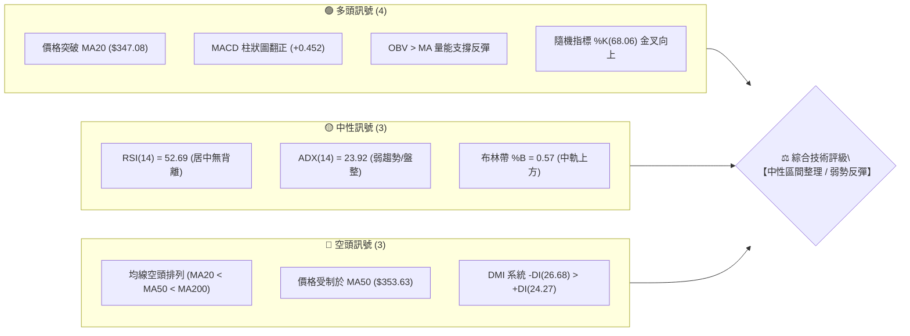
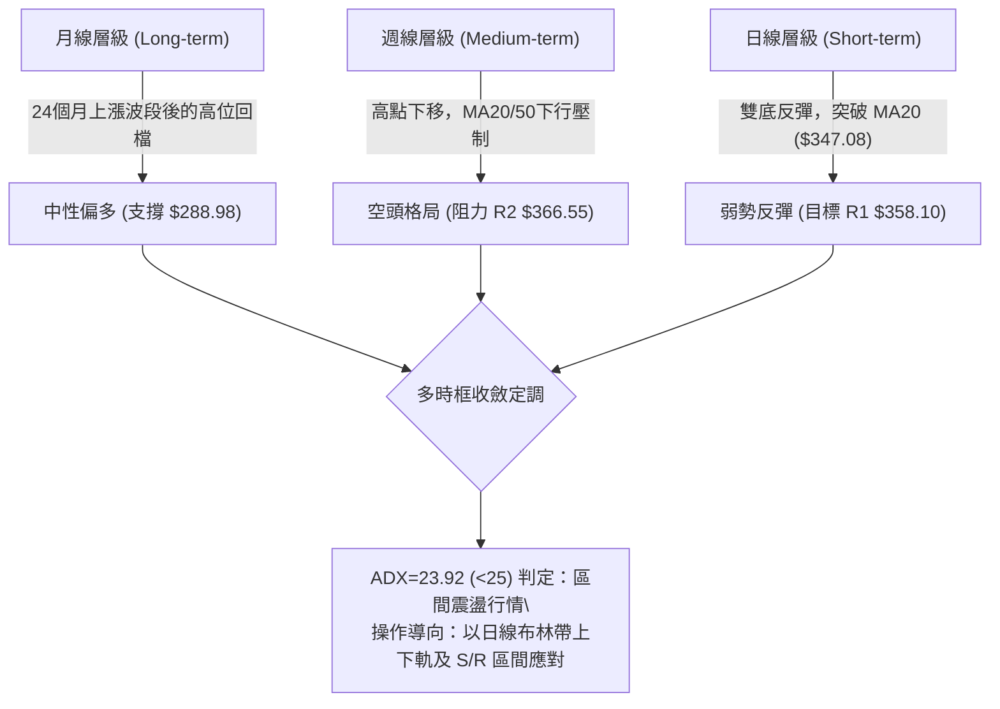
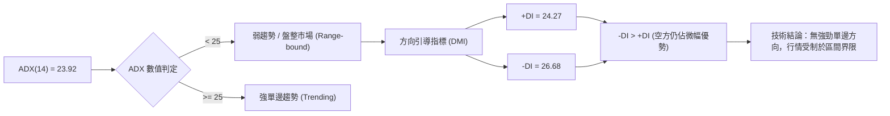
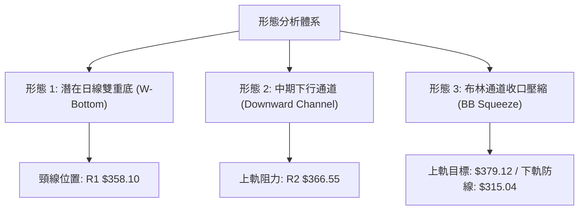
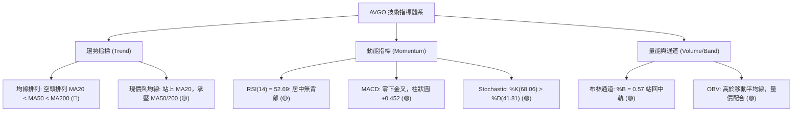
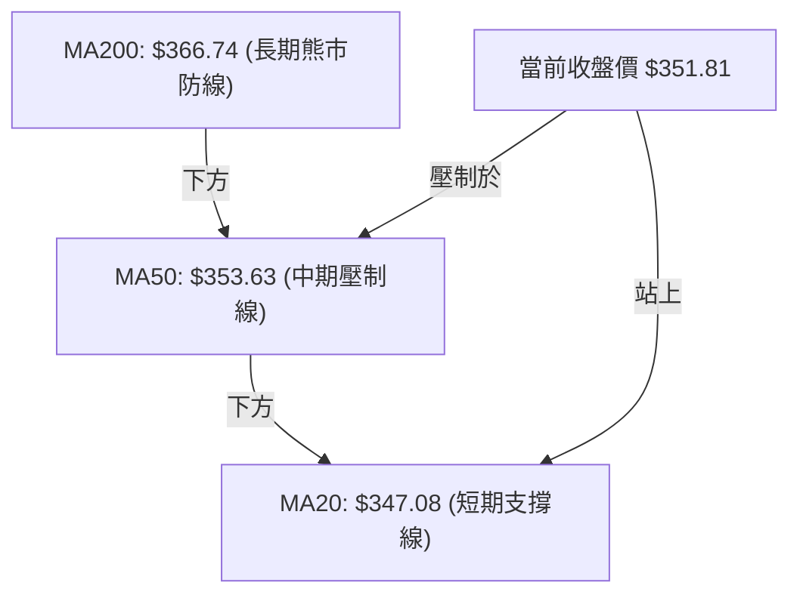
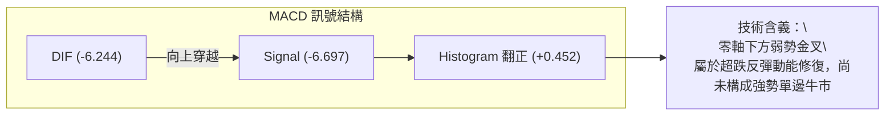
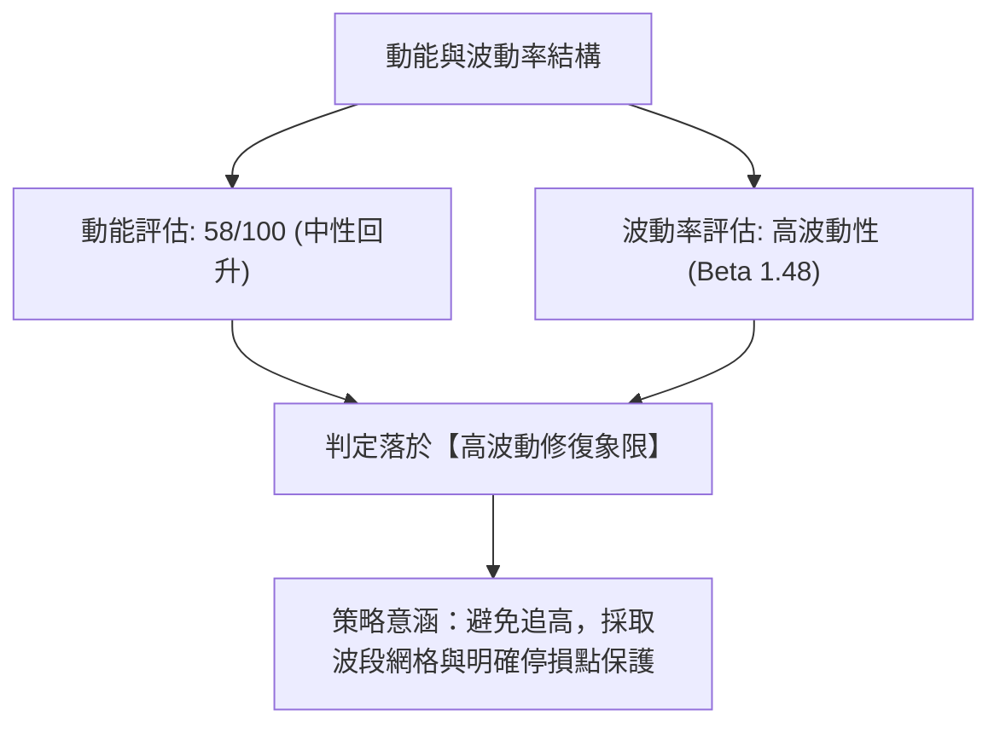
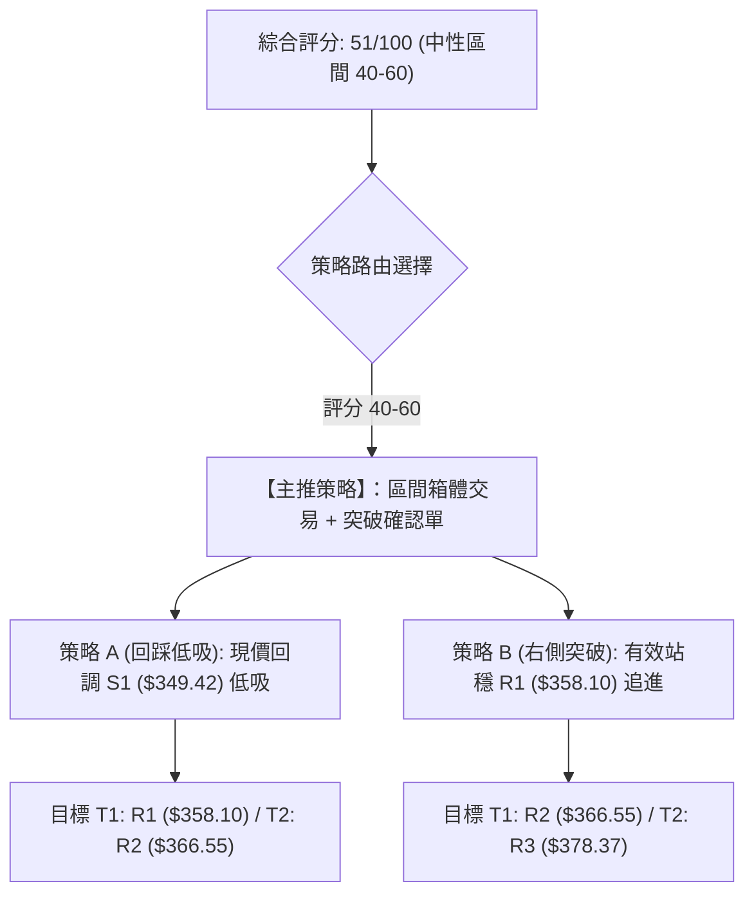
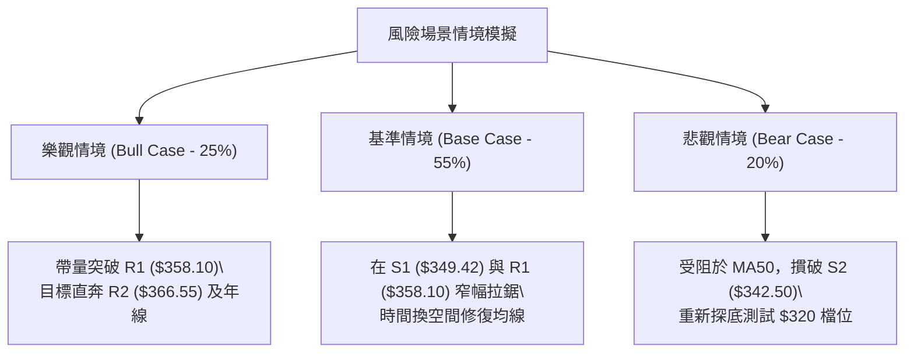

# AVGO 技術分析報告

> **報告日期**：2026-10-29 ｜ **語言**：繁體中文 ｜ **數據來源**：Yahoo Finance ｜ **當前價格**：$351.81 USD

---

## 目錄

| 章節 | 內容 |
|------|------|
| [1. 技術面概覽](#1-技術面概覽) | 訊號儀表板、核心指標速覽、技術評分卡 |
| [2. 趨勢分析](#2-趨勢分析) | 多時框趨勢、12個月走勢、中期週線、ADX趨勢強度 |
| [3. 圖表形態分析](#3-圖表形態分析) | 形態識別信心度、K線組合識別、形態幾何測算 |
| [4. 支撐與阻力](#4-支撐與阻力) | 價位分布圖、阻力位、支撐位、斐波那契回調結構 |
| [5. 技術指標深度解讀](#5-技術指標深度解讀) | 均線系統、RSI背離、MACD柱狀圖、布林通道、OBV量價 |
| [6. 動能與波動率](#6-動能與波動率) | 動能四象限、ATR波動率、Beta市場敏感度 |
| [7. 多時框架總結](#7-多時框架總結) | 時框評分矩陣、多時框收斂原則與方向定調 |
| [8. 交易策略建議](#8-交易策略建議) | 策略路由、價格情境階梯、主策略設定、風控對沖 |
| [9. 風險提示與監控](#9-風險提示與監控) | 監控指標Checklist、風險情境路徑、風控總結 |

---

## 1. 技術面概覽

### 🎯 技術訊號儀表板

Broadcom Inc.（AVGO）目前呈現「短期超跌反彈、中長期均線受壓、指標處於低檔金叉但面臨區間整理」的格局。ADX 數值為 23.92，表明市場處於弱趨勢／區間震盪階段。



---

### 📊 核心指標速覽表

| 指標類別 | 指標名稱 | 當前數值 | 訊號 | 解讀與技術意義 |
|:---|:---|:---|:---:|:---|
| **價格** | 當前收盤價 | $351.81 | 🟡 | 位於 52 週區間 30.7% 位置，短線自低檔 $320.23 回升 |
| **短期均線** | MA20 | $347.08 | 🟢 | 現價站上 MA20（+1.36%），短線脫離急跌陰影 |
| **中期均線** | MA50 | $353.63 | 🔴 | 現價位於 MA50 下方，構成直接動態阻力 |
| **長期均線** | MA200 | $366.74 | 🔴 | 年線層級承壓，大格局仍屬空頭反彈修正波 |
| **動能指標** | RSI(14) | 52.69 | 🟡 | 位於 50 強弱分水嶺附近，無超買或超賣現象 |
| **動能指標** | MACD (12,26,9) | -6.244 / -6.697 | 🟢 | MACD 於零軸下方出現黃金交叉，柱狀圖 +0.452 |
| **隨機指標** | KD (14,3,3) | %K 68.06 / %D 41.81 | 🟢 | 低檔金叉後持續向上發散，短線動能偏多 |
| **趨勢強度** | ADX(14) | 23.92 | 🟡 | ADX < 25 表明無單邊趨勢，行情轉入區間震盪 |
| **趨勢方向** | DMI (+DI / -DI)| 24.27 / 26.68 | 🔴 | -DI 仍略高於 +DI，空方力量尚未完全消退 |
| **通道指標** | 布林通道 | 中軌 $347.08 / 上軌 $379.12 | 🟢 | %B 為 0.57，位於中軌上方，朝向通道上半部運行 |
| **量能指標** | 成交量 / OBV | 22.63M (量比 1.03x) | 🟢 | OBV > MA，量能有效確認近日自 $320 檔位的反彈 |
| **波動度** | ATR(14) | $11.47 (3.26%) | 🟡 | 波動度適中，提供單日 $11.5 左右的操作空間 |

---

### 🏆 技術評分卡

依據 6 項子維度綜合量化評定，各維度基準滿分為 100 分。

```
╔══════════════════════════════════════════════════════════════╗
║              技術評分卡 — AVGO (2026-10-29)                  ║
╠══════════════════════════════════════════════════════════════╣
║ 趨勢強度 (ADX<25, 空頭主導)   ████████░░░░░░░░░░░░  42/100 🟡 ║
║ 動能指標 (MACD翻正, RSI中性)  ████████████░░░░░░░░  58/100 🟡 ║
║ 支撐穩定度 (S1/S2支撐確認)    █████████████░░░░░░░  65/100 🟢 ║
║ 成交量配合 (OBV偏多, 量比1.03)███████████░░░░░░░░░  55/100 🟡 ║
║ 形態完整度 (雙底初成, 頸線待破)██████████░░░░░░░░░░  48/100 🟡 ║
║ 均線排列 (空頭排列, 站上MA20) ████████░░░░░░░░░░░░  38/100 🔴 ║
╠══════════════════════════════════════════════════════════════╣
║ 綜合評分 (六項算術平均)       ██████████░░░░░░░░░░  51/100 🟡 ║
║ 評級結論：【中性觀望 / 區間震盪操作】                         ║
╚══════════════════════════════════════════════════════════════╝
```

*計算式驗證：(42 + 58 + 65 + 55 + 48 + 38) ÷ 6 = 306 ÷ 6 = 51.0 分（評級：中性 51/100）。*

---

## 2. 趨勢分析

### 🌐 多時框趨勢分析

透過多時框架收斂體系，AVGO 當前呈現「長線多頭回撤、中線空頭整理、短線弱勢反彈」的複雜交織結構。



---

### 📈 長期趨勢 — 12個月走勢圖（ASCII）

以下展示過去 12 個月（2025-11 至 2026-10）收盤價走勢路徑：

```
AVGO 月線收盤走勢圖（過去 12 個月：2025-11 至 2026-10）
價格軸 ($)
$450 ┤                                  ● $445.25 (2026-05 次高點)
$420 ┤                             ● $416.01
$400 ┤ ● $399.99 (2025-11)
$380 ┤                                       ● $377.06   ● $388.57
$360 ┤      ● $366.90                                         ● $369.67
$340 ┤           ● $344.20                                         ● $351.19  ● $351.81 (現價)
$320 ┤                ● $329.48 ● $317.80
$300 ┤                               ● $308.46 (2026-03 低點)
     └──────────────────────────────────────────────────────────────────────────
       11   12   01   02   03   04   05   06   07   08   09   10 (月份)
```

#### 走勢特徵分析表格

| 階段區間 | 時間跨度 | 起訖收盤價 | 漲跌幅 | 結構特徵與技術解讀 |
|:---|:---|:---|:---:|:---|
| **階段一：回檔整理** | 2025-11 → 2026-03 | $399.99 → $308.46 | -22.88% | 自 $400 大關回調，於 $308.46 尋獲長期波段買盤支撐 |
| **階段二：主升噴出** | 2026-03 → 2026-05 | $308.46 → $445.25 | +44.35% | AI 浪潮推動，創下月線收盤高點，並衝出 52W 最高 $493.32 |
| **階段三：大幅修正** | 2026-05 → 2026-06 | $445.25 → $377.06 | -15.31% | 高檔獲利回吐，出現月線級別吞噬性修正 |
| **階段四：次高震盪** | 2026-06 → 2026-08 | $377.06 → $369.67 | -1.96%  | 7月短暫反彈至 $388.57，但8月再度轉弱，形成頭部雛形 |
| **階段五：築底盤整** | 2026-08 → 2026-10 | $369.67 → $351.81 | -4.83%  | 9月、10月連續兩個月收在 $351 附近，顯示下行賣壓在 $350 鈍化 |

---

### 📊 中期趨勢（週線分析）

從近 8 週收盤走勢來看，AVGO 經歷了一輪加速下探後的企穩修復：

```
中期週線關鍵壓制與支撐結構示意圖
阻力軸  R3: $378.37 ──────────────────────────────────────── (波段重壓力區)
        R2: $366.55 ──────────────┐ (週線下行通道上軌)
        R1: $358.10 ──────┐       │
現價區  $351.81  ─────────┼───────┼───────────────────────── (當前突破 MA20 回測中)
        S1: $349.42 ──────┘       │
支撐軸  S2: $342.50 ──────────────┘ (頸線支撐防線)
        S3: $335.20 ──────────────────────────────────────── (前波起漲支撐)
        破底點: $320.23 ── (2026-10-23 週K低點，近期絕對底部)
```

週線指標顯示，在 2026-10-16 當週收跌至 $328.75（週 RSI 跌至 34.9）、10-23 當週探底 $320.23 後，本週（截至 10-28）大幅反彈至 $351.81，週 RSI 快速抽升至 52.7，MACD 柱狀圖收斂翻正（+0.452），顯示中期跌勢暫告告一段落。

---

### ⚡ 趨勢強度評估（ADX 解讀）



#### ADX 趨勢強度對照表

| 評估項目 | 數值 / 狀態 | 閾值標準 | 專業解讀 |
|:---|:---:|:---:|:---|
| **趨勢強度 (ADX)** | 23.92 | < 25.0 | 趨勢動能偏弱，市場缺乏連續單邊推動力，順勢突破策略易失效 |
| **正向趨向 (+DI)** | 24.27 | - | 買方動能自低檔回升，但尚未跨越 25 強勢線 |
| **負向趨向 (-DI)** | 26.68 | - | 賣方力量自 30 以上回落，但仍高於 +DI，空頭尚未棄守 |
| **方向差距 (DI Spread)** | -2.41 | - | 差值微小，預示即將進入多空拉鋸的震盪膠著期 |
| **交易操作指引** | 震盪模式 | ADX < 25 | **嚴禁追漲殺跌**，交易策略應轉為「支撐位低吸、阻力位高拋」 |

---

## 3. 圖表形態分析

### 🔍 形態識別系統

在日線與週線的價位波動中，價格在經歷連續下挫後，於 $320 檔位獲得強烈技術支撐，形成了典型的短線雙重底形態雏形，但上方受制於中期均線密集壓制區。



#### 形態識別與信心度評估表

| 形態名稱 | 信心度 | 判斷依據（嚴格引用數據） | 完成度 | 目標價計算式與精確目標 |
|:---|:---:|:---|:---:|:---|
| **短線雙重底 (W-Bottom)** | 62% | 左底 2026-10-16 低點 $328.58，右底 2026-10-23 低點 $320.23；兩次探底後強勁拉升 | 75% | 頸線阻力 R1 ($358.10) − 右底低點 ($320.23) = 形態高度 $37.87。<br>突破目標 = $358.10 + $37.87 = **$395.97**（若突破 R1 成立） |
| **中期下行通道整理** | 70% | 自 8 月高點回調以來，連續受制於週線下行壓制，波段高點聚類於 R2 $366.55 | 85% | 上軌阻力位 **$366.55**（R2）；通道下軌支撐對應 S3 **$335.20** |
| **頭肩頂形態** | 25% | *數據不足以確認左肩與右肩對稱結構* | N/A | **訊號不足，僅做指標型解讀**（依規則 15 註明） |

---

### 🕯️ 重要 K 線形態分析

嚴格依據數據中「近 10 根日 K」與「近 8 根週 K」實際數據解讀：

#### 近 10 根日 K 線形態解讀

| 日期（日K） | 開盤價 | 最高價 | 最低價 | 收盤價 | 成交量 | K線形態名稱 | 技術解讀與訊號強度 |
|:---|:---:|:---:|:---:|:---:|:---:|:---|:---|
| 2026-10-15 | 338.34 | 344.70 | 334.61 | 344.33 | 28,455,800 | 實體中陽線 | 探底回升，多頭反撲 🟢 |
| 2026-10-16 | 338.48 | 339.59 | 328.58 | 328.75 | 29,839,600 | 大陰線光腳 | 放量下殺，摜破短期支撐 🔴 |
| 2026-10-19 | 338.75 | 340.20 | 333.82 | 334.59 | 17,457,600 | 縮量十字星 | 跌勢暫歇，市場多空觀望 🟡 |
| 2026-10-20 | 334.00 | 341.10 | 330.80 | 334.37 | 15,951,800 | 紡錘線 (Spinning) | 波動收縮，空方動能減弱 🟡 |
| 2026-10-21 | 338.03 | 339.24 | 332.29 | 337.80 | 17,123,600 | 小陽線 | 試探性回升，但量能不足 🟡 |
| 2026-10-22 | 326.53 | 330.82 | 321.02 | 323.24 | 28,139,100 | 跳空放量長陰 | 空方再次發力，直逼前波低點 🔴 |
| 2026-10-23 | 321.50 | 327.70 | 320.23 | 321.68 | 15,917,000 | 縮量探底錘頭 | 最低點 $320.23 獲利多支撐，縮量見底 🟢 |
| 2026-10-26 | 324.53 | 332.12 | 323.25 | 329.17 | 18,646,700 | 啟動陽線 | 脫離底部，確認 $320 支撐有效 🟢 |
| 2026-10-27 | 339.87 | 345.67 | 336.87 | 342.33 | 25,567,200 | 跳空放量中陽 | 連續突破 MA5 與 MA10，多方掌握短線主導 🟢 |
| 2026-10-28 | 349.22 | 352.40 | 344.35 | 351.81 | 22,629,700 | 光頭強勢大陽 | 站上 MA20 ($347.08)，挑戰 S1 轉化區 🟢 |

#### 近 8 根週 K 線形態解讀

| 日期（週K） | 開盤價 | 最高價 | 最低價 | 收盤價 | 週成交量 | K線形態名稱 | 技術解讀與訊號強度 |
|:---|:---:|:---:|:---:|:---:|:---:|:---|:---|
| 2026-09-11 | 363.02 | 372.02 | 357.10 | 361.33 | 101,544,300 | 衝高回落小陰 | 受制於 $372 壓力，多頭受挫 🔴 |
| 2026-09-18 | 348.99 | 362.62 | 335.20 | 356.96 | 149,021,600 | 長下影線錘頭 | 下探 S3 ($335.20) 獲得主力買盤承接 🟢 |
| 2026-09-25 | 358.66 | 366.55 | 346.89 | 352.81 | 107,643,000 | 衝高受阻流星 | 觸及 R2 ($366.55) 遭空方強力壓制 🔴 |
| 2026-10-02 | 352.87 | 361.86 | 343.29 | 355.14 | 109,689,700 | 窄幅震盪十字 | 多空平衡，醞釀方向選擇 🟡 |
| 2026-10-09 | 357.79 | 380.84 | 356.14 | 361.54 | 114,351,000 | 長上影假突破 | 衝擊 R3 ($378.37) 形成多頭陷阱 🔴 |
| 2026-10-16 | 359.43 | 360.69 | 328.58 | 328.75 | 115,026,300 | 週線光腳長陰 | 假突破後慘烈殺跌，破壞週均線 🔴 |
| 2026-10-23 | 338.75 | 341.10 | 320.23 | 321.68 | 94,589,100 | 下影探底陰線 | 創出本輪回調低點 $320.23，賣壓耗竭 🟡 |
| 2026-10-28 | 324.53 | 352.40 | 323.25 | 351.81 | 66,843,600 | 週線長實體中陽 | 本週強勢拉升近 $30，一陽吞兩陰 🟢 |

---

### 📉 ASCII 走勢形態示意圖

```
AVGO 近期雙重底打底與頸線壓制示意圖
價格軸 ($)
$366.55 ┤                                                  [R2 強阻力]
$358.10 ┤───────────────────────────┬────────────── [R1 頸線阻力]
$351.81 ┤                           │       ★ 現價 ($351.81，挑戰 MA50)
$347.08 ┤                           │   ▲ 突破 MA20
$335.20 ┤          ●                │  /           [S3 歷史支撐]
$328.58 ┤         / \               │ /
$320.23 ┤────────●───\─────────────●─/ ────────── [絕對底部防線]
         (10-16 左底)         (10-23 右底)
         └───────────────────────────────────────► 時間軸
```

---

### 🎯 形態目標價計算

根據日線雙底結構的幾何學量測法則，各關鍵點位計算如下：
1. **頸線確認位**：引用自波段高點聚類 **R1 = $358.10**。
2. **形態底部低點**：取雙底右底極值 **$320.23**。
3. **形態垂直高度**：$H = \$358.10 - \$320.23 = \mathbf{\$37.87}$。
4. **最小量度滿足目標價**：$P_{\text{Target}} = \text{頸線 } \$358.10 + H (\$37.87) = \mathbf{\$395.97}$。
5. **形態失敗止損位**：跌破右底起漲點，即波段支撐 **S2 = $342.50** 作為短線多頭結構破壞點。

---

## 4. 支撐與阻力

### 🗺️ 關鍵價位分布圖（ASCII）

```
AVGO 價位結構分布圖（嚴格依據 OHLCV 歷史聚類數據）
══════════════════════════════════════════════════════════════
$378.37 ║██████████████████████████████║ 強阻力 R3 (波段多頭極限)
$367.03 ║░░░░░░░░░░░░░░░░░░░░░░░░░░░░░░║ 斐波那契 61.8% 重合帶
$366.55 ║██████████████████████        ║ 中期關鍵阻力 R2 / MA200 ($366.74)
$358.10 ║████████████████████████████  ║ 短線關鍵阻力 R1 (頸線突破點)
$353.63 ║──────────────────────────────║ 動態阻力 MA50
$351.81 ╠══════════════════════════════╣ ◄ 現價 (收盤價)
$349.42 ║▓▓▓▓▓▓▓▓▓▓▓▓▓▓▓▓▓▓▓▓▓▓        ║ 近期第一支撐 S1
$347.08 ║──────────────────────────────║ 動態支撐 MA20 (布林中軌)
$342.50 ║██████████████████████████    ║ 關鍵波段支撐 S2
$335.20 ║██████████████████████████████║ 強力防守支撐 S3
$332.71 ║░░░░░░░░░░░░░░░░░░░░░░░░░░░░░░║ 斐波那契 78.6% 回調位
══════════════════════════════════════════════════════════════
```

---

### 🚧 阻力位分析表

阻力位嚴格引用數據中近一年波段高點聚類計算數值：

| 阻力級別 | 精確價位 | 距現價幅幅 | 形成原因與技術共振 | 突破難度 | 重要性權重 |
|:---|:---:|:---:|:---|:---:|:---:|
| **阻力一 (R1)** | **$358.10** | +1.79% | 近期多次衝高回落頸線位；臨近 MA50 ($353.63) 反壓帶 | 中等 🟡 | ★★★★☆ |
| **阻力二 (R2)** | **$366.55** | +4.19% | 2026-09-25 週K波段高點；與 MA200 ($366.74) 形成完美技術共振 | 極高 🔴 | ★★★★★ |
| **阻力三 (R3)** | **$378.37** | +7.55% | 2026-10-09 週K假突破長上影頂部；布林通道上軌 ($379.12) 強壓區 | 極高 🔴 | ★★★★☆ |

---

### 🛡️ 支撐位分析表

支撐位嚴格引用數據中近一年波段低點聚類計算數值：

| 支撐級別 | 精確價位 | 距現價跌幅 | 形成原因與技術共振 | 守住機率 | 重要性權重 |
|:---|:---:|:---:|:---|:---:|:---:|
| **支撐一 (S1)** | **$349.42** | -0.68% | 短線拉升回踩第一防線；緊鄰 MA20 動態支撐 ($347.08) | 70% 🟢 | ★★★★☆ |
| **支撐二 (S2)** | **$342.50** | -2.65% | 10-27 跳空起漲平台低點；短線多空強弱分水嶺 | 80% 🟢 | ★★★★★ |
| **支撐三 (S3)** | **$335.20** | -4.72% | 2026-09-18 週K長下影波段底點；斐波那契 78.6% ($332.71) 護城河 | 90% 🟢 | ★★★★★ |

---

### 📐 斐波那契回調位分析

依據 52 週波段區間（$288.98 → $493.32），總回調區間跨度達 $204.34：

| 回調比例 | 斐波那契價位 | 當前價位相對位置 | 結構意涵與技術解讀 |
|:---|:---:|:---:|:---|
| **0.0%** (52W High) | **$493.32** | +40.22% | 歷史天花板，本輪 AI 浪潮頂部 |
| **23.6%** | **$445.09** | +26.51% | 強勢回檔防守線，2026-05 月線收盤處 |
| **38.2%** | **$415.26** | +18.04% | 關鍵牛熊平衡軸，2026-04 月線突破平台 |
| **50.0%** | **$391.15** | +11.18% | 半數回撤心理關卡，多頭修復極限區 |
| **61.8% (黃金分割)** | **$367.03** | +4.33% | **極核心多空樞紐**；與阻力 R2 ($366.55) 及 MA200 ($366.74) 形成三合一高壓共振帶 |
| **78.6%** | **$332.71** | -5.43% | **深度防禦回撤位**；10月低點 $320.23 探底成功守穩於此線附近 |
| **100.0%** (52W Low) | **$288.98** | -17.86% | 52 週最低點，終極多頭防線 |

**斐波那契定位解讀**：
當前收盤價 **$351.81** 正好處於 **61.8% ($367.03)** 與 **78.6% ($332.71)** 之間。這表明 AVGO 已結束了自 $493.32 回撤至 78.6% 的極端超跌階段，目前正展開朝向黃金分割 61.8% 水準的「死貓跳／技術性修復反彈」。只要價格無法有效突破 $367.03，整體的斐波那契框架仍定義為「熊市回撤波中的次級反彈」。

---

## 5. 技術指標深度解讀

### 🎛️ 指標訊號總覽



---

### 📈 移動平均線排列分析



#### 均線全景數據解析

| 均線名稱 | 當前價格 | 與現價乖離 | 排列狀態 | 走勢特徵解讀 |
|:---|:---:|:---:|:---:|:---|
| **MA5** | $333.65 | +5.44% | 向上發散 | 短期 5 日斜率極度陡峭向上，急彈動能充沛 |
| **MA10** | $334.81 | +5.08% | 向上翻揚 | 提供極短線第一道下檔動態保護 |
| **MA20** | $347.08 | +1.36% | 由降轉平 | 現價站上 MA20，短期翻多，確立打底反彈架構 |
| **MA50** | $353.63 | -0.51% | 下行壓制 | 空方前鋒阻力，現價在此處面臨爭奪 |
| **MA60** | $362.97 | -3.07% | 下行 | 季線下彎，中線壓力持續沉重 |
| **MA120** | $380.69 | -7.59% | 下行 | 半年線向下扣高，半年內套牢盤密集 |
| **MA200** | $366.74 | -4.07% | 走平下垂 | **長期牛熊分界**，目前 MA20 < MA50 < MA200 呈現典型空頭排列 |
| **MA240** | $365.21 | -3.67% | 走平 | 年線附近籌碼沉澱，與 MA200 形成雙重阻力壁壘 |

---

### 📉 RSI(14) 分析

*   **當前數值**：**52.69**（Wilder 計算平滑法）
*   **強度進度條**：
    `超賣 (0) ░░░░░░░░░░░░ 52.69 ▓▓▓▓▓▓▓▓▓▓░░░░░░░░░░ 超買 (100)`
*   **區間定位**：處於 50–60 中性偏多區間，已自前週超賣邊緣（10-16 週 RSI 僅 34.9）完全修復。
*   **背離檢驗結論**：
    依據近 20 根 K 棒首尾之價格與 RSI 方向比對：**無明顯背離現象**。低點 $320.23 對應 RSI 同步回落，隨後價格拉升與 RSI 指數同步揚升，屬於正常的指標跟隨價格修復，不具備頂背離或底背離的極端反轉提示。

---

### 📊 MACD (12, 26, 9) 訊號解讀

```
MACD 數值快照：
DIF (MACD 線):  -6.244
DEA (Signal 線): -6.697
MACD Histogram:  +0.452 🟢 (金叉向上)
```



雖然 MACD 出現了黃金交叉且柱狀圖翻紅，但由於雙線均深處於零軸下方（< 0），這在技術分析中被界定為「弱勢環境下的空頭回補浪」，不可盲目視為反轉大牛市，上方零軸附近將面臨嚴峻考驗。

---

### 📦 布林通道分析

布林帶寬度與軌道結構如下：
*   **BB 上軌**：$379.12
*   **BB 中軌 (MA20)**：$347.08
*   **BB 下軌**：$315.04
*   **帶寬**：$64.08 (18.2%)
*   **%B 指標**：**0.57** (0=下軌, 0.5=中軌, 1=上軌)

```
AVGO 布林通道位置示意圖
$379.12 ┬────────────────────────────────────────── 布林上軌
        │
        │
$351.81 ┼─── ★ 現價 ($351.81, %B = 0.57，突破中軌上方)
$347.08 ┼─── ────────────────────────────────────── 布林中軌 (MA20)
        │
        │
$315.04 ┴────────────────────────────────────────── 布林下軌
```

現價自布林下軌 $315 附近展開強勁抽拔，目前已成功跨越中軌 $347.08，表明短線空頭擠壓告一段落，價格進入通道上半區間，短線運行通道目標指向上軌 $379.12 與阻力 R3 ($378.37) 的結合處。

---

### 💹 成交量分析（量價配合度）

1.  **量能指標比對**：
    *   最新單日成交量：**22,629,700** 股
    *   20 日均量 (20MA Volume)：**22,001,185** 股（量比：**1.03x**）
    *   50 日均量 (50MA Volume)：**23,992,776** 股
2.  **量價配合狀態**：
    *   **OBV 趨勢**：數據明確顯示「**OBV > MA → 量能支撐上漲**」。在過去 3 個交易日內，價格自 $321.68 連續拔高至 $351.81，成交量逐日溫和放大至 2,260 萬股，量價呈現良性同步放大格局。
    *   **籌碼鎖定度**：機構持股佔比高達 79.8%，空頭回補帶動的量能有效托舉價格，未出現量價背離的量縮虛漲現象。

---

## 6. 動能與波動率

### ⚡ 動能評估四象限

評估 AVGO 在「動能強度 (以 RSI/MACD 為主)」與「波動率 (以 ATR/Beta 為主)」兩大維度的定位：

| 象限 | 動能維度 | 波動維度 | 典型特徵 | AVGO 當前所處狀態評估 |
|:---:|:---:|:---:|:---|:---|
| **第一象限 (Q1)** | 強動能 (Bullish) | 低波動 (Low Vol) | 穩定單邊牛市 | 非當前狀態 |
| **第二象限 (Q2)** | 弱動能 (Bearish) | 低波動 (Low Vol) | 沉悶陰跌盤整 | 非當前狀態 |
| **第三象限 (Q3)** | 強動能 (Bullish) | 高波動 (High Vol) | 激進突破爆發 | 非當前狀態 |
| **第四象限 (Q4)** | **中弱動能 (Neutral)** | **高波動 (High Vol)** | **劇烈震盪修正 / 弱勢反彈** | **✓ 當前精準落點：動能修復期但高 Beta 震盪** |



---

### 📊 ATR 波動率分析

*   **ATR(14) 數值**：**$11.47** (Wilder 平滑)
*   **佔股價比例**：**3.26%**
*   **專業波動解讀**：
    AVGO 每日平均真實波動幅度達 $11.47，具備顯著的日間波幅與震盪空間。
*   **止損與風控設置指引**：
    *   **日間波動緩衝 (1.0 × ATR)**：$11.47（適合超短線當沖防守）。
    *   **波段防守保護 (1.5 × ATR)**：$1.5 \times \$11.47 = \mathbf{\$17.21}$。
    *   **波段安全邊界 (2.0 × ATR)**：$2.0 \times \$11.47 = \mathbf{\$22.94}$。
    在現價 $351.81 建立的多頭部位，其基準技術防守位應設於現價減去 1.0–1.5 倍 ATR 之外，恰好對應於 **S1 ($349.42)** 與 **S2 ($342.50)** 區間內。

---

### 📐 Beta 與市場相關性

*   **Beta 係數**：**1.476**
*   **市場敏感度解讀**：
    AVGO 具備高度進攻性，其波動幅度比標普 500 指數高出 47.6%。在半導體板塊及整體科技股走強時，AVGO 具備充沛的超額收益（Alpha）爆發力；然而在市場流動性緊縮或大盤回調時，其下行殺傷力亦同步放大。此高 Beta 特徵要求投資人必須嚴格控制單筆部位權重，避免波動過度侵蝕本金。

---

## 7. 多時框架總結

### 📋 時框架評分表

| 時框架 | 趨勢方向 | 動能狀態 | 均線排列 | 形態特徵 | 綜合評分 | 戰術建議 |
|:---|:---:|:---:|:---:|:---|:---:|:---|
| **日線 (短期)** | 偏多 🟢 | 強烈反彈 | 站上 MA20，承壓 MA50 | 雙底雛形初現，衝擊頸線 | **62/100** | 尋找回踩 S1 不破的高勝率低吸點 |
| **週線 (中期)** | 偏空 🔴 | 弱勢回穩 | 受制於下行 MA20/MA50 | 處於下行通道，本週長陽修復 | **46/100** | 逢高在阻力 R2/R3 減碼防守 |
| **月線 (長期)** | 中性 🟡 | 高位整理 | 位於 MA240 之上 | 52W 區間 30.7% 處長線打底 | **51/100** | 逢低分批布局，不宜單筆重倉追高 |

---

### 🔲 綜合訊號矩陣

| 技術維度 | 短期（日線） | 中期（週線） | 長期（月線） | 多時框一致性解讀 |
|:---|:---:|:---:|:---:|:---|
| **趨勢方向** | 弱勢反彈 🟢 | 空頭回檔 🔴 | 長牛修正 🟡 | 衝突中：長多中期空，短期超跌反彈 |
| **量能狀態** | 溫和放量 🟢 | 縮量企穩 🟡 | 均量持平 🟡 | 底部量能初步回補，尚未達井噴程度 |
| **支撐阻力** | 突破 S1 轉支撐 🟢 | 考驗 R1/R2 壓力 🔴 | 守住 78.6% 斐波那契 🟢 | 空間受限於 S1 ($349) 至 R2 ($366) 之間 |

---

### ⚖️ 多時框收斂結論

**嚴格遵循多時框收斂規則（規則 14）**：
1.  **趨勢 vs 盤整判定**：當前 ADX(14) 數值為 **23.92 (< 25.0)**，系統強制判定當前市場處於**【盤整行情（Range-bound）】**，而非強單邊趨勢行情。
2.  **主導時框與交易邏輯**：在盤整行情下，不宜採用日線級別的追價順勢策略，而必須以**「日線布林通道上下軌（$315.04 – $379.12）及關鍵 S/R 區間」**為主要交易邊界。週線與月線的空頭壓制限制了向上空間，日線反彈動能提供了局部操作利潤。
3.  **唯一方向性定調結論**：**【中性觀望，區間震盪偏多操作】**。本結論嚴格收斂第 1 章技術評分卡（51/100），並作為第 8 章交易策略的唯一指針。

---

## 8. 交易策略建議

### 🗺️ 策略決策流程圖



---

### 🧭 策略路由

**當前主策略方向 = 【中性區間操作，以高拋低吸為主，嚴格依據 51/100 評分分流】**。
由於綜合評分處於 40–60 的中性區間，且 ADX < 25，禁止激進單邊下注，重點把握「回踩支撐低吸（策略 A）」與「確認突破頸線跟進（策略 B）」兩套紀律化劇本。

---

### 🎯 價格情境階梯（Price Scenarios）

價位嚴格引用第 4 章及數據計算數值：

| 觸發條件 | 下一目標價 | 後續延伸目標 | 情境技術含義 |
|:---|:---:|:---:|:---|
| **向上突破 R1 ($358.10)** | **R2 ($366.55)** | **R3 ($378.37)** | 短線雙底確立，衝擊 200 日均線及 61.8% 斐波那契重壓帶 |
| **持穩現價區間 ($349 – $353)** | **$355.00** | **$358.10** | 消化 MA50 阻力，於布林通道上半部進行強勢橫盤整理 |
| **跌破 S1 ($349.42)** | **S2 ($342.50)** | **S3 ($335.20)** | 短線反彈動能衰退，重新下探打第二隻腳尋找實質支撐 |

---

### 📊 情境機率分佈

| 運行情境 | 發生機率 | 主要技術依據（嚴格引用指標） |
|:---|:---:|:---|
| **區間震盪整理** | **50%** | ADX=23.92 表明趨勢動能不足；布林通道帶寬收窄；現價夾在 MA20 與 MA50 之間 |
| **繼續向上反彈** | **35%** | MACD 柱狀圖翻正 (+0.452)；OBV > MA 量能充沛；站穩布林中軌 (%B = 0.57) |
| **再度下殺探底** | **15%** | 均線系統呈空頭排列 (MA20 < MA50 < MA200)；-DI(26.68) 仍壓制 +DI(24.27) |

---

### 🟢 主策略詳情（區間與突破操作）

嚴格依據規則 17 計算風險報酬比：$RR = \frac{T_1 - \text{進場價}}{\text{進場價} - \text{止損價}}$。

| 策略要素 | 策略 A（回踩支撐低吸單） | 策略 B（突破頸線順勢單） |
|:---|:---|:---|
| **策略類型** | 區間下軌左側低吸 | 右側確認突破追擊 |
| **進場條件** | 股價回踩 S1 不破，收出下影十字星確認 | 日K收盤價實體帶量突破頸線 R1 |
| **精確進場價格** | **$349.42** (S1 支撐位) | **$358.10** (R1 突破點位) |
| **第一目標價 T1** | **$358.10** (阻力 R1) | **$366.55** (阻力 R2) |
| **第二目標價 T2** | **$366.55** (阻力 R2) | **$378.37** (阻力 R3) |
| **嚴格止損價格** | **$342.50** (跌破支撐 S2) | **$349.42** (跌破支撐 S1) |
| **單筆承擔風險** | $\$349.42 - \$342.50 = \$6.92$ | $\$358.10 - \$349.42 = \$8.68$ |
| **T1 預期回報** | $\$358.10 - \$349.42 = \$8.68$ | $\$366.55 - \$358.10 = \$8.45$ |
| **風險報酬比** | **1 : 1.25（以 T1 計）**<br>*(以 T2 計為 1 : 2.48)* | **1 : 0.97（以 T1 計）**<br>*(以 T2 計為 1 : 2.34)* |
| **策略勝率評估** | 65% | 55% |
| **建議配置倉位** | 10% – 15% 總資金 | 8% – 10% 總資金 |

*風險報酬比驗證說明：*
*   *策略 A（以 T1 計）：$8.68 \div 6.92 = 1.254 \rightarrow \mathbf{1 : 1.25}$；（以 T2 計）：$(\$366.55 - \$349.42) \div 6.92 = 17.13 \div 6.92 = 2.475 \rightarrow \mathbf{1 : 2.48}$。*
*   *策略 B（以 T1 計）：$8.45 \div 8.68 = 0.973 \rightarrow \mathbf{1 : 0.97}$；（以 T2 計）：$(\$378.37 - \$358.10) \div 8.68 = 20.27 \div 8.68 = 2.335 \rightarrow \mathbf{1 : 2.34}$。*

---

### 🔴 反向風險觸發點（對沖提示）

若出現以下情境，將徹底推翻當前短線反彈邏輯，投資人應即刻執行多頭平倉或啟動做空對沖：
1.  **關鍵價位破位**：日線收盤價跌破 **S2 ($342.50)**，且伴隨成交量放大至 2,500 萬股以上。
2.  **動態指標破壞**：MACD 柱狀圖在零軸下方再次反轉轉負，且 RSI(14) 快速跌破 45。
3.  **對沖操作建議**：跌破 $342.50 後，預期將回測 **S3 ($335.20)** 及本輪低點 **$320.23**。可建立適量反向空頭部位，以 $349.42 作為防守止損點。

---

### ⭐ 整體訊號強度評星

```
做多訊號強度：★★★☆☆  (3.0/5星 — 短線反彈動能充沛，但受制於中期均線)
做空訊號強度：★★☆☆☆  (2.0/5星 — 空頭賣壓暫竭，做空性價比不足)
整體可信度：  ★★★☆☆  (3.5/5星 — 指標低檔收斂，區間邊界清晰明確)
```

---

## 9. 風險提示與監控

### ✅ 關鍵監控指標 Checklist

```
╔══════════════════════════════════════════════════════════════╗
║               交易監控與預警 Checklist                       ║
╠══════════════════════════════════════════════════════════════╣
║ [ ] 價格突破監控：收盤價是否放量站上 R1 ($358.10)            ║
║ [ ] 動態阻力監控：盤中能否站穩 MA50 ($353.63)               ║
║ [ ] 關鍵防守監控：回調是否跌破 S1 ($349.42) 及 MA20 ($347.08)║
║ [ ] 停損戒備監控：是否觸發 S2 ($342.50) 絕對止損點          ║
║ [ ] 動能背離監控：RSI(14) 衝刺 60 過程是否出現量價背離        ║
║ [ ] 趨勢變異監控：ADX(14) 是否升破 25 (標誌震盪轉單邊)       ║
║ [ ] 籌碼量能監控：OBV 是否持續維持在移動平均線上方          ║
╚══════════════════════════════════════════════════════════════╝
```

---

### ⚠️ 風險場景分析



---

### 🛡️ 風險管理重要提醒

1.  **高 Beta 與部位管理**：
    AVGO 的 Beta 高達 1.476，單日真實波幅 ATR 為 $11.47（3.26%）。在區間震盪階段，單一持倉部位建議嚴格限制在總投資組合的 **10% – 15%** 以內，嚴禁使用過度槓桿。
2.  **均線系統的「空頭慣性」警惕**：
    雖然短線價格站上 MA20，但當前 MA20 < MA50 < MA200 的死亡交叉空頭排列並未解除。歷史技術數據顯示，在空頭排列下的反彈往往在測試 MA50 或 MA200 時遭遇強烈解套賣壓，**不可抱持「V型反轉直破新高」的盲目樂觀心態**。
3.  **無條件停損紀律**：
    盤整交易的核心在於「盈虧比與止損保護」。若價格意外擊穿 **S2 ($342.50)**，說明雙底支撐失敗，必須無條件止損出場，切勿向下攤平。

---

## 📋 報告總結

```
╔══════════════════════════════════════════════════════════════╗
║              AVGO 技術分析報告總結 (2026-10-29)              ║
╠══════════════════════════════════════════════════════════════╣
║ 當前收盤價：$351.81 USD                                      ║
║ 技術總評分：51 / 100 🟡 (六維算術平均值)                      ║
║ 技術面評級：⚖️【中性觀望 / 區間震盪操作】                     ║
╠══════════════════════════════════════════════════════════════╣
║ 關鍵結論提煉：                                               ║
║ ├─ 長期趨勢：🟡 月線高位修正，自 52W 低點 $288.98 反彈 30.7% ║
║ ├─ 中期趨勢：🔴 週線受制於下行通道與 MA200 ($366.74) 均線壁壘║
║ ├─ 短期趨勢：🟢 日線自 $320.23 連續反彈，站穩 MA20 ($347.08)  ║
║ ├─ 關鍵支撐：S1: $349.42  ｜  S2: $342.50  ｜  S3: $335.20   ║
║ ├─ 關鍵阻力：R1: $358.10  ｜  R2: $366.55  ｜  R3: $378.37   ║
║ └─ 分析師目標：均價 $530.14 (高 $660.00 / 低 $215.88)        ║
╠══════════════════════════════════════════════════════════════╣
║ 最優交易策略組合：                                           ║
║ 1. 🥇 最佳機會（策略 A）：回踩 S1 ($349.42) 低吸，止損 $342.50║
║    目標 T1: $358.10 (風報比 1:1.25) / T2: $366.55 (1:2.48)   ║
║ 2. 🥈 次選機會（策略 B）：放量突破 R1 ($358.10) 追擊          ║
║    目標 T1: $366.55 (風報比 1:0.97) / T2: $378.37 (1:2.34)   ║
║ 3. 🥉 保守選擇：維持現金觀望，等待日線收盤站上 MA200 後進場   ║
╚══════════════════════════════════════════════════════════════╝
```

---

> ⚠️ **免責聲明**：本報告為依據客觀量化技術指標與圖表形態所生成之深度研究報告，所有引用數據均取自歷史價格資訊。本報告**僅供學術交流與研究參考**，**不構成任何形式的投資建議、要約或承諾**。證券投資伴隨高度市場風險，投資人應獨立評估自身風險承受能力並自負盈虧。

---

*報告完成時間：2026-10-29 ｜ 數據基底：Broadcom Inc. (AVGO) 歷史技術數據套件 ｜ 分析體系：多時框架技術分析*