# AVGO 技術分析報告

> **報告日期**：2026-10-30 ｜ **語言**：繁體中文 ｜ **數據來源**：Yahoo Finance ｜ **當前價格**：$345.00 USD

---

## 目錄

| 章節 | 內容 |
|------|------|
| [1. 技術面概覽](#1-技術面概覽) | 訊號儀表板、核心指標、評分卡 |
| [2. 趨勢分析](#2-趨勢分析) | 多時框趨勢、長中短期走勢、ADX 解讀 |
| [3. 圖表形態分析](#3-圖表形態分析) | 形態識別、K線組合、目標價計算 |
| [4. 支撐與阻力](#4-支撐與阻力) | 關鍵價位分布、阻力支撐表、斐波那契回調 |
| [5. 技術指標深度解讀](#5-技術指標深度解讀) | MA 排列、RSI、MACD、布林通道、量價配合 |
| [6. 動能與波動率](#6-動能與波動率) | 動能四象限、ATR 波動率、Beta 市場敏感度 |
| [7. 多時框架總結](#7-多時框架總結) | 時框架矩陣、多時框收斂定調 |
| [8. 交易策略建議](#8-交易策略建議) | 策略路由、主策略執行、風控與評星 |
| [9. 風險提示與監控](#9-風險提示與監控) | 監控清單、情境推演、風控架構 |
| [📋 報告總結](#-報告總結) | 核心結論與最佳策略組合 |

---

## 1. 技術面概覽

### 🎯 技術訊號儀表板

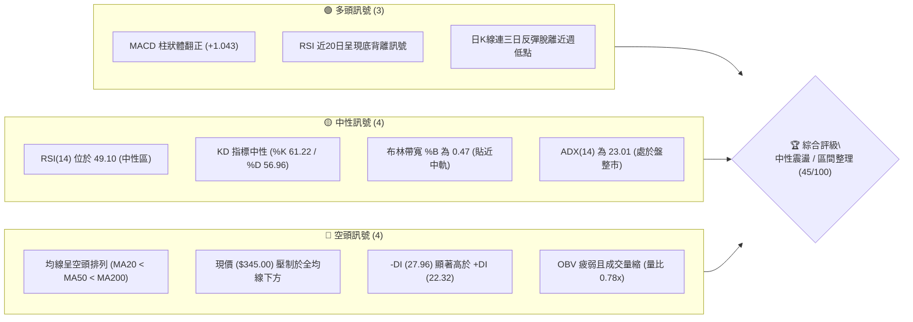

---

### 📊 核心指標速覽表

| 指標類別 | 指標名稱 | 當前數值 | 訊號 | 解讀 |
|:---|:---|:---|:---:|:---|
| **價格** | 當前價格 | $345.00 | 🟡 | 位於52週區間 27.4% 位置，自低點 $320.23 反彈 |
| **均線** | 短期 MA20 | $347.15 | 🔴 | 現價位於其下方 -0.62%，面臨首道動態均線壓制 |
| **均線** | 中期 MA50 | $353.29 | 🔴 | 價格位於 MA50 之下，中期下行趨勢尚未扭轉 |
| **均線** | 長期 MA200 | $366.70 | 🔴 | 價格低於年線，中長線技術格局處於弱勢空頭格局 |
| **動能** | RSI(14) | 49.10 | 🟡 | 脫離超賣區回升至中性水準，伴隨日線底背離跡象 |
| **動能** | MACD (12,26,9)| -5.393 / -6.436 | 🟢 | 零軸下出現黃金交叉，Histogram 擴張至 +1.043 |
| **趨勢強度**| ADX(14) | 23.01 | 🟡 | 數值低於 25，表明單邊趨勢衰竭，進入箱體震盪 |
| **布林通道**| 帶寬與位置 | BB中軌 $347.15 (%B 0.47)| 🟡 | 價格貼近中軌，正測試中軌壓力，未現單邊擴軌 |
| **成交量** | 成交量比率 | 16.92M / 20日均量 21.62M | 🔴 | 量比 0.78x，反彈未獲量能實質放大確認，OBV 偏弱 |
| **波動** | ATR(14) | $11.58 (3.36%) | 🟡 | 處於歷史常態區間，每日合理震盪幅度約 $11.58 |

---

### 🏆 技術評分卡

```
╔════════════════════════════════════════════════════════════════╗
║             技術評分卡 — AVGO (Broadcom Inc.) 2026-10-30       ║
╠════════════════════════════════════════════════════════════════╣
║ 趨勢強度      ████████░░░░░░░░░░░░  40/100  🟡 中性偏弱 (ADX=23.01)    ║
║ 動能指標      ██████████░░░░░░░░░░  52/100  🟡 中性格局 (底背離修復)    ║
║ 支撐穩定度    ███████████░░░░░░░░░  55/100  🟡 區間支撐 (S1/S2支撐漸成) ║
║ 成交量配合    ███████░░░░░░░░░░░░░  38/100  🔴 量能疲弱 (量比僅0.78x)  ║
║ 形態完整度    ██████████░░░░░░░░░░  48/100  🟡 箱底回升 (構建雙底雛形)  ║
║ 均線排列      ███████░░░░░░░░░░░░░  35/100  🔴 空頭排列 (MA20<50<200)  ║
╠════════════════════════════════════════════════════════════════╣
║ 綜合評分      █████████░░░░░░░░░░░  45/100  評級：中性震盪 (規則18算術平均)║
╚════════════════════════════════════════════════════════════════╝
```

---

## 2. 趨勢分析

### 🌐 多時框趨勢分析

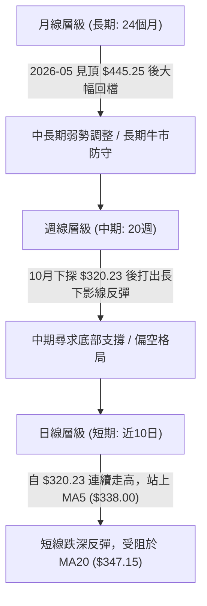

---

### 📈 長期趨勢 — 12個月走勢圖（Unicode）

依據月線收盤數據繪製過去 12 個月（2025-11 至 2026-10）價格走勢：

```
AVGO 月線走勢圖（過去12個月）
價格軸 ($)
$450 ┤                                  ● $445.25 (2026-05 高點)
$420 ┤                            ● $416.01
$390 ┤● $399.99 (2025-11)                               ● $388.57
$360 ┤             ● $366.90(10月)               ● $377.06     ● $369.67
$330 ┤       ● $344.20     ● $329.48   ● $317.80                     ● $351.19
$300 ┤                                       ● $308.46 (2026-03)           ● $345.00 (現在)
     └─────────────────────────────────────────────────────────────────────────► 時間
       11M   12M    01M    02M    03M    04M    05M    06M    07M    08M    09M    10M
```

#### 長期月線走勢特徵分析表

| 階段區間 | 起止月份 | 起點收盤 | 終點收盤 | 區間漲跌幅 | 形態與成交特徵解讀 |
|:---|:---:|:---:|:---:|:---:|:---|
| **高位回撤期** | 2025-11 → 2026-03 | $399.99 | $308.46 | -22.88% | 自 $400 大關失守，連續4個月陰跌，於 $308.46 尋獲支撐 |
| **春季主升浪** | 2026-03 → 2026-05 | $308.46 | $445.25 | +44.35% | 強勢爆發性行情，刷新歷史月線收盤高點，多頭極盛 |
| **見頂回落期** | 2026-05 → 2026-09 | $445.25 | $351.19 | -21.12% | 衝高乏力快速退潮，失守 $400 及 $380 兩大整數關卡 |
| **築底試探期** | 2026-09 → 2026-10 | $351.19 | $345.00 | -1.76% | 跌勢明顯趨緩，月K收十字星孕育線，測試年線支撐位 |

---

### 📊 中期趨勢（週線分析）

中期技術面檢視近 20 週的收盤價分布，走勢呈現標準的「頭肩頂破位後的慣性下行與反彈測試」。7 月下旬至 8 月初反彈至 $426.98 遇阻後，開啟主跌段，並於 2026-10-23 週創下波段低點 $320.23。

```
週線級別阻力與支撐示意圖
═══════════════════════════════════════════════════════════════
$380.84 ───────────────────────────── 10月上旬反彈波段頂部阻力
$366.55 ═════════════════════════════ 週線密集套牢區 / 斐波 61.8% (R3)
$358.10 ----------------------------- 9月下旬整理平台下軌 (R2)
$350.81 ----------------------------- 10月下旬反彈高點聚類 (R1)
$345.00 ◄─── 當前收盤價 ($345.00)
$335.20 ═════════════════════════════ 9月波段低點平台 / 中期關鍵防線 (S2)
$320.23 ───────────────────────────── 2026-10-23 波段最低點 (近一年強支撐區)
═══════════════════════════════════════════════════════════════
```

---

### ⚡ 趨勢強度評估（ADX 解讀）

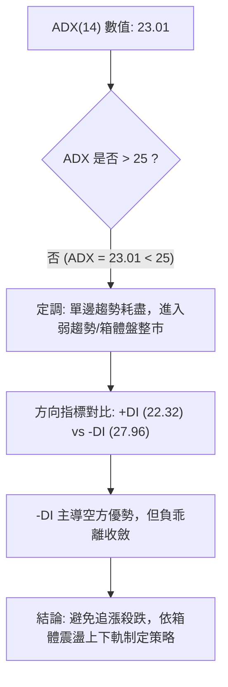

#### ADX 趨勢強度對照

| 指標名稱 | 當前讀數 | 門檻區間 | 市場狀態判定 | 交易戰術涵義 |
|:---|:---:|:---:|:---:|:---|
| **ADX(14)** | **23.01** | < 25.00 | **無明確趨勢 / 弱盤整行情** | 順勢指標失效，均線常現雙向假突破，應切換為區間交易 |
| **+DI (14)** | **22.32** | 基準線 | 多方力量邊際改善 | 較前週低點有所回升，但尚未跨越 -DI 形成多頭交叉 |
| **-DI (14)** | **27.96** | 基準線 | 空方佔優但動能鈍化 | 空頭壓制力減退，未見單邊破位加速信號 |

---

## 3. 圖表形態分析

### 🔍 形態識別系統

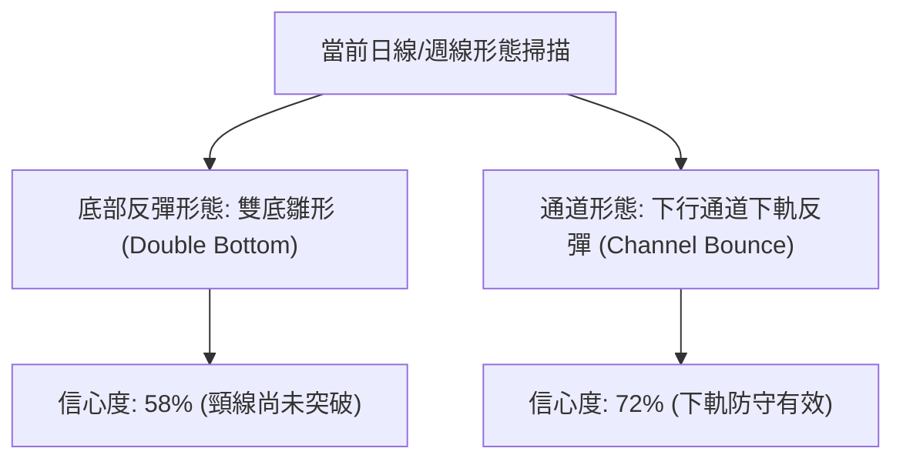

#### 圖表形態信心度評估表（依規則 15）

| 形態名稱 | 信心度 | 判斷依據（嚴格引用數據） | 完成度 | 目標價計算式與數值 |
|:---|:---:|:---|:---:|:---|
| **雙重底雛形 (W-Bottom)** | **58%** | 兩次下探低點分別為 2026-10-16 的 $328.58 與 2026-10-23 的 $320.23，兩次低點相距 5 個交易日且低點未大幅跌破；隨後連續反彈收復 $345.00。 | **65%** | 頸線為 10-28 高點 $352.40。形態高度 = $352.40 - $320.23 = $32.17。突破目標 = $352.40 + $32.17 = **$384.57**（若未能突破頸線則形態失敗）。 |
| **下行通道下軌回抽** | **72%** | 價格觸及布林下軌 $315.13 附近（10-23 最低 $320.23）後強力反彈，目前回到中軌 $347.15 邊緣。 | **85%** | 目標為通道中軸至上軌區間，即布林中軌 **$347.15** 與布林上軌 **$379.17**。 |
| **均線死叉壓制形態** | **85%** | MA20 ($347.15) < MA50 ($353.29) < MA200 ($366.70)，標準空頭排列。 | **100%** | 動態壓制位，第一目標看 MA20 **$347.15**，第二目標看 MA50 **$353.29**。 |

---

### 🕯️ 重要 K 線形態分析

嚴格依據數據中「近 10 根日 K」與「近 8 根週 K」之精確數值進行解讀（符合規則 19）：

#### 近 10 根日 K 線形態解讀表

| 日期 | 開盤價 | 最高價 | 最低價 | 收盤價 | K線形態名稱 | 技術解讀 | 訊號 |
|:---:|:---:|:---:|:---:|:---:|:---:|:---|:---:|
| 2026-10-16 | $338.48 | $339.59 | $328.58 | $328.75 | 光腳中長黑K | 跳空低開低走，收盤近乎最低，空頭加速下殺 | 🔴 |
| 2026-10-19 | $338.75 | $340.20 | $333.82 | $334.59 | 跳空長上影倒錘頭 | 向上回補跳空未果，多頭衝高回落，拋壓沉重 | 🔴 |
| 2026-10-20 | $334.00 | $341.10 | $330.80 | $334.37 | 紡錘十字星 | 多空拉鋸互不相讓，波動區間收斂，下行暫緩 | 🟡 |
| 2026-10-21 | $338.03 | $339.24 | $332.29 | $337.80 | 陽線小十字 | 低檔縮量回穩，多頭嘗試組織抵抗，買盤觀望 | 🟡 |
| 2026-10-22 | $326.53 | $330.82 | $321.02 | $323.24 | 破位跳空大陰K | 跳空低開逾 11 美元，擊穿 $328 前低，空方發動二次破位 | 🔴 |
| 2026-10-23 | $321.50 | $327.70 | $320.23 | $321.68 | 探底長下影十字星 | 創出本輪波段最低點 $320.23 後獲買盤拉起，具低檔反轉信號 | 🟢 |
| 2026-10-26 | $324.53 | $332.12 | $323.25 | $329.17 | 低檔起跳中陽K | 確認前日十字星支撐，收盤高於開盤，展開超跌反彈 | 🟢 |
| 2026-10-27 | $339.87 | $345.67 | $336.87 | $342.33 | 帶量突破大陽K | 跳空高開並站穩 $340，多頭動能放量爆發 | 🟢 |
| 2026-10-28 | $349.22 | $352.40 | $344.35 | $351.81 | 衝高小陽線 | 盤中觸及 $352.40（突破 R1 $350.81），尾盤受制於 MA50 | 🟢 |
| 2026-10-29 | $342.00 | $346.15 | $338.80 | $345.00 | 低開回踩小陽星 | 低開消化獲利盤，回踩 S1 ($342.50) 後收於 $345.00，量縮整固 | 🟡 |

#### 近 8 根週 K 線形態解讀表

| 日期（週結） | 開盤價 | 最高價 | 最低價 | 收盤價 | 週K形態名稱 | 技術解讀 | 訊號 |
|:---:|:---:|:---:|:---:|:---:|:---:|:---|:---:|
| 2026-09-11 | $363.02 | $372.02 | $357.10 | $361.33 | 高位震盪陰孕線 | 衝高 $372 承壓，整體維持在中期均線下方弱勢運行 | 🔴 |
| 2026-09-18 | $348.99 | $362.62 | $335.20 | $356.96 | 長下影紡錘線 | 下探波段支撐 S2 ($335.20) 出現強支撐，週量放大至 149M | 🟢 |
| 2026-09-25 | $358.66 | $366.55 | $346.89 | $352.81 | 衝高受阻流星陰線 | 測試 R3 ($366.55) 未果，收盤回落至開盤下方 | 🔴 |
| 2026-10-02 | $352.87 | $361.86 | $343.29 | $355.14 | 窄幅整理陽十字 | 區間震盪收縮，多空雙方在 $350 關卡進入相持階段 | 🟡 |
| 2026-10-09 | $357.79 | $380.84 | $356.14 | $361.54 | 衝高回落長上影K | 盤中一度狂飆至 $380.84，但遭遇暴量解套拋壓，留長上影線 | 🔴 |
| 2026-10-16 | $359.43 | $360.69 | $328.58 | $328.75 | 週線破位實體長陰 | 斷頭鍘刀週K，單週下瀉逾 30 美元，多頭結構遭到破壞 | 🔴 |
| 2026-10-23 | $338.75 | $341.10 | $320.23 | $321.68 | 慣性下挫空頭實體 | 探底 $320.23，週線連續兩根長黑，空頭情緒極度宣洩 | 🔴 |
| 2026-10-29 | $324.53 | $352.40 | $323.25 | $345.00 | 週線長下影包覆陽線 | 低開高走吞噬前週實體，下影線長達 $21.75，中期止跌信號確立 | 🟢 |

---

### 📉 ASCII 走勢形態示意圖

```
AVGO 日線反彈走勢與頸線壓力示意圖
價格軸 ($)
$355 ┤                                ╭── 10-28 衝高 $352.40 (形態頸線)
$350 ┤                               ┌┴┐ 
$345 ┤                             ┌─┘ └─ 10-29 收盤 $345.00 (現價測試中軌)
$340 ┤              ┌┐             │
$335 ┤              ││             │
$330 ┤  ┌┐          ││   ┌┐        │
$325 ┤  ││ 10-16    ││   ││        │
$320 ┤  ││ $328.58  ││   ││ 10-23  │
     └──┴┴──────────┴┴───┴┴────────┴──────────────────────► 時間
       【第一低點】        【第二低點】     【底部頸線測試】
         $328.58             $320.23          $350.81 - $352.40
```

---

### 🎯 形態目標價計算

1. **雙底（W底）測量目標價**：
   - **基底低點**：取二次探底極值 $320.23（2026-10-23 低點）。
   - **頸線壓力位**：取近期反彈高點 $352.40（2026-10-28 高點）。
   - **垂直形態高度 ($H$)**：$352.40 - $320.23 = \$32.17$。
   - **最小量度目標價**：頸線突破點 + 形態高度 = $\$352.40 + \$32.17 = \mathbf{\$384.57}$。
   - **技術確認條件**：日線收盤價必須連續 2 個交易日突破並站穩阻力位 R1（$350.81）及頸線高點（$352.40），且日成交量放大至 20 日均量以上（> 21.62M）。

---

## 4. 支撐與阻力

### 🗺️ 關鍵價位分布圖（Unicode）

```
AVGO 價位結構分布圖（嚴格依據 OHLCV 計算）
═══════════════════════════════════════════════════════════════
$367.03 ║██████████████████████████████║ 斐波那契 61.8% 強阻力位
$366.55 ║████████████████████████████  ║ 強阻力 R3（波段密集高點聚類）
$358.10 ║██████████████████            ║ 阻力 R2（中期平台壓力位）
$350.81 ║████████████████████████      ║ 關鍵阻力 R1（短線反彈首道重壓）
$347.15 ╟──────────────────────────────╢ 動態中軌阻力（MA20 / 布林中軌）
$345.00 ╠══════════════════════════════╣ ◄ 現價 ($345.00)
$342.50 ║▓▓▓▓▓▓▓▓▓▓▓▓▓▓▓▓▓▓            ║ 近期支撐 S1（波段回踩確認點）
$335.20 ║████████████████████████      ║ 強支撐 S2（9月波段低點平台聚類）
$332.71 ║██████████████████████████    ║ 斐波那契 78.6% 回調關鍵支撐
$327.66 ║████████████████████████████  ║ 極限支撐 S3（波段起漲防守點）
═══════════════════════════════════════════════════════════════
```

---

### 🚧 阻力位分析表

全部數值嚴格引用「關鍵價位」數據庫之波段高點聚類數值：

| 阻力級別 | 精確價位 | 距現價幅 | 形成原因與技術共振 | 突破難度 | 重要性權重 |
|:---|:---:|:---:|:---|:---:|:---:|
| **阻力 R1** | **$350.81** | +1.68% | 近期反彈波段高點聚類，與 10-28 實體收盤及 MA50 ($353.29) 形成共振壓制帶 | 🟡 中等 | ★★★★☆ |
| **阻力 R2** | **$358.10** | +3.80% | 9 月中下旬整理平台下軌，前期套牢籌碼密集成交區 | 🔴 較高 | ★★★☆☆ |
| **阻力 R3** | **$366.55** | +6.25% | 近一年多次測試之波段頂部，與斐波那契 61.8% ($367.03) 及 MA200 ($366.70) 形成三重共振壓制 | 🔴 極高 | ★★★★★ |

---

### 🛡️ 支撐位分析表

全部數值嚴格引用「關鍵價位」數據庫之波段低點聚類數值：

| 支撐級別 | 精確價位 | 距現價幅 | 形成原因與技術共振 | 守住機率 | 重要性權重 |
|:---|:---:|:---:|:---|:---:|:---:|
| **支撐 S1** | **$342.50** | -0.72% | 10-27 大陽線突破後之回踩測試位，目前日線第一道多頭防護墊 | 🟢 70% | ★★★☆☆ |
| **支撐 S2** | **$335.20** | -2.84% | 2026-09-18 週K長下影線探底之波段低點聚類，具備強大籌碼支撐 | 🟢 80% | ★★★★☆ |
| **支撐 S3** | **$327.66** | -5.03% | 10-16 破位陰線低點群聚處，此處失守代表雙底構建失敗，趨勢將破底 | 🟡 60% | ★★★★★ |

---

### 📐 斐波那契回調位分析

依據 52 週絕對極值區間（低點 $288.98 → 高點 $493.32，落差 $204.34）計算：

| 回調比率 | 斐波那契點位 | 價位特徵解讀與當前位置標注 |
|:---:|:---:|:---|
| **0.0%** | **$493.32** | 52 週歷史峰值高點（空頭長期回檔起點） |
| **23.6%** | **$445.09** | 2026 年 5 月月線最高收盤價區間（$445.25） |
| **38.2%** | **$415.26** | 2026 年 4 月主升浪起點平台（$416.01） |
| **50.0%** | **$391.15** | 多空中期分水嶺，7-8 月震盪中樞（$388.57 ~ $392.28） |
| **61.8%** | **$367.03** | **黃金分割重壓位**（與阻力 R3 $366.55、年線 MA200 $366.70 高度共振） |
| **現價區間**| **$345.00** | **位於 78.6% 回調位 ($332.71) 與 61.8% 回調位 ($367.03) 之間** |
| **78.6%** | **$332.71** | **深幅回調極限防守位**（與支撐 S2 $335.20 形成雙重支撐屏障） |
| **100.0%** | **$288.98** | 52 週歷史最低點（波段絕對防線） |

**黃金分割技術意涵**：
當前 AVGO 收盤價 $345.00 處於 78.6%（$332.71）至 61.8%（$367.03）的深幅回調修復區間。價格在跌破 61.8% 黃金分割位後並未直墜 100% 底部，而是在 78.6% 水準上方（$332.71）止跌並引發底背離反彈，顯示此區間具備顯著的價值買盤與技術性防禦買力。

---

## 5. 技術指標深度解讀

### 🎛️ 指標訊號總覽

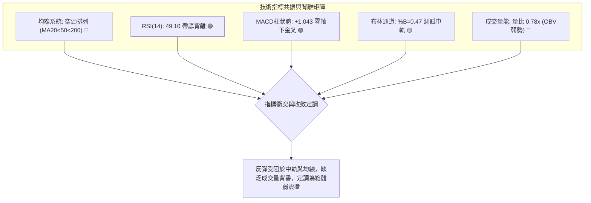

---

### 📈 移動平均線排列分析

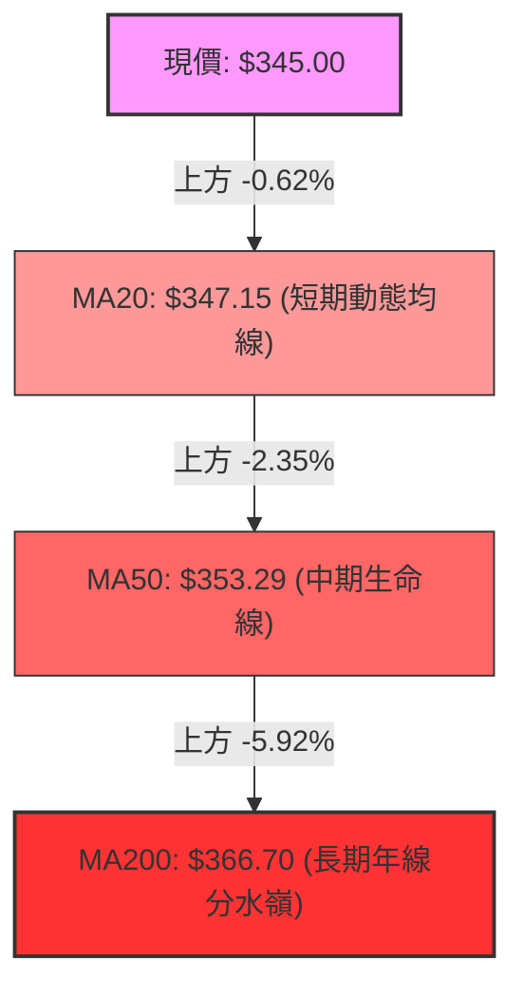

#### 各週期均線技術數值與偏離度表

| 均線名稱 | 數值 | 距現價幅度 | 走勢趨向 | 技術含義解讀 |
|:---|:---:|:---:|:---:|:---|
| **MA 5** | $338.00 | +2.07% | ▲ 向上扣低 | 短線急攻助推線，現價站穩其上，短期多頭佔優 |
| **MA 10** | $334.87 | +3.02% | ▲ 向上反折 | 超跌反彈支撐線，已自低檔拐頭向上 |
| **MA 20** | $347.15 | -0.62% | ▼ 走平下彎 | 布林中軌所在，空頭第一道嚴密防線，面臨即時壓制 |
| **MA 50** | $353.29 | -2.35% | ▼ 緩步下移 | 中期空頭下壓趨勢線，若未帶量突破，中期反彈空間受限 |
| **MA 60** | $361.76 | -4.63% | ▼ 下行趨勢 | 季線下行壓制，代表過去一季進場籌碼全數處於浮虧狀態 |
| **MA 120**| $379.99 | -9.21% | ▼ 陡峭下行 | 半年線強阻力，靠近布林通道上軌（$379.17） |
| **MA 200**| $366.70 | -5.92% | ▼ 微幅下行 | 牛熊分界線，與阻力 R3 ($366.55) 重疊，為長線反轉唯一標準 |
| **MA 240**| $365.24 | -5.54% | ▼ 下行走勢 | 長期均線走弱，佐證目前處於大週期調整波段中 |

---

### 📉 RSI(14) 分析

#### RSI 數值進度條
```
RSI(14): 49.10 
[0] ─────────────── [30] ───────●─────── [70] ─────────────── [100]
超賣區 (0-30)          中性徘徊區 (30-70)          超買區 (70-100)
進度條: ██████████░░░░░░░░░░ 49.10% (中性偏平衡)
```

- **背離判斷結論**：
  **⚠️ 存在標準「底背離 (Bullish Divergence)」**。
  - **價格走勢**：在近 20 根 K 棒的首尾對比中，2026-10-16 創收盤低點 $328.75，隨後 10-23 創出更低的收盤價 $321.68（Lowest Close）。
  - **RSI 走勢**：10-16 的週/日線 RSI 讀數為 34.9，而 10-23 在價格更低的背景下，RSI 卻維持在 34.3，隨後迅速在 10-29 大幅拉升至 **49.10**，斜率顯著陡峭於價格反彈斜率。
  - **背離有效性**：該底背離已成功觸發本輪自 $320.23 至 $345.00 的跌深反彈，但由於當前數值已逼近 50 榮枯線，背離動能已釋放逾半，後續若無量能跟進，易在 50–55 區間形成二次頂部回撤。

---

### 📊 MACD (12, 26, 9) 訊號解讀

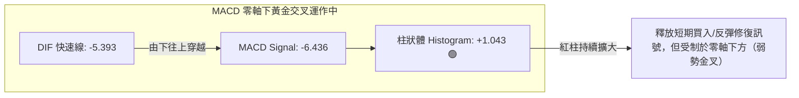

- **深度技術判定**：
  MACD 目前位於零軸下方（DIF -5.393 / Signal -6.436），雖呈現向上金叉且柱狀體為正值（+1.043），但在量化技術體系中，**零軸下方的黃金交叉一律歸類為「弱勢技術性反抽」**而非單邊主升浪。此訊號支持價格向上測試 MA20 及 MA50，但在未突破零軸前，隨時存在二次向下死叉的風險。

---

### 📦 布林通道分析

```
AVGO 布林通道（20日，2倍標準差）結構示意圖
═══════════════════════════════════════════════════════════════
$379.17 ─────────────────────────────── 布林上軌 (Upper Band)
        │
        │
$347.15 ═══════════════════════════════ 布林中軌 (MA20 / Middle Band)
$345.00 ◄── 現價 ($345.00，位於 %B = 0.47 處，貼近中軌)
        │
        │
$315.13 ─────────────────────────────── 布林下軌 (Lower Band)
═══════════════════════════════════════════════════════════════
```

- **位置與形態解讀**：
  - **布林上軌**：$379.17
  - **布林中軌 (MA20)**：$347.15
  - **布林下軌**：$315.13
  - **%B 指標**：0.47（0 代表下軌，0.5 代表中軌，1.0 代表上軌）
  - **通道開口特徵**：上下軌帶寬寬達 $64.04（約 18.5%），表明前期單邊下跌釋放了巨大波動率。目前價格自下軌（10-23 最低點 $320.23 接近下軌 $315.13）反彈至中軌下方，%B 達到 0.47，已進入「中軌攻防區」。若未能帶量衝破中軌 $347.15，價格將依通道慣性回踩中下軌之間。

---

### 💹 成交量分析（量價配合度）

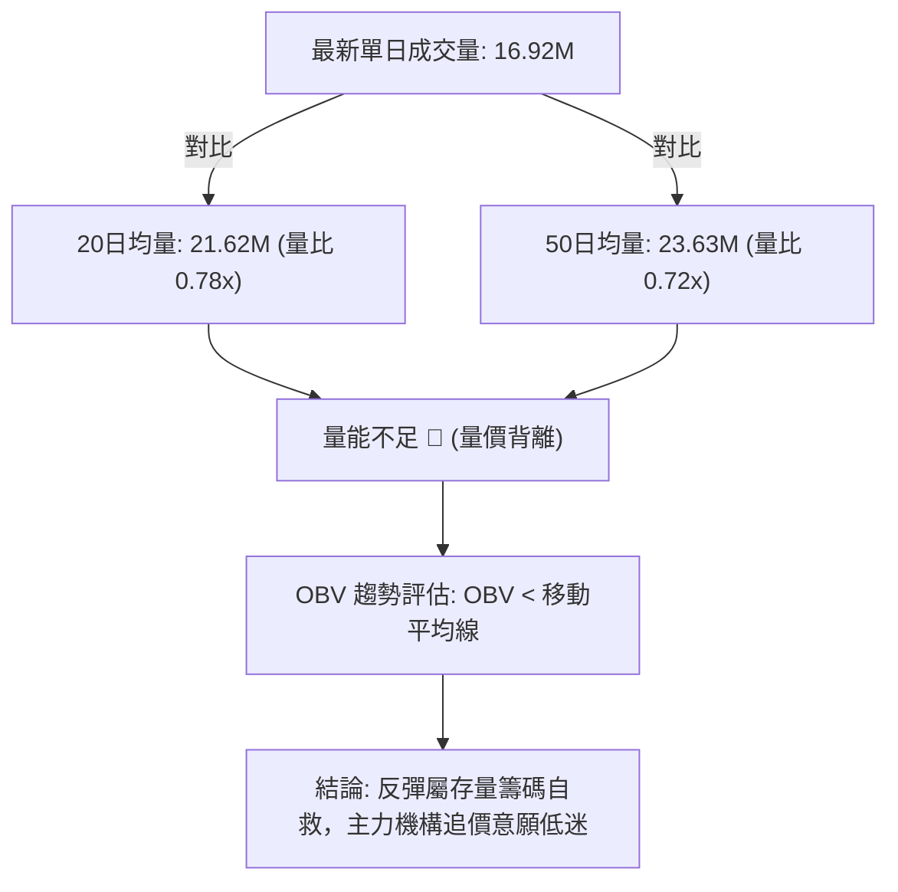

- **量價背離技術診斷**：
  近期價格自 10-23 低點連續反彈至 10-29 收盤 $345.00（漲幅達 +7.68%），然而最新成交量僅有 16,920,000 股，遠低於 20 日均量 21,622,905 股（量比僅 0.78x），更大幅落後於 50 日均量（23.63M）。與此同時，OBV 處於均線下方延續下行趨勢，構成典型的**「價升量縮」逆向背離**。這意味著場外增量資金並未認同當前反彈，價格上行隨時會因量能不濟而遇阻回落。

---

## 6. 動能與波動率

### ⚡ 動能評估四象限

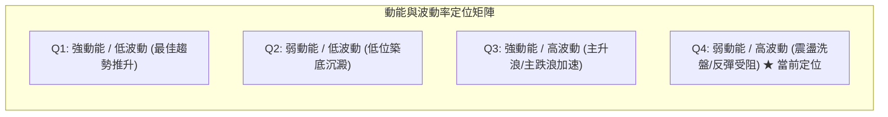

#### 動能與波動率定位解析表

| 象限標籤 | 動能狀態 | 波動率狀態 | AVGO 當前狀態評估 | 策略應對準則 |
|:---:|:---:|:---:|:---:|:---|
| **Q1** | 強 | 低 | ── | 趨勢順勢加碼 |
| **Q2** | 弱 | 低 | ── | 長線左側建倉 |
| **Q3** | 強 | 高 | ── | 追隨突破行情 |
| **Q4** | **弱** | **高** | **✓ 正確定位**：ATR 達 3.36%，短線震盪劇烈，但 RSI 僅 49、ADX 僅 23，缺乏持續單邊推動力 | **嚴控倉位、快進快出，切忌追高** |

---

### 📊 ATR 波動率分析

- **ATR(14) 數值**：**$11.58**（佔當前股價 $345.00 的 **3.36%**，Wilder 平滑計算）。
- **日內真實波幅技術解讀**：
  AVGO 每日正常的價格擺動區間約為 $11.6 美元。在設定停損與進場空間時，必須嚴格依據 ATR 進行緩衝保護，避免被市場隨機雜訊掃出場。
- **止損距離建議**：
  - **超短線交易（1.0 × ATR）**：安全緩衝距離為 **$11.58**。
  - **波段交易（1.5 × ATR）**：安全緩衝距離為 **$17.37**。
  - **趨勢防守（2.0 × ATR）**：安全緩衝距離為 **$23.16**。

---

### 📐 Beta 與市場相關性

- **Beta 係數**：**1.476**（高貝塔科技龍頭）。
- **市場特徵分析**：
  - AVGO 的波動幅度約為 S&P 500 指數的 1.48 倍。在當前半導體板塊與總體科技股震盪加劇的背景下，高 Beta 特質放大了下行階段的跌幅，但也賦予了跌深反彈時更強的彈性。
  - 當標普 500 或費城半導體指數回調 1% 時，AVGO 理論預期波動將達到 1.48%，因此任何現貨或衍生品佈局必須計入系統性風險溢價。

---

## 7. 多時框架總結

### 📋 時框架評分表

| 時框架 | 趨勢方向 | 動能狀態 | 均線排列狀況 | 形態識別結論 | 綜合評分 | 戰術操作建議 |
|:---:|:---:|:---:|:---:|:---:|:---:|:---|
| **短期 (日線)** | 🟡 跌深反彈 | 🟢 MACD金叉/底背離 | 🔴 MA20壓制 (空頭排列) | 雙底頸線衝擊中 | 52/100 | 短線高出低進，以中軌為界 |
| **中期 (週線)** | 🔴 弱勢尋底 | 🟡 RSI 49.1/長下影 | 🔴 處於季線/半年線下方 | 長下影包覆止跌 | 42/100 | 逢反彈減持高位套牢浮額 |
| **長期 (月線)** | 🟡 牛市深度回檔| 🔴 5月見頂後逐級回落| 🟡 測試年線與斐波 78.6% | 月K十字星嘗試築底 | 41/100 | 長期投資者靜待雙底頸線突破 |

---

### 🔲 綜合訊號矩陣

```
時框維度與指標信號共振矩陣
═══════════════════════════════════════════════════════════════
  指標維度        短期 (日線)      中期 (週線)      長期 (月線)
───────────────────────────────────────────────────────────────
  均線排列 (MA)       🔴 偏空          🔴 偏空          🟡 中性
  動能指標 (MACD)     🟢 偏多          🟡 中性          🔴 偏空
  超買超賣 (RSI)      🟢 底背離        🟡 中性          🟡 中性
  量價結構 (VOL)      🔴 量縮背離      🔴 量能退潮      🔴 縮量整理
  形態結構 (PAT)      🟡 雙底雛形      🔴 箱體破位      🟡 斐波支撐
═══════════════════════════════════════════════════════════════
  維度訊號結論： 短期反彈動能存在，但被中長期均線與成交量死鎖！
```

---

### ⚖️ 多時框收斂結論（嚴格遵守規則 14）

1. **行情屬性定調**：
   當前日線 ADX(14) 讀數為 **23.01**（< 25.00），依據收斂規則，本輪行情**定調為典型的「盤整行情 / 箱體震盪市」**，而非單邊趨勢行情。
2. **時框優先級裁決**：
   在盤整行情中，中長期的均線壓制不會立刻引發崩跌，日線級別的短期動能亦不足以發動反轉。**交易重心全面收斂至日線布林通道上下軌（$315.13 ~ $379.17）以及關鍵波段高低點所界定的區間範圍**。
3. **唯一方向性結論**：
   **【中性觀望 / 區間箱體交易】**。
   既不可盲目追多（面臨 MA20 $347.15 及阻力 R1 $350.81 雙重壓制，量能嚴重不足），亦不可在震盪下緣盲目殺跌（日線 MACD 零軸下金叉且 RSI 底背離支撐依然有效）。

---

## 8. 交易策略建議

### 🗺️ 策略決策流程圖

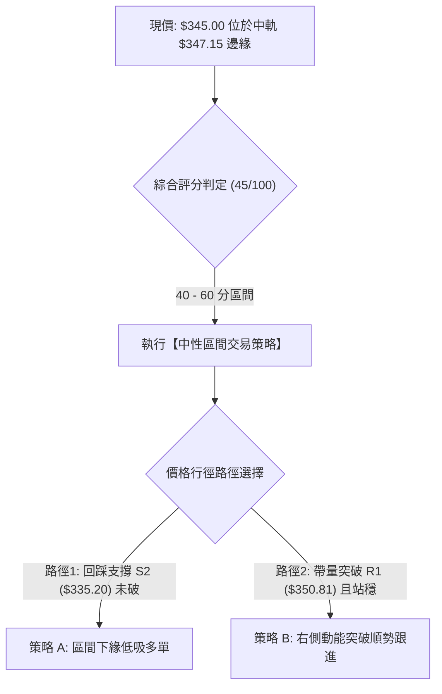

---

### 🧭 策略路由（依評分卡分流，嚴格遵守評分 45/100）

> **當前主策略方向 = 【中性區間震盪策略】（依據綜合評分 45/100，介於 40–60 之中性區間，不進行單邊主觀下注，以布林帶中下軌與 S/R 關鍵位作為區間操作基準）。**

---

### 🎯 價格情境階梯（Price Scenarios）

價位嚴格引用第 4 章由 OHLCV 精確計算之數值：

| 觸發條件 | 下一目標價位 | 後續延伸極限 | 情境技術含義 |
|:---|:---:|:---:|:---|
| **強勢突破阻力 R1 ($350.81)** | **阻力 R2 ($358.10)** | **阻力 R3 ($366.55)** | 短線轉強，完成雙底頸線突破，直撲年線 |
| **受阻於現價至 MA20 ($347.15)** | **支撐 S1 ($342.50)** | **支撐 S2 ($335.20)** | 箱體震盪，中軌承壓，回踩下層支撐蓄勢 |
| **有效跌破支撐 S1 ($342.50)** | **支撐 S2 ($335.20)** | **支撐 S3 ($327.66)** | 中期弱勢重啟，多頭抵抗失敗，測試波段底部 |

---

### 📊 情境機率分佈

| 情境劇本 | 機率 | 主要技術依據與指標佐證 |
|:---|:---:|:---|
| **區間震盪整固（主基調）** | **55%** | ADX 僅 23.01 宣告無趨勢，布林帶寬 %B 處於 0.47，多空在 MA20 附近陷入膠著 |
| **延續底背離向上反彈** | **30%** | MACD 柱狀體維持紅柱（+1.043），日線連三陽，存在向上測試 R1/R2 的動能 |
| **失守支撐破底回落** | **15%** | 全均線空頭排列（MA20<50<200），成交量比僅 0.78x，若大盤走弱易引發補跌 |

---

### 🟢 主策略詳情（區間高出低進與突破跟進）

本章節所有風險報酬比嚴格依據規則 17 公式計算：$\text{RRR} = (T1 - \text{進場價}) \div (\text{進場價} - \text{止損價})$。

| 策略要素 | 策略 A（左側區間低吸 — 回踩支撐買入） | 策略 B（右側動能突破 — 站穩 R1 跟進） |
|:---|:---|:---|
| **策略邏輯** | 股價回踩箱體下緣支撐 S2 企穩，博弈雙底支撐反彈 | 帶量突破短線密集壓制位 R1，順勢博弈均線修復補漲 |
| **進場條件** | 回踩測試支撐 S2 出現日線止跌K線（如小陽/十字星） | 日線收盤價實體突破阻力 R1 且量比 > 1.2x |
| **進場價格** | **$335.20**（支撐位 S2 精確值） | **$350.81**（阻力位 R1 精確突破點） |
| **止損價格** | **$327.66**（支撐位 S3 精確值，跌破即止損） | **$342.50**（支撐位 S1 精確值，跌破轉弱止損） |
| **目標價 T1** | **$350.81**（阻力位 R1 精確值） | **$358.10**（阻力位 R2 精確值） |
| **目標價 T2** | **$358.10**（阻力位 R2 精確值） | **$366.55**（阻力位 R3 精確值） |
| **風險報酬比** | **1 : 2.07（以 T1 計）**<br>計算式：$(350.81 - 335.20) \div (335.20 - 327.66) = 15.61 \div 7.54 = 2.07$<br>另列：**1 : 3.04（以 T2 計）** | **1 : 0.88（以 T1 計）**<br>計算式：$(358.10 - 350.81) \div (350.81 - 342.50) = 7.29 \div 8.31 = 0.88$<br>另列：**1 : 1.90（以 T2 計）** |
| **成功機率** | **65%**（支撐位 S2 具備強大籌碼沉澱） | **50%**（受制於上方 MA50 密集均線壓制） |
| **建議倉位** | **15%**（基礎波段倉位） | **10%**（輕倉動能試單） |

---

### 🔴 反向風險觸發點（對沖與風控提示）

1. **多頭策略全面推翻條件**：
   - 若日線收盤價跌破支撐 S3（**$327.66**），宣告近兩週之低檔雙底形態徹底破功，後續將直接考驗波段低點 $320.23 甚至 52 週低點區間。
   - **處置**：所有多頭部位無條件市價止損，並可反手以輕倉建立空單避險。
2. **空頭反撲阻擊條件**：
   - 若現價於日內直接突破並站穩阻力 R3（**$366.55**）及 MA200 年線，則代表中長線空頭結構被逆轉，空方必須無條件全數平倉停損。

---

### ⭐ 整體訊號強度評星

```
╔════════════════════════════════════════════════════════════════╗
║ 做多訊號強度：  ★★☆☆☆  (2.5/5 星) — 僅屬底背離跌深反彈，均線反壓沉重 ║
║ 做空訊號強度：  ★★★☆☆  (3.0/5 星) — 均線空頭排列，但處於區間低位不宜殺跌║
║ 整體策略可信度：★★★☆☆  (3.0/5 星) — 箱體整理格局，指標矛盾待破局   ║
╚════════════════════════════════════════════════════════════════╝
```

---

## 9. 風險提示與監控

### ✅ 關鍵監控指標 Checklist

```
╔════════════════════════════════════════════════════════════════╗
║                AVGO 技術風控監控清單 (Checklist)               ║
╠════════════════════════════════════════════════════════════════╣
║ [ ] 監控 MA20 動態中軌 ($347.15)：收盤能否突破並站穩 2 個交易日 ║
║ [ ] 監控阻力 R1 ($350.81)：是否出現帶量假突破留長上影線       ║
║ [ ] 監控日成交量變化：反彈單日成交量是否回升至 21.62M 以上    ║
║ [ ] 監控 MACD 柱狀體：紅柱 (+1.043) 是否出現收縮翻黑現象      ║
║ [ ] 監控 RSI(14) 數值：是否在 50-55 壓力區再次反折拐頭向下     ║
║ [ ] 監控支撐 S1 ($342.50)：回踩是否具備有效承接力道          ║
║ [ ] 監控極限支撐 S3 ($327.66)：絕對防守底線，破位立即清倉離場 ║
╚════════════════════════════════════════════════════════════════╝
```

---

### ⚠️ 風險場景分析

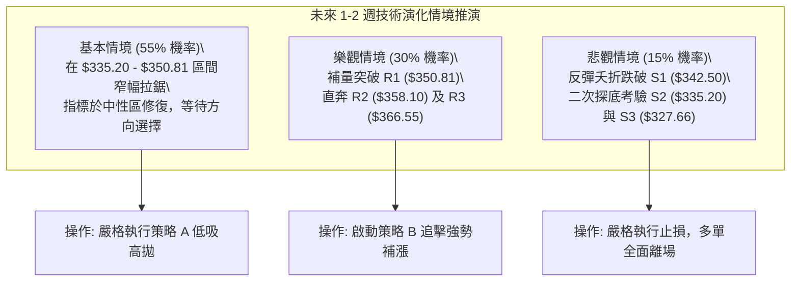

---

### 🛡️ 風險管理重要提醒

1. **波動率與倉位管理**：
   - AVGO 當前 ATR 達 **$11.58**（單日波動 3.36%），Beta 達 **1.476**。高波動性意味著部位規模絕不可過大。在當前評分 45 分的中性格局下，**總持倉曝險強烈建議控制在總資金的 15% - 25% 以內**。
2. **量價失效風險**：
   - 目前最新成交量僅有 16.92M（量比 0.78x），量能持續處於低溫狀態。量縮背景下的任何向上拉升極易形成「多頭陷阱（Bull Trap）」，在未能見到單日成交量突破 25M 之前，不可重倉追高。
3. **移動止損紀律**：
   - 若採用策略 A 在 $335.20 順利建倉，當股價獲利超過 1.0 × ATR（即達到 $\$335.20 + \$11.58 = \$346.78$）時，應立即將止損點上移至損益平衡點（$335.20），鎖定本金安全。

---

## 📋 報告總結

```
╔════════════════════════════════════════════════════════════════╗
║               AVGO 技術分析報告核心總結儀表板                  ║
╠════════════════════════════════════════════════════════════════╣
║ 報告日期：2026-10-30                                          ║
║ 當前價格：$345.00 USD                                         ║
║ 分析評級：⚖️ 中性震盪 / 區間箱體整理 (技術評分: 45 / 100)      ║
╠════════════════════════════════════════════════════════════════╣
║ 關鍵趨勢結論：                                                ║
║ ├─ 長期趨勢：🟡 中性回檔 (5月見頂 $445.25 後回撤，於斐波78.6%止跌)║
║ ├─ 中期趨勢：🔴 弱勢整理 (處於 MA200 $366.70 下方，空頭排列)  ║
║ ├─ 短期趨勢：🟢 跌深反彈 (受 RSI 底背離及 MACD 弱金叉驅動)     ║
║ ├─ 關鍵支撐：S1 $342.50 │ S2 $335.20 │ S3 $327.66             ║
║ ├─ 關鍵阻力：R1 $350.81 │ R2 $358.10 │ R3 $366.55             ║
║ └─ 外資分析師目標價：$530.14 (均值) / $215.88 (低) / $660.00 (高)║
╠════════════════════════════════════════════════════════════════╣
║ 最優策略組合建議：                                            ║
║ 1. 🥇 最佳機會：【策略 A 區間低吸】                            ║
║    回踩支撐 S2 ($335.20) 進場，止損設 S3 ($327.66)，          ║
║    目標 R1 ($350.81)，風險報酬比 1 : 2.07（以 T1 計）          ║
║ 2. 🥈 次選機會：【策略 B 突破跟進】                            ║
║    放量站穩阻力 R1 ($350.81) 追進，止損 S1 ($342.50)，        ║
║    目標 R2 ($358.10)，風險報酬比 1 : 0.88（以 T1 計）          ║
║ 3. 🥉 保守選擇：【場外觀望】                                  ║
║    等待日線帶量收復 MA20 ($347.15) 且 ADX 突破 25，確認新一輪  ║
║    趨勢啟動後再行順勢進場。                                   ║
╚════════════════════════════════════════════════════════════════╝
```

---

> ⚠️ **免責聲明**：本報告為技術量化分析模型生成之研究報告，所有分析、點位推算與評估結論均嚴格基於歷史 OHLCV 價格數據。本報告**僅供學術研究與投資策略討論參考**，**絕不構成任何具體金融產品之買賣要約或投資建議**。金融市場瞬息萬變，技術指標存在隨機鈍化與失真風險，投資人應獨立評估自身財務狀況與風險承受能力，入市需極度謹慎。

---

*報告生成時間：2026-10-30 ｜ 數據來源：Yahoo Finance ｜ 分析框架：多時框技術分析模型*