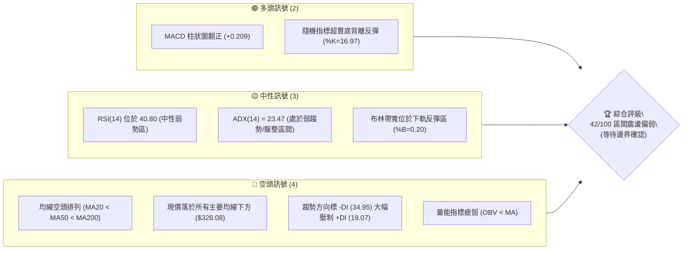
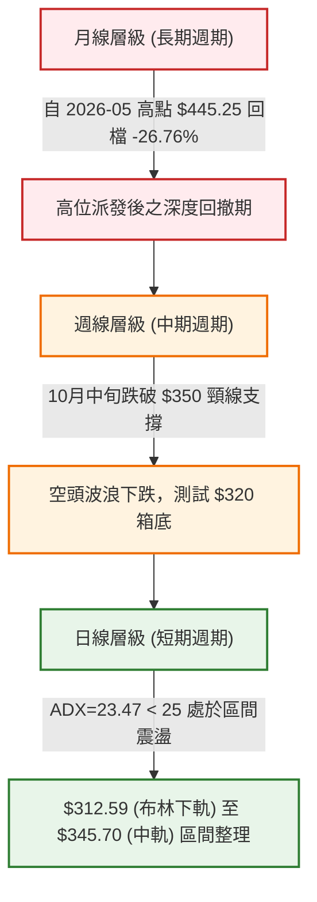
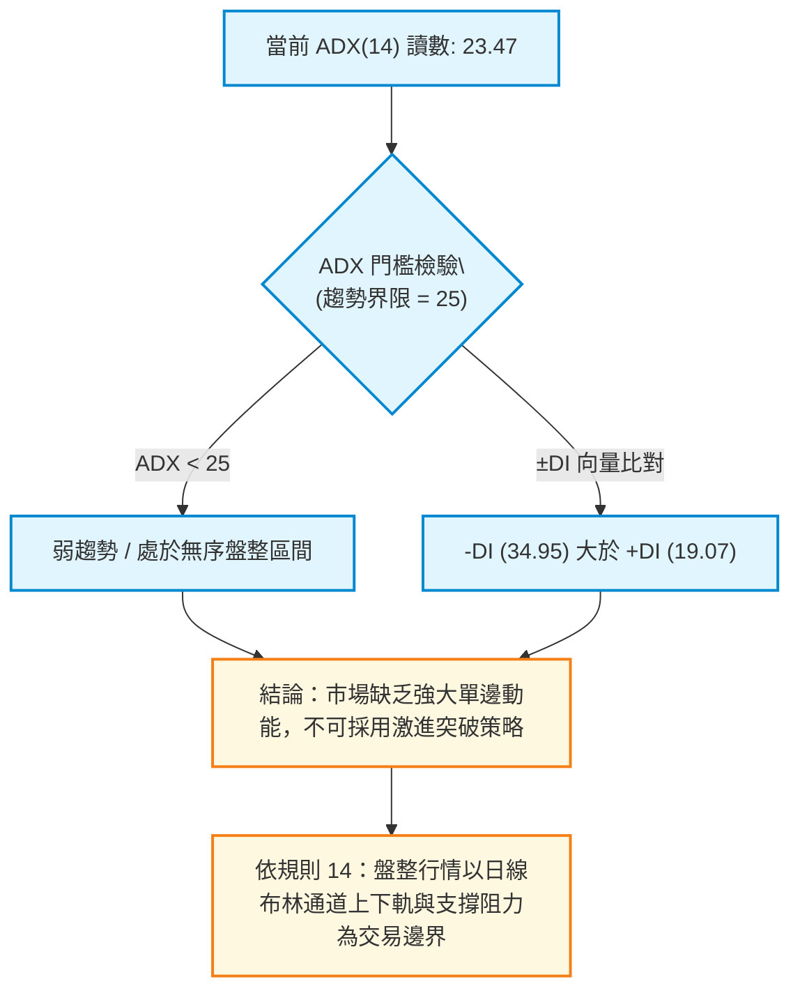
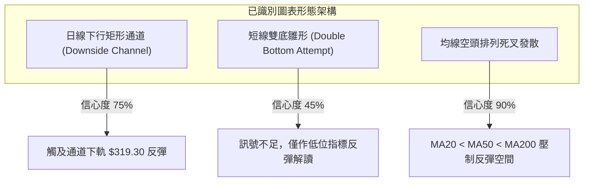
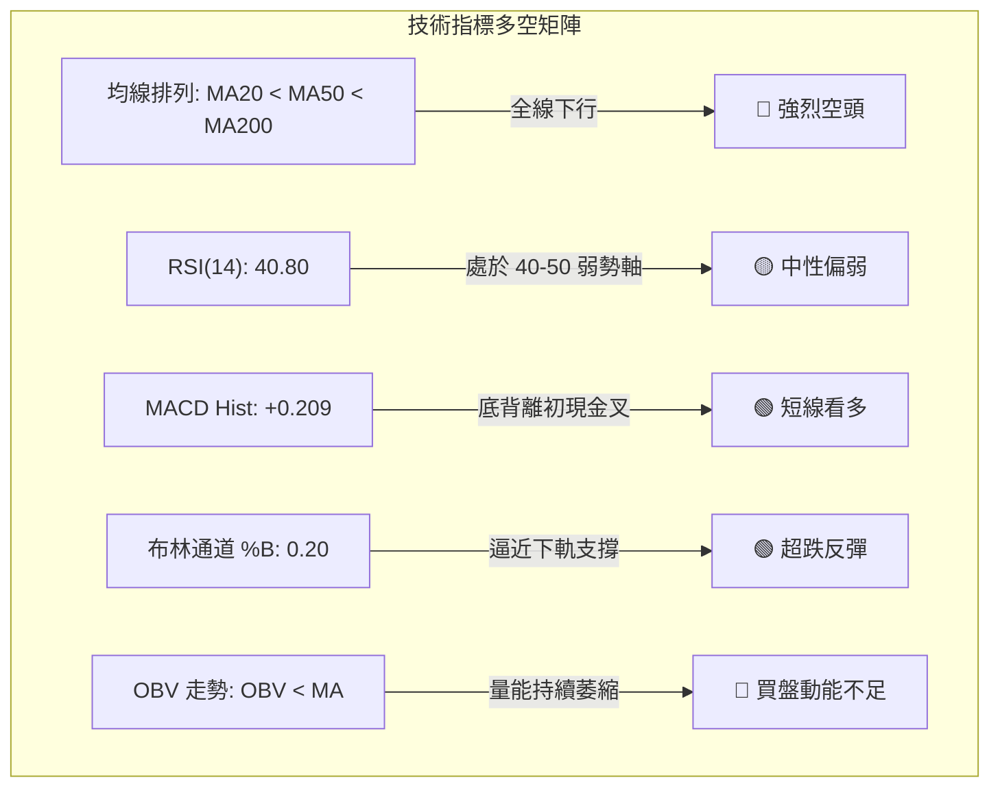
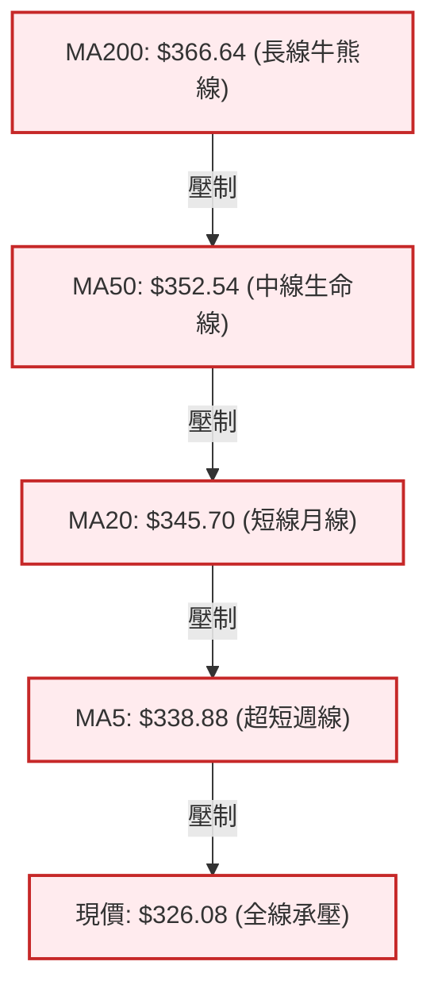
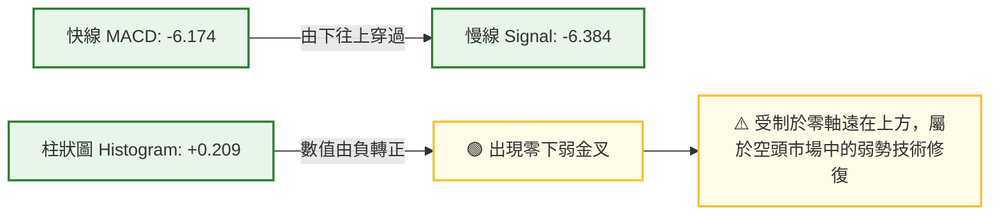
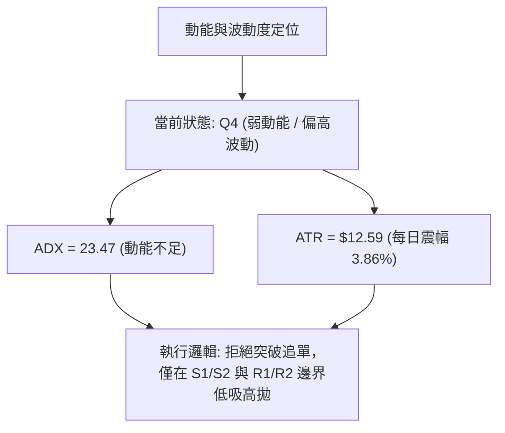
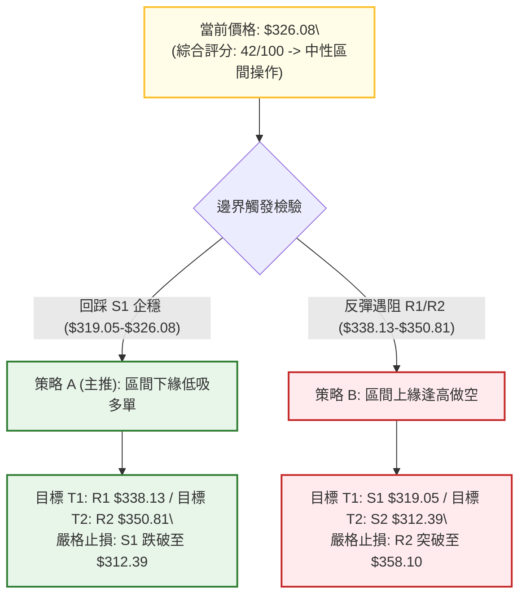
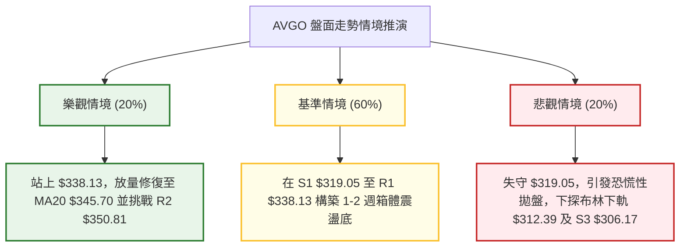

# AVGO 技術分析報告

> **報告日期**：2026-10-31 ｜ **語言**：繁體中文 ｜ **數據來源**：Yahoo Finance ｜ **當前價格**：$326.08

---

## 目錄

| 章節 | 內容 |
|------|------|
| [1. 技術面概覽](#1-技術面概覽) | 訊號儀表板、核心指標、評分卡 |
| [2. 趨勢分析](#2-趨勢分析) | 多時框趨勢、長中短期走勢、12個月歷史圖 |
| [3. 圖表形態分析](#3-圖表形態分析) | 形態識別、K線組合、目標價推算 |
| [4. 支撐與阻力](#4-支撐與阻力) | 關鍵價位、斐波那契回調結構 |
| [5. 技術指標深度解讀](#5-技術指標深度解讀) | 均線系統、RSI、MACD、布林通道、OBV |
| [6. 動能與波動率](#6-動能與波動率) | 動能四象限、ATR、Beta 與市場關聯 |
| [7. 多時框架總結](#7-多時框架總結) | 時框架矩陣、多時框收斂定論 |
| [8. 交易策略建議](#8-交易策略建議) | 策略路由、情境階梯、風報比精算 |
| [9. 風險提示與監控](#9-風險提示與監控) | 監控清單、情境推演、風控規則 |
| [📋 報告總結](#-報告總結) | 核心結論與執行綱領 |

---

## 1. 技術面概覽

### 🎯 技術訊號儀表板



---

### 📊 核心指標速覽表

| 指標類別 | 指標名稱 | 當前數值 | 訊號 | 專業解讀 |
|:---|:---|:---|:---:|:---|
| **價格** | 當前收盤價 | $326.08 | 🔴 | 位於 52 週區間 ($288.98 - $493.32) 的 18.2% 低位，受制於長期均線 |
| **均線** | MA20 | $345.70 | 🔴 | 現價低於 MA20 達 -5.67%，短期承壓於布林中軌阻力 |
| **均線** | MA50 | $352.54 | 🔴 | 中期波段防線下彎，與 MA200 形成高位死叉後持續發散 |
| **均線** | MA200 | $366.64 | 🔴 | 現價低於長期牛熊分界線達 -11.06%，長週期技術架構轉弱 |
| **動能** | RSI(14) | 40.80 | 🟡 | 位於 40–50 中性偏弱區，未跌破 30 超賣線，短線呈現低位鈍化 |
| **動能** | MACD (12,26,9) | -6.174 / -6.384 | 🟢 | 快慢線處於零軸下方深度負值區，但柱狀圖 (+0.209) 初步金叉收斂 |
| **動能** | KD (%K, %D) | 16.97 / 48.75 | 🟡 | %K 進入極度超賣區間 (<20)，具備技術性底抽超跌反彈契機 |
| **趨勢** | ADX / ±DI | 23.47 (ADX) | 🟡 | ADX < 25 指向盤整格局，-DI (34.95) 主導但動能暫未形成單邊突破 |
| **通道** | 布林通道 | 下軌 $312.59 | 🟢 | 現價 %B 為 0.20，逼近下軌後收長下影線，具備均值回歸拉力 |
| **成交量** | 量比 (20日) | 1.64x | 🟡 | 最新日成交量 3,646 萬股顯著放大，下探 S1 後獲承接盤支撐 |
| **波動** | ATR(14) | $12.59 | 🔴 | 波動率佔股價 3.86%，每日潛在震幅大，風控止損需預留緩衝 |

---

### 🏆 技術評分卡

```
╔════════════════════════════════════════════════════════════════╗
║                  技術評分卡 — AVGO (2026-10-31)                 ║
╠════════════════════════════════════════════════════════════════╣
║ 趨勢強度 (Trend)       ██████░░░░░░░░░░░░░░  32/100  🔴 空頭主導 ║
║ 動能指標 (Momentum)    ██████████░░░░░░░░░░  50/100  🟡 零軸低翻 ║
║ 支撐穩定度 (Support)   ███████████░░░░░░░░░  54/100  🟡 考驗低位 ║
║ 成交量配合 (Volume)    ████████░░░░░░░░░░░░  42/100  🟡 爆量探底 ║
║ 形態完整度 (Pattern)   █████████░░░░░░░░░░░  44/100  🟡 箱底弱整 ║
║ 均線排列 (Moving Avg)  ██████░░░░░░░░░░░░░░  30/100  🔴 全面空頭 ║
╠════════════════════════════════════════════════════════════════╣
║ 綜合評分 (Overall)     ████████░░░░░░░░░░░░  42/100  中性偏弱震盪║
║                        (評分規則 18：六項算術平均四捨五入 = 42) ║
╚════════════════════════════════════════════════════════════════╝
```

---

## 2. 趨勢分析

### 🌐 多時框趨勢分析



---

### 📈 長期趨勢 — 12 個月走勢圖（ASCII）

以下走勢圖忠實呈現 2025 年 11 月至 2026 年 10 月共 12 個月之月線收盤價演變：

```
AVGO 月線收盤走勢圖 (2025-11 至 2026-10)
價格 ($)
$450 ┤                                  ● $445.25 (5月高點)
$420 ┤                             ● $416.01
$400 ┤ ● $399.99                                       
$380 ┤                                       ● $377.06  ● $388.57
$360 ┤                                                        ● $369.67  ● $351.19
$340 ┤      ● $344.20                                                          ● $326.08 (現價)
$320 ┤           ● $329.48  ● $317.80
$300 ┤                               ● $308.46 (3月低點)
     └─┬────┬────┬────┬────┬────┬────┬────┬────┬────┬────┬────┬──
      11月 12月 01月 02月 03月 04月 05月 06月 07月 08月 09月 10月
       (2025)                     (2026)
```

#### 走勢特徵分析表格

| 階段區間 | 起訖月份 | 收盤價變化 | 漲跌幅 | 核心形態與技術特徵 |
|:---|:---|:---:|:---:|:---|
| **第一階段：高位修正** | 2025-11 → 2026-03 | $399.99 → $308.46 | -22.88% | 獲利了結盤湧現，均線形成第一輪中級修正，於 $308 形成波段支撐 |
| **第二階段：主升衝頂** | 2026-03 → 2026-05 | $308.46 → $445.25 | +44.35% | AI 浪潮推動爆發性買盤，連續兩月大陽線創下歷史次高收盤 |
| **第三階段：次高派發** | 2026-05 → 2026-07 | $445.25 → $388.57 | -12.73% | 衝高 $493.32 後受阻回落，形成高位頭部 M 頭雛形，量能逐步背離 |
| **第四階段：空頭陰跌** | 2026-07 → 2026-10 | $388.57 → $326.08 | -16.08% | 均線相繼死叉，跌破 61.8% 斐波那契位 ($367.03)，下探 78.6% 位 |

---

### 📊 中期趨勢（週線分析）

週線架構上，自 2026-08-07 收盤 $426.98 創下波段次高以來，週 K 線呈現標準的一浪低於一浪。近 8 週收盤由 9 月初的 $361.33 逐步滑落至當前 $326.08。

```
週線級別價格壓力與支撐框架
$380.84 ┬────────────────────────────────────────── 10/09 週高點 (波段反彈頂點)
        │
$366.64 ┼┈┈┈┈┈┈┈┈┈┈┈┈┈┈┈┈┈┈┈┈┈┈┈┈┈┈┈┈┈┈┈┈┈┈┈┈┈┈┈┈┈┈ MA200 長期牛熊分水嶺
$352.54 ┼┈┈┈┈┈┈┈┈┈┈┈┈┈┈┈┈┈┈┈┈┈┈┈┈┈┈┈┈┈┈┈┈┈┈┈┈┈┈┈┈┈┈ MA50 中期下行壓力帶
        │
$338.13 ┼────────────────────────────────────────── 阻力位 R1 (近週多空爭奪位)
$326.08 ┼◀════════════════════════════════════════ 現價 ($326.08)
$319.05 ┼────────────────────────────────────────── 支撐位 S1 (本週低點聚類防線)
$312.39 ┴────────────────────────────────────────── 支撐位 S2 / 布林下軌重合區
```

---

### ⚡ 趨勢強度評估（ADX 解讀）



#### ADX 趨勢強度對照表

| 指標變數 | 當前讀數 | 門檻區間 | 技術含義 | 對交易策略之指示 |
|:---|:---:|:---:|:---|:---|
| **ADX(14)** | **23.47** | < 25 | **弱趨勢 / 區間盤整** | 避免追漲殺跌，趨勢跟隨模型失效，轉為高拋低吸 |
| **+DI** | **19.07** | 參照 -DI | **多頭推動力偏弱** | 買盤動能不足以發動持續性主升浪 |
| **-DI** | **34.95** | 遠高於 +DI | **空方佔據盤面主導** | 反彈易受阻，盤中衝高回落機率偏高 |
| **DI 差值** | **-15.88** | 負向擴大 | **空頭壓制依然存在** | 多頭僅能依託超賣支撐進行防禦性反彈 |

---

## 3. 圖表形態分析

### 🔍 形態識別系統



#### 形態識別信心度與目標價（嚴格遵守規則 15）

| 形態名稱 | 信心度 | 判斷依據（嚴格引用數據） | 完成度 | 目標價計算式（依形態高度推算） |
|:---|:---:|:---|:---:|:---|
| **日線下行箱體震盪** | **75%** | 價格在 S1 ($319.05) 與 R2 ($350.81) 之間反覆震盪打底 | 70% | 通道下緣 $319.05 反彈目標為布林中軌 MA20 ($345.70) 及通道上緣 R2 ($350.81) |
| **潛在雙重底雛形** | **45%** | 10/23 低點 $320.23 與 10/30 低點 $319.30 形成水平雙針 | 40% | **訊號不足，僅作指標型解讀**：未突破頸線 R1 ($338.13)，不得提前確認形態 |
| **均線空頭排列壓制** | **90%** | MA20 ($345.70) < MA50 ($352.54) < MA200 ($366.64)，且全線下彎 | 100% | 向上反彈第一阻力受制於 MA20 ($345.70)；中軌承壓 |

---

### 🕯️ 重要 K 線形態分析

嚴格依據提供的「近 10 根日 K」與「近 8 根週 K」之開、高、低、收數據進行解讀（符合規則 19）：

#### 近 10 根日 K 棒解讀

| 日期 | 開盤價 | 最高價 | 最低價 | 收盤價 | 成交量 | K 線形態名稱 | 技術解讀與多空意涵 | 訊號 |
|:---|:---:|:---:|:---:|:---:|:---:|:---|:---|:---:|
| **2026-10-19** | 338.75 | 340.20 | 333.82 | 334.59 | 17,457,600 | 窄幅小陰線 | 弱勢整理，反彈受制於 340 整數關卡 | 🔴 |
| **2026-10-20** | 334.00 | 341.10 | 330.80 | 334.37 | 15,951,800 | 長十字星 | 上下影線對稱，量能萎縮，方向不明 | 🟡 |
| **2026-10-21** | 338.03 | 339.24 | 332.29 | 337.80 | 17,123,600 | 帶下影小陽星 | 試圖收復跌幅，多頭防守 332 支撐 | 🟡 |
| **2026-10-22** | 326.53 | 330.82 | 321.02 | 323.24 | 28,139,100 | 跳空放量大陰線 | 跳空低開下殺，跌破前低，空方發力貫穿 | 🔴 |
| **2026-10-23** | 321.50 | 327.70 | 320.23 | 321.68 | 15,917,000 | 低位錘頭十字星 | 探底 320.23 後獲得承接，空頭拋壓減緩 | 🟡 |
| **2026-10-26** | 324.53 | 332.12 | 323.25 | 329.17 | 18,646,700 | 溫和放量小陽線 | 吞噬前日陰線實體，啟動技術性修復 | 🟢 |
| **2026-10-27** | 339.87 | 345.67 | 336.87 | 342.33 | 25,567,200 | 跳空高開長陽線 | 突破 MA5，多頭強勢上攻測試 MA20 阻力 | 🟢 |
| **2026-10-28** | 349.22 | 352.40 | 344.35 | 351.81 | 22,718,200 | 衝高光頭中陽線 | 觸及 MA50 ($352.54) 壓力區，多方動能釋放 | 🟢 |
| **2026-10-29** | 342.00 | 346.15 | 338.80 | 345.00 | 17,052,700 | 低開回踩小陽線 | 獲利盤回吐，受阻於 R2 ($350.81) 下方 | 🟡 |
| **2026-10-30** | 330.72 | 331.98 | 319.30 | 326.08 | 36,462,300 | 爆量長下影陰錘頭 | 暴跌探底 S1 ($319.05) 觸發 3,646 萬強承接盤 | 🟡 |

#### 近 8 根週 K 棒解讀

| 週結日期 | 開盤價 | 最高價 | 最低價 | 收盤價 | 週成交量 | K 線形態特徵 | 中期多空訊號 | 訊號 |
|:---|:---:|:---:|:---:|:---:|:---:|:---|:---|:---:|
| **2026-09-11** | 363.02 | 372.02 | 357.10 | 361.33 | 101,544,300 | 衝高回落小陰線 | 測試 MA200 失敗，上方拋壓沉重 | 🔴 |
| **2026-09-18** | 348.99 | 362.62 | 335.20 | 356.96 | 149,021,600 | 巨量震盪十字線 | 1.49 億股換手，多空在 350 一線劇烈交鋒 | 🟡 |
| **2026-09-25** | 358.66 | 366.55 | 346.89 | 352.81 | 107,643,000 | 陰孕線 (Bearish Harami) | 無法突破前週高點，重心逐波下移 | 🔴 |
| **2026-10-02** | 352.87 | 361.86 | 343.29 | 355.14 | 109,689,700 | 抵抗型低位小陽線 | 守住 343 支撐，弱勢盤整 | 🟡 |
| **2026-10-09** | 357.79 | 380.84 | 356.14 | 361.54 | 114,351,000 | 帶巨幅長上影倒錘頭 | 衝高 380.84 遇阻暴跌，形成短期頭部確認 | 🔴 |
| **2026-10-16** | 359.43 | 360.69 | 328.58 | 328.75 | 115,026,300 | 光腳破位大陰線 | 實體跌破 330，空頭單邊主導下殺 | 🔴 |
| **2026-10-23** | 338.75 | 341.10 | 320.23 | 321.68 | 94,589,100 | 低位弱反彈陰線 | 量縮下探 320.23，跌勢減緩但未止跌 | 🔴 |
| **2026-10-30** | 324.53 | 352.40 | 319.30 | 326.08 | 120,447,100 | 放量長下影長上影十字 | 週震幅達 33.1 美元，多空在 $319-$352 激烈博弈 | 🟡 |

---

### 📉 ASCII 走勢形態示意圖

```
日線低位箱體震盪與 10/30 探底回升結構：
價格 ($)
$352.40 ┤             ▲ 10/28 頂點 (受阻於 MA50 $352.54 與 R2 $350.81)
        │            ╱ ╲
$342.33 ┤    ▲      ●   ╲
        │   ╱ ╲    ╱     ● 10/29
$331.98 ┤  ●   ●  ╱       ╲
        │ ╱     ╲╱         ╲  ▲ 10/30 開盤 $330.72
$326.08 ┤● 10/26            ● 10/30 收盤價 ($326.08)
        │                   │
$319.30 ┤                   ▼ 10/30 最低點 (精確測試支撐位 S1 $319.05)
        └──────────────────────────────────────────────
        支撐區域 S1 ($319.05) 展現強勁買盤防守，留下 $6.78 長下影線！
```

---

### 🎯 形態目標價計算

根據 10/23 低點 ($320.23) 與 10/30 低點 ($319.30) 形成的微型雙底潛在結構：
1. **形態低點基準 (Base)**：$319.05 (S1 支撐點)
2. **短期反彈頸線 (Neckline)**：$338.13 (阻力位 R1，對應 10/19-10/21 反彈高點密集區)
3. **垂直形態高度 (Height)**：
   $$\text{Height} = \text{Neckline} - \text{Base} = \$338.13 - \$319.05 = \$19.08$$
4. **理論向上測量目標價 (Target 1)**：
   $$\text{Target 1} = \text{Neckline} + \text{Height} = \$338.13 + \$19.08 = \$357.21$$
   *(該推算值精確貼近阻力位 R3 之 \$358.10)*
5. **保守通道目標 (Conservative)**：若無法完成突破，則受制於布林中軌 MA20 ($345.70) 及阻力位 R2 ($350.81)。

---

## 4. 支撐與阻力

### 🗺️ 關鍵價位分布圖（ASCII）

```
AVGO 價位結構分布圖 (由 OHLCV 聚類與斐波那契精算)
═════════════════════════════════════════════════════════════════
$493.32 ║▓▓▓▓▓▓▓▓▓▓▓▓▓▓▓▓▓▓▓▓▓▓▓▓▓▓▓▓▓▓║ 52W 歷史高點 (Fib 0.0%)
$367.03 ║██████████████████████████    ║ 關鍵結構位 (Fib 61.8%) / MA200 $366.64
$358.10 ║████████████████████          ║ 強阻力 R3 (+9.82%)
$350.81 ║████████████████████████      ║ 核心阻力 R2 (+7.58%) / MA50 壓制
$338.13 ║████████████████              ║ 頸線阻力 R1 (+3.69%) / MA5 聚合
$332.71 ║┈┈┈┈┈┈┈┈┈┈┈┈┈┈┈┈┈┈┈┈┈┈┈┈┈┈┈┈┈┈║ 斐波那契回調位 (Fib 78.6%)
$326.08 ╠══════════════════════════════╣ ◄ 當前收盤價 ($326.08)
$319.05 ║▓▓▓▓▓▓▓▓▓▓▓▓▓▓▓▓▓▓▓▓▓▓▓▓      ║ 近期核心波段支撐 S1 (-2.16%)
$312.39 ║██████████████████████████    ║ 強支撐 S2 (-4.20%) / 布林下軌 $312.59
$306.17 ║██████████████████████████████║ 極限防守支撐 S3 (-6.11%)
$288.98 ║▓▓▓▓▓▓▓▓▓▓▓▓▓▓▓▓▓▓▓▓▓▓▓▓▓▓▓▓▓▓║ 52W 歷史低點 (Fib 100.0%)
═════════════════════════════════════════════════════════════════
```

---

### 🚧 阻力位分析表

所有價位嚴格引用自數據之「關鍵價位」與「均線系統」：

| 阻力級別 | 精確價位 | 距現價幅動 | 技術形成原因與結構強度 | 突破難度評估 | 重要性級別 |
|:---|:---:|:---:|:---|:---:|:---:|
| **阻力位 R1** | **$338.13** | +3.69% | 近 10 日成交密集區平台，貼近 MA5 ($338.88)，為短線空頭防線 | 中等 🟡 | ★★★☆☆ |
| **阻力位 R2** | **$350.81** | +7.58% | 10/28 反彈高點聚類，重合 MA50 ($352.54) 與布林中軌上方 | 極高 🔴 | ★★★★☆ |
| **阻力位 R3** | **$358.10** | +9.82% | 9 月下旬震盪箱頂平台，大量籌碼套牢套現峰值區 | 極高 🔴 | ★★★★★ |

---

### 🛡️ 支撐位分析表

所有價位嚴格引用自數據之「關鍵價位」：

| 支撐級別 | 精確價位 | 距現價幅動 | 技術形成原因與結構強度 | 守住機率評估 | 重要性級別 |
|:---|:---:|:---:|:---|:---:|:---:|
| **支撐位 S1** | **$319.05** | -2.16% | 近期波段低點聚類 (10/30 低點 $319.30 獲利盤承接驗證) | 65% 🟢 | ★★★★☆ |
| **支撐位 S2** | **$312.39** | -4.20% | 日線布林下軌 ($312.59) 重合位，前期多頭發動起點 | 75% 🟢 | ★★★★★ |
| **支撐位 S3** | **$306.17** | -6.11% | 2026-03 月線低點 ($308.46) 聚類防區，年內強弱最終壁壘 | 85% 🟢 | ★★★★★ |

---

### 📐 斐波那契回調位分析

依據 52 週完整區間（低點 **$288.98** 至 高點 **$493.32**，總落差 \$204.34）：

| 回調比率 | 精確基準價位 | 當前相對位置與技術意義 |
|:---|:---:|:---|
| **0.0% (52W High)** | **$493.32** | 歷史極限高位，長期多頭終極目標 |
| **23.6%** | **$445.09** | 2026-05 月線收盤頂部 ($445.25)，強多頭防線（已跌破） |
| **38.2%** | **$415.26** | 2026-04 月線突破平台 ($416.01)，多頭中繼轉折軸（已跌破） |
| **50.0%** | **$391.15** | 多空絕對平衡點，7 月收盤密集區（已跌破） |
| **61.8%** | **$367.03** | 黃金分割強防守位，重合 MA200 ($366.64)，現已轉化為牛熊分界大阻力 |
| **78.6%** | **$332.71** | **關鍵深度回撤位。現價 ($326.08) 跌破該位 -2.0%，處於弱勢鈍化** |
| **100.0% (52W Low)**| **$288.98** | 52 週最低點，年線級別極限終極防守大底 |

> **位置判定**：當前收盤價 **$326.08** 正處於 **78.6% 回調位 ($332.71)** 與 **100.0% 低點 ($288.98)** 之間的超跌修復區域。若能儘速收復 $332.71，方能化解持續下探 100% 斐波那契底部的風險。

---

## 5. 技術指標深度解讀

### 🎛️ 指標訊號總覽



---

### 📈 移動平均線排列分析



#### 均線發散與乖離數據

*   **均線結構**：MA5 ($338.88) < MA10 ($334.61) < MA20 ($345.70) < MA50 ($352.54) < MA60 ($360.20) < MA200 ($366.64) < MA120 ($379.15)。呈現標準的**完全空頭排列**。
*   **短期乖離率**：現價距離 MA20 乖離達 **-5.67%**，距離 MA200 乖離達 **-11.06%**。技術層面上產生了顯著的負向負乖離過大現象，隨時存在向 MA20 ($345.70) 尋求均線回歸修復的需求。

---

### 📉 RSI(14) 分析

*   **當前數值**：**40.80**（Wilder 計算模型）
*   **強弱度展示**：
```
RSI(14) 讀數: 40.80
[0] ─────────── [30] 超賣 ───────●───── [50] 中軸 ──────────── [70] 超買 ─────────── [100]
進度條: ████████████████░░░░░░░░░░░░░░░░░░░░ 40.80% (中性偏弱區間)
```
*   **背離分析判斷**：
    依據近 20 根 K 棒的首尾方向比對，價格自 10 月初之 $361.54 下跌至當前 $326.08，跌幅 -9.81%；而 RSI 指標由 10/16 低點的 34.90 及 10/23 的 34.30，逐步爬升至當前的 40.80。**指標出現微幅底背離徵兆（價格創新低而 RSI 未創新低）**，提示下方殺跌動能正在衰竭，但尚未構成標準大級別底背離。

---

### 📊 MACD(12, 26, 9) 訊號解讀



*   **訊號解讀**：MACD 快線 (-6.174) 於 10/30 正式上穿訊號線 (-6.384)，柱狀圖翻紅至 **+0.209**。這是在歷經近兩週連續綠柱收縮後的首個看多訊號，確認短期下行速率減緩，技術面迎來喘息反彈窗口。

---

### 📦 布林通道分析

```
日線布林通道結構 (20日參數, 2倍標準差)
$378.81 ┬────────────────────────────────────────── 上軌 (Upper Band)
        │
$345.70 ┼┈┈┈┈┈┈┈┈┈┈┈┈┈┈┈┈┈┈┈┈┈┈┈┈┈┈┈┈┈┈┈┈┈┈┈┈┈┈┈┈┈┈ 中軌 MA20 (Middle Band / 第一反彈阻力)
        │
$326.08 ┼◀═════════ 現價 (%B = 0.20，緊貼下軌回升)
$312.59 ┴────────────────────────────────────────── 下軌 (Lower Band / 強支撐防線)
```

*   **通道狀態**：%B 讀數為 **0.20**，表明價格處於布林帶極低位置。10/30 最低點 $319.30 逼近下軌 $312.59 即引發強烈反抽，通道未見喇叭口向下暴跌發散，而是呈現帶寬收窄，支持價格在 **$312.59 至 $345.70** 區間內進行震盪築底。

---

### 💹 成交量分析（量價配合度）

1.  **成交量激增**：最新交易日 (10/30) 成交量達到 **36,462,300 股**，較 20 日均量 (22,220,675 股) 放量達 **1.64 倍**。
2.  **量價特徵**：在暴跌測試 S1 ($319.05) 支撐時爆出近期最大量，且收盤留下長達 $6.78 的長下影線，顯示機構主力在 $320 下方進場承接，呈現標準的「低位爆量承接」特徵。
3.  **OBV 狀態**：目前 OBV 趨勢仍標示「OBV < MA → 量能疲弱」，表明長線累積量尚未翻多，仍需連續放量陽線方能確認趨勢反轉。

---

## 6. 動能與波動率

### ⚡ 動能評估四象限

| 象限 | 動能強度 | 波動率水準 | AVGO 當前定位 | 策略應對方向 |
|:---:|:---:|:---:|:---:|:---|
| **Q1 (高動能 / 低波動)** | 強 (Bullish) | 低 (Low Vol) | — | 最佳單邊趨勢加碼點 |
| **Q2 (低動能 / 低波動)** | 弱 (Neutral) | 低 (Low Vol) | — | 盤整蓄勢，適合突破前潛伏 |
| **Q3 (強動能 / 高波動)** | 強 (Extreme) | 高 (High Vol) | — | 狂熱主升或急跌恐慌拋售 |
| **Q4 (低動能 / 高波動)** | **弱 (Bearish)** | **高 (ATR 3.86%)** | **✓ 當前定位點** | **震盪劇烈但方向不明，易洗盤，嚴控倉位** |



---

### 📊 ATR 波動率分析

*   **ATR(14) 數值**：**$12.59**（佔當前股價之 **3.86%**，Wilder 平滑法）。
*   **止損與區間設定依據**：
    *   **超短線單日正常噪聲**：$12.59 × 1.0 = **$12.60**
    *   **防洗盤安全止損距離 (1.5x ATR)**：$12.59 × 1.5 = **$18.89**
    *   *應用含義*：在 $326.08 進場時，技術止損若小於 $12.59 極易被日常隨機波動掃出場；設定在 S2 ($312.39) 處的保護距離為 $13.69 (約 1.1x ATR)，具備良好風控合理性。

---

### 📐 Beta 與市場相關性

*   **Beta 係數**：**1.476**
*   **市場敏感度解讀**：AVGO 具備高度進攻性，其波動幅度為標普 500 指數的 1.48 倍。當半導體族群或大盤回調時，其下行放大效應明顯；同理，若市場情緒轉暖引發科技股空頭回補，其反彈爆發力亦將高於市場平均。

---

## 7. 多時框架總結

### 📋 時框架評分表

| 時框架 | 趨勢方向 | 動能狀態 | 均線系統排列 | 圖表形態架構 | 綜合評分 | 操作指導建議 |
|:---|:---:|:---:|:---:|:---:|:---:|:---|
| **長期 (月線)** | 偏空回調 🔴 | RSI 走低至中軸 🟡 | 跌破 10 月線，回踩 MA20 🟡 | 自 $445 高點回落，測試前期箱頂 🟡 | **45/100** | 長線多頭逢低分批建倉，未現逆轉 |
| **中期 (週線)** | 空頭排列 🔴 | MACD 負向收斂 🟡 | MA50 壓制，跌破 MA200 🔴 | 週線下行階梯，測試 $320 支撐 🔴 | **38/100** | 逢反彈減碼，中線不宜盲目重倉 |
| **短期 (日線)** | 區間築底 🟡 | KD 超賣底背離 🟢 | 全面空頭排列，但負乖離大 🟡 | $319-$338 區間窄幅整理，長下影 🟢 | **46/100** | 區間網格操作，依託 S1 輕倉博反彈 |

---

### 🔲 綜合訊號矩陣

```
時框與指標共振分析：
┌──────────────┬──────────────┬──────────────┬──────────────┐
│  時框指標    │   日線 (短期)│   週線 (中期)│   月線 (長期)│
├──────────────┼──────────────┼──────────────┼──────────────┤
│ 均線系統     │  🔴 空頭排列 │  🔴 空頭排列 │  🟡 考驗均線 │
│ 動能 (RSI)   │  🟡 40.80    │  🟡 40.80    │  🟡 中性平衡 │
│ 趨勢 (MACD)  │  🟢 柱狀翻正 │  🟢 柱狀微升 │  🔴 高位死叉 │
│ 通道位置     │  🟢 逼近下軌 │  🔴 跌破中軌 │  🟡 中軌上方 │
│ 成交量能     │  🟢 低位放量 │  🟡 震盪換手 │  🔴 高位縮量 │
└──────────────┴──────────────┴──────────────┴──────────────┘
訊號共振結論：長期多頭基石受損但未崩潰，中線空頭壓制，短線醞釀超跌反彈。
```

---

### ⚖️ 多時框收斂結論（嚴格遵守規則 14）

1.  **行情屬性定性**：
    當前日線 **ADX(14) 讀數為 23.47 (< 25)**，嚴格判定為**「弱趨勢 / 盤整震盪行情」**。
2.  **多時框取捨權重**：
    依規則 14 收斂規則，在盤整行情中，中長期趨勢指標退居次要地位，**以日線布林通道上下軌 ($312.59 - $378.81) 與波段支撐阻力 S1/R1 為主要交易邊界**。
3.  **唯一方向性結論**：
    **【中性觀望，區間高拋低吸】**。短線價格在 S1 ($319.05) 獲得顯著買盤支撐，但上方受制於 R1 ($338.13) 與 MA20 ($345.70)，未形成單邊突破前，嚴禁單向重倉押注。

---

## 8. 交易策略建議

### 🗺️ 策略決策流程圖



---

### 🧭 策略路由

*   **當前主策略方向**：**區間震盪操作（依評分卡綜合評分 42/100，落於 40–60 中性區間）**。
*   **核心指導方針**：市場處於 ADX < 25 的無趨勢盤整期，主推在關鍵支撐位 S1 附近採取**低吸短多**，並在阻力位 R1/R2 分批獲利了結；同時以阻力位為防守進行**高拋對沖**，等待價格實質突破 $312-$350 區間。

---

### 🎯 價格情境階梯（Price Scenarios）

價位嚴格引用自第 4 章之精確數據：

| 觸發條件 | 下一目標價位 | 後續延伸走勢 | 技術含義與市場心理 |
|:---|:---:|:---:|:---|
| **強勢突破 R1 ($338.13)** | **R2 ($350.81)** | **R3 ($358.10)** | 短線轉強，封閉跳空缺口，空頭被迫平倉回補 |
| **站穩現價 ($326.08) 震盪** | **R1 ($338.13)** | **S1 ($319.05)** | 於布林帶下半區拉鋸打底，消化 10/30 拋壓 |
| **實體跌破 S1 ($319.05)** | **S2 ($312.39)** | **S3 ($306.17)** | 中期破位轉弱，觸發停損盤，考驗年內極限防線 |

---

### 📊 情境機率分佈

| 運行情境 | 發生機率 | 主要技術依據與數據驗證 |
|:---|:---:|:---|
| **區間震盪築底** | **55%** | ADX 僅 23.47，布林帶寬度收窄，S1 ($319.05) 與 78.6% 斐波位有買盤固守 |
| **反彈向上修復** | **30%** | MACD 柱狀翻正 (+0.209)，KD 嚴重超賣，10/30 爆量 1.64x 留下長下影線 |
| **再次破位下挫** | **15%** | 均線呈現全空頭排列，-DI (34.95) 仍居高不下，OBV 尚未形成累積放量 |

---

### 🟢 交易策略詳情

嚴格依據規則 13（引用既有價位）與規則 17（風報比公式精算）：
*   多頭風報比公式：$$RRR = \frac{\text{Target T1} - \text{Entry}}{\text{Entry} - \text{Stop}}$$
*   空頭風報比公式：$$RRR = \frac{\text{Entry} - \text{Target T1}}{\text{Stop} - \text{Entry}}$$

| 策略要素 | 策略 A（區間下緣低吸反彈多單） | 策略 B（區間上緣逢高做空對沖） |
|:---|:---:|:---:|
| **交易方向** | 多頭 (Long) 🟢 | 空頭 (Short) 🔴 |
| **進場條件** | 10/30 長下影確認，現價企穩於 S1 上方 | 反彈無力，觸及 R1 阻力位受阻確認 |
| **進場價格** | **$326.08**（當前收盤價） | **$338.13**（精確引用阻力位 R1） |
| **止損價格** | **$319.05**（精確引用支撐位 S1） | **$350.81**（精確引用阻力位 R2） |
| **目標價 T1** | **$338.13**（精確引用阻力位 R1） | **$319.05**（精確引用支撐位 S1） |
| **目標價 T2** | **$350.81**（精確引用阻力位 R2） | **$312.39**（精確引用支撐位 S2） |
| **風險報酬比** | **1 : 1.71（以 T1 計）**<br>*(計算式: (338.13-326.08)/(326.08-319.05) = 12.05/7.03)*<br>另列：**1 : 3.52（以 T2 計）** | **1 : 1.50（以 T1 計）**<br>*(計算式: (338.13-319.05)/(350.81-338.13) = 19.08/12.68)*<br>另列：**1 : 2.03（以 T2 計）** |
| **成功機率** | **60%** | **55%** |
| **建議倉位** | **15%**（輕倉試單） | **10%**（防禦性對沖） |

---

### 🔴 反向風險觸發點（對沖與撤退提示）

*   **多頭止損撤退點**：若日 K 收盤價**實體跌破 $319.05 (S1)**，說明 10/30 長下影為誘多陷阱，多頭應立即停損離場，下行空間將直指 $312.39 (S2) 甚至 $306.17 (S3)。
*   **空頭止損覆蓋點**：若價格帶量突破並站穩 **$350.81 (R2)**，代表雙底形態確立且站上 MA50，空頭邏輯被徹底推翻，必須無條件平倉止損。

---

### ⭐ 整體訊號強度評星

```
做多訊號強度：★★☆☆☆  (2.5/5 星 — 僅限超跌超賣之區間反彈交易)
做空訊號強度：★★★☆☆  (3.0/5 星 — 均線全面壓制，但受制於低位支撐)
整體可信度：  ★★★☆☆  (3.5/5 星 — ADX<25 震盪格局確立，區間邊界有效)
```

---

## 9. 風險提示與監控

### ✅ 關鍵監控指標 Checklist

```
╔══════════════════════════════════════════════════════════════════╗
║                    每日盤面技術監控清單 (Checklist)              ║
╠══════════════════════════════════════════════════════════════════╣
║ [ ] 價格收盤是否跌破支撐位 S1 ($319.05)                          ║
║ [ ] RSI(14) 能否順利突破 50 中軸，抑或在 45 附近再度受阻回落    ║
║ [ ] MACD 柱狀圖正值 (+0.209) 能否持續擴大，帶動快線穿過零軸     ║
║ [ ] 日成交量能否維持在 2,220 萬股均量之上（放量上攻 vs 縮量下殺）║
║ [ ] 隨機指標 KD %K (16.97) 能否有效脫離 20 超賣線向上發散        ║
║ [ ] 半導體板塊指數與大盤 Beta 波動聯動風險                      ║
╚══════════════════════════════════════════════════════════════════╝
```

---

### ⚠️ 風險場景分析



---

### 🛡️ 風險管理重要提醒

1.  **高波動度風險管理**：
    AVGO 的 ATR 為 **$12.59**（佔股價 3.86%），屬於高波動科技龍頭。單筆交易最大虧損額度必須嚴格控制在總資金的 **1% - 1.5%** 內。以 $326.08 進場、止損設於 $319.05（每股風險 $7.03）為例，10 萬美元帳戶之單次持倉不宜超過 140–200 股。
2.  **均線空頭趨勢下的假突破防範**：
    所有 MA 均呈向下發散排列，任何急漲觸及 MA20 ($345.70) 或 MA50 ($352.54) 皆屬賣壓沉重的強阻力區，嚴禁在阻力位前夕追價。
3.  **衍生品對沖思維**：
    現貨持倉者若不願在低位割肉，建議在價格反彈至 R1 ($338.13) 時，買入貼水虛值認沽期權（Put）或賣出備兌認購期權（Covered Call），以抵禦潛在跌破 S1 之破位風險。

---

## 📋 報告總結

```
╔══════════════════════════════════════════════════════════════════════╗
║                     AVGO 技術分析報告總結                            ║
╠══════════════════════════════════════════════════════════════════════╣
║ 報告日期：2026-10-31                                                 ║
║ 當前價格：$326.08                                                    ║
║ 分析評級：⚖️ 42/100（中性偏弱震盪，區間操作為主）                     ║
╠══════════════════════════════════════════════════════════════════════╣
║ 關鍵技術維度結論：                                                   ║
║ ├─ 長期趨勢：🟡 月線高位深度回撤，處於 78.6% 斐波那契回調關鍵防禦區   ║
║ ├─ 中期趨勢：🔴 週線完全空頭排列，受制於 MA50 ($352.54) 與 MA200    ║
║ ├─ 短期趨勢：🟡 日線 ADX=23.47 處於弱盤整，10/30 放量下影探底 S1      ║
║ ├─ 關鍵支撐：S1 $319.05 ｜ S2 $312.39 ｜ S3 $306.17                  ║
║ ├─ 關鍵阻力：R1 $338.13 ｜ R2 $350.81 ｜ R3 $358.10                  ║
║ └─ 機構共識：分析師目標均價 $530.14（基本面長線仍為 Strong Buy）    ║
╠══════════════════════════════════════════════════════════════════════╣
║ 最優策略組合建議：                                                   ║
║ 1. 🥇 最佳機會：依託 S1 支撐於 $326.08 輕倉博反彈，目標 $338.13     ║
║                 (止損 $319.05，風報比 1 : 1.71)                      ║
║ 2. 🥈 次選機會：反彈至阻力位 R1 ($338.13) 遇阻時建立對沖空單         ║
║                 (止損 $350.81，目標 $319.05，風報比 1 : 1.50)       ║
║ 3. 🥉 保守選擇：完全空倉觀望，靜待日線實體突破 R1 或跌破 S1 後跟進  ║
╚══════════════════════════════════════════════════════════════════════╝
```

---

> ⚠️ **免責聲明**：本報告為依據量化技術分析模型生成之研究報告，報告中所有價位與技術指標皆基於歷史公開市場成交資訊。本報告**僅供研究與學術參考**，**不構成任何形式的要約、招攬或投資買賣建議**。金融市場瞬息萬變，投資人應獨立思考，審慎評估個人風險承受能力，並自負盈虧。

---
*報告生成時間：2026-10-31 ｜ 數據來源：Yahoo Finance ｜ 分析框架：多時框技術分析模型*