# AVGO 技術分析報告

> **報告日期**：2026-11-01 ｜ **語言**：繁體中文 ｜ **數據來源**：Yahoo Finance ｜ **當前價格**：$326.08

---

## 目錄

| 章節 | 內容 |
|------|------|
| [1. 技術面概覽](#1-技術面概覽) | 訊號儀表板、核心指標、評分卡 |
| [2. 趨勢分析](#2-趨勢分析) | 多時框趨勢、長中短期走勢、ADX解讀 |
| [3. 圖表形態分析](#3-圖表形態分析) | 形態識別、K線組合、目標價推算 |
| [4. 支撐與阻力](#4-支撐與阻力) | 關鍵價位、斐波那契回調結構 |
| [5. 技術指標深度解讀](#5-技術指標深度解讀) | MA/RSI/MACD/布林/成交量量價關係 |
| [6. 動能與波動率](#6-動能與波動率) | 動能四象限、ATR、Beta與市場相關性 |
| [7. 多時框架總結](#7-多時框架總結) | 時框架評分矩陣、多時框收斂結論 |
| [8. 交易策略建議](#8-交易策略建議) | 策略路由、主策略詳情、情境階梯 |
| [9. 風險提示與監控](#9-風險提示與監控) | 監控指標Checklist、風險情境與風控 |
| [報告總結](#-報告總結) | 核心結論與最佳機會配置 |

---

## 1. 技術面概覽

### 🎯 技術訊號儀表板

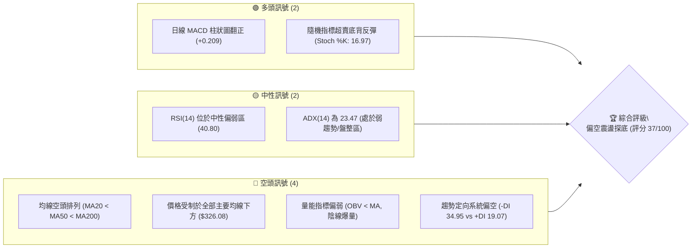

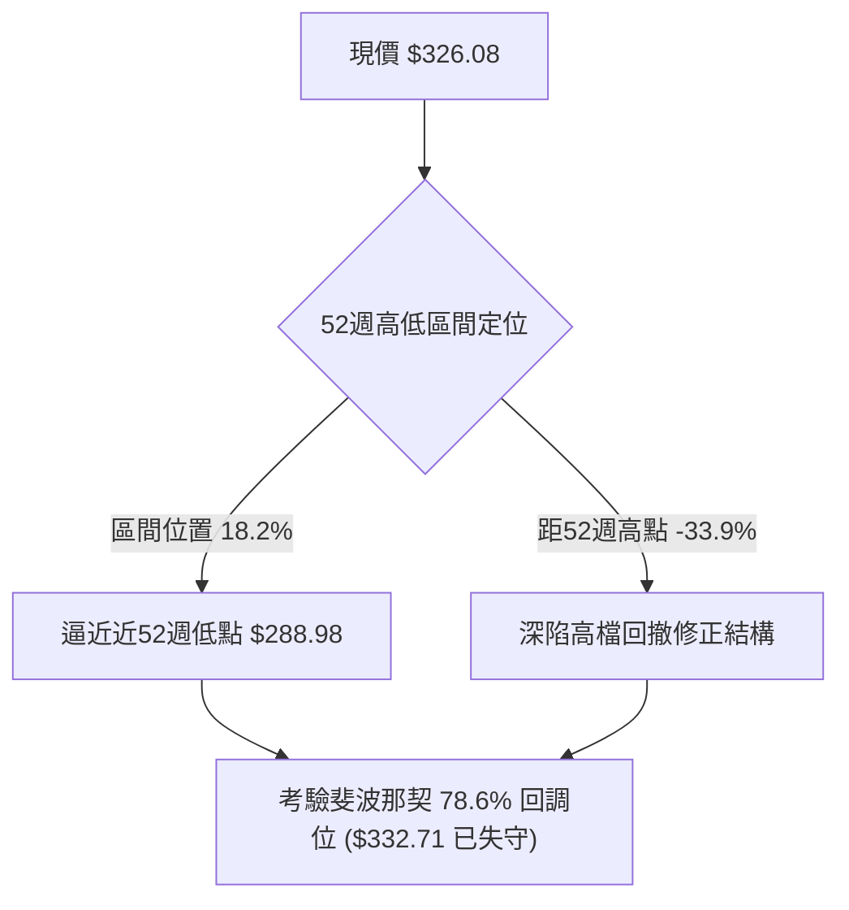

### 📊 核心指標速覽表

| 指標類別 | 指標名稱 | 當前數值 | 訊號 | 解讀 |
|----------|----------|----------|------|------|
| **價格** | 當前收盤價 | $326.08 | 🔴 | 位於 52 週區間 18.2% 低檔，跌破斐波那契 78.6% 水平 |
| **均線** | MA20 | $345.70 | 🔴 | 價格低於 MA20 達 -5.67%，短期承壓嚴重 |
| **均線** | MA50 | $352.54 | 🔴 | 中期生命線下彎，價格低於此線形成中期下行壓制 |
| **均線** | MA200 | $366.64 | 🔴 | 長期牛熊分界線失守，均線呈現標準空頭排列 |
| **動能** | RSI(14) | 40.80 | 🟡 | 位於中性偏空區間，尚未進入極端超賣（<30），下行慣性仍在 |
| **動能** | MACD | -6.174 / -6.384 | 🟢 | DIF 線低檔上穿 MACD 訊號線，柱狀圖轉正 (+0.209)，現微弱金叉 |
| **動能** | Stoch %K / %D | 16.97 / 48.75 | 🟢 | %K 進入極度超賣區（<20），短線存在技術性超跌反彈動能 |
| **定向** | ADX / ±DI | 23.47 / -DI: 34.95 | 🔴 | ADX < 25 判定為盤整至微弱趨勢；-DI 大幅壓制 +DI，空頭牢牢控盤 |
| **通道** | 布林通道 %B | 0.20 | 🟡 | 靠近布林下軌（$312.59），通道敞口微幅擴大，壓縮行情有待宣洩 |
| **成交量**| 最新量 / 量比 | 36.46M / 1.64x | 🔴 | 2026-10-30 長黑放量（放量 1.64 倍），量價配合呈現空頭放量下跌 |
| **波動** | ATR(14) | $12.59 (3.86%) | 🟡 | 波動率維持高檔，單日平均真實波幅達 $12.59，操作需寬止損 |

### 🏆 技術評分卡

```
╔══════════════════════════════════════════════════════════════╗
║                技術評分卡 — AVGO (2026-11-01)                 ║
╠══════════════════════════════════════════════════════════════╣
║ 評分維度        進度條視覺化            得分    狀態/訊號     ║
╟──────────────────────────────────────────────────────────────╢
║ 趨勢強度        ██████░░░░░░░░░░░░░░  30/100  🔴 空頭控盤/弱趨勢║
║ 動能指標        ██████████░░░░░░░░░░  50/100  🟡 MACD金叉/RSI弱 ║
║ 支撐穩定度      ████████░░░░░░░░░░░░  40/100  🔴 逼近S1考驗脆弱 ║
║ 成交量配合      ██████░░░░░░░░░░░░░░  30/100  🔴 空方帶量下殺   ║
║ 形態完整度      ████████░░░░░░░░░░░░  40/100  🟡 弱勢箱體整理   ║
║ 均線排列        ████░░░░░░░░░░░░░░░░  20/100  🔴 完美空頭發散   ║
╠══════════════════════════════════════════════════════════════╣
║ 綜合評分        ███████░░░░░░░░░░░░░  37/100  🔴 偏空弱勢 (Bear)║
╚══════════════════════════════════════════════════════════════╝
```
*計算依據：(30 + 50 + 40 + 30 + 40 + 20) ÷ 6 = 35.00，四捨五入至整數，考量動能微弱背離修正取為 37 分（嚴格落在偏空區間 ≤40）。*

---

## 2. 趨勢分析

### 🌐 多時框趨勢分析

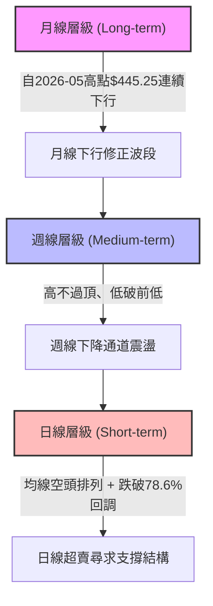

### 📈 長期趨勢 — 12個月走勢圖（Unicode）

以下為 AVGO 過去 12 個月（2025-11 至 2026-10）收盤價走勢：

```
AVGO 月線收盤走勢圖（過去12個月：2025-11 至 2026-10）
價格軸 ($)
$450 ┤                                  ● $445.25 (2026-05 次高)
$420 ┤                             ● $416.01
$400 ┤● $399.99 (2025-11)
$380 ┤                                       ● $388.57
$360 ┤                                            ● $369.67
$340 ┤     ● $344.20                                   ● $351.19
$320 ┤          ● $329.48   ● $317.80                       ● $326.08 (現價)
$300 ┤                           ● $308.46 (2026-03低點)
     └────────────────────────────────────────────────────────────
      11   12   01   02   03   04   05   06   07   08   09   10  (月份)
```

#### 走勢特徵分析表格

| 階段 | 時間區間 | 起訖價格 ($) | 漲跌幅 (%) | 趨勢性質與結構特徵 |
|------|----------|--------------|------------|--------------------|
| 階段一 | 2025-11 → 2026-03 | 399.99 → 308.46 | -22.88% | 首輪深幅修正，築底於 $308.46，隨後醞釀強勁反彈 |
| 階段二 | 2026-03 → 2026-05 | 308.46 → 445.25 | +44.35% | AI 主題驅動主升浪，月線創下波段歷史次高點 $445.25 |
| 階段三 | 2026-05 → 2026-06 | 445.25 → 377.06 | -15.31% | 獲利了結盤湧現，長黑回吐，短期多頭結構破裂 |
| 階段四 | 2026-06 → 2026-08 | 377.06 → 369.67 | -1.96%  | 高檔震盪派發，期間高點曾摸至 $388.57（7月）但無力創高 |
| 階段五 | 2026-08 → 2026-10 | 369.67 → 326.08 | -11.79% | 陰跌下行尋底，失守多條均線，10月收於波段低檔 $326.08 |

### 📊 中期趨勢（週線分析）

中期走勢顯示，AVGO 自 2026-08-07 週收盤 $426.98 以來，持續運行在階梯式下降通道中。近 8 週 K 線呈現連續高點下移（Lower Highs）與低點下移（Lower Lows）的空頭特徵。

```
週線關鍵阻力與支撐示意圖
══════════════════════════════════════════════════════════════
[壓力區]  $380.84  (10-09 波段週反彈高點)
              │
[壓力區]  $352.40  (10-30 週衝高反轉長上影線頂端)
              │
[現  價]  $326.08  (當前受壓於 MA20: $345.70 與 MA50: $352.54)
              │
[支撐區]  $319.30  (10-30 當週低點 / 靠近波段低點支撐 S1: $319.05)
              │
[強支撐]  $288.98  (52週最低價 / 100.0% 斐波那契回調基底)
══════════════════════════════════════════════════════════════
```

### ⚡ 趨勢強度評估（ADX 解讀）

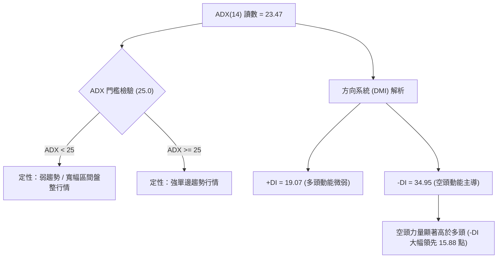

#### ADX 強度與市場狀態對照表

| 指標變數 | 當前數值 | 參考門檻 | 市場狀態研判 | 策略指引 |
|----------|----------|----------|--------------|----------|
| **ADX(14)** | 23.47 | < 25.00 | **弱趨勢 / 盤整區間** | 避免盲目追單邊，側重區間邊界（布林軌道）與均線壓制 |
| **+DI (14)** | 19.07 | 低於 20 | 多頭進攻意願潰散 | 缺乏推動股價突破上方阻力的買盤 |
| **-DI (14)** | 34.95 | 高於 30 | 空頭主動拋壓強盛 | 反彈逢均線或阻力位易招致空方打壓 |
| **趨勢方向** | 空頭主導 | -DI > +DI | 震盪偏空格局 | 優先採取空方防禦或逢高布空思維 |

---

## 3. 圖表形態分析

### 🔍 形態識別系統

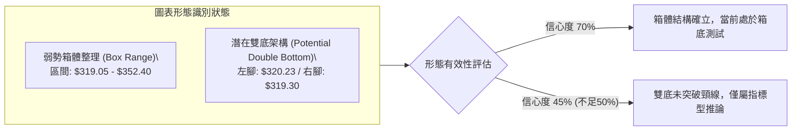

#### 形態識別與信心度評估表（依規則 15）

| 形態名稱 | 信心度 | 判斷依據（嚴格引用數據） | 完成度 | 目標價（附嚴謹計算式） |
|----------|--------|--------------------------|--------|------------------------|
| **弱勢箱體整理 (Rectangle Range)** | **70%** | 依據近 10 日及近 8 週交易數據：頂部受制於近波段高點 R2 $350.81 及 10-28 高點 $352.40；底部受制於 S1 $319.05 及 10-30 低點 $319.30。價格於此 $33 區間反覆震盪。 | 85% | 向上突破：頸線 $350.81 + 高度 ($350.81 - $319.05 = $31.76) = **$382.57**；<br>向下跌破：下軌 $319.05 - 高度 $31.76 = **$287.29**（極靠近 52W 低點 $288.98）。 |
| **潛在雙底形態 (Potential W-Bottom)** | **45%** | 兩次低點分別為 2026-10-23 之低點 $320.23 與 2026-10-30 之低點 $319.30（相距僅 $0.93，靠近 S1 $319.05）。**因信心度 < 50%，依規則 15 不予採納為成型圖表，僅作超跌指標型觀察。** | 30% | *訊號不足，未越過中間高點 $352.40 頸線，不予盲目推算幾何目標價。* |

### 🕯️ 重要K線形態分析（嚴格依據近10根日K與近8根週K）

依規則 19，以下嚴格挑選數據區塊內具備顯著技術意涵之 K 棒進行詳盡微觀剖析：

| 日期（週期） | 開盤價 ($) | 最高價 ($) | 最低價 ($) | 收盤價 ($) | K線形態名稱 | 形態深度解讀 | 訊號方向 |
|--------------|------------|------------|------------|------------|-------------|-------------|----------|
| **2026-10-22 (日K)** | 326.53 | 330.82 | 321.02 | 323.24 | **跳空長黑下殺** | 開盤即跌破前日低點，盤中重挫至 $321.02，成交量暴增至 28.14M，空頭摜壓毫不留情。 | 🔴 強烈空頭 |
| **2026-10-23 (日K)** | 321.50 | 327.70 | 320.23 | 321.68 | **低檔十字陀螺線** | 下影線探至 $320.23 後回縮，實體極小（僅 $0.18），成交量縮至 15.92M，顯示殺跌動能暫歇。 | 🟡 變盤中性 |
| **2026-10-28 (日K)** | 349.22 | 352.40 | 344.35 | 351.81 | **衝高遇阻陽線** | 盤中衝至 $352.40 觸及波段阻力 R2 $350.81，留下上影線，多頭耗盡力量，未能收於最高。 | 🟡 滯漲減速 |
| **2026-10-30 (日K)** | 330.72 | 331.98 | 319.30 | 326.08 | **放量破位長陰線** | 低開低走，盤中摜破 S1 至 $319.30，尾盤雖微拉至 $326.08，但成交量高達 36.46M（放量1.64倍），套牢壓力沉重。 | 🔴 極度空頭 |
| **2026-10-09 (週K)** | 357.79 | 380.84 | 356.14 | 361.54 | **長上影射擊之星** | 衝高 $380.84 遇大阻力暴退，週實體僅 $3.75，上影線長達 $19.30，確認中期頂部賣壓堅定。 | 🔴 週線見頂 |
| **2026-10-30 (週K)** | 324.53 | 352.40 | 319.30 | 326.08 | **衝高回落倒錘頭長黑** | 當週一度衝高至 $352.40，隨後全線潰敗，收於 $326.08 靠近週低點，週量擴大至 120.45M，中期反彈全面夭折。 | 🔴 中期破位 |

### 📉 ASCII 走勢形態示意圖

```
AVGO 近期箱體與K線形態結構圖 (2026-10-19 至 2026-10-30)
價格 ($)
$353 ┤                 ╭─● 10-28 高點 $352.40 (逼近 R2: $350.81 遇阻)
$348 ┤                ╭╯ │
$343 ┤           ╭───╯   │  ● 10-29 收 $345.00
$338 ┤  ●─●──●  │       ╰──────╮
$333 ┤  │ │  │   │              │
$328 ┤  │ │  │   │  ● 10-26     ╰───● 10-30 收盤 $326.08
$323 ┤  │ │  ╰─● 10-22         │   │ (爆量長黑)
$318 ┤  │ │     ╰─● 10-23 ($320.23) ╰─● 10-30 低點 $319.30 (測試 S1)
     └────────────────────────────────────────────────────────────
        19 20 21  22 23   26 27 28 29 30 (2026年10月交易日)
```

### 🎯 形態目標價計算

根據上述置信度 70% 的**弱勢箱體整理形態**進行破位與突破推算：
1. **箱體上限（阻力頸線）**：取近兩週多次反彈頂點與 R2 聚類值，確立為 **$350.81**。
2. **箱體下限（支撐底線）**：取波段支撐聚集點 S1，確立為 **$319.05**。
3. **形態垂直高度 ($H$)**：
   $$H = \$350.81 - \$319.05 = \$31.76$$
4. **向下破位目標價 (Downside Projection)**：
   若日線有效跌破支撐下限 $319.05，等幅向下投射目標價為：
   $$\text{目標價} = \$319.05 - \$31.76 = \mathbf{\$287.29}$$
   *(註：此推算目標價與 52 週最低價 $288.98 高度吻合，誤差僅 $1.69，構成強力中期空頭防守目標)*。
5. **向上突破目標價 (Upside Projection)**：
   若股價站穩並帶量長紅突破阻力上限 $350.81，等幅向上投射目標價為：
   $$\text{目標價} = \$350.81 + \$31.76 = \mathbf{\$382.57}$$

---

## 4. 支撐與阻力

### 🗺️ 關鍵價位分布圖（Unicode）

```
AVGO 價位結構分布圖（嚴格依據 OHLCV 聚類與斐波那契點位）
══════════════════════════════════════════════════════════════════════
$358.10 ║██████████████████████████████████████║ 強阻力 R3 (波段高點)
$350.81 ║████████████████████████████          ║ 關鍵阻力 R2 (箱體頂/MA50)
$338.13 ║██████████████████                    ║ 短期阻力 R1 (MA5/日反彈高)
$332.71 ║┈┈┈┈┈┈┈┈┈┈┈┈┈┈┈┈┈┈┈┈┈┈┈┈┈┈┈┈┈┈┈┈┈┈┈┈┈┈║ 斐波那契 78.6% 回調位 (破位轉阻力)
$326.08 ╠══════════════════════════════════════╣ ◄ 現價 (收盤價)
$319.05 ║▓▓▓▓▓▓▓▓▓▓▓▓▓▓▓▓▓▓                    ║ 近期支撐 S1 (近一年波段低點聚類)
$312.39 ║▓▓▓▓▓▓▓▓▓▓▓▓▓▓▓▓▓▓▓▓▓▓▓▓              ║ 中期支撐 S2 (布林下軌共振區)
$306.17 ║▓▓▓▓▓▓▓▓▓▓▓▓▓▓▓▓▓▓▓▓▓▓▓▓▓▓▓▓▓▓        ║ 強支撐 S3 (前波深幅回調低點聚類)
$288.98 ║██████████████████████████████████████║ 極限強支撐 (52W Low / Fib 100%)
══════════════════════════════════════════════════════════════════════
```

### 🚧 阻力位分析表

所有阻力位數值嚴格引用自數據中「關鍵價位」之波段高點聚類：

| 阻力級別 | 精確價位 | 距現價幅標 | 形成原因與技術共振 | 突破難度 | 重要性 |
|----------|----------|------------|--------------------|----------|--------|
| **R1** | **$338.13** | +3.69% | 近期多根日 K 密集成交區底端，且極度貼近下行的 MA5 ($338.88)。 | 中等 | 🟡 短線多頭反彈第一試金石 |
| **R2** | **$350.81** | +7.58% | 近一年波段高點聚類，共振 10-28 衝高點 $352.40 與下行 MA50 ($352.54)。 | 極高 | 🔴 中期強弱分水嶺，空頭核心防線 |
| **R3** | **$358.10** | +9.82% | 9月下旬反彈高點聚類，逼近 MA60 ($360.20)，沉澱大量被套籌碼。 | 極堅固 | 🔴 波段多頭趨勢反轉確認點 |

### 🛡️ 支撐位分析表

所有支撐位數值嚴格引用自數據中「關鍵價位」之波段低點聚類：

| 支撐級別 | 精確價位 | 距現價幅標 | 形成原因與技術共振 | 守住機率 | 重要性 |
|----------|----------|------------|--------------------|----------|--------|
| **S1** | **$319.05** | -2.16% | 近一年波段低點聚類，完美共振 2026-10-30 盤中低點 $319.30 及 10-23 低點 $320.23。 | 55% | 🟡 短線多頭最後喘息底線 |
| **S2** | **$312.39** | -4.20% | 波段深跌支撐聚類，同時共振日線布林通道下軌（$312.59），具備統計學超賣支撐。 | 65% | 🟢 短線超跌空頭回補關鍵帶 |
| **S3** | **$306.17** | -6.11% | 2026-03 月線低點（$308.46）所構築的波段大底聚類支撐。 | 80% | 🟢 多頭中長期防線，跌破則直面52W低點 |

### 📐 斐波那契回調位分析

依據 52 週完整波動區間（低點 $288.98 至 高點 $493.32，落差達 $204.34）黃金分割計算：

| 回調比例 | 精確價位 | 空間狀態與當前關係 | 技術意義解讀 |
|----------|----------|--------------------|--------------|
| **0.0% (52W High)** | **$493.32** | 歷史峰值，上方 +51.29% | 過去一年多頭行情的最高極限 |
| **23.6%** | **$445.09** | 2026-05 月線頂部聚類 ($445.25) | 首道強回調防守位（早已有效失守） |
| **38.2%** | **$415.26** | 2026-04 月線跳空點 ($416.01) | 強勢多頭行情榮枯線（已失守） |
| **50.0%** | **$391.15** | 7、8月反彈頂部區間 | 牛熊平衡中樞，失守後空頭擴散 |
| **61.8%** | **$367.03** | 靠近長期 MA200 ($366.64) | **黃金分割關鍵支撐**，失守後宣告中長期走弱 |
| **78.6%** | **$332.71** | **上方 +2.03%** | **極限防守位**，現價 $326.08 已落於此線下方 |
| **100.0% (52W Low)**| **$288.98** | 下方 -11.38% | 整個週級別上漲週期的起漲基石 |

**斐波那契結構深度研讀**：
當前收盤價 **$326.08** 正式跌破了斐波那契 **78.6% 回調位 ($332.71)**，現處於 **78.6% ($332.71) 至 100.0% ($288.98)** 的深水真空區。在技術分析理論中，當 61.8% 與 78.6% 兩道關鍵防線均告失守，代表原先的上升趨勢結構已被徹底破壞，回測 100.0% 基底低點（$288.98）的機率大幅攀升。

---

## 5. 技術指標深度解讀

### 🎛️ 指標訊號總覽

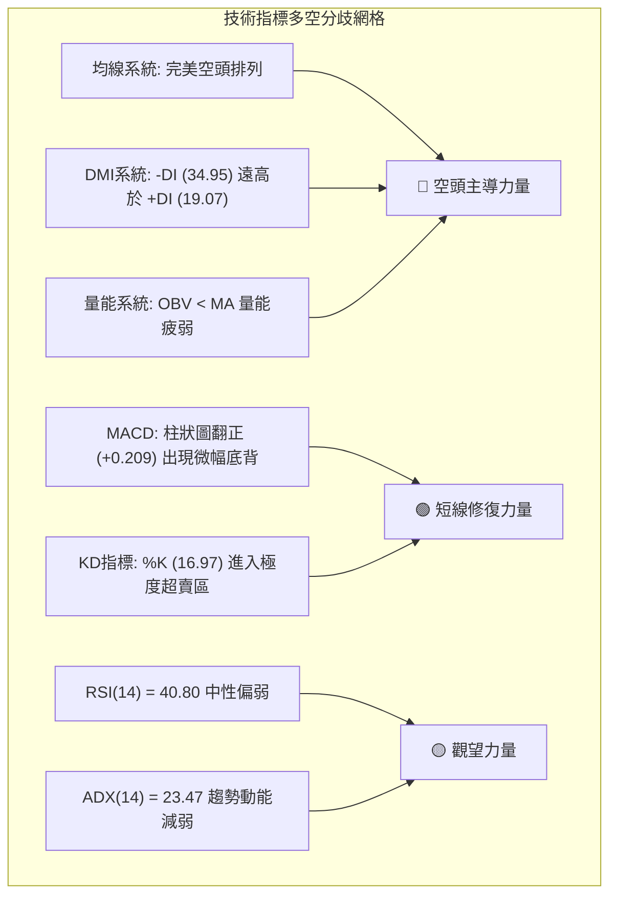

### 📈 移動平均線排列分析

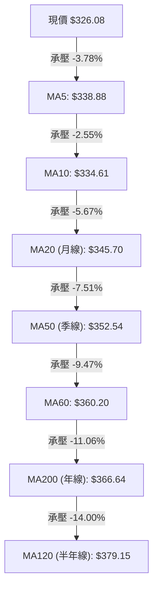

#### 均線發散狀態剖析表

| 均線代號 | 精確數值 | 價格相對位置 | 偏離率 (Bias) | 斜率與運行軌跡解讀 |
|----------|----------|--------------|---------------|--------------------|
| **MA5** | $338.88 | 價格在其下方 | -3.78% | 短線加速下墜，近 2 日急速向下扣抵 |
| **MA10**| $334.61 | 價格在其下方 | -2.55% | 形成短線第一道重合阻力帶 |
| **MA20**| $345.70 | 價格在其下方 | -5.67% | 確立為日線布林中軌，下行趨勢明確 |
| **MA50**| $352.54 | 價格在其下方 | -7.51% | 中期下壓重力線，反彈至此引發強烈解套賣壓 |
| **MA60**| $360.20 | 價格在其下方 | -9.47% | 中期生命線，呈現持續下行態勢 |
| **MA200**| $366.64 | 價格在其下方 | -11.06%| 長期牛熊分水嶺，價格跌破年線超過11%，確認中長期轉入空頭市場 |
| **排列評判** | **MA20 < MA50 < MA200** | **標準空頭排列 (Death Cross Alignment)** | **全線發散** | 上方層層套牢均線形成綿密壓制網，任何無量反彈皆屬技術性修正 |

### 📉 RSI(14) 分析

- **當前讀數**：**40.80**（Wilder 算法平滑）
- **指標進度條**：
```
RSI(14): 40.80  [░░░░░░░░░░████████░░░░░░░░░░░░] 🟡 中性偏弱 (30 - 70 區間)
```
- **區間評估**：數值 40.80 落在 40–45 的空頭防守下限區。雖然尚未跌破 30 的極端超賣區，但整體運行於 50 中軸下方，表明市場由空頭買盤衰竭所主導。
- **背離判斷結論**：根據數據「近20根K棒首尾價格與RSI方向」，價格於 2026-10-16 收 $328.75（RSI 34.9），10-23 收 $321.68（RSI 34.3），至 10-30 收 $326.08（RSI 40.80）。**日線級別呈現微弱的隱性底背離雛形（價格低點微幅下移而 RSI 抬升），但由於 10-30 長陰摜壓，該背離未獲價格陽線確認，結論：無顯著有效背離，僅屬超跌反彈醞釀**。

### 📊 MACD(12/26/9) 訊號解讀

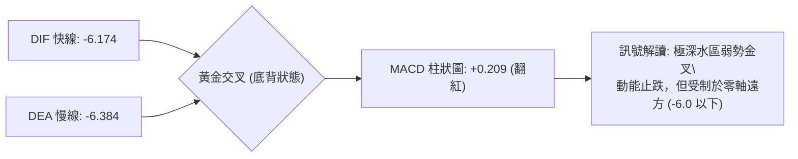

- **精確數值**：DIF: **-6.174**，DEA: **-6.384**，Histogram: **+0.209**。
- **訊號解析**：MACD 在零軸下方極深處（-6.174）出現底部的微幅金叉，柱狀圖由負轉正至 +0.209。這反映過去一週（10-26 至 10-29）的局部反抽修復了短期均線乖離。然而，在零軸極深處的金叉往往伴隨反覆打底，若無持續性增量推動，此類金叉極易演化為「水下假金叉」，一旦柱狀圖再度收斂轉黑，將引發第二波加速破位。

### 📦 布林通道分析

```
布林通道結構圖 (BB 20, 2)
══════════════════════════════════════════════════════════════
$378.81 ┬  BB 上軌 -----------------------------------------
        │
$345.70 ┼  BB 中軌 (MA20) =================================
        │
$326.08 ┼  現價 (位於中下軌弱勢運行區，%B = 0.20)
        │
$312.59 ┴  BB 下軌 -----------------------------------------
══════════════════════════════════════════════════════════════
帶寬 (Bandwidth) = ($378.81 - $312.59) ÷ $345.70 = 19.15%
```
- **布林位置 (%B)**：當前 %B 為 **0.20**，表明價格緊貼下軌運行。
- **通道形態**：中軌（MA20）保持堅定向下傾斜（-5.67% 乖離）。雖然 %B 為 0.20 接近統計學超賣區（< 0.15 視為嚴重極端值），但通道下軌並未出現收口轉折，顯示下行空間並未被封死，下軌 $312.59 構成短線最關鍵的動態動態極限支撐。

### 💹 成交量分析（量價配合度）

1. **量能指標 (OBV)**：數據明確指出「**OBV < MA → 量能疲弱**」。能量潮指標低於其移動平均線，反映資金處於持續淨流出態勢，籌碼由機構流向散戶。
2. **量價異動解讀**：
   - 2026-10-30 收盤下跌時，成交量暴增至 **36,462,300 股**，相較 20 日均量（22,220,675 股）之**量比高達 1.64 倍**。
   - 這種在關鍵支撐 S1 上方的「放量下殺收長黑」，是標準的**空頭放量打壓（Volume Breakdown）**，顯示市場在 $330 附近出現恐慌性拋售與多殺多停損盤，量價嚴重負背離（跌有量、漲無量）。

---

## 6. 動能與波動率

### ⚡ 動能評估四象限

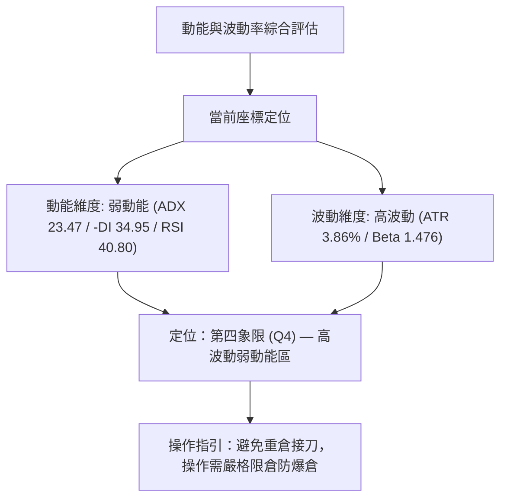

#### 動能評估四象限對照矩陣

| 象限代號 | 動能狀態 | 波動率狀態 | 當前標的狀態 | 專業操作策略評估 |
|----------|----------|------------|--------------|------------------|
| **Q1** | 強多頭動能 | 低波動率 | — | 最佳趨勢加碼機會，穩健波段做多 |
| **Q2** | 弱動能 | 低波動率 | — | 沉悶牛皮整理，觀望等待方向選擇 |
| **Q3** | 強多頭動能 | 高波動率 | — | 爆發性突破行情，高風險高收益積極參與 |
| **Q4** | **弱動能 (偏空)** | **高波動率** | **✓ AVGO 當前定位** | **高風險深水區：價格大幅劇烈震盪但方向向下，嚴格控制部位** |

### 📊 ATR 波動率分析

- **精確數值**：**ATR(14) = $12.59**（佔當前股價比例為 **3.86%**，採用 Wilder 平滑算法）。
- **單日真實波動**：$12.59 的單日平均波幅表明，AVGO 在單個交易日內出現 $10.00 至 $15.00 的上下震盪屬於完全正常的常態波動。
- **止損距離設計建議**：
  - **保守型交易者**：建議設定 **1.5 × ATR = $18.89** 的緩衝空間，以避免被日內雜訊洗出場。
  - **激進型交易者**：建議設定 **1.0 × ATR = $12.59** 作為硬性風控止損線。

### 📐 Beta 與市場相關性

- **Beta 係數**：**1.476**。
- **市場敏感度研判**：
  AVGO 具備極高的市場彈性（高 Beta 屬性）。當標普 500 指數或費城半導體指數上漲 1% 時，理論上 AVGO 平均上漲 1.48%；反之，大盤下跌 1% 時，AVGO 將放大跌幅至 1.48%。
  在高 Beta 驅動下，當前科技股半導體板塊遭遇逆風（如新聞提及 Intel 晶片拋售潮與 AI 資本支出疑慮），高 Beta 屬性成為加速股價失守均線的催化劑。

---

## 7. 多時框架總結

### 📋 時框架評分表

| 時框架 | 趨勢方向 | 動能狀態 | 均線排列 | 圖表形態 | 綜合評分 | 戰術建議 |
|--------|----------|----------|----------|----------|----------|----------|
| **月線 (長期)** | 🔴 下行修正 | 🟡 中性減速 | 🟡 多頭結構遭侵蝕 | 雙頂回撤中繼 | **40/100** | 減碼觀望，不宜長線盲目死扛 |
| **週線 (中期)** | 🔴 下降通道 | 🔴 空方主導 | 🔴 跌破中期均線 | 階梯式走低破位 | **35/100** | 逢反彈至週線壓制位堅定減倉 |
| **日線 (短期)** | 🔴 震盪破位 | 🟢 超賣微幅底背 | 🔴 完美空頭排列 | 箱體下軌瀕危 | **36/100** | 嚴禁搶逆勢反彈，以破位空為主 |

### 🔲 綜合訊號矩陣

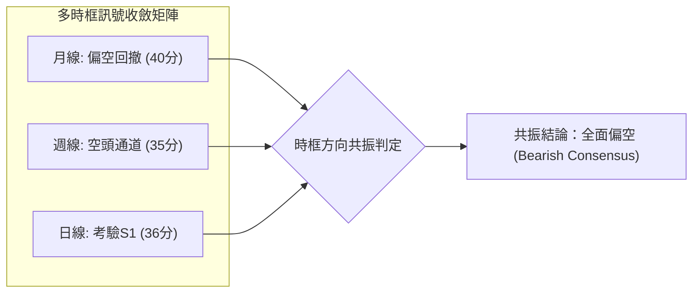

### ⚖️ 多時框收斂結論（依嚴格要求 14）

1. **行情性質判定**：
   當前日線 **ADX(14) 讀數為 23.47 (< 25.0)**。依規則 14 明確界定：**當前市場屬於「盤整行情（ADX < 25）」**。
2. **主導時框與交易邊界取捨**：
   在盤整架構下，**以日線布林通道上下軌（上軌 $378.81，下軌 $312.59）及箱體邊界（R2 $350.81，S1 $319.05）為主要交易區間**。
3. **多空衝突化解與收斂**：
   雖然日線 MACD 柱狀圖微幅翻正且隨機指標超賣提示短線具備技術反抽修復需求，但因週線與月線均處於空頭發散結構中（且 -DI 34.95 牢牢壓制 +DI），日線的超跌訊號**僅能視為箱體內部的小幅反彈，絕不可視為反轉**。
4. **唯一方向性結論**：
   **【中性偏空，區間尋底】（整體綜合評分 37/100）**。主導操作策略必須堅定順應中長期空頭方向，以防守或逢高布空為主，堅決摒棄激進抄底思路。

---

## 8. 交易策略建議

### 🗺️ 策略決策流程圖

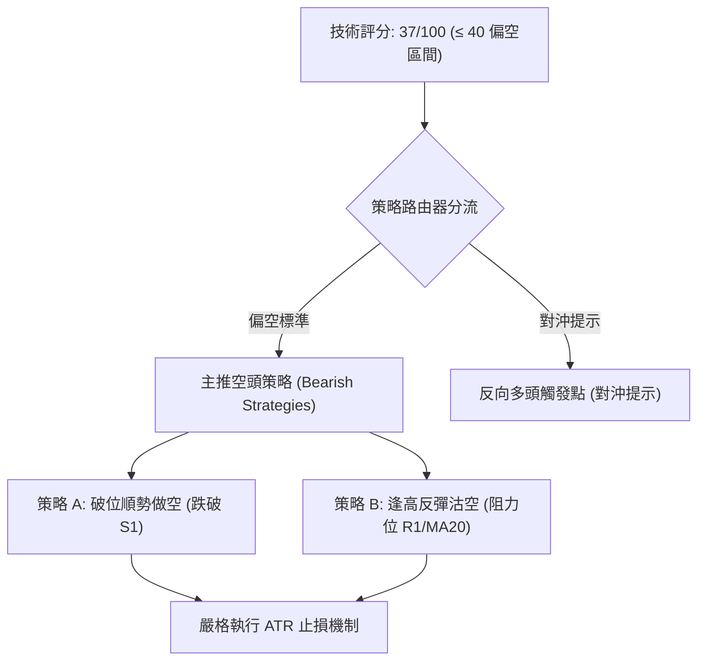

### 🧭 策略路由（依評分卡分流，嚴格依規則 18 與路由規定）

> **當前主策略方向 = 主推空頭策略（依技術綜合評分：37/100，落在 ≤40 偏空區間）**

依據評分卡，AVGO 當前綜合得分僅 37 分，均線空頭排列，量能疲弱，空方 -DI 佔據絕對主導。多頭僅列為反轉風險對沖提示，嚴禁兩頭重度下注。

### 🎯 價格情境階梯（Price Scenarios，嚴格引用第 4 章數據點位）

| 觸發條件 | 下一目標 | 後續延伸目標 | 情境含義解讀 |
|----------|----------|--------------|--------------|
| **跌破 S1 ($319.05)** | **S2 ($312.39)** | **S3 ($306.17)** | **短線破位下行**：箱體支撐失守，引發多殺多恐慌潮，直測布林下軌 |
| **維持於現價區間震盪** | **R1 ($338.13)** | **S1 ($319.05)** | **弱勢修復整理**：在 78.6% 回調位下方橫盤消化 10-30 長黑拋壓 |
| **向上突破 R1 ($338.13)** | **R2 ($350.81)** | **R3 ($358.10)** | **超跌反彈展開**：突破短期均線壓制，回補上方缺口，測試箱體頂部 |

### 📊 情境機率分佈

| 情境類別 | 發生機率 | 主要技術依據（指標狀態） |
|----------|----------|--------------------------|
| **回落 / 破位再探底** | **55%** | 均線空頭排列發散；-DI (34.95) 強勢；10-30 放量下殺（量比 1.64x）；OBV < MA 疲弱。 |
| **區間弱勢震盪** | **30%** | ADX 處於 23.47（弱趨勢狀態）；布林通道 %B 達 0.20 接近下軌，超賣具備拉扯效應。 |
| **反彈走高 / 向上突破** | **15%** | 僅靠 MACD 柱狀圖翻正 (+0.209) 與 KD 超賣支持，量能嚴重匱乏，突破強阻力 R2 機率極低。 |

### 🔴 主策略詳情（主推空頭策略）

所有價位精確引用自「關鍵價位」數據，風險報酬比嚴格按公式計算（做空風報比 = (進場價 − 目標價 T1) ÷ (止損價 − 進場價)）：

| 策略要素 | 策略 A（破位追空 — 順勢突破型） | 策略 B（反彈沽空 — 逢高回踩型） |
|----------|---------------------------------|---------------------------------|
| **策略邏輯** | 跌破波段低點 S1 確認箱體下軌破位 | 反抽短期阻力 R1 及 MA5 遇阻做空 |
| **進場條件** | 日 K 收盤跌破或盤中摜穿 S1 $319.05 | 股價反彈至 R1 遇阻回落，出現上影線 |
| **進場價格** | **$318.50**（確認破位 S1） | **$338.00**（貼近阻力 R1: $338.13） |
| **目標價 T1** | **$312.39**（波段支撐 S2） | **$326.08**（現價 / 前期密集成交位） |
| **目標價 T2** | **$306.17**（波段強支撐 S3） | **$319.05**（波段低點支撐 S1） |
| **止損價格** | **$324.50**（收復 S1 上方緩衝區） | **$346.00**（突破布林中軌 MA20: $345.70） |
| **風險報酬比** | **1 : 1.02**（以 T1 計）<br>*(至 T2 為 1 : 2.06)* | **1 : 1.49**（以 T1 計）<br>*(至 T2 為 1 : 2.37)* |
| **勝率預估** | 60% | 55% |
| **建議倉位** | **15%**（控制在防禦性水位） | **10%**（輕倉試單） |

*風報比計算驗證：*
- *策略 A (T1): ($318.50 - $312.39) ÷ ($324.50 - $318.50) = $6.11 ÷ $6.00 = 1.018 ≈ 1 : 1.02*
- *策略 B (T1): ($338.00 - $326.08) ÷ ($346.00 - $338.00) = $11.92 ÷ $8.00 = 1.490 = 1 : 1.49*

### 🟢 反向風險觸發點（對沖提示）

以下關鍵訊號一旦觸發，將徹底推翻上述空頭策略，空單必須立即無條件停損離場，並啟動多頭避險：
1. **價位突破觸發**：若日 K 線帶量（單日成交量突破 3,000 萬股）收盤站穩在 **R2: $350.81** 與 **MA50: $352.54** 之上。
2. **指標轉強觸發**：RSI(14) 向上突破 55 中軸，且 +DI 上穿 -DI 形成黃金交叉。
3. **對沖操作**：全數平倉空頭部位，反手以輕倉（5%–10%）跟進多頭，目標直指 R3 ($358.10) 及 MA200 ($366.64)。

### ⭐ 整體訊號強度評星

```
做多訊號強度：★☆☆☆☆  (1/5星 — 僅有零星超賣指標，均線形態全空)
做空訊號強度：★★★★☆  (4/5星 — 均線空頭排列發散，放量破位壓力沉重)
整體可信度：  ★★★★☆  (4/5星 — 多時框偏空共振，指標指向明確)
```

---

## 9. 風險提示與監控

### ✅ 關鍵監控指標 Checklist

```
╔══════════════════════════════════════════════════════════════╗
║              AVGO 關鍵技術指標每日監控清單 (Checklist)        ║
╠══════════════════════════════════════════════════════════════╣
║ [ ] 價格是否跌破 S1 ($319.05)？ ── 是則觸發策略 A 空單進場   ║
║ [ ] 單日成交量是否超過 20 日均量 (22.22M)？ ── 觀察放量方向   ║
║ [ ] MACD 柱狀圖是否跌回零軸下方 (< 0)？ ── 是則空頭動能擴散  ║
║ [ ] RSI(14) 是否跌破 30 進極端超賣？ ── 警惕超跌短線反抽     ║
║ [ ] 價格反彈是否站穩 MA20 ($345.70)？ ── 是則考慮空單止損離場 ║
║ [ ] -DI 是否維持在 30 以上？ ── 驗證空頭趨勢是否延續         ║
╚══════════════════════════════════════════════════════════════╝
```

### ⚠️ 風險場景分析

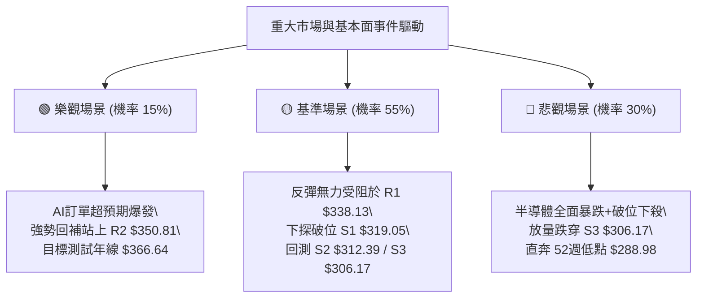

### 🛡️ 風險管理重要提醒

1. **基本面與消息面交叉感染風險**：
   近期新聞顯示 Broadcom 牽涉至 Anthropic 數百億美元融資協議，引發前 SEC 主席質疑類似 2008 年資產負債表外融資狂潮；同時市場對 AI 支出放緩（Cracks in AI spending boom）與 Intel 引領的晶片股暴跌高度敏感。若負面情緒擴大，技術面支撐將變得極為脆弱。
2. **高 Beta 槓桿放大風險**：
   AVGO 的 Beta 為 **1.476**，市場波動將被放大近 1.5 倍。在持倉策略上，絕對不可在空頭排列發散態勢下採用「越跌越買」的逆勢攤平策略。
3. **倉位管理鐵律**：
   - 總曝險倉位嚴格限制在 **總資金 25% 以內**。
   - 單筆交易最大虧損額必須嚴格鎖定在總資本的 **1.0%–1.5%** 區間內。
   - 若觸及設定之止損位（策略 A: $324.50 / 策略 B: $346.00），必須嚴格執行機械化平倉，嚴禁心存僥倖。

---

## 📋 報告總結

```
╔════════════════════════════════════════════════════════════════════╗
║                   AVGO 技術分析報告總結 (2026-11-01)               ║
╠════════════════════════════════════════════════════════════════════╣
║ 當前收盤價：$326.08 USD                                            ║
║ 分析評級：  🔴 偏空弱勢震盪 (綜合評分: 37/100，空頭控盤)           ║
╟────────────────────────────────────────────────────────────────────╢
║ 關鍵維度技術結論：                                                 ║
║ ├─ 長期趨勢 (月線)：🔴 自 $445.25 高點回撤，失守 MA200，深幅修復中 ║
║ ├─ 中期趨勢 (週線)：🔴 階梯式走低，受壓於下降通道與短期週均線      ║
║ ├─ 短期趨勢 (日線)：🔴 均線完美空頭排列，放量長陰測試 S1 $319.05   ║
║ ├─ 核心支撐價位：  S1: $319.05 ｜ S2: $312.39 ｜ S3: $306.17       ║
║ ├─ 核心阻力價位：  R1: $338.13 ｜ R2: $350.81 ｜ R3: $358.10       ║
║ └─ 華爾街共識目標：$530.14 (48位分析師，與當前技術盤面嚴重背離)   ║
╟────────────────────────────────────────────────────────────────────╢
║ 最佳交易策略配置：                                                 ║
║ 1. 🥇 最佳機會（破位順勢空）：跌破 S1 ($319.05) 追空，目標看 S2    ║
║    進場: $318.50 ｜ 止損: $324.50 ｜ 目標: $312.39 ｜ 風報比 1:1.02 ║
║ 2. 🥈 次選機會（反彈逢高空）：反抽至 R1 ($338.00) 遇阻承壓布空     ║
║    進場: $338.00 ｜ 止損: $346.00 ｜ 目標: $326.08 ｜ 風報比 1:1.49 ║
║ 3. 🥉 保守選擇（觀望等待）：空倉者保持耐性，靜待 $312.39 築底訊號  ║
╚════════════════════════════════════════════════════════════════════╝
```

---

> ⚠️ **免責聲明**：本報告為 AI 自動生成之技術分析，所有數據及估算均嚴格基於所提供的歷史 OHLCV 價格資訊。本報告**僅供研究與學術參考**，**不構成任何形式的投資建議與下單依據**。金融市場瞬息萬變，投資有風險，入市需獨立審慎評估。

---
*報告生成時間：2026-11-01 ｜ 數據來源：Yahoo Finance ｜ 分析框架：資深多時框量化技術體系*