# AVGO 技術分析報告

> **報告日期**：2026-11-02 ｜ **語言**：繁體中文 ｜ **數據來源**：Yahoo Finance ｜ **當前價格**：$326.08

---

## 目錄

| 章節 | 內容 |
|------|------|
| [1. 技術面概覽](#1-技術面概覽) | 訊號儀表板、核心指標、評分卡 |
| [2. 趨勢分析](#2-趨勢分析) | 多時框趨勢、長中短期走勢 |
| [3. 圖表形態分析](#3-圖表形態分析) | 形態識別、K線組合、目標價 |
| [4. 支撐與阻力](#4-支撐與阻力) | 關鍵價位、斐波那契回調 |
| [5. 技術指標深度解讀](#5-技術指標深度解讀) | MA/RSI/MACD/布林/成交量 |
| [6. 動能與波動率](#6-動能與波動率) | 動能評估、ATR、Beta |
| [7. 多時框架總結](#7-多時框架總結) | 時框架評分矩陣 |
| [8. 交易策略建議](#8-交易策略建議) | 多空策略、風險報酬比 |
| [9. 風險提示與監控](#9-風險提示與監控) | 監控指標、風險場景 |

---

## 1. 技術面概覽

### 🎯 技術訊號儀表板

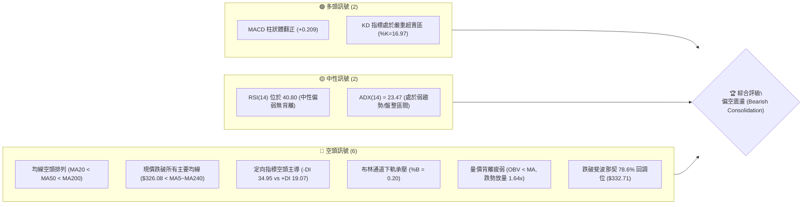

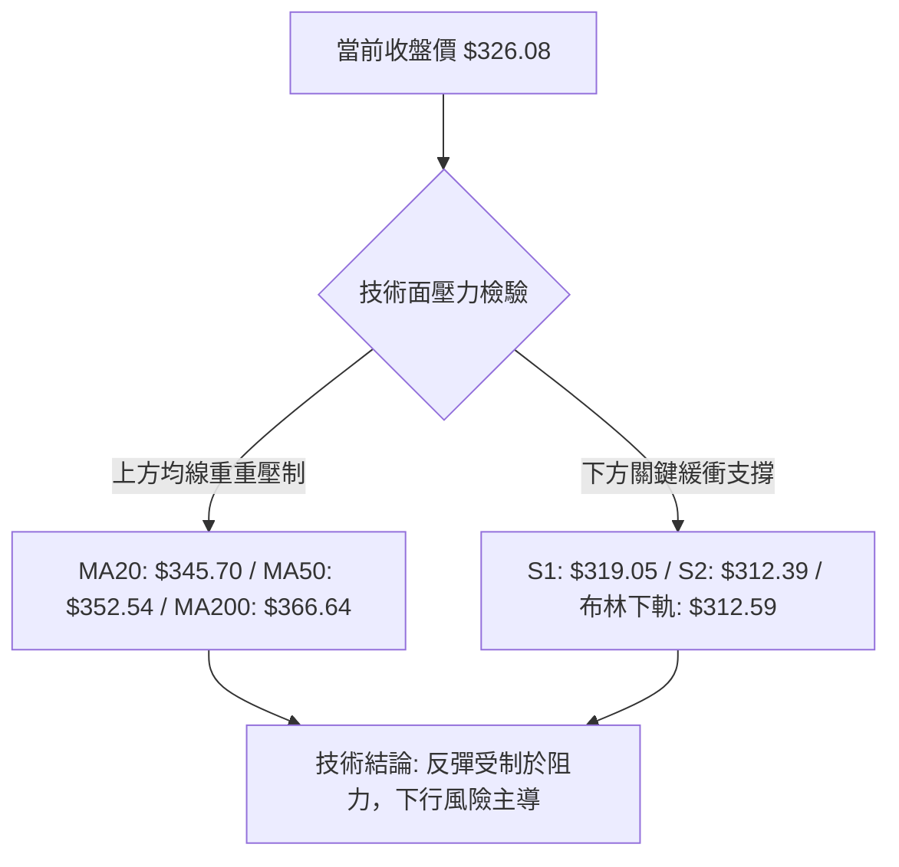

### 📊 核心指標速覽表

| 指標類別 | 指標名稱 | 當前數值 | 訊號 | 解讀 |
|----------|----------|----------|------|------|
| **價格** | 當前收盤價 | $326.08 | 🔴 | 位於 52 週高低區間之 18.2% 位置，接近底部但疲弱 |
| **均線** | MA20 (短均) | $345.70 | 🔴 | 價格低於 MA20 達 -5.67%，短期下行趨勢顯著 |
| **均線** | MA50 (中均) | $352.54 | 🔴 | 價格低於 MA50，中期多頭架構完全瓦解 |
| **均線** | MA200 (長均) | $366.64 | 🔴 | 價格跌破年線關鍵分水嶺，長期趨勢轉空 |
| **動能** | RSI(14) | 40.80 | 🟡 | 進入 40–50 偏弱中性區間，未達 <30 極端超賣，無背離 |
| **動能** | MACD (12,26,9) | -6.174 / -6.384 | 🟢 | DIF 與 DEA 仍在零軸下方深處，但柱狀體翻正 (+0.209) 微幅收斂 |
| **隨機指標** | Stoch %K / %D | 16.97 / 48.75 | 🟢 | %K 進入 20 以下超賣區，醞釀技術性超跌反彈動能 |
| **趨勢強度** | ADX(14) | 23.47 | 🟡 | ADX < 25 判定為弱趨勢或低位震盪，但 -DI(34.95) 遠大於 +DI(19.07) |
| **通道通道** | Bollinger %B | 0.20 | 🔴 | 逼近布林帶下軌 ($312.59)，空方力量處於擴張主導地位 |
| **成交量** | 20日成交量比 | 1.64x | 🔴 | 最新成交量 36.46M 放大，下跌放量反映空頭拋壓湧現 |
| **量能趨勢** | OBV 走勢 | OBV < MA | 🔴 | 能量潮低於移動平均線，資金持續呈現淨流出狀態 |
| **波動度** | ATR(14) | $12.59 | 🟡 | 每日平均震幅約 3.86%，波動適中，止損設置需給予充足空間 |

### 🏆 技術評分卡

```
╔══════════════════════════════════════════════════════════════════╗
║                 技術評分卡 — AVGO (2026-11-02)                  ║
╠══════════════════════════════════════════════════════════════════╣
║ 趨勢強度 (Trend Strength)   ██████░░░░░░░░░░░░░░  30/100  🔴 空頭主導  ║
║ 動能指標 (Momentum)         ████████░░░░░░░░░░░░  42/100  🟡 弱勢修復  ║
║ 支撐穩定度 (Support Level)   █████████░░░░░░░░░░░  45/100  🟡 考驗前低  ║
║ 成交量配合 (Volume Profile)  ███████░░░░░░░░░░░░░  35/100  🔴 帶量下挫  ║
║ 形態完整度 (Pattern Status)  ████████░░░░░░░░░░░░  38/100  🔴 破位下行  ║
║ 均線排列 (Moving Averages)  █████░░░░░░░░░░░░░░░  26/100  🔴 空頭排列  ║
╠══════════════════════════════════════════════════════════════════╣
║ 綜合評分 (Overall Score)    ███████░░░░░░░░░░░░░  36/100  🔴 偏空震盪  ║
║ 計算依據：(30 + 42 + 45 + 35 + 38 + 26) ÷ 6 = 36.0 (規則 18)     ║
╚══════════════════════════════════════════════════════════════════╝
```

---

## 2. 趨勢分析

### 🌐 多時框趨勢分析

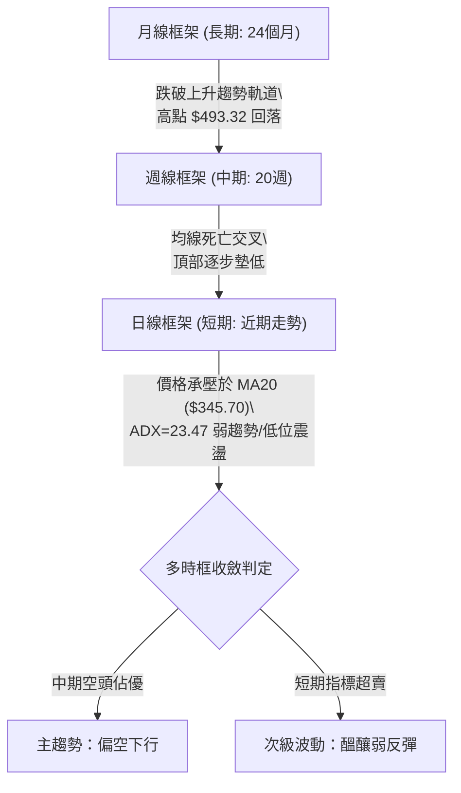

```mermaid
graph LR
    subgraph 長期趨勢 ["月線級別 (Long-term)"]
        direction TB
        L1["歷史高點: $445.25 (2026-05)"]
        L2["最新收盤: $326.08 (2026-10)"]
        L3["狀態: 進入中期修正深水區"]
    end
    subgraph 中期趨勢 ["週線級別 (Medium-term)"]
        direction TB
        M1["週K自 8 月高點 $426.98 持續滑落"]
        M2["跌破斐波那契 61.8% ($367.03)"]
        M3["狀態: 空頭主導波段走勢"]
    end
    subgraph 短期趨勢 ["日線級別 (Short-term)"]
        direction TB
        S1["均線排列: MA20 < MA50 < MA200"]
        S2["跌破 R1 ($338.13) 與前波震盪平台"]
        S3["狀態: 測試 S1 ($319.05) 支撐力道"]
    end
    長期趨勢 -.-> 中期趨勢 -.-> 短期趨勢
```

### 📈 長期趨勢 — 12個月走勢圖（Unicode）

```
AVGO 月線走勢圖（過去12個月：2025-11 至 2026-10）
價格軸 ($)
$450 ┤                                  ●(2026-05 $445.25 高點)
$420 ┤                             ●(2026-04 $416.01)
$400 ┤ ●(2025-11 $399.99)
$380 ┤                                       ●(2026-07 $388.57)
$360 ┤                                            ●(2026-08 $369.67)
$340 ┤      ●(2025-12 $344.20)                         ●(2026-09 $351.19)
$320 ┤           ●(2026-01 $329.48)                         ●(2026-10 $326.08 現在)
$300 ┤                ●(2026-02 $317.80) ●(2026-03 $308.46)
     └─────────────────────────────────────────────────────────────────
       11   12   01   02   03   04   05   06   07   08   09   10  (月份)
     [  2025 年末  ] [            2026 年上半至下半年走勢            ]
```

#### 走勢特徵分析表格

| 階段區間 | 起訖月份 | 起訖價格 | 區間漲跌幅 | 主要走勢特徵與結構意涵 |
|----------|----------|----------|------------|------------------------|
| **衝高築頂** | 2025-11 → 2026-03 | $399.99 → $308.46 | -22.88% | 自高位獲利了結回吐，連續四個月回檔並於 $308.46 尋求支撐 |
| **主升反彈** | 2026-03 → 2026-05 | $308.46 → $445.25 | +44.35% | 強勁拉升創下波段歷史收盤新高，展現 AI 與半導體強大動能 |
| **波段退潮** | 2026-05 → 2026-06 | $445.25 → $377.06 | -15.31% | 高檔急跌，形成長陰吞噬，標誌著長期多頭趨勢告一段落 |
| **反彈受阻** | 2026-06 → 2026-07 | $377.06 → $388.57 | +3.05% | 縮量反抽，無法突破 $400.00 整數關卡，形成次高點架構 |
| **陰跌破位** | 2026-07 → 2026-10 | $388.57 → $326.08 | -16.08% | 8月短暫見頂 $426.98 後持續下挫，月線連三陰，逼近年度低點 |

### 📊 中期趨勢（週線分析）

從近 20 週收盤走勢觀察，AVGO 呈現明顯的波浪式震盪下行（Lower Highs & Lower Lows）。2026-08-07 週收盤創下 $426.98 的次高點後，空方逐步擴大戰果，歷經 9 月中旬於 $360.00 附近的橫盤掙扎，於 10 月中旬徹底跌破該平台，10-23 當週創下 $321.68 的近期收盤低點。

```
週線近期主要壓力與支撐示意：
───────────────────────────────────────────────────────────────────────
[壓力3] $380.84 ─── 2026-10-09 週波段高點（反彈強阻力）
[壓力2] $361.54 ─── 2026-10-09 週收盤價 / 跌破的頸線平台
[壓力1] $338.13 ─── 阻力 R1 / 近期震盪反彈阻力
────────────────────── 當前週收盤: $326.08 ───────────────────────────
[支撐1] $319.30 ─── 2026-10-30 週內最低點（前哨支撐）
[支撐2] $312.39 ─── 支撐 S2 / 逼近布林通道週/日線下軌區間
[支撐3] $288.98 ─── 52 週最低點（終極強支撐防線）
───────────────────────────────────────────────────────────────────────
```

### ⚡ 趨勢強度評估（ADX 解讀）

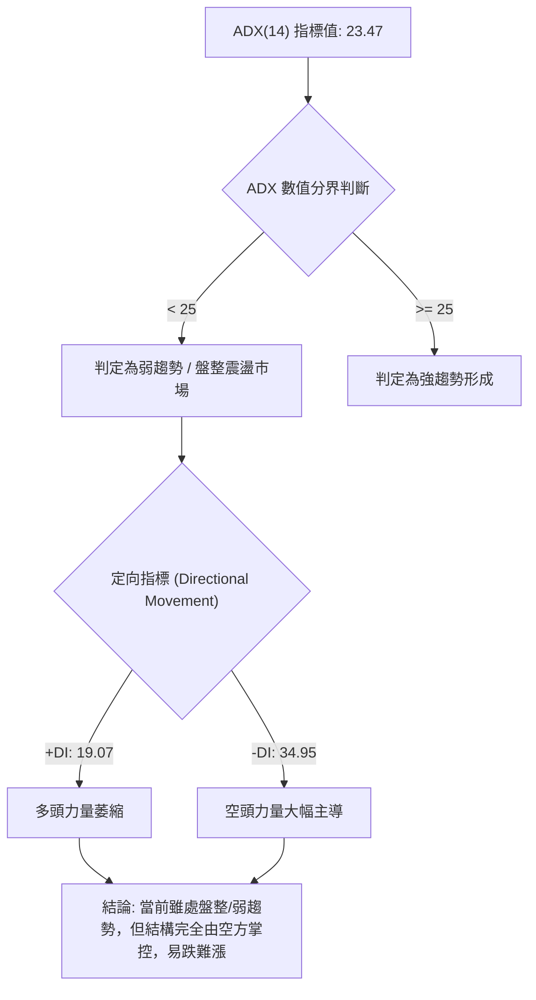

#### ADX 趨勢強度對照表

| 指標名稱 | 數值 | 參考區間 | 市場狀態解讀 |
|----------|------|----------|--------------|
| **ADX(14)** | **23.47** | 0 – 20: 極弱趨勢<br>**20 – 25: 弱趨勢/低位盤整**<br>25 – 40: 強趨勢行情<br>40+: 極強單邊行情 | 目前處於 23.47，表明單邊下跌動能雖暫時趨緩，進入盤整震盪，但尚未擺脫破位後的下行陰霾。 |
| **+DI (14)** | **19.07** | 多方攻擊動能 | +DI 處於 20 以下低位，多方买盤缺乏推升價格的持續動能。 |
| **-DI (14)** | **34.95** | 空方攻擊動能 | -DI 高達 34.95，顯示空方完全掌握市場定價話語權。 |
| **DI 差值** | **-15.88** | 淨方向動能 | 差值嚴重為負，確認反彈均屬弱勢修正性質。 |

---

## 3. 圖表形態分析

### 🔍 形態識別系統

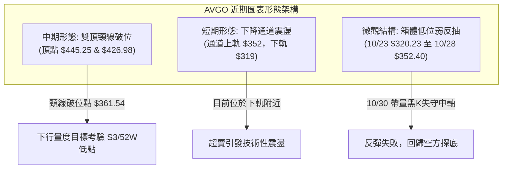

#### 形態信心度評估表

| 形態名稱 | 信心度 | 判斷依據（引用數據） | 完成度 | 目標價（附計算式） |
|----------|--------|----------------------|--------|--------------------|
| **雙重頂 (Double Top)** | **75%** | 兩次波段高點分別為 2026-05 ($445.25) 與 2026-08-07 週高點 ($426.98)，頸線位於 2026-10-09 當週低點聚類阻力 R3 ($358.10) / 週收盤 $361.54。10月中旬長黑K帶量跌破頸線。 | 90% | 跌破頸線 R3 ($358.10) 後：量度跌幅 = 頸線 $358.10 − (次頂 $426.98 − 頸線 $358.10) = $358.10 − $68.88 = **$289.22**（極度接近 52W 低點 $288.98）。 |
| **短期下降旗形/矩形破位** | **65%** | 10-19 至 10-23 於 $320.23–$341.10 盤整後向上假突破至 10-28 高點 $352.40，隨後 10-30 長黑重挫跌回起漲點。 | 85% | 假突破確認，以區間震盪低點 S1 **$319.05** 為第一回撤目標，跌破則推向 S2 **$312.39**。 |
| **短底雙重打底 (潛在)** | **35%** | 10-23 日低 $320.23 與 10-30 日低 $319.30 嘗試構築短平底（接近 S1 $319.05）。但 10-30 帶量大跌，且信心度 < 50%，依規則 15 註明：**訊號不足，僅做指標型超賣解讀，不得視為有效築底形態**。 | 30% | 若突破短線阻力 R1 ($338.13)，量度反彈目標 = $338.13 + ($338.13 − $319.05) = **$357.21**（受阻於 R3 $358.10 之前）。 |

### 🕯️ 重要 K 線形態分析

依據數據提供之「近10根日K」與「近8根週K」之精確開高低收進行嚴格辨識：

| 日期（日K/週K） | 開 | 高 | 低 | 收 | 成交量 | K線形態 | 專業技術解讀 | 訊號 |
|------------------|----|----|----|----|--------|---------|--------------|------|
| **日K 10-22** | 326.53 | 330.82 | 321.02 | 323.24 | 28.14M | **放量中陰線** | 跳空低開低走，擊穿短期均線，空方加速發力。 | 🔴 |
| **日K 10-23** | 321.50 | 327.70 | 320.23 | 321.68 | 15.92M | **低位紡錘線** | 縮量探底至 $320.23 後回穩，呈現暫時止跌跡象。 | 🟡 |
| **日K 10-26** | 324.53 | 332.12 | 323.25 | 329.17 | 18.65M | **溫和紅實體K** | 走出低位反彈陽線，收復 5 日均線。 | 🟢 |
| **日K 10-27** | 339.87 | 345.67 | 336.87 | 342.33 | 25.57M | **跳空長紅K** | 伴隨放量跳空大漲，挑戰 MA20 ($345.70) 關鍵壓力。 | 🟢 |
| **日K 10-28** | 349.22 | 352.40 | 344.35 | 351.81 | 22.72M | **衝高遇阻陽線** | 盤中觸及高點 $352.40（受壓於 MA50 $352.54），留上影線。 | 🟡 |
| **日K 10-29** | 342.00 | 346.15 | 338.80 | 345.00 | 17.05M | **回踩陰十字星** | 低開震盪，未能延續上攻動能，買盤追高意願減退。 | 🟡 |
| **日K 10-30** | 330.72 | 331.98 | 319.30 | 326.08 | 36.46M | **放量破位大長黑** | 巨量下挫（量比 1.64x），單日吞噬前三日漲幅，空頭反撲極為凌厲。 | 🔴 |
| **週K 10-09** | 357.79 | 380.84 | 356.14 | 361.54 | 114.35M | **長上影流星陰線**| 衝高至 $380.84 遭遇強大拋壓，宣告反彈竭盡。 | 🔴 |
| **週K 10-16** | 359.43 | 360.69 | 328.58 | 328.75 | 115.03M | **實體大陰線** | 光腳大黑K破位，跌破關鍵支撐帶，形成斷頭鍘刀。 | 🔴 |
| **週K 10-23** | 338.75 | 341.10 | 320.23 | 321.68 | 94.59M | **低位陰十字紡錘**| 探底尋求支撐，跌勢暫緩但多頭無力組織強烈反攻。 | 🟡 |
| **週K 10-30** | 324.53 | 352.40 | 319.30 | 326.08 | 120.45M | **長上影倒轉錘陰**| 週中大漲至 $352.40 後慘遭空頭全數摜壓，留下近 $26 巨大上影線。 | 🔴 |

### 📉 ASCII 走勢形態示意圖

```
AVGO 近期日K走勢結構示意圖（10-19 至 10-30）
價格軸 ($)
$355 ┤                     ┌─┐ 10-28 高點 $352.40（遇阻 MA50 $352.54）
$350 ┤                     │ │
$345 ┤                 ┌─┐ │ │ ┌─┐ 10-29 滯漲陰十字
$340 ┤                 │ │ │ │ │ │
$335 ┤ ┌─┐ ┌─┐ ┌─┐     │ │ └─┘ └─┘
$330 ┤ │ │ │ │ │ │ ┌─┐ └─┘         ┌─┐ 10-30 巨量長黑反撲收 $326.08
$325 ┤ └─┘ └─┘ │ │ │ │             │ │
$320 ┤     └─┘ └─┘ └─┘             │ │ 10-30 探低 $319.30（逼近 S1 $319.05）
$315 ┤                              └─┘
     └─────────────────────────────────────────────────────────────
       10-19 10-20 10-21 10-22 10-23 10-26 10-27 10-28 10-29 10-30
       [  低檔平台弱勢震盪  ] [  突發反彈抽高  ] [  巨量斷頭黑K回落  ]
```

### 🎯 形態目標價計算

根據雙重頂形態跌破頸線之量度空間測算：
*   **第一形態（週線雙頂頸線破位）**：
    *   頸線位置：$358.10（對應聚類阻力 R3 及 10-09 週低點防線）
    *   主頂高點：$426.98（2026-08-07 週高點）
    *   形態高度 $H = \$426.98 - \$358.10 = \$68.88$
    *   量度下行目標 $T_{Down} = \$358.10 - \$68.88 = \mathbf{\$289.22}$（該目標精準呼應 52 週最低價 **$288.98**）
*   **第二形態（近期短線衝高回落箱體）**：
    *   箱體頂部：$352.40（10-28 日高，遇阻於 R2 $350.81 及 MA50 $352.54）
    *   箱體底部：$319.05（支撐位 S1）
    *   箱體高度 $h = \$352.40 - \$319.05 = \$33.35$
    *   若跌破 S1 $319.05，下一階量度延伸目標 = $\$319.05 - \$33.35 \times 0.618 \approx \$298.44$，途中關鍵支撐節點即為 S2 **$312.39** 與 S3 **$306.17**。

---

## 4. 支撐與阻力

### 🗺️ 關鍵價位分布圖（Unicode）

```
AVGO 價位結構分布圖（OHLCV 聚類計算與斐波那契疊加）
═══════════════════════════════════════════════════════════════════════
$493.32 ║████████████████████████████████║ 52W 歷史最高點 (Fib 0.0%)
$445.09 ║████████████████████            ║ 斐波那契 23.6% 回調位
$415.26 ║████████████████████████        ║ 斐波那契 38.2% 回調位
$391.15 ║██████████████████              ║ 斐波那契 50.0% 多空分水嶺
$367.03 ║████████████████████████████    ║ 斐波那契 61.8% / 長期MA200 ($366.64)
$358.10 ║████████████████████████        ║ 強阻力 R3 (波段頂部密集區)
$350.81 ║██████████████████              ║ 阻力 R2 (MA50 $352.54 匯合處)
$338.13 ║████████████                    ║ 關鍵阻力 R1 (MA5 $338.88 壓制區)
$332.71 ║▓▓▓▓▓▓▓▓▓▓▓▓▓▓▓▓                ║ 斐波那契 78.6% 回調支撐轉阻力
$326.08 ╠════════════════════════════════╣ ◄ 當前收盤價 ($326.08)
$319.05 ║▓▓▓▓▓▓▓▓▓▓▓▓▓▓▓▓▓▓▓▓            ║ 近期支撐 S1 (近兩週震盪低點聚類)
$312.39 ║████████████████████████        ║ 強支撐 S2 (日線布林下軌 $312.59 匯聚)
$306.17 ║████████████████████████████    ║ 極強支撐 S3 (年內回調重要支撐)
$288.98 ║████████████████████████████████║ 52W 歷史最低點 (Fib 100.0%)
═══════════════════════════════════════════════════════════════════════
```

### 🚧 阻力位分析表

數據引用自 OHLCV 波段高點聚類計算之確切數值：

| 阻力級別 | 確切價位 | 形成原因與技術重合點 | 突破難度 | 重要性評級 |
|----------|----------|----------------------|----------|------------|
| **阻力 R1** | **$338.13** | 近一年波段高點聚類位，當前與 5 日均線 MA5 ($338.88) 高度重疊，為短線反彈首要空頭防線。 | 🟡 中等 | ★★★☆☆ (短線強弱分水嶺) |
| **阻力 R2** | **$350.81** | 近期 10-28 衝高受阻高點 ($352.40) 鄰近區域，同時與中期均線 MA50 ($352.54) 形成共振反壓。 | 🔴 極高 | ★★★★☆ (中期空頭趨勢防線) |
| **阻力 R3** | **$358.10** | 歷史頸線平台及密集換手區，上方臨近 60日均線 MA60 ($360.20)，多頭必須收復此位方能扭轉中期空局。 | 🔴 堅不可摧 | ★★★★★ (多空結構逆轉關鍵點) |

### 🛡️ 支撐位分析表

數據引用自 OHLCV 波段低點聚類計算之確切數值：

| 支撐級別 | 確切價位 | 形成原因與技術重合點 | 守住機率 | 重要性評級 |
|----------|----------|----------------------|----------|------------|
| **支撐 S1** | **$319.05** | 近一年波段低點聚類位，近兩週多個日K低點（10-23 之 $320.23、10-30 之 $319.30）均在此處獲得暫時承接。 | 🟡 55% | ★★★☆☆ (短線多頭最後堡壘) |
| **支撐 S2** | **$312.39** | 波段密集承接低點，與布林通道日線下軌 ($312.59) 形成強烈共振支撐區間。 | 🟢 68% | ★★★★☆ (超賣反彈戰略緩衝區) |
| **支撐 S3** | **$306.17** | 2026-03 月線低點 ($308.46) 之聚類延伸位，跌破此位將直接開啟對 52W 低點 $288.98 的全面測試。 | 🟢 75% | ★★★★★ (年度防禦中樞底線) |

### 📐 斐波那契回調位分析

依據 52 週完整波動區間（低點 $288.98 → 高點 $493.32，波動價差 $204.34）之精確黃金分割點解析：

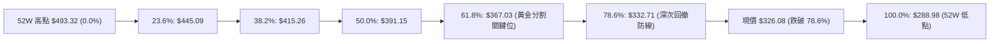

#### 斐波那契關鍵點位對照表

| 回調比率 | 確切價位 | 當前相對位置 | 技術意涵與結構狀態 |
|----------|----------|--------------|--------------------|
| **0.0%** | **$493.32** | 上方 +51.29% | 52 週最高點，長期牛市頂部。 |
| **23.6%** | **$445.09** | 上方 +36.50% | 2026-05 月線收盤頂部 ($445.25)，初級支撐已徹底失效。 |
| **38.2%** | **$415.26** | 上方 +27.35% | 2026-04 月線高位整理平台，多頭強弱分水嶺。 |
| **50.0%** | **$391.15** | 上方 +19.96% | 中期心理中樞關卡，此位失守代表空頭奪取波段定價權。 |
| **61.8%** | **$367.03** | 上方 +12.56% | 黃金分割強防禦位，目前與 MA200 ($366.64) 完全黏合，構成上方極強反壓。 |
| **78.6%** | **$332.71** | 上方 +2.03% | 深次回撤支撐位。**當前價格 $326.08 已實質跌破此位**，宣告技術面破位下行。 |
| **100.0%** | **$288.98** | 下方 -11.38% | 52 週最低點，終極下行防禦底線。 |

**位置解讀**：現價 $326.08 落在 **78.6% ($332.71)** 與 **100.0% ($288.98)** 之間的弱勢運行帶。78.6% 回調位被跌破後，依據波浪與斐波那契技術原理，股票往往失去強有力的結構支撐，極易向下尋求 100% 原始起漲點（$288.98）進行回測打底。

---

## 5. 技術指標深度解讀

### 🎛️ 指標訊號總覽

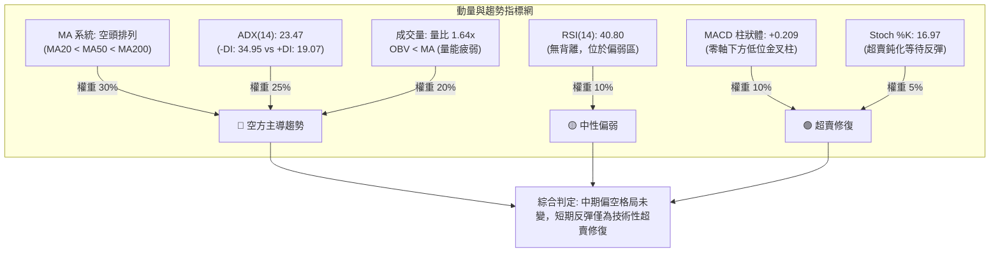

### 📈 移動平均線排列分析

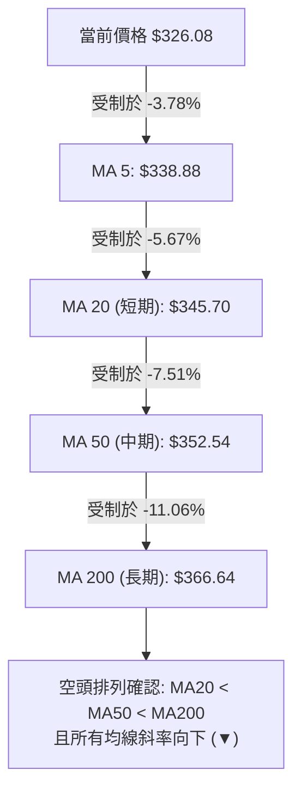

#### 各週期均線數據詳細評估表

| 均線名稱 | 數值 | 距現價乖離 | 走勢趨向 | 技術含義解讀 |
|----------|------|------------|----------|--------------|
| **MA 5** | $338.88 | -3.78% | ▼ 下行 | 極短線動態阻力，壓制短多反抽 |
| **MA 10** | $334.61 | -2.55% | ▼ 下行 | 短期防線，下穿速度加快 |
| **MA 20** | $345.70 | -5.67% | ▼ 下行 | 布林中軌所在，短期多空生命線，下行傾角陡峭 |
| **MA 50** | $352.54 | -7.51% | ▼ 下行 | 中期波段主力成本線，形成堅固天花板 |
| **MA 60** | $360.20 | -9.47% | ▼ 下行 | 中期季線支撐瓦解，反轉為阻力 |
| **MA 120**| $379.15 | -14.00%| ▼ 下行 | 半年線持續走低，沉重套牢賣壓密集區 |
| **MA 200**| $366.64 | -11.06%| ▼ 下行 | 牛熊分界線失守，長期走勢進入熊市修正週期 |
| **MA 240**| $365.18 | -10.71%| ▼ 下行 | 兩年線下彎，長期持股成本結構全面惡化 |

### 📉 RSI(14) 分析

*   **當前 RSI(14) 數值**：**40.80** (Wilder 平滑計算)

```
RSI(14) 強度指標進度條：
0                      30          40.80        70                     100
├──────────────────────┼─────────────█──────────┼──────────────────────┤
[      極度超賣區      ]  [  弱勢區  ]  ▲  [  多頭強勢區  ] [    極度超買區    ]
進度條: ████████████████░░░░░░░░░░░░░░░░░░░░░░░░ 40.80%
```

*   **超買超賣與動能結構分析**：
    *   RSI 位於 40.80，處於 30 至 50 之間的弱勢空方主導區間，尚未觸及 30 以下的極度超賣警戒線。這表明空方拋壓雖強，但市場尚未進入「恐慌性拋售」的衰竭狀態，仍具備慣性向下尋底的空間。
*   **背離檢驗（Divergence Analysis）**：
    *   **頂背離**：無。近期股價自高點下落，RSI 同步走低。
    *   **底背離**：嚴格依據 20 根 K 棒對比，10-23 低點價格收盤 $321.68（RSI 約 34.3），至 10-30 收盤 $326.08（RSI 40.80），兩者走勢同向回升後受挫；且 10-30 盤中低點 $319.30 跌破 10-23 低點 $320.23 時，RSI 迅速拉回至 40.80，**系統判定為「無明顯背離」**。因此，目前不可預期會有強烈的底背離報復性反彈。

### 📊 MACD(12/26/9) 訊號解讀

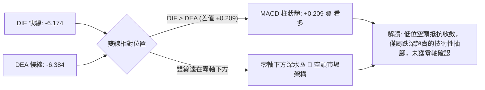

*   **指標數據明細**：
    *   DIF (MACD 線)：**-6.174**
    *   DEA (Signal 線)：**-6.384**
    *   MACD 柱狀體 (Histogram)：**+0.209**
*   **技術含義分析**：MACD 線在零軸極深位置微幅穿越 Signal 線，使柱狀體由負轉正（+0.209）。然而，在強烈的空頭排列（MA20 < MA50 < MA200）環境下，零軸下方的低位金叉多屬於「弱勢抵抗」或「空頭回補誘多」，一旦上方遇阻於均線（如 MA20 $345.70），DIF 隨時可能再度下拐形成二次死叉（零下二次探底）。

### 📦 布林通道分析

```
AVGO 布林通道（20, 2）架構示意圖：
價格軸 ($)
$380 ┤ ────────────────────────── 上軌: $378.81 (空方極端超買警戒線)
$370 ┤
$360 ┤
$350 ┤
$345 ┤ ┈┈┈┈┈┈┈┈┈┈┈┈┈┈┈┈┈┈┈┈┈┈┈┈┈┈ 中軌 (MA20): $345.70 (多空反壓生命線)
$335 ┤
$326 ┤ ◄──────── 現價: $326.08 (%B = 0.20, 逼近下軌弱勢區間)
$320 ┤
$312 ┤ ────────────────────────── 下軌: $312.59 (動態波段下行支撐)
```

*   **通道參數與數據**：
    *   上軌 (Upper Band)：**$378.81**
    *   中軌 (Middle Band, MA20)：**$345.70**
    *   下軌 (Lower Band)：**$312.59**
    *   通道位置指標 (%B)：**0.20**（0 代表下軌，0.5 代表中軌，1 代表上軌）
    *   通道帶寬 (Bandwidth)：$(\$378.81 - \$312.59) \div \$345.70 = 19.15\%$
*   **技術狀態解析**：%B 為 0.20，顯示價格高度貼近下軌運行。帶寬維持在 19.15% 擴張狀態，表明自 10 月初開啟的開口向下擴張仍具慣性。現價與下軌（$312.59）僅距約 4.14%，下方空間收窄，空方若繼續向下摜壓，將在下軌處激發技術性超賣承接盤。

### 💹 成交量分析（量價配合度）

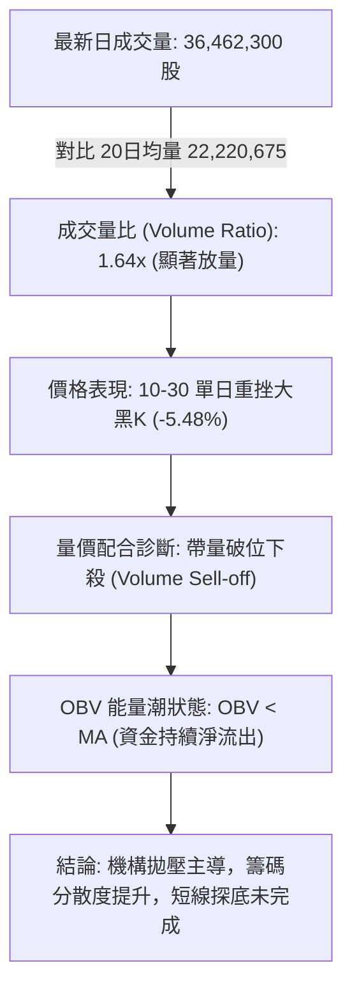

*   **成交量特徵統計**：
    *   最新成交量：**36,462,300 股**
    *   20日均量：**22,220,675 股**（量比：**1.64x**，高於均量 64%）
    *   50日均量：**23,968,422 股**
*   **能量潮 (OBV) 解讀**：
    *   OBV 指標持續位於其均線下方運行（OBV < MA），代表過去數週的每一次反彈均伴隨量能萎縮，而下跌時均出現放量出逃現象。此一「量增價跌、量縮價漲」的背離走勢，徹底坐實了資金出逃的本質。

---

## 6. 動能與波動率

### ⚡ 動能評估四象限

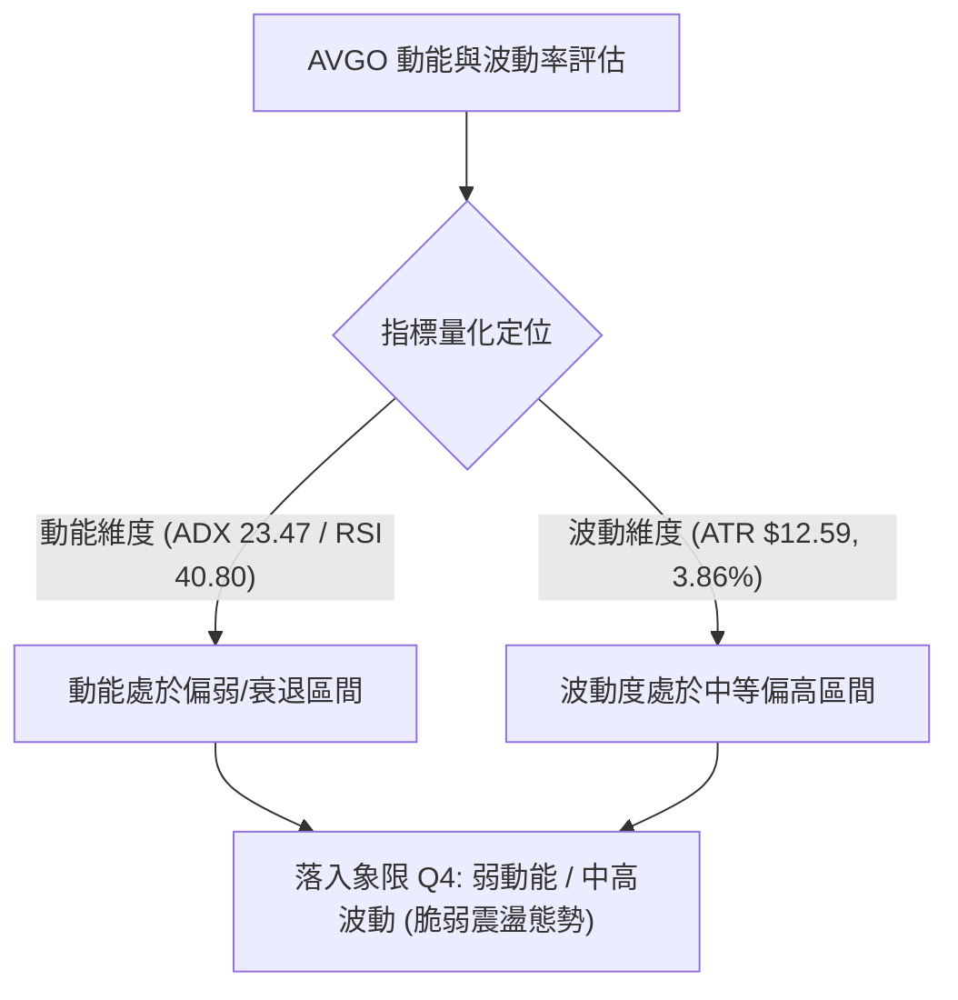

#### 動能與波動四象限定位分析表

| 象限 | 動能維度 | 波動維度 | 代表特徵 | 當前狀態評估 | 實戰應對策略 |
|------|----------|----------|----------|--------------|--------------|
| **Q1** | 強 (Strong) | 低 (Low) | 穩定單邊牛市 | — | 順勢加碼持股 |
| **Q2** | 弱 (Weak) | 低 (Low) | 橫盤築底整理 | — | 逢低定投佈局 |
| **Q3** | 強 (Strong) | 高 (High) | 劇烈單邊突破 | — | 緊跟趨勢突破交易 |
| **Q4** | **弱 (Weak)** | **高 (High)** | **高敏脆弱下行** | **✓ (AVGO 當前位置)** | **謹慎觀望，逢反彈減倉或順勢做空** |

**象限診斷**：AVGO 目前落入 **Q4 象限**。在缺乏強勁上行動能（RSI 僅 40.80、ADX 23.47 弱趨勢、+DI 萎縮）的背景下，每日價格震幅達 $12.59（佔比 3.86%），呈現「大震盪、弱反彈、易破位」的脆弱特徵，追高風險極大。

### 📊 ATR 波動率分析

*   **ATR(14) 數值**：**$12.59**（佔現價 $326.08 之 **3.86%**，Wilder 計算法）
*   **止損與價格緩衝測算**：
    *   **短線日內緩衝 (1.0 × ATR)**：$\$12.59$。日內正常隨機噪音波動範圍為 $\$326.08 \pm \$12.59$（區間 $\$313.49 - \$338.67$）。
    *   **波段防守距離 (1.5 × ATR)**：$\$12.59 \times 1.5 = \mathbf{\$18.89}$。任何波段多空單均須預留至少 $18.89 的止損邊際，以避免被正常市場雜訊洗出場。
    *   **趨勢防守距離 (2.0 × ATR)**：$\$12.59 \times 2.0 = \mathbf{\$25.18}$。趨勢型中長線交易之關鍵防線設定值。

### 📐 Beta 與市場相關性

*   **Beta 係數**：**1.476**
*   **市場敏感度解讀**：
    *   AVGO 的 Beta 高達 1.476，表明其對標普 500 指數與費城半導體指數具有顯著的高槓桿屬性。當大盤指數下跌 1% 時，理論上 AVGO 將放大下挫約 1.48%。在近期科技股整體承壓、AI 板塊獲利回吐的宏觀氣候下，高 Beta 特性加劇了 AVGO 的技術面下修幅度。

---

## 7. 多時框架總結

### 📋 時框架評分表

| 時框架 | 趨勢方向 | 動能狀態 | 均線排列 | 關鍵形態 | 綜合評分 | 戰術建議 |
|--------|----------|----------|----------|----------|----------|----------|
| **短期 (日線)** | 🔴 偏空震盪 | 🟡 RSI 40.80 超賣修復 | 🔴 空頭排列 (MA20<50<200) | 巨量黑K破位回踩 S1 | 35/100 | 反彈遇阻即做空，嚴格止損 |
| **中期 (週線)** | 🔴 明顯走熊 | 🔴 MACD 週線負向擴散 | 🔴 跌破週線 20/50 均線 | 雙頂破頸線量度尋底 | 32/100 | 逢反抽減碼，空單波段持有 |
| **長期 (月線)** | 🟡 深度回調 | 🟡 考驗牛熊分水嶺 | 🟡 逼近 MA200/兩年線防線 | 52W高點 $493.32 大回撤 | 48/100 | 接近 52W 低點前不宜盲目抄底 |

### 🔲 綜合訊號矩陣

```
訊號維度對照矩陣：
╔══════════════╦══════════════╦══════════════╦══════════════╗
║   分析維度   ║  短期 (日線) ║  中期 (週線) ║  長期 (月線) ║
╠══════════════╬══════════════╬══════════════╬══════════════╣
║ 趨勢方向     ║  🔴 下行震盪 ║  🔴 空頭主導 ║  🟡 深度回檔 ║
║ 動能指標     ║  🟡 底部收斂 ║  🔴 弱勢疲軟 ║  🟡 中性偏弱 ║
║ 均線系統     ║  🔴 空頭排列 ║  🔴 跌破關鍵 ║  🟡 考驗長均 ║
║ 量能結構     ║  🔴 放量下挫 ║  🔴 空方堆量 ║  🟡 縮量回洗 ║
║ 支撐/阻力    ║  考驗 S1支撐 ║  受阻 R2/R3  ║  靠攏 52W低  ║
╚══════════════╩══════════════╩══════════════╩══════════════╝
一致性評估：中短期訊號高度共振偏空（一致性高達 85%），長期牛市基石遭受考驗。
```

### ⚖️ 多時框收斂結論

依據本報告之「多時框收斂規則（規則 14）」進行嚴格收斂判定：

1.  **市場狀態判定**：當前 ADX(14) 數值為 **23.47 (< 25)**，依照量化定義，市場處於**弱趨勢/低位盤整震盪行情**。
2.  **主導時框與空間判定**：在 ADX < 25 的盤整結構中，日線布林通道上下軌（**$312.59 – $378.81**）為核心震盪空間。然而，由於中期均線呈現標準的**空頭排列（MA20 $345.70 < MA50 $352.54 < MA200 $366.64）**，且 -DI (34.95) 壓倒性勝過 +DI (19.07)，因此日線的震盪中樞嚴重向通道下軌偏移。
3.  **唯一方向性結論**：**【偏空震盪，逢高做空為主】**。
    *   短期指標（Stoch %K=16.97、MACD Hist=+0.209）提供的僅是「超賣反抽動能」，日線反彈僅視為尋找更高性價比的空頭進場點。
    *   反彈的第一極限阻力即為 R1（$338.13），強阻力為 MA20/R2（$345.70–$350.81）。下行目標直接指向支撐 S1（$319.05）及布林下軌/S2（$312.39）。

---

## 8. 交易策略建議

### 🗺️ 策略決策流程圖

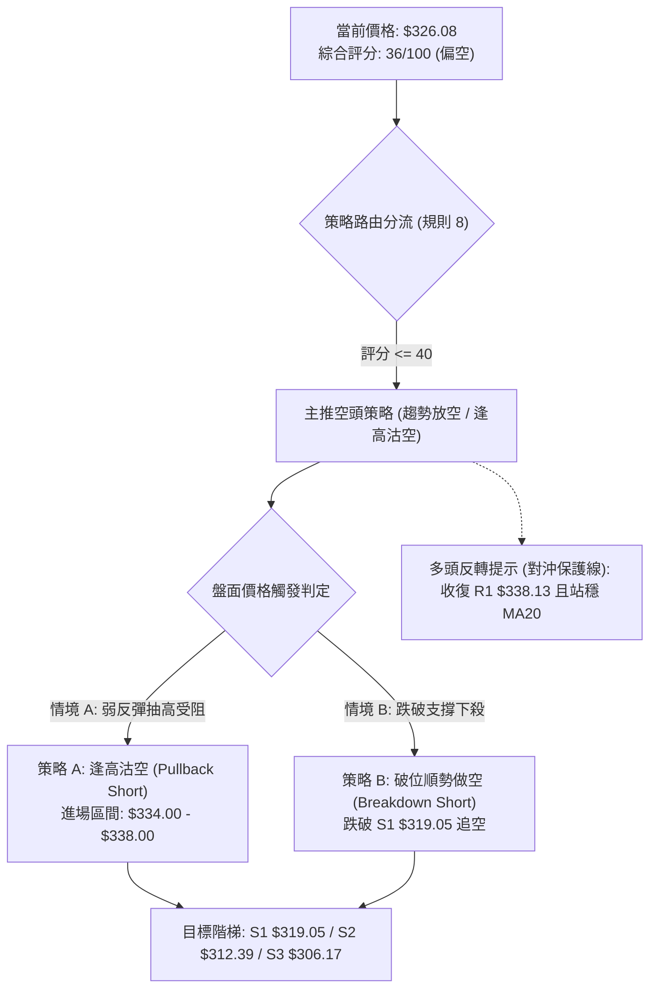

### 🧭 策略路由（依評分卡分流）

> **當前主策略方向 = 【偏空操作 / 逢高做空】（依據技術評分卡綜合評分：36 / 100 判定）**

*   依規則 8 要求，綜合評分 ≤ 40 嚴格**主推空頭策略**。多頭操作在當前空頭排列且放量下挫的結構下勝率極低，僅作為反向風險觸發與空單停損對沖參考。

### 🎯 價格情境階梯（Price Scenarios）

價位完全嚴格引用自數據區塊中 OHLCV 計算之確切支撐阻力數值：

| 觸發條件 | 下一目標 | 後續延伸目標 | 情境技術含義與應對策略 |
|----------|----------|--------------|------------------------|
| **強勢突破 R1 ($338.13)** | R2 ($350.81) | R3 ($358.10) | 短線超賣反彈演化為深度修正，空單全部離場觀望。 |
| **反彈受阻於 R1 ($338.13)** | 現價區間 ($326.08) | S1 ($319.05) | 標準空頭反抽確認，極佳之逢高沽空加碼點。 |
| **失守現價回踩 S1 ($319.05)** | S2 ($312.39) | S3 ($306.17) | 空頭慣性延續，測試布林下軌及關鍵波段支撐。 |
| **放量擊穿 S2 ($312.39)** | S3 ($306.17) | 52W低點 ($288.98) | 開啟主跌浪空間，波段空單大幅獲利展期。 |

### 📊 情境機率分佈

| 價格情境 | 發生機率 | 主要技術依據與數據驗證 |
|----------|----------|------------------------|
| **回落再探底 / 破位下行** | **55%** | 均線完整空頭排列，-DI 高達 34.95，最新成交量暴增至 36.46M 帶量下殺，OBV 疲軟走低。 |
| **區間弱勢震盪 (S1 ↔ R1)** | **30%** | ADX 位於 23.47 處於盤整區，Stoch 超賣 (%K=16.97) 具備防守買盤，MACD 柱狀體收斂 (+0.209)。 |
| **強勁反彈 / V型反轉** | **15%** | 需克服上方 MA20 ($345.70) 及斐波那契 78.6% ($332.71) 兩道天花板，在無重大利多下難度極高。 |

### 🟢 主策略詳情（方向：主推空頭）

依規則 17 要求，進場價若為區間，以區間中點計算並註明；風險報酬比嚴格按公式 $(進場價 - 目標價) \div (止損價 - 進場價)$ 呈現，精確算回。

| 策略要素 | 策略 A：反彈遇阻做空 (Pullback Short) | 策略 B：跌破 S1 順勢做空 (Breakdown Short) |
|----------|----------------------------------------|---------------------------------------------|
| **進場條件** | 股價弱勢反彈至 R1 與 MA5 附近，盤中見上影線或滯漲紅轉黑。 | 股價跌破 S1 支撐位，且成交量放大確認破位。 |
| **進場價格** | **$336.00**（取區間 $334.00–$338.00 之**中點**計算） | **$318.50**（跌破 S1 $319.05 之確認追空價） |
| **目標價 T1** | **$319.05**（支撐位 S1） | **$312.39**（支撐位 S2 / 逼近布林下軌） |
| **目標價 T2** | **$312.39**（支撐位 S2 / 布林下軌） | **$306.17**（支撐位 S3） |
| **止損價格** | **$343.00**（突破 R1 $338.13 且預留約 0.4×ATR） | **$322.50**（重回 S1 之假突破防守點） |
| **風險報酬比 (T1)** | **1 : 2.42（以 T1 計）**<br>驗證：$(336.00 - 319.05) \div (343.00 - 336.00) = 16.95 \div 7.00 = 2.42$ | **1 : 1.53（以 T1 計）**<br>驗證：$(318.50 - 312.39) \div (322.50 - 318.50) = 6.11 \div 4.00 = 1.53$ |
| **風險報酬比 (T2)** | **1 : 3.37（以 T2 計）**<br>驗證：$(336.00 - 312.39) \div (343.00 - 336.00) = 23.61 \div 7.00 = 3.37$ | **1 : 3.08（以 T2 計）**<br>驗證：$(318.50 - 306.17) \div (322.50 - 318.50) = 12.33 \div 4.00 = 3.08$ |
| **交易勝率估計** | **62%** | **55%** |
| **建議倉位** | **總資金之 8% – 10%** | **總資金之 5% – 7%** |

### 🔴 反向風險觸發點（對沖提示）

若出現以下訊號，代表偏空主策略遭到市場推翻，空單必須果斷無條件止損，甚至反手佈局超跌反彈：
1.  **日K收盤價突破並站穩阻力 R1 ($338.13)**：伴隨成交量突破 25M 以上，標誌短線築底成功。
2.  **MACD 雙線自零軸下快速拉升並突破零軸**：柱狀體大幅擴張超過 +2.0 以上。
3.  **價格向上收復 MA20 ($345.70)**：宣告空頭下行通道被實質向上瓦解，空方主動權喪失。

### ⭐ 整體訊號強度評星

```
做多訊號強度：★★☆☆☆  (2.0/5星 — 僅屬低位指標超賣，缺乏形態支撐)
做空訊號強度：★★★★☆  (4.0/5星 — 均線與量價共振偏空，順勢交易)
整體可信度：  ★★★★☆  (4.0/5星 — 數據指標一致性高達 85%)
```

---

## 9. 風險提示與監控

### ✅ 關鍵監控指標 Checklist

```
╔══════════════════════════════════════════════════════════════════╗
║               交易監控 Checklist — AVGO 風控守則                 ║
╠══════════════════════════════════════════════════════════════════╣
║ [ ] 價格是否跌破 S1 ($319.05)？ ── 破位確認空頭趨勢加速          ║
║ [ ] 價格是否反彈突破 R1 ($338.13)？ ── 觸發空單第一警報預警      ║
║ [ ] 價格是否收復 MA20 ($345.70)？ ── 中期趨勢逆轉，空單全數撤退  ║
║ [ ] 成交量是否連續兩日低於 20M？ ── 縮量盤整，應提防假突破洗盤    ║
║ [ ] RSI(14) 是否跌破 30？ ── 進入極度超賣，嚴禁追空，準備止盈    ║
║ [ ] ADX(14) 是否升破 25 且 -DI 向上？ ── 確認由盤整轉為單邊暴跌   ║
╚══════════════════════════════════════════════════════════════════╝
```

### ⚠️ 風險場景分析

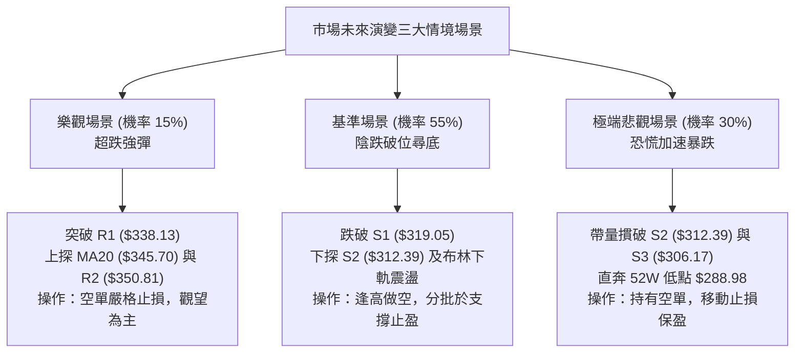

### 🛡️ 風險管理重要提醒

1.  **波動性與倉位控管**：
    *   AVGO 目前的日 ATR 高達 $12.59（3.86%），單日波動極具殺傷力。單筆交易風險敞口（Risk at Cost）嚴格限制在總投資組合淨值的 **1.0% – 1.5%** 以內。
    *   若以帳戶淨值 $100,000 為例，單筆最大允許虧損為 $1,000。若執行策略 A（止損幅度 $7.00），則最大建倉股數為：$1,000 \div \$7.00 \approx 142$ 股（部位金額約 $47,700，需搭配保證金或降低倉位至 8% 總曝險）。
2.  **半導體板塊與消息面黑天鵝**：
    *   近期新聞顯示半導體同業如 Intel、Marvell 劇烈震盪，且 Broadcom 涉及高達 $43B 的 Anthropic 相關佈局引發市場對 AI 資本支出回報率之擔憂。板塊系統性拋售可能放大技術面破位下殺速度，操作上切忌在未見築底訊號前盲目「接飛刀」抄底。

---

## 📋 報告總結

```
╔══════════════════════════════════════════════════════════════════╗
║                    AVGO 技術分析報告總結                        ║
╠══════════════════════════════════════════════════════════════════╣
║ 報告日期：2026-11-02                                             ║
║ 當前價格：$326.08                                                ║
║ 分析評級：🔴 偏空震盪 / 逢高做空 (綜合評分: 36/100)               ║
╠══════════════════════════════════════════════════════════════════╣
║ 關鍵結論：                                                       ║
║ ├─ 長期趨勢：🟡 深度回調（自高點 $493.32 大幅修正，考驗 52W低點）║
║ ├─ 中期趨勢：🔴 空頭主導（週線雙頂頸線破位，均線全面空頭排列）    ║
║ ├─ 短期趨勢：🔴 帶量破位（10-30 放量大陰線吞噬反彈，測試 S1 支撐）║
║ ├─ 關鍵支撐：S1: $319.05 ｜ S2: $312.39 ｜ S3: $306.17          ║
║ ├─ 關鍵阻力：R1: $338.13 ｜ R2: $350.81 ｜ R3: $358.10          ║
║ └─ 斐波那契：已實質跌破 78.6% ($332.71)，向下開啟測試 $288.98 空間║
╠══════════════════════════════════════════════════════════════════╣
║ 最優策略組合：                                                   ║
║ 1. 🥇 最佳機會：策略 A — 反彈至 $336.00 逢高沽空 (R/R = 1 : 2.42)║
║ 2. 🥈 次選機會：策略 B — 跌破 $319.05 順勢追空 (R/R = 1 : 1.53)║
║ 3. 🥉 防禦選擇：場外觀望，靜待股價回測 $312.39 獲支撐且 RSI 背離║
╚══════════════════════════════════════════════════════════════════╝
```

---

> ⚠️ **免責聲明**：本報告為 AI 自動生成之技術分析，所有數據及估算均基於所提供的歷史價格與量化技術指標資訊。本報告**僅供研究與學術參考**，**不構成任何買賣要約或投資建議**。金融市場瞬息萬變，投資具有高度風險，交易者應獨立評估自身風險承受能力並自負盈虧。

---

*報告生成時間：2026-11-02 ｜ 數據來源：Yahoo Finance ｜ 分析框架：多時框技術分析體系*