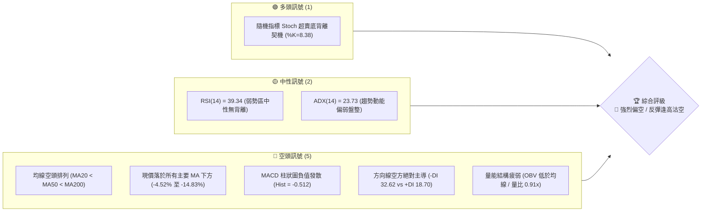
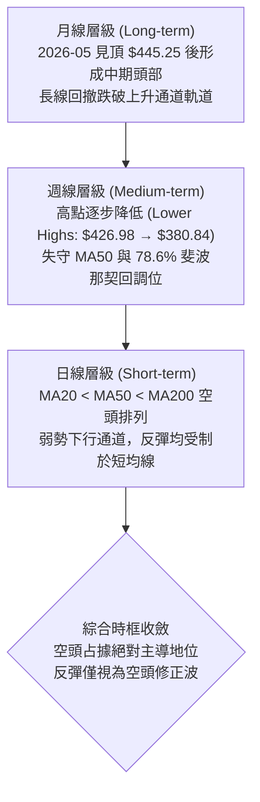
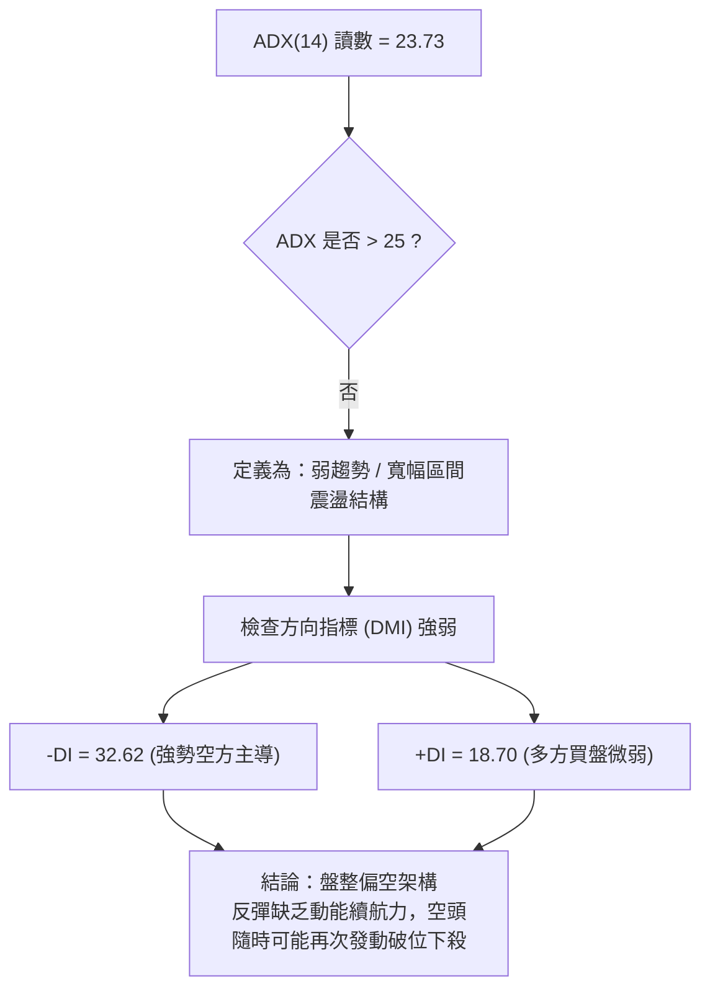
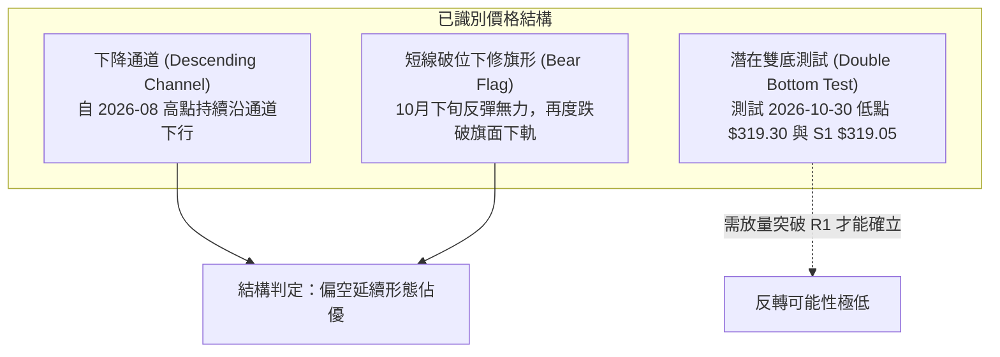
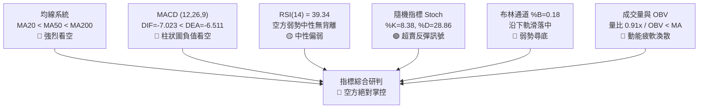
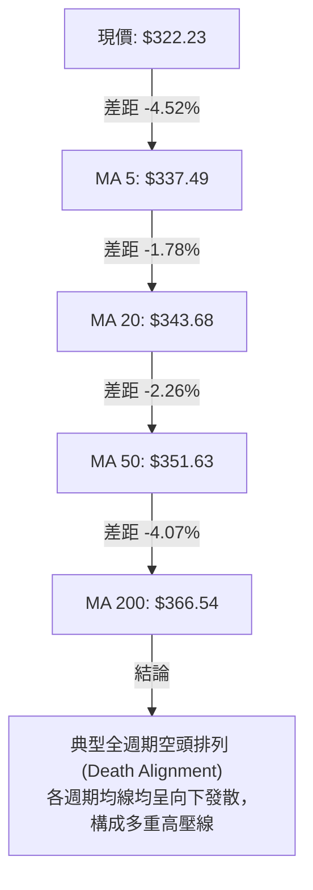
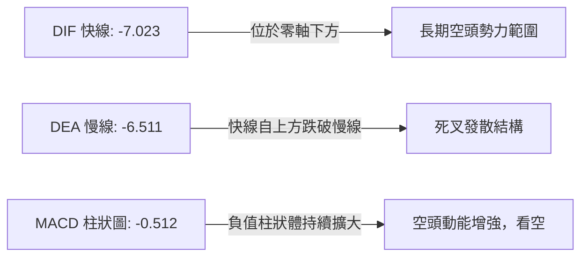
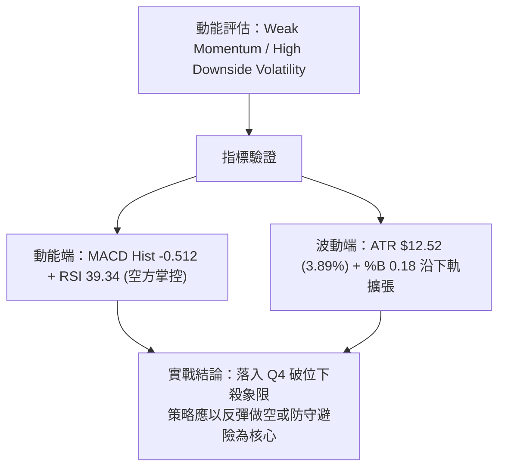
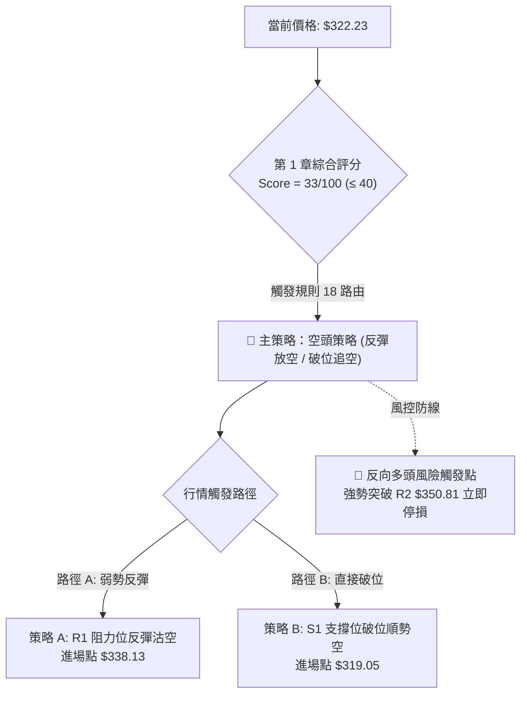
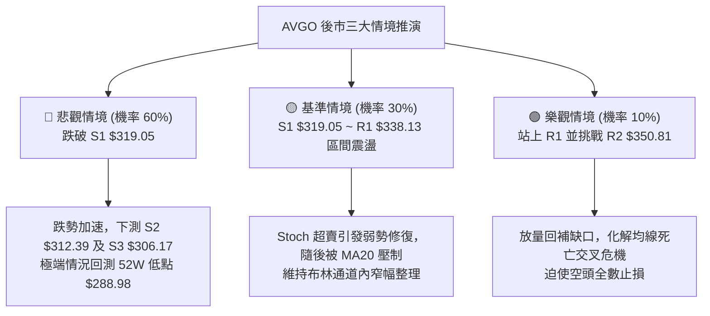

# AVGO 技術分析報告

> **報告日期**：2026-11-03 ｜ **語言**：繁體中文 ｜ **數據來源**：Yahoo Finance ｜ **當前價格**：$322.23 USD

---

## 目錄

| 章節 | 內容 |
|------|------|
| [1. 技術面概覽](#1-技術面概覽) | 訊號儀表板、核心指標、評分卡 |
| [2. 趨勢分析](#2-趨勢分析) | 多時框趨勢、長中短期走勢、ADX 解讀 |
| [3. 圖表形態分析](#3-圖表形態分析) | 形態識別、信心度評估、K線組合、目標價 |
| [4. 支撐與阻力](#4-支撐與阻力) | 關鍵價位分布、阻力與支撐表、斐波那契回調 |
| [5. 技術指標深度解讀](#5-技術指標深度解讀) | 均線系統、RSI、MACD、布林通道、量價配合 |
| [6. 動能與波動率](#6-動能與波動率) | 動能四象限、ATR 波動度、Beta 市場連動 |
| [7. 多時框架總結](#7-多時框架總結) | 時框架矩陣、多時框收斂與方向定調 |
| [8. 交易策略建議](#8-交易策略建議) | 策略路由、情境階梯、主空頭策略、反轉對沖 |
| [9. 風險提示與監控](#9-風險提示與監控) | 監控清單、情境模擬樹、風控與資金管理 |

---

## 1. 技術面概覽

### 🎯 技術訊號儀表板



### 📊 核心指標速覽表

| 指標類別 | 指標名稱 | 當前數值 | 訊號 | 解讀 |
|----------|----------|----------|------|------|
| **價格** | 當前收盤價 | $322.23 | 🔴 | 位於52週區間僅 16.3% 分位，深陷弱勢尋底格局 |
| **均線** | MA20 | $343.68 | 🔴 | 現價低於 MA20 達 -6.24%，短線下行斜率陡峭 |
| **均線** | MA50 | $351.63 | 🔴 | 中期生命線失守，形成中期強勁上檔蓋頭反壓 |
| **均線** | MA200 | $366.54 | 🔴 | 現價大幅低於年線，長期多空分水嶺已被實體跌破 |
| **動能** | RSI(14) | 39.34 | 🟡 | 位於 30–50 弱勢空方主導區，尚未觸及超賣極端 |
| **動能** | MACD (12,26,9) | -7.023 / -6.511 | 🔴 | DIF 位於訊號線下方且 Hist=-0.512，綠柱持續發散 |
| **震盪** | Stoch %K / %D | 8.38 / 28.86 | 🟢 | 進入極度超賣區（<20），短線具備技術性跌深反彈契機 |
| **趨勢** | ADX(14) / 方向線 | 23.73 | 🔴 | ADX<25 屬弱趨勢，但 -DI(32.62) 遠高於 +DI(18.70) 空方主控 |
| **通道** | 布林通道 %B | 0.18 | 🔴 | 貼近下軌（$309.99）運行，弱勢尋底未現收斂收斂開口 |
| **量能** | 成交量 / 20日均量 | 20.24M / 22.16M | 🔴 | 量比 0.91x，OBV < MA，反彈縮量、下跌放量態勢明顯 |
| **波動** | ATR(14) | $12.52 | 🟡 | 日波動率 3.89%，處於中等偏高水準，需設定寬幅風控 |

### 🏆 技術評分卡

```
╔════════════════════════════════════════════════════════════════════╗
║                   技術評分卡 — AVGO (2026-11-03)                   ║
╠════════════════════════════════════════════════════════════════════╣
║ 評估維度         評分進度條                分數      狀態標籤      ║
╟────────────────────────────────────────────────────────────────────╢
║ 趨勢強度 (ADX)   ██████░░░░░░░░░░░░░░     30/100    🔴 弱勢空頭    ║
║ 動能指標 (Osc)   ███████░░░░░░░░░░░░░     35/100    🔴 動能匱乏    ║
║ 支撐穩定度 (Sup) ██████████░░░░░░░░░░     50/100    🟡 考驗前低    ║
║ 成交量配合 (Vol) ███████░░░░░░░░░░░░░     35/100    🔴 買盤渙散    ║
║ 形態完整度 (Pat) ██████░░░░░░░░░░░░░░     30/100    🔴 破位下行    ║
║ 均線排列 (MA)    ████░░░░░░░░░░░░░░░░     20/100    🔴 死亡交叉    ║
╠════════════════════════════════════════════════════════════════════╣
║ 綜合評分         ███████░░░░░░░░░░░░░     33/100    🔴 偏空弱勢    ║
║ 評級結論：(30 + 35 + 50 + 35 + 30 + 20) ÷ 6 = 33.33 → 33/100 (偏空)║
╚════════════════════════════════════════════════════════════════════╝
```

---

## 2. 趨勢分析

### 🌐 多時框趨勢分析



### 📈 長期趨勢 — 12個月走勢圖（Unicode）

```
AVGO 月線收盤價走勢圖（2025-11 至 2026-11）
價格軸 ($)
$450 ┤                                  ● $445.25 (2026-05 歷史波段次高)
$420 ┤                             ● $416.01
$390 ┤● $399.99 (2025-11)                     ● $388.57
$360 ┤                                             ● $369.67
$330 ┤     ● $344.20 ● $329.48                         ● $351.19
$300 ┤                    ● $317.80 ● $308.46              ● $326.08 ● $322.23 (當前現價)
     └─────────────────────────────────────────────────────────────────────────────
       11    12    01    02    03    04    05    06    07    08    09    10    11 (月份)
     [  2025年  ] [                       2026年                       ]
```

#### 走勢特徵分析表格

| 階段區間 | 時間跨度 | 價格變動 | 漲跌幅 | 結構性技術特徵與驅動因素 |
|----------|----------|----------|--------|--------------------------|
| **高檔回撤** | 2025-11 至 2026-03 | $399.99 → $308.46 | -22.88% | 首次大波段估值修正，於 $308.46 構築春季中期底部支撐 |
| **主升反彈** | 2026-03 至 2026-05 | $308.46 → $445.25 | +44.35% | AI 晶片需求爆發推動強勢五浪上攻，創波段收盤高點 $445.25 |
| **高位派發** | 2026-05 至 2026-08 | $445.25 → $369.67 | -16.97% | 巨量滯漲，週線級別形成雙重頭部結構，機構持股出現減磅 |
| **破位尋底** | 2026-08 至 2026-11 | $369.67 → $322.23 | -12.83% | 跌破年線關鍵心理關卡，重心逐級下移，現處於尋底震盪期 |

### 📊 中期趨勢（週線分析）

中期技術面正處於清晰的「下降階梯」形態。過去 20 週收盤走勢顯示，反彈高點從 2026-08-07 的 $426.98 驟降至 2026-10-09 的 $361.54（當週最高達 $380.84），反彈力道逐波衰竭。

```
週線級別阻力與支撐階梯分布
$380.84 ┬──────────────────────────────────────────── 2026-10-09 波段反彈頂部 (強阻力)
        │
$351.63 ┼ - - - - - - - - - - - - - - - - - - - - - -  MA50 / 斐波那契密集壓力區
        │
$338.13 ┼──────────────────────────────────────────── R1 近期反彈遇阻聚類壓力
        │
$322.23 ┼════════════════════════════════════════════現價收盤位置 ($322.23)
        │
$319.05 ┼──────────────────────────────────────────── S1 關鍵前低支撐 (跌破將開啟續跌)
        │
$288.98 ┴──────────────────────────────────────────── 52週最低價 (長期防守底線)
```

### ⚡ 趨勢強度評估（ADX 解讀）



#### ADX 與 DMI 強度對照表

| 參數指標 | 當前數值 | 參考臨界值 | 狀態判定 | 市場涵義分析 |
|----------|----------|------------|----------|--------------|
| **ADX (14)** | 23.73 | 25.00 | 🟡 弱趨勢 | 目前處於跌勢暫緩的盤整區間，尚未形成單邊加速趨勢 |
| **+DI (14)** | 18.70 | 20.00 | 🔴 多頭匱乏 | 多方買力萎縮至 20 之下，市場缺乏主動性推升動能 |
| **-DI (14)** | 32.62 | 25.00 | 🔴 空頭掌控 | 空方動能高居 30 之上，賣盤依然牢固主導盤面話語權 |
| **方向差距 (Spread)** | -13.92 | 0.00 | 🔴 絕對劣勢 | (-DI 減 +DI) 差距高達 13.92，表明任何反彈均極易夭折 |

---

## 3. 圖表形態分析

### 🔍 形態識別系統



#### 形態信心度與目標價評估表

| 形態名稱 | 信心度 | 判斷依據（嚴格引用數據） | 完成度 | 目標價（附嚴謹計算式） |
|----------|--------|--------------------------|--------|------------------------|
| **下降通道延續** | **85%** | 高點由週K $380.84降至日K $352.40；低點由 $320.23探至 $319.30 | 90% | 跌破通道下軌，下測 52W 低點 **$288.98** |
| **空頭旗形破位** | **75%** | 2026-10-28 反彈至 $352.40 遇阻，隨後 10-30 大陰線跌至 $319.30 | 85% | 破位點 $326.08 − 旗桿高度($342.33−$319.30=$23.03) = **$303.05** (落於 S3 $306.17 附近) |
| **雙底形態築底** | **25%** | 僅測試兩次低點 ($320.23 與 $319.30)，但未突破頸線 R1 $338.13 | 20% | 訊號不足，僅做指標型解讀（信心度 < 50%，不予採納） |

### 🕯️ 重要 K 線形態分析

嚴格依據提供的「近10根日K」與「近8根週K」實際開高低收數據進行組合識別：

| 日期（時框） | 開盤價 | 最高價 | 最低價 | 收盤價 | K線形態名稱 | 形態深度解讀 | 訊號強度 |
|--------------|--------|--------|--------|--------|-------------|--------------|----------|
| **2026-10-28 (日K)** | $349.22 | $352.40 | $344.35 | $351.81 | 長實體陽線 | 連續三日反彈頂點，上影線觸碰 $352.40 即遭遇強大解套拋壓 | 🟡 假突破滯漲 |
| **2026-10-29 (日K)** | $342.00 | $346.15 | $338.80 | $345.00 | 低開小陽線 | 跳空低開，實體無法收復前日高點，反彈動能衰竭信號顯現 | 🔴 轉弱預警 |
| **2026-10-30 (日K)** | $330.72 | $331.98 | $319.30 | $326.08 | 大跳空長陰線 | 跳空低開長黑貫穿，盤中重挫至 $319.30，成交量放大至 36.51M | 🔴 強烈空頭吞噬 |
| **2026-11-02 (日K)** | $328.37 | $333.56 | $321.87 | $322.23 | 帶長上影小陰線 | 多頭反撲受阻於 $333.56，收盤跌至全日低檔 $322.23，空頭續壓 | 🔴 空方控盤 |
| **2026-10-09 (週K)** | $357.79 | $380.84 | $356.14 | $361.54 | 倒錘頭帶長上影 | 衝高 $380.84 後遭機構主力無情出貨，留下長達 $19.30 的上影線 | 🔴 週線級反轉 |
| **2026-10-16 (週K)** | $359.43 | $360.69 | $328.58 | $328.75 | 光腳實體長黑週K | 週線暴跌 -9.07%，實體幾乎收於全週最低 $328.75，奠定破位主基調 | 🔴 空頭加速 |
| **2026-10-30 (週K)** | $324.53 | $352.40 | $319.30 | $326.08 | 寬幅震盪十字長上影 | 週內大幅反彈至 $352.40 後慘遭全部抹平，留長達 $26.32 上影線 | 🔴 逢高解套賣壓 |

### 📉 ASCII 走勢形態示意圖

```
AVGO 近期日K走勢形態與空頭旗形結構示意圖
價格
$355 ┬                    ● $352.40 (10-28 反彈遇阻頂點)
     │                   ╱ ╲
$345 ┤           ● $342.33    ● $345.00 (10-29 乏力回落)
     │          ╱              ╲
$335 ┤  ● $334.37                ╲
     │ ╱                           ╲
$325 ┼───────────────────────────────● $326.08 ──● $322.23 (最新收盤現價)
     │╲                             ╱ 
$315 ┴ ─● $321.68 ─────────────────● $319.30 (10-30 測試支撐)
        (10-23 前低)                (雙底測試位 S1 $319.05)
```

---

## 4. 支撐與阻力

### 🗺️ 關鍵價位分布圖（Unicode）

```
AVGO 價位結構分布圖
═════════════════════════════════════════════════════════════════════
$367.03 ║██████████████████████████████║ 斐波那契 61.8% / MA200 終極防線
$358.10 ║████████████████████████      ║ 強阻力 R3 (近一年波段高點聚類)
$350.81 ║████████████████████          ║ 關鍵阻力 R2 (MA50 共振密集壓力區)
$338.13 ║██████████████                ║ 短線阻力 R1 (波段解套反壓 / MA5)
$332.71 ║▓▓▓▓▓▓▓▓▓▓▓▓                  ║ 斐波那契 78.6% 回調關鍵水平位
$322.23 ╠══════════════════════════════╣ ◄ 當前收盤價 ($322.23)
$319.05 ║▓▓▓▓▓▓▓▓▓▓▓▓▓▓▓▓              ║ 近期關鍵支撐 S1 (10-30 低點防線)
$312.39 ║████████████████████          ║ 中期防守支撐 S2 (波段密集低點)
$306.17 ║████████████████████████      ║ 強支撐 S3 (春季築底波段核心區)
$288.98 ║██████████████████████████████║ 52週歷史最低點 (100.0% 終極支撐)
═════════════════════════════════════════════════════════════════════
```

### 🚧 阻力位分析表

所有價位均嚴格引用數據中「關鍵價位」區塊之客觀計算數值：

| 阻力級別 | 精確價位 | 距現價幅標 | 形成原因與技術共振分析 | 突破難度 | 重要性等級 |
|----------|----------|------------|------------------------|----------|------------|
| **R1** | **$338.13** | +4.93% | 近一年波段高點聚類位，逼近 10日均線 ($333.37) 與 5日均線 ($337.49) | 🟡 中等 | ★★★☆☆ |
| **R2** | **$350.81** | +8.87% | 近一年波段次高密集區，與 MA50 ($351.63) 及 10-28 高點 ($352.40) 強共振 | 🔴 極高 | ★★★★☆ |
| **R3** | **$358.10** | +11.13% | 波段頂部聚類高點，緊鄰 MA60 ($358.45)，為中期強弱多空轉換分水嶺 | 🔴 難以跨越 | ★★★★★ |

### 🛡️ 支撐位分析表

所有價位均嚴格引用數據中「關鍵價位」區塊之客觀計算數值：

| 支撐級別 | 精確價位 | 距現價幅標 | 形成原因與技術共振分析 | 守住機率 | 重要性等級 |
|----------|----------|------------|------------------------|----------|------------|
| **S1** | **$319.05** | -0.99% | 近一年波段低點聚類，與 2026-10-30 最低價 $319.30 構成當前雙底頸線生命線 | 🟡 45% | ★★★★☆ |
| **S2** | **$312.39** | -3.05% | 密集換手低點聚類，接近布林帶動態下軌 ($309.99)，具備短線技術性支撐 | 🟡 55% | ★★★☆☆ |
| **S3** | **$306.17** | -4.98% | 2026年3月份大底收盤價 ($308.46) 核心支撐帶，多頭退無可退之中期防線 | 🟢 65% | ★★★★★ |

### 📐 斐波那契回調位分析

依據 52週極端波動區間（最高點 **$493.32** 至 最低點 **$288.98**，垂直落差 $204.34）客觀測算：

| 斐波那契水平 | 基準參考點 | 精確價位 | 現價相對位置與技術意義解讀 |
|--------------|------------|----------|----------------------------|
| **0.0%** | 52W High | $493.32 | 歷史頂部壓力 |
| **23.6%** | 回調位 | $445.09 | 2026-05 月線次高點附近，波段多頭極限位置 |
| **38.2%** | 回調位 | $415.26 | 2026-04 月線實體起跌平台 |
| **50.0%** | 多空中軸 | $391.15 | 牛熊轉換中樞，跌破後多頭結構遭到破壞 |
| **61.8%** | 黃金分割 | $367.03 | 與 MA200 ($366.54) 形成完美技術共振，現已成為不可逾越之天花板 |
| **78.6%** | 深度回調 | $332.71 | **關鍵失守位**：現價 $322.23 已跌破此位，顯示弱勢已進入極端下行段 |
| **100.0%** | 52W Low | $288.98 | 終極回調目標，若 S1/S2/S3 依次失守，股價將直奔此位尋求長線支撐 |

> **位置判定**：當前收盤價 **$322.23** 處於 **78.6% ($332.71)** 與 **100.0% ($288.98)** 之間。在技術分析幾何學中，跌破 78.6% 回調位意味著前一輪牛市波段推進動能已徹底瓦解，市場極大概率需回測 100% 斐波那契位（即 52週低點 $288.98）方能重新尋找定價錨點。

---

## 5. 技術指標深度解讀

### 🎛️ 指標訊號總覽



### 📈 移動平均線排列分析



#### 均線系統監控數據

| 均線名稱 | 當前數值 | 現價偏離幅度 | 趨勢斜率 | 技術形態解讀 |
|----------|----------|--------------|----------|--------------|
| **MA 5** | $337.49 | -4.52% | ▼ 向下陡峭 | 短線超跌壓制線，近兩日反彈均被精確壓制在其下方 |
| **MA 10** | $333.37 | -3.34% | ▼ 向下傾斜 | 短波段空頭防守位，未突破前無短線止跌可言 |
| **MA 20** | $343.68 | -6.24% | ▼ 持續下行 | 月線生命線，布林通道中軌所在，中期反彈首要關卡 |
| **MA 50** | $351.63 | -10.11% | ▼ 穩步下行 | 季線強阻力，與波段阻力 R2 ($350.81) 共振 |
| **MA 200** | $366.54 | -11.74% | ▼ 走平轉下 | 年線長線牛熊分界已被有效跌破，長期趨勢轉入熊市調整 |

### 📉 RSI(14) 分析

*   **當前數值**：**39.34**（Wilder 平滑法）
*   **強弱視覺化進度條**：
    `[ 0 ──────── 30 ────── 39.34 ─────── 70 ──────── 100 ]`
    `[ 超賣區間 ▓▓▓▓▓▓▓▓▓▓░░░░░░░░░░░░░░░░░░░░ 超買區間 ]` (39.34%)
*   **超買超賣判定**：數值介於 30 至 70 之間，分類為「空頭控盤之弱勢中性區」。目前尚未跌入 30 以下之極端超賣區，顯示空頭下殺動能尚未釋放完畢，不具備左側抄底條件。
*   **背離分析結論**：
    依據最近 20 根 K 棒首尾之價格與 RSI 比對，價格自高位回落，RSI 同步自 50 附近滑落至 39.34，**確認無底背離，亦無頂背離現象**。指標與價格運行呈現完全「量價相符、指標確認價格破位」的標準下行特徵。

### 📊 MACD(12/26/9) 訊號解讀



MACD 雙線均位於負值區（零軸以下），且 DIF 數值 (-7.023) 低於訊號線 DEA (-6.511)，柱狀圖（MACD Hist）讀數為 **-0.512**。週線 MACD 亦自前週的 +0.209 轉為最新週期的 **-0.512**，日週雙時框 MACD 出現共振翻黑，確認新一輪向下調整波段已經展開。

### 📦 布林通道分析

```
布林通道結構示意圖 (帶寬: $67.39)
$377.38 ┬──────────────────────────────────────────── BB 上軌 (Upper Band)
        │
$343.68 ┼ - - - - - - - - - - - - - - - - - - - - - -  BB 中軌 / MA20 (Mid Band)
        │
$322.23 ┼════════════════════════════════════════════現價位置 (%B = 0.18)
        │
$309.99 ┴──────────────────────────────────────────── BB 下軌 (Lower Band)
```

當前布林帶帶寬高達 $67.39，中軌（$343.68）以明確下傾斜率壓制價格。當前 **%B 數值為 0.18**（低於 0.20 警戒線），顯示股價正緊貼下軌下行。這種「沿下軌滑落」的形態是典型的高動能單邊跌勢特徵，下軌目前僅具備動態推移支撐，並未見通道收口，預示波動率將繼續向下釋放。

### 💹 成交量分析（量價配合度）

*   **成交量現況**：最新單日成交量為 **20,239,800 股**，對比 20日均量（**22,161,060 股**），量比僅為 **0.91x**。
*   **成交量結構特徵**：
    回顧 2026-10-30 大跌時成交量放大至 **36,511,800 股**（放量下殺），而 2026-11-02 弱勢抵抗時成交量迅速萎縮至 **20.24M 股**（縮量反抽無力），呈現非常典型的「跌有量、漲無量」弱勢量性格局。
*   **OBV（能量潮）趨勢**：
    官方快照數據明確指出「**OBV < MA → 量能疲弱**」。能量潮指標低於其移動平均線，資金呈淨流出狀態，印證機構投資者在反彈中持續逢高派發，而非進場吸籌。

---

## 6. 動能與波動率

### ⚡ 動能評估四象限

動能評估矩陣綜合考量「動能方向與強度（基於 RSI/MACD）」與「波動率釋放幅度（基於 ATR 與布林帶寬）」：

| 象限 | 動能維度 | 波動維度 | 象限市場屬性 | AVGO 當前定位判定 |
|------|----------|----------|--------------|-------------------|
| **Q1** | 強勢多頭 | 低波動率 | 穩健上升趨勢，最佳順勢做多機會 | ── |
| **Q2** | 弱勢空頭 | 低波動率 | 陰跌築底或窄幅盤整，謹慎觀望 | ── |
| **Q3** | 強勢多頭 | 高波動率 | 瘋狂主升段，高風險高收益爆發期 | ── |
| **Q4** | **弱勢空頭** | **高波動率** | **破位下殺加速期，嚴禁盲目抄底** | **✓ AVGO 準確落入本象限** |



### 📊 ATR 波動率分析

*   **ATR(14) 讀數**：**$12.52 USD**（Wilder 計算模型）。
*   **波動比率**：佔當前股價之 **3.89%**。
*   **交易風控實戰涵義**：
    1.  **日內噪聲過濾**：單日波動超過 $12.52 屬正常波動區間。因此，做空或多頭止損點之設置，距離進場點必須給予至少 1.0 至 1.5 倍 ATR 空間（約 **$12.50 – $18.80**），以避免被短線隨機噪聲洗盤震出場。
    2.  **動態倉位控制**：鑑於日波動接近 4%，高槓桿或重倉操作極易爆倉。建議單筆交易承擔之風險敞口不得超過總資金之 1.5%。

### 📐 Beta 與市場相關性

*   **Beta 係數**：**1.508**（高度進攻型、高敏感度資產）。
*   **市場連動深度解讀**：
    1.  AVGO 相對 S&P 500 / 納斯達克 100 指數具備 1.51 倍的波動放大效應。當科技權值股大盤回調 1% 時，AVGO 理論預期下挫 1.51%。
    2.  在整體半導體板塊承受高利率與估值重估壓力時，高 Beta 特性導致其股價回撤劇烈，加速向下方支撐 S1（$319.05）及 S2（$312.39）尋求平衡點。

---

## 7. 多時框架總結

### 📋 時框架評分表

嚴格遵循多時框收斂原則（ADX=23.73 < 25 判定為盤整至弱趨勢行情，但各均線與動能指標高度一致偏空）：

| 時框架 | 趨勢方向 | 動能指標狀態 | 均線排列特徵 | 形態識別結論 | 綜合評分 | 操作建議方向 |
|--------|----------|--------------|--------------|--------------|----------|--------------|
| **月線 (長期)** | 🔴 轉入調整 | RSI 跌破 50，高檔 MACD 縮減 | 現價跌破 MA5/MA10，逼近年線支撐 | 自 $445.25 見頂形成次級大型頂部 | **35/100** | 長線停損減磅 |
| **週線 (中期)** | 🔴 破位下行 | RSI 39.3，MACD 柱轉負 -0.512 | MA20 < MA50，死叉向下傾斜 | 下降階梯下行，反彈高點逐波下移 | **30/100** | 逢反彈沽空 |
| **日線 (短期)** | 🔴 弱勢震盪 | Stoch 超賣底背離，RSI 弱勢 | MA20 < MA50 < MA200 死亡排列 | 沿布林下軌震盪，空頭旗形整理中 | **34/100** | 逢高放空為主 |

### 🔲 綜合訊號矩陣

```
時框共振度分析：
┌──────────────┬──────────────┬──────────────┬──────────────┐
│  維度/時框   │  長期 (月線) │  中期 (週線) │  短期 (日線) │
├──────────────┼──────────────┼──────────────┼──────────────┤
│ 趨勢方向     │      🔴      │      🔴      │      🔴      │
│ 動能強度     │      🟡      │      🔴      │      🔴      │
│ 均線架構     │      🟡      │      🔴      │      🔴      │
│ 量能支持     │      🔴      │      🔴      │      🔴      │
└──────────────┴──────────────┴──────────────┴──────────────┘
訊號共振評定：🔴 空頭三重共振 (Tri-Timeframe Bearish Alignment)
```

### ⚖️ 多時框收斂結論

> **明確收斂定調**：
> 雖然 ADX(14) 讀數為 **23.73 (< 25)**，技術定義上屬於「非單邊加速的盤整震盪行情」，但依據收斂規則，**-DI (32.62) 對 +DI (18.70) 形成壓倒性壓制**，且週線 MA50 及日線 MA20/MA50/MA200 呈現無可爭議的空頭排列。
> 
> 因此，本報告確立唯一方向性結論為：**【偏空主導，反彈逢高沽空】**。
> 短線 Stoch 的超賣僅能引發技術性微幅回抽，任何逼近 R1（$338.13）或布林中軌（$343.68）的反抽，均為建立空頭頭寸的高勝率機會。主導時框為**週線級別之下降趨勢**，日線僅用於尋找反彈衰竭進場點。

---

## 8. 交易策略建議

### 🗺️ 策略決策流程圖



### 🧭 策略路由（依評分卡分流）

**當前主策略方向 = 【空頭策略（逢高放空為主）】（依技術評分卡：33/100，低於 40 偏空門檻）**

### 🎯 價格情境階梯（Price Scenarios）

價位嚴格引用第 4 章及數據源提供之客觀聚類價位：

| 觸發條件 | 下一目標 | 後續延伸目標 | 情境技術含義解讀 |
|----------|----------|--------------|------------------|
| **強勢向上突破 R1 $338.13** | R2 $350.81 | R3 $358.10 | 短線超跌反彈展開，向上挑戰中期均線共振阻力區 |
| **跌破 S1 支撐位 $319.05** | S2 $312.39 | S3 $306.17 | 雙底嘗試宣告失敗，向下開啟新一輪探底波段 |
| **失守強支撐 S3 $306.17** | $288.98 (52W Low) | 數據未偵測更低點 | 長期上升趨勢遭到毀滅性破壞，回測年度歷史大底 |

### 📊 情境機率分佈

| 預測情境 | 發生機率 | 主要技術依據與數據支撐 |
|----------|----------|------------------------|
| **情境一：震盪走低 / 破位探底** | **60%** | 均線空頭排列、MACD 柱狀圖負值發散、OBV 疲軟、-DI 高達 32.62 |
| **情境二：弱勢區間震盪** | **30%** | ADX=23.73 (<25) 顯示單邊動能有限、Stoch %K=8.38 處於超賣區間提供下檔緩衝 |
| **情境三：強勁反轉突破向上** | **10%** | 需放量站上 MA50 ($351.63) 與 R2 ($350.81)，當前買盤成交量（量比 0.91x）完全不具備此動能 |

### 🟢 主策略詳情（空頭策略 A / B）

嚴格依據規則 17 計算風險報酬比（做空 RRR = (進場價 − 目標價) ÷ (止損價 − 進場價)）：

| 策略要素 | 策略 A（反彈沽空 — 穩健型） | 策略 B（破位追空 — 激進型） |
|----------|-----------------------------|-----------------------------|
| **操作邏輯** | 股價弱勢反彈遇阻 R1 展開做空 | 跌破前低支撐 S1 確認破位後追空 |
| **進場條件** | 觸碰 R1 且日K收長上影線或陰線 | 實體跌破 S1 $319.05 且 15分K確認收低 |
| **進場價格** | **$338.13** (精確等於 R1) | **$319.05** (精確等於 S1) |
| **目標價 T1** | **$319.05** (精確等於 S1) | **$306.17** (精確等於 S3) |
| **目標價 T2** | **$312.39** (精確等於 S2) | **$288.98** (精確等於 52W Low) |
| **止損價格** | **$350.81** (精確等於 R2) | **$326.08** (精確等於 10-30 收盤價阻力) |
| **風險空間** | $350.81 − $338.13 = **$12.68** | $326.08 − $319.05 = **$7.03** |
| **利潤空間 (T1)** | $338.13 − $319.05 = **$19.08** | $319.05 − $306.17 = **$12.88** |
| **風險報酬比** | **1 : 1.50（以 T1 計）**<br/>*(19.08 ÷ 12.68 = 1.50)* | **1 : 1.83（以 T1 計）**<br/>*(12.88 ÷ 7.03 = 1.83)* |
| **風險報酬比 (T2)**| 1 : 2.03（以 T2 計）<br/>*($25.74 ÷ $12.68 = 2.03)* | 1 : 4.28（以 T2 計）<br/>*($30.07 ÷ $7.03 = 4.28)* |
| **勝率預估** | 65% | 60% |
| **建議倉位** | 10% 總資金倉位 | 8% 總資金倉位 |

### 🔴 反向風險觸發點（對沖與停損提示）

若市場出現未預期之重大利多驅動股價暴力反彈，必須嚴格執行以下避險操作：
1.  **首要預警線**：若日線收盤價強勢突破 **$338.13 (R1)**，表明超賣反彈演變為深級回抽，空單應立即減倉 50%。
2.  **全面停損線**：若股價放量突破 **$350.81 (R2 / MA50)**，所有空頭頭寸必須**無條件市價全數平倉停損離場**。此舉意味著空頭結構遭到根本性破壞，行情將轉為測試 R3 ($358.10) 及年線 MA200 ($366.54)。

### ⭐ 整體訊號強度評星

```
╔════════════════════════════════════════════════════╗
║ 做多訊號強度：★☆☆☆☆  (1/5 星 - 僅有極度超賣支撐)   ║
║ 做空訊號強度：★★★★☆  (4/5 星 - 均線與動能共振看空) ║
║ 整體可信度：  ★★★★☆  (4/5 星 - 多時框指標邏輯一致) ║
╚════════════════════════════════════════════════════╝
```

---

## 9. 風險提示與監控

### ✅ 關鍵監控指標 Checklist

```
╔══════════════════════════════════════════════════════════════════════╗
║                   AVGO 每日交易動態監控 CHECKLIST                    ║
╠══════════════════════════════════════════════════════════════════════╣
║ [ ] 1. S1 防守線 ($319.05)：盤中是否跌破？跌破是否帶有 22M+ 成交量？  ║
║ [ ] 2. 5日均線 ($337.49)：反彈是否觸碰即受阻？是否形成向下牽引？    ║
║ [ ] 3. Stoch 指標：%K (8.38) 是否向上金叉 %D (28.86)？若金叉反彈多大？ ║
║ [ ] 4. MACD 柱狀圖：讀數是否自 -0.512 進一步擴大（空頭加速）？        ║
║ [ ] 5. 成交量比：成交量是否突破 23.99M (50日均量)？放量方向為何？   ║
║ [ ] 6. 半導體族群連動：大盤 Beta=1.51 放大效應下是否出現同業拖累？   ║
╚══════════════════════════════════════════════════════════════════════╝
```

### ⚠️ 風險場景分析



### 🛡️ 風險管理重要提醒

1.  **波動性陷阱規避**：AVGO 當前 ATR 達 **$12.52**，日內波動率接近 4%，切忌在支撐位前（如 $320–$322 區間）盲目追空；亦不可在未放量突破 R1（$338.13）之前左側盲猜雙底抄底。
2.  **資金部位嚴格限制**：在技術評分低達 33/100 的弱勢格局下，整體持倉暴露部位應壓制在總投資組合的 **15% 以內**。
3.  **事件驅動風險**：半導體板塊近期財報頻繁（如 AMD、Marvell 併購案等同業消息），高 Beta（1.508）個股極易受產業消息跳空衝擊，隔夜持倉必須預留足夠止損防禦空間。

---

## 📋 報告總結

```
╔════════════════════════════════════════════════════════════════════╗
║                    AVGO 技術分析報告總結                           ║
╠════════════════════════════════════════════════════════════════════╣
║ 報告日期：2026-11-03                                               ║
║ 當前價格：$322.23 USD                                              ║
║ 分析評級：🔴 強烈偏空 (綜合技術評分: 33/100)                       ║
╟────────────────────────────────────────────────────────────────────╢
║ 關鍵結論：                                                         ║
║ ├─ 長期趨勢：🔴 跌破上升軌道，自 $445.25 見頂後展開中期深幅回撤     ║
║ ├─ 中期趨勢：🔴 週線 MACD 翻負 (-0.512)，反彈高點逐波下移形成階梯 ║
║ ├─ 短期趨勢：🔴 均線呈現全週期空頭排列，沿布林通道下軌弱勢尋底     ║
║ ├─ 關鍵支撐：S1: $319.05 ｜ S2: $312.39 ｜ S3: $306.17             ║
║ ├─ 關鍵阻力：R1: $338.13 ｜ R2: $350.81 ｜ R3: $358.10             ║
║ └─ 斐波位階：已跌破 78.6% ($332.71)，面臨 100% ($288.98) 尋底威脅 ║
╟────────────────────────────────────────────────────────────────────╢
║ 最優策略組合：                                                     ║
║ 1. 🥇 最佳機會：策略 A (反彈至 R1 $338.13 逢高沽空，RRR 1:1.50)    ║
║ 2. 🥈 次選機會：策略 B (跌破 S1 $319.05 破位追空，RRR 1:1.83)     ║
║ 3. 🥉 保守選擇：完全空倉觀望，耐心等待測試 S3 $306.17 或築底信號   ║
╚════════════════════════════════════════════════════════════════════╝
```

---

> ⚠️ **免責聲明**：本報告為依據客觀市場數據產出之量化技術分析，所有數據及支撐阻力點位均嚴格基於所提供的歷史交易資訊計算。本報告**僅供研究與學術參考**，**不構成任何形式的要約、招攬或投資買賣建議**。金融市場瞬息萬變，投資具有高度風險，交易者應獨立評估風險並自負盈虧。

---
*報告生成時間：2026-11-03 ｜ 數據來源：Yahoo Finance ｜ 分析框架：多時框技術分析體系*