# AVGO 技術分析報告

> **報告日期**：2026-11-04 ｜ **語言**：繁體中文 ｜ **數據來源**：Yahoo Finance ｜ **當前價格**：$332.13

---

## 目錄

| 章節 | 內容 |
|------|------|
| [1. 技術面概覽](#1-技術面概覽) | 訊號儀表板、核心指標、評分卡 |
| [2. 趨勢分析](#2-趨勢分析) | 多時框趨勢、長中短期走勢 |
| [3. 圖表形態分析](#3-圖表形態分析) | 形態識別、K線組合、目標價 |
| [4. 支撐與阻力](#4-支撐與阻力) | 關鍵價位、斐波那契回調 |
| [5. 技術指標深度解讀](#5-技術指標深度解讀) | MA/RSI/MACD/布林/成交量 |
| [6. 動能與波動率](#6-動能與波動率) | 動能評估、ATR、Beta |
| [7. 多時框架總結](#7-多時框架總結) | 時框架評分矩陣 |
| [8. 交易策略建議](#8-交易策略建議) | 多空策略、風險報酬比 |
| [9. 風險提示與監控](#9-風險提示與監控) | 監控指標、風險場景 |

---

## 1. 技術面概覽

### 🎯 技術訊號儀表板

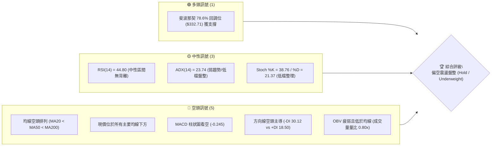

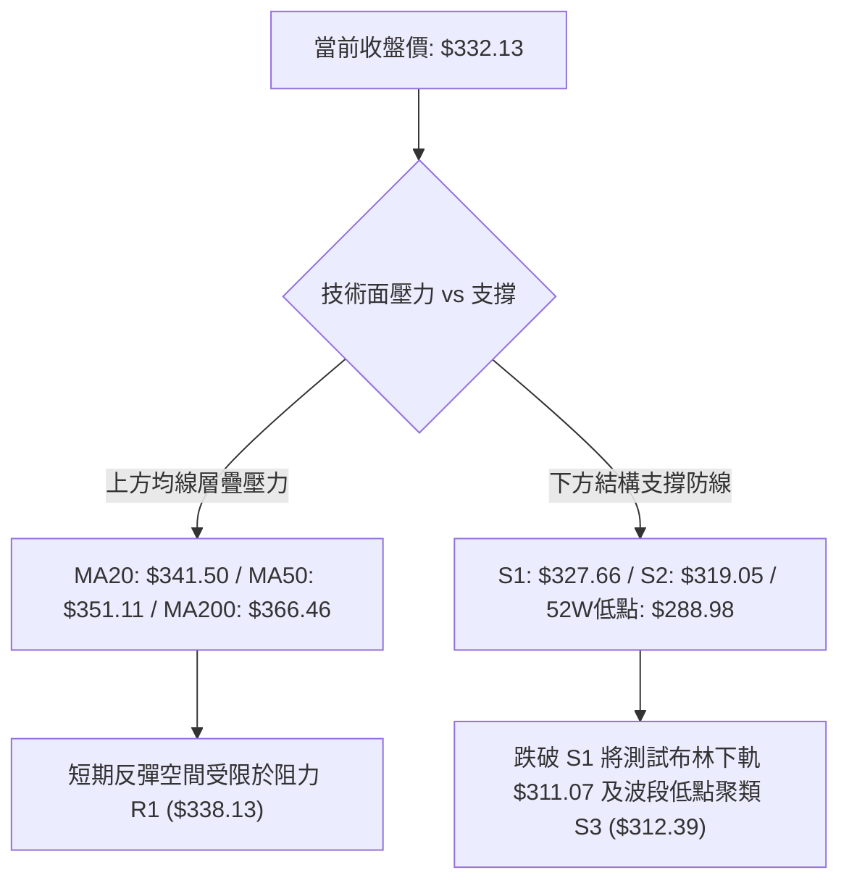

### 📊 核心指標速覽表

| 指標類別 | 指標名稱 | 當前數值 | 訊號 | 解讀 |
|----------|----------|----------|------|------|
| **價格** | 當前價格 | $332.13 | 🔴 | 位於 52 週區間 21.1% 之相對低位，呈現弱勢整理 |
| **均線** | MA20 | $341.50 | 🔴 | 現價低於短期生命線 -2.74%，受壓制明顯 |
| **均線** | MA50 | $351.11 | 🔴 | 現價低於中期均線 -5.41%，中期波段偏空 |
| **均線** | MA200 | $366.46 | 🔴 | 現價低於長期牛熊線 -9.37%，長期多頭架構受損 |
| **動能** | RSI(14) | 44.80 | 🟡 | 位於 30–70 中性區間，首尾 20 根 K 棒無顯著背離 |
| **動能** | MACD (12,26,9) | -6.818 / -6.573 | 🔴 | DIF 線低於訊號線，Hist 柱狀圖為 -0.245 看空 |
| **趨勢** | ADX(14) | 23.74 | 🟡 | ADX < 25 處於無明顯強趨勢的弱勢震盪狀態 |
| **趨勢** | 方向指標 (DMI) | -DI: 30.12 / +DI: 18.50 | 🔴 | 空方主導力量顯著強於多方 |
| **通道** | 布林通道 (%B) | %B = 0.35 | 🟡 | 位於中軌 ($341.50) 與下軌 ($311.07) 之間偏弱側 |
| **量能** | 最新成交量 / 量比 | 17,120,000 / 0.80x | 🔴 | 低於 20 日均量 (21,479,700)，OBV 疲弱確認空頭量能 |
| **波動** | ATR(14) | $12.59 | 🟡 | 每日平均波動幅度約 3.79%，提供合理風控與止損區間 |

### 🏆 技術評分卡

```
╔══════════════════════════════════════════════════════════════════╗
║                技術評分卡 — AVGO (2026-11-04)                   ║
╠══════════════════════════════════════════════════════════════════╣
║  趨勢強度      ████████░░░░░░░░░░░░  40/100  🔴 (ADX 23.74 空頭主導)║
║  動能指標      ████████░░░░░░░░░░░░  40/100  🔴 (RSI 44.8, MACD負值)║
║  支撐穩定度    ██████████░░░░░░░░░░  50/100  🟡 (測試Fib 78.6%及S1) ║
║  成交量配合    ██████░░░░░░░░░░░░░░  30/100  🔴 (量比0.8x, OBV疲弱) ║
║  形態完整度    ████████░░░░░░░░░░░░  40/100  🔴 (低檔旗形整理雛形)  ║
║  均線排列      ████░░░░░░░░░░░░░░░░  20/100  🔴 (空頭完美發散排列)  ║
╠══════════════════════════════════════════════════════════════════╣
║  綜合評分      ████████░░░░░░░░░░░░  37/100  🔴 偏空震盪盤整       ║
╚══════════════════════════════════════════════════════════════════╝
```
*註：綜合評分由六項子評分算術平均得出：(40 + 40 + 50 + 30 + 40 + 20) ÷ 6 = 36.67，四捨五入至整數為 37/100。*

---

## 2. 趨勢分析

### 🌐 多時框趨勢分析

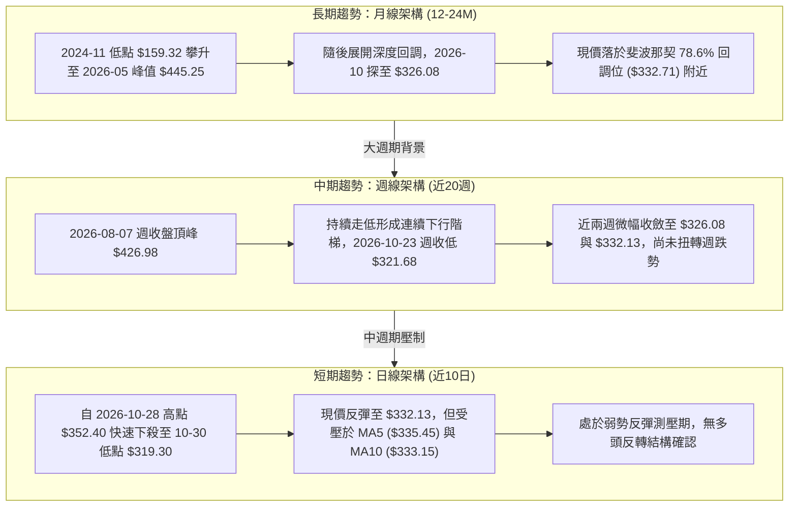

### 📈 長期趨勢 — 12個月走勢圖（Unicode）

依據過去 12 個月（2025-11 至 2026-11）收盤歷史繪製之月線走勢圖如下：

```
AVGO 月線收盤走勢圖（2025-11 至 2026-11）
價格軸 ($)
$450 ┤                                      ● $445.25 (2026-05 高點)
$420 ┤                                ●
$390 ┤● $399.99 (2025-11)                   │  ● $388.57
$360 ┤      │                               ●     │  ●
$330 ┤      ● $344.20                       │     │  │  ● $326.08
$300 ┤            ● $329.48 ● $317.80 ● $308.46   │  │  │  │  ● $332.13 (現價)
     └─────────────────────────────────────────────────────────
       11    12    01    02    03    04    05    06    07 08 09 10 11 (月份)
      2025  2025  2026  2026  2026  2026  2026  2026       2026 (年)
```

**歷史波段走勢特徵分析表格**：

| 時期區間 | 起始價 ($) | 結束價 ($) | 漲跌幅 (%) | 趨勢特徵描述 |
|----------|------------|------------|------------|--------------|
| 2025-11 ~ 2026-03 | $399.99 | $308.46 | -22.88% | 自前波高點承壓深度回調，連續 4 個月走低至低點 $308.46 |
| 2026-03 ~ 2026-05 | $308.46 | $445.25 | +44.35% | 強勢主升浪突破，兩個月內暴漲，創下歷史收盤高點 $445.25 |
| 2026-05 ~ 2026-06 | $445.25 | $377.06 | -15.31% | 高檔獲利了結賣壓湧現，長黑回落 |
| 2026-06 ~ 2026-07 | $377.06 | $388.57 | +3.05%  | 弱勢震盪反彈，構築次高點平台 |
| 2026-07 ~ 2026-10 | $388.57 | $326.08 | -16.08% | 展開陰跌通道，月收盤呈現階梯式下挫，空頭佔據主導 |
| 2026-10 ~ 2026-11 | $326.08 | $332.13 | +1.86%  | 於斐波那契 78.6% 回調位低檔收斂，嘗試止跌但動能不足 |

### 📊 中期趨勢（週線分析）

中期技術面觀察，近 20 週高點出現在 2026-08-07 之週收盤價 $426.98，隨後展開一輪結構性下行浪潮。在 2026-10-16 當週放量長黑，週收盤價暴跌至 $328.75，跌破此前所有橫盤區間；隨後在 2026-10-23 當週探底至低點 $320.23，收在 $321.68。近兩週（10-30 週收 $326.08，11-03 週收 $332.13）雖然出現微幅反彈，但週線 MACD 仍深陷零軸下方震盪，且上方重重均線與高點聚類壓制，反彈力道極為有限。

```
AVGO 週線關鍵壓力與支撐階梯示意圖
===================================================================
 [壓力頂層] $366.55 ~ $380.84 ─── 近8週高點密集阻力區（10-09高點 $380.84）
    │
 [壓力中層] $352.40 ~ $356.14 ─── 10-30週高點及前期平台中軸
    │
 [現價區域] $332.13 ──────────── 弱勢低檔整理
    │
 [支撐底層] $319.30 ~ $320.23 ─── 近期日/週線極限低點防線 (S2: $319.05)
    │
 [最終防線] $288.98 ──────────── 52週最低價防線
===================================================================
```

### ⚡ 趨勢強度評估（ADX 解讀）

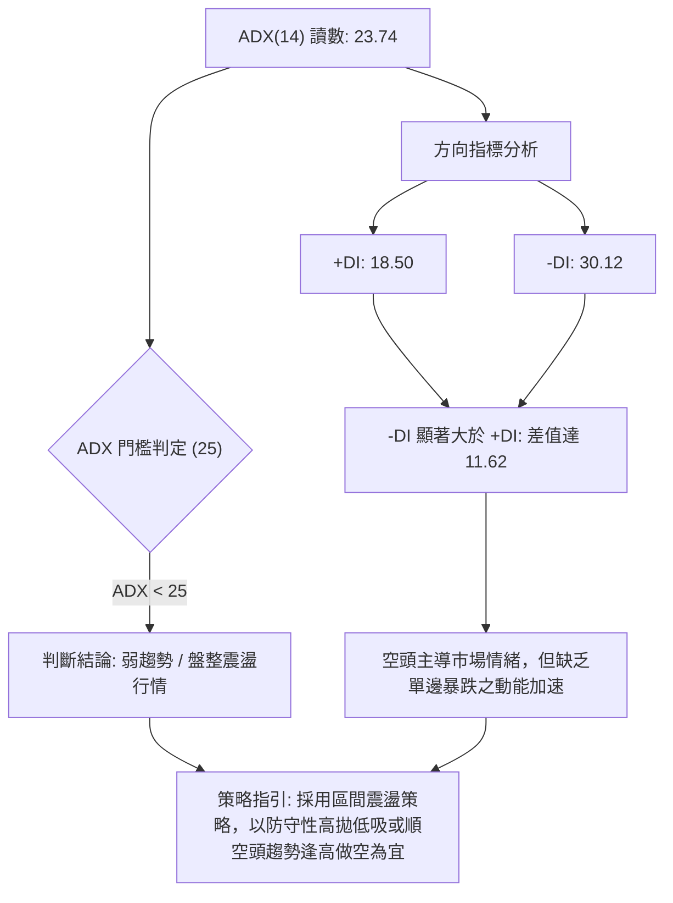

**ADX 趨勢強度對照表**：

| 指標項目 | 數值 | 參考標準 | 當前市場狀態判定 |
|----------|------|----------|------------------|
| **ADX(14)** | 23.74 | < 20：無趨勢<br>20–25：弱趨勢/低檔盤整<br>> 25：強趨勢確立<br>> 40：極強趨勢 | **弱趨勢/盤整行情**。當前 ADX 為 23.74，低於臨界值 25，表明既非單邊暴漲亦非極度強烈的單邊主跌，市場進入動能衰竭的震盪洗盤格局。 |
| **+DI (14)** | 18.50 | 衡量多方推升力道 | **多方動能疲弱**。低於 20，多頭無力組織連續攻擊。 |
| **-DI (14)** | 30.12 | 衡量空方下打力道 | **空方維持主導**。高於 30，顯示賣壓仍處於相對主導地位。 |
| **DI 差值 (+DI - -DI)**| -11.62 | 正值為多頭主導，負值為空頭主導 | **空頭佔優**。負值擴大確認反彈僅屬弱勢修正性質。 |

---

## 3. 圖表形態分析

### 🔍 形態識別系統

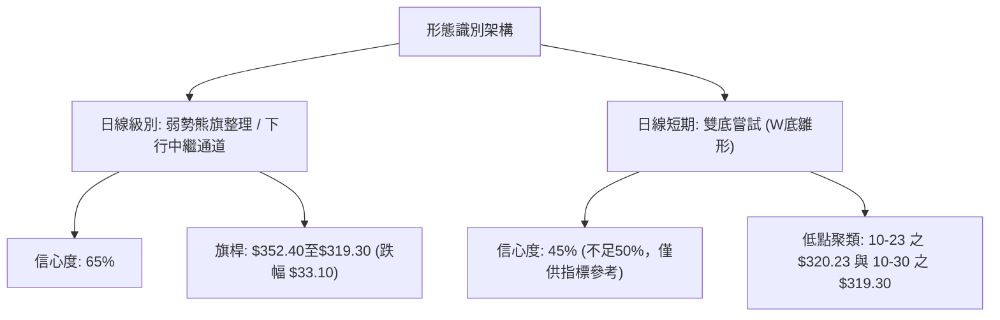

**圖表形態識別與信心度評估表**：

| 形態名稱 | 信心度 | 判斷依據（引用數據） | 完成度 | 目標價（附計算式） |
|----------|--------|----------------------|--------|--------------------|
| **熊旗中繼形態 (Bearish Flag)** | 65% | 1. 旗桿：由 2026-10-28 高點 $352.40 快速跌至 10-30 低點 $319.30（高度 = $352.40 − $319.30 = $33.10）。<br>2. 旗面：近 3 個交易日於 $321.87 至 $335.74 間微幅反彈整理，成交量同步萎縮。 | 50% | 由跌破點推算：若跌破 S1 ($327.66)，對應測量目標 = 破位點 $327.66 − 旗桿高度 $33.10 = **$294.56**（接近 52W 低點 $288.98）。 |
| **雙底形態 (W-Bottom)** | 45% | 1. 左底：2026-10-23 低點 $320.23。<br>2. 右底：2026-10-30 低點 $319.30。<br>3. 中間頸線：2026-10-28 高點 $352.40。<br>*註：信心度低於 50%，成交量未能放大，頸線未突破，僅做指標型低檔支撐參考。* | 35% | 由形態推算：若突破頸線 $352.40，形態高度 = $352.40 − $319.30 = $33.10，理論目標 = $352.40 + $33.10 = **$385.50**。 |

### 🕯️ 重要K線形態分析

嚴格依據數據中「近 10 根日 K」與「近 8 根週 K」之實際開高低收數值進行判讀：

**近 10 根日 K 線形態分析表**：

| 日期（日K） | 開 | 高 | 低 | 收 | 成交量 | K線形態 | 解讀與訊號 |
|---|---|---|---|---|---|---|---|
| 2026-10-21 | 338.03 | 339.24 | 332.29 | 337.80 | 17,123,600 | 窄幅十字小陰線 | 高低點收斂，反彈力竭，多空陷入短暫平衡 🟡 |
| 2026-10-22 | 326.53 | 330.82 | 321.02 | 323.24 | 28,139,100 | 跳空下挫中長黑K | 跳空破位伴隨放量，空頭下殺動能強勁 🔴 |
| 2026-10-23 | 321.50 | 327.70 | 320.23 | 321.68 | 15,917,000 | 低檔紡錘線 (Spindle) | 於 $320.23 見買盤抵抗，縮量盤整止跌 🟡 |
| 2026-10-26 | 324.53 | 332.12 | 323.25 | 329.17 | 18,646,700 | 溫和放量小陽線 | 展開超跌技術性反彈，突破前一日高點 🟢 |
| 2026-10-27 | 339.87 | 345.67 | 336.87 | 342.33 | 25,567,200 | 跳空高開強勢中陽線 | 放量反彈，回補上方缺口，測試 MA20 壓力 🟢 |
| 2026-10-28 | 349.22 | 352.40 | 344.35 | 351.81 | 22,718,200 | 帶上影實體陽線 | 觸碰波段阻力 R2 ($350.81) 與 MA50，留長上影遇阻 🟡 |
| 2026-10-29 | 342.00 | 346.15 | 338.80 | 345.00 | 17,052,700 | 縮量孕線小陽線 | 未過前高，買盤追高意願急凍，反彈阻力大 🟡 |
| 2026-10-30 | 330.72 | 331.98 | 319.30 | 326.08 | 36,511,800 | 暴量下殺大陰線 (吞噬)| 放量 36.5M 暴跌，吞噬前三日漲幅，探底 $319.30 🔴 |
| 2026-11-02 | 328.37 | 333.56 | 321.87 | 322.23 | 20,326,900 | 下跌實體黑K | 低檔承壓，反彈無力，收盤收在全天相對低點 🔴 |
| 2026-11-03 | 328.97 | 335.74 | 326.60 | 332.13 | 17,120,000 | 低檔長下影小陽K | 於 $326.60 獲支撐回升，收復 $330，呈現弱勢反抽 🟢 |

**近 8 根週 K 線形態分析表**：

| 日期（週K最後交易日） | 開 | 高 | 低 | 收 | 週成交量 | 週K線形態 | 解讀與訊號 |
|---|---|---|---|---|---|---|---|
| 2026-09-18 | 348.99 | 362.62 | 335.20 | 356.96 | 149,021,600 | 巨量長下影紅K | 低檔有強大買盤承接，週線止跌回升 🟢 |
| 2026-09-25 | 358.66 | 366.55 | 346.89 | 352.81 | 107,643,000 | 高檔倒轉錘頭陰K | 上探 $366.55 遭遇長期均線壓制回落 🔴 |
| 2026-10-02 | 352.87 | 361.86 | 343.29 | 355.14 | 109,689,700 | 區間震盪小陽星 | 處於橫盤窄幅震盪，多空暫未分勝負 🟡 |
| 2026-10-09 | 357.79 | 380.84 | 356.14 | 361.54 | 114,351,000 | 衝高回落長上影陽K | 衝刺 $380.84 遇強烈出貨賣壓，週線見頂 🔴 |
| 2026-10-16 | 359.43 | 360.69 | 328.58 | 328.75 | 115,026,300 | 破位光腳長黑K | 實體大陰線跌破多條短期均線，週趨勢翻空 🔴 |
| 2026-10-23 | 338.75 | 341.10 | 320.23 | 321.68 | 94,589,100 | 下跌實體大黑K | 延續跌勢破位，逼近波段下檔低點防線 🔴 |
| 2026-10-30 | 324.53 | 352.40 | 319.30 | 326.08 | 120,496,600 | 放量長上影墓碑十字星| 衝高 $352.40 再次遭空方重擊，低點跌至 $319.30 🔴 |
| 2026-11-03 | 328.37 | 335.74 | 321.87 | 332.13 | 37,446,900 | 弱勢小陽回升棒 (未完週)| 於前低上方微幅反彈，量能未及前週三分之一 🟡 |

### 📉 ASCII 走勢形態示意圖

```
AVGO 近期熊旗整理形態與關鍵價位示意圖
價格 ($)
$355 ┤                     ● (10-28 高點 $352.40 / 阻力 R2: $350.81)
$350 ┤                    ╱ ╲
$345 ┤                   ╱   ╲
$340 ┤                  ╱     ╲   (旗面整理通道)
$335 ┤   (旗桿跌勢)    ╱       ╲  ┌───● (11-03 收盤: $332.13)
$330 ┤                ╱         ╲ │  ╱
$325 ┤               ╱           ╲│ ╱  ● (10-30 收盤: $326.08)
$320 ┤● (10-23低點: $320.23)     └─● (10-30 低點: $319.30 / 支撐 S2: $319.05)
     └────────────────────────────────────────────────────────
       10-23        10-26   10-28   10-30   11-02   11-03 (交易日)
```

### 🎯 形態目標價計算

1. **熊旗中繼形態目標價推算**：
   - **旗桿起點**：2026-10-28 高點 $352.40
   - **旗桿終點**：2026-10-30 低點 $319.30
   - **旗桿垂直高度**：$352.40 − $319.30 = **$33.10**
   - **破位觸發點**：若跌破近期第一道防守支撐 S1 ($327.66)
   - **空頭形態推算目標價**：$327.66 − $33.10 = **$294.56**（標注為「由熊旗形態高度推算」，與 52W 低點 $288.98 構成支撐帶）。

2. **雙底反轉目標價（低信心度 45%，僅作參照）**：
   - **頸線位置**：2026-10-28 高點 $352.40
   - **底部位階**：10-30 低點 $319.30
   - **底頂高度差**：$352.40 − $319.30 = **$33.10**
   - **多頭形態推算目標價**：$352.40 + $33.10 = **$385.50**（標注為「由雙底形態高度推算」）。

---

## 4. 支撐與阻力

### 🗺️ 關鍵價位分布圖（Unicode）

```
AVGO 價位結構分布圖（引自 OHLCV 計算聚類及斐波那契回調）
══════════════════════════════════════════════════════════════════
$358.10 ║████████████████████████║ 強阻力 R3（波段密集高點聚類）
$350.81 ║████████████████████    ║ 中期阻力 R2（MA50 $351.11 匯合點）
$338.13 ║████████████████████████║ 短期關鍵阻力 R1（反彈第一目標位）
$332.71 ╟────────────────────────╢ 斐波那契 78.6% 回調位
$332.13 ╠════════════════════════╣ ◄ 當前收盤價 ($332.13)
$327.66 ║▓▓▓▓▓▓▓▓▓▓▓▓▓▓▓▓        ║ 近期波段第一支撐 S1
$319.05 ║████████████████████████║ 核心波段強支撐 S2（10月雙底防線）
$312.39 ║████████████████████    ║ 深層防守支撐 S3（貼近布林下軌 $311.07）
$288.98 ║████████████████████████║ 斐波那契 100.0% / 52週歷史低點
══════════════════════════════════════════════════════════════════
```

### 🚧 阻力位分析表

價位嚴格引用技術數據中「關鍵價位」區塊之波段高點聚類數值：

| 阻力級別 | 價位 | 距現價幅 | 形成原因 | 突破難度 | 重要性 |
|----------|------|----------|----------|----------|--------|
| **R1** | **$338.13** | +1.81% | 近一年波段高點聚類，與 5 日均線 ($335.45) 形成重疊壓力帶 | 🟡 中等 | 🔴 短期生命線：必須有效站穩方能化解短線陰跌格局 |
| **R2** | **$350.81** | +5.62% | 波段高點聚類，與 50 日均線 ($351.11) 及 10-28 突破高點 ($352.40) 高度共振 | 🔴 困難 | 🔴 中期多空分水嶺：未收復前中期趨勢維持偏空 |
| **R3** | **$358.10** | +7.82% | 近一年波段頂部高點聚類，與 60 日均線 ($356.96) 及密集套牢籌碼峰重合 | 🔴 極高 | 🟡 長期分水嶺：多頭扭轉中期熊市的關鍵防線 |

### 🛡️ 支撐位分析表

價位嚴格引用技術數據中「關鍵價位」區塊之波段低點聚類數值：

| 支撐級別 | 價位 | 距現價幅 | 形成原因 | 守住機率 | 重要性 |
|----------|------|----------|----------|----------|--------|
| **S1** | **$327.66** | -1.35% | 近一年波段低點聚類，亦為 11-03 低點 ($326.60) 上方重要支撐關卡 | 60% 🟡 | 🔴 短線第一防線：一旦收盤破位，短多必須停損 |
| **S2** | **$319.05** | -3.94% | 波段低點強聚類，2026-10-30 探底極限點 ($319.30) 所在之雙底頸線支撐 | 70% 🟢 | 🔴 核心生命防線：跌破將引發熊旗形態之等長量度下殺 |
| **S3** | **$312.39** | -5.94% | 深層波段低點聚類，緊鄰日線布林通道下軌 ($311.07) | 85% 🟢 | 🟡 極限防守位：提供超賣背離技術性反彈契機 |

### 📐 斐波那契回調位分析

依據數據提供的 52 週波動區間（高點 $493.32 → 低點 $288.98，垂直落差 $204.34）進行回調位對應分析：

```
斐波那契回調層級（52週區間 $288.98 → $493.32）
-------------------------------------------------------------------
 0.0%  (52W High)   $493.32  ── 頂部天花板
 23.6%              $445.09  ── 2026-05 收盤頂部附近
 38.2%              $415.26  ── 2026-04 突破平台
 50.0%              $391.15  ── 多空半山腰關鍵軸
 61.8%              $367.03  ── 黃金分割關鍵防線 (接近 MA200: $366.46)
 78.6%              $332.71  ── ◄ 現價 ($332.13) 精確在此回調位附近
100.0% (52W Low)    $288.98  ── 52週歷史底部
-------------------------------------------------------------------
```

**回調位深度解讀**：
當前收盤價 **$332.13** 精確貼近於 **78.6% 深度回調位 ($332.71)**，距該位僅差 -$0.58 (-0.17%)。在古典技術分析中，78.6%（即黃金比例的平方根衍生比率）被視為「最後一道回調防線」。若價格在此處出現企穩訊號，代表此輪自 $493.32 的大回調已釋放大部分做空動能；然而若收盤有效跌破 $332.71 並失守 S1 ($327.66)，則價格在結構上將失去所有關鍵黃金回調依託，極大機率朝向下一個終極斐波那契水平——100.0% 回調位 **$288.98** 尋求支撐。

---

## 5. 技術指標深度解讀

### 🎛️ 指標訊號總覽

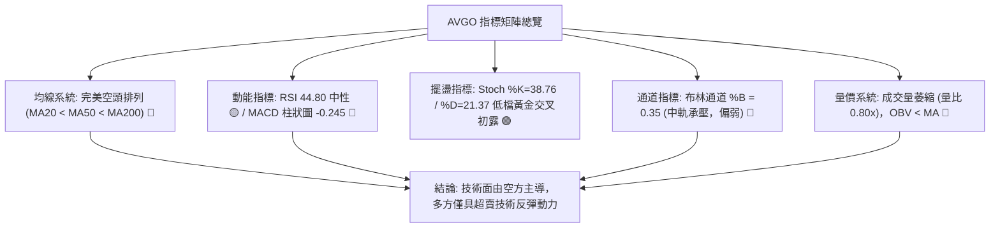

### 📈 移動平均線排列分析

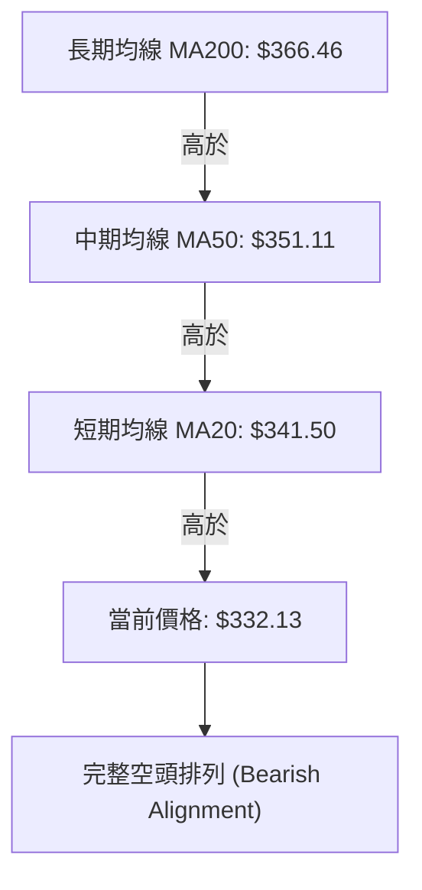

**均線系統詳細參數與偏離分析表**：

| 均線名稱 | 當前價格 | 與現價價差 ($) | 偏離幅度 (%) | 走勢特徵描述 |
|----------|----------|----------------|--------------|--------------|
| **MA 5** | $335.45 | -$3.32 | -0.99% | 短線下壓斜率陡峭，現價在其下方運行 |
| **MA 10** | $333.15 | -$1.02 | -0.31% | 極短線緊貼現價上方，構成反彈首要壓制 |
| **MA 20** | $341.50 | -$9.37 | -2.74% | 扣高走低，為月線級別生命線，空頭排列確認 |
| **MA 50** | $351.11 | -$18.98 | -5.41% | 季線下行，與阻力 R2 ($350.81) 形成堅固共振頂 |
| **MA 60** | $356.96 | -$24.83 | -6.96% | 中期下壓均線，下行斜率未見減緩 |
| **MA 120** | $377.66 | -$45.53 | -12.06% | 半年線持續壓制，負乖離率達兩位數 |
| **MA 200** | $366.46 | -$34.33 | -9.37% | 長期牛熊分界線失守，顯示大週期進入調整期 |
| **MA 240** | $365.09 | -$32.96 | -9.03% | 年線失守，構成上方極為沉重的解套賣壓層 |

### 📉 RSI(14) 分析

- **當前讀數**：**44.80**（Wilder 計算法）
- **動能評估進度條**：
  ```
  RSI(14) 強度：[0] ░░░░░░░░░░░░░░░░░░░░████████████░░░░░░░░░░░░░░ [100]  (44.80)
  ```
- **區間定位**：處於 30 至 70 之常態中性區間。既未觸及 30 以下之嚴重超賣極限（無即時強烈報復性反彈推力），亦未進入 50 以上之強勢多頭領域，顯示買盤追高意願消極。
- **背離分析**：依據最新 20 根日 K 首尾比對，價格自 2026-10-21 收盤 $337.80 降至 2026-11-03 收盤 $332.13，RSI 自前期中性區域波動至當前 44.80，**明確判定無頂背離亦無底背離**。走勢呈現價格與指標同步陰跌的協同狀態。

### 📊 MACD(12,26,9) 訊號解讀

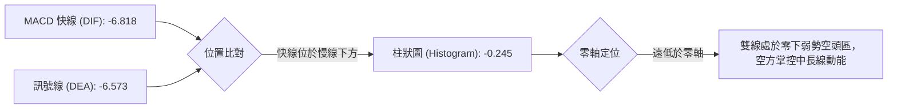

**MACD 結構解讀**：
1. **數值狀態**：DIF (-6.818) 小於 DEA (-6.573)，差值產生負值柱狀圖 **-0.245**。
2. **多空訊號**：指標在零軸下方運行，柱狀圖雖未加速擴散，但仍維持綠色（負值）空頭主導格局，顯示多方尚未形成有效的黃金交叉動能。
3. **週線 MACD 參照**：近 20 週數據顯示，2026-10-16 當週週 MACD 柱大幅翻負至 -1.993，10-23 週達 -2.999；儘管 10-30 微翻正至 +0.209，但最新一週（11-03）再度轉負為 -0.245，證實反彈基礎脆弱，空方隨時可能重掌主動。

### 📦 布林通道分析

```
AVGO 布林通道價格空間示意圖（參數：20, 2）
══════════════════════════════════════════════════════════════════
$371.93 ────────── 上軌 (Upper Band)
  │
  │
$341.50 ────────── 中軌 (MA20) ─── 空頭重壓所在
  │
  │     ● 現價: $332.13 (%B = 0.35)
  │
$311.07 ────────── 下軌 (Lower Band)
══════════════════════════════════════════════════════════════════
```

**布林通道詳細指標解讀**：
- **布林帶寬度 (Bandwidth)**：(上軌 $371.93 − 下軌 $311.07) ÷ 中軌 $341.50 = **17.82%**，通道寬度處於適中收縮狀態，無極度擠壓暴衝特徵。
- **%B 指標**：**0.35**。%B 介於 0（下軌）與 0.5（中軌）之間，代表當前股價受壓於空頭通道區域。現價距離下軌空間僅剩約 6.34%，距離中軌壓力有 2.82%，向下尋找下軌支撐的重力仍大於向上突破阻力。

### 💹 成交量分析（量價配合度）

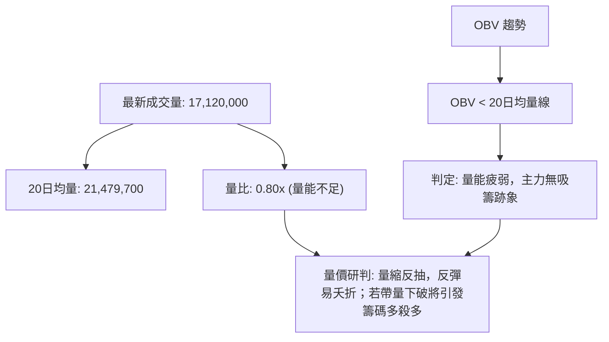

**量價關係綜合判定**：
最新交易日成交量僅 17.12M，相較於 20 日均量（21.48M）呈現顯著量縮（量比 0.80x）。回顧 2026-10-30 大跌時成交量放大至 36.51M，顯示「**下跌放量、反彈縮量**」的標準空頭籌碼特徵。OBV 指標持續低於其移動平均線，確認整體機構資金處於淨流出階段，量能並未確認反彈的有效性。

---

## 6. 動能與波動率

### ⚡ 動能評估四象限

| 象限 | 動能維度 | 波動維度 | 典型特徵 | AVGO 當前狀態判定 |
|------|----------|----------|----------|-------------------|
| **Q1** | 強動能 (Bullish) | 低波動 (Low Vol) | 穩定單邊上行趨勢 | 否 |
| **Q2** | 弱動能 (Bearish) | 低波動 (Low Vol) | 陰跌、無量陰盤、防守磨底 | 否 |
| **Q3** | 強動能 (Trend) | 高波動 (High Vol) | 主升浪或暴跌主跌浪 | 否 |
| **Q4** | **弱動能 (Bearish)** | **中高波動 (Mod-High Vol)** | **震盪尋底、空頭修正、反彈脆弱** | **✓ 符合當前定位** |

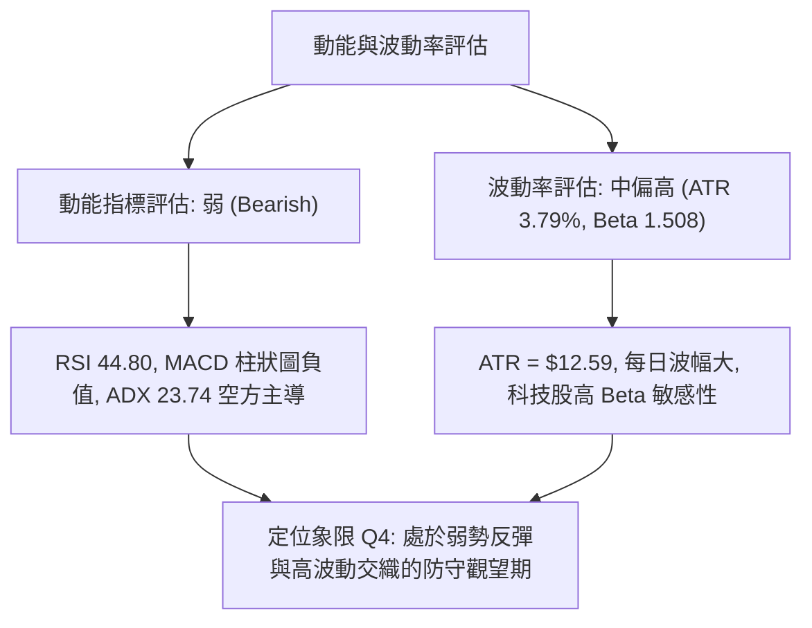

### 📊 ATR 波動率分析

- **ATR(14) 讀數**：**$12.59**（佔現價比率為 **3.79%**，採 Wilder 平滑算法）。
- **日內與波段風險評估**：每日理論常態波動區間達 $12.59，顯示 AVGO 股性極具彈性與侵略性，短期噪音較大。
- **風控止損距離建議**：
  - **極短線（Day/Swing Trading）**：建議以 1.0 × ATR（即 **$12.60**）作為保護性止損緩衝空間。
  - **波段交易（Position Trading）**：建議以 1.5 ~ 2.0 × ATR（即 **$18.90 ~ $25.20**）作為寬鬆止損空間，以防日內假突破震盪洗盤。

### 📐 Beta 與市場相關性

- **Beta 係數**：**1.508**
- **市場特徵解讀**：AVGO 具備顯著的高貝塔科技股特徵，對標普 500 指數與費城半導體指數的波動敏感度高達 1.5 倍以上。在科技股整體遭遇 AI 資本支出疑慮與宏觀利率波及時，AVGO 跌幅往往放大；反之，一旦半導體類股整體回暖，其彈性亦高於大盤。
- **機構持股與空頭水位**：機構持股佔比高達 **79.8%**，籌碼相對集中；空頭佔流通盤比率（Short % Float）僅 **1.1%**，空頭比率（Short Ratio）為 **2.31**，顯示空方並無極端聚集下注，此輪下挫主要源於機構內部的高檔換手與獲利了結，並非高比例惡意做空，因此短期內發生劇烈軋空（Short Squeeze）的機率極低。

---

## 7. 多時框架總結

### 📋 時框架評分表

| 時框架 | 趨勢方向 | 動能狀態 | 均線排列 | 圖表形態 | 綜合評分 | 操作建議 |
|--------|----------|----------|----------|----------|----------|----------|
| **長期 (月線)** | 🟡 中性回調 | 45/100 🟡 | 跌破多條月均線 🔴 | 自歷史高點 $445 展開深度回調 🔴 | **45/100** 🟡 | 長期多單底倉減持，靜待 $310-$330 築底確認 |
| **中期 (週線)** | 🔴 偏空格局 | 35/100 🔴 | 週線下壓空頭 🔴 | 連續階梯下移，長上影墓碑星 🔴 | **30/100** 🔴 | 逢反彈減碼或順勢建立對沖保護空單 |
| **短期 (日線)** | 🔴 空頭弱震 | 40/100 🔴 | MA20<MA50<MA200 🔴 | 熊旗中繼通道微幅反抽 🔴 | **35/100** 🔴 | 嚴禁盲目搶反彈，僅限極短線區間博弈 |

### 🔲 綜合訊號矩陣

```
訊號維度對齊分析矩陣
══════════════════════════════════════════════════════════════════
維度            短期 (日線)      中期 (週線)      長期 (月線)
──────────────────────────────────────────────────────────────────
均線體系        🔴 空頭排列      🔴 下壓破位      🟡 測試牛熊線
動能指標        🟡 中性 (44.8)   🔴 MACD走空      🔴 動能滑落
成交量能        🔴 萎縮量比0.8x  🔴 反彈無量      🟡 常態分化
支撐阻力        🟡 測S1與Fib78.6 🔴 跌破中期平台  🟢 逼近52W支撐帶
形態架構        🔴 弱勢熊旗      🔴 下降通道      🟡 深度ABC回調
──────────────────────────────────────────────────────────────────
一致性判定：長中短期全線呈現「偏空與弱勢盤整共振」，無多頭逆轉跡象。
══════════════════════════════════════════════════════════════════
```

### ⚖️ 多時框收斂結論

依據多時框收斂規則（規則 14）：
1. **行情性質判定**：當前 ADX(14) 讀數為 **23.74**，嚴格小於 25 臨界值，因此整體架構判定為「**盤整弱勢震盪行情**」，而非單邊趨勢主升或主跌行情。
2. **主導時框與優先級**：在盤整行情中，分析重點收斂至「**日線布林通道上下軌（$311.07 ~ $371.93）與波段高低點聚類（S1: $327.66 / R1: $338.13）**」所構成的區間內。同時，由於中長期均線（MA20/MA50/MA200）全面處於現價上方且形成完美空頭排列，中期壓制顯著高於短線反彈動能。
3. **收斂唯一方向性結論**：**偏空震盪盤整（Cautious / Underweight）**。日線的反抽僅屬技術面超跌修復，在未帶量收復 MA20 ($341.50) 以前，不可視為趨勢反轉。本結論與第 1 章評分卡（綜合評分 37/100）及後續交易策略完全一致。

---

## 8. 交易策略建議

### 🗺️ 策略決策流程圖

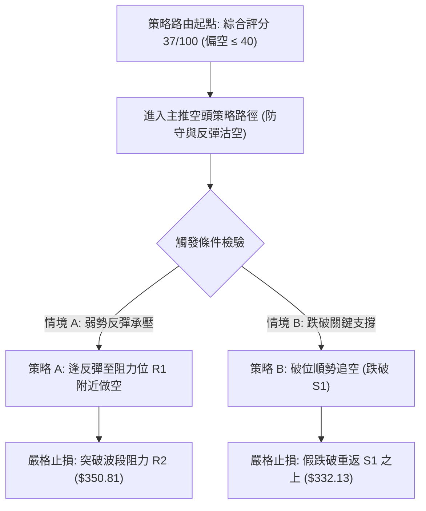

### 🧭 策略路由

**當前主策略方向 = 主推空頭策略（偏空防守 / 逢高做空，依綜合評分 37/100）**
依據規則 18 與評分路由規範，綜合評分 ≤ 40，技術面由空方完全主導，主推空頭防守與順勢做空策略，多頭僅列為反轉風險對沖提示。

### 🎯 價格情境階梯（Price Scenarios）

價位嚴格引用第 4 章及數據源關鍵價位計算數值：

| 觸發條件 | 下一目標 | 後續延伸 | 情境含義 |
|----------|----------|----------|----------|
| **向上突破 R1 ($338.13)** | R2 ($350.81) | R3 ($358.10) | 短線超跌反彈轉強，測試 MA50 壓力峰 |
| **現價區間震盪 ($327.66 ~ $338.13)** | 徘徊 $332.13 | 測試 Fib 78.6% | 弱勢築底消化賣壓，等待量能表態 |
| **向下跌破 S1 ($327.66)** | S2 ($319.05) | S3 ($312.39) | 中期破位延續，熊旗形態展開等長下殺 |

### 📊 情境機率分佈

| 情境 | 機率 | 主要依據 |
|------|------|----------|
| **反彈受阻回落 / 再探低點 (主情境)** | **55%** | 均線空頭排列未變，-DI (30.12) 強力壓制 +DI (18.50)，MACD 處於零下綠柱，量能萎縮主力無意接盤 |
| **區間弱勢震盪 (次情境)** | **30%** | ADX 讀數 23.74 < 25 缺乏單邊動能，斐波那契 78.6% 回調位 ($332.71) 具備初步抵抗買盤 |
| **強勢反轉突破 (小機率情境)** | **15%** | 必須伴隨單日成交量擴大至 30M 以上並連克 R1 與 MA20，目前毫無量價配合跡象 |

### 🟢 主策略詳情（方向依上方路由：空頭策略）

以下策略之進場點、止損點、目標價均嚴格引用技術數據中的聚類價位：

| 策略要素 | 策略 A（反彈高空策略 — 推薦） | 策略 B（破位追空策略 — 激進） |
|----------|--------------------------------|--------------------------------|
| **交易類型** | 逢阻力位放空 | 支撐破位順勢做空 |
| **進場條件** | 反彈至短期阻力 R1 附近受阻回落 | 實體日 K 跌破第一道支撐 S1 |
| **進場價格** | **$338.13** (即 R1 阻力位) | **$327.66** (即 S1 支撐破位點) |
| **目標價 T1** | **$319.05** (支撐 S2，波段雙底防線) | **$312.39** (支撐 S3，布林下軌附近) |
| **目標價 T2** | **$312.39** (支撐 S3，波段深層支撐) | **$288.98** (52週歷史最低價) |
| **止損價格** | **$350.81** (阻力 R2，突破則空頭失效) | **$338.13** (阻力 R1，假跌破停損點) |
| **風險報酬比** | **1 : 1.51**（以 T1 計）<br>*計算式：($338.13 - $319.05) ÷ ($350.81 - $338.13) = $19.08 ÷ $12.68 = 1.505* | **1 : 1.46**（以 T1 計）<br>*計算式：($327.66 - $312.39) ÷ ($338.13 - $327.66) = $15.27 ÷ $10.47 = 1.458* |
| **成功機率** | 60% 🟢 | 55% 🟡 |
| **建議倉位** | 總資金之 10% ~ 15% | 總資金之 5% ~ 10% |

*註：策略 A 若計算至 T2 ($312.39)，風險報酬比為 1 : 2.03（以 T2 計）；策略 B 若計算至 T2 ($288.98)，風險報酬比為 1 : 3.69（以 T2 計）。*

### 🔴 反向風險觸發點（對沖提示）

若出現以下情境，宣告空頭主策略失效，應即刻空單平倉並啟動多頭對沖防禦：
1. **價位突破**：日 K 線收盤價強勢突破 **$350.81 (R2)**，代表一舉站上 MA50 與前波反彈高點。
2. **指標轉強**：MACD 出現零軸下方的強勢黃金交叉，且柱狀圖由負翻正擴張超過 +1.0。
3. **量能爆發**：單日成交量放大超過 20 日均量之 1.5 倍（即超過 32,200,000 股）並收出光腳大陽線。

### ⭐ 整體訊號強度評星

```
做多訊號強度：★★☆☆☆  (2/5星 — 僅具跌深反彈與超賣抵抗性質)
做空訊號強度：★★★★☆  (4/5星 — 均線與量能全面偏空，順勢交易佔優)
整體可信度：  ★★★☆☆  (3/5星 — ADX<25 震盪特徵明顯，需防範洗盤)
```

---

## 9. 風險提示與監控

### ✅ 關鍵監控指標 Checklist

```
╔══════════════════════════════════════════════════════════════════╗
║               AVGO 技術面日常監控 Checklist                      ║
╠══════════════════════════════════════════════════════════════════╣
║ [ ] 監控價位 $327.66 (S1)：是否出現跌破放量？破位將啟動下行延續 ║
║ [ ] 監控價位 $338.13 (R1)：反彈是否在此遇阻？為最佳防守做空點   ║
║ [ ] 均線動態：現價與 MA20 ($341.50) 乖離是否收斂完成？         ║
║ [ ] 動能變化：MACD 柱狀圖是否持續收縮？若由 -0.245 轉正需警惕   ║
║ [ ] 成交量能：成交量是否突破 21.48M 均量？無量反彈皆視為誘多     ║
║ [ ] 波動警報：日內波動是否超越 ATR $12.59？防範假突破侵蝕本金   ║
╚══════════════════════════════════════════════════════════════════╝
```

### ⚠️ 風險場景分析

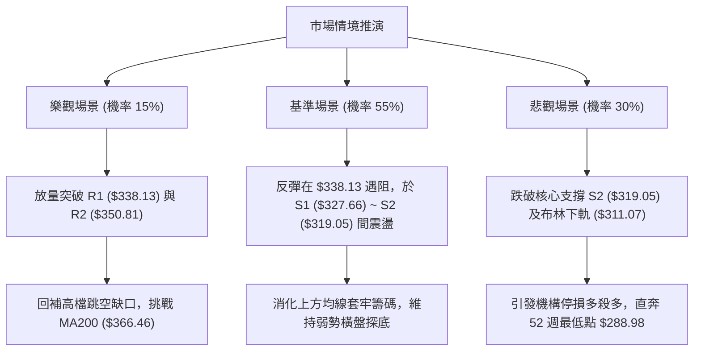

### 🛡️ 風險管理重要提醒

1. **嚴守 ATR 風控止損**：AVGO 日內 ATR 高達 **$12.59 (3.79%)**，單日波動極劇烈。任何操作進場前必須預先設定止損單，嚴禁於虧損狀態下盲目向下攤平（Averaging Down）。
2. **高 Beta 科技股系統性風險**：AVGO 之 Beta 係數為 **1.508**，極度依賴半導體族群整體的流動性與市場風險偏好（Risk-on/off）。在納斯達克指數尚未完成築底前，個股極易遭遇流動性連帶衝擊。
3. **倉位管理嚴律**：在 ADX < 25 且技術面評分僅 37/100 之弱勢震盪環境中，總持倉部位建議降至常規水位的 **30% 至 50% 以下**，單筆策略損失風險必須嚴格控制在總投資組合淨值的 **1.0%** 以內。

---

## 📋 報告總結

```
╔══════════════════════════════════════════════════════════════════╗
║                    AVGO 技術分析報告總結                        ║
╠══════════════════════════════════════════════════════════════════╣
║ 報告日期：2026-11-04                                             ║
║ 當前價格：$332.13                                                ║
║ 分析評級：🔴 偏空震盪盤整 (Underweight / Cautious) — 評分 37/100 ║
╠══════════════════════════════════════════════════════════════════╣
║ 關鍵結論：                                                       ║
║ ├─ 長期趨勢：🟡 中性回調，歷史高點 $445 回落，測試 Fib 78.6%     ║
║ ├─ 中期趨勢：🔴 弱勢空頭，連續跌破週均線，頂部下移形成階梯賣壓  ║
║ ├─ 短期趨勢：🔴 熊旗整理，現價受制於全線下行均線，動能疲弱      ║
║ ├─ 關鍵支撐：S1: $327.66  │  S2: $319.05  │  S3: $312.39        ║
║ ├─ 關鍵阻力：R1: $338.13  │  R2: $350.81  │  R3: $358.10        ║
║ └─ 分析師目標共識：$526.81 (基本面 Target，技術面嚴重脫節)      ║
╠══════════════════════════════════════════════════════════════════╣
║ 最優策略組合：                                                   ║
║ 1. 🥇 最佳機會：逢反彈至 R1 ($338.13) 遇阻放空，止損 R2 ($350.81)║
║    目標 S2 ($319.05)，風報比 1 : 1.51 (策略 A)                   ║
║ 2. 🥈 次選機會：實體黑 K 跌破 S1 ($327.66) 順勢做空，             ║
║    目標 S3 ($312.39)，風報比 1 : 1.46 (策略 B)                   ║
║ 3. 🥉 保守選擇：多單空手觀望，靜待日線站穩 MA20 ($341.50) 且    ║
║    量能放大後再行研判進場機會                                    ║
╚══════════════════════════════════════════════════════════════════╝
```

---

> ⚠️ **免責聲明**：本報告為技術分析研究，所有數據、圖表及價位推算均嚴格基於歷史量價資訊（OHLCV）。本報告**僅供研究與學術參考**，**不構成任何要約、推薦或投資建議**。市場有風險，交易需獨立判斷並自負盈虧。

---

*報告生成時間：2026-11-04 ｜ 數據來源：Yahoo Finance ｜ 分析框架：多時框技術分析體系*