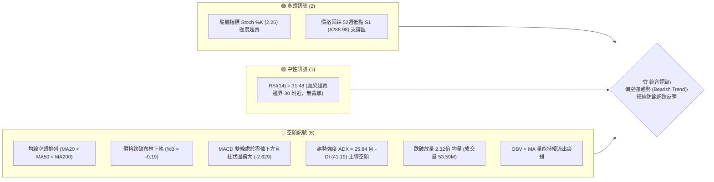
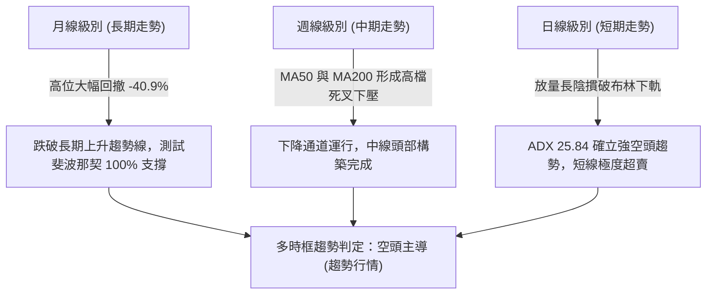
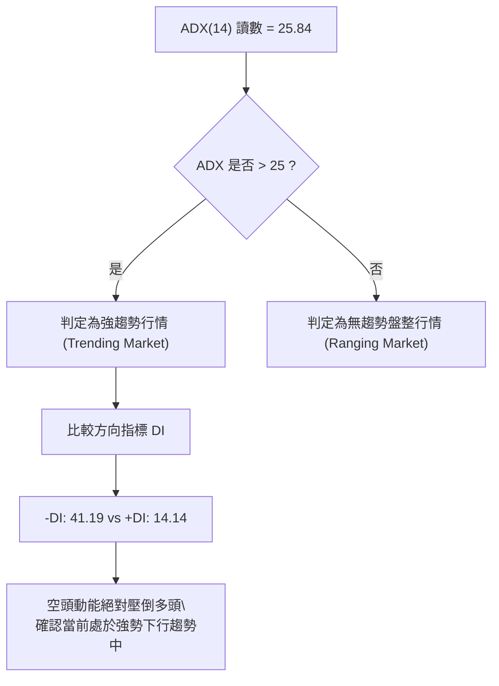
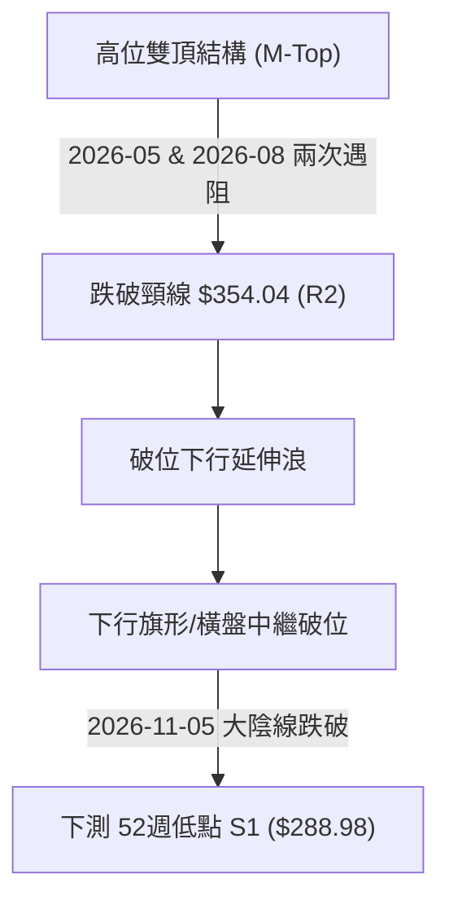
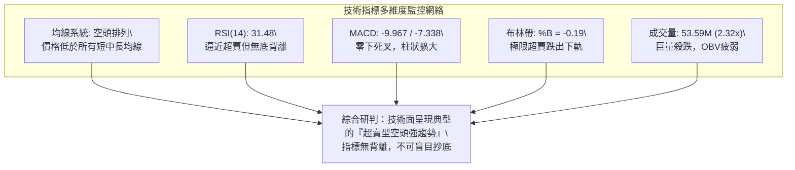
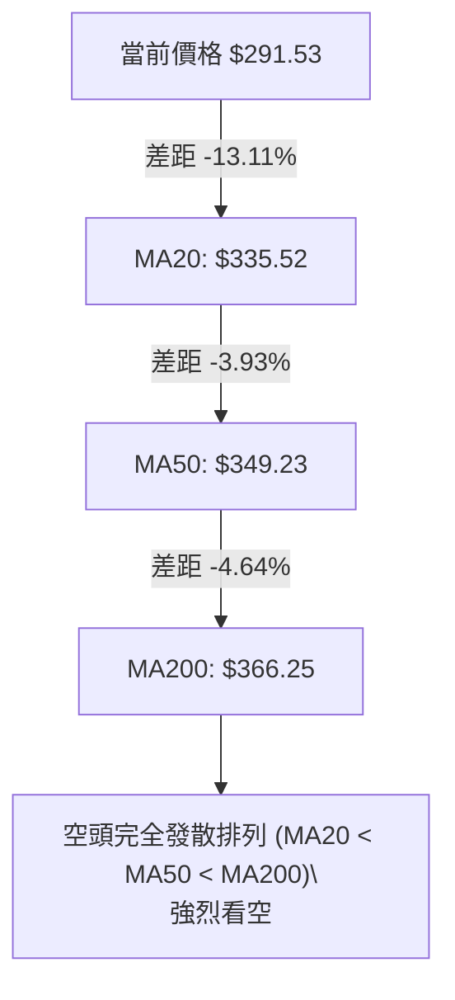
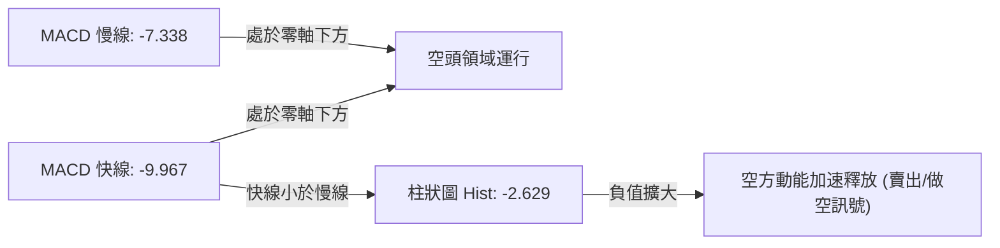
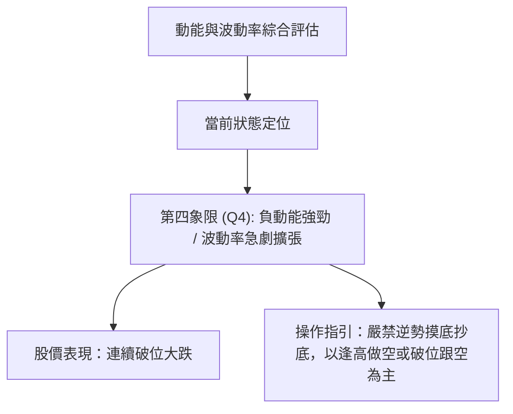
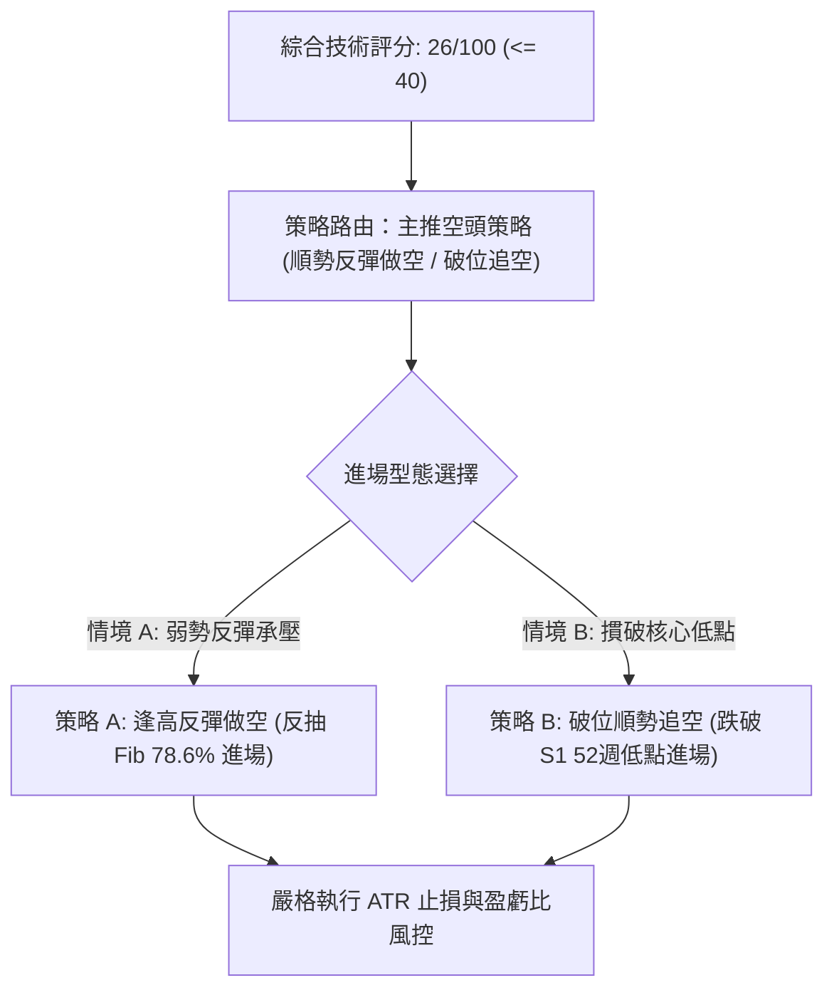
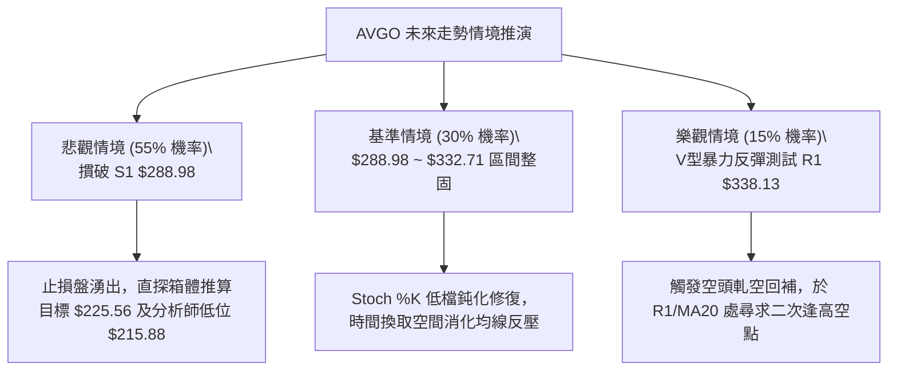

# AVGO 技術分析報告

> **報告日期**：2026-11-06 ｜ **語言**：繁體中文 ｜ **數據來源**：Yahoo Finance ｜ **當前價格**：$291.53

---

## 目錄

| 章節 | 內容 |
|------|------|
| [1. 技術面概覽](#1-技術面概覽) | 訊號儀表板、核心指標、評分卡 |
| [2. 趨勢分析](#2-趨勢分析) | 多時框趨勢、長中短期走勢、ADX解讀 |
| [3. 圖表形態分析](#3-圖表形態分析) | 形態識別、K線組合、目標價推算 |
| [4. 支撐與阻力](#4-支撐與阻力) | 關鍵價位結構、斐波那契回調聚類 |
| [5. 技術指標深度解讀](#5-技術指標深度解讀) | 均線系統、RSI、MACD、布林通道、量價配合 |
| [6. 動能與波動率](#6-動能與波動率) | 動能四象限、ATR波動率、Beta市場風險 |
| [7. 多時框架總結](#7-多時框架總結) | 時框架評分矩陣、多時框收斂結論 |
| [8. 交易策略建議](#8-交易策略建議) | 策略路由、價格情境、主策略詳情與風控 |
| [9. 風險提示與監控](#9-風險提示與監控) | 關鍵指標清單、情境推演、資金管理提醒 |

---

## 1. 技術面概覽

### 🎯 技術訊號儀表板



---

### 📊 核心指標速覽表

| 指標類別 | 指標名稱 | 當前數值 | 訊號 | 解讀 |
|:---|:---|:---|:---:|:---|
| **價格** | 當前收盤價 | $291.53 | 🔴 | 位於 52週區間僅 1.3% 位置，逼近全波段最低位 |
| **均線** | MA20 | $335.52 | 🔴 | 價格低於 MA20 達 -13.11%，短期均線反壓沉重 |
| **均線** | MA50 | $349.23 | 🔴 | 價格低於 MA50 達 -16.52%，中期走勢完全受壓制 |
| **均線** | MA200 | $366.25 | 🔴 | 價格低於 MA200 達 -20.40%，跌破長線牛熊分界線 |
| **動能** | RSI(14) | 31.48 | 🟡 | 位於中性與超賣臨界點（30-70），未見底背離 |
| **動能** | Stoch %K / %D | 2.26 / 19.90 | 🟢 | 進入極度超賣鈍化區，隨時存在技術性抽頭動能 |
| **動能** | MACD (12,26,9) | -9.967 / -7.338 | 🔴 | 雙線負值發散，柱狀圖 -2.629，空方動能強勁釋放 |
| **趨勢** | ADX (14) | 25.84 | 🔴 | ADX > 25 確立趨勢行情；-DI (41.19) 遠高於 +DI (14.14) |
| **通道** | 布林通道 %B | -0.19 | 🔴 | 價格跌穿布林下軌 ($303.52)，呈現帶狀下行破位 |
| **量能** | 當日量 / 20日均量 | 53.59M / 23.10M | 🔴 | 量比達 2.32x，放量長陰下殺，OBV 疲軟未見承接盤 |
| **波動** | ATR(14) | $14.21 | 🔴 | 佔股價 4.87%，單日波動幅度極大，下行風險擴張 |

---

### 🏆 技術評分卡

```
╔══════════════════════════════════════════════════════════════════╗
║                   技術評分卡 — AVGO (2026-11-06)                 ║
╠══════════════════════════════════════════════════════════════════╣
║ 趨勢強度 (Trend)     ████░░░░░░░░░░░░░░░░  20/100  🔴 極度疲弱   ║
║ 動能指標 (Momentum)  █████░░░░░░░░░░░░░░░  25/100  🔴 空方主導   ║
║ 支撐穩定度 (Support) ████████░░░░░░░░░░░░  40/100  🟡 考驗前低   ║
║ 成交量配合 (Volume)  █████░░░░░░░░░░░░░░░  25/100  🔴 放量下殺   ║
║ 形態完整度 (Pattern) ██████░░░░░░░░░░░░░░  30/100  🔴 破位形態   ║
║ 均線排列 (MA Align)  ███░░░░░░░░░░░░░░░░░  16/100  🔴 空頭排列   ║
╠══════════════════════════════════════════════════════════════════╣
║ 綜合評分             █████░░░░░░░░░░░░░░░  26/100  🔴 強烈偏空   ║
║ 評分公式依據：(20 + 25 + 40 + 25 + 30 + 16) ÷ 6 = 26 (四捨五入)   ║
╚══════════════════════════════════════════════════════════════════╝
```

---

## 2. 趨勢分析

### 🌐 多時框趨勢分析



---

### 📈 長期趨勢 — 12個月走勢圖（Unicode）

以下展示 AVGO 自 2025-12 至 2026-11 過去 12 個月之收盤價歷史走勢與關鍵高低點分佈：

```
AVGO 月線走勢圖（過去12個月收盤價變動）
價格軸 ($)
$460 ┤                                  ● $445.25 (2026-05 次高)
$430 ┤                          ● $416.01
$400 ┤
$370 ┤                                          ● $377.06   ● $388.57
$340 ┤  ● $344.20                                                   ● $369.67   ● $351.19
$310 ┤          ● $329.48   ● $317.80   ● $308.46                                       ● $326.08
$280 ┤                                                                                          ● $291.53 (現價)
     └────┬──────────┬──────────┬──────────┬──────────┬──────────┬──────────┬──────────┬──────────┬──────────┬──────────┬─────
        25-12      26-01      26-02      26-03      26-04      26-05      26-06      26-07      26-08      26-09      26-10      26-11
```

#### 走勢特徵分析表格

| 階段區間 | 起止價格 | 漲跌幅 | 趨勢特徵描述 |
|:---|:---|:---:|:---|
| **2025-12 ~ 2026-03** | $344.20 → $308.46 | -10.38% | 震盪探底階段，於 $308 附近構築春季整理平台 |
| **2026-03 ~ 2026-05** | $308.46 → $445.25 | +44.35% | 主升浪爆發，受 AI 需求催化直奔歷史次高收盤 $445.25 |
| **2026-05 ~ 2026-07** | $445.25 → $388.57 | -12.73% | 高位巨幅震盪，獲利了結賣壓湧現，確立頭部結構 |
| **2026-07 ~ 2026-11** | $388.57 → $291.53 | -24.97% | 單邊下行波段，接連摜破多道支撐，直逼 52週低點 $288.98 |

---

### 📊 中期趨勢（週線分析）

週線視角下，AVGO 自 2026 年 8 月高點回落以來，高點與低點逐步下移（Lower Highs & Lower Lows）：

```
AVGO 週線阻力與支撐示意圖
═══════════════════════════════════════════════════════════════
$380.84 ────── 2026-10-09 波段反彈高點（強阻力區）
  │
$366.55 ────── 關鍵阻力 R3 (MA200 聚類區 $366.25 / 斐波那契 61.8% $367.03)
  │
$354.04 ────── 中期阻力 R2 (MA60 聚類區 $353.40)
  │
$338.13 ────── 短期頸線阻力 R1 (MA20 聚類區 $335.52)
  │
$291.53 ◄───── 當前價格 (2026-11-05 收盤)
  │
$288.98 ────── 52週絕對低點 S1 (斐波那契 100.0% 終極防守)
═══════════════════════════════════════════════════════════════
```

週線指標顯示，MACD 週線柱狀圖再度翻負至 -2.629，週成交量持續維持在 1.15 億股以上的高水位，確認中期資金呈實質撤退狀態。

---

### ⚡ 趨勢強度評估（ADX 解讀）



#### ADX 強度對照與解讀

| 指標 | 數值 | 門檻標準 | 狀態評估 | 實戰解讀 |
|:---|:---:|:---:|:---:|:---|
| **ADX(14)** | **25.84** | > 25.0 | 🟢 強趨勢確認 | 市場已脫離無方向盤整，進入動能驅動的趨勢行情 |
| **+DI** | **14.14** | < 20.0 | 🔴 多頭衰竭 | 買盤極度匱乏，多方缺乏向上推升價格的力道 |
| **-DI** | **41.19** | > 40.0 | 🔴 空方主導 | 賣方掌控市場絕對定價權，空頭趨勢強烈發散 |

---

## 3. 圖表形態分析

### 🔍 形態識別系統



#### 圖表形態信心度表格

| 形態名稱 | 信心度 | 判斷依據（引用數據） | 完成度 | 目標價（附精確計算式） |
|:---|:---:|:---|:---:|:---|
| **日線級別矩形破位** | **85%** | 2026-10-23 至 2026-11-04 股價於 $319.30 至 $352.40 震盪，11-05 放量大陰線收 $291.53 正式向下摜破箱底 | 100% (已破位) | 由箱體高度推算：箱底 $319.30 − (箱頂 $352.40 − 箱底 $319.30) = **$286.20** |
| **中期雙頂結構 (M-Top)** | **75%** | 52週高點 $493.32 回落後，反彈高點受阻於 2026-08-07 週收盤 $426.98，隨後跌破頸線 R2 ($354.04) | 90% | 由頸線跌破推算：頸線 $354.04 − (次頂 $426.98 − 頸線 $354.04) = **$281.10** |
| **雙底形態 (潛在反轉)** | **30%** | 股價逼近 52週低點 S1 ($288.98)，訊號不足，僅做指標型解讀，不可臆測成形 | 15% | 訊號不足，數據中未偵測到反轉確認信號，不予計算目標價 |

---

### 🕯️ 重要 K 線形態分析

嚴格依據數據中「近10根日K」與「近8根週K」之開高低收進行客觀辨識：

#### 近10根日K形態精解

| 日期 | 開 | 高 | 低 | 收 | K線形態 | 解讀 | 訊號 |
|:---|:---:|:---:|:---:|:---:|:---|:---|:---:|
| **2026-10-23** | 321.50 | 327.70 | 320.23 | 321.68 | 窄幅十字小陽星 | 縮量探底，於 $320 形成微弱支撐 | 🟡 |
| **2026-10-26** | 324.53 | 332.12 | 323.25 | 329.17 | 溫和放量小中陽 | 展開短線反彈，買盤回流 | 🟢 |
| **2026-10-27** | 339.87 | 345.67 | 336.87 | 342.33 | 跳空跳高光頭陽線 | 多方強勢上攻，站上短期均線 | 🟢 |
| **2026-10-28** | 349.22 | 352.40 | 344.35 | 351.81 | 衝高小陽線 | 觸及波段高點 $352.40，遭遇 R2 賣壓 | 🟡 |
| **2026-10-29** | 342.00 | 346.15 | 338.80 | 345.00 | 高位跳空小陰線 | 多頭動能衰退，未能創高 | 🔴 |
| **2026-10-30** | 330.72 | 331.98 | 319.30 | 326.08 | 放量中長陰線 | 空方吞噬，成交量放大至 36.5M，確立反彈結束 | 🔴 |
| **2026-11-02** | 328.37 | 333.56 | 321.87 | 322.23 | 低開低走倒錘頭 | 反彈乏力，高點下移 | 🔴 |
| **2026-11-03** | 328.97 | 335.74 | 326.60 | 332.13 | 弱勢反抽陽線 | 縮量反抽，受制於 MA20 | 🟡 |
| **2026-11-04** | 326.86 | 334.12 | 321.74 | 325.48 | 衝高回落倒狀十字星 | 多方反攻再次潰敗，下影線引出次日殺盤 | 🔴 |
| **2026-11-05** | 311.89 | 314.00 | 290.12 | 291.53 | **巨量破位大陰線** | **跳空低開長黑，放量 53.59M，實體大跌 -10.43%** | 🔴 |

#### 近8根週K形態精解

| 日期 | 開 | 高 | 低 | 收 | K線形態 | 解讀 | 訊號 |
|:---|:---:|:---:|:---:|:---:|:---|:---|:---:|
| **2026-09-18** | 348.99 | 362.62 | 335.20 | 356.96 | 長下影中陽線 | 下探 $335 後強力回升 | 🟢 |
| **2026-09-25** | 358.66 | 366.55 | 346.89 | 352.81 | 上影受阻小陰線 | 觸碰 R3 ($366.55) 遭壓制回落 | 🔴 |
| **2026-10-02** | 352.87 | 361.86 | 343.29 | 355.14 | 窄幅震盪十字星 | 均線糾纏，多空處於膠著 | 🟡 |
| **2026-10-09** | 357.79 | 380.84 | 356.14 | 361.54 | 長上影射擊之星 | 衝高 $380.84 遇大單出貨壓回，形成中期大頂 | 🔴 |
| **2026-10-16** | 359.43 | 360.69 | 328.58 | 328.75 | 光腳破位長大陰 | 摜破 MA50，單週暴跌引發趨勢反轉 | 🔴 |
| **2026-10-23** | 338.75 | 341.10 | 320.23 | 321.68 | 縮量續跌中陰線 | 慣性下挫，市場缺乏流動性承接 | 🔴 |
| **2026-10-30** | 324.53 | 352.40 | 319.30 | 326.08 | 長上影倒T線 | 衝高 $352.40 遭遇二次收割 | 🔴 |
| **2026-11-05** | 328.37 | 335.74 | 290.12 | 291.53 | **週線巨陰線** | **跌破前低 $319.30，直探 52週低點** | 🔴 |

---

### 📉 ASCII 走勢形態示意圖

```
AVGO 箱體破位與下行延伸浪示意圖
價格
$354.04 ─────────── 頂部阻力 (2026-10-28 高點 $352.40 附近 / R2)
         ┌─────────┐
         │ 震盪箱體 │ (10/23 - 11/04)
$319.30 ─┴────┬────┴ 頸線支撐位 (箱底)
              │
              │  2026-11-05 巨量跳空大陰破位 (成交量 53.59M)
              ▼
$291.53 ───────────── 現價位置 (布林下軌破裂)
  │
$288.98 ───────────── 52週低點 S1 (斐波那契 100% 支撐)
  │
  ▼ 箱體等幅下行投射目標：$286.20
```

---

### 🎯 形態目標價計算

1. **短期箱體等幅下測目標價**：
   - 箱體上限：$352.40（2026-10-28 高點）
   - 箱體下限（破位頸線）：$319.30（2026-10-30 低點）
   - 箱體高度：$352.40 - $319.30 = $33.10
   - **破位理論目標價** = $319.30 - $33.10 = **$286.20**（位於 S1 $288.98 下方約 0.96%）

2. **中期頭部結構延伸推算目標價**：
   - 由頸線 R2 ($354.04) 與波段高點 ($426.98) 形成之雙頂高度：$426.98 - $354.04 = $72.94
   - **雙頂量度目標價** = $354.04 - $72.94 = **$281.10**

---

## 4. 支撐與阻力

### 🗺️ 關鍵價位分布圖（Unicode）

```
AVGO 價位結構分布圖
═════════════════════════════════════════════════════════════════════
$366.55 ║██████████████████████████████║ 強阻力 R3 (MA200 / Fib 61.8%)
$354.04 ║████████████████████          ║ 阻力 R2 (MA60 / 雙頂頸線)
$338.13 ║████████████████████████      ║ 關鍵阻力 R1 (MA20 / 短線分水嶺)
$332.71 ║░░░░░░░░░░░░░░░░░░░░░░        ║ 斐波那契 78.6% 回調位
────────╫──────────────────────────────╫─────────────────────────────
$291.53 ╠══════════════════════════════╣ ◄ 現價 (2026-11-05 收盤)
────────╫──────────────────────────────╫─────────────────────────────
$288.98 ║▓▓▓▓▓▓▓▓▓▓▓▓▓▓▓▓▓▓▓▓▓▓▓▓▓▓▓▓  ║ 核心支撐 S1 (52週低點 / Fib 100%)
  N/A   ║                              ║ 支撐 S2 (數據中未偵測到)
  N/A   ║                              ║ 支撐 S3 (數據中未偵測到)
═════════════════════════════════════════════════════════════════════
```

---

### 🚧 阻力位分析表

依據數據「關鍵價位」區塊聚類計算之數值：

| 阻力級別 | 價位 | 形成原因 | 突破難度 | 重要性 |
|:---|:---:|:---|:---:|:---|
| **R1** | **$338.13** | 近一年波段高點聚類、MA20 ($335.52) 與 Fib 78.6% ($332.71) 密集反壓區 | 🟡 中等偏高 | 極高（短線多空扭轉關鍵） |
| **R2** | **$354.04** | 近一年波段高點聚類、MA60 ($353.40) 及 10/28 反彈高點 ($352.40) 阻力 | 🔴 極高 | 高（中期下降趨勢防守點） |
| **R3** | **$366.55** | 近一年波段高點聚類、年線 MA200 ($366.25) 與 Fib 61.8% ($367.03) 共振 | 🔴 極難突破 | 核心（牛熊長期多空分界） |

---

### 🛡️ 支撐位分析表

依據數據「關鍵價位」區塊聚類計算之數值：

| 支撐級別 | 價位 | 形成原因 | 守住機率 | 重要性 |
|:---|:---:|:---|:---:|:---|
| **S1** | **$288.98** | 52週絕對低點、斐波那契 100.0% 回調位聚類支撐（距現價僅 -0.88%） | 35% | 核心終極防線（破位將引發真空暴跌） |
| **S2** | **N/A** | 數據中未偵測到近一年波段低點聚類數值 | N/A | N/A（依規則不予編造） |
| **S3** | **N/A** | 數據中未偵測到近一年波段低點聚類數值 | N/A | N/A（依規則不予編造） |

---

### 📐 斐波那契回調位分析

依據 52週極值區間（低點 $288.98 至 高點 $493.32，總落差 $204.34）計算：

| 斐波那契層級 | 精確價位 | 相對現價距離 | 技術面定位與意義解讀 |
|:---:|:---:|:---:|:---|
| **0.0% (52W High)** | **$493.32** | +69.22% | 歷史多頭極限高點，目前為不可逾越之長期天花板 |
| **23.6%** | **$445.09** | +52.67% | 2026-05 次高收盤點 ($445.25)，第一波獲利了結區 |
| **38.2%** | **$415.26** | +42.44% | 2026-04 整理平台，多頭強弱回調黃金分割點 |
| **50.0%** | **$391.15** | +34.17% | 多空平衡中軸線，自 2026-08 跌破後確立空頭佔優 |
| **61.8%** | **$367.03** | +25.90% | 黃金分割防守位，精確共振 R3 ($366.55) 與 MA200 ($366.25) |
| **78.6%** | **$332.71** | +14.13% | 深度回調極限位，與 MA20 ($335.52) 構成短期強反壓帶 |
| **100.0% (52W Low)**| **$288.98** | -0.88% | **現價 ($291.53) 正處於 78.6% 至 100.0% 之間，極度逼近 100.0%** |

**意義解讀**：股價回撤已達 52週漲幅之 100%，意味著過去一年所有的多頭利潤已被全數回吐。若 $288.98 失守，宣告 52週上升週期徹底終結，技術面將面臨無支撐的真空滑落。

---

## 5. 技術指標深度解讀

### 🎛️ 指標訊號總覽



---

### 📈 移動平均線排列分析



#### 各週期均線偏離度

| 均線名稱 | 數值 | 距現價價差 | 偏離率 (%) | 均線歷史軌跡與趨勢狀態 |
|:---|:---:|:---:|:---:|:---|
| **MA 5** | $319.49 | -$27.96 | -8.75% | 短線極速下彎，呈現連續急跌特徵 |
| **MA 10** | $328.74 | -$37.21 | -11.32% | 加速向下發散，短線壓制首選 |
| **MA 20** | $335.52 | -$43.99 | -13.11% | 月線反壓強烈，與布林中軌完全重合 |
| **MA 50** | $349.23 | -$57.70 | -16.52% | 季線空頭下行，中期趨勢完全遭到破壞 |
| **MA 60** | $353.40 | -$61.87 | -17.51% | 與 R2 ($354.04) 形成密集中期阻力帶 |
| **MA 120** | $375.62 | -$84.09 | -22.39% | 半年線持續走平轉跌 |
| **MA 200** | $366.25 | -$74.72 | -20.40% | 年線失守，宣告長期牛市轉為空頭市場 |
| **MA 240** | $364.76 | -$73.23 | -20.08% | 長期成本線遭有效跌破 |

---

### 📉 RSI(14) 分析

當前數值：**31.48**（Wilder 計算方法）

```
RSI (14) 讀數強度進度條
超賣區 (0-30)          中性區 (30-70)          超買區 (70-100)
[0] ─────────────── [30] ─────────────────────── [70] ─────────────── [100]
██████░░░░░░░░░░░░░░░░░░░░░░░░░░░░░░░░░░░░░░░░░░░░░░░ (31.48)
```

- **區間評估**：雖然 RSI(14) 降至 31.48，技術上仍位於 30-70 的中性偏低區間，尚未進入低於 30 的絕對超賣區。
- **背離判斷**：數據明確提示「**無明顯背離**（比較近20根K棒首尾價格與RSI方向均為同步向下走低）」。
- **結論**：價格下跌伴隨 RSI 同步走低，屬於健康且強勁的空方趨勢推動，無任何底背離見底特徵。

---

### 📊 MACD (12, 26, 9) 訊號解讀



- **MACD 快線**：-9.967
- **信號線 (Signal)**：-7.338
- **柱狀圖 (Histogram)**：-2.629
- **深度解讀**：雙線深陷零軸下方且負向差值持續擴大，柱狀圖自前一週的微弱翻紅再度猛烈轉負（-2.629），表明空頭重新取得絕對加速權，死叉開口持續擴大。

---

### 📦 布林通道分析

```
AVGO 日線布林通道 (20, 2) 結構示意圖
價格
$367.52 ────────────────────────────────── 上軌 (Upper Band)
  │
$335.52 ────────────────────────────────── 中軌 (MA20 Baseline)
  │
$303.52 ────────────────────────────────── 下軌 (Lower Band)
══════════════════════════════════════════
$291.53 ◄─── 現價位置 (%B = -0.19，脫離通道下軌運作)
```

- **上軌**：$367.52
- **中軌 (MA20)**：$335.52
- **下軌**：$303.52
- **帶寬與位置**：當前 %B 數值為 **-0.19**（小於 0 意味著價格完全收在下軌 $303.52 之下達 -$11.99）。
- **特徵**：此現象屬於極端的「貼軌/出軌下行（Band Walking Down）」，在強趨勢中並非買入訊號，而是下行爆發力強烈的體現。

---

### 💹 成交量分析（量價配合度）

```
成交量對比柱狀圖 (股)
當日成交量:  53,594,200  ████████████████████████████████████████ (2.32x)
20日均量:   23,101,660  █████████████████
50日均量:   24,771,650  ██████████████████
```

- **量價關係**：2026-11-05 單日放量至 **53,594,200 股**，為 20日均量（23,101,660 股）的 **2.32 倍**。
- **形態實質**：股價單日重挫 -10.43% 並伴隨巨量長黑，屬於標準的「放量破位殺跌（Panic Volume Breakdown）」。
- **OBV 走勢**：數據顯示「OBV < MA → 量能疲弱」，能量潮指標持續下挫且運行於其均線下方，說明大資金處於主動淨出逃狀態，並非機構進場承接的良性換手。

---

## 6. 動能與波動率

### ⚡ 動能評估四象限



| 象限 | 動能維度 | 波動維度 | AVGO 狀態判定 | 戰略應對方針 |
|:---:|:---:|:---:|:---:|:---|
| **Q1** | 正向強動能 | 低波動率 | — | 多頭平穩主升浪，持股待漲 |
| **Q2** | 弱動能 | 低波動率 | — | 盤整蓄勢期，觀望等待突破 |
| **Q3** | 正向強動能 | 高波動率 | — | 魚尾噴行情，分批止盈降低槓桿 |
| **Q4** | **負向強動能** | **高波動率** | **✓ (當前狀態)** | **空頭加速主跌段，順勢做空或嚴格空倉** |

---

### 📊 ATR 波動率分析

- **ATR(14)**：**$14.21**（Wilder 計算，佔當前股價比例達 **4.87%**）
- **單日期望波幅**：目前 AVGO 日均震盪幅度高達 $14.21 美元，代表日間雜訊與震倉幅度極大。
- **止損距離建議**：
  - 順勢空單跟蹤止損：建議設置為 **1.0 ~ 1.5 倍 ATR**（即 **$14.21 ~ $21.32**）。
  - 短線反彈止損點：必須設置於 **$14.21** 之外，以防範盤中正常波動觸發洗盤。

---

### 📐 Beta 與市場相關性

- **Beta 係數**：**1.508**
- **市場敏感度**：AVGO 具備高度進攻與高波動屬性。當大盤（S&P 500 / 費城半導體指數 SOX）下跌 1% 時，AVGO 平均回撤幅度達 1.51%。
- **背景共振**：近期新聞顯示半導體板塊受監管擔憂與晶片股整體拋售拖累（如 Nvidia 自十月高點回檔），高 Beta 特性導致 AVGO 在市場情緒轉弱時遭遇放大式下殺。

---

## 7. 多時框架總結

### 📋 時框架評分表

| 時框架 | 趨勢方向 | 動能狀態 | 均線排列 | 圖表形態 | 綜合評分 | 建議方針 |
|:---|:---:|:---:|:---:|:---:|:---:|:---|
| **月線 (長期)** | 🔴 下行修正 | 弱勢中性 | 跌破 MA20 支撐 | 歷史高位大幅回吐 | **35/100** | 核心資產減碼，防範長期週期走熊 |
| **週線 (中期)** | 🔴 空頭掌控 | 負向擴大 | MA50/200 下壓 | 雙頂破位下跌 | **25/100** | 中線反彈逢高減倉，禁止中線做多 |
| **日線 (短期)** | 🔴 強勢空頭 | 極度超賣 | 空頭完全發散 | 箱體下軌巨量破位 | **20/100** | 短線空方主導，僅防盤中技術性抽頭 |

---

### 🔲 綜合訊號矩陣

| 維度 | 短期（日線） | 中期（週線） | 長期（月線） | 矩陣一致性研判 |
|:---|:---:|:---:|:---:|:---|
| **趨勢方向** | 空頭向下 | 空頭向下 | 轉為空頭 | 🔴 全週期高度共振向下 |
| **動能指標** | 超賣發散 | 空方加速 | 趨向負值 | 🔴 賣壓主導整體週期 |
| **支撐穩定** | 考驗 S1 | S1 為最後屏障 | 考驗年線下方 | 🟡 支撐極其脆弱 |
| **量價配合** | 放量下殺 | 連續高量撤退 | 縮量陰跌後放量 | 🔴 主力撤退特徵明確 |

---

### ⚖️ 多時框收斂結論

嚴格依據**多時框收斂規則（規則 14）**進行判定：
1. **行情性質判定**：當前日線 ADX(14) 讀數為 **25.84 > 25.0**，確認目前市場處於**強趨勢行情**，而非區間震盪行情。
2. **主導時框優先級**：趨勢行情中，必須以中長期（週線 / MA50 $349.23、MA200 $366.25）之空頭方向為主導方向，日線級別之各項指標超賣僅能作為「尋找逢高進場做空時機」之參考，嚴禁逆勢抄底。
3. **唯一方向性結論**：**強烈偏空（空頭主導，防範超跌反彈）**。本結論與第 1 章技術評分卡（26/100）、第 2 章 ADX 分析及第 5 章均線系統完全收斂一致。

---

## 8. 交易策略建議

### 🗺️ 策略決策流程圖



---

### 🧭 策略路由

> **當前主策略方向 = 空頭策略（依技術評分 26/100，評級強烈偏空）**  
> 依規定，評分 ≤ 40 必須主推空頭策略，多頭僅列為反轉風險觸發點與對沖參考，嚴禁兩頭下注。

---

### 🎯 價格情境階梯（Price Scenarios）

價位嚴格引用下方數據「關鍵價位」與「斐波那契回調位」之實際數值：

| 觸發條件 | 下一目標 | 後續延伸 | 技術情境含義解讀 |
|:---|:---:|:---:|:---|
| **跌破 S1 $288.98** | **$286.20** | **$225.56** | 宣告 52週低點徹底淪陷，觸發日線箱體等幅下跌 ($286.20) 與延伸浪 |
| **弱勢反抽 R1 $338.13 遇阻** | **$303.52** | **$288.98** | 短線超賣修復結束，受制於 MA20 ($335.52) 與 R1，空頭重啟下行 |
| **向上突破 R1 $338.13** | **$354.04 (R2)** | **$366.55 (R3)** | 空頭結構受挫，行情轉入寬幅震盪修復（反轉風險情境） |

---

### 📊 情境機率分佈

| 情境 | 機率 | 主要依據 |
|:---|:---:|:---|
| **回落 / 再破底 (跌破 S1)** | **55%** | ADX 25.84 確立空頭趨勢；成交量暴增 2.32x 放量下殺；OBV 疲軟未見承接 |
| **區間弱勢震盪 (S1~Fib 78.6%)**| **30%** | Stoch %K 處於極度超賣 (2.26)；S1 ($288.98) 具備整數與心理共振支撐 |
| **超跌強烈反彈 (挑戰 R1)** | **15%** | 布林通道 %B 達 -0.19 脫離下軌；但均線反壓沉重，無底背離支撐 |

---

### 🟢 主策略詳情（空頭交易策略）

所有目標價與價位嚴格引用數據或明確附上計算式：

| 策略要素 | 策略 A（反彈逢高做空 — 穩健型） | 策略 B（跌破順勢追空 — 激進型） |
|:---|:---|:---|
| **進場條件** | 股價短線超跌反抽，觸及 Fib 78.6% 且受制於 R1 阻力 | 股價放量跌破 52週低點 S1 ($288.98) 確認收破 |
| **進場價格** | **$332.71**（斐波那契 78.6% 回調位） | **$288.98**（跌破 52週低點 S1 觸發進場） |
| **目標價 T1** | **$288.98**（關鍵支撐 S1 / 52週低點） | **$225.56**（由箱體高度推算：288.98 - (352.40 - 288.98) = 225.56） |
| **目標價 T2** | **$225.56**（由箱體高度推算：288.98 - 63.42 = 225.56） | **$215.88**（引用數據：分析師最低目標價 Target Low） |
| **止損價格** | **$338.13**（關鍵阻力位 R1） | **$303.52**（布林通道下軌，防範假跌破抽回） |
| **風險報酬比** | **1 : 8.07（以 T1 計）**<br>計算式：(332.71 - 288.98) ÷ (338.13 - 332.71) = 43.73 ÷ 5.42 = 8.07<br>*(以 T2 計為 1 : 19.77)* | **1 : 4.36（以 T1 計）**<br>計算式：(288.98 - 225.56) ÷ (303.52 - 288.98) = 63.42 ÷ 14.54 = 4.36<br>*(以 T2 計為 1 : 5.03)* |
| **成功機率** | **65%** | **55%** |
| **建議倉位** | **15% ~ 20%**（資金佔比） | **10% ~ 15%**（突破確認後分批建立） |

---

### 🔴 反向風險觸發點（對沖提示）

若出現以下訊號，宣告主策略空頭邏輯面臨嚴重挑戰，空頭部位必須立即平倉或對沖：
1. **價位突破信號**：日線收盤價強勢收復 **$338.13 (R1)** 阻力位，並站穩 MA20 ($335.52) 之上。
2. **動能反轉信號**：日線級別 RSI(14) 突破 50 中軸，且 MACD 柱狀圖翻正形成零下金叉。
3. **量能異動信號**：在 $288.98 附近出現單日超過 5,000 萬股的「長下影吞噬大陽線」，確認主力機構進場護盤。

---

### ⭐ 整體訊號強度評星

```
做多訊號強度：★★☆☆☆  (2.0/5星 — 僅具備超賣鈍化博弈價值)
做空訊號強度：★★★★☆  (4.0/5星 — 趨勢確立、均線排列完整)
整體可信度：  ★★★★☆  (4.0/5星 — 價量結構與多時框高度收斂)
```

---

## 9. 風險提示與監控

### ✅ 關鍵監控指標 Checklist

```
╔══════════════════════════════════════════════════════════════════╗
║               交易員每日盤面監控清單 (Checklist)                 ║
╠══════════════════════════════════════════════════════════════════╣
║ [ ] 核心低點防守：監控 $288.98 (S1) 是否被收盤跌破              ║
║ [ ] 動能背離檢驗：檢驗跌破 $288.98 時 RSI 是否低於 31.48 (防背離) ║
║ [ ] 均線動態反壓：觀察 MA5 ($319.49) 與 MA10 ($328.74) 壓制力道  ║
║ [ ] 成交量異常度：若反彈日成交量低於 2,000萬股，確認為弱勢誘多  ║
║ [ ] 波動率警戒線：ATR(14) 若突破 $16.00，應主動削減 30% 總持倉   ║
║ [ ] 外部市場共振：密切追蹤費城半導體指數 (SOX) 與 AI 晶片板塊拋售 ║
╚══════════════════════════════════════════════════════════════════╝
```

---

### ⚠️ 風險場景分析



---

### 🛡️ 風險管理重要提醒

1. **ATR 動態倉位控管法**：
   - 當前 ATR 為 **$14.21**，佔股價近 5%。每交易 100 股 AVGO，單日資本暴露風險即達 $1,421 美元。
   - 投資組合單筆交易承擔之最大風險損失嚴格限制於總資產的 **1.0%** 以內。
2. **左側交易禁令**：
   - 目前所有短中長均線（MA5、10、20、50、60、120、200、240）全數向下發散。在未看見「右側放量長陽吞噬」及「底背離確認」之前，**絕對禁止進場左側盲目抄底**。
3. **財報與事件風險對沖**：
   - AVGO 具備 1.508 之高 Beta 係數，易受半導體政策監管與科技板塊巨頭（如 NVDA）波動影響。若持有現貨底倉，應利用近月價外看跌期權（Put Option）針對 $288.98 關鍵位進行下行保護。

---

## 📋 報告總結

```
╔══════════════════════════════════════════════════════════════════╗
║                     AVGO 技術分析報告總結                        ║
╠══════════════════════════════════════════════════════════════════╣
║ 報告日期：2026-11-06                                             ║
║ 當前價格：$291.53                                                ║
║ 分析評級：🔴 強烈偏空 (綜合評分 26/100，空頭趨勢行情)            ║
║                                                                  ║
║ 核心結構結論：                                                   ║
║ ├─ 長期趨勢：🔴 月線高位回撤 -40.9%，年線 MA200 ($366.25) 失守  ║
║ ├─ 中期趨勢：🔴 週線雙頂形態確立，MA50 拐頭下行發散             ║
║ ├─ 短期趨勢：🔴 跌破布林下軌 (%B -0.19)，放量 2.32倍大陰破位    ║
║ ├─ 關鍵支撐：S1: $288.98 (距現價 -0.88%，S2/S3 數據中未偵測到)  ║
║ ├─ 關鍵阻力：R1: $338.13 ｜ R2: $354.04 ｜ R3: $366.55           ║
║ └─ 分析師目標：均價 $526.81 ｜ 最低 $215.88 ｜ 最高 $660.00      ║
║                                                                  ║
║ 最優策略組合：                                                   ║
║ 1. 🥇 最佳機會 (穩健)：策略 A — 逢反彈至 Fib 78.6% ($332.71) 做空║
║    止損 $338.13，目標 T1 $288.98，風報酬比 1 : 8.07 (以 T1 計) ║
║ 2. 🥈 次選機會 (激進)：策略 B — 放量跌破 S1 ($288.98) 順勢追空   ║
║    止損 $303.52，目標 T1 $225.56，風報酬比 1 : 4.36 (以 T1 計) ║
║ 3. 🥉 保守選擇：完全保持空倉觀望，耐心等待 S1 防守結果與背離訊號 ║
╚══════════════════════════════════════════════════════════════════╝
```

---

> ⚠️ **免責聲明**：本報告為依據客觀量化指標與圖表形態所產出之專業技術分析，所有數據及估算均嚴格基於所提供之歷史價格與技術指標資訊。本報告**僅供研究與學術參考**，**不構成任何要約、推薦或投資建議**。金融市場波動劇烈，投資人應獨立評估風險並自行承擔交易損益。

---

*報告生成時間：2026-11-06 ｜ 數據來源：Yahoo Finance ｜ 分析框架：多時框技術分析*