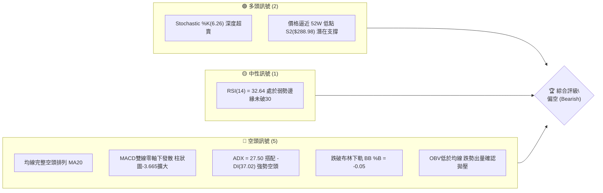
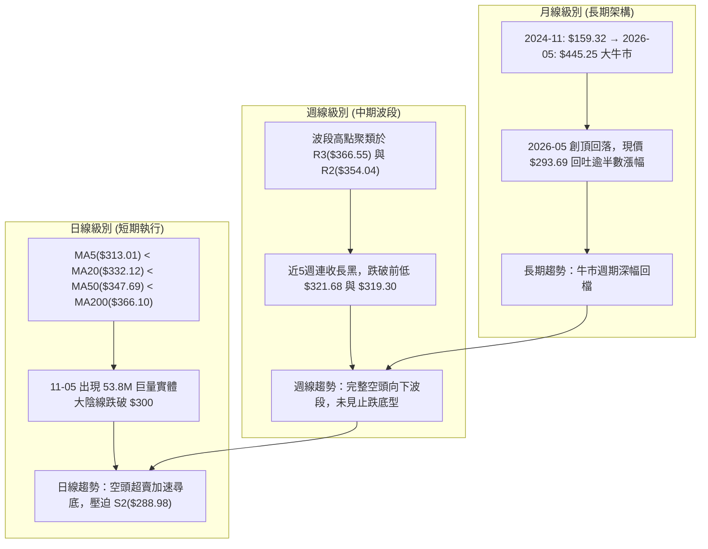
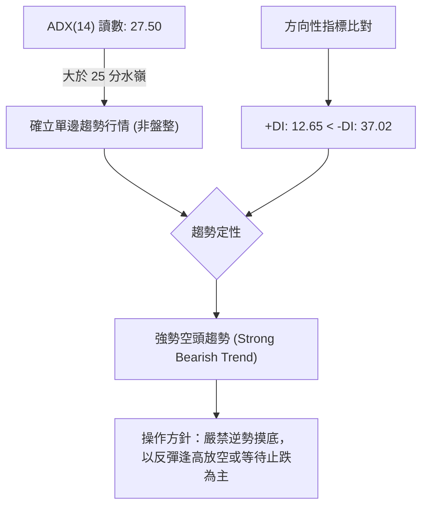
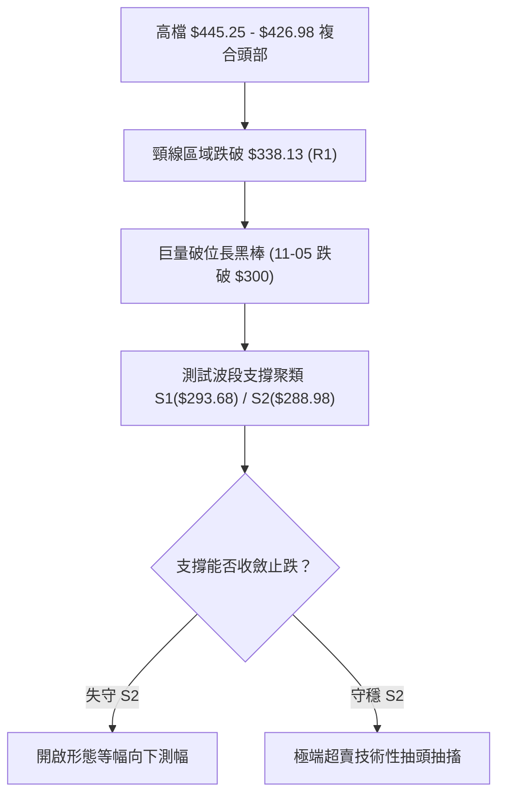
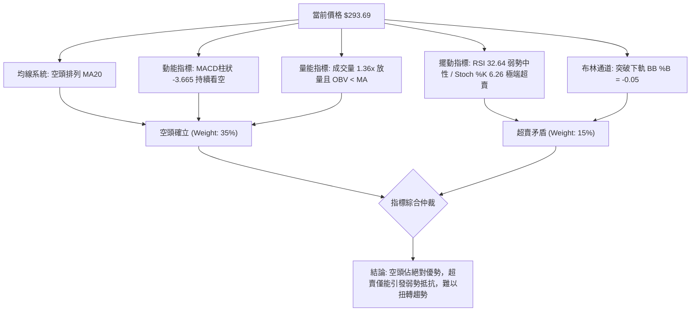
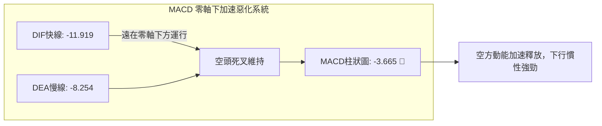
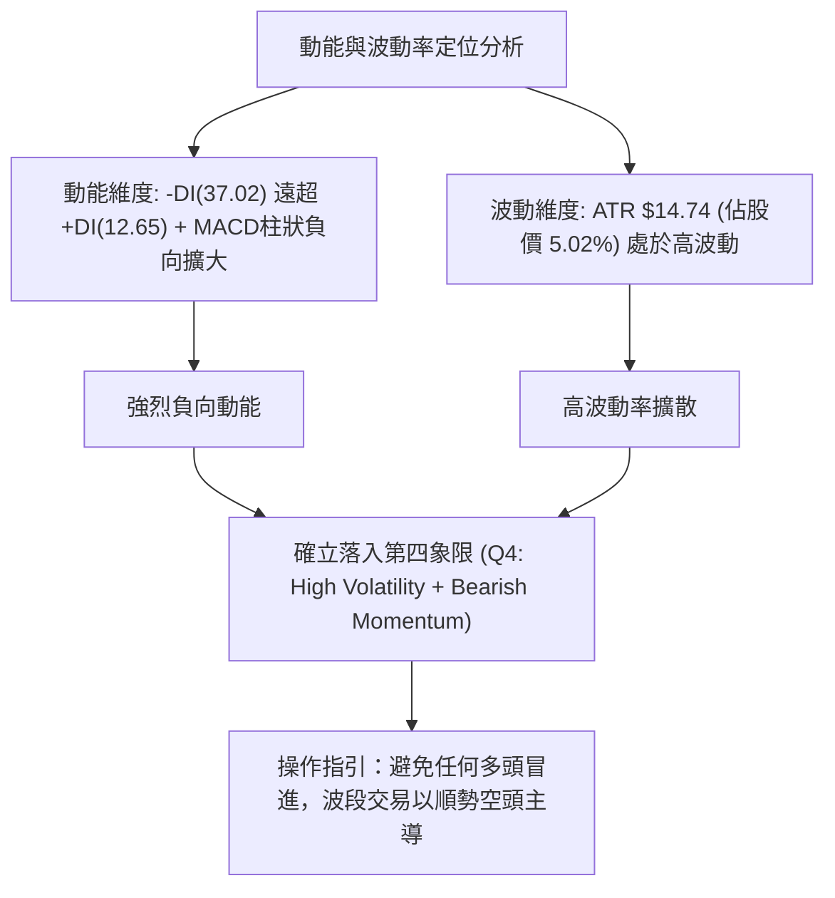
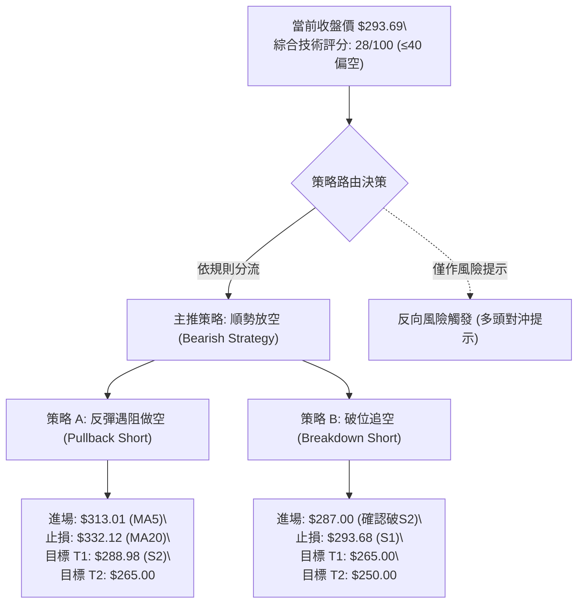
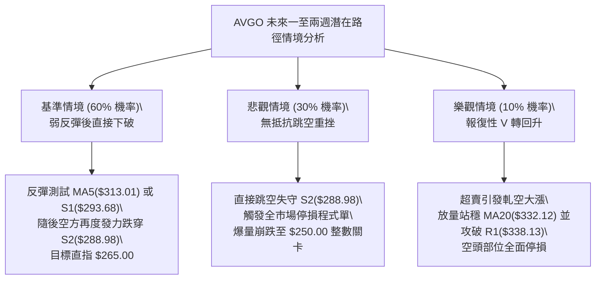

# AVGO 技術分析報告

> **報告日期**：2026-11-07 ｜ **語言**：繁體中文 ｜ **數據來源**：Yahoo Finance ｜ **當前價格**：$293.69

---

## 目錄

| 章節 | 內容 |
|------|------|
| [1. 技術面概覽](#1-技術面概覽) | 訊號儀表板、核心指標、評分卡 |
| [2. 趨勢分析](#2-趨勢分析) | 多時框趨勢、長中短期走勢 |
| [3. 圖表形態分析](#3-圖表形態分析) | 形態識別、K線組合、目標價 |
| [4. 支撐與阻力](#4-支撐與阻力) | 關鍵價位、斐波那契回調 |
| [5. 技術指標深度解讀](#5-技術指標深度解讀) | MA/RSI/MACD/布林/成交量 |
| [6. 動能與波動率](#6-動能與波動率) | 動能評估、ATR、Beta |
| [7. 多時框架總結](#7-多時框架總結) | 時框架評分矩陣 |
| [8. 交易策略建議](#8-交易策略建議) | 多空策略、風險報酬比 |
| [9. 風險提示與監控](#9-風險提示與監控) | 監控指標、風險場景 |
| [10. 報告總結](#-報告總結) | 關鍵結論、最佳策略組合 |

---

## 1. 技術面概覽

### 🎯 技術訊號儀表板

Broadcom Inc. (AVGO) 目前報價為 $293.69，正處於過去 52 週波動區間（$288.98 - $493.32）的最底層 2.3% 分位。技術架構全面呈現空頭壓制態勢，日線、週線與月線結構均承受實質拋售壓力。以下為多空訊號的綜合分布圖：



### 📊 核心指標速覽表

| 指標類別 | 指標名稱 | 當前數值 | 訊號 | 解讀 |
|----------|----------|----------|------|------|
| **價格** | 當前收盤價 | $293.69 | 🔴 | 位於52週區間底部2.3%，逼近年度極值，破底風險顯著 |
| **均線** | MA20 | $332.12 | 🔴 | 現價低於MA20達11.57%，短期趨勢極度疲弱 |
| **均線** | MA50 | $347.69 | 🔴 | 現價低於MA50達15.53%，中期波段完全由空方掌控 |
| **均線** | MA200 | $366.10 | 🔴 | 跌破牛熊分界線達19.78%，長期結構遭到系統性破壞 |
| **動能** | RSI(14) | 32.64 | 🟡 | 位於弱勢中性格局，尚未跌入<30極端超賣區，動能續跌空間仍存 |
| **動能** | MACD (12,26,9) | -11.919 / -8.254 | 🔴 | 雙線位於零軸之下，柱狀圖擴散至 -3.665，空頭加速推進 |
| **擺動** | Stochastic (14,3,3) | %K: 6.26 / %D: 9.06 | 🟢 | 指標進入極端超賣盲區（<10），暗示下行動能短期有衰竭可能 |
| **趨勢** | ADX / ±DI (14) | ADX: 27.50 / -DI: 37.02 | 🔴 | ADX>25確立強趨勢行情，-DI遠高於+DI(12.65)，空頭佔據絕對優勢 |
| **通道** | 布林通道 (20,2) | 下軌: $297.46 (%B: -0.05) | 🔴 | 價格突破下軌外側，進入異常偏離軌道，呈現空頭單邊擴散 |
| **量能** | 成交量 / 20日均量 | 32.38M / 23.89M (1.36x) | 🔴 | 伴隨放量破位下跌，OBV < MA，大資金拋售跡象明確 |
| **波動** | ATR(14) | $14.74 (5.02%) | 🔴 | 實體波幅偏高，單日波動達5%以上，市場處於恐慌釋放期 |

### 🏆 技術評分卡

依照六大技術面向進行定量評估（每項滿分 100 分），各項指標嚴格依照量化數據給分：

```
╔════════════════════════════════════════════════════════════════╗
║                   技術評分卡 — AVGO (2026-11-07)               ║
╠════════════════════════════════════════════════════════════════╣
║ 趨勢強度      ██████████████░░░░░░  70/100  🔴 (空頭強趨勢)    ║
║ 動能指標      ████░░░░░░░░░░░░░░░░  20/100  🔴 (負向動能主導)  ║
║ 支撐穩定度    ██████░░░░░░░░░░░░░░  30/100  🔴 (逼近最後防線)  ║
║ 成交量配合    ████░░░░░░░░░░░░░░░░  20/100  🔴 (量增價跌不利)  ║
║ 形態完整度    ████░░░░░░░░░░░░░░░░  20/100  🔴 (頭部下破確立)  ║
║ 均線排列      ██░░░░░░░░░░░░░░░░░░  10/100  🔴 (完全空頭排列)  ║
╠════════════════════════════════════════════════════════════════╣
║ 綜合評分      ██████░░░░░░░░░░░░░░  28/100  🔴 強烈看空        ║
╚════════════════════════════════════════════════════════════════╝
```

> **評分計算說明**：綜合評分為六項維度之算術平均值：(70 + 20 + 30 + 20 + 20 + 10) ÷ 6 = 170 ÷ 6 = 28.33，四捨五入取整數為 **28/100**。評級嚴格落入 **≤40 偏空區間**。

---

## 2. 趨勢分析

### 🌐 多時框趨勢分析

當前 AVGO 的多時框架構呈現全面收斂向下。由於日線級別 ADX(14) 報 27.50，高於 25 的趨勢分水嶺，依據收斂優先級規則，市場目前屬於明確的「趨勢行情」，由週線與日線的中長期均線（MA50、MA200）承擔核心方向導引。



### 📈 長期趨勢 — 12個月走勢圖（Unicode）

過去 12 個月（2025-11 至 2026-11）AVGO 走過了一輪波瀾壯闊的牛頂構築與深度重挫歷程。以下為月線收盤價走勢示意圖：

```
AVGO 月線走勢圖（過去12個月：2025-11 至 2026-11）
價格軸 ($)
$450 ┤                                  ● $445.25 (2026-05 次高頂)
$420 ┤                            ● $416.01
$390 ┤● $399.99                                ● $388.57
$360 ┤                                      ● $377.06  ● $369.67
$330 ┤        ● $344.20 ● $329.48                         ● $351.19  ● $326.08
$300 ┤              ● $317.80 ● $308.46                                  ● $293.69 ◄ 現價
     └───────────────────────────────────────────────────────────────────────────
       11-25 12-25 01-26 02-26 03-26 04-26 05-26 06-26 07-26 08-26 09-26 10-26 11-26
```

#### 走勢特徵分析表格

| 階段區間 | 時間跨度 | 起訖收盤價 | 區間漲跌幅 | 走勢特徵與結構意涵 |
|----------|----------|------------|------------|--------------------|
| 階段一：高檔震盪 | 2025-11 → 2026-03 | $399.99 → $308.46 | -22.88% | 首輪深幅修正，於 $308 附近獲得波段支撐，確立第一重底部 |
| 階段二：主力拉抬 | 2026-03 → 2026-05 | $308.46 → $445.25 | +44.35% | 狂暴主升浪，突破前高創下 $445.25 收盤紀錄，52W最高達 $493.32 |
| 階段三：高檔做頭 | 2026-05 → 2026-08 | $445.25 → $369.67 | -16.97% | 反覆震盪做頭，多次上攻無力，主力籌碼於 $380-$400 區間派發 |
| 階段四：加速崩跌 | 2026-08 → 2026-11 | $369.67 → $293.69 | -20.55% | 均線轉為空頭排列，連續跌破整數關卡，現價直逼 52W 低點 $288.98 |

### 📊 中期趨勢（週線分析）

中期技術架構正處於典型的空頭下降通道之中。從近 20 週數據觀察，自 2026-08-07 觸及高點 $426.98 以來，週線高點一路墊低：$426.98 → $392.28 → $368.12 → $361.54 → $335.74。與此同時，週 MACD 柱狀圖在短暫於 10 月中旬翻正至 +2.477 後，迅速隨拋盤擴大而再度轉負，最新一週（2026-11-06）擴大至 -3.665，伴隨週成交量放大至 147.69M 股，展現出機構賣壓加速傾瀉的空方訊號。

```
週線級別中期阻力與支撐分佈
────────────────────────────────────────────────────────────
$366.55 ──────────────── 週線關鍵阻力 R3 (9月波段反彈頂部聚類)
$354.04 ──────────────── 週線強阻力 R2 (10月反彈次高點區域)
$338.13 ──────────────── 週線第一阻力 R1 (跌破之平台轉壓力)
$293.69 ════════════════ 當前收盤價 (週K長黑實體直落)
$293.68 ┄┄┄┄┄┄┄┄┄┄┄┄ 近一年波段低點支撐 S1 (防守線)
$288.98 ──────────────── 52週絕對低點支撐 S2 (年度最後堡壘)
────────────────────────────────────────────────────────────
```

### ⚡ 趨勢強度評估（ADX 解讀）

當前日線級別趨勢指標呈現標準的單邊空頭主導格局：
- **ADX(14)**：27.50（>25，代表盤面已脫離無趨勢盤整，進入強烈單邊趨勢）
- **+DI(14)**：12.65（多方力量大幅衰退）
- **-DI(14)**：37.02（空方力量高居主導，壓倒性高於多方）



| 指標區間 | 當前數值 | 狀態評估 | 實戰交易含義 |
|----------|----------|----------|--------------|
| ADX > 25 | 27.50 | 🟢 趨勢明確 | 市場具備單邊持續推動力，波段策略優於震盪網格策略 |
| -DI vs +DI | 37.02 vs 12.65 | 🔴 空方完勝 | 負向擴散高達 24.37 點差，空頭主導，任何微幅反彈皆易遭逢反手鎮壓 |
| 趨勢類型 | 單邊下行 | 🔴 順勢偏空 | 依據多時框收斂規則，短期所有策略必須服從中長期下行趨勢 |

---

## 3. 圖表形態分析

### 🔍 形態識別系統

在多時框結構中，由於 AVGO 跌破了自 2026 年 8 月以來的多重整理平台，圖表呈現頭肩頂/雙重頂複合破位下行形態。依據客觀幾何對稱與數據支持度進行評估如下：



#### 形態識別與信心度評估表

| 形態名稱 | 信心度 | 判斷依據（引用數據） | 完成度 | 目標價（附計算式） |
|----------|--------|----------------------|--------|--------------------|
| 複合頭肩頂/下降楔形向下破位 | 75% | 跌破頸線 $338.13 (R1)；近兩週放量長黑擊穿所有均線 | 90% | 頸線 $338.13 - 形態高度 ($366.55 - $338.13 = $28.42) = **$309.71**（已跌破）；次級測幅：頸線 $338.13 - 高檔頭部高度 ($380.84 - $338.13 = $42.71) = **$295.42**（已抵達） |
| 雙底潛在構築（左底 S2，右底測試） | 42% | 當前逼近 52W 低點 S2($288.98)，但量能未縮，缺乏右底反轉K線確認 | 30% | *訊號不足，僅做指標型超賣解讀，暫不設定形態推算目標價* |

### 🕯️ 重要K線形態分析

嚴格依照數據所提供之近 10 根日 K 與近 8 根週 K 的實際開、高、低、收數據，解讀最具結構代表性的關鍵 K 棒：

| 日期（日K/週K） | 開 | 高 | 低 | 收 | K線形態 | 解讀 | 訊號 |
|-----------------|----|----|----|----|---------|------|------|
| 2026-10-28 (日K) | 349.22 | 352.40 | 344.35 | 351.81 | 多頭反彈小陽線 | 觸及波段高點 $352.40 後遭遇阻力，留有上影線，反彈動能見頂 | 🟡 |
| 2026-10-30 (日K) | 330.72 | 331.98 | 319.30 | 326.08 | 帶量破位中長黑 | 成交量跳升至 36.51M，實體大黑棒跌破 $320 平台，空頭攻勢發動 | 🔴 |
| 2026-11-04 (日K) | 326.86 | 334.12 | 321.74 | 325.48 | 倒轉錘頭/衝高受阻 | 盤中反彈上測 $334.12 遇 MA20 反壓潰敗，收盤收於低位，確認阻力 | 🔴 |
| 2026-11-05 (日K) | 311.89 | 314.00 | 290.12 | 291.53 | 恐慌崩跌大光腳陰線 | 單日爆出 53.84M 巨量，跳空低開低走重挫逾 $20，實體極長，空方極度宣洩 | 🔴 |
| 2026-11-06 (日K) | 311.13 | 311.52 | 289.77 | 293.69 | 低檔弱勢十字孕線 | 低點見 $289.77，逼近 52W 低點 $288.98，量能收縮至 32.38M，暫時獲得微弱承接 | 🟡 |
| 2026-10-09 (週K) | 357.79 | 380.84 | 356.14 | 361.54 | 長上影假突破射擊之星 | 衝高 $380.84 未果，主力多頭陷阱，確立為波段次高頂部 | 🔴 |
| 2026-10-16 (週K) | 359.43 | 360.69 | 328.58 | 328.75 | 週線反轉大長陰 | 一舉吞噬前四週整理區間，收在最低 $328.75，中期趨勢正式反轉向下 | 🔴 |
| 2026-11-06 (週K) | 328.37 | 335.74 | 289.77 | 293.69 | 放量破底貫穿長陰 | 週成交量放大至 147.70M，直接擊穿 $300 整數關卡，週線收於 52 週最低區 | 🔴 |

### 📉 ASCII 走勢形態示意圖

近期日 K 線跌破頸線與暴跌之形態幾何走勢：

```
AVGO 近期破位與探底形態幾何圖 (2026-10-26 至 2026-11-06)
價格 ($)
$354 ┤          [10-28 頂部: $352.40]
$350 ┤             ┌─┐
$345 ┤       ┌─┐   │ │ ┌─┐
$340 ┤       │ │   │ │ │ │
$335 ┤ ┌─┐   │ │   │ │ │ │   ┌─┐
$330 ┤ │ │   │ │   │ │ └─┘   │ │   ┌─┐
$325 ┤ │ │   └─┘   └─┘       │ │   │ │ ┌─┐
$320 ┤ └─┘                   └─┘   └─┘ │ │ 頸線支撐破位點 ($320 - $338)
     ├──────────────────────────────────┼────────────────────────
$310 ┤                                  │ 11-05 巨量長黑跳空貫穿
$300 ┤                                  │   ┌──┐
$295 ┤                                  │   │  │
$290 ┤                                  │   │  │    ┌─┐ [11-06 低點: $289.77]
     └──────────────────────────────────┴───┴──┴────┴─┴──────────
        10-26 10-27 10-28 10-29 10-30 11-02 11-03 11-04 11-05 11-06
```

### 🎯 形態目標價計算

依據幾何形態學與數據中已確立的關鍵價位進行目標測算：
1. **破位頸線量度目標價**：
   - 選取 2026-10-09 週 K 反彈高點 $380.84，與破位主要平台阻力位 R1（$338.13）。
   - 形態箱體高度 $H = \$380.84 - \$338.13 = \$42.71$。
   - 自頸線 R1 向下等幅投影目標價 $T = \$338.13 - \$42.71 = \mathbf{\$295.42}$。
   - **實況驗證**：現價 $293.69 已精準貫穿並完全滿足此目標，顯示第一階段頭部測幅已全數兌現，目前直接正面迎擊年度核心支撐 S2（$288.98）。

---

## 4. 支撐與阻力

### 🗺️ 關鍵價位分布圖（Unicode）

所有標註之價位均來自提供的歷史高低點聚類與斐波那契計算數值，嚴禁捏造任何小數點價位：

```
AVGO 價位結構分布圖 (2026-11-07)
═════════════════════════════════════════════════════════════════════════════
$493.32 ║████████████████████████████████████████║ 52週歷史最高點 (Fib 0.0%)
$415.26 ║████████████████████████████            ║ Fib 38.2% 回調阻力
$367.03 ║████████████████████                    ║ Fib 61.8% 重要黃金分割線
$366.55 ║████████████████████                    ║ 強阻力 R3 (近一年波段高點聚類)
$354.04 ║████████████████                        ║ 阻力 R2 (反彈高點聚類)
$338.13 ║████████████████████████                ║ 關鍵阻力 R1 (頸線與波段密集區)
$332.71 ║████████████                            ║ Fib 78.6% 回調阻力
$297.46 ║▓▓▓▓▓▓▓▓▓▓▓▓▓▓▓▓                        ║ 布林通道下軌 (超賣邊界)
$293.69 ╠════════════════════════════════════════╣ ◄ 現價 (Last Close)
$293.68 ║▓▓▓▓▓▓▓▓▓▓▓▓▓▓▓▓▓▓▓▓▓▓▓▓                ║ 近期波段低點支撐 S1 (防守臨界)
$288.98 ║████████████████████████████████████████║ 52週絕對低點強支撐 S2 (Fib 100.0%)
═════════════════════════════════════════════════════════════════════════════
```

### 🚧 阻力位分析表

阻力位完全引用數據中「關鍵價位」區塊聚類計算所得：

| 阻力級別 | 價位 | 形成原因 | 突破難度 | 重要性 |
|----------|------|----------|----------|--------|
| **R1** | $338.13 | 近一年波段高點密集聚類，前期多次築底之關鍵平台頸線，跌破後轉為極強反壓 | ★★★★☆ | 極高。多頭短期若無法收復此位置，任何反彈均屬死貓跳 |
| **R2** | $354.04 | 10月反彈次高點（10-28 高點 $352.40 附近聚類），且與日線 MA60($351.35) 重疊 | ★★★★☆ | 高。中期下降趨勢的主結構防守點 |
| **R3** | $366.55 | 近一年主要高點聚類，與 Fib 61.8% ($367.03)、MA200($366.10)、布林上軌($366.79) 形成四重重合共振阻力 | ★★★★★ | 戰略級。此處為中長期牛熊轉換之絕對生死線 |

### 🛡️ 支撐位分析表

支撐位完全引用數據中「關鍵價位」區塊聚類計算所得：

| 支撐級別 | 價位 | 形成原因 | 守住機率 | 重要性 |
|----------|------|----------|----------|--------|
| **S1** | $293.68 | 近一年波段低點聚類，距現價 $293.69 僅 $0.01 之差，為當前盤面直接接觸點 | 35% | 中。盤中已於 11-05 及 11-06 數次遭刺穿，支撐有效性已被實質削弱 |
| **S2** | $288.98 | 52週絕對低點（2026-11-06 低點 $289.77 正逼近此處），Fib 100.0% 終極支撐 | 60% | 極高。多頭全年度最後一道防禦陣地，失守將引發估值重構與多殺多爆發 |

### 📐 斐波那契回調位分析

依據 52 週完整波動區間（高點 $493.32 → 低點 $288.98）計算之各回調水平如下表所示：

| 斐波那契比例 | 價位 | 與現價距離 (%) | 技術意涵解讀 |
|--------------|------|----------------|--------------|
| 0.0% (52W High) | $493.32 | +67.97% | 歷史頂部壓力區，目前遙不可及 |
| 23.6% | $445.09 | +51.55% | 2026-05 月線次高收盤區域 ($445.25) |
| 38.2% | $415.26 | +41.39% | 2026-04 月線突破平台，強阻力 |
| 50.0% | $391.15 | +33.19% | 心理平衡軸，7月反彈多次受阻於此 |
| 61.8% | $367.03 | +24.97% | 黃金分割關鍵防線，跌破後確認牛市完全瓦解 |
| 78.6% | $332.71 | +13.29% | 深幅回檔防線，與當前 MA20 ($332.12) 形成共振反壓 |
| 100.0% (52W Low) | $288.98 | -1.60% | 全年跌幅完全回吐，極限價值防禦底線 |

> **現價位置解讀**：現價 $293.69 正緊密貼合於 **78.6% ($332.71) 至 100.0% ($288.98)** 的最深回調區間內，且已滑落至距離 100.0% 回調位僅剩 1.60%（$4.71）之極度脆弱邊緣。跌破 78.6% 代表多頭防禦力量已全線潰退，若 100.0% 遭帶量有效跌破，將打開週線級別的無支撐真空深淵。

---

## 5. 技術指標深度解讀

### 🎛️ 指標訊號總覽

所有指標之訊號聯動與衝突關係如下圖所示：



### 📈 移動平均線排列分析

當前 AVGO 短、中、長期均線系統呈現完美的標準「空頭發散排列」（Bearish Alignment）：

```
均線空頭排列示意圖
────────────────────────────────────────────────────────────
MA240: $364.57 ──┐
MA200: $366.10 ──┼── 長期均線密集反壓區 ($364 - $374)
MA120: $374.57 ──┘
MA 60: $351.35 ───── 中期波段防線
MA 50: $347.69 ───── 中期生命線
MA 20: $332.12 ───── 月線反壓
MA 10: $325.95 ───── 雙週快速均線
MA  5: $313.01 ───── 短期極度陡峭下壓反壓
$293.69 ════════════ 當前價格 (深嵌於所有均線下方)
────────────────────────────────────────────────────────────
```

| 均線名稱 | 當前價格 | 與現價乖離率 (%) | 狀態走勢解讀 |
|----------|----------|------------------|--------------|
| MA 5 | $313.01 | -6.17% | 5日線以極大斜率下穿，短線強烈壓制，股價難有喘息空間 |
| MA 10 | $325.95 | -9.90% | 下行斜率維持近 10%，空方第一波段壓制線 |
| MA 20 | $332.12 | -11.57% | 短期生命線，BB 中軌所在，連續 10 個交易日壓制價格收盤 |
| MA 50 | $347.69 | -15.53% | 季線下彎，中期反轉確立，任何觸及此處均為放空良機 |
| MA 200 | $366.10 | -19.78% | 牛熊分界線失守，負乖離接近 20%，市場由牛市徹底轉入熊市週期 |

### 📉 RSI(14) 分析

當前 RSI(14) 讀數為 **32.64**：

```
RSI(14) 強度儀表板
0                    30      50               70                   100
├────────────────────┼───────┼────────────────┼────────────────────┤
[  極端超賣區間  ]   │ 現價  │                │   [ 超買警戒區 ]   │
                     ▲ 32.64
進度條: █████████████░░░░░░░░░░░░░░░░░░░░░░░░░░░ 32.64%
```

- **超買超賣區間分析**：RSI 雖逼近 30 超賣線，但尚未正式跌破 30 進一步形成極度恐慌清洗。這表明空頭拋壓仍具有一定控制力，並未出現多殺多的最後崩潰性買盤承接，下行空間依然敞開。
- **背離判斷**：
  - 價格於 2026-10-30 收盤 $326.08，RSI 為 40.8；
  - 價格於 2026-11-06 跌至收盤 $293.69（創 52 週次低收盤），RSI 降至 32.64。
  - **結論：價格創低，RSI 同步創低，不存在底背離現象**。日線指標首尾比對顯示動能與價格同向，確認空頭跌勢真實有效。

### 📊 MACD(12/26/9) 訊號解讀



MACD 快線（-11.919）與慢線（-8.254）雙雙深陷於零軸下方，且兩者負向差距持續擴大。柱狀圖自前期的微幅正值（10-30 的 +0.209）迅速翻黑並垂直擴大至 -3.665，展現出強烈的空頭二次主跌浪特徵，完全否定了短線技術性築底的可能。

### 📦 布林通道分析

當前布林通道（20日，2倍標準差）展現出單邊「張口下行」（Band Walking Downward）的極端態勢：

```
布林通道現況分佈 (ASCII)
$366.79 ┬─────────────────────────────── 上軌 (Upper Band)
        │
$332.12 ┼ - - - - - - - - - - - - - - - 中軌 / MA20 (Middle Band)
        │
$297.46 ┴─────────────────────────────── 下軌 (Lower Band)
$293.69 ◄ 現價 (%B = -0.05，跌出下軌外側！)
```

- **上軌**：$366.79
- **中軌 (MA20)**：$332.12
- **下軌**：$297.46
- **通道指標 %B**：-0.05
- **走勢解讀**：%B 數值為負數（-0.05），意味著當前收盤價已實質性跌穿布林下軌之外側。在強趨勢行情（ADX=27.50）中，價格沿著下軌單邊摩擦下行（Band Walking）屬於標準的極度弱勢訊號，並非單純的超賣反彈買點，反而意味著市場進入無阻力下墜階段。

### 💹 成交量分析（量價配合度）

- **最新單日成交量**：32,379,300 股
- **20日平均成交量**：23,890,500 股（量比達 **1.36x**，放量 36%）
- **50日平均成交量**：24,997,462 股
- **近期天量爆破**：11-05 單日放量至 53,835,500 股，創下近兩個月最大單日成交量，且當日實體下跌達 -$33.95，呈現標準的「放量長陰破位」。
- **OBV 能量潮趨勢**：OBV 指標持續位於其均線下方運行，確認主力籌碼處於持續流出淨派發狀態。量價呈現「跌有量、彈無量」的典型空頭架構，未見主力機構積極護盤的量能堆疊痕跡。

---

## 6. 動能與波動率

### ⚡ 動能評估四象限

藉由對「動能強度（Directional Momentum）」與「市場波動率（Volatility）」的交叉比對，AVGO 目前明確落入「強下行動能 ✕ 高波動率」的危險區間：

| 象限分區 | 動能狀態 | 波動率狀態 | 涵蓋特徵 | 當前 AVGO 狀態與評估 |
|----------|----------|------------|----------|----------------------|
| **第一象限 (Q1)** | 正向強動能 | 低波動 | 穩健牛市主升段 | 非當前狀態 |
| **第二象限 (Q2)** | 弱動能 | 低波動 | 狹幅無方向盤整 | 非當前狀態 |
| **第三象限 (Q3)** | 正向強動能 | 高波動 | 快速衝頂暴漲期 | 非當前狀態 |
| **第四象限 (Q4)** | **負向強動能** | **高波動** | **加速破位殺跌期** | **✓ 當前落點**：恐慌釋放，順勢放空或空手觀望，切忌左側盲目抄底 |



### 📊 ATR 波動率分析

- **ATR(14)**：**$14.74**（採 Wilder 平滑算法）
- **波動百分比**：佔當前股價之 **5.02%**
- **市場意涵解讀**：AVGO 目前每日正常的平均波動區間已高達近 $15 美元，顯示市場定價分歧劇烈，恐慌拋盤與程式化止損單頻繁被觸發。
- **風控與止損距離設定建議**：
  - **極短線交易止損**：應設定至少 1.0 × ATR（約 **$14.74**）。
  - **波段交易止損**：應設定 1.5 × 至 2.0 × ATR（即 **$22.11 至 $29.48**），否則極易在正常的盤中大幅洗盤中遭到非理性掃損。

### 📐 Beta 與市場相關性

- **Beta 係數**：**1.508**
- **大盤敏感度解讀**：AVGO 具備極高的市場敏感度，其波幅通常為 S&P 500 指數的 1.5 倍以上。在半導體族群與整體科技板塊回檔時，AVGO 將承擔放大的下行槓桿效應。高達 1.508 的 Beta 搭配目前極度轉弱的技術形態，使得該股成為機構投資者在科技板塊降低曝險時的首要減碼標的。

---

## 7. 多時框架總結

### 📋 時框架評分表

依據日線、週線、月線三個維度進行獨立技術面評估：

| 時框架 | 趨勢方向 | 動能 (RSI/MACD) | 均線排列 | 圖表形態 | 綜合評分 | 戰略建議 |
|--------|----------|-----------------|----------|----------|----------|----------|
| **月線 (長期)** | 🟡 轉弱偏空 | RSI 自高檔回落 / 跌破前波起漲中樞 | 價格跌破 MA5/MA10，逼近 MA20 | 高檔雙重頂回測大週期支撐 | 38/100 | 長期投資者停止定額加碼，耐心等待底型 |
| **週線 (中期)** | 🔴 明確空頭 | MACD 柱狀 -3.665 擴大 / RSI 32.6 | MA5<MA10<MA20 空頭排列 | 反彈高點逐波下移，破位大陰線 | 24/100 | 中期波段強烈順勢看空，逢反彈皆為放空點 |
| **日線 (短期)** | 🔴 恐慌下跌 | Stoch %K 6.26 極端超賣 / RSI 32.64 | 完美空頭排列 MA20<MA50<MA200 | 跳空放量長黑，下探 S1/S2 防線 | 22/100 | 短線超賣隨時有弱反彈，但不可作為做多依據 |

### 🔲 綜合訊號矩陣

```
時框架訊號矩陣對照
┌──────────────┬────────────┬────────────┬────────────┐
│ 技術維度     │ 短期 (日線)│ 中期 (週線)│ 長期 (月線)│
├──────────────┼────────────┼────────────┼────────────┤
│ 主趨勢方向   │   🔴 空頭  │   🔴 空頭  │   🟡 偏空  │
│ 均線系統     │   🔴 空頭  │   🔴 空頭  │   🟡 轉弱  │
│ 動能指標     │   🟡 超賣  │   🔴 轉弱  │   🔴 下行  │
│ 成交量能     │   🔴 帶量破│   🔴 連續出│   🔴 縮量反│
│ 支撐防守     │   🔴 瀕危  │   🔴 跌破  │   🟡 測底  │
└──────────────┴────────────┴────────────┴────────────┘
```

### ⚖️ 多時框收斂結論

依據多時框收斂規則（規則 14）：
1. **行情定性**：當前 ADX(14) 讀數為 **27.50（>25）**，系統確認當前市場為高強度的**「趨勢行情」**，絕非區間盤整行情。
2. **主導時框**：在趨勢行情中，優先級以中長期（週線、MA50、MA200）方向為依歸。當前週線完整走空，日線所有均線呈現完全空頭排列，下行趨勢無可置疑。
3. **衝突收斂**：日線級別雖出現短期隨機指標超賣（Stoch %K: 6.26），但此超賣訊號僅代表短線賣壓宣洩過急，不能對抗週線與日線 ADX>25 所確立的強大空頭慣性。日線超賣只用於**尋找空頭交易更佳的高空進場點**，嚴禁作為翻多信號。
4. **唯一方向性結論**：**強烈偏空（Strongly Bearish）**。第 8 章之交易策略將全面由空頭主導。

---

## 8. 交易策略建議

### 🗺️ 策略決策流程圖



### 🧭 策略路由（依評分卡分流）

> **當前主策略方向 = 空頭主導（依綜合評分 28/100，嚴格屬於 ≤40 偏空區間）**
> 
> 由於綜合評分僅 28 分，均線完全空頭排列且 ADX 確立強下行趨勢，本報告嚴格執行紀律，**全面主推空頭交易策略**，所有多頭操作僅列為「反轉風險觸發點（對沖提示）」，嚴禁任何兩頭下注之模稜兩可建議。

### 🎯 價格情境階梯（Price Scenarios）

價位嚴格引用下方數據與第 4 章之實際數值：

| 觸發條件 | 下一目標 | 後續延伸 | 情境含義 |
|----------|----------|----------|----------|
| 強力反彈突破 R1 $338.13 | R2 $354.04 | R3 $366.55 | 中期空頭架構破壞，短線全面轉強 |
| 弱勢抽頭受阻於 MA20 $332.12 | S1 $293.68 | S2 $288.98 | 空頭波段標準回踩蓄勢，主跌浪延續 |
| 跌破關鍵支撐 S1 $293.68 | S2 $288.98 | $265.00 (估算支撐) | 空頭破位，考驗 52 週終極大底 |
| 帶量擊穿 52W 低點 S2 $288.98 | $265.00 | $250.00 | 恐慌多殺多爆發，開啟無底深淵走勢 |

### 📊 情境機率分佈

| 情境類別 | 機率估計 | 主要指標與量化依據 |
|----------|----------|-------------------|
| **下行破位 / 再探新低** | **60%** | ADX=27.50 趨勢強勁，-DI(37.02) 輾壓多方，MACD 柱狀 -3.665 擴大，放量長黑跌破下軌 |
| **超賣弱反彈 / 區間震盪** | **30%** | Stochastic %K(6.26) 深度超賣，價格貼近 S2($288.98)，空頭短線可能獲利回補引發抽搐 |
| **反轉向上 / 突破反轉** | **10%** | 均線 MA20/MA50/MA200 重重泰山壓頂，OBV 持續疲軟，無實質大資金反轉籌碼進場跡象 |

### 🔴 主策略詳情（空頭主導策略）

嚴格依照規則 17 計算風險報酬比：做空風險報酬比 = (進場價 − 目標價 T1) ÷ (止損價 − 進場價)。

| 策略要素 | 策略 A：反彈遇阻放空 (波段首選) | 策略 B：跌破 S2 追隨放空 (突破型) |
|----------|----------------------------------|------------------------------------|
| **進場條件** | 股價受超賣引發抽頭，反彈測試 MA5 遇阻無力突破確認滯漲時進場 | 實體日 K 跌破 52 週低點 S2($288.98) 且成交量放大確認時進場 |
| **進場價格** | **$313.01**（精確對齊當前 MA5 下壓點） | **$287.00**（確認有效擊穿 S2 之突破點） |
| **目標價 T1** | **$288.98**（精確對齊 52W 低點支撐 S2） | **$265.00**（由頭部高度測算之下一個整數支撐） |
| **目標價 T2** | **$265.00**（失守 S2 後之次級測幅目標） | **$250.00**（極端恐慌下行整數大關） |
| **止損價格** | **$332.12**（精確對齊 MA20 兼布林中軌阻力） | **$293.68**（精確對齊原支撐轉反壓之 S1） |
| **風險報酬比** | **1 : 1.26（以 T1 計）**<br>*(313.01 - 288.98) ÷ (332.12 - 313.01) = 24.03 ÷ 19.11 = 1.257*<br>*(以 T2 計則為 1 : 2.51)* | **1 : 3.29（以 T1 計）**<br>*(287.00 - 265.00) ÷ (293.68 - 287.00) = 22.00 ÷ 6.68 = 3.293*<br>*(以 T2 計則為 1 : 5.54)* |
| **勝率估計** | **65%** | **55%** |
| **建議倉位** | **15%**（基礎波段配置） | **10%**（動態破位配置） |

### 🟢 反向風險觸發點（對沖提示）

若市場出現以下極端反轉訊號，代表放空邏輯遭到破壞，空頭部位必須立即停損或建立對沖保護：
1. **價位警報**：收盤價強勢突破 **$332.12（MA20）**，或者盤中放量收復頸線 **$338.13（R1）**。
2. **指標警報**：日線 MACD 柱狀圖連續三日翻紅且 DIF 與 DEA 於零軸下形成黃金交叉；日線 RSI(14) 強勢收復 50 中軸。
3. **對沖建議**：一旦突破 $338.13，所有空頭頭寸必須全數離場，切不可心存僥倖逆勢死扛。

### ⭐ 整體訊號強度評星

```
╔════════════════════════════════════════════════════════════════╗
║ 做多訊號強度：★☆☆☆☆  (1/5星 - 僅存超賣指標，無支撐確認)     ║
║ 做空訊號強度：★★★★☆  (4/5星 - 均線/趨勢/量能/動能全面共振)   ║
║ 整體可信度：  ★★★★☆  (4/5星 - ADX>25 趨勢明確，多時框一致)  ║
╚════════════════════════════════════════════════════════════════╝
```

---

## 9. 風險提示與監控

### ✅ 關鍵監控指標 Checklist

交易者每日盤後必須嚴格檢視以下技術防線之變動狀態：

```
╔═════════════════════════════════════════════════════════════════════════════╗
║                      AVGO 每日技術風控清單 (Checklist)                      ║
╠═════════════════════════════════════════════════════════════════════════════╣
║ [ ] 價格防線 S2：收盤價是否跌破 52W 低點 $288.98？(跌破將觸發破位追空)      ║
║ [ ] 均線反壓 MA5：反彈是否始終受制於 $313.01 之下？(受阻為良好空點)        ║
║ [ ] 生命線 MA20：價格是否突破 $332.12？(突破則空頭策略 A 必須嚴格止損)     ║
║ [ ] 動能警戒 RSI：日線 RSI 是否跌破 30 進入極端恐慌？或回升穿越 40？        ║
║ [ ] 趨勢強度 ADX：ADX 是否持續高於 25 且 -DI 維持在 35 以上擴散？           ║
║ [ ] 波動警戒 ATR：單日震幅是否超過 $14.74 (1.0x ATR) 引發異常滑價？         ║
║ [ ] 異動量能：單日成交量是否再度爆出 >45M 的異常天量？                     ║
╚═════════════════════════════════════════════════════════════════════════════╝
```

### ⚠️ 風險場景分析



### 🛡️ 風險管理重要提醒

1. **ATR 波動防禦**：當前 ATR 高達 **$14.74（5.02%）**，盤中波動極其劇烈。部位規模必須隨波動率放大而動態縮減（建議單筆交易風險敞口不超過總資金的 1.0% - 1.5%）。
2. **高 Beta 雙向槓桿風險**：AVGO 的 Beta 為 **1.508**，若整體美股大盤（S&P 500、Nasdaq）出現反彈，AVGO 的抽搐反彈幅度可能遠超預期，放空者切忌在盤中急跌時情緒化追空，務必等待反彈至關鍵阻力位（如 MA5、MA20）附近再行佈局。
3. **52 週低點心理防線**：**$288.98** 是全市場多頭最後的信仰防線。若在此價位附近出現長下影線或量縮十字星，應警惕短線空頭回補帶來的劇烈反彈。

---

## 📋 報告總結

```
╔════════════════════════════════════════════════════════════════════════════╗
║                        AVGO 技術分析報告總結                               ║
╠════════════════════════════════════════════════════════════════════════════╣
║ 報告日期：2026-11-07                                                       ║
║ 當前價格：$293.69                                                          ║
║ 綜合評級：🔴 強烈看空 / 建議減碼放空 (技術評分: 28/100)                    ║
╠════════════════════════════════════════════════════════════════════════════╣
║ 關鍵結論：                                                                 ║
║ ├─ 長期趨勢：🟡 牛市大週期深幅回檔，長線結構轉入熊市邊界                   ║
║ ├─ 中期趨勢：🔴 週線完整下降通道，均線呈現完全空頭排列                     ║
║ ├─ 短期趨勢：🔴 跌破布林下軌加速下行，日線 ADX=27.50 空頭趨勢確立          ║
║ ├─ 關鍵支撐：S1 $293.68（臨界面） / S2 $288.98（52週絕對低點）            ║
║ ├─ 關鍵阻力：MA5 $313.01 / MA20 $332.12 / 頸線 R1 $338.13 / R2 $354.04     ║
║ └─ 機構共識：分析師平均目標 $526.81（基本面長期看好但與當前技術面嚴重脫鉤）║
╠════════════════════════════════════════════════════════════════════════════╣
║ 最優策略組合：                                                             ║
║ 1. 🥇 最佳機會：等待弱勢反彈至 MA5 ($313.01) 放空，止損設 MA20 ($332.12)， ║
║                 首要目標看 S2 ($288.98)，風報比 1 : 1.26 (至 T2 為 1:2.51)║
║ 2. 🥈 次選機會：右側確認跌穿 S2 後於 $287.00 追空，止損 $293.68，          ║
║                 目標 $265.00，風報比 1 : 3.29                              ║
║ 3. 🥉 保守選擇：空手觀望，靜待股價於 $288.98 附近構築明確右底反轉型態，   ║
║                 未見 MACD 與 RSI 底背離前絕不進場抄底                      ║
╚════════════════════════════════════════════════════════════════════════════╝
```

---

> ⚠️ **免責聲明**：本報告為技術分析研究，所有數據、圖表及策略推算均基於市場歷史價格與量能資訊。本報告**僅供學術研究與交易思路參考**，**不構成任何具體投資建議或獲利保證**。金融市場瞬息萬變，投資人應自行審慎評估風險並自負盈虧。

---

*報告生成時間：2026-11-07 ｜ 數據來源：Yahoo Finance ｜ 分析框架：多時框技術分析體系*