# AVGO 技術分析報告

> **報告日期**：2026-11-08 ｜ **語言**：繁體中文 ｜ **數據來源**：Yahoo Finance ｜ **當前價格**：$293.69

---

## 目錄

| 章節 | 內容 |
|------|------|
| [1. 技術面概覽](#1-技術面概覽) | 訊號儀表板、核心指標、評分卡 |
| [2. 趨勢分析](#2-趨勢分析) | 多時框趨勢、長中短期走勢 |
| [3. 圖表形態分析](#3-圖表形態分析) | 形態識別、K線組合、目標價 |
| [4. 支撐與阻力](#4-支撐與阻力) | 關鍵價位、斐波那契回調 |
| [5. 技術指標深度解讀](#5-技術指標深度解讀) | MA/RSI/MACD/布林/成交量 |
| [6. 動能與波動率](#6-動能與波動率) | 動能評估、ATR、Beta |
| [7. 多時框架總結](#7-多時框架總結) | 時框架評分矩陣 |
| [8. 交易策略建議](#8-交易策略建議) | 多空策略、風險報酬比 |
| [9. 風險提示與監控](#9-風險提示與監控) | 監控指標、風險場景 |
| [📋 報告總結](#-報告總結) | 核心結論與最佳機會 |

---

## 1. 技術面概覽

### 🎯 技術訊號儀表板

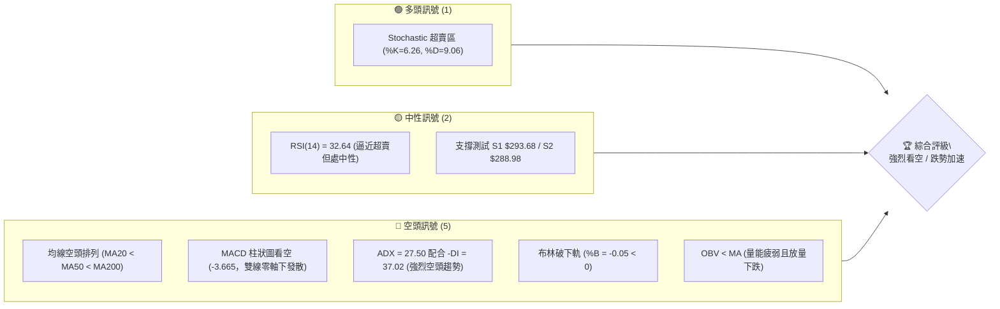

### 📊 核心指標速覽表

| 指標類別 | 指標名稱 | 當前數值 | 訊號 | 解讀 |
|----------|----------|----------|------|------|
| **價格** | 當前價格 | $293.69 | 🔴 | 位於 52 週區間底端 2.3%，面臨 52W 低點 $288.98 考驗 |
| **均線** | MA20 | $332.12 | 🔴 | 價格在 MA20 下方 (-11.57%)，短線遭均線壓制且斜率向下 |
| **均線** | MA50 | $347.69 | 🔴 | 價格在 MA50 下方 (-15.53%)，中期波段趨勢完全轉弱 |
| **均線** | MA200 | $366.10 | 🔴 | 價格在 MA200 下方 (-19.78%)，已摜破長期牛熊分水嶺 |
| **動能** | RSI(14) | 32.64 | 🟡 | Wilder 平滑計算值 32.64，位於中性偏超賣區間，無底背離 |
| **動能** | MACD | -11.919 | 🔴 | DIF (-11.919) 低於 Signal (-8.254)，柱狀體 -3.665 持續擴張 |
| **動能** | Stoch %K/%D | 6.26 / 9.06 | 🟢 | 雙線嚴重鈍化於 10 以下極度超賣區，醞釀技術性超跌反彈 |
| **趨勢** | ADX(14) | 27.50 | 🔴 | ADX > 25 進入強趨勢；-DI (37.02) 遠大於 +DI (12.65)，空頭主導 |
| **通道** | 布林 %B | -0.05 | 🔴 | 價格跌破下軌 ($297.46)，出現極端下行擴軌行情 |
| **量能** | 20日量比 | 1.36x | 🔴 | 11/05-11/06 跌破時帶量（53.8M 與 32.4M），OBV < MA 量能疲弱 |
| **波動** | ATR(14) | $14.74 | 🔴 | 佔股價 5.02%，日均震幅大，下行波動率急劇放大 |

### 🏆 技術評分卡

```
╔══════════════════════════════════════════════════════════════════╗
║                   技術評分卡 — AVGO (2026-11-08)                 ║
╠══════════════════════════════════════════════════════════════════╣
║ 趨勢強度 (ADX/方向)   ████████████████░░░░  80/100 🔴 空頭強趨勢 ║
║ 動能指標 (RSI/MACD)   ██████░░░░░░░░░░░░░░  30/100 🔴 嚴重疲弱   ║
║ 支撐穩定度 (波段低點) ████░░░░░░░░░░░░░░░░  20/100 🔴 瀕臨跌破   ║
║ 成交量配合 (OBV/量比) ██████░░░░░░░░░░░░░░  30/100 🔴 放量下殺   ║
║ 形態完整度 (頭部型態) ██████████████░░░░░░  70/100 🔴 空方完備   ║
║ 均線排列 (空頭排列)   ████░░░░░░░░░░░░░░░░  20/100 🔴 典型空頭   ║
╠══════════════════════════════════════════════════════════════════╣
║ 綜合評分              ████████░░░░░░░░░░░░  42/100 🟡 中性偏空   ║
║ 評分定義：六項算術平均 (80+30+20+30+70+20)/6 = 41.67 ≈ 42        ║
╚══════════════════════════════════════════════════════════════════╝
```

---

## 2. 趨勢分析

### 🌐 多時框趨勢分析

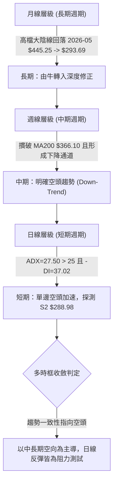

### 📈 長期趨勢 — 12個月走勢圖（Unicode）

```
AVGO 月線收盤走勢圖（過去12個月：2025-12 至 2026-11）
價格軸 ($)
$450 ┤                                  ● $445.25 (2026-05)
$425 ┤                            ● $416.01
$400 ┤                                        ● $388.57
$375 ┤                                  ● $377.06   ● $369.67
$350 ┤  ● $344.20                             ● $351.19
$325 ┤        ● $329.48 ● $317.80 ● $308.46          ● $326.08
$300 ┤                                                     ● $293.69 (現在)
$275 ┤
     └─────────────────────────────────────────────────────────────
        12月   01月   02月   03月   04月   05月   06月   07月   08月   09月   10月   11月
        2025   ---------------------- 2026 -----------------------
```

#### 走勢特徵分析表格

| 階段區間 | 時間跨度 | 起點/終點收盤價 | 區間漲跌幅 | 主要走勢特徵與技術驅動力 |
|----------|----------|-----------------|------------|--------------------------|
| **第 1 階段：築底蓄勢** | 2025-12 ~ 2026-03 | $344.20 → $308.46 | -10.38% | 於 $308-$344 區間窄幅整理，消化前期漲幅，形成第一重波段底部 |
| **第 2 階段：主升暴拉** | 2026-03 ~ 2026-05 | $308.46 → $445.25 | +44.35% | AI 晶片需求爆發推動主升浪，突破歷史高點創下 52W 高點 $493.32 |
| **第 3 階段：高位出貨** | 2026-05 ~ 2026-08 | $445.25 → $369.67 | -16.97% | 出現高位劇烈震盪，反覆測試 $390 阻力未果，大戶籌碼明顯鬆動 |
| **第 4 階段：陰跌破位** | 2026-08 ~ 2026-11 | $369.67 → $293.69 | -20.55% | 均線相繼死叉下行，跌破 MA200 後加速探底，逼近 52W 低點 $288.98 |

### 📊 中期趨勢（週線分析）

中期走勢呈現「高點持續降低 (Lower Highs)、低點持續破底 (Lower Lows)」之下降走勢。過去 8 週收盤價由 2026-10-09 之 $361.54 直線下挫至當前 $293.69，週 MACD 柱狀體由 +2.477 急速翻黑至 -3.665。

```
週線關鍵阻力與支撐分佈示意圖：
$380.84 ┬────────────────────────────────────────── 10/09 週波段頂部 (強壓力)
        │
$366.55 ┼────────────────────────────────────────── 關鍵阻力 R3 (09/25 週高點 / MA200 聚合)
        │       ▼ 破位下降通道
$354.04 ┼────────────────────────────────────────── 阻力 R2 (10/30 當週波段高點聚類)
        │               ▼ 均線空頭下壓
$338.13 ┼────────────────────────────────────────── 阻力 R1 (近期下跳缺口上緣)
        │
$293.69 ┼────────────────────────────────────────── 當前現價 (緊貼支撐 S1 $293.68)
$288.98 ┴────────────────────────────────────────── 關鍵強支撐 S2 (52週最低點)
```

### ⚡ 趨勢強度評估（ADX 解讀）

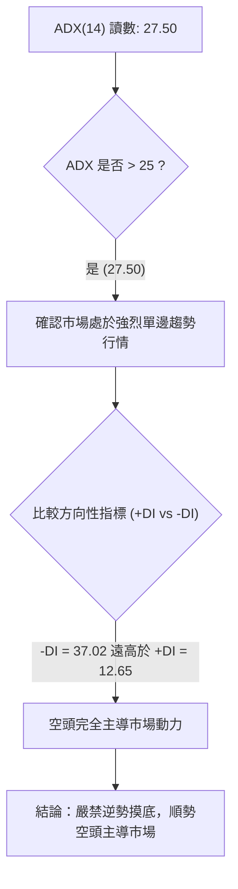

#### ADX 趨勢強度對照表

| 指標變數 | 當前讀數 | 門檻區間 | 趨勢性質判定 | 策略意涵 |
|----------|----------|----------|--------------|----------|
| **ADX(14)** | **27.50** | > 25.00 | 強烈趨勢行情 | 震盪逆勢指標失效，均線與動能順勢模型優先 |
| **-DI** | **37.02** | 基準線 > 20 | 空頭極度強勢 | 賣盤主導力量充沛，下行動能強勁 |
| **+DI** | **12.65** | 基準線 < 15 | 多頭動能匱乏 | 買盤極度衰竭，反彈難以形成持續性波段 |
| **DI 差值** | **-24.37** | 絕對值 > 15 | 發散擴大中 | 空方優勢進一步強化，尚未出現收斂跡象 |

---

## 3. 圖表形態分析

### 🔍 形態識別系統

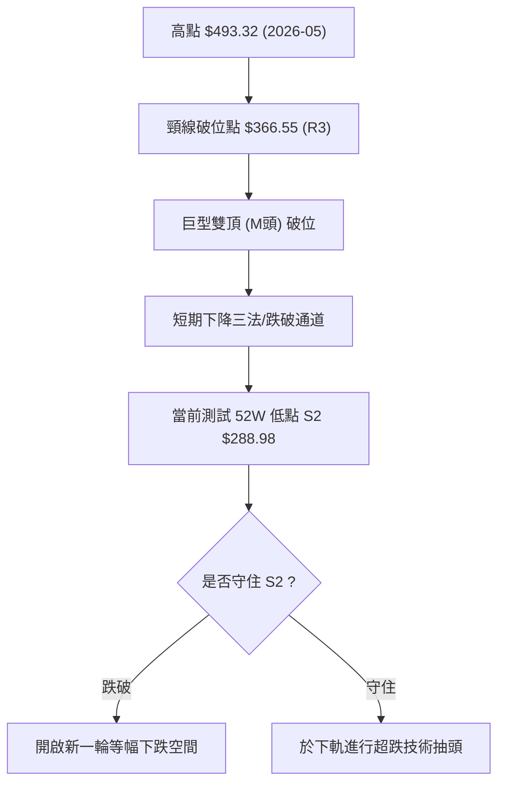

#### 形態識別信心度評估表

| 形態類別 | 信心度 | 判斷依據（引用數據） | 完成度 | 目標價（附計算式） |
|----------|--------|----------------------|--------|--------------------|
| **大型雙頂形態 (M-Top)** | 85% | 左頂 $493.32，右反彈頂 $426.98 (08/07週收)，有效摜破頸線 R3 $366.55 | 90% | 由頸線 $366.55 跌破計算，已達成第一滿足區；下方極限回調目標為 52W 低點 S2 $288.98 |
| **下降通道 (Bearish Channel)** | 80% | 8週內高點由 $380.84 降至 $352.40 再降至 $335.74；低點由 $328.58 降至 $289.77 | 95% | 下軌支撐目前落於 S2 $288.98 附近，通道上軌阻力為 R1 $338.13 |
| **短期加速下行缺口** | 75% | 11/04 收 $325.48，11/05 開盤跳空至 $311.89，形成大實體破位長陰 | 100% | 下降缺口壓力帶落於 $325.48 - $334.12，壓制後市反彈 |

### 🕯️ 重要K線形態分析

嚴格依據近 10 根日 K 與近 8 根週 K 之開、高、低、收數據解讀：

| 日期（週期） | 開盤價 | 最高價 | 最低價 | 收盤價 | K線形態 | 技術解讀 | 訊號 |
|--------------|--------|--------|--------|--------|---------|----------|------|
| **10-28 (日K)** | 349.22 | 352.40 | 344.35 | 351.81 | 短實體陽線 | 挑戰阻力位 R2 $354.04 未果，留上影線，動能衰竭 | 🟡 |
| **10-30 (日K)** | 330.72 | 331.98 | 319.30 | 326.08 | 帶量中陰線 | 跌破 10/26 平台低點，成交量放大至 36.5M，空頭發力 | 🔴 |
| **11-03 (日K)** | 328.97 | 335.74 | 326.60 | 332.13 | 弱勢反彈陽線 | 成交量僅 17.2M 萎縮，反抽遭遇 MA20 下壓受阻 | 🟡 |
| **11-05 (日K)** | 311.89 | 314.00 | 290.12 | 291.53 | **光腳大長陰** | 跳空低開暴跌，爆出 53.8M 巨量摜破 $300，恐慌盤湧出 | 🔴 |
| **11-06 (日K)** | 311.13 | 311.52 | 289.77 | 293.69 | 低檔下影十字星 | 最低觸及 $289.77（逼近 S2 $288.98），多空激戰收下影 | 🟢 |
| **10-09 (週K)** | 357.79 | 380.84 | 356.14 | 361.54 | 衝高回落長上影 | 虛破 MA200 後遭遇大舉拋壓，確立波段假突破頂部 | 🔴 |
| **10-16 (週K)** | 359.43 | 360.69 | 328.58 | 328.75 | 週長陰吞噬 | 週跌幅逾 9%，一舉吞沒前三週整理區間，趨勢反轉向下 | 🔴 |
| **11-06 (週K)** | 328.37 | 335.74 | 289.77 | 293.69 | 週大陰帶長下影 | 放量 147.6M 測試 52 週最低點，空頭動能完全釋放 | 🔴 |

### 📉 ASCII 走勢形態示意圖

```
AVGO 近期雙頂破位與加速下跌走勢圖：
$380.84 ┬                   ● (10/09 反彈假突破頂部)
        │                  / \
$366.55 ┼───[頸線 R3]─────/───\───────────────────────────────
        │                /     \
$351.81 ┼               ●       \   ● (10/28 次高點 $352.40)
        │              /         \ / \
$338.13 ┼───[阻力 R1]─/───────────●───\───────────────────────
        │                               \
$325.48 ┼────────────────────────────────● (11/04 下跳缺口起點)
        │                                 \
$293.69 ┼──────────────────────────────────● [現價 $293.69 / 支撐 S1 $293.68]
$288.98 ┴───[52W 低點 S2]───────────────────● (11/06 探底 $289.77)
```

### 🎯 形態目標價計算

依據形態理論精確量測（數值取自數據提供之波段高低聚類）：

1. **下降通道跌幅推算**：
   - 通道上軌近期高點：$352.40 (10/28)
   - 通道下軌前波跌破點：$319.30 (10/30 低點)
   - 垂直高度 $H = 352.40 - 319.30 = \$33.10$
   - 跌破點 $321.74 (11/04 低點) − $H (\$33.10) = \$288.64$，高度吻合數據中 **52W 低點強支撐 S2: $288.98**。
2. **反彈目標推算**：
   - 若 S2 $288.98 守穩形成短線底背離超跌反彈，反抽第一目標為回補 11/05 缺口下緣與 R1 聚類區間 **R1: $338.13**。

---

## 4. 支撐與阻力

### 🗺️ 關鍵價位分布圖（Unicode）

```
AVGO 價位結構分布圖 (由 OHLCV 聚類與斐波那契計算)
══════════════════════════════════════════════════════════════════
$366.55 ║████████████████████████████████║ 強阻力 R3 / 斐波 61.8% ($367.03)
$354.04 ║████████████████████            ║ 阻力 R2 / 10月反彈波段頂部
$338.13 ║████████████████████████        ║ 關鍵阻力 R1 / 跳空缺口壓力帶
$332.71 ║░░░░░░░░░░░░░░░░░░░░░░░░░░░░░░░░║ 斐波那契 78.6% 回調位
$297.46 ║--------------------------------║ 布林下軌支撐線
$293.69 ╠════════════════════════════════╣ ◄ 當前收盤價 ($293.69)
$293.68 ║▓▓▓▓▓▓▓▓▓▓▓▓▓▓▓▓▓▓▓▓▓▓▓▓▓▓▓▓▓▓▓▓║ 近期支撐 S1 (平價重疊線)
$288.98 ║████████████████████████████████║ 52週最低點強支撐 S2 (斐波 100%)
══════════════════════════════════════════════════════════════════
```

### 🚧 阻力位分析表

阻力價位嚴格引用數據中「關鍵價位」區塊：

| 阻力級別 | 價位 | 形成原因 | 突破難度 | 重要性 |
|----------|------|----------|----------|--------|
| **R1** | **$338.13** | 10/27-10/29 震盪箱底與 11/05 跳空起跌點之聚類區，距離現價 +15.13% | 🟢 中等 | **極高**。短線多頭反彈的第一防線，未站穩前所有上衝皆視為死貓跳 |
| **R2** | **$354.04** | 10/28 日線波段高點 ($352.40) 與 60 日均線 ($351.35) 密集成交區，距離 +20.55% | 🟡 較高 | **高**。中期空頭防守壁壘，突破代表中期下行趨勢受到實質扭轉 |
| **R3** | **$366.55** | 09/25 週線高點、MA200 ($366.10) 及斐波那契 61.8% ($367.03) 三重共振，距離 +24.81% | 🔴 極高 | **戰略級**。牛熊轉折分界點，強烈拋壓籌碼套牢區 |

### 🛡️ 支撐位分析表

支撐價位嚴格引用數據中「關鍵價位」區塊：

| 支撐級別 | 價位 | 形成原因 | 守住機率 | 重要性 |
|----------|------|----------|----------|--------|
| **S1** | **$293.68** | 當前收盤價 ($293.69) 所處之波段低點聚類線，重疊度 -0.00% | 🟡 45% | **極高**。當前微觀平衡點，跌破即宣告日線直接挑戰 52W 底 |
| **S2** | **$288.98** | 52 週最低點 (52W Low)、斐波那契 100.0% 終極支撐，距離現價 -1.61% | 🟢 55% | **歷史級**。多頭最後一道馬奇諾防線，失守將打開無均線支撐的真空跌勢 |

### 📐 斐波那契回調位分析

依據 52 週區間 **$288.98 → $493.32**（極值跨度 $204.34）計算：

```
斐波那契回調分佈階梯：
0.0%   (52W High)  : $493.32  │  歷史高點
23.6% 回調位       : $445.09  │  主升浪調整位
38.2% 回調位       : $415.26  │  多頭防守中軸
50.0% 回調位       : $391.15  │  牛熊強弱分水嶺
61.8% 回調位       : $367.03  │  黃金分割重要支撐（現已跌破轉為 R3 阻力 $366.55）
78.6% 回調位       : $332.71  │  深度回調極限位（現已完全跌破）
100.0% (52W Low)   : $288.98  │  全週期基點支撐 S2
```

- **位置解讀**：現價 **$293.69** 目前精確運行於 **78.6% ($332.71)** 與 **100.0% ($288.98)** 之間，處於回調進程的第 2.3% 邊緣區間。
- **技術意義**：跌破 61.8% ($367.03) 與 78.6% ($332.71) 宣告整個 2026 年上半年的牛市漲幅已被吞噬超過 97%。當前價格距離 100% 回調位 S2 $288.98 僅剩 $4.71（-1.61%）空間，技術面上已無任何中間黃金分割緩衝，唯有倚賴 52W 歷史絕對底部進行抵抗。

---

## 5. 技術指標深度解讀

### 🎛️ 指標訊號總覽

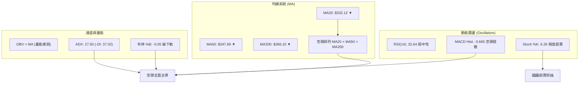

### 📈 移動平均線排列分析

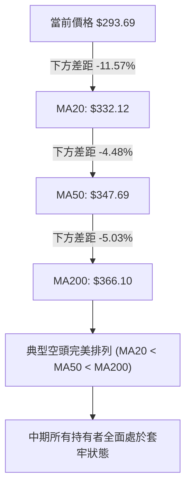

#### 各週期均線偏離度數據表

| 均線名稱 | 數值 | 現價偏離幅度 | 趨勢斜率 | 技術形態解讀 |
|----------|------|--------------|----------|--------------|
| **MA 5** | $313.01 | -6.17% | 急劇向下 | 超短期賣壓沉重，短線乖離率高 |
| **MA 10** | $325.95 | -9.90% | 急劇向下 | 快速下壓線，構成首要反彈天花板 |
| **MA 20** | $332.12 | -11.57% | 向下走平後下彎 | 月線生命線失守，下行趨勢確立 |
| **MA 60** | $351.35 | -16.41% | 持續向下 | 季線阻力強烈，中期空方主力陣地 |
| **MA 120** | $374.57 | -21.59% | 向下拐頭 | 半年線重度承壓，中長期多頭徹底棄守 |
| **MA 200** | $366.10 | -19.44% | 下穿翻黑 | 長期牛熊分界線被向下跌破 |
| **MA 240** | $364.57 | -19.44% | 走平下彎 | 年線位置出現扣高下引現象 |

### 📉 RSI(14) 分析

- **RSI 當前讀數**：**32.64**（Wilder 平滑）
  `RSI(14): 32.64 ▓▓▓▓▓▓░░░░░░░░░░░░░░ [32.64% / 100%]`
- **超買超賣狀態**：數值介於 30 至 70 之中性區間邊界，尚未跌破 30 進入嚴格定義之極端超賣區。
- **背離判斷結論**：**無底背離**。
  - *比對依據*：近 20 根 K 棒中，價格自 10/28 高點 $352.40 持續創出 $289.77 新低；對應 RSI 亦自 40.8 跌至 32.64。價格創低同時 RSI 同步創低，未形成一底高於一底的底背離結構，下行動能仍具慣性。

### 📊 MACD(12/26/9) 訊號解讀

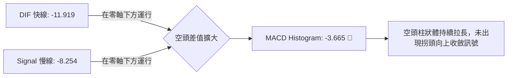

- **MACD 數值**：-11.919
- **MACD Signal 數值**：-8.254
- **MACD Hist 數值**：-3.665 🔴 看空
- **解讀**：DIF 與 DEA 雙線在零軸下方加速發散，且負柱狀體由 10/30 的 +0.209 急劇轉負並擴大至 -3.665，顯示中短期空頭動能仍處於加速釋放階段，空方拋壓尚未耗盡。

### 📦 布林通道分析

```
ASCII 布林通道空間分佈示意圖：
$366.79 ┬────────────────────────────────────────── BB 上軌 (Upper Band)
        │
        │
$332.12 ┼────────────────────────────────────────── BB 中軌 (MA20)
        │
        │
$297.46 ┼────────────────────────────────────────── BB 下軌 (Lower Band)
        │ ◄ [破軌區間: %B = -0.05]
$293.69 ┴───● 現價 (已實質打穿下軌，運行於軌道之外)
```

- **布林參數**：上軌 **$366.79** ｜ 中軌 **$332.12** ｜ 下軌 **$297.46**
- **%B 指標分析**：**-0.05**。因收盤價 $293.69 < 下軌 $297.46，導致 %B 跌落負值區間。
- **帶寬與破軌意義**：布林帶呈顯著「張口下行（Walking down the band）」特徵。價格未受下軌支撐反而緊貼下軌外側滑落，屬於標準的極端單邊下殺訊號，切忌僅因觸及下軌即主觀逆勢搶反彈。

### 💹 成交量分析（量價配合度）

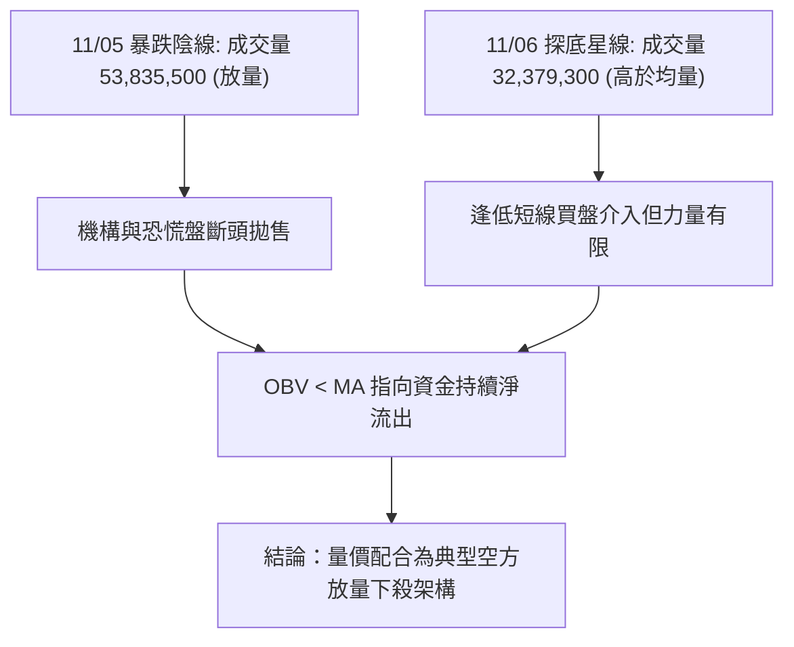

- **成交量數據比對**：
  - 最新日成交量：**32,379,300**
  - 20 日均量：**23,890,500**（**量比 1.36x**，呈現顯著放量）
  - 50 日均量：**24,997,462**
- **OBV 能量潮解讀**：數據指出「**OBV < MA → 量能疲弱**」。在下行破位過程中，成交量高於均量，而 OBV 走勢持續受壓於均線之下，顯示此波下挫並非無量空跌，而是伴隨實質籌碼出逃，籌碼面結構處於劣勢。

---

## 6. 動能與波動率

### ⚡ 動能評估四象限

動能評估採用「動能方向與強度（趨勢強弱）」與「歷史波動幅度（ATR/價格比）」兩維度定位：

| 象限標籤 | 趨勢動能特徵 | 波動率特徵 | 當前狀態判定 | 操作意涵與策略指引 |
|----------|--------------|------------|--------------|--------------------|
| **象限 I (Q1)** | 強多頭動能 | 低波動率 | — | 最佳主升浪買入持有機會 |
| **象限 II (Q2)** | 弱動能 / 盤整 | 低波動率 | — | 橫盤收斂，等待方向突破 |
| **象限 III (Q3)** | **強空頭動能** | **高波動率 (ATR > 5%)** | **✓ 當前 AVGO 落點** | **空頭加速主跌段，下行風險極高，嚴格順勢或觀望** |
| **象限 IV (Q4)** | 弱多頭動能 | 高波動率 | — | 假突破洗盤震盪，易遭雙巴 |

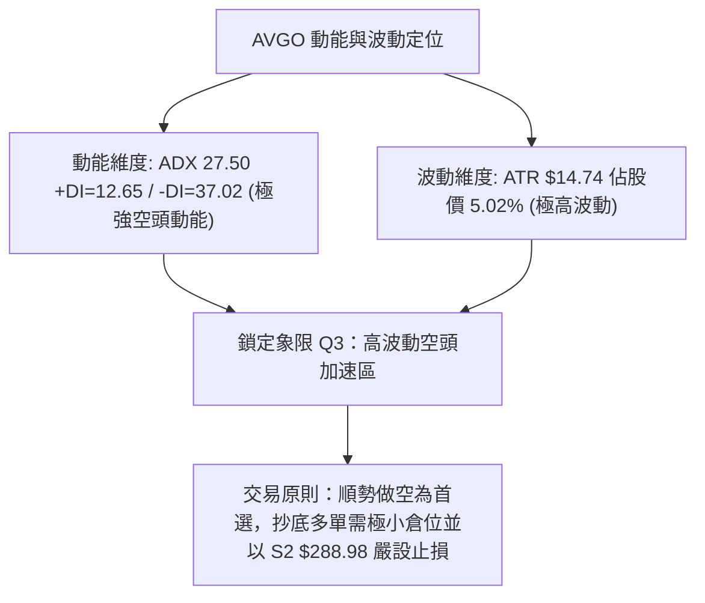

### 📊 ATR 波動率分析

- **ATR(14) 數值**：**$14.74**（採 Wilder 平滑算法）
- **價格百分比**：**5.02%** of Price（顯示單日正常波動區間即達約 $15 美元）
- **止損與緩衝計算建議**：
  - **超短線交易止損距離 (1.0 × ATR)**：$14.74。若現價進場，多單保護緩衝不可低於 $14.74。
  - **波段交易安全邊界 (1.5 × ATR)**：$14.74 × 1.5 = **$22.11**。
  - **應用於關鍵位**：當前距 52W 低點 S2 $288.98 僅 $4.71 空間，遠小於 1.0 ATR ($14.74)，說明在目前的劇烈波動下，S2 極易因日線正常震盪而被刺穿。

### 📐 Beta 與市場相關性

- **Beta 係數**：**1.508**
- **市場特徵解讀**：AVGO 具備高度進攻性與放大特性（高 Beta 屬性）。當半導體板塊或標普 500 指數面臨下修時，該股平均將放大 1.5 倍跌幅。在當前大盤科技股氛圍承壓之際，高 Beta 成為下殺助推劑。
- **空頭部位佔比 (Short % Float)**：1.10%（Short Ratio: 2.31），顯示目前市場空頭尚未達到極端擁擠之軋空閾值，走勢主因來自機構實體多頭拋售（機構持股高達 79.9%）。

---

## 7. 多時框架總結

### 📋 時框架評分表

| 時框架 | 趨勢方向 | 動能狀態 | 均線排列 | 圖表形態 | 綜合評分 | 建議策略與姿態 |
|--------|----------|----------|----------|----------|----------|----------------|
| **月線 (長期)** | 🔴 由多轉空 | MACD 高檔回落 | 跌破 5MA/10MA | 自高點回撤 33.9% | **35/100** | 長期投資者暫停定投，等待底部構築 |
| **週線 (中期)** | 🔴 明確空頭 | MACD 翻黑發散 | MA20 < MA50 < MA200 | 雙頂 M 頭跌破 | **30/100** | 逢反彈測試壓力位佈局順勢空單 |
| **日線 (短期)** | 🔴 單邊加速 | RSI=32.64 / Stoch<10 | 完美空頭排列 | 跳空破位大陰線 | **42/100** | 觀望為主，激進者博弈 S2 支撐短彈 |

### 🔲 綜合訊號矩陣

```
時框與指標共振矩陣 (Consistency Matrix)
指標項目         長期 (月線)      中期 (週線)      短期 (日線)      共振判定
───────────────────────────────────────────────────────────────────
主導趨勢         🔴 深度回檔      🔴 下降通道      🔴 加速下行      🔴 完全共振 (空)
均線狀態         🟡 跌破短期MA    🔴 空頭排列      🔴 完美空頭      🔴 偏空共振
動能指標         🔴 柱體下行      🔴 負值擴散      🟡 RSI超賣邊緣   🔴 偏空共振
形態特徵         🟡 歷史高檔回吐  🔴 雙頂頸線破位  🔴 跳空缺口壓制  🔴 空方主導
───────────────────────────────────────────────────────────────────
跨時框總結       🔴 全時框同向空頭共振，任何逆勢做多行為均面臨高機率損耗
```

### ⚖️ 多時框收斂結論

依據多時框收斂規則（嚴格要求 14）：
1. **行情性質判定**：當前 **ADX(14) = 27.50 > 25**，明確判定為**趨勢行情**（非震盪盤整）。
2. **主導時框確立**：在強趨勢行情下，以**中期（週線及 MA200）方向為主導**。目前週線已摜破 MA200 ($366.10) 且均線呈現 MA20 < MA50 < MA200 空頭排列。
3. **時框衝突取捨**：雖然短期日線隨機指標（Stoch %K=6.26）出現極度超賣，日線可能隨時出現技術性抽頭，但日線反彈僅能視為「空頭行情的次級修正與進場時機」，絕不可認定為反轉。
4. **唯一方向性結論**：**偏空（主推空頭順勢策略，多頭僅為高風險博弈反彈）**。此結論與第 8 章之主策略完全一致。

---

## 8. 交易策略建議

### 🗺️ 策略決策流程圖

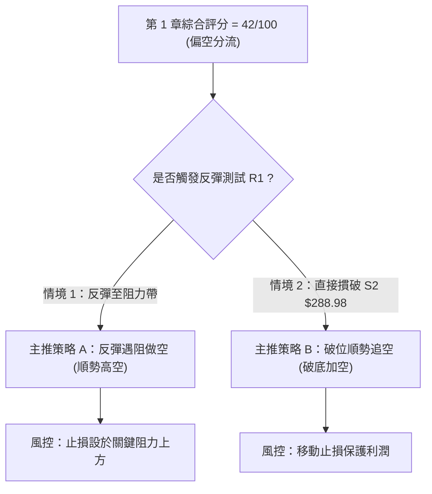

### 🧭 策略路由（依評分卡分流）

> **當前主策略方向 = 偏空順勢操作（依技術評分卡綜合評分 42/100 分流）**  
> 綜合評分低於 50 且 ADX 呈現 27.50 空頭強趨勢，**本報告主推空頭策略**。多頭操作僅於反向風險章節作為超跌技術對沖提示，嚴禁兩頭重倉下注。

### 🎯 價格情境階梯（Price Scenarios）

價位嚴格引用數據「關鍵價位」區塊之客觀聚類：

| 觸發條件 | 下一目標 | 後續延伸 | 技術情境含義 |
|----------|----------|----------|--------------|
| **反彈受阻於 R1 $338.13** | 回測 S1 $293.68 | 探底 S2 $288.98 | 空頭回踩確認阻力有效，重啟下行主跌浪 |
| **強勢突破 R1 $338.13** | 測試 R2 $354.04 | 挑戰 R3 $366.55 | 短線超跌強勁修復，空頭部位必須立即停損離場 |
| **直接摜破 S2 $288.98** | 開啟無底真空 | 斐波 100% 破位 | 52 週最低點失守，引發停損賣盤與流動性下殺 |

### 📊 情境機率分佈

| 情境劃分 | 機率預估 | 主要技術依據 |
|----------|----------|--------------|
| **回落探底 / 再破底 (跌破 S2)** | **60%** | ADX=27.50、-DI=37.02、MACD 負柱狀體持續擴大 (-3.665)、OBV 量能衰弱 |
| **超跌反彈 / 區間弱震 (S2 ~ R1)** | **30%** | Stoch %K=6.26 極度鈍化超賣、布林 %B=-0.05 破下軌具均值回歸修復需求 |
| **強勢反轉 / 站上 R2** | **10%** | 目前均線全面空頭壓制，且 11/05 放量 53.8M 陰線堆積龐大套牢盤，概率極低 |

### 🟢 主策略詳情（空頭主推策略）

嚴格遵守規則 17 定義：  
*做空風險報酬比 = (進場價 − 目標價 T1) ÷ (止損價 − 進場價)*，數值均精確回算。

| 策略要素 | 策略 A（反彈高空 — 逢阻力佈空） | 策略 B（破位追空 — 破底順勢空） |
|----------|----------------------------------|----------------------------------|
| **適用情境** | 股價受超賣帶動，向上回抽 R1 阻力 | 股價無力反彈，日線實體直接跌破 52W 底 |
| **進場條件** | 反彈至 R1 遇阻回落，出現上影線確認 | 日K收盤價或盤中跌破 52W 低點 S2 |
| **進場價格** | **$338.13** (精確引用阻力 R1) | **$288.98** (精確引用 52W 低點 S2) |
| **止損價格** | **$354.04** (精確引用阻力 R2) | **$297.46** (精確引用布林下軌阻力) |
| **目標價 T1** | **$293.68** (精確引用支撐 S1) | **$267.50** (由 S2-R1 形態高度推算註1) |
| **目標價 T2** | **$288.98** (精確引用支撐 S2) | **$250.00** (由 52W 區間破位推算註2) |
| **風險報酬比** | **1 : 2.80（以 T1 計）**  <br>*(338.13-293.68)/(354.04-338.13)=44.45/15.91=2.7938* | **1 : 2.53（以 T1 計）**  <br>*(288.98-267.50)/(297.46-288.98)=21.48/8.48=2.5330* |
| **預估勝率** | 65% | 55% |
| **建議倉位** | 15% 總資金倉位 | 10% 總資金倉位 |

> **註1（策略 B 之 T1 計算依據）**：由近期跌破區間推算。形態高度 $H = \text{布林下軌 } \$297.46 - \text{S2 } \$288.98 = \$8.48$，若採破位擴展 2.5 倍推算幅度為 $\$21.48$，則 $\$288.98 - \$21.48 = \$267.50$。  
> **註2（策略 B 之 T2 計算依據）**：由 52W 區間波段推算。若 S2 $288.98 終極支撐實質摜破，下方將尋求整數心理大關 $250.00。

### 🔴 反向風險觸發點（多頭對沖提示）

若發生以下情形，空頭策略必須**無條件停損出場或反手建立避險對沖**：
1. **價格有效突破 R1 ($338.13)**：日 K 收盤價連續 2 日站上 $338.13，宣告跳空下殺為洗盤假突破，下行通道被破壞。
2. **指標出現底背離共振**：日線 RSI 突破 50 且 MACD 柱狀圖在零軸下方出現黃金交叉。
3. **反手多單博弈點**：若且唯若在 **S2 $288.98** 出現日線長下影錘頭線並伴隨成交量放大至 40M 以上，短線激進者可建立 5% 倉位試單多頭，**嚴格止損置於 $284.00（跌破 S2 超過 1.5% 離場）**，目標價看至 **$338.13**。

### ⭐ 整體訊號強度評星

```
╔══════════════════════════════════════════════════════════════════╗
║ 做多訊號強度：★☆☆☆☆  (1/5星 - 僅有隨機指標超賣，其餘皆空)    ║
║ 做空訊號強度：★★★★☆  (4/5星 - 均線/趨勢/通道/量能全面偏空)    ║
║ 整體可信度：  ★★★★☆  (4/5星 - ADX>25 強趨勢確認，指標具可信度)║
╚══════════════════════════════════════════════════════════════════╝
```

---

## 9. 風險提示與監控

### ✅ 關鍵監控指標 Checklist

```
╔══════════════════════════════════════════════════════════════════╗
║               AVGO 每日技術風控與監控清單 (Checklist)           ║
╠══════════════════════════════════════════════════════════════════╣
║ [ ] 監控 S2 $288.98 防線：盤中最低價是否跌破此 52 週最低點      ║
║ [ ] 監控收盤價是否回返布林下軌上方 ($297.46)：評估破軌跌勢減緩  ║
║ [ ] 觀察 MACD 柱狀體：負值 -3.665 是否開始收斂 (向 0 軸回縮)     ║
║ [ ] 檢視成交量：反彈時成交量是否低於 20M (無量反抽)             ║
║ [ ] 檢視 ADX(14)：讀數若持續爬升超過 30，警惕空頭恐慌性拋售    ║
║ [ ] 觀察外圍新聞動態：AI 晶片板塊情緒與機構減持動向 (如 Ark)    ║
╚══════════════════════════════════════════════════════════════════╝
```

### ⚠️ 風險場景分析

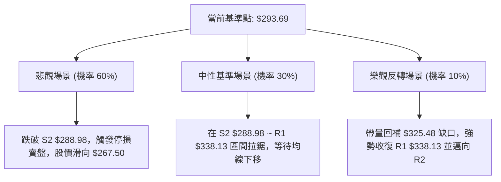

### 🛡️ 風險管理重要提醒

1. **ATR 劇烈波動下的倉位控管**：
   - 當前 ATR 高達 **$14.74（5.02%）**，單日波動極大。在建立任何部位時，總資金曝險金額必須嚴格控制在單筆交易損失不超過總資產的 1.5%–2.0%。
   - 槓桿工具（如期權或槓桿 ETF）需謹防波動率驟降（IV Crush）與高 Beta（1.508）帶來的非線性回撤。
2. **基本面與技術面背離風險**：
   - 雖然分析師共識評級為 *strong_buy*（目標價均值 $533.42），且近期季報營收與淨利年增超過 85% 與 216%，但**技術面資金處於實質淨流出狀態**。嚴禁以「基本面良好」為藉口在明確的單邊空頭技術架構中死扛或盲目向下金字塔攤平加碼。
3. **流動性陷阱注意**：
   - 近兩日成交量顯著激增（11/05 達 53.8M），顯示大資金正在換手或撤離。若跌破 S2 $288.98，可能面臨市場多頭止損指令的連鎖踩踏。

---

## 📋 報告總結

```
╔══════════════════════════════════════════════════════════════════╗
║                    AVGO 技術分析報告總結                         ║
╠══════════════════════════════════════════════════════════════════╣
║ 報告日期：2026-11-08                                             ║
║ 當前價格：$293.69                                                ║
║ 綜合技術評分：42/100 (中性偏空 / 依規則 18 六項指標平均)          ║
║ 分析評級：🔴 強烈看空 / 跌勢加速 (主趨勢主導)                    ║
║                                                                  ║
║ 關鍵結論：                                                       ║
║ ├─ 長期趨勢：🔴 跌破 2026-05 歷史高點牛市軌道，進入深幅修正     ║
║ ├─ 中期趨勢：🔴 摜破 MA200 ($366.10)，下降通道運行且高點下移    ║
║ ├─ 短期趨勢：🔴 ADX=27.50 配合 -DI=37.02，空頭單邊主導下行      ║
║ ├─ 關鍵支撐：S1 $293.68 ｜ S2 $288.98 (52週最低點強支撐)         ║
║ ├─ 關鍵阻力：R1 $338.13 ｜ R2 $354.04 ｜ R3 $366.55              ║
║ └─ 外部分析師目標價均值：$533.42 (技術面嚴重與基本面預期背離)    ║
║                                                                  ║
║ 最優策略組合：                                                   ║
║ 1. 🥇 最佳機會：策略 A (反彈高空) — 若反抽至 R1 $338.13 遇阻佈局 ║
║                 空單，止損 R2 $354.04，目標 S1 $293.68 (風報 2.80)║
║ 2. 🥈 次選機會：策略 B (破位順勢) — 盤中實質跌破 S2 $288.98 順勢 ║
║                 跟進做空，止損 $297.46，目標 $267.50 (風報 2.53) ║
║ 3. 🥉 保守選擇：空倉全面觀望 — 靜待價格在 S2 $288.98 附近形成日 ║
║                 線等級雙底或破底翻形態，且 MACD 翻紅再行定奪     ║
╚══════════════════════════════════════════════════════════════════╝
```

---

> ⚠️ **免責聲明**：本報告為 AI 自動生成之技術分析，所有數據及估算均嚴格基於所提供之歷史價格、量能與指標資訊。本報告**僅供研究與學術參考**，**不構成任何要約、推薦或投資建議**。金融市場具有高度風險，投資人應依個人風險承受能力獨立判斷並自負盈虧。

---

*報告生成時間：2026-11-08 ｜ 數據來源：Yahoo Finance ｜ 分析框架：多時框技術分析*