# AVGO 技術分析報告

> **報告日期**：2026-11-09 ｜ **語言**：繁體中文 ｜ **數據來源**：Yahoo Finance ｜ **當前價格**：$293.69

---

## 目錄

| 章節 | 內容 |
|------|------|
| [1. 技術面概覽](#1-技術面概覽) | 訊號儀表板、核心指標、評分卡 |
| [2. 趨勢分析](#2-趨勢分析) | 多時框趨勢、長中短期走勢、ADX 解讀 |
| [3. 圖表形態分析](#3-圖表形態分析) | 形態識別、K線組合、目標價推算 |
| [4. 支撐與阻力](#4-支撐與阻力) | 關鍵價位結構、斐波那契回調 |
| [5. 技術指標深度解讀](#5-技術指標深度解讀) | MA/RSI/MACD/布林/成交量量價關係 |
| [6. 動能與波動率](#6-動能與波動率) | 動能評估四象限、ATR、Beta 與市場連動 |
| [7. 多時框架總結](#7-多時框架總結) | 時框架矩陣與多時框優先級收斂 |
| [8. 交易策略建議](#8-交易策略建議) | 主策略路由、情境階梯、精確風報比 |
| [9. 風險提示與監控](#9-風險提示與監控) | 監控清單、情境推演、風控與倉位規範 |

---

## 1. 技術面概覽

### 🎯 技術訊號儀表板

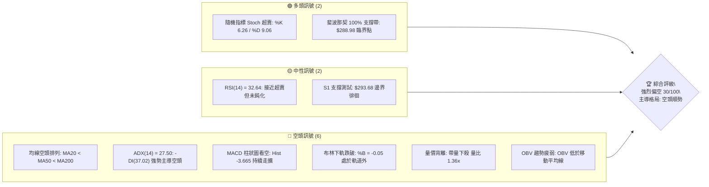

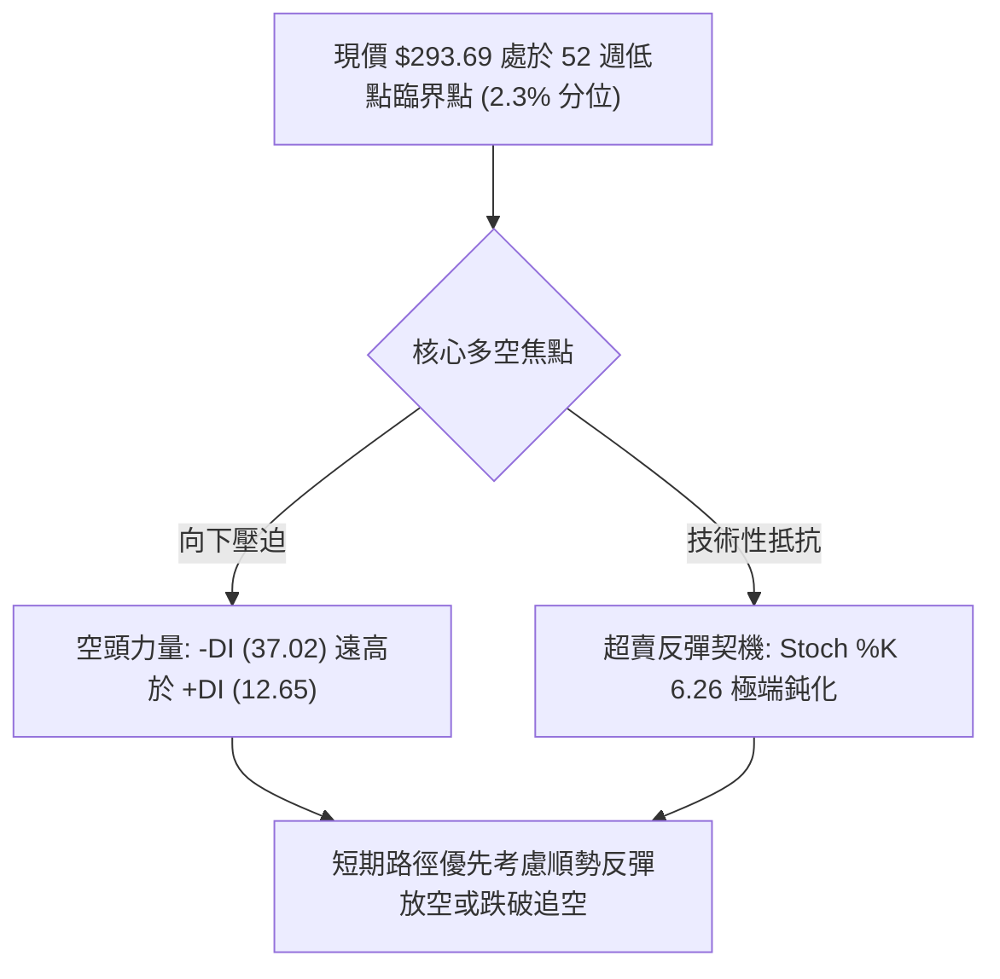

### 📊 核心指標速覽表

| 指標類別 | 指標名稱 | 當前數值 | 訊號 | 解讀 |
|----------|----------|----------|------|------|
| **價格** | 當前價格 | $293.69 | 🔴 | 位於 52 週區間底部 2.3% 分位，空方沉重下壓 |
| **均線** | MA20 | $332.12 | 🔴 | 價格低於 MA20 達 -11.57%，短中期空頭排列確立 |
| **均線** | MA50 | $347.69 | 🔴 | 價格顯著低於 MA50，中期上升結構遭到徹底破壞 |
| **均線** | MA200 | $366.10 | 🔴 | 跌破牛熊分界線 MA200，長期技術格局正式轉空 |
| **動能** | RSI(14) | 32.64 | 🟡 | 位於弱勢中性格局，尚未跌破 30 形成絕對超賣 |
| **動能** | MACD | -11.919 | 🔴 | DIF 遠低於訊號線 (-8.254)，柱狀體 -3.665 擴大 |
| **趨勢** | ADX(14) | 27.50 | 🔴 | 數值 > 25 且 -DI(37.02) 佔據主導，趨勢性空頭 |
| **波動** | ATR(14) | $14.74 | 🟡 | 佔股價 5.02%，日內波動劇烈，單日洗盤風險高 |
| **通道** | 布林 %B | -0.05 | 🔴 | 跌穿布林下軌 ($297.46)，出現向下極端張嘴噴出 |
| **量能** | OBV | OBV < MA | 🔴 | 成交量配合下跌放大，資金主力呈現實質撤離態勢 |

### 🏆 技術評分卡

```
╔══════════════════════════════════════════════════════════════╗
║                技術評分卡 — AVGO (2026-11-09)                 ║
╠══════════════════════════════════════════════════════════════╣
║ 趨勢強度 (Trend)     ████████░░░░░░░░░░░░  40/100  🔴 空頭強勢║
║ 動能指標 (Momentum)  ██████░░░░░░░░░░░░░░  30/100  🔴 極度疲弱║
║ 支撐穩定度 (Support) ████░░░░░░░░░░░░░░░░  20/100  🔴 瀕臨破底║
║ 成交量配合 (Volume)  ██████░░░░░░░░░░░░░░  30/100  🔴 帶量下挫║
║ 形態完整度 (Pattern) ████████░░░░░░░░░░░░  40/100  🟡 頂部確認║
║ 均線排列 (MovingAvg) ████░░░░░░░░░░░░░░░░  20/100  🔴 完美空頭║
╠══════════════════════════════════════════════════════════════╣
║ 綜合評分 (Overall)   ██████░░░░░░░░░░░░░░  30/100  🔴 強烈偏空║
║ 評級結論: 依規則 18 算術平均 (40+30+20+30+40+20)/6 = 30 分     ║
╚══════════════════════════════════════════════════════════════╝
```

---

## 2. 趨勢分析

### 🌐 多時框趨勢分析

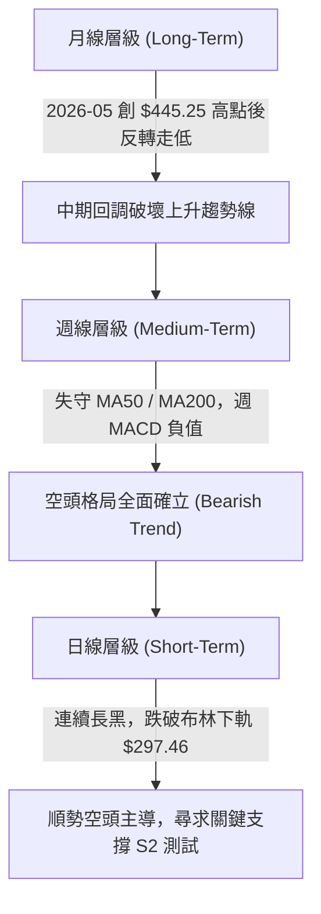

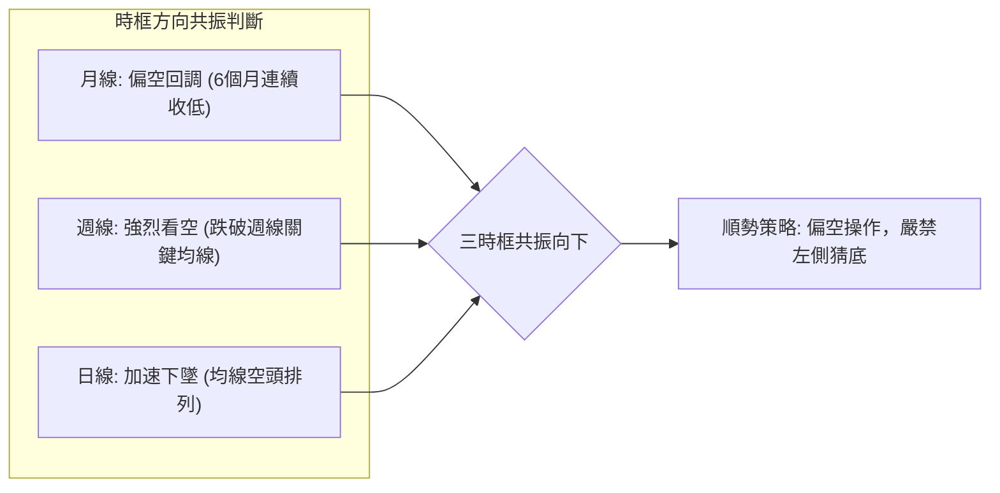

### 📈 長期趨勢 — 12個月走勢圖（Unicode）

```
AVGO 月線走勢圖（過去12個月：2025-12 至 2026-11）
價格軸 ($)
$450 ┤                                  ● $445.25 (2026-05 波段頂部)
$430 ┤                             
$410 ┤                             ● $416.01 (2026-04)
$390 ┤                                            ● $388.57 (2026-07)
$370 ┤                                       ● $377.06   ● $369.67 (2026-08)
$350 ┤ ● $344.20 (2025-12)                                   ● $351.19 (2026-09)
$330 ┤      ● $329.48                                             ● $326.08 (2026-10)
$310 ┤           ● $317.80   ● $308.46                                 
$290 ┤                                                                      ● $293.69 ◄ 現價
     └─┬─────┬─────┬─────┬─────┬─────┬─────┬─────┬─────┬─────┬─────┬─────┬──
     12月   01月  02月  03月  04月  05月  06月  07月  08月  09月  10月  11月
     (25)  (26)  (26)  (26)  (26)  (26)  (26)  (26)  (26)  (26)  (26)  (26)
```

#### 長期月線走勢特徵分析表

| 階段區間 | 月收盤起止價 | 漲跌幅 | 走勢特徵與技術含義 |
|----------|--------------|--------|--------------------|
| **2025-12 ~ 2026-03** | $344.20 → $308.46 | -10.38% | 首次回調築底，在 $308 附近獲得短暫支撐 |
| **2026-03 ~ 2026-05** | $308.46 → $445.25 | +44.35% | 主升浪反彈噴出，創下 24 個月最高月收盤紀錄 |
| **2026-05 ~ 2026-07** | $445.25 → $388.57 | -12.73% | 頂部帶量回吐，高檔籌碼派發跡象顯著 |
| **2026-07 ~ 2026-11** | $388.57 → $293.69 | -24.42% | 破位加速殺跌，跌破所有中期防守平台，直逼年內低點 |

### 📊 中期趨勢（週線分析）

```
中期週線空間阻力與支撐示意圖：
阻力位 R3 ── $366.55  ────────────────────────── (近一年波段高點聚類)
             │  ▲ 
阻力位 R2 ── $354.04  ────────────────────────── (反彈中期關鍵阻力)
             │  │
阻力位 R1 ── $338.13  ────────────────────────── (反彈第一道天花板)
             │  │ 
當前價格 ── $293.69  ◄── (目前緊貼 S1 支撐位)
             │  │
支撐位 S1 ── $293.68  ────────────────────────── (波段低點聚類，僅差 $0.01)
             │  ▼
支撐位 S2 ── $288.98  ────────────────────────── (52週最低點，絕對防守底線)
```

### ⚡ 趨勢強度評估（ADX 解讀）

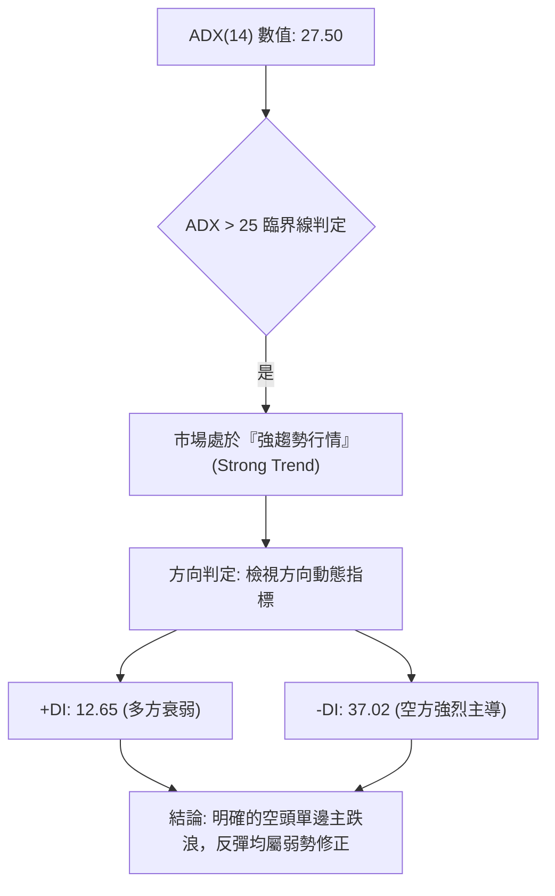

#### ADX 趨勢強度對照表

| 指標變數 | 當前讀數 | 強度級別 | 技術解讀 |
|----------|----------|----------|----------|
| **ADX (14)** | 27.50 | 🟢 強趨勢 (>25) | 行情擺脫盤整區間，具備持續發展趨勢動能 |
| **+DI (14)** | 12.65 | 🔴 極端偏弱 | 買方動能枯竭，多頭無力組織有效反攻 |
| **-DI (14)** | 37.02 | 🔴 極端主導 | 空頭力量全面控盤，呈現單邊推動特徵 |
| **方向差距 (Spread)** | -24.37 | 🔴 空方壓制 | 空方動能領先超過 24 個基點，趨勢慣性強烈向下 |

---

## 3. 圖表形態分析

### 🔍 形態識別系統

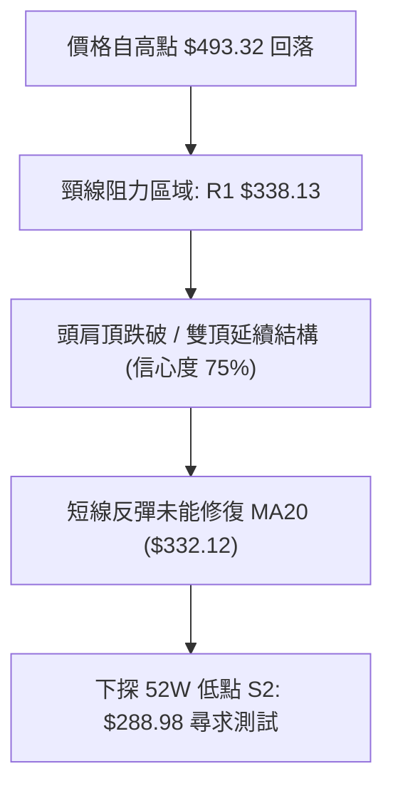

#### 圖表幾何形態判定表（依規則 15）

| 形態名稱 | 信心度 | 判斷依據（引用數據） | 完成度 | 目標價（附計算式） |
|----------|--------|----------------------|--------|--------------------|
| **雙重頂/頭肩頸線破位** | 75% | 2026年高檔多次受阻於 R3 $366.55，跌破 R1 $338.13 支撐轉換位 | 90% | 頸線 $338.13 - 形態高度 ($366.55 - $338.13 = $28.42) = **$309.71**（已跌破抵達） |
| **布林通道下軌極端超賣形態** | 80% | 價格穿透下軌 ($297.46)，BB %B 為 -0.05，Stoch %K 跌至 6.26 | 95% | 均值回歸理論目標：測試布林中軌 MA20 **$332.12** |
| **多重底/雙底潛在結構** | 35% | 目前僅觸及 S1 $293.68 與 S2 $288.98，未形成任何右側轉折確認 | 20% | 訊號不足，僅做指標型解讀（信心度 < 50%，不設定多頭幾何目標價） |

### 🕯️ 重要K線形態分析

依規則 19，僅針對「近10根日K」與「近8根週K」進行開高低收分析：

#### 近10根日K線形態分析表

| 日期 | 開 | 高 | 低 | 收 | 成交量 | K線形態 | 解讀與訊號 |
|------|----|----|----|----|--------|---------|------------|
| 2026-10-26 | 324.53 | 332.12 | 323.25 | 329.17 | 18,646,700 | 溫和實體陽線 | 🟡 測試 MA20 承壓，量能未放大 |
| 2026-10-27 | 339.87 | 345.67 | 336.87 | 342.33 | 25,567,200 | 跳空走高大陽線 | 🟢 放量上攻，短期多頭反彈高潮 |
| 2026-10-28 | 349.22 | 352.40 | 344.35 | 351.81 | 22,718,200 | 衝高小陽實體 | 🟡 受阻於阻力 R2 ($354.04) 邊緣 |
| 2026-10-29 | 342.00 | 346.15 | 338.80 | 345.00 | 17,052,700 | 孕線收跌陰線 | 🔴 高檔量縮滯漲，動能轉折向下 |
| 2026-10-30 | 330.72 | 331.98 | 319.30 | 326.08 | 36,511,800 | 跳空長陰線破位 | 🔴 放量摜破多條短期均線，空頭反撲 |
| 2026-11-02 | 328.37 | 333.56 | 321.87 | 322.23 | 20,326,900 | 弱勢下挫陰線 | 🔴 跌勢延續，未能收復 $326 支撐 |
| 2026-11-03 | 328.97 | 335.74 | 326.60 | 332.13 | 17,274,500 | 假突破上影陽線 | 🟡 盤中抽高測試 MA20 失敗回落 |
| 2026-11-04 | 326.86 | 334.12 | 321.74 | 325.48 | 23,881,800 | 倒轉錘頭陰線 | 🔴 上檔解套賣壓沉重，反彈無力 |
| 2026-11-05 | 311.89 | 314.00 | 290.12 | 291.53 | 53,835,500 | 崩跌大長黑棒 | 🔴 爆量崩跌 -10.43%，直摜 S1 邊界 |
| 2026-11-06 | 311.13 | 311.52 | 289.77 | 293.69 | 32,379,300 | 低檔十字星/錘線 | 🟡 逼近 S2 ($288.98) 獲買盤微幅護盤 |

#### 近8根週K線形態分析表

| 日期 | 開 | 高 | 低 | 收 | 成交量 | K線形態 | 解讀與訊號 |
|------|----|----|----|----|--------|---------|------------|
| 2026-09-18 | 348.99 | 362.62 | 335.20 | 356.96 | 149,021,600 | 長下影線錘子週K | 🟢 低檔買盤承接有力 |
| 2026-09-25 | 358.66 | 366.55 | 346.89 | 352.81 | 107,643,000 | 衝高回落十字週K | 🔴 觸碰阻力位 R3 ($366.55) 遭壓制 |
| 2026-10-02 | 352.87 | 361.86 | 343.29 | 355.14 | 109,689,700 | 區間震盪紡錘線 | 🟡 缺乏方向，多空僵持 |
| 2026-10-09 | 357.79 | 380.84 | 356.14 | 361.54 | 114,351,000 | 長上影假突破線 | 🔴 誘多後回落，留下強烈籌碼套牢 |
| 2026-10-16 | 359.43 | 360.69 | 328.58 | 328.75 | 115,026,300 | 光腳大陰線向下 | 🔴 週線實質性跌破中期所有均線支撐 |
| 2026-10-23 | 338.75 | 341.10 | 320.23 | 321.68 | 94,589,100 | 下跌延續黑三兵 | 🔴 空方控盤，無反抗跡象 |
| 2026-10-30 | 324.53 | 352.40 | 319.30 | 326.08 | 120,496,600 | 長上影反彈失敗線 | 🔴 盤中反彈逼近 R2 隨即潰散 |
| 2026-11-06 | 328.37 | 335.74 | 289.77 | 293.69 | 147,698,000 | 爆量長陰線殺跌 | 🔴 週跌幅深沉，低點測至 $289.77 |

### 📉 ASCII 走勢形態示意圖

```
AVGO 近期雙重頂破位與加速主跌示意圖：
價格
$380 ┤               ▲ 假突破高點 $380.84 (2026-10-09)
$366 ┤       ┌─●─┐   │   ┌─●─┐  ◄── 阻力聚類 R3 $366.55
$354 ┤       │   │   │   │   │  ◄── 阻力位 R2 $354.04
$338 ┤───────┴───┴───┼───┴───┴────── 頸線阻力位 R1 $338.13 (已失守)
$320 ┤               │         ▼ 破位加速長黑 (2026-10-30)
$305 ┤               │          
$293 ┤               │          ● 現價 $293.69 (緊壓支撐位 S1 $293.68)
$288 ┤               │          ┴── 極限防守支撐 S2 $288.98
     └───────────────┼───────────────────────────► 時間
```

### 🎯 形態目標價計算

根據頭肩頂/雙重頂形態量度跌幅計算規則：
1. **形態頸線位**：取波段高點震盪下緣支撐轉換位 **R1: $338.13**。
2. **形態高點聚類**：取上方多次衝高受阻之聚類壓力 **R3: $366.55**。
3. **形態垂直高度**：$H = 366.55 - 338.13 = \$28.42$。
4. **最小量度滿足點**：$\text{目標價} = \text{頸線 } 338.13 - H (28.42) = \mathbf{\$309.71}$（該目標價已於 11-05 長黑棒中跌破貫穿）。
5. **延伸目標價位**：當 $309.71 失守後，空方目標自然延伸至年內關鍵波段低點聚類 **S1: $293.68** 以及 52 週最低點 **S2: $288.98**。

---

## 4. 支撐與阻力

### 🗺️ 關鍵價位分布圖（Unicode）

```
AVGO 價位結構分布圖（嚴格引用系統計算數據）
═══════════════════════════════════════════════════
$366.55 ║████████████████████████║ 強阻力 R3 (年內聚類高點)
$354.04 ║████████████████████    ║ 阻力 R2 (中期波段反彈高點)
$338.13 ║████████████████████████║ 關鍵阻力 R1 (原頸線支撐轉阻力)
$332.71 ║░░░░░░░░░░░░░░░░░░░░░░░░║ 斐波那契 78.6% 回調位
$297.46 ║┈┈┈┈┈┈┈┈┈┈┈┈┈┈┈┈┈┈┈┈┈┈┈┈║ 布林通道下軌 (短線壓制)
$293.69 ╠════════════════════════╣ ◄ 當前收盤價
$293.68 ║▓▓▓▓▓▓▓▓▓▓▓▓▓▓▓▓▓▓▓▓▓▓▓▓║ 近期支撐 S1 (近一年波段低點聚類)
$288.98 ║████████████████████████║ 強支撐 S2 (52週最低點 / Fib 100%)
═══════════════════════════════════════════════════
```

### 🚧 阻力位分析表

所有價位均來自歷史波段高點聚類計算：

| 阻力級別 | 價位 | 形成原因 | 突破難度 | 重要性 |
|----------|------|----------|----------|--------|
| **R1** | $338.13 | 近一年波段高點聚類、斐波那契 78.6% ($332.71) 上緣重合帶 | 🔴 極高 | 關鍵多空分水嶺，收復此處方可化解單邊空頭趨勢 |
| **R2** | $354.04 | 近期 10 月底反彈破位起跌點，聚類高點密集籌碼套牢區 | 🔴 極高 | 中期反轉確認位，未突破前所有反彈皆屬空頭回抽 |
| **R3** | $366.55 | 近一年多次波段高點聚類、接近 MA200 ($366.10) 牛熊分界線 | 🔴 堅不可摧 | 長期牛熊轉換防線，代表機構多頭防禦成本核心 |

### 🛡️ 支撐位分析表

所有價位均來自歷史波段低點聚類計算：

| 支撐級別 | 價位 | 形成原因 | 守住機率 | 重要性 |
|----------|------|----------|----------|--------|
| **S1** | $293.68 | 近一年波段低點聚類，與當前現價 ($293.69) 僅距 $0.01 | 🟡 40% (岌岌可危) | 短期第一道心理防線，若日線實體跌破將觸發停損賣壓 |
| **S2** | $288.98 | 52 週最低點 (52W Low)，亦為 52 週回調波段的 100% 斐波那契底線 | 🟢 50% (多方最後堡壘) | 決定長期趨勢是否全面潰敗破底的終極支撐位 |

*註：S3 在提供的數據聚類中未偵測到，依數據紀律不予捏造。*

### 📐 斐波那契回調位分析

依據 52 週波段區間（$288.98 至 $493.32）回調位精確分佈：

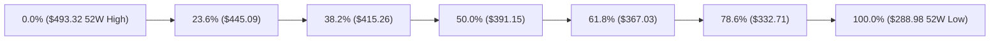

#### 斐波那契區間深度解讀

- **當前位置**：現價 $293.69 精確落在 **78.6% ($332.71)** 與 **100.0% ($288.98)** 回調區間之內，極度逼近 100% 底線（距離僅剩 $4.71，即 -1.61%）。
- **技術意義**：
  1. 股價在跌破 61.8% 黃金分割位 ($367.03) 後，引發了長期量化多頭的程式化停損，形成了單邊流暢的跌勢。
  2. 78.6% 回調位 ($332.71) 恰好與當前 MA20 ($332.12) 高度重疊，形成後續反彈難以踰越的強固壓制。
  3. 目前股價已將整輪歷史大行情的漲幅幾乎 100% 全部回吐。若跌破 100.0% ($288.98)，將打開未知的破底空間。

---

## 5. 技術指標深度解讀

### 🎛️ 指標訊號總覽

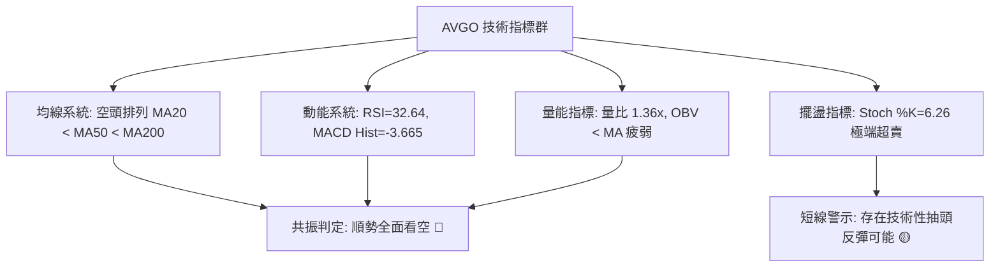

### 📈 移動平均線排列分析

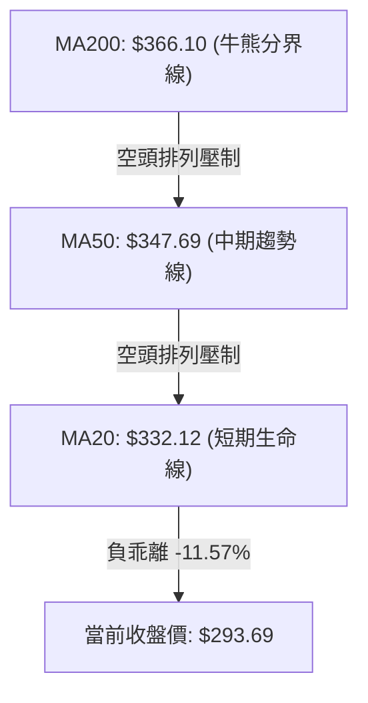

#### 移動平均線數據對比解讀

| 均線名稱 | 數值 | 價格相距 | 乖離率 (Bias) | 排列形態與歷史走勢特徵 |
|----------|------|----------|---------------|------------------------|
| **MA 5** | $313.01 | -$19.32 | -6.17% | ▇▆▆▆▆▆▇█████▇▆▅▅▄▄▃▃▃▃▄▄▄▄▄▃▁▁（短線瀑布下殺） |
| **MA 10** | $325.95 | -$32.25 | -9.90% | ▇▇▇▇▇▇▇████████▇▆▅▄▃▃▂▃▃▃▂▂▂▁▁（空頭加速發散） |
| **MA 20** | $332.12 | -$38.43 | -11.57% | ████▇███████████▇▇▆▆▆▅▅▅▅▄▄▃▂▁（月線級別下彎） |
| **MA 60** | $351.35 | -$57.66 | -16.41% | ████████▇▇▇▇▇▇▆▆▆▆▅▅▅▄▄▄▃▃▂▂▁▁（季線死叉確立） |
| **MA 120**| $374.57 | -$80.88 | -21.59% | ███████████▇▇▇▆▆▆▅▅▅▄▄▄▃▃▂▂▂▁▁（半年線壓制） |
| **MA 200**| $366.10 | -$72.41 | -19.78% | 跌破牛熊臨界點，長期投資者進入防禦停損期 |
| **MA 240**| $364.57 | -$70.88 | -19.44% | ▆▆▆▆▆▇▇█████▇▇▆▆▅▅▅▄▄▃▃▄▃▃▃▂▁▁（年線正式失守） |

### 📉 RSI(14) 分析

- **RSI(14) 數值**：32.64（Wilder 平滑計算）。
- **進度條展示**：
  ```
  RSI(14): 32.64 ▓▓▓▓▓▓░░░░░░░░░░░░░░ 32.6%  (處於弱勢偏空，尚未跌破 30 超賣線)
  ```
- **超買超賣狀態**：30–70 為常態區間。當前 32.64 顯示空方佔據絕對優勢，多頭買盤力量渙散，但尚未形成極端拋售竭盡（未破 30），意味著下方仍有下瀉動能。
- **背離判斷**：
  - 根據系統比較近 20 根 K 棒首尾的價格與 RSI 方向，**明確判定為：無明顯背離**。
  - 價格創新低，RSI 亦同步探底，指標對價格的下跌趨勢給予「完全確認」，無底背離護盤訊號。

### 📊 MACD(12/26/9) 訊號解讀

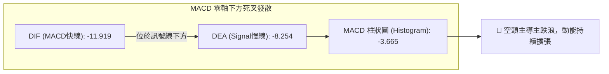

- **MACD DIF (-11.919)** 與 **Signal (-8.254)** 均位於零軸深處，且 DIF 乖離繼續下行，顯示中長線趨勢全面空頭。
- **MACD Histogram (-3.665)**：負值持續放大，柱狀圖柱體向下延伸，否定了短期轉折向上收斂的可能。

### 📦 布林通道分析

```
AVGO 布林通道軌道與現價示意圖：
價格
$366.79 ┤ ───────────────────────────────── BB 上軌
$349.45 ┤ 
$332.12 ┤ ═════════════════════════════════ BB 中軌 (MA20)
$314.79 ┤ 
$297.46 ┤ ───────────────────────────────── BB 下軌
$293.69 ┤ ◄── 現價 ($293.69 破軌運行，BB %B = -0.05)
```

- **通道寬度 (Bandwidth)**：$(366.79 - 297.46) / 332.12 = 20.87\%$，通道呈現劇烈向下開口（張嘴），說明波動率放大並由空方引導。
- **現價相對位置 (%B)**：-0.05。小於 0 意味著價格已經實質跌破並運行在布林通道下軌 ($297.46) 之外，技術上屬於極端空頭超賣推動格局。

### 💹 成交量分析（量價配合度）

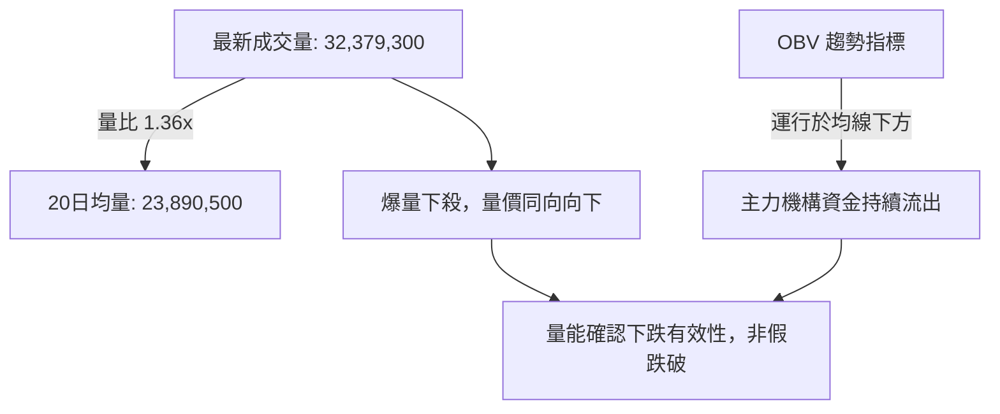

- **量比 (Volume Ratio)**：最新單日成交 32,379,300 股，相較於 20 日均量 (23,890,500 股) 放大至 **1.36 倍**；而在 11-05 暴跌當日更高達 **53,835,500 股**（超過 2.2 倍均量），呈現典型的帶量下殺。
- **OBV (能量潮)**：OBV 指標持續低於其移動平均線，且斜率陡峭向下，完全確認了盤面的拋售壓力來自機構主力資金的實質套現，不存在量價底背離的吸籌跡象。

---

## 6. 動能與波動率

### ⚡ 動能評估四象限

動能評估四象限矩陣（動能強度 vs 波動率）：

| 象限 | 動能維度 | 波動率維度 | 當前狀態判定 | 技術與操作含義 |
|------|----------|------------|--------------|----------------|
| **Q1 (高動能·低波動)** | 強 (Bull/Bear) | 低 (Low Vol) | — | 趨勢穩步推進，適合順勢波段持倉 |
| **Q2 (低動能·低波動)** | 弱 (Consolidation)| 低 (Low Vol) | — | 窄幅盤整待變，流動性收縮 |
| **Q3 (強動能·高波動)** | **強空頭 (Strong Bear)** | **高 (High Vol)** | **✓ (AVGO 當前位置)** | **高風險高波動單邊主跌浪，空方動能宣洩** |
| **Q4 (低動能·高波動)** | 弱 (Choppy) | 高 (High Vol) | — | 無方向高頻洗盤，極易造成雙向停損 |

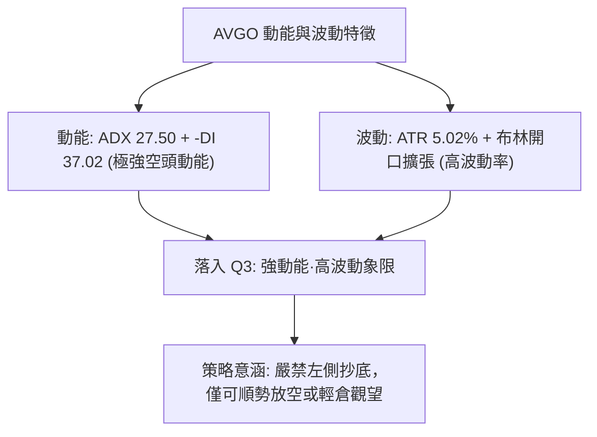

### 📊 ATR 波動率分析

- **ATR(14) 讀數**：$14.74（Wilder 平滑法計算）。
- **相對股價佔比**：$14.74 / 293.69 = \mathbf{5.02\%}$。
- **波動特性解讀**：日均振幅達到 5% 以上，屬於高波動半導體權值股特徵。單日正常的市場雜訊波動即可達到 15 美元，這意味著任何緊密的交易停損都會被輕易洗出場。
- **止損距離建議**：
  - 順勢空單防守點：建議設置在進場點上方 $1.5 \times \text{ATR}$（即 $1.5 \times 14.74 = \$22.11$）。
  - 超跌反彈多單防守點：必須放置於歷史低點 S2 ($288.98) 下方至少 $0.5 \times \text{ATR}$（約 $7.37 美元），以防假跌破洗盤。

### 📐 Beta 與市場相關性

- **Beta 係數**：**1.508**。
- **大盤相關性分析**：AVGO 具備高度進攻性與放大波動的特性。當那斯達克 (Nasdaq 100) 或費城半導體指數 (SOX) 出現 1% 的回調時，AVGO 平均將承擔 1.508% 的下行衝擊。在大盤整體面臨宏觀回調的環境下，高 Beta 特性加劇了 AVGO 的拋售潮。

---

## 7. 多時框架總結

### 📋 時框架評分表

| 時框架 | 趨勢方向 | 動能狀態 | 均線排列 | 圖表形態 | 綜合評分 | 建議 |
|--------|----------|----------|----------|----------|----------|------|
| **月線 (Long-Term)** | 🔴 轉空 | 負向擴大 | 跌破多條長期MA | 雙頂高位跌破 | 30/100 | 長期投資減倉避險 |
| **週線 (Medium-Term)** | 🔴 強烈看空 | MACD柱負向放大 | 空頭排列 (破MA200)| 帶量下破平台 | 25/100 | 嚴禁盲目建倉抄底 |
| **日線 (Short-Term)** | 🔴 單邊主跌 | Stoch 鈍化超賣 | 完美空頭排列 | 破布林下軌貼地 | 35/100 | 順勢做空，警惕超賣抽頭 |

### 🔲 綜合訊號矩陣

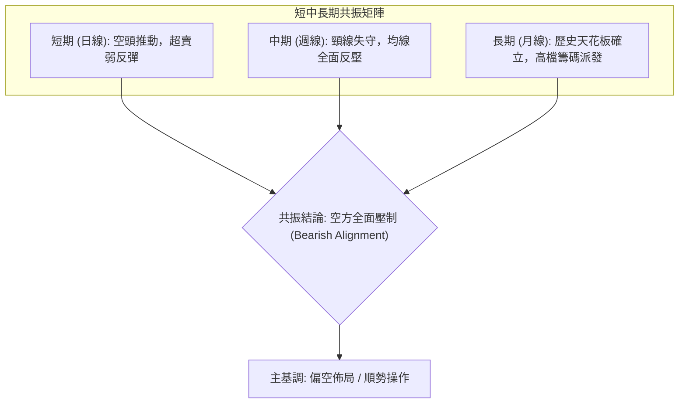

### ⚖️ 多時框收斂結論

依「嚴格要求 14」之收斂規則進行判定：
1. **行情性質判定**：當前 ADX(14) 為 **27.50**，明確大於 25 臨界值，因此當前市場被嚴格定義為**「趨勢行情」（Trend Market）**，而非震盪盤整行情。
2. **主導時框裁決**：在 ADX > 25 的趨勢行情下，優先級必須**以中長期時框（週線 / MA50 / MA200）方向為主導**。當前週線 MA50 ($347.69) 與 MA200 ($366.10) 均遭到失守，週 MACD 柱為負值 (-3.665)，均線呈現完美空頭排列。
3. **日線角色定位**：日線雖然出現 Stoch %K=6.26 的超賣現象，但僅能視為空頭主趨勢下的短期雜訊，只能用來尋找高空進場點，不可作為逆勢做多的理由。
4. **唯一收斂結論**：**強烈偏空（Bearish）**。此結論嚴格與第 1 章技術評分卡（綜合評分 30/100）保持一致，並直接指導第 8 章採取以空頭為主的操作策略。

---

## 8. 交易策略建議

### 🗺️ 策略決策流程圖

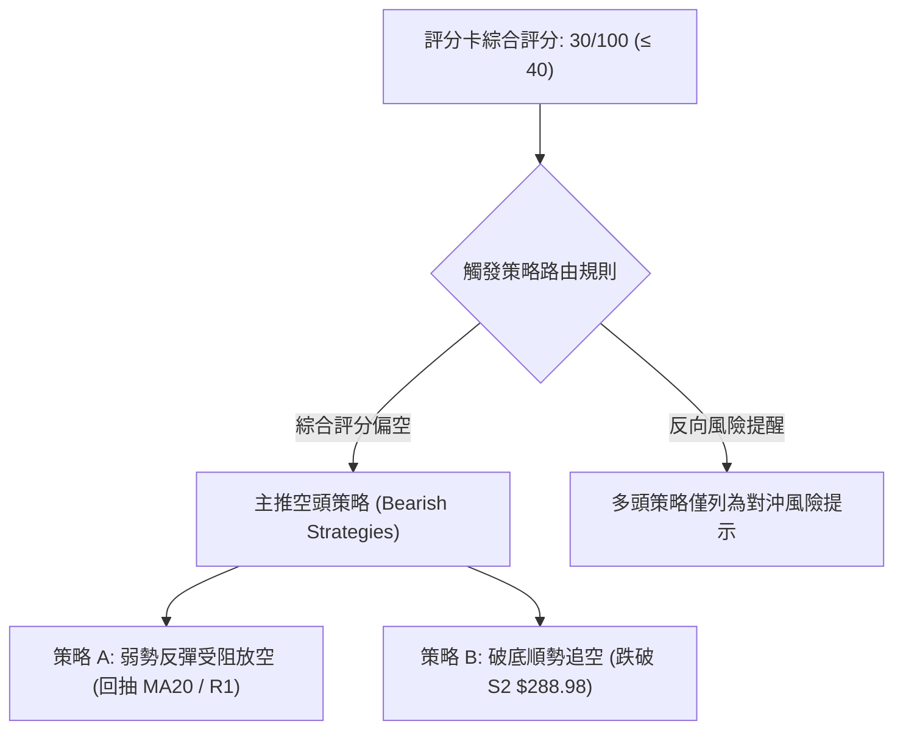

### 🧭 策略路由（依評分卡分流，不得兩頭下注）

> **當前主策略方向 = 強烈偏空（依評分卡綜合評分 30/100，規則 18 判定）**

依規則要求，綜合評分 ≤ 40 必須主推空頭策略。多頭僅列為反轉風險觸發點供風控對沖參考。

### 🎯 價格情境階梯（Price Scenarios）

價位嚴格引用第 4 章／關鍵價位區塊之真實數值：

| 觸發條件 | 下一目標 | 後續延伸 | 情境含義 |
|----------|----------|----------|----------|
| **反彈受阻回落** | 測試 S1 $293.68 | 下探 S2 $288.98 | 空頭中繼正常回抽，最佳順勢加空點 |
| **跌破 S1 $293.68** | 考驗 S2 $288.98 | 探尋未知歷史底 | 主跌浪加速，多頭防線全面瓦解 |
| **有效跌破 S2 $288.98** | 打開無支撐真空 | 觸發機構清算 | 創 52 週新低，程式化單邊拋售爆發 |
| **突破 R1 $338.13** | 測試 R2 $354.04 | 挑戰 R3 $366.55 | 空頭結構遭到破壞，短線轉強訊號（推翻空頭） |

### 📊 情境機率分佈

| 情境劇本 | 估計機率 | 主要技術依據（引用指標狀態） |
|----------|----------|------------------------------|
| **情境一：延續跌勢 / 跌破 S2 再探底** | **60%** | ADX 27.50 強趨勢主導，-DI 37.02 控盤，OBV 跌破均線量能潰散 |
| **情境二：在 S1 與 S2 間極窄幅震盪** | **25%** | Stoch %K=6.26 極端超賣鈍化，且靠近 52W 低點引發少量被動買盤 |
| **情境三：反彈回抽修復負乖離** | **15%** | 價格跌出布林下軌 (%B -0.05)，與 MA20 負乖離高達 -11.57% 的均值修復 |

### 🟢 主策略詳情（空頭主導策略）

精確數值計算嚴格遵守規則 17：風險報酬比 = (進場價 − 目標價 T1) ÷ (止損價 − 進場價)。

| 策略要素 | 策略 A（反彈高空 — 逢高阻力放空） | 策略 B（破位追空 — 跌破 S2 追空） |
|----------|----------------------------------|----------------------------------|
| **進場條件** | 股價弱勢反彈測試 MA20 與 R1 阻力帶出現阻滯長上影 | 跌破 52 週最低點 S2 且日線收盤確認跌破 |
| **進場價格** | **$335.00**（取 R1 $338.13 下方反彈區間中點） | **$288.00**（確認破位 S2 $288.98 關鍵點後） |
| **目標價 T1** | **$293.68**（引用支撐位 S1 聚類低點） | **$265.00**（由形態高度 $28.42 向下推算：$293.68 - $28.42 = $265.26，取整 $265.00） |
| **目標價 T2** | **$288.98**（引用支撐位 S2 / 52W 低點） | **$250.00**（由兩倍形態高度向下推算：$288.98 - $38.42 = $250.56，取整 $250.00） |
| **止損價格** | **$354.04**（嚴格引用阻力位 R2 波段高點） | **$297.46**（嚴格引用布林通道下軌作為假跌破止損線） |
| **風險報酬比** | **1 : 2.17（以 T1 計）**<br>計算式：$(335 - 293.68) / (354.04 - 335) = 41.32 / 19.04 = 2.17$<br>另：1 : 2.42（以 T2 計，$(335-288.98)/19.04 = 2.417$） | **1 : 2.43（以 T1 計）**<br>計算式：$(288 - 265) / (297.46 - 288) = 23.00 / 9.46 = 2.431$<br>另：1 : 4.02（以 T2 計，$(288-250)/9.46 = 4.017$） |
| **成功機率** | **65%** | **60%** |
| **建議倉位** | **10% - 15%** | **8% - 10%** |

### 🔴 反向風險觸發點（對沖提示）

若出現以下情況，主策略（偏空）將被推翻，空單必須無條件止損或離場：
1. **關鍵點位收復**：日線收盤價強勢站上 **R1: $338.13**，突破 MA20 ($332.12) 與 78.6% 斐波那契壓力帶。
2. **技術訊號反轉**：MACD 柱狀圖在零軸下方出現連續兩根顯著翻紅縮腳，且 RSI(14) 突破 45 阻力關卡。
3. **量價異動**：在 S2 ($288.98) 附近出現單日超過 50,000,000 股的爆量長下影線（類似 11-05 的天量但在低檔收陽）。

### ⭐ 整體訊號強度評星

```
做多訊號強度：★☆☆☆☆  (1/5星 - 僅有極端超賣，無右側確認)
做空訊號強度：★★★★☆  (4/5星 - 均線/趨勢/量能三位一體看空)
整體可信度：  ★★★★☆  (4/5星 - ADX>25，多時框共振度高)
```

---

## 9. 風險提示與監控

### ✅ 關鍵監控指標 Checklist

```
╔══════════════════════════════════════════════════════════════╗
║               AVGO 技術面日常監控清單 (Checklist)             ║
╠══════════════════════════════════════════════════════════════╣
║ [ ] 價位監控：S2 $288.98 是否在日線收盤被實質貫穿           ║
║ [ ] 均線監控：反彈時 MA20 ($332.12) 是否構成強烈壓制         ║
║ [ ] 動能監控：RSI(14) 能否擺脫 32.64 弱勢區並突破 40 關口   ║
║ [ ] 通道監控：布林 %B 是否能從 -0.05 重新修復站回 0.00 以上   ║
║ [ ] 量能監控：單日成交量是否回落至 20日均量 (23.89M) 以下    ║
║ [ ] 宏觀監控：費城半導體指數 (SOX) 是否跌破關鍵中期支撐       ║
╚══════════════════════════════════════════════════════════════╝
```

### ⚠️ 風險場景分析

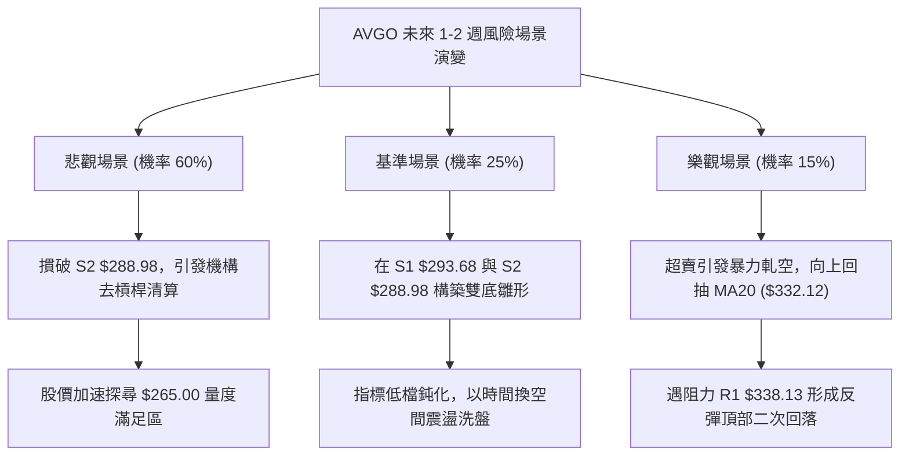

### 🛡️ 風險管理重要提醒

1. **ATR 波動風險管控**：當前 ATR(14) 高達 **$14.74 (5.02%)**。這意味著單日內股價上下跳動 10 至 15 美元屬正常範疇。進行任何操作時，單筆交易虧損額度必須嚴格限制在**總投資組合資金的 1.0% 以內**。
2. **倉位控制與槓桿限制**：由於當前股價貼近 52 週歷史低點，波動極易失真，整體持倉水位不宜超過 20%。嚴禁在此階段使用融資或高倍數槓桿金融衍生品進行單邊抄底押注。
3. **財報與事件風險防範**：半導體產業目前面臨 AI 基礎設施資本支出可持續性疑慮與高估值回調壓力。在宏觀半導體類股未出現集體放量止跌前，不可孤立看待 AVGO 的個股技術反彈。

---

## 📋 報告總結

```
╔══════════════════════════════════════════════════════════════╗
║                   AVGO 技術分析報告總結                      ║
╠══════════════════════════════════════════════════════════════╣
║ 報告日期：2026-11-09                                         ║
║ 當前價格：$293.69                                            ║
║ 分析評級：🔴 強烈偏空（綜合技術評分 30/100）                 ║
╠══════════════════════════════════════════════════════════════╣
║ 關鍵結論：                                                   ║
║ ├─ 長期趨勢：🔴 高檔雙頂回吐，6個月跌幅達 24.42%             ║
║ ├─ 中期趨勢：🔴 跌破 MA200 牛熊線與 MA50，週線空頭排列      ║
║ ├─ 短期趨勢：🔴 單邊主跌推動，布林通道 %B 破軌運行 (-0.05)   ║
║ ├─ 關鍵支撐：S1 $293.68 / S2 $288.98                         ║
║ ├─ 關鍵阻力：R1 $338.13 / R2 $354.04 / R3 $366.55            ║
║ └─ 分析師目標：華爾街平均目標價 $533.42 (技術面目前嚴重背離)   ║
╠══════════════════════════════════════════════════════════════╣
║ 最優策略組合：                                               ║
║ 1. 🥇 最佳機會：策略 A — 弱勢反彈至 $335 附近受阻時順勢放空  ║
║    (風報比 1 : 2.17，目標 S1 $293.68 / S2 $288.98，止損 R2) ║
║ 2. 🥈 次選機會：策略 B — 實質跌穿 S2 $288.98 關鍵支撐後追空  ║
║    (風報比 1 : 2.43，目標 $265.00，止損設於布林下軌 $297.46)║
║ 3. 🥉 保守選擇：空倉觀望，等待日線級別底背離或重新收復 R1   ║
╚══════════════════════════════════════════════════════════════╝
```

---

> ⚠️ **免責聲明**：本報告為 AI 自動生成之技術分析，所有數據及估算均基於提供的歷史價格資訊。本報告**僅供研究與學術參考**，**不構成任何投資建議**。投資有風險，入市需謹慎。

---

*報告生成時間：2026-11-09 ｜ 數據來源：Yahoo Finance ｜ 分析框架：多時框技術分析*