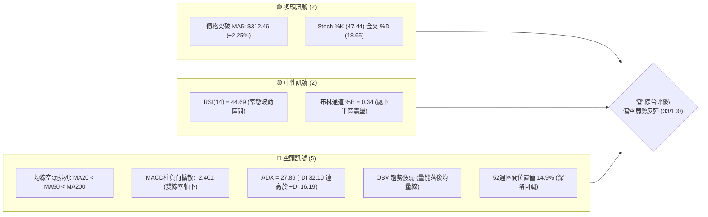
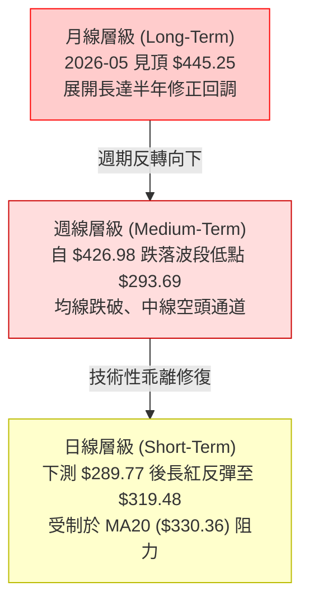
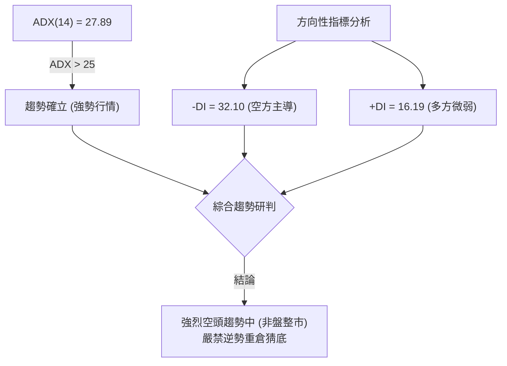
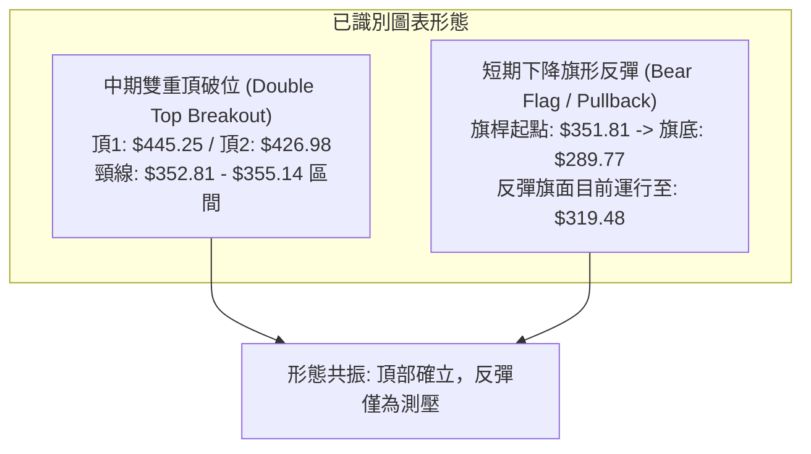
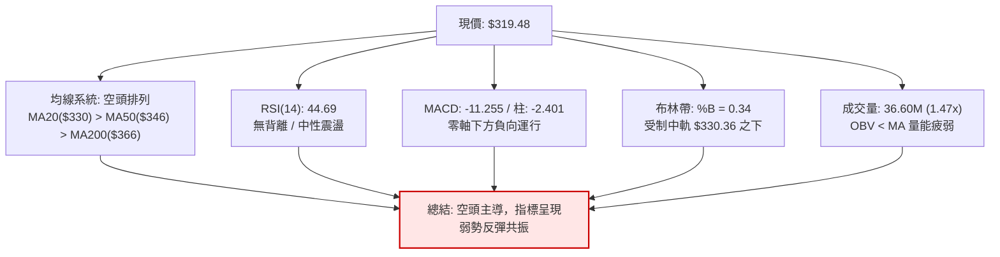
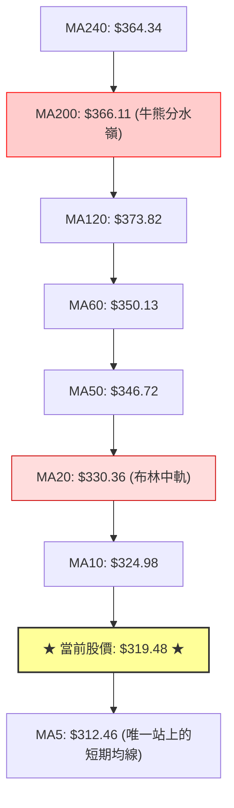
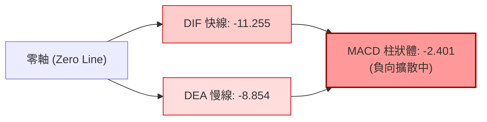
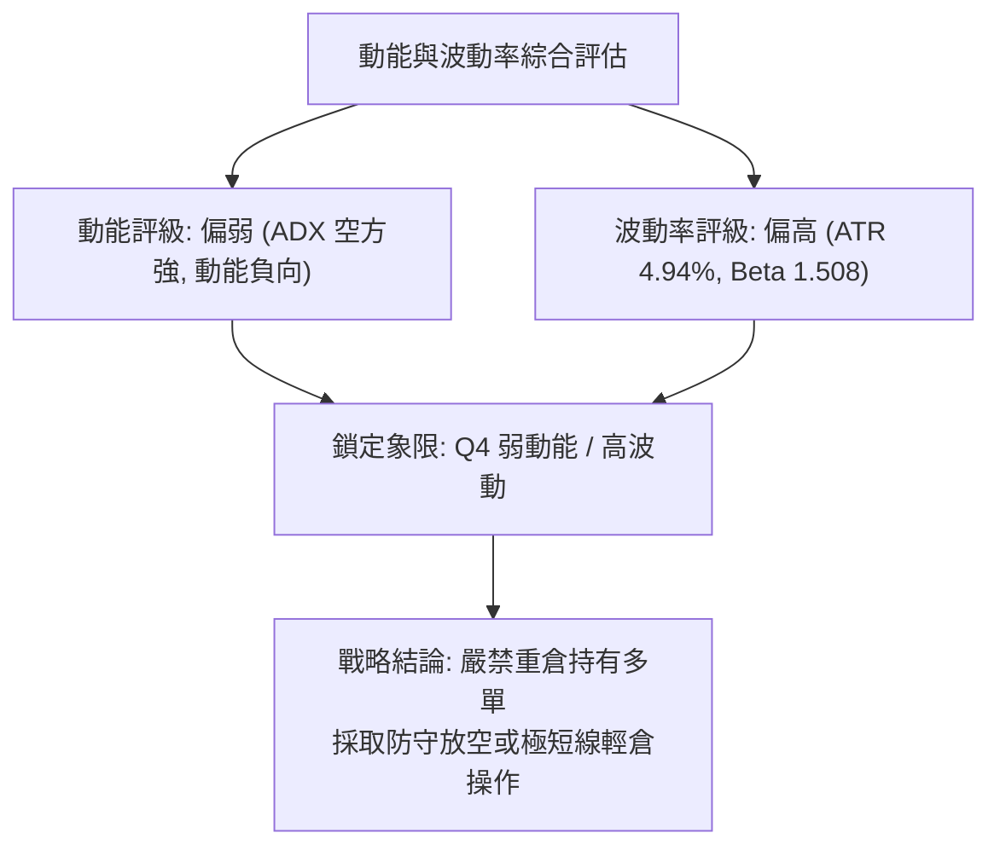
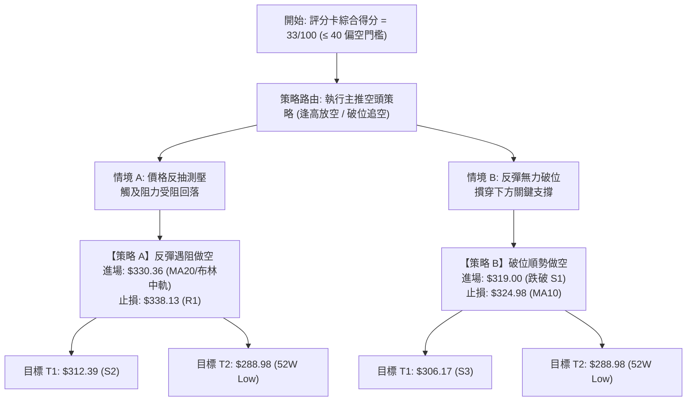
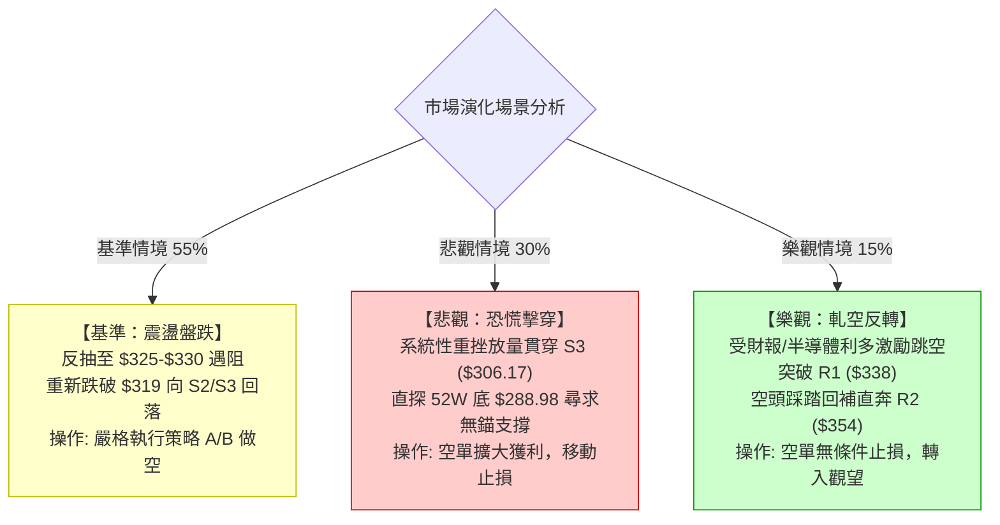

# AVGO 技術分析報告

> **報告日期**：2026-11-10 ｜ **語言**：繁體中文 ｜ **數據來源**：Yahoo Finance ｜ **當前價格**：$319.48 USD

---

## 目錄

| 章節 | 內容 |
|------|------|
| [1. 技術面概覽](#1-技術面概覽) | 訊號儀表板、核心指標、評分卡 |
| [2. 趨勢分析](#2-趨勢分析) | 多時框趨勢、長中短期走勢、ADX強弱 |
| [3. 圖表形態分析](#3-圖表形態分析) | 形態識別、K線組合、目標價推算 |
| [4. 支撐與阻力](#4-支撐與阻力) | 關鍵價位、斐波那契回調結構 |
| [5. 技術指標深度解讀](#5-技術指標深度解讀) | MA/RSI/MACD/布林/成交量全面共振 |
| [6. 動能與波動率](#6-動能與波動率) | 動能四象限、ATR風控、Beta連動 |
| [7. 多時框架總結](#7-多時框架總結) | 時框架矩陣與趨勢收斂判定 |
| [8. 交易策略建議](#8-交易策略建議) | 策略路由、情境階梯、風報比策略表 |
| [9. 風險提示與監控](#9-風險提示與監控) | 監控清單、極端情境與風控準則 |

---

## 1. 技術面概覽

### 🎯 技術訊號儀表板

Broadcom Inc. (AVGO) 目前技術架構呈現「中長期空頭趨勢壓制、短期超跌反彈」格局。均線系統全線下彎呈空頭排列，MACD 處於零軸下方深度負值區，ADX 讀數確認空方主導的趨勢行情正在進行。短期僅有隨機指標低檔金叉及價格站上超短期 MA5 帶來技術性抽頭契機。



---

### 📊 核心指標速覽表

| 指標類別 | 指標名稱 | 當前數值 | 訊號 | 解讀 |
|:---|:---|:---|:---:|:---|
| **價格** | 當前收盤價 | $319.48 | 🔴 | 位於 52 週波段下緣 14.9%，跌勢顯著 |
| **均線** | MA20 | $330.36 | 🔴 | 現價位於 MA20 下方 -3.29%，短線受壓制 |
| **均線** | MA50 | $346.72 | 🔴 | 現價位於 MA50 下方 -7.86%，中期結構偏空 |
| **均線** | MA200 | $366.11 | 🔴 | 現價位於 MA200 下方 -12.74%，長期牛熊分界失守 |
| **動能** | RSI(14) | 44.69 | 🟡 | 中性區間，自超賣區小幅回升，未見底背離 |
| **動能** | MACD (12,26,9) | -11.255 / -8.854 | 🔴 | 雙線位於零軸下，柱狀體 -2.401 顯示空方佔優 |
| **動能** | KD (Stoch 14,3,3) | %K 47.44 / %D 18.65 | 🟢 | 低檔金叉發散，提供日線級別短線修復動能 |
| **趨勢** | ADX (14) | 27.89 | 🔴 | ADX > 25 且 -DI(32.10) > +DI(16.19)，空方強趨勢 |
| **通道** | 布林通道 (20,2) | $296.98 ~ $363.74 | 🟡 | %B 為 0.34，受壓於中軌 $330.36 之下 |
| **成交量**| 最新量 / 20日均量 | 36.60M / 24.91M | 🟡 | 量比 1.47x，低檔長紅伴隨量能回補，但 OBV 仍弱 |
| **波動** | ATR(14) | $15.79 | 🔴 | 日波動幅度達 4.94%，市場劇烈震盪，洗盤風險高 |

---

### 🏆 技術評分卡

評分機制依據六大技術構面綜合權重評估。綜合評分依規則 18 取六項子評分之算術平均值：`(30 + 35 + 45 + 35 + 35 + 20) ÷ 6 = 33.33`，四捨五入為 **33/100**。

```
╔══════════════════════════════════════════════════════════════╗
║              技術評分卡 — AVGO (2026-11-10)                   ║
╠══════════════════════════════════════════════════════════════╣
║ 趨勢強度 (Trend)     ██████░░░░░░░░░░░░░░  30/100  🔴 空方主導 ║
║ 動能指標 (Momentum)  ███████░░░░░░░░░░░░░  35/100  🔴 零軸壓制 ║
║ 支撐穩定度 (Support) █████████░░░░░░░░░░░  45/100  🟡 考驗低點 ║
║ 成交量配合 (Volume)  ███████░░░░░░░░░░░░░  35/100  🔴 量能背馳 ║
║ 形態完整度 (Pattern) ███████░░░░░░░░░░░░░  35/100  🔴 空頭通道 ║
║ 均線排列 (Moving Avg)████░░░░░░░░░░░░░░░░  20/100  🔴 典型空排 ║
╠══════════════════════════════════════════════════════════════╣
║ 綜合評分 (Overall)   ███████░░░░░░░░░░░░░  33/100  🔴 偏空弱勢 ║
╚══════════════════════════════════════════════════════════════╝
```

---

## 2. 趨勢分析

### 🌐 多時框趨勢分析

透過月線、週線與日線的層級穿透，可清晰釐清主趨勢與次級波折返的關係：



---

### 📈 長期趨勢 — 12個月走勢圖（ASCII）

以下展示 AVGO 過去 12 個月（2025-12 至 2026-11）的月線收盤走勢，標注頂部回落與當前價位結構：

```
AVGO 月線收盤走勢圖（2025-12 至 2026-11）
價格 ($)
$460 ┤                                  ● $445.25 (2026-05 波段頂部)
$430 ┤                            ● $416.01
$400 ┤                                        ● $388.57
$370 ┤                                  ● $377.06   ● $369.67
$340 ┤  ● $344.20                                        ● $351.19
$310 ┤        ● $329.48  ● $317.80  ● $308.46                   ● $326.08  ● $319.48 (現價)
$280 ┤                                                                 (低點觸及 $289.77)
     └────┬─────────┬─────────┬─────────┬─────────┬─────────┬─────────┬─────────┬─────────┬────
       2025-12   2026-01   2026-02   2026-03   2026-04   2026-05   2026-06   2026-07   2026-08   2026-09   2026-10   2026-11
```

#### 長期走勢階段特徵分析

| 階段時間 | 價格區間 ($) | 漲跌幅 | 走勢特徵描述 |
|:---|:---:|:---:|:---|
| **2025-12 ~ 2026-03** | 344.20 → 308.46 | -10.38% | 高檔震盪築底，於 $308–$320 構築支撐平台 |
| **2026-03 ~ 2026-05** | 308.46 → 445.25 | +44.35% | 主升浪狂飆，創下歷史次高與 52 週高點 $493.32 |
| **2026-05 ~ 2026-08** | 445.25 → 369.67 | -16.97% | 頭部放量派發，週線跌破短期均線，趨勢轉折 |
| **2026-08 ~ 2026-11** | 369.67 → 319.48 | -13.58% | 空頭主導下行，破位加速下探至 $289.77，現處弱勢反彈 |

---

### 📊 中期趨勢（週線分析）

週線近 8 週形成顯著的「下階梯式」跌勢。9 月底於 $366.55 遇阻後，連綿收黑，特別是 2026-11-06 當週創下低點 $289.77，週成交量暴增至 147,761,200 股，顯現恐慌性殺跌籌碼。

```
中期週線阻力與支撐示意圖
══════════════════════════════════════════════════════════════════════
[強阻力區]   $366.55 ────── 9月反彈頂點 / 斐波 61.8% ($367.03) 聚類
                  │
[次級阻力]   $338.13 ────── 10月反彈次高點 / 斐波 78.6% ($332.71)
                  │
[現價定位]   $319.48 ◄──── 剛收復 S1 ($319.05)，面臨週均線反壓
                  │
[近期低點]   $289.77 ────── 11-06 恐慌低點 / 接近 52W Low ($288.98)
══════════════════════════════════════════════════════════════════════
```

---

### ⚡ 趨勢強度評估（ADX 解讀）

當前技術讀數顯示 ADX(14) 數值為 **27.89**。依據技術分析法則，ADX 突破 25 即代表市場處於「明晰的趨勢行情（Trending Market）」，而非混沌的震盪市。



#### ADX 指標強度對照

| 指標名稱 | 實際數值 | 臨界標準 | 狀態評定 | 技術意義 |
|:---|:---:|:---:|:---:|:---|
| **ADX (14)** | **27.89** | 25.00 | 🟢 趨勢強勁 | 脫離無方向橫盤，單邊波動加劇 |
| **-DI (14)** | **32.10** | 20.00 | 🔴 空方控盤 | 賣盤佔據主導，空頭壓制力道顯著 |
| **+DI (14)** | **16.19** | 20.00 | 🔴 多方衰竭 | 買盤動能不足，難以支撐反轉攻擊 |
| **方向差距 (-DI - +DI)**| **+15.91** | 0.00 | 🔴 空頭淨優勢 | 趨勢空方排列，任何反彈均屬次級折返 |

---

## 3. 圖表形態分析

### 🔍 形態識別系統

根據近一年與近數週價格軌跡，AVGO 出現了明確的高檔派發頂部形態與日線超跌旗形整理：



#### 圖表形態信心度與目標價評估表

| 形態名稱 | 信心度 | 判斷依據（引用數據） | 完成度 | 目標價（附精確計算式） |
|:---|:---:|:---|:---:|:---|
| **中期雙重頂 (Double Top)** | **85%** | 兩次波段高點分別在 2026-05 的 $445.25 與 2026-08 的 $426.98，後續跌破 2026-09 週收盤頸線 $352.81。 | 100% (已破位) | 頸線 $352.81 − 形態高度 ($426.98 − $352.81 = $74.17) = **$278.64** |
| **短期超跌反彈通道 (Bear Flag)** | **70%** | 自 10-28 高點 $352.40 崩跌至 11-06 低點 $289.77（跌幅 $62.63），近 2 日小幅回升至 $319.48。 | 60% (運行中) | 旗形反彈極限約中軌 $330.36；若再度跌破旗底 $289.77，二浪下行目標 = $289.77 − $62.63 = **$227.14** |

---

### 🕯️ 重要 K 線形態分析

嚴格依據數據中「近 10 根日 K」與「近 8 根週 K」之開高低收數據進行客觀解讀：

#### 近 10 根日 K 線形態解讀表

| 日期 | 開盤價 | 最高價 | 最低價 | 收盤價 | K線形態名稱 | 技術解讀 | 訊號 |
|:---:|:---:|:---:|:---:|:---:|:---:|:---|:---:|
| **10-27** | 339.87 | 345.67 | 336.87 | 342.33 | 帶下影小陽線 | 測試 $336.87 獲得支撐，溫和回升 | 🟡 |
| **10-28** | 349.22 | 352.40 | 344.35 | 351.81 | 跳空光腳中陽 | 向上挑戰阻力區 R2 ($354.04) 失敗收長上影 | 🟡 |
| **10-29** | 342.00 | 346.15 | 338.80 | 345.00 | 窄幅整理陰十字 | 高檔多空猶豫，成交量萎縮至 17.05M 顯露疲態 | 🟡 |
| **10-30** | 330.72 | 331.98 | 319.30 | 326.08 | 跳空放量中長黑 | 跳空跌破 MA20，伴隨 36.51M 賣壓放量確認破位 | 🔴 |
| **11-02** | 328.37 | 333.56 | 321.87 | 322.23 | 弱勢反彈受阻黑K | 向上回測 $333.56 遇阻，收盤逼近全日低點 | 🔴 |
| **11-03** | 328.97 | 335.74 | 326.60 | 332.13 | 溫和修復小紅K | 抵抗性買盤推升，但無法封閉 10-30 缺口 | 🟡 |
| **11-04** | 326.86 | 334.12 | 321.74 | 325.48 | 衝高回落十字黑 | 向上測試 $334.12 承壓，多頭反攻無力轉為派發 | 🔴 |
| **11-05** | 311.89 | 314.00 | 290.12 | 291.53 | 恐慌崩跌大長黑 | 暴跌 -10.43%，單日爆量 53.84M 跌破 $300 大關 | 🔴 |
| **11-06** | 311.13 | 311.52 | 289.77 | 293.69 | 探底長下影小黑星 | 下探 52W 低點邊緣 $289.77 後引發短線空頭回補 | 🟢 |
| **11-09** | 305.29 | 323.05 | 304.29 | 319.48 | 實體中長陽貫穿線 | 放量 36.60M 貫穿前一日高點，收盤站上 S1 ($319.05) | 🟢 |

#### 近 8 根週 K 線形態解讀表

| 日期（週末） | 開盤價 | 最高價 | 最低價 | 收盤價 | 週K線形態名稱 | 技術解讀 | 訊號 |
|:---:|:---:|:---:|:---:|:---:|:---:|:---|:---:|
| **09-25** | 358.66 | 366.55 | 346.89 | 352.81 | 衝高受阻流星陰線 | 遇阻 R3 ($366.55) 後大幅回落，確認頂部壓制 | 🔴 |
| **10-02** | 352.87 | 361.86 | 343.29 | 355.14 | 窄幅下影小陽紡錘 | 於 $343.29 尋求支撐，多空陷入拉鋸 | 🟡 |
| **10-09** | 357.79 | 380.84 | 356.14 | 361.54 | 衝高假突破長上影 | 虛破 $380 誘多後回吐，形成顯著中期空頭陷阱 | 🔴 |
| **10-16** | 359.43 | 360.69 | 328.58 | 328.75 | 斷頭崩跌大黑棒 | 一舉貫穿多道支撐，收盤收在最低點 $328.75 | 🔴 |
| **10-23** | 338.75 | 341.10 | 320.23 | 321.68 | 延續性破位黑K | 弱勢下探，買盤完全退守，均線呈現加速下彎 | 🔴 |
| **10-30** | 324.53 | 352.40 | 319.30 | 326.08 | 震盪反抽受阻長上影| 反彈至 $352.40 遭逢空方狙擊，收盤退回 $326.08 | 🔴 |
| **11-06** | 328.37 | 335.74 | 289.77 | 293.69 | 放量恐慌大黑棒 | 週成交量爆出 147.76M，重挫擊穿 $300 整數關口 | 🔴 |
| **11-09** | 305.29 | 323.05 | 304.29 | 319.48 | 單日週初長紅回補 | 週初技術性修復大漲，短線嘗試構築防禦陣地 | 🟢 |

---

### 📉 ASCII 走勢形態示意圖

下圖呈現 10 月下旬以來的破位與反彈測試結構：

```
AVGO 日線形態走勢示意圖
$355 ┤      ● 10-28 ($352.40 旗形高點)
$345 ┤    ／  ＼
$335 ┤  ／      ● 11-03 ($335.74 弱勢反彈點)
$325 ┤● 10-30    ＼        ● 11-09 現價 $319.48 (反彈測試中)
$315 ┤ (破位缺口)  ＼    ／
$305 ┤               ＼／
$295 ┤                ● 11-06 恐慌低點 ($289.77)
$285 └────────────────────────────────────────────────────────
     10-27      10-30      11-03      11-06      11-09
```

---

## 4. 支撐與阻力

### 🗺️ 關鍵價位分布圖（ASCII）

嚴格依據 OHLCV 歷史數據計算之高低點聚類與斐波那契回調位，建構核心空間坐標軸：

```
AVGO 價位結構分布圖 (OHLCV 精確計算)
════════════════════════════════════════════════════════════════════
$366.55 ║████████████████████████████████████║ 強阻力 R3 (9月高點/斐波61.8%)
$354.04 ║████████████████████████            ║ 次級阻力 R2 (10-28 反彈阻力)
$338.13 ║████████████████                    ║ 關鍵阻力 R1 (波段回調反壓位)
$330.36 ║────────────────────────────────────║ 布林中軌 / MA20 短線分水嶺
$319.48 ╠════════════════════════════════════╣ ◄ 當前收盤價 ($319.48)
$319.05 ║▓▓▓▓▓▓▓▓▓▓▓▓▓▓▓▓▓▓▓▓▓▓▓▓▓▓▓▓▓▓▓▓▓▓▓▓║ 近期支撐 S1 (臨界支撐線)
$312.39 ║████████████████                    ║ 核心支撐 S2 (波段回踩密集成交)
$306.17 ║████████████████████████            ║ 強支撐 S3 (恐慌殺跌前緩衝區)
$288.98 ║████████████████████████████████████║ 52週極限低點 (52W Low / 斐波100%)
════════════════════════════════════════════════════════════════════
```

---

### 🚧 阻力位分析表

所有價位均嚴格取自數據給定之 OHLCV 計算聚類：

| 阻力級別 | 精確價位 | 距現價幅標 | 形成原因與技術意涵 | 突破難度 | 重要性 |
|:---|:---:|:---:|:---|:---:|:---:|
| **阻力 R1** | **$338.13** | +5.84% | 近一年波段高點密集聚類，逼近 MA20 ($330.36) 與斐波 78.6% ($332.71) 反壓。 | 🟡 中等 | ★★★★☆ |
| **阻力 R2** | **$354.04** | +10.82% | 10-28 高點 ($352.40) 與 MA60 ($350.13) 重疊區，前期平臺破位頸線位置。 | 🔴 極高 | ★★★★★ |
| **阻力 R3** | **$366.55** | +14.73% | 09-25 週K波段高點，精確共振斐波 61.8% ($367.03) 及 MA200 ($366.11)。 | 🔴 堅不可摧 | ★★★★★ |

---

### 🛡️ 支撐位分析表

| 支撐級別 | 精確價位 | 距現價幅標 | 形成原因與技術意涵 | 守住機率 | 重要性 |
|:---|:---:|:---:|:---|:---:|:---:|
| **支撐 S1** | **$319.05** | -0.14% | 近一年波段低點聚類，目前收盤價 $319.48 緊貼其上，多頭防守第一線。 | 🟡 50% | ★★★☆☆ |
| **支撐 S2** | **$312.39** | -2.22% | 密集換手低點聚類，共振超短期均線 MA5 ($312.46)，跌破將引發停損賣壓。 | 🟡 45% | ★★★★☆ |
| **支撐 S3** | **$306.17** | -4.17% | 恐慌崩跌波段之最後防護陣地，此位失守將直探 11-06 低點 $289.77。 | 🟢 60% | ★★★★☆ |
| **終極底** | **$288.98** | -9.55% | 52 週最低價 (52W Low) 及斐波那契 100.0% 終極支撐，破位將引發無錨下墜。 | 🟢 75% | ★★★★★ |

---

### 📐 斐波那契回調位分析

依據 52 週區間波段低點 **$288.98** 至最高點 **$493.32**（全波段落差高達 $204.34）進行斐波那契黃金分割計算：

| 斐波那契回調比例 | 精確對應價位 | 技術結構意義解讀 | 當前價格相對位置 |
|:---:|:---:|:---|:---:|
| **0.0% (52W High)** | **$493.32** | 歷史峰值阻力，長期多頭終極目標 | 位於此價位下方 -35.24% |
| **23.6%** | **$445.09** | 2026-05 月線高點密集成交區 | 遠在當前價格上方 |
| **38.2%** | **$415.26** | 2026-04 月線收盤突破點 | 遠在當前價格上方 |
| **50.0%** | **$391.15** | 多空絕對強弱分水嶺（半山腰） | 遠在當前價格上方 |
| **61.8%** | **$367.03** | **黃金分割牛熊界**（精確共振 R3 $366.55 及 MA200） | 遠在當前價格上方 |
| **78.6%** | **$332.71** | **深度防禦警戒線**（共振 MA20 $330.36 與 R1 $338.13） | 現價下方反彈首要考驗 |
| **100.0% (52W Low)**| **$288.98** | **波段起漲起點**（11-06 剛探至 $289.77 止跌） | 現價下方極限防禦底線 |

> **深度位置解讀**：現價 **$319.48** 正精確受困於 **78.6% ($332.71)** 與 **100.0% ($288.98)** 之間的「極度超跌重挫危險區」。跌破 61.8% ($367.03) 後，長線多頭結構已遭實質破壞，當前反彈屬於回測 78.6% 壓力線的弱勢修正。

---

## 5. 技術指標深度解讀

### 🎛️ 指標訊號總覽



---

### 📈 移動平均線排列分析

均線系統展現極為標準的空頭排列特徵，短、中、長期均線全數向下俯衝，對股價形成沉重蓋頭反壓：



#### 均線數據與偏離度表

| 均線名稱 | 當前價格 | 與現價價差 | 偏離幅度 (%) | 走勢特徵 | 訊號評定 |
|:---|:---:|:---:|:---:|:---|:---:|
| **MA5** | $312.46 | +$7.02 | +2.25% | 連續 2 日翻揚，提供超短線支撐 | 🟢 翻多 |
| **MA10** | $324.98 | -$5.50 | -1.69% | 持續走跌，為日內反彈第一道阻力 | 🔴 看空 |
| **MA20** | $330.36 | -$10.88 | -3.29% | 加速下彎，共振布林中軌強壓 | 🔴 偏空 |
| **MA50** | $346.72 | -$27.24 | -7.86% | 中期生命線失守，下行斜率陡峭 | 🔴 偏空 |
| **MA60** | $350.13 | -$30.65 | -8.75% | 季線下穿，形成波段壓制重災區 | 🔴 看空 |
| **MA120** | $373.82 | -$54.34 | -14.54% | 半年線持續走低 | 🔴 看空 |
| **MA200** | $366.11 | -$46.63 | -12.74% | **死亡交叉進行中** (MA50 < MA200) | 🔴 長空 |

---

### 📉 RSI(14) 分析

當前 Wilder RSI(14) 讀數為 **44.69**。

```
RSI(14) 數值進度條定位
0 [════════════════ 超賣 30 ═══════════ 中性 50 ═══════════ 超買 70 ════════════════] 100
  ████████████████████████░░░░░░░░░░░░░░░░░░░░░░░░░░░░░░░  44.69 (偏弱中性區)
```

*   **超買/超賣研判**：RSI 脫離 11-06 的 32.6 低檔弱勢區，目前回升至 44.69，未進入 70 超買區，亦不再處於 30 極端超賣區。
*   **背離判定**：**「無明顯背離」**。比對近 20 根 K 棒走勢，價格自 10-28 高點 $352.40 跌至 11-06 低點 $289.77，RSI 同步自 50.2 震盪下行至 32.6，未出現價格破底而 RSI 抬高的底背離特徵，因此當前反彈僅能視為動能弱勢修復，不可視為趨勢反轉。

---

### 📊 MACD(12,26,9) 訊號解讀



*   **快慢線位置**：DIF (-11.255) 與 DEA (-8.854) 雙雙深陷零軸之下，反映中線波段為完全空頭趨勢。
*   **柱狀體型態**：柱體為 **-2.401**，持續呈現負值，代表空方動能仍持續發散，尚未出現柱狀體收斂翻紅之金叉早期徵兆。

---

### 📦 布林通道分析

布林帶寬度大幅張開，反映波動率隨殺跌暴增。

```
AVGO 布林通道日線空間示意圖
════════════════════════════════════════════════════════════════════
$363.74 ───────────────────────────── 布林上軌 (Upper Band)
                  │
                  │
$330.36 ───────────────────────────── 布林中軌 (MA20 / Middle Band)
                  │   ▲
$319.48 ──────────┼───● 當前收盤價 (%B = 0.34)
                  │   ▼
$296.98 ───────────────────────────── 布林下軌 (Lower Band)
════════════════════════════════════════════════════════════════════
```

*   **通道寬度 (Bandwidth)**：上軌 $363.74 與下軌 $296.98 相距達 $66.76（帶寬 20.9%），屬寬幅擴張階段。
*   **%B 指標解析**：%B = 0.34，顯示現價處於下軌上方、中軌下方的空頭掌控區間。11-06 股價一度跌破下軌 ($289.77 < $296.98) 形成乖離過大，當前回抽屬於正常的通道內技術性回歸，布林中軌 **$330.36** 構成反彈極限鐵壁。

---

### 💹 成交量分析（量價配合度）

*   **成交量變化**：最新日成交量為 **36,603,900** 股，相較 20 日均量（24.91M）量比達 **1.47x**。雖然 11-09 出現放量反彈長紅，但對比 11-05 崩跌時爆出的 **53,835,500** 股恐慌賣壓，多頭反攻量能仍遜於主跌段空頭放量規模。
*   **能量潮 (OBV) 研判**：數據清晰顯示「OBV < MA → 量能疲弱」。這表明主力大戶資金在 9-10 月的高位派發後，資金並未顯著回流回補，籌碼面呈現「散戶接刀、機構被動回補」特徵，量價缺乏多頭主升所需的量價齊揚架構。

---

## 6. 動能與波動率

### ⚡ 動能評估四象限

評估 AVGO 在「趨勢動能」與「波動率水平」之相對定位：

| 象限分區 | 動能狀態 | 波動水平 | AVGO 當前定位 | 操作環境技術解讀 |
|:---:|:---:|:---:|:---:|:---|
| **第一象限 (Q1)** | 強動能 (多頭) | 低波動 | — | 最佳波段順勢抱牢時機 |
| **第二象限 (Q2)** | 弱動能 (盤整) | 低波動 | — | 沉悶牛皮市，突破前夕觀望 |
| **第三象限 (Q3)** | 強動能 (多頭) | 高波動 | — | 快速拉升期，高風險高收益 |
| **第四象限 (Q4)** | **弱動能 (空頭)** | **高波動** | **✓ (當前處於此象限)** | **主跌段或弱勢反彈，震盪極劇烈，風險收益比極度不對稱** |



---

### 📊 ATR 波動率分析

*   **ATR(14) 數值**：**$15.79**（占現價比例達 **4.94%**，依據 Wilder 計算標準）。
*   **日常風控涵義**：這意味著 AVGO 在一個正常交易日內，價格產生 $15–$16 美元的上下擺動屬於常規隨機雜訊。
*   **止損距離建議**：
    *   **短線交易 (Swing)**：建議最低止損距離為 `1.0 × ATR` = **$15.79**。
    *   **波段防守 (Position)**：建議安全止損距離為 `1.5 ~ 2.0 × ATR` = **$23.69 ~ $31.58**。若止損設定過於緊密（如小於 $10），極易在日內高波動中遭到無效洗盤出場。

---

### 📐 Beta 與市場相關性

*   **Beta 係數**：**1.508**。
*   **市場連動解讀**：AVGO 具備高度積極的高彈性特質。當標普 500 或那斯達克 100 指數波動 1.0% 時，理論上 AVGO 將產生 1.508% 的同向放大波動。在當前大盤科技股劇烈震盪背景下，高 Beta 將顯著放大下檔回撤風險，多頭部位需提防系統性風險衝擊。

---

## 7. 多時框架總結

### 📋 時框架評分表

依據各時框均線、動能指標與趨勢強度進行綜合評定：

| 時框架 | 趨勢方向 | 動能狀態 | 均線排列特徵 | 關鍵圖表形態 | 綜合評分 | 操作戰略建議 |
|:---:|:---:|:---:|:---|:---|:---:|:---|
| **長期 (月線)** | 🔴 偏空修正 | 負向發散 | 跌破 5MA/10MA，高檔乖離收斂 | 2026-05 頂部派發後長陰回落 | 35/100 | 長期投資者減碼避險 |
| **中期 (週線)** | 🔴 確立下行 | 柱體負擴散 | MA20 < MA50，死亡交叉隱現 | 雙重頂破位，跌破頸線 $352 | 30/100 | 反彈受阻逢高做空為主 |
| **短期 (日線)** | 🟡 弱勢反彈 | 低檔修復 | MA20 壓制，僅突破 MA5 反抽 | 超跌長黑後之旗形回抽通道 | 40/100 | 短線超跌反抽，謹防誘多 |

---

### 🔲 綜合訊號矩陣

```
時框架訊號矩陣與方向性共振
┌───────────┬──────────────┬──────────────┬──────────────┬──────────────┐
│  時框架   │  趨勢 (Trend)│  均線 (MA)   │  動能 (MACD) │  綜合判定    │
├───────────┼──────────────┼──────────────┼──────────────┼──────────────┤
│  月線 (M) │    🔴 偏空   │    🔴 走平   │    🟡 轉弱   │   🔴 修正期  │
│  週線 (W) │    🔴 強空   │    🔴 空排   │    🔴 負向   │   🔴 主跌段  │
│  日線 (D) │    🟡 震盪   │    🔴 空排   │    🟡 修復   │   🟡 測阻力  │
└───────────┴──────────────┴──────────────┴──────────────┴──────────────┘
```

---

### ⚖️ 多時框收斂結論

依據多時框收斂規則（規則 14）：
1.  **趨勢 vs 盤整判定**：當前 ADX(14) 數值為 **27.89**，大於 25 臨界值，明確判定當前為**「空頭趨勢行情（Trending Market）」**，而非無方向的盤整市。
2.  **時框收斂優先級**：必須以中長期（週線 / MA50 / MA200）方向為絕對主導，日線層級的反彈長紅僅能定義為**「空頭主趨勢下的次級折返走勢」**，日線反彈主要用於尋求風險回報比優異的逢高進場做空機會，而非轉向看多。
3.  **唯一方向性結論**：**【偏空（主策略：逢高放空）】**。此結論與第 1 章評分卡（33/100）及第 5 章均線全面空排完全一致。

---

## 8. 交易策略建議

### 🗺️ 策略決策流程圖



---

### 🧭 策略路由

> **當前主策略方向 = 【主推空頭策略（偏空逢高放空）】（依技術評分卡：33/100）**

依據評分卡規則，評分 ≤ 40 必須完全聚焦於空頭部署，多頭操作僅列為極端反轉之停損風控對沖提示，嚴禁在多空兩端同時重倉對賭。

---

### 🎯 價格情境階梯（Price Scenarios）

所有價位均精確引用數據中的阻力與支撐聚類：

| 觸發條件 | 下一目標 | 後續延伸 | 情境技術含義與應對 |
|:---|:---:|:---:|:---|
| **強勢向上突破 R1 $338.13** | R2 $354.04 | R3 $366.55 | 超跌強反彈延伸，空頭策略全面停損觀望 |
| **反彈受阻於 MA20 $330.36** | S1 $319.05 | S2 $312.39 | 符合主策略預期，空頭建倉之最佳甜點區 |
| **向下跌破 S1 $319.05** | S2 $312.39 | S3 $306.17 | 短線反彈夭折，啟動順勢破位加碼做空 |
| **失守強支撐 S3 $306.17** | $289.77 | 52W 低點 $288.98 | 恐慌二浪加速下探，直奔 52 週底線 |

---

### 📊 情境機率分佈

| 情境類型 | 發生機率 | 主要技術數據依據 |
|:---|:---:|:---|
| **回落再探底（下行趨勢延續）** | **55%** | 均線典型空排、ADX=27.89 且 -DI=32.10 強勢主導、MACD 柱負向擴散。 |
| **區間弱勢震盪（旗面整理）** | **30%** | 布林 %B=0.34 處於下軌回升期，KD 低檔金叉支持短線拉鋸抗跌。 |
| **強勢反轉上行（多頭突圍）** | **15%** | OBV 疲弱且基本面分析師目標價雖高但技術面嚴重破位，反轉機率極低。 |

---

### 🟢 主策略詳情（空頭主推策略表）

依據規則 17，風險報酬比公式嚴格定義為：做空時 `(進場價 − 目標價) ÷ (止損價 − 進場價)`，以格式 `1 : X.XX（以 T1 計）` 呈現。

| 策略要素 | 策略 A（反彈受阻空 — 逢高做空） | 策略 B（跌破追擊空 — 順勢破位） |
|:---|:---|:---|
| **策略類型** | 順應週線空頭，等待日線次級折返測壓進場 | 跌破關鍵支撐後之動能順勢追空 |
| **進場條件** | 股價反彈至布林中軌/MA20，出現上影線承壓 | 股價實體跌破關鍵支撐 S1 ($319.05) |
| **進場價格** | **$330.36**（MA20 與布林中軌重疊處） | **$319.00**（確認破位 S1 $319.05） |
| **目標價 T1** | **$312.39**（核心支撐 S2） | **$306.17**（強支撐 S3） |
| **目標價 T2** | **$288.98**（52W Low 終極底） | **$288.98**（52W Low 終極底） |
| **止損價格** | **$338.13**（關鍵阻力 R1 突破止損） | **$324.98**（MA10 均線上方止損） |
| **風險報酬比** | **1 : 2.31（以 T1 計）**<br/>*(330.36 - 312.39) ÷ (338.13 - 330.36) = 17.97 ÷ 7.77*<br/>另標注：**1 : 5.33（以 T2 計）** | **1 : 2.15（以 T1 計）**<br/>*(319.00 - 306.17) ÷ (324.98 - 319.00) = 12.83 ÷ 5.98*<br/>另標注：**1 : 5.02（以 T2 計）** |
| **勝率評估** | **60%** | **50%** |
| **建議倉位** | **總資金之 10% ~ 15%** | **總資金之 5% ~ 8%** |

---

### 🔴 反向風險觸發點（多頭對沖提示）

若出現以下訊號，代表空頭結構遭遇嚴重挑戰，空單必須立即全部止損退場，嚴禁硬抗：
1.  **日 K 線實體收盤突破 $338.13 (R1)**：意味著行情突破 MA20 並克服斐波 78.6% 壓力，短線將形成 W 底向 R2 ($354.04) 挺進。
2.  **MACD 柱狀體翻正且金叉**：DIF 向上穿越 DEA，代表日線級別動能翻多。
3.  **多頭對沖操作**：若突破 $338.13，可極輕倉（小於 5% 倉位）短多對沖，嚴格以 $330.36 設防，目標看 $354.04。

---

### ⭐ 整體訊號強度評星

```
╔══════════════════════════════════════════════════════════════╗
║ 做多訊號強度：★★☆☆☆  (2/5星 - 僅屬超跌反抽，缺乏底部共振)   ║
║ 做空訊號強度：★★★★☆  (4/5星 - 順應大時框，均線形態共振空)   ║
║ 整體可信度：  ★★★★☆  (4/5星 - ADX>25 趨勢明確，非盤整雜訊)   ║
╚══════════════════════════════════════════════════════════════╝
```

---

## 9. 風險提示與監控

### ✅ 關鍵監控指標 Checklist

交易者每日盤後必須審視之清單檢核：

```
╔══════════════════════════════════════════════════════════════╗
║               AVGO 技術面日常監控清單 (Checklist)             ║
╠══════════════════════════════════════════════════════════════╣
║ [ ] 價格是否跌破 S1 ($319.05)？ ── 若跌破，空頭二浪開啟      ║
║ [ ] 日成交量是否超越 50M 股？  ── 異常放量警惕主力變盤       ║
║ [ ] RSI(14) 是否突破 50 中軸？ ── 若站上 50，反彈空間擴大    ║
║ [ ] MACD 柱是否由負轉正？      ── 柱體翻紅前，絕不盲目做多   ║
║ [ ] ADX 是否跌破 25？          ── 若走低，趨勢可能轉為箱型   ║
║ [ ] 價格能否站上 MA20 ($330)？ ── 短期多空分水嶺，決定留跨   ║
╚══════════════════════════════════════════════════════════════╝
```

---

### ⚠️ 風險場景分析



---

### 🛡️ 風險管理重要提醒

1.  **高 Beta 與高 ATR 雙重防護**：AVGO 具備 Beta 1.508 與每日 $15.79 (4.94%) 之 ATR 波動幅。單筆交易承受風險絕不可超過帳戶總淨值的 **1.0% ~ 1.5%**。
2.  **基本面背離風險警告**：
    *   財務數據顯示：最新季度營收成長達 **85.5%**、EPS 成長 **215.3%**，47 位華爾街分析師平均目標價高達 **$533.42**，共識評級為 `Strong Buy`。
    *   **技術分析視角**：股價走勢嚴重脫離亮麗的基本面數據，技術圖表已率先反映潛在的機構獲利了結或半導體資本支出放緩預期。在技術面確認完成突破底部（至少站回 MA50 $346.72）之前，切勿純因「基本面良好」而逆勢盲目重倉抄底。

---

## 📋 報告總結

```
╔══════════════════════════════════════════════════════════════╗
║                  AVGO 技術分析報告總結                       ║
╠══════════════════════════════════════════════════════════════╣
║ 報告日期：2026-11-10                                         ║
║ 當前價格：$319.48 USD                                        ║
║ 分析評級：🔴 偏空弱勢（技術評分：33/100）                    ║
║                                                              ║
║ 核心趨勢結論：                                               ║
║ ├─ 長期趨勢 (月線)：🔴 偏空修正，自高點回調近半年            ║
║ ├─ 中期趨勢 (週線)：🔴 空頭主導，雙重頂破位下行              ║
║ ├─ 短期趨勢 (日線)：🟡 弱勢反彈，受壓於 MA20 ($330.36)       ║
║ ├─ 關鍵支撐：S1 $319.05 / S2 $312.39 / 52W底 $288.98         ║
║ ├─ 關鍵阻力：R1 $338.13 / R2 $354.04 / R3 $366.55            ║
║ └─ 分析師目標均價：$533.42 (技術面與基本面極端背離)          ║
║                                                              ║
║ 最優策略組合建議：                                           ║
║ 1. 🥇 最佳機會（主策略 A）：反彈至 $330.36 遇阻放空          ║
║    止損設於 $338.13，目標下看 $312.39 (風報比 1 : 2.31)      ║
║ 2. 🥈 次選機會（主策略 B）：跌破 $319.00 順勢加碼空          ║
║    止損設於 $324.98，目標下看 $306.17 (風報比 1 : 2.15)      ║
║ 3. 🥉 防守觀望：長線投資人暫勿抄底，靜待站穩 MA50 再行評估   ║
╚══════════════════════════════════════════════════════════════╝
```

---

> ⚠️ **免責聲明**：本報告為技術分析研究成果，所有價位模型、圖表與數據均基於歷史市場交易資訊推算。本報告**僅供研究與學術參考**，**不構成任何個人化的投資邀請或操作建議**。金融市場瞬息萬變，交易具有本金虧損之高風險，投資人進場前應獨立評估財務承受能力並嚴格執行資金管理。

---

*報告生成時間：2026-11-10 ｜ 數據來源：Yahoo Finance ｜ 分析框架：多時框技術分析體系*