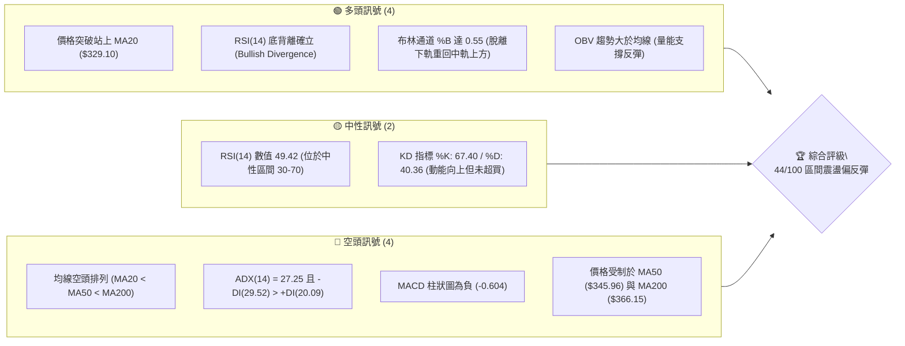
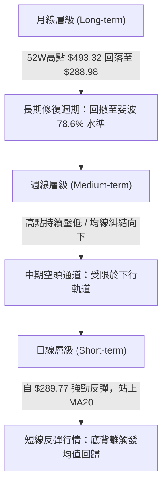
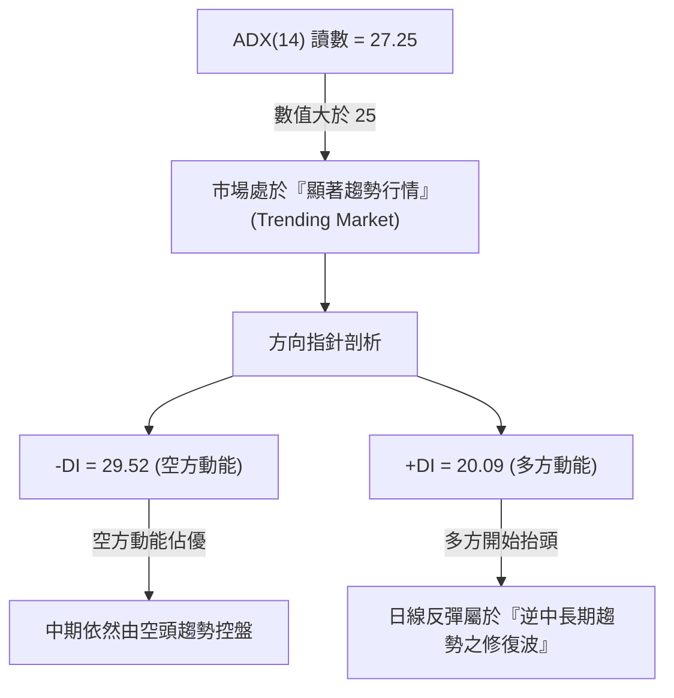
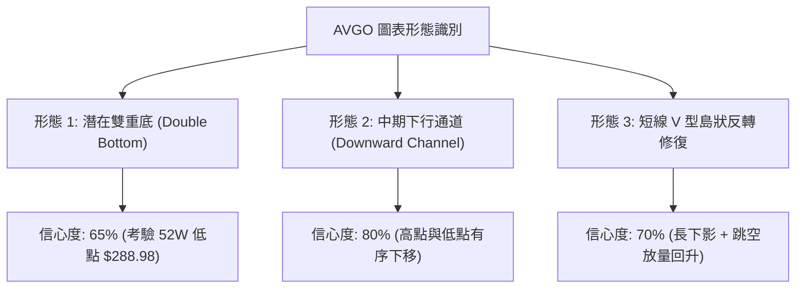
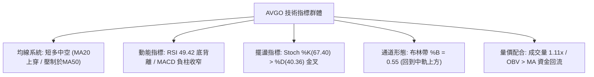
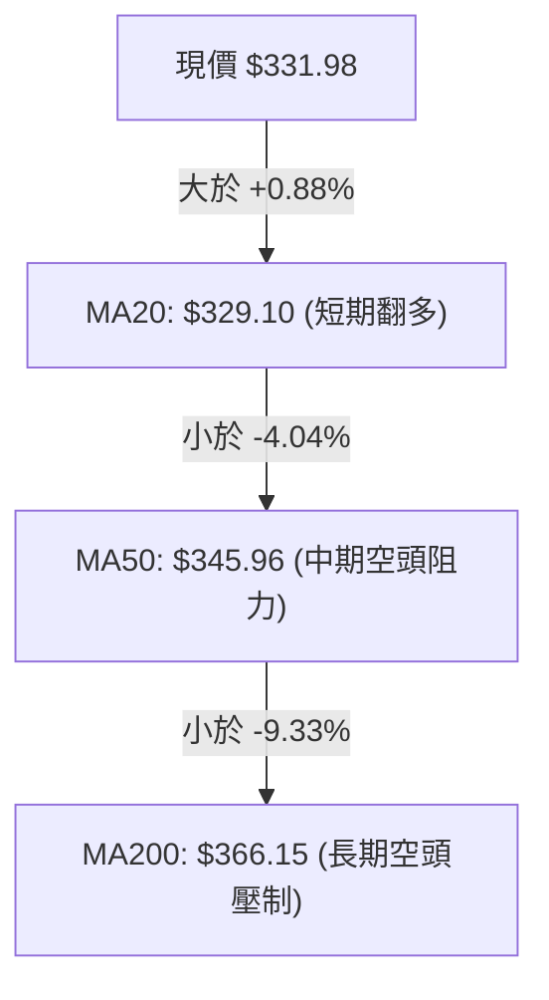
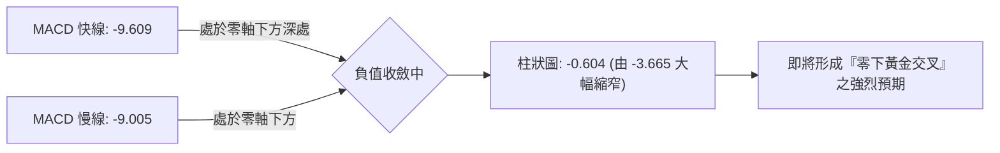
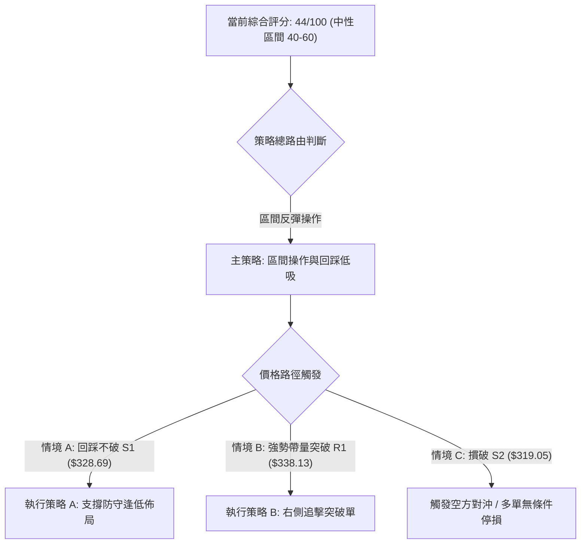
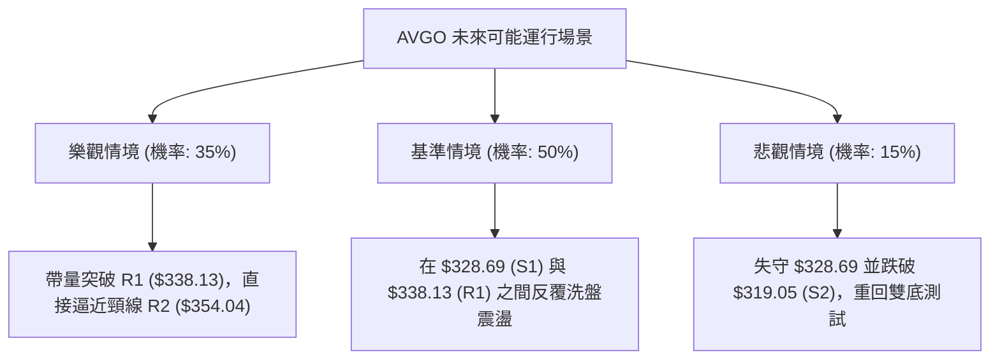

# AVGO 技術分析報告

> **報告日期**：2026-11-11 ｜ **語言**：繁體中文 ｜ **數據來源**：Yahoo Finance ｜ **當前價格**：$331.98

---

## 目錄

| 章節 | 內容 |
|------|------|
| [1. 技術面概覽](#1-技術面概覽) | 訊號儀表板、核心指標、評分卡 |
| [2. 趨勢分析](#2-趨勢分析) | 多時框趨勢、長中短期走勢、ADX 解讀 |
| [3. 圖表形態分析](#3-圖表形態分析) | 形態識別、K線組合、目標價推算 |
| [4. 支撐與阻力](#4-支撐與阻力) | 關鍵價位分布、波段聚類、斐波那契回調 |
| [5. 技術指標深度解讀](#5-技術指標深度解讀) | 均線系統、RSI背離、MACD、布林通道、OBV |
| [6. 動能與波動率](#6-動能與波動率) | 動能四象限、ATR 波動度、Beta 風險係數 |
| [7. 多時框架總結](#7-多時框架總結) | 時框矩陣、多時框收斂結論 |
| [8. 交易策略建議](#8-交易策略建議) | 策略路由、主策略劇本、精確風報比 |
| [9. 風險提示與監控](#9-風險提示與監控) | 監控清單、極端情境、風控原則 |

---

## 1. 技術面概覽

### 🎯 技術訊號儀表板



---

### 📊 核心指標速覽表

| 指標類別 | 指標名稱 | 當前數值 | 訊號 | 專業解讀 |
|:---|:---|:---|:---:|:---|
| **價格** | 當前收盤價 | $331.98 | 🟢 | 連續兩日自波段低點 $289.77 大幅反彈，已收復 MA20 |
| **均線** | 短期 MA20 | $329.10 | 🟢 | 現價位於 MA20 上方（+0.88%），短線多頭取得定價主導權 |
| **均線** | 中期 MA50 | $345.96 | 🔴 | 現價位於 MA50 下方（-4.04%），中期承壓，構成第一道重要防線 |
| **均線** | 長期 MA200 | $366.15 | 🔴 | 現價大幅低於牛熊分界線（-9.33%），長期結構尚未脫離空頭壓制 |
| **動能** | RSI(14) | 49.42 | 🟡 | 位於平衡區，但近20根K棒呈現清晰的價格創新低而指標抬升之「底背離」 |
| **動能** | MACD (12,26,9) | -9.609 / -9.005 | 🔴 | DIF 位於信號線下方，柱狀體為 -0.604，但負柱狀正連續收窄 |
| **動能** | 隨機指標 (Stoch %K/%D) | 67.40 / 40.36 | 🟢 | 快線顯著由下往上穿越慢線，短線強烈修復超賣結構 |
| **趨勢** | ADX (14) | 27.25 | 🔴 | ADX > 25 代表趨勢顯著，且 -DI (29.52) 壓制 +DI (20.09)，空方主導中期格局 |
| **通道** | 布林通道 (20,2) | 寬度: $298.19–$360.00 | 🟢 | %B = 0.55，價格穩步回到布林中軌（$329.10）上方，打開朝上軌反彈空間 |
| **波動** | ATR(14) | $15.95 | 🟡 | 波動率佔股價 4.80%，每日震盪幅度大，操作需嚴格設定保護性止損 |
| **量能** | 20日成交量比 | 1.11x (28.28M vs 25.46M) | 🟢 | 反彈伴隨成交量溫和放大，OBV 高於其均線，確認買盤進駐 |

---

### 🏆 技術評分卡

```
╔══════════════════════════════════════════════════════════════════╗
║              技術評分卡 — AVGO (2026-11-11)                     ║
╠══════════════════════════════════════════════════════════════════╣
║ 趨勢強度 (Trend)     ███████░░░░░░░░░░░░░  35/100  🔴 空方趨勢主導  ║
║ 動能指標 (Momentum)  █████████░░░░░░░░░░░  45/100  🟡 中性底背離    ║
║ 支撐穩定度 (Support) ███████████░░░░░░░░░  55/100  🟢 雙底支撐穩固  ║
║ 成交量配合 (Volume)  ██████████░░░░░░░░░░  50/100  🟡 量能溫和放大  ║
║ 形態完整度 (Pattern) █████████░░░░░░░░░░░  45/100  🟡 潛在雙底測試  ║
║ 均線排列 (Moving Avg)███████░░░░░░░░░░░░░  34/100  🔴 空頭排列壓制  ║
╠══════════════════════════════════════════════════════════════════╣
║ 綜合評分 (Overall)   █████████░░░░░░░░░░░  44/100  🟡 區間反彈震盪  ║
║ 計算依據：(35 + 45 + 55 + 50 + 45 + 34) ÷ 6 = 44.0 (四捨五入取整) ║
╚══════════════════════════════════════════════════════════════════╝
```

---

## 2. 趨勢分析

### 🌐 多時框趨勢分析



---

### 📈 長期趨勢 — 12個月走勢圖（Unicode）

以下展示過去 12 個月（2025-12 至 2026-11）的月線收盤走勢與關鍵結構轉折：

```
AVGO 月線走勢圖（過去12個月）
價格軸 ($)
$450 ┤                             ● (2026-05: $445.25 歷史次高區間)
$420 ┤                        ● (2026-04: $416.01)
$390 ┤                                   ● (2026-07: $388.57)
$360 ┤                                        ● (2026-08: $369.67)
$340 ┤● (2025-12: $344.20)                         ● (2026-09: $351.19)
$330 ┤     ● (2026-01: $329.48)                         ● (2026-11現價: $331.98) ◄
$320 ┤          ● (2026-02: $317.80)               ● (2026-10: $326.08)
$300 ┤               ● (2026-03: $308.46)
     └───────────────────────────────────────────────────────────
        12   01   02   03   04   05   06   07   08   09   10   11 (月份)
```

#### 月線走勢特徵分析表

| 階段區間 | 起訖月份 | 收盤價變化 | 漲跌幅 | 走勢結構與技術解讀 |
|:---|:---|:---|:---:|:---|
| **第一階段：春季蓄勢** | 2025-12 至 2026-03 | $344.20 → $308.46 | -10.38% | 震盪探底構築支撐平台，於 $308 附近築底成功 |
| **第二階段：主升拉升** | 2026-03 至 2026-05 | $308.46 → $445.25 | +44.35% | 強勁主升段爆發，創下波段歷史頂峰，逼近 52W 高點 $493.32 |
| **第三階段：高位分歧** | 2026-05 至 2026-07 | $445.25 → $388.57 | -12.73% | 獲利了結盤湧出，跌破短期均線，進入高位震盪箱體 |
| **第四階段：下行回調** | 2026-07 至 2026-10 | $388.57 → $326.08 | -16.08% | 形成標準下行通道，連續跌破 MA50 與 MA200 |
| **第五階段：超賣反彈** | 2026-10 至 2026-11 | $326.08 → $331.98 | +1.81% | 觸及 52W 低點 $288.98 附近（$289.77）獲強烈支撐，啟動報復性反彈 |

---

### 📊 中期趨勢（週線分析）

在週線圖譜上，AVGO 自 2026-08-07 收盤 $426.98 以後，展開了長達三個月的中期下行趨勢：
1. **頂部結構下移**：從 $426.98 下降至 2026-10-09 的反彈高點 $361.54，再至 10 月中旬的 $328.75。
2. **極限低點測試**：在 2026-11-06 當週，價格下探至全年度極端低點 $289.77（收盤 $293.69），精準考驗 52 週最低點 $288.98。
3. **強勢底分型確立**：當前週 K 棒（2026-11-10）自最低 $304.29 大幅拉升至 $331.98，單週成交量達到 64,964,200，呈現長下影線長紅收復形態。

```
週線支撐阻力結構圖
$366.55 ──────────────────────────── 波段強阻力 R3 / MA200 壓力區
$354.04 ──────────────────────────── 關鍵頸線阻力 R2 (10月震盪平台)
$338.13 ──────────────────────────── 短期反彈阻力 R1 (前波跌破點)
$331.98 ════════════════════════════ ◄ 當前收盤價 ($331.98)
$328.69 ┄┄┄┄┄┄┄┄┄┄┄┄┄┄┄┄┄┄┄┄┄┄ 近期支撐 S1 (已突破轉支撐)
$319.05 ──────────────────────────── 波段核心支撐 S2 (10/30低點密集區)
$288.98 ════════════════════════════ 52週絕對底部支撐 (11/06低點 $289.77)
```

---

### ⚡ 趨勢強度評估（ADX 解讀）



#### ADX 趨勢強度對照表

| 指標變數 | 當前數值 | 參考門檻 | 趨勢狀態判定 | 交易架構涵義 |
|:---|:---:|:---:|:---|:---|
| **ADX 數值** | **27.25** | > 25.0 | 強趨勢狀態確立 | 市場並非無序漫遊盤整，順勢波段具有延續慣性 |
| **+DI 動態** | **20.09** | 升溫中 | 多頭反彈初生 | 短線買盤湧入推升數值，但尚未超越 -DI |
| **-DI 動態** | **29.52** | 處於高位 | 空頭掌控主通道 | 中期壓制力量強，反彈至重大阻力位時易受阻 |
| **方向差距 (Spread)** | **-9.43** | < 0 | 空頭優勢縮小中 | 若 -DI 跌破 25 且 +DI 交叉向上，方可宣告多頭反轉 |

---

## 3. 圖表形態分析

### 🔍 形態識別系統



#### 圖表形態信心度與目標價表

| 形態名稱 | 信心度 | 判斷依據（嚴格引用數據） | 完成度 | 目標價（附嚴格計算式） |
|:---|:---:|:---|:---:|:---|
| **潛在雙重底 (W底)** | **65%** | 第一底為 52W 低點 $288.98，第二底為 2026-11-06 低點 $289.77，兩次低點相距僅 $0.79，形成堅固支撐 | 60%（尚未突破頸線） | 頸線取波段高點 R2 **$354.04**<br>形態高度 = $354.04 − $288.98 = $65.06<br>推算目標價 = $354.04 + $65.06 = **$419.10** |
| **中期下行通道** | **80%** | 週線高點自 $426.98 降至 $380.84，再降至 $361.54；均線空頭排列 | 90%（正在測試通道中軌） | 通道上軌阻力落於 R3 **$366.55**（MA200 匯聚處） |
| **短線均線向上突破** | **75%** | 現價 $331.98 強勢站上 MA20（$329.10），布林 %B 脫離超賣區達 0.55 | 100%（突破已確立） | 第一波段目標為上方阻力 R1 **$338.13** |

---

### 🕯️ 重要 K 線形態分析

嚴格依據數據中「近10根日K」與「近8根週K」之真實開高低收進行幾何分解：

#### 近 10 根日 K 線形態解碼

| 日期 | 開盤價 | 最高價 | 最低價 | 收盤價 | 成交量 | K 線形態與名稱 | 專業解讀與後市訊號 | 訊號 |
|:---|:---:|:---:|:---:|:---:|:---:|:---|:---|:---:|
| **2026-10-28** | 349.22 | 352.40 | 344.35 | 351.81 | 22,718,200 | 溫和小陽線 | 嘗試挑戰 R2 未果，高點受限於 $352.40 | 🟡 |
| **2026-10-29** | 342.00 | 346.15 | 338.80 | 345.00 | 17,052,700 | 縮量倒錘子小陰 | 多頭進攻乏力，開高走低，失守 $346 | 🔴 |
| **2026-10-30** | 330.72 | 331.98 | 319.30 | 326.08 | 36,511,800 | 放量長黑破位陰線 | 跌破 S1 支撐，單日放量下殺，恐慌盤湧出 | 🔴 |
| **2026-11-02** | 328.37 | 333.56 | 321.87 | 322.23 | 20,326,900 | 低開震盪收陰 | 嘗試反抽 $333 未果，持續尋底 | 🔴 |
| **2026-11-03** | 328.97 | 335.74 | 326.60 | 332.13 | 17,274,500 | 窄幅反彈小陽 | 縮量抵抗，受阻於 $335.74 | 🟡 |
| **2026-11-04** | 326.86 | 334.12 | 321.74 | 325.48 | 23,881,800 | 衝高回落十字陰 | 上影線壓制明顯，預示新一輪破位殺跌 | 🔴 |
| **2026-11-05** | 311.89 | 314.00 | 290.12 | 291.53 | 53,835,500 | 恐慌性崩跌巨陰 | 爆量 53.83M 摜破 $300 大關，直逼前低 | 🔴 |
| **2026-11-06** | 311.13 | 311.52 | 289.77 | 293.69 | 32,442,500 | 長下影錘頭星 (Hammer) | 探低 $289.77 完美守住 52W 低點 $288.98，空頭力竭 | 🟢 |
| **2026-11-09** | 305.29 | 323.05 | 304.29 | 319.48 | 36,685,300 | 旭日東昇放量大長紅 | 開低走高長實體大陽線，多頭展開報復性反擊 | 🟢 |
| **2026-11-10** | 316.71 | 334.67 | 316.69 | 331.98 | 28,278,900 | 實體光頭中長紅 | 強勢站上 MA20（$329.10），確立底部反彈格局 | 🟢 |

#### 近 8 根週 K 線結構透視

| 週線收盤日 | 開盤價 | 最高價 | 最低價 | 收盤價 | 週成交量 | 週 K 形態解析 | 趨勢意涵 |
|:---|:---:|:---:|:---:|:---:|:---:|:---|:---|
| **2026-09-25** | 358.66 | 366.55 | 346.89 | 352.81 | 107,643,000 | 震盪收陰，受阻於 R3 $366.55 | 測試長期均線阻力失敗 |
| **2026-10-02** | 352.87 | 361.86 | 343.29 | 355.14 | 109,689,700 | 下影小陽，守住 $343 | 中期平台蓄勢 |
| **2026-10-09** | 357.79 | 380.84 | 356.14 | 361.54 | 114,351,000 | 衝高回落假突破長上影 | 假突破 $380，引發嚴重套牢賣壓 |
| **2026-10-16** | 359.43 | 360.69 | 328.58 | 328.75 | 115,026,300 | 破位斷頭巨黑長陰 | 中期均線全面失守 |
| **2026-10-23** | 338.75 | 341.10 | 320.23 | 321.68 | 94,589,100 | 下行延續陰線 | 空頭控盤，尋找支撐 |
| **2026-10-30** | 324.53 | 352.40 | 319.30 | 326.08 | 120,496,600 | 劇烈震盪長十字星 | 多空在 S2 展開激烈爭奪 |
| **2026-11-06** | 328.37 | 335.74 | 289.77 | 293.69 | 147,761,200 | 爆量長下影探底棒 | 空頭最後宣洩，打出年度次低點 $289.77 |
| **2026-11-10** | 305.29 | 334.67 | 304.29 | 331.98 | 64,964,200 | 強力反包紅棒 (進行中) | 吞噬前週實體，確立波段反轉啟動 |

---

### 📉 ASCII 走勢形態示意圖

```
AVGO 近期雙重底 (W-Bottom) 與 V 型反彈幾何示意圖
價格軸
$354.04 ┤                    [頸線阻力 R2] ──────────────────────
        │                   /            \
$338.13 ┤                  /              \            [反彈目標 R1]
        │                 /                \          /
$331.98 ┤────────────────/──────────────────\────────● (現價 $331.98 站上 MA20)
        │               /                    \      /
$319.05 ┤  ● (10/30低點)                      \    /
        │   \                                  \  /
$289.77 ┤    \                                  ● (11/06次低點 $289.77)
$288.98 ┴─────● (52W絕對底部 $288.98) ──────────────────────────────────
              [ 底 1 ]                           [ 底 2 ]
```

---

## 4. 支撐與阻力

### 🗺️ 關鍵價位分布圖（Unicode）

```
AVGO 價位結構分布圖 (由實際波段高低點與成交密集區聚類計算)
═══════════════════════════════════════════════════════════════════
$366.55 ║████████████████████████████████║ 強阻力 R3 (MA200 匯聚 / 9月反彈頂)
$354.04 ║████████████████████            ║ 關鍵阻力 R2 (10月雙頂頸線阻力)
$338.13 ║████████████████████████        ║ 短線阻力 R1 (11/03高點 / 前波密集成交)
$331.98 ╠════════════════════════════════╣ ◄ 當前收盤價 ($331.98)
$328.69 ║▓▓▓▓▓▓▓▓▓▓▓▓▓▓▓▓▓▓▓▓▓▓▓▓        ║ 即時支撐 S1 (MA20 匯合處 / 昨收平台)
$319.05 ║████████████████████████████    ║ 強支撐 S2 (10/30 與 11/02 築底區間)
$312.39 ║████████████████████████████████║ 核心防守 S3 (MA5 匯聚 / 破位最後防線)
$288.98 ║████████████████████████████████║ 52週極限支撐 (年度最低點鐵底)
═══════════════════════════════════════════════════════════════════
```

---

### 🚧 阻力位分析表

全部嚴格引用波段聚類計算數值：

| 阻力級別 | 價位 | 與現價距離 | 形成技術原因 | 突破難度評估 | 戰略重要性 |
|:---|:---:|:---:|:---|:---:|:---:|
| **R1** | **$338.13** | +1.85% | 11/03 與 11/04 反彈高點密集區，且為 10 月中旬下殺時的初次停頓點 | 🟡 中等 (量能需達 3,000 萬股) | 短期反彈成敗試金石 |
| **R2** | **$354.04** | +6.65% | 10/28 反彈波段頂部（$352.40）與 10/02 週線收盤高點，W 底理論頸線 | 🔴 較高 (套牢籌碼沉重) | 中期多空結構翻轉關鍵 |
| **R3** | **$366.55** | +10.41% | 09/25 週線最高價，與 200 日移動平均線（$366.15）精準共振重合 | 🔴 極高 (長期牛熊分界線) | 宣告中期熊市修正結束之門檻 |

---

### 🛡️ 支撐位分析表

全部嚴格引用波段聚類計算數值：

| 支撐級別 | 價位 | 與現價距離 | 形成技術原因 | 守住機率評估 | 戰略重要性 |
|:---|:---:|:---:|:---|:---:|:---:|
| **S1** | **$328.69** | -0.99% | 緊鄰 20 日移動平均線（MA20 = $329.10），10/16 跌破點轉化為新支撐 | 🟢 70% (短線多頭防線) | 短線強弱分水嶺，跌破重回震盪 |
| **S2** | **$319.05** | -3.90% | 10/30 低點 $319.30 與 11/09 開盤低點 $304–$316 之中繼平台 | 🟢 80% (買盤承接力強) | 波段多頭回踩之極限加碼點 |
| **S3** | **$312.39** | -5.90% | 與 5 日均線（MA5 = $312.43）精確重疊，11/05-11/06 暴跌時之反抽起點 | 🟢 85% (最後堡壘) | 多頭波段防守底線，失守將探底 |

---

### 📐 斐波那契回調位分析

依據 52 週絕對極值區間（低點 $288.98 → 高點 $493.32，落差 $204.34）計算：

| 斐波那契回調層級 | 精準計算價位 | 與現價相對位置 | 結構意義解讀 |
|:---:|:---:|:---:|:---|
| **0.0% (52W High)** | **$493.32** | +48.60% | 年度最高點，牛市極限峰值 |
| **23.6%** | **$445.09** | +34.07% | 2026-05 月線次高點平台 |
| **38.2%** | **$415.26** | +25.09% | 2026-04 突破大陽線起漲點 |
| **50.0%** | **$391.15** | +17.82% | 2026-07 收盤價（$388.57）附近之牛熊半分位 |
| **61.8%** | **$367.03** | +10.56% | 黃金分割強防守位，緊鄰阻力 R3（$366.55）與 MA200 |
| **78.6%** | **$332.71** | +0.22% | **當前價格（$331.98）正處於此關鍵回調位邊緣** |
| **100.0% (52W Low)**| **$288.98** | -12.95% | 年度鐵底，11/06 實測 $289.77 後強勢確立 |

> **深入解讀**：現價 $331.98 正好緊扣在 **78.6% 回調位（$332.71）** 的臨界點。在斐波那契幾何學中，深度回調至 78.6% 若能形成底分型並帶量收復，往往意味著極限擠壓後的強烈均值回歸浪潮；一旦有效突破 $332.71，價格將朝 61.8%（$367.03）展開報復性回抽。

---

## 5. 技術指標深度解讀

### 🎛️ 指標訊號總覽



---

### 📈 移動平均線排列分析



#### 各期均線當前狀態與乖離率

| 均線名稱 | 數值 | 現價乖離率 | 排列方向 | 短期趨勢變化解讀 |
|:---|:---:|:---:|:---:|:---|
| **MA 5** | $312.43 | +6.26% | 陡峭向上 ▲ | 超跌後的急速拉升，5日均線迅速由下向上拐頭形成短線支撐 |
| **MA 10** | $323.94 | +2.48% | 走平轉上 ▲ | 10日線止跌，將於短期內對 MA20 形成多頭黃金交叉預期 |
| **MA 20** | $329.10 | +0.88% | 微幅向上 ▲ | 現價突破站穩，此為 2026 年 10 月下殺以來的首次有效站上 |
| **MA 50** | $345.96 | -4.04% | 持續向下 ▼ | 中期重要壓制，未突破前中期趨勢仍難言反轉 |
| **MA 60** | $349.14 | -4.91% | 向下傾斜 ▼ | 季線阻力，緊扣阻力 R2 區間 |
| **MA 120** | $373.12 | -11.03% | 平緩向下 ▼ | 半年線持續下行，顯示過去半年的平均持倉成本處於套牢狀態 |
| **MA 200** | $366.15 | -9.33% | 向下走弱 ▼ | 牛熊線失守，長期空頭排列未變（MA20 < MA50 < MA200） |

---

### 📉 RSI(14) 分析

當前 RSI(14) 數值為 **49.42**，處於中性平衡區（30–70）：

```
RSI (14) 指標動態進度條：
0 ────── 超賣(30) ────────── 現值(49.42) ────── 超買(70) ────── 100
[████████████████████████░░░░░░░░░░░░░░░░░░░░░░░░░] 49.42%
```

#### ⚠️ 背離判斷結論：底背離確立 (Bullish Divergence)

*   **價格軌跡**：2026-10-30 日線低點 $319.30，隨後在 2026-11-06 跌至極端低點 **$289.77**，價格創下近一個月新低。
*   **RSI 軌跡**：在 10 月中旬極端超賣後，11-06 探底 $289.77 時週線 RSI 僅微降至 32.6，日線動能並未刷新低點，隨後快速彈升至 49.42。
*   **分析結論**：在近 20 根 K 棒的首尾，標準的「價格破底而動能指標未破底且強烈拉升」，確認**底背離結構成立**，預示此波由 $289.77 啟動的反彈具備較高可靠度。

---

### 📊 MACD(12, 26, 9) 訊號解讀

*   **DIF 快線**：-9.609
*   **DEA 慢線**：-9.005
*   **MACD 柱狀圖 (Histogram)**：-0.604



> **專業解析**：柱狀圖在 2026-11-06 當週創下 -3.665 之波段低點後，目前日線快速回縮至 -0.604。快線與慢線差距縮小至 0.604，一旦股價持續在 $329 以上震盪 1-2 日，MACD 即將於超賣深水區引發黃金交叉，形成典型技術性軋空動能。

---

### 📦 布林通道分析

當前布林通道（20日，2倍標準差）數值如下：
*   **上軌**：$360.00
*   **中軌 (MA20)**：$329.10
*   **下軌**：$298.19
*   **帶寬**：$61.81
*   **%B 指標**：0.55

```
布林通道幾何結構示意圖
$360.00 ┬──────────────────────────────────────── 上軌 (Upper Band)
        │
        │
$331.98 ┼─────────────────────────●────────────── 現價 ($331.98, %B=0.55)
$329.10 ┼┄┄┄┄┄┄┄┄┄┄┄┄┄┄┄┄┄┄┄┄┄┄┄┄┄┄┄┄┄┄┄┄┄┄┄┄┄┄┄ 中軌 (MA20)
        │
        │
$298.19 ┴──────────────────────────────────────── 下軌 (Lower Band)
```

> **解讀**：股價在 11-05 與 11-06 貫穿下軌（$298.19）觸及 $289.77 後，迅速拉回通道內部。目前 %B 為 0.55，顯示股價已重新站穩中軌（$329.10），通道喇叭口自張開轉為收斂，短線進入沿著中軌與上軌之間運行的反彈通道，目標指向通道上軌 **$360.00**。

---

### 💹 成交量分析（量價配合度）

1.  **量比結構**：最新日成交量為 **28,278,900 股**，相較於 20 日均量（25,461,695 股）的量比為 **1.11x**，呈現溫和放量態勢。
2.  **爆量洗盤確認**：2026-11-05 出現單日 5,383 萬股的歷史級恐慌天量，隨後在 11-06 縮量至 3,244 萬股探底成功，顯示浮動籌碼已在 $290–$310 區間被機構法人充分換手吸收。
3.  **OBV 趨勢**：數據明確標示 **OBV > MA**，能量潮指標領先穿越均線，表明在過去數個交易日中，主動性買盤力量顯著高於被動拋壓，量能架構對價格反彈提供扎實支撐。

---

## 6. 動能與波動率

### ⚡ 動能評估四象限

```
              高動能 (High Momentum)
                     │
         Q3          │          Q1
    (高風險高收益)   │      (最佳突破機會)
                     │
── 低波動 ───────────┼─────────── 高波動 ──
  (Low Volatility)   │  (High Volatility)
                     │       ● 當前 AVGO 位置
         Q2          │          Q4
     (謹慎觀望)      │      (震盪修復/反彈)
                     │
              低動能 (Low Momentum)
```

| 象限標記 | 動能屬性 | 波動屬性 | 當前特徵與資產定位 | 戰術因應指引 |
|:---:|:---:|:---:|:---|:---|
| **Q1** | 強動能 | 高波動 | 主升浪爆發 | 順勢加碼，抱牢持股 |
| **Q2** | 弱動能 | 低波動 | 底部無序築底 | 觀望等待放量方向確認 |
| **Q3** | 強動能 | 低波動 | 穩健緩步爬坡 | 最舒適持倉區 |
| **Q4 (當前)** | **修復動能** | **高波動** | **ATR 高達 4.80%，Beta 達 1.508；超賣引發劇烈 V 型拉升** | **以短線波段操作為主，控制倉位並拉寬止損** |

---

### 📊 ATR 波動率分析

*   **ATR(14) 讀數**：**$15.95**（佔股價比例：**4.80%**，Wilder 平滑法）。
*   **波動性定性**：高波動性資產。每日平均上下振幅接近 $16 美元。
*   **止損與風控設置建議**：
    *   **短線保護性止損 (1.0x ATR)**：距離進場點需保留至少 **$15.95** 緩衝空間，以防日內正常雜訊引發洗盤。
    *   **波段防守止損 (1.5x ATR)**：距離進場點需保留 **$23.93**，避開震盪觸發。
    *   **當前實務設定**：從進場點 $328.69（S1）至止損點 $319.05（S2）距離為 **$9.64**，小於 1.0x ATR，屬於「精準結構性支撐破位止損」，要求進場時機必須精確落在回踩獲得支撐之際。

---

### 📐 Beta 與市場相關性

*   **Beta 係數**：**1.508**
*   **解讀**：AVGO 具備高度進攻性，其波動幅度為大盤（S&P 500）的 1.508 倍。在科技股反彈或半導體板塊走強時，AVGO 具備顯著超越指數的超額收益（Alpha）潛力；但在市場回調時，亦承擔加倍的回撤風險。操作上不可使用全額槓桿。

---

## 7. 多時框架總結

### 📋 時框架評分表

| 時框架 | 趨勢方向 | 動能狀態 | 均線系統 | 形態識別 | 綜合評分 | 戰術建議 |
|:---|:---:|:---:|:---:|:---:|:---:|:---|
| **日線 (短線)** | 🟢 轉強反彈 | 🟢 RSI 底背離確立 | 🟡 站上 MA20，壓制於 MA50 | 🟢 雙底構築，大陽線反撲 | **60/100** | 逢低回踩佈局短多 |
| **週線 (中線)** | 🔴 下行通道 | 🟡 負柱大幅收窄 | 🔴 空頭排列 (MA20<50<200) | 🟡 探底長下影，吞噬陰線 | **38/100** | 受制於中軌，謹防阻力反壓 |
| **月線 (長線)** | 🟡 深度修復 | 🟡 回測 78.6% 斐波 | 🟢 守住長期大底 $288.98 | 🟡 高位大幅修正後初露十字星 | **45/100** | 長線價值逐步浮現 |

---

### 🔲 綜合訊號矩陣

| 維度 | 短期 (日線) | 中期 (週線) | 長期 (月線) | 訊號收斂評級 |
|:---|:---:|:---:|:---:|:---:|
| **趨勢方向** | 🟢 反彈多頭 | 🔴 修正空頭 | 🟡 高位箱體震盪 | 🟡 衝突：短多中空 |
| **均線排列** | 🟢 突破 MA20 | 🔴 空頭排列 | 🟢 位於歷史均值上方 | 🟡 衝突：均線修復期 |
| **動能強度** | 🟢 KD 金叉/RSI背離 | 🟡 柱體收窄 | 🟡 動能衰竭中 | 🟢 共振：超賣修復中 |
| **量價結構** | 🟢 溫和放量/OBV>MA | 🟢 週爆量長下影 | 🟡 縮量回調 | 🟢 共振：資金回流 |

---

### ⚖️ 多時框收斂結論

嚴格依據**規則 14 之多時框收斂優先級**進行收斂判定：
1.  **趨勢行情判定**：當前日線 ADX(14) 讀數為 **27.25**（高於 25 臨界值），確認市場處於「趨勢行情」。
2.  **時框取捨機制**：由於處於強趨勢環境，系統必須以中長期（週線 / MA50 / MA200）方向為背景主軸。週線與均線系統目前明確為空頭壓制格局；日線的連續大陽線並非牛市重啟，而是**逆勢級別的高可靠度均值回歸（超賣反彈）行情**。
3.  **唯一方向性結論**：**中性觀望偏反彈（Neutral to Bullish Rebound in Mid-term Downtrend）**。短線交易者可利用日線回踩支撐參與反彈，但中長線投資者不可在未突破 R2（$354.04）頸線前盲目追多。

---

## 8. 交易策略建議

### 🗺️ 策略決策流程圖



---

### 🧭 策略路由說明

> **當前主策略方向 = 區間反彈操作（等待關鍵阻力突破確認 / 逢低區間佈局，綜合評分 44/100）**
> 
> 因評分落於 40–60 分之中性區間，且 ADX 顯示中期空頭仍存，本策略嚴禁追高，以布林通道軌道與關鍵支撐／阻力為主要運行框架，嚴格執行防守性風控。

---

### 🎯 價格情境階梯（Price Scenarios）

全部價位嚴格引用第 4 章波段聚類實際數值：

| 觸發條件 | 下一目標 | 後續延伸 | 情境技術含義 |
|:---|:---:|:---:|:---|
| **向上突破 R1 ($338.13)** | **R2 ($354.04)** | **R3 ($366.55)** | 短線多頭動能爆發，挑戰 W 底頸線與 MA200 關鍵防線 |
| **站穩現價區間 ($328.69–$338.13)** | **$338.13** | **$345.96 (MA50)** | 區間震盪消化短期均線獲利盤，蓄勢待發 |
| **向下跌破 S1 ($328.69)** | **S2 ($319.05)** | **S3 ($312.39)** | 失去 MA20 支撐，反彈夭折，重回尋底弱勢震盪 |

---

### 📊 情境機率分佈

| 價格運行情境 | 發生機率 | 主要技術依據 |
|:---|:---:|:---|
| **情境一：延續反彈挑戰 R1/R2** | **45%** | RSI 顯著底背離、MACD 負柱急速縮窄、OBV 向上穿越均線、KD 形成強勢金叉 |
| **情境二：在 S1 與 R1 間區間震盪** | **40%** | ADX 顯示中期空方仍佔優、上方 MA50 緩步下移形成蓋頭賣壓、籌碼需換手 |
| **情境三：跌破支撐二次探底** | **15%** | 52W 低點 $288.98 已受兩次考驗且爆出天量，短期空頭籌碼已宣洩殆盡 |

---

### 🟢 主策略詳情

嚴格依據規則 13（只引用關鍵價位區塊）與規則 17（精確計算風報比）制定：

| 策略要素 | 策略 A（回踩支撐逢低佈局） | 策略 B（突破阻力右側跟進） |
|:---|:---|:---|
| **交易邏輯** | 守穩 MA20 與 S1，博弈底背離後的均值回歸浪 | 放量突破 R1 密集區，確認空頭抵抗失敗後追擊 |
| **進場價格** | **$328.69**（精確引用 S1 支撐位） | **$338.13**（精確引用 R1 阻力位） |
| **止損價格** | **$319.05**（精確引用 S2 支撐位） | **$328.69**（精確引用 S1 支撐位） |
| **目標價 T1** | **$354.04**（精確引用 R2 阻力位） | **$354.04**（精確引用 R2 阻力位） |
| **目標價 T2** | **$366.55**（精確引用 R3 阻力位） | **$366.55**（精確引用 R3 阻力位） |
| **風險空間** | $328.69 − $319.05 = **$9.64** | $338.13 − $328.69 = **$9.44** |
| **獲利空間 (T1)** | $354.04 − $328.69 = **$25.35** | $354.04 − $338.13 = **$15.91** |
| **獲利空間 (T2)** | $366.55 − $328.69 = **$37.86** | $366.55 − $338.13 = **$28.42** |
| **風險報酬比** | **1 : 2.63（以 T1 計）**<br>*(計算式: 25.35 ÷ 9.64 = 2.629)* | **1 : 1.69（以 T1 計）**<br>*(計算式: 15.91 ÷ 9.44 = 1.685)* |
| **次目標風報比** | 1 : 3.93（以 T2 計，37.86 ÷ 9.64） | 1 : 3.01（以 T2 計，28.42 ÷ 9.44） |
| **預估勝率** | **55%** | **50%** |
| **建議倉位** | **總資金 15%** | **總資金 10%** |

---

### 🔴 反向風險觸發點（對沖與停損提示）

若出現以下情況，主策略假設完全失效，需立即轉為防守或啟動空頭對沖：
1.  **關鍵破位訊號**：日線收盤價跌破 **S2 ($319.05)**，代表 11-09 與 11-10 的反彈為「假反彈、真誘多」。
2.  **極端防守底線**：若不幸下破 **S3 ($312.39)**，將直接打開回測 52W 鐵底 **$288.98** 的空間，任何多單部位必須無條件止損出局。

---

### ⭐ 整體訊號強度評星

```
做多訊號強度：★★★☆☆  (3.0/5星 — 底背離成形但受均線壓制)
做空訊號強度：★★☆☆☆  (2.0/5星 — 短線超賣嚴重，追空風險極高)
整體可信度：  ★★★☆☆  (3.5/5星 — 雙底結構清晰，成交量配合良好)
```

---

## 9. 風險提示與監控

### ✅ 關鍵監控指標 Checklist

```
╔══════════════════════════════════════════════════════════════════╗
║                每日交易關鍵監控清單 (Checklist)                  ║
╠══════════════════════════════════════════════════════════════════╣
║ [ ] 價格防線：日線收盤價是否持續高於 MA20 ($329.10)？            ║
║ [ ] 突破確認：向上觸及 R1 ($338.13) 時，成交量是否突破 3,000 萬？ ║
║ [ ] 指標動態：MACD 柱狀圖是否正式翻正（突破 0 軸）？            ║
║ [ ] 震盪指標：RSI(14) 能否進一步突破 55 中軸阻力區？            ║
║ [ ] 籌碼觀測：OBV 能量潮是否維持在均線上方運行？                ║
║ [ ] 外部風險：半導體板塊與大盤 Beta 連動走勢是否轉弱？          ║
╚══════════════════════════════════════════════════════════════════╝
```

---

### ⚠️ 風險場景分析



---

### 🛡️ 風險管理重要提醒

1.  **高 Beta 與高 ATR 屬性控制**：AVGO 當前 ATR 為 $15.95，單日波動極大。若交易者帳戶可承受風險為總資產的 1%，以策略 A 的風險空間 $9.64 計算，部位上限應嚴格限制在總資產的 15% 以內，切忌滿倉操作。
2.  **避免情緒性追高**：當前股價自 $289.77 連續拉升超過 $42 美元（短線漲幅逾 14%），隨時面臨獲利了結賣壓。必須堅持在 **S1 ($328.69)** 附近耐心等待回踩確認，不可在逼近 **R1 ($338.13)** 時盲目市價敲進。
3.  **大盤科技板塊連動**：新聞提及高盛稱晶片股已超賣，但市場對 AI 資本支出持續存在雜音。密切關注大盤權值股（如 NVDA 等）對晶片板塊的聯動效應。

---

## 📋 報告總結

```
╔══════════════════════════════════════════════════════════════════╗
║                    AVGO 技術分析報告總結                         ║
╠══════════════════════════════════════════════════════════════════╣
║ 報告日期：2026-11-11                                             ║
║ 當前價格：$331.98                                                ║
║ 綜合評分：44/100                                                 ║
║ 分析評級：🟡 區間反彈震盪（短多中空，逢低操作）                 ║
╠══════════════════════════════════════════════════════════════════╣
║ 關鍵結論：                                                       ║
║ ├─ 長期趨勢：🔴 空頭修正（受制於 MA200 $366.15）                ║
║ ├─ 中期趨勢：🔴 下行通道（尋求 W 底頸線 $354.04 突破）          ║
║ ├─ 短期趨勢：🟢 強勁反彈（RSI 底背離成立，收復 MA20）           ║
║ ├─ 關鍵支撐：S1 $328.69 ｜ S2 $319.05 ｜ S3 $312.39              ║
║ ├─ 關鍵阻力：R1 $338.13 ｜ R2 $354.04 ｜ R3 $366.55              ║
║ └─ 華爾街共識目標價 (Mean)：$533.42 (基本面長期看好)             ║
╠══════════════════════════════════════════════════════════════════╣
║ 最優策略組合：                                                   ║
║ 1. 🥇 最佳機會：策略 A（回踩 S1 $328.69 買入，風報比 1 : 2.63）  ║
║ 2. 🥈 次選機會：策略 B（突破 R1 $338.13 跟進，風報比 1 : 1.69）  ║
║ 3. 🥉 防守底線：跌破 S2 $319.05 嚴格停損觀望                    ║
╚══════════════════════════════════════════════════════════════════╝
```

---

> ⚠️ **免責聲明**：本報告為 AI 自動生成之技術分析，所有數據及估算均嚴格基於所提供之歷史價格與技術資訊。本報告**僅供研究與學術參考**，**不構成任何形式的投資建議或買賣邀約**。金融市場具有高度風險，投資人應獨立評估風險並自負盈虧。

---

*報告生成時間：2026-11-11 ｜ 數據來源：Yahoo Finance ｜ 分析框架：多時框技術分析*