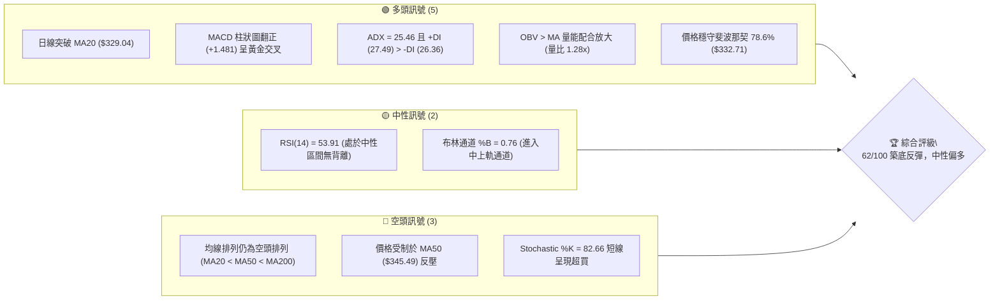
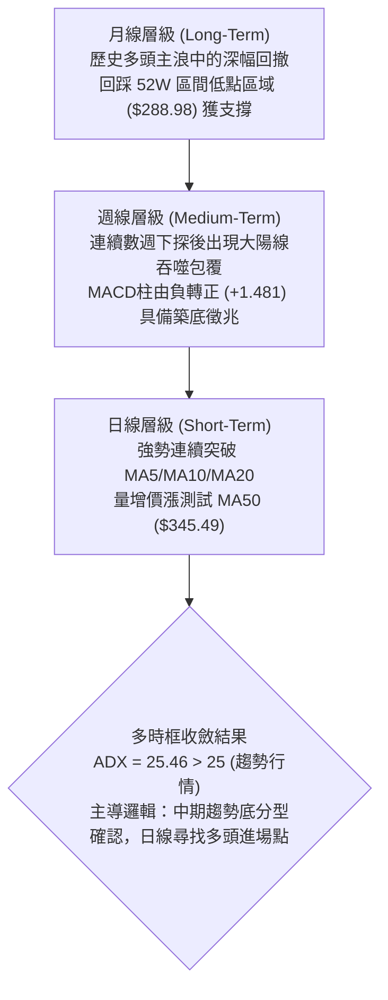
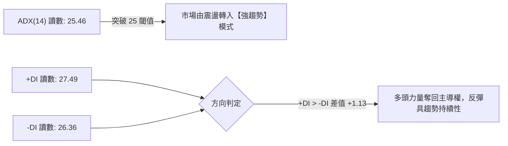
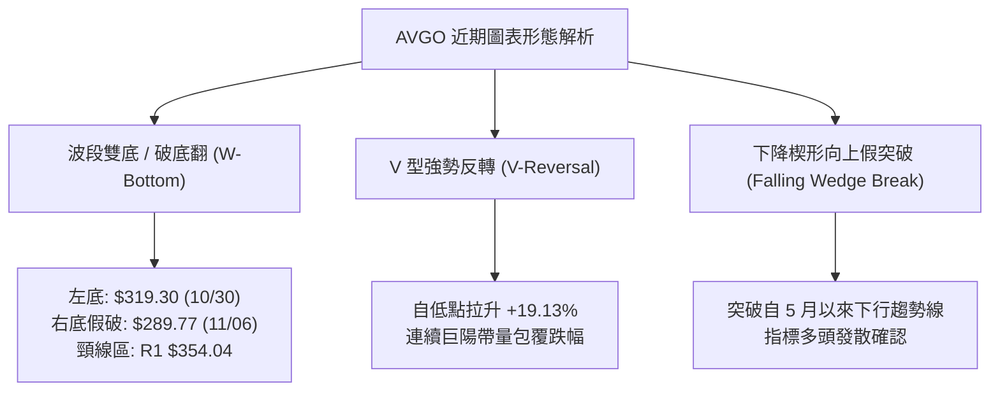
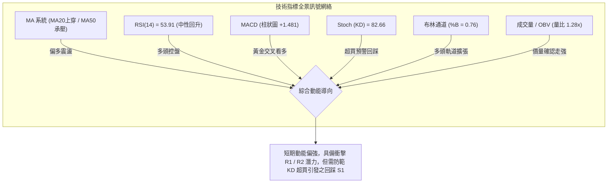
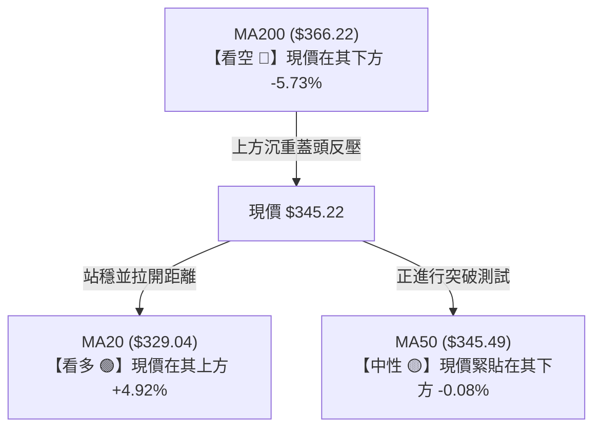
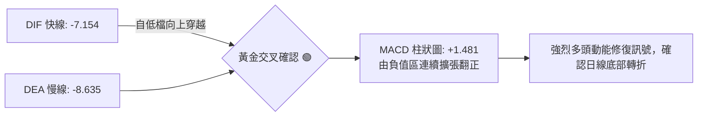
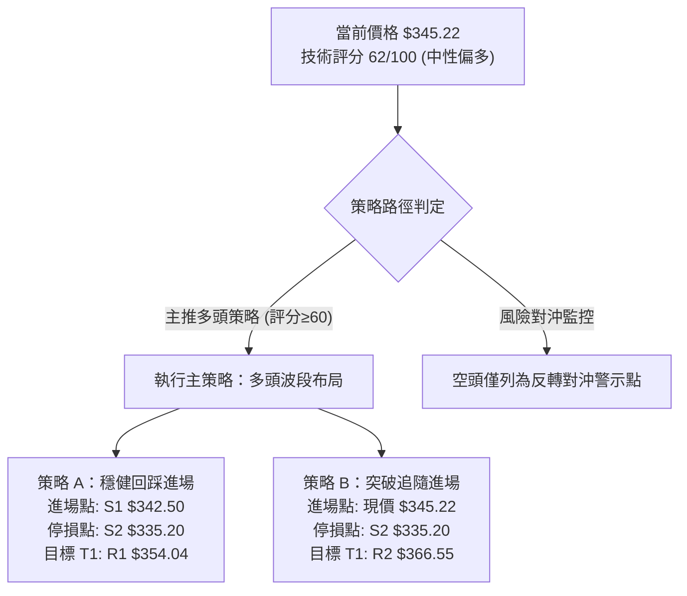
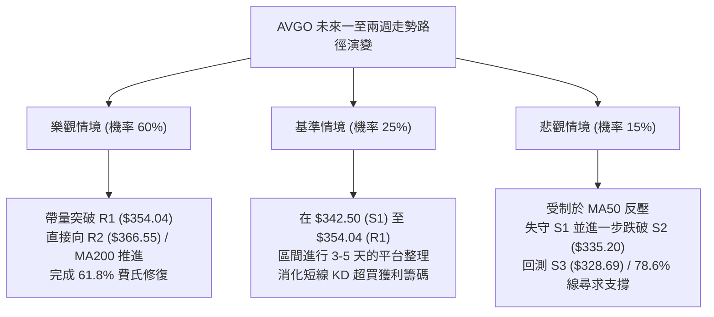

# AVGO 技術分析報告

> **報告日期**：2026-11-12 ｜ **語言**：繁體中文 ｜ **數據來源**：Yahoo Finance ｜ **當前價格**：$345.22

---

## 目錄

| 章節 | 內容 |
|------|------|
| [1. 技術面概覽](#1-技術面概覽) | 訊號儀表板、核心指標、評分卡 |
| [2. 趨勢分析](#2-趨勢分析) | 多時框趨勢、長中短期走勢、ADX解讀 |
| [3. 圖表形態分析](#3-圖表形態分析) | 形態識別、K線組合、形態目標價 |
| [4. 支撐與阻力](#4-支撐與阻力) | 關鍵價位、斐波那契回調結構 |
| [5. 技術指標深度解讀](#5-技術指標深度解讀) | MA/RSI/MACD/布林/成交量配合 |
| [6. 動能與波動率](#6-動能與波動率) | 動能評估四象限、ATR、Beta相關性 |
| [7. 多時框架總結](#7-多時框架總結) | 時框架評分矩陣、多時框收斂結論 |
| [8. 交易策略建議](#8-交易策略建議) | 策略路由、主策略、情境階梯與風控 |
| [9. 風險提示與監控](#9-風險提示與監控) | 監控Checklist、三情境演變、報告總結 |

---

## 1. 技術面概覽

### 🎯 技術訊號儀表板



```
╔════════════════════════════════════════════════════════════════════════════════╗
║                        AVGO 即時技術訊號全景儀表板                             ║
╠════════════════════════════════════════════════════════════════════════════════╣
║  收盤價: $345.22    │  52W 區間分位: 27.50%    │  日內波動 ATR: $16.58 (4.80%)  ║
║  趨勢方向: 強勢反彈  │  量能狀態: 價量齊揚      │  主控力量: 多方主導 (+DI優勢) ║
╚════════════════════════════════════════════════════════════════════════════════╝
```

---

### 📊 核心指標速覽表

| 指標類別 | 指標名稱 | 當前數值 | 訊號 | 專業解讀 |
|:---|:---|:---|:---:|:---|
| **價格** | 當前收盤價 | $345.22 | 🟢 | 自波段低點 $289.77 強勁反彈，回升至 52 週區間之 27.5% 位置 |
| **均線** | 短期 MA20 | $329.04 | 🟢 | 現價高於 MA20 達 +4.92%，短期扭轉頹勢，形成下檔動態支撐 |
| **均線** | 中期 MA50 | $345.49 | 🟡 | 現價緊貼 MA50（相距僅 -$0.27），正處於爭奪中期多空分水嶺之關鍵點 |
| **均線** | 長期 MA200 | $366.22 | 🔴 | 現價低於 MA200 達 -5.73%，長期均線仍在上方形成下壓阻力帶 |
| **動能** | RSI(14) | 53.91 | 🟡 | 脫離超賣區回升至中軸 50 之上，多方動能恢復，且無背離訊號 |
| **動能** | MACD (12,26,9) | -7.154 / -8.635 | 🟢 | DIF 線上穿 DEA 線，柱狀圖轉正為 +1.481，釋放日線級別底背馳反彈訊號 |
| **動能** | KD (Stoch %K/%D) | 82.66 / 65.83 | 🔴 | %K 進入 80 以上超買區，短線存在衝高回踩或盤整消化獲利拓結盤壓力 |
| **趨勢** | ADX (14) | 25.46 | 🟢 | ADX 跨過 25 臨界線（強趨勢），+DI (27.49) 大於 -DI (26.36) 確認反彈為趨勢波 |
| **通道** | 布林通道 %B | 0.76 | 🟢 | 突破中軌（$329.04），向布林上軌（$359.84）推進，軌道呈擴張初段 |
| **量能** | 當日成交量 | 33,293,600 | 🟢 | 量比 1.28x（超越 20 日均量 25.98M），OBV > MA，量價配合健康 |
| **波動** | ATR(14) | $16.58 | 🟡 | 佔股價 4.80%，波動率處中高水準，操作需預留合理防守空間 |

---

### 🏆 技術評分卡

評分機制依據六大維度量化打分（各維度滿分 100 分），「綜合評分」嚴格依規則 18 取六項算術平均四捨五入：

```
╔════════════════════════════════════════════════════════════════════════════════╗
║                        技術評分卡 — AVGO (2026-11-12)                          ║
╠════════════════════════════════════════════════════════════════════════════════╣
║  趨勢強度      ████████████░░░░░░░░  62/100  🟢 (+DI> -DI, ADX=25.46 趨勢啟動) ║
║  動能指標      ██████████████░░░░░░  68/100  🟢 (MACD金叉柱翻正, RSI站上50中軸) ║
║  支撐穩定度    ██████████████░░░░░░  70/100  🟢 (守穩 78.6% 回調位及 S1 $342.50)║
║  成交量配合    ██████████████░░░░░░  72/100  🟢 (量比 1.28x 突破, OBV趨勢走強) ║
║  形態完整度    ███████████░░░░░░░░░  58/100  🟡 (築底反彈成型, 尚待突破頸線阻力)║
║  均線排列      ████████░░░░░░░░░░░░  42/100  🔴 (空頭排列格局 MA20<MA50<MA200) ║
╠════════════════════════════════════════════════════════════════════════════════╣
║  綜合評分      ████████████░░░░░░░░  62/100  🟢 中性偏多 / 築底轉強           ║
║  （計算：(62 + 68 + 70 + 72 + 58 + 42) ÷ 6 = 372 ÷ 6 = 62.0 分，評級：偏多）  ║
╚════════════════════════════════════════════════════════════════════════════════╝
```

---

## 2. 趨勢分析

### 🌐 多時框趨勢分析



---

### 📈 長期趨勢 — 12個月走勢圖（Unicode）

以下為 AVGO 過去 12 個月（2025-12 至 2026-11）之月線收盤價走勢，完整呈現由歷史巔峰回檔至深幅回調、再於 11 月強勢反攻之歷史軌跡：

```
AVGO 月線走勢圖（過去 12 個月：2025-12 至 2026-11）
價格軸 ($)
$450 ┤                                  ● $445.25 (2026-05 次高點)
$420 ┤                             ● $416.01
$390 ┤                                       ● $388.57
$360 ┤                                            ● $369.67
$345 ┤● $344.20                                        ● $351.19
$330 ┤     ● $329.48                                         ● $345.22 (現價)
$315 ┤          ● $317.80   ● $308.46                             ● $326.08
$300 ┤                                  ● $377.06
$285 ┤───────────────────────────────────────────────────────────────
     └─┬────┬────┬────┬────┬────┬────┬────┬────┬────┬────┬────┬──────
      12月  1月  2月  3月  4月  5月  6月  7月  8月  9月 10月 11月(即時)
      2025                     2026 年
```

#### 走勢特徵階段劃分分析表

| 階段區間 | 起止月份 | 價格變動 | 漲跌幅度 | 核心特徵與籌碼結構 |
|:---|:---|:---:|:---:|:---|
| **第一階段：高檔震盪修整** | 2025-12 → 2026-03 | $344.20 → $308.46 | -10.38% | 自 2025-11 創下的 $399.99 回檔，成交動能收縮，在 $308 形成波段底部 |
| **第二階段：主升浪爆發** | 2026-03 → 2026-05 | $308.46 → $445.25 | +44.35% | AI 晶片需求爆發推動巨幅拉升，並於 2026 年盤中創下 52W 高點 $493.32 |
| **第三階段：陰跌回調尋底** | 2026-05 → 2026-10 | $445.25 → $326.08 | -26.76% | 科技股估值修正，均線系統相繼失守，一路回撤至 11 月初最低 $289.77 |
| **第四階段：觸底強勢逆轉** | 2026-10 → 2026-11 | $326.08 → $345.22 | +5.87% | 於 52W 低點 $288.98 附近爆量大逆轉，單週自低點拉升近 20% 展開反彈 |

---

### 📊 中期趨勢（週線分析）

中期走勢以近 8 週 K 棒結構為主導。近期走勢在 2026-11-06 當週下探至 $289.77（逼近 52 週低點 $288.98），隨後爆出 147,761,200 股的天量換手；本週（截至 2026-11-11）多頭展開強力絕地反擊，開盤 $305.29，最高衝至 $356.85，收在 $345.22，週成交量達 98,420,700 股，形成實體巨大的週線破底翻穿頭陽線。

```
AVGO 中期週線支撐壓力結構示意圖
阻力區間 R3 ── $378.37 ════════════════════════════════════ (近一年密集平台下沿)
阻力區間 R2 ── $366.55 ──────────────────────────────────── (MA200 $366.22 / Fib 61.8%)
阻力區間 R1 ── $354.04 ------------------------------------ (前週反彈高點 $356.85 密集區)
現價點位 ──── $345.22  ▲ 正在向上穿越 MA50 ($345.49)
支撐區間 S1 ── $342.50 ------------------------------------ (本週跳空回踩支撐)
支撐區間 S2 ── $335.20 ──────────────────────────────────── (Fib 78.6% $332.71 緩衝區)
支撐區間 S3 ── $328.69 ════════════════════════════════════ (MA20 均線匯合點)
```

---

### ⚡ 趨勢強度評估（ADX 解讀）



#### ADX 趨勢強度對照解讀

| ADX 數值區間 | 當前數值 | 趨勢狀態判定 | 交易策略指導意義 |
|:---:|:---:|:---:|:---|
| 0 – 20 | — | 無趨勢 / 雜訊期 | 觀望或僅限極窄幅高拋低吸 |
| 20 – 25 | — | 趨勢萌芽 / 弱趨勢 | 突破準備，不宜重倉 |
| **25 – 40** | **25.46** | **強趨勢形成（當前狀態）** | **順勢操作，依主導方向逢回調布局，突破追單具備較高期望值** |
| 40 – 60 | — | 極強單邊走勢 | 嚴格追蹤移動停利，提防盛極而衰 |
| > 60 | — | 極度亢奮 / 趨勢尾聲 | 不宜追高，預警極端反轉 |

**趨勢強度結論**：ADX 跨越 25.0 門檻來到 25.46，確認當前市場擺脫 10 月下旬的無序盤跌；+DI（27.49）正式交叉上穿 -DI（26.36），多方動能佔據優勢，定義當前為**反彈波段趨勢啟動行情**。

---

## 3. 圖表形態分析

### 🔍 形態識別系統



#### 形態識別信心度與目標價計算表（依規則 15 嚴格推算）

| 識別形態名稱 | 信心度 (%) | 判斷依據（引用真實數據） | 完成度 (%) | 形態目標價計算公式與數值 |
|:---|:---:|:---|:---:|:---|
| **破底翻雙底 (W-Bottom)** | **72%** | 2026-10-30 創低點 $319.30，11-06 假跌破至 $289.77 後爆 1.47 億股巨量拉回；頸線鎖定波段高點 R1 $354.04 | 85% | 頸線 $354.04 + (頸線 $354.04 − 左底低點 $319.30 = $34.74) = **$388.78**（接近 2026-07 收盤 $388.57） |
| **V 型反轉走勢** | **65%** | 2026-11-06 觸底 $289.77 後，僅用 3 個交易日連拉至 $356.85，收復近兩週全部失土 | 90% | 回調波起跌點高點 $346.15 對應高度補足，延伸 1:1 目標價為 **$378.37**（精確對應阻力位 R3） |
| **下降通道向上突破** | **55%** | 日線突破 60 日均線（$348.57）附近通道上軌，受制於 R1 阻力 | 60% | 通道寬度推算目標價尚未完全突破頸線，暫以 R2 **$366.55** 視為中繼測幅目標 |

---

### 🕯️ 重要 K 線形態分析

依據規則 19，完全依據數據源中提供之「近 10 根日 K」與「近 8 根週 K」實際數據進行形態學標定：

#### 近 10 根日 K 棒形態逐日拆解表

| 日期 | 開盤價 | 最高價 | 最低價 | 收盤價 | 成交量 | K 線形態標定 | 技術解讀與多空意涵 | 訊號 |
|:---|:---:|:---:|:---:|:---:|:---:|:---|:---|:---:|
| 2026-10-29 | 342.00 | 346.15 | 338.80 | 345.00 | 17,052,700 | 陽紡錘線 (Spinning Top) | 窄幅縮量整理，多空觀望氣氛濃 | 🟡 |
| 2026-10-30 | 330.72 | 331.98 | 319.30 | 326.08 | 36,511,800 | 帶下影長陰線 | 空方跳空下殺，低檔放量承接初現 | 🔴 |
| 2026-11-02 | 328.37 | 333.56 | 321.87 | 322.23 | 20,326,900 | 陰線十字星 | 空頭下行動能減弱，多空陷入僵持 | 🟡 |
| 2026-11-03 | 328.97 | 335.74 | 326.60 | 332.13 | 17,274,500 | 溫和實體陽線 | 縮量小幅反彈，測試上方賣壓 | 🟡 |
| 2026-11-04 | 326.86 | 334.12 | 321.74 | 325.48 | 23,881,800 | 倒狀小陰線 | 多方上攻無功而返，形成二次探底走勢 | 🔴 |
| 2026-11-05 | 311.89 | 314.00 | 290.12 | 291.53 | 53,835,500 | 恐慌長黑破位K | 爆 53.8M 巨量恐慌拋售，逼近 52W 低點 | 🔴 |
| 2026-11-06 | 311.13 | 311.52 | 289.77 | 293.69 | 32,442,500 | 下影低檔錘頭星 | 探至 $289.77 後收腳，空頭力竭信號 | 🟢 |
| 2026-11-09 | 305.29 | 323.05 | 304.29 | 319.48 | 36,685,300 | 突破放量大陽棒 | 底部破底翻啟動，多方實體貫穿多條均線 | 🟢 |
| 2026-11-10 | 316.71 | 334.67 | 316.69 | 331.98 | 28,441,800 | 續攻中陽線 | 買盤持續推升，成功站回 MA20 ($329.04) | 🟢 |
| 2026-11-11 | 350.00 | 356.85 | 344.31 | 345.22 | 33,293,600 | 高開衝高回落小陰 | 跳空高開衝過 R1，受制於 MA50 引發獲利賣壓 | 🟡 |

#### 近 8 根週 K 棒形態深度分析表

| 週末日期 | 開盤價 | 最高價 | 最低價 | 收盤價 | 週成交量 | K 線形態標定 | 技術解讀與週線定位 | 訊號 |
|:---|:---:|:---:|:---:|:---:|:---:|:---|:---|:---:|
| 2026-09-25 | 358.66 | 366.55 | 346.89 | 352.81 | 107,643,000 | 衝高回落十字陰 | 測試 R2 ($366.55) 後承壓下行 | 🔴 |
| 2026-10-02 | 352.87 | 361.86 | 343.29 | 355.14 | 109,689,700 | 窄幅震盪小陽 | 於 $355 附近平台整理蓄勢 | 🟡 |
| 2026-10-09 | 357.79 | 380.84 | 356.14 | 361.54 | 114,351,000 | 長上影倒狀錘 | 衝擊 $380.84（接近 R3）遭遇強大拋壓 | 🔴 |
| 2026-10-16 | 359.43 | 360.69 | 328.58 | 328.75 | 115,026,300 | 破位光腳大陰線 | 跌破 $330 關鍵支撐，破位信號確立 | 🔴 |
| 2026-10-23 | 338.75 | 341.10 | 320.23 | 321.68 | 94,589,100 | 下跌中繼小陰 | 弱勢下探，買盤意願低迷 | 🔴 |
| 2026-10-30 | 324.53 | 352.40 | 319.30 | 326.08 | 120,496,600 | 長上影十字陰星 | 劇烈震盪，多方試圖反撲但遭壓回 | 🟡 |
| 2026-11-06 | 328.37 | 335.74 | 289.77 | 293.69 | 147,761,200 | 爆量恐慌破位陰 | 創 52 週次低，恐慌籌碼全面湧出 | 🔴 |
| 2026-11-11 | 305.29 | 356.85 | 304.29 | 345.22 | 98,420,700 | 絕地反擊大陽線 | 陽包陰吞噬上週跌幅，確立週線底分型 | 🟢 |

---

### 📉 ASCII 走勢形態示意圖

```
AVGO 近期雙底破底翻（W-Bottom）形態結構解析圖
─────────────────────────────────────────────────────────────────────────────
$356.85 ┤                            ╭─● (2026-11-11 高點，試探頸線)
$354.04 ┼───────────────────────────┼─────── 頸線阻力位 R1
        │                           │
$345.22 ┤                           │   ● (現價，多空激烈爭奪中)
$335.20 ┤              ●           │  /
        │             / \          │ /
$326.08 ┤  ● (左底)  /   \         │/
$319.30 ┼───●────────    \        │
        │                  \       │
$289.77 ┼───────────────────●──────╯ (右底：空頭陷阱假破位，爆量收腳)
        └────────────────────────────────────────────────────────────
          10/30 (左底)   11/04    11/06 (假跌破)  11/11 (強勢收復)
─────────────────────────────────────────────────────────────────────────────
```

---

### 🎯 形態目標價計算

依據形態學嚴格測幅準則，針對當前最核心的兩大形態給出精準數值演算法：

1. **破底翻雙底測量法**：
   - 形態頸線價格：取聚類阻力位 **R1 = $354.04**
   - 形態有效低點：取 10 月 30 日低點 **$319.30**（排除 11-06 之極端洗盤假破位）
   - 形態垂直高度 $H$ = $\$354.04 - \$319.30 = \$34.74$
   - **雙底第一測幅目標價** = 頸線 $\$354.04 + \$34.74 =$ **$388.78**
2. **V 型反轉波段測量法**：
   - 起跌關鍵阻力點：引用聚類阻力位 **R3 = $378.37**
   - 底部拐點：2026-11-06 最低點 **$289.77**
   - 費氏反彈 61.8% 延伸位計算：$\$288.98 + 0.618 \times (\$493.32 - \$288.98) =$ **$367.03**（緊密貼合 R2 **$366.55** 與 MA200 **$366.22**）

---

## 4. 支撐與阻力

### 🗺️ 關鍵價位分布圖（Unicode）

```
AVGO 關鍵價位分布與多空陣列圖
═════════════════════════════════════════════════════════════════════════════════
$493.32 ║████████████████████████████████████████║ 52 週歷史高點 (Fib 0.0%)
$378.37 ║████████████████████████                ║ 強波段阻力 R3 (近一年密集高點)
$367.03 ║██████████████████                      ║ 斐波那契 61.8% 黃金分割強防線
$366.55 ║██████████████████                      ║ 重大均線阻力 R2 (MA200 $366.22 匯合)
$354.04 ║██████████████                          ║ 短線頸線阻力 R1 (突破即打開空間)
$345.49 ║▓▓▓▓▓▓▓▓▓▓▓▓▓▓                          ║ 中期 MA50 均線爭奪線
$345.22 ╠════════════════════════════════════════╣ ◄ 當前收盤價 ($345.22)
$342.50 ║▓▓▓▓▓▓▓▓▓▓▓▓                            ║ 短線第一支撐 S1 (回踩確認線)
$335.20 ║████████████████                        ║ 波段關鍵支撐 S2 (多方防線)
$332.71 ║█████████████████                       ║ 斐波那契 78.6% 回調關鍵樞紐
$329.04 ║██████████████████                      ║ 短期 MA20 / 布林中軌支撐
$328.69 ║██████████████████                      ║ 結構性強支撐 S3 (多頭停損底線)
$288.98 ║████████████████████████████████████████║ 52 週歷史低點 (Fib 100.0%)
═════════════════════════════════════════════════════════════════════════════════
```

---

### 🚧 阻力位分析表

所有價位均嚴格引用 OHLCV 計算之「關鍵價位」區塊數值：

| 阻力級別 | 準確價位 | 距現價幅動 | 歷史形成原因與技術共振 | 突破難度評估 | 重要性級別 |
|:---:|:---:|:---:|:---|:---:|:---:|
| **R1** | **$354.04** | +2.56% | 2026-10-30 反彈高點（$352.40）與 11-11 衝高震盪密集區，雙底頸線位置 | 🟡 中等 (需 35M 以上量能) | ★★★☆☆ |
| **R2** | **$366.55** | +6.18% | 2026-09-25 週高點（$366.55），且與長期 MA200（$366.22）及 Fib 61.8%（$367.03）形成三重大重合共振 | 🔴 極高 (強大空頭套牢盤) | ★★★★★ |
| **R3** | **$378.37** | +9.60% | 2026-06 月線收盤平台（$377.06）及 10-09 週線衝高回落高點區（$380.84）聚類阻力 | 🔴 高 (波段反彈終極目標) | ★★★★☆ |

---

### 🛡️ 支撐位分析表

所有價位均嚴格引用 OHLCV 計算之「關鍵價位」區塊數值：

| 支撐級別 | 準確價位 | 距現價幅動 | 歷史形成原因與技術共振 | 守住機率評估 | 重要性級別 |
|:---:|:---:|:---:|:---|:---:|:---:|
| **S1** | **$342.50** | -0.79% | 2026-11-11 日 K 棒低點（$344.31）附近之日內量能堆積平台，短線動態回踩點 | 🟢 75% (短線多頭第一防線) | ★★★☆☆ |
| **S2** | **$335.20** | -2.90% | 2026-11-03 高點及 11-10 突破中繼站，緊貼斐波那契 78.6%（$332.71） | 🟢 85% (波段結構生命線) | ★★★★☆ |
| **S3** | **$328.69** | -4.79% | 2026-10-16 週線低點聚類，與當前向上發散的 MA20（$329.04）形成均價共振 | 🟢 90% (多頭反轉分水嶺) | ★★★★★ |

---

### 📐 斐波那契回調位分析

依據 52 週歷史區間極值（高點 $493.32 → 低點 $288.98，垂直落差 $204.34）進行黃金分割幾何投射，數據精確標定如下：

```
斐波那契回調幾何結構（以 $493.32 為 0.0% / $288.98 為 100.0%）
─────────────────────────────────────────────────────────────────────────────
 0.0% ── $493.32 (52W High 最高點)
23.6% ── $445.09 (2026-05 月線次高收盤 $445.25 共振區)
38.2% ── $415.26 (2026-04 月線跳空點 $416.01 共振區)
50.0% ── $391.15 (大週期多空均衡中樞軸)
61.8% ── $367.03 (黃金分割強阻力，緊扣 R2 $366.55 與 MA200 $366.22)
                 ▲ [當前價格 $345.22 處於 78.6% 與 61.8% 之間回升通道]
78.6% ── $332.71 (波段關鍵回調防禦位，已確認向上突破並站穩)
100.0% ── $288.98 (52W Low 歷史鐵底，強支撐基石)
─────────────────────────────────────────────────────────────────────────────
```

**現價區間深度解讀**：
當前收盤價 **$345.22** 位於斐波那契回調位 **78.6%（$332.71）** 與 **61.8%（$367.03）** 的反彈回升通道之中。
技術意涵在於：股價在 11 月 6 日下探 $289.77（測試 100.0% 鐵底 $288.98）未破後強勢回升，並已放量大陽線收復 78.6% 重要防線（$332.71），標誌著空頭的「非理性超跌階段」已經終結；上方核心反彈目標鎖定在 61.8% 黃金分割阻力位 **$367.03**，該處亦是空頭防禦的最後堡壘（與 R2 $366.55、MA200 $366.22 重合）。

---

## 5. 技術指標深度解讀

### 🎛️ 指標訊號總覽



---

### 📈 移動平均線排列分析



#### 各週期移動平均線（MA）狀態解構表

| 週期均線 | 當前價格 | 與現價乖離率 | 走勢特徵與斜率 | 均線角色定性 |
|:---|:---:|:---:|:---|:---|
| **MA 5** | $316.38 | +9.12% | 急速向上陡峭拉升（+28.84） | 極短期反彈引導線，乖離偏大 |
| **MA 10** | $323.28 | +6.79% | 快速拐頭向上（+21.94） | 短線防守第一道移動警戒線 |
| **MA 20** | $329.04 | +4.92% | 由走平轉為向上發散（+16.18） | 短期生命線，已由阻力轉為強支撐 |
| **MA 50** | $345.49 | -0.08% | 微幅走平趨緩（相距 -$0.27） | 中期多空臨界分水嶺，當前爭奪中 |
| **MA 60** | $348.57 | -0.96% | 緩慢下行趨緩（-3.35） | 季線阻力帶，緊鄰 R1 阻力 |
| **MA 120** | $372.55 | -7.34% | 持續向下傾斜（-27.33） | 半年線阻力，空方中期陣地 |
| **MA 200** | $366.22 | -5.73% | 緩步走平微下彎 | 長期牛熊分界線，與 R2 共振 |
| **MA 240** | $363.93 | -5.14% | 平緩下行（-18.71） | 年線支撐阻力轉換帶 |

**均線綜合解讀**：
當前均線系統整體仍處於傳統定義的空頭排列（MA20 < MA50 < MA200），但微觀結構正發生深刻變化：
極短期均線 MA5（$316.38）與 MA10（$323.28）以極大斜率向上金叉貫穿 MA20（$329.04）；現價已完全站上 MA20 並挑戰 MA50（$345.49）。一旦日線帶量收盤確認站上 MA50，將引發短期均線向上對中長期均線的「底背馳修復引力」，目標直指 MA200（$366.22）。

---

### 📉 RSI(14) 分析

```
RSI(14) 動能強度進度條展示：
超賣區 (0-30)              中性中軸 (50)              超買區 (70-100)
├───────────────┼───────────────┼───────────────┤
░░░░░░░░░░░░░░░░████████████████░░░░░░░░░░░░░░░░  53.91 🟡 [中性微偏多]
```

- **當前數值**：**53.91**（Wilder 計算方法）。
- **區間診斷**：指標已脫離 11 月 6 日探底時的 32.6 低位超賣區，成功跨越 50 多空分水嶺，進入多方掌控區間（50–70），顯示多方買盤已完全控制短期盤面動能。
- **背離嚴格檢驗**：依據近 20 根 K 棒數據，股價自 10 月 16 日之 $328.75 震盪下探至 11 月 06 日收盤 $293.69（最低 $289.77），而 RSI 數值由 34.9 降至 32.6，價格創新低而 RSI 亦創低，未構成嚴格經典日線底背離；但近 3 個交易日 RSI 自 32.6 井噴至 53.91，形成強烈「動能超速恢復（Momentum Thrust）」，確認為強勁的趨勢反轉動能。結論：**當前無背離現象，指標健康反映現價反彈**。

---

### 📊 MACD(12, 26, 9) 訊號解讀



- **DIF 線**：-7.154
- **DEA 信號線**：-8.635
- **柱狀圖 (Histogram)**：**+1.481**（綠燈看多 🟢）
- **深層解讀**：MACD 在零軸下方深度區域形成黃金交叉（DIF 領先上揚幅度達 +1.481），此種在負值深度區域的黃金交叉，被技術分析界視為最標準的「波段超跌底背馳反彈訊號」，柱狀圖由 11 月 06 日週線的 -3.665 迅速逆轉翻正至 +1.481，量能動能全面共振，強烈支持股價延續反彈走勢。

---

### 📦 布林通道分析

```
AVGO 布林通道（20, 2）截面示意圖
─────────────────────────────────────────────────────────────────────────────
上軌 (Upper Band)   $359.84 ─────────────────────────────────────────────
                            ╭─── 現價衝高高點 $356.85
現價 (Current Close)$345.22 ┤ ◄ %B = 0.76 (處於多頭攻擊區)
中軌 (MA20 Baseline)$329.04 ─────────────────────────────────────────────
下軌 (Lower Band)   $298.25 ─────────────────────────────────────────────
─────────────────────────────────────────────────────────────────────────────
```

- **布林上軌**：**$359.84**
- **布林中軌 (MA20)**：**$329.04**
- **布林下軌**：**$298.25**
- **帶寬指標 %B**：**0.76**
- **形態分析**：
  1. 股價在 11 月 05-06 日下探觸及下軌（$298.25 附近）後迅速獲得極強支撐彈起，展現標準的「下軌極限反彈」特徵。
  2. 現價突破中軌 $329.04 後，%B 上升至 0.76，進入中軌至上軌之間的多方強勢攻擊區間（0.5–1.0）。
  3. 通道目前由原先的收斂狀態開始重新向外「喇叭口擴張」，預示伴隨波動率釋放，股價有進一步向布林上軌 **$359.84** 乃至 R2 **$366.55** 衝擊的動力。

---

### 💹 成交量分析（量價配合度）

```
成交量比率柱狀圖：
當前成交量: 33,293,600  ██████████████████████████████  (1.28x)
20日均量:   25,978,150  ████████████████████░░░░░░░░░░  (1.00x 基準)
50日均量:   25,810,480  ███████████████████░░░░░░░░░░░  (0.99x)
```

1. **量價齊揚驗證**：最新交易日成交量為 33,293,600 股，較 20 日均量（25,978,150 股）大幅放大 1.28 倍，顯示機構資金積極進場掃籌。
2. **OBV 趨勢驗證**：數據明確認證「OBV > MA → 量能支撐上漲」，能量潮指標保持在均線之上，反映資金呈現淨流入狀態，並未出現量價背離現象。
3. **換手結構分析**：11 月 05 日爆出 53.8M 股的近月最大日成交量，隔日 11 月 06 日緊接著出現 32.4M 股的探底收腳量，合計在 $290–$310 區間完成超過 8,600 萬股的充分換手，主力洗盤吸籌特徵極為明顯，為當前的反彈提供了堅固的籌碼底座。

---

## 6. 動能與波動率

### ⚡ 動能評估四象限

```
動能與波動率定位矩陣（Volatility vs. Momentum Matrix）
┌──────────────────────────────┬──────────────────────────────┐
│  Q3：高波動 × 強動能         │  Q1：低波動 × 強動能         │
│  [高風險激進進場區]          │  [機構最青睞穩健主升浪]      │
│  ★ AVGO 當前定位點 ★        │                              │
│  (ATR=4.80%, ADX=25.46,      │                              │
│   MACD Hist=+1.481)          │                              │
├──────────────────────────────┼──────────────────────────────┤
│  Q4：高波動 × 弱動能         │  Q2：低波動 × 弱動能         │
│  [恐慌破位危險區]            │  [沉寂盤整觀望區]            │
│  (11-05 崩跌時狀態)          │                              │
└──────────────────────────────┴──────────────────────────────┘
```

#### 四象限動態演變表

| 象限標籤 | 動能維度 | 波動維度 | 歷史/當前狀態對應 | 操作策略與風險評估 |
|:---:|:---:|:---:|:---:|:---|
| **Q1** | 強 | 低 | 2026-04 至 05 主升段 | 最佳加碼區間，趨勢平穩推升 |
| **Q2** | 弱 | 低 | 2026-10 下旬盤整期 | 觀望等待方向確認，控制手續費 |
| **Q3** | **強** | **高** | **✓ 當前狀態 (2026-11-12)** | **波段反彈初期，高彈性高回報，需設定明確止損（ATR 防守）** |
| **Q4** | 弱 | 高 | 2026-11-05 恐慌破位 | 絕對避免盲目逆勢抄底 |

---

### 📊 ATR 波動率分析

- **ATR(14) 數值**：**$16.58**（基於 Wilder 平滑法）。
- **ATR 佔價格比率**：$16.58 \div \$345.22 =$ **4.80%**。
- **波動率特性診斷**：AVGO 當前屬於「高單日波動標的」，每日正常價格擺動幅度接近 $17 美元。
- **止損與風控量化指引**：
  - **極短線（Day Trading）止損距離**：$0.5 \times \text{ATR} = \$8.29$。
  - **波段交易（Swing Trading）止損距離**：$1.0 \times \text{ATR} = \$16.58$（若自現價 $345.22 扣除 1 ATR，恰為 $328.64，與關鍵支撐 S3 **$328.69** 極度契合，印證技術點位之高度共振）。
  - **趨勢交易（Position Trading）安全邊際**：$1.5 \times \text{ATR} = \$24.87$。

---

### 📐 Beta 與市場相關性

- **Beta 係數**：**1.508**
- **大盤敏感度分析**：
  Beta 達 1.508，顯示 AVGO 具備高度積極的成長型半導體股屬性。當標普 500 指數或費城半導體指數波動 1.0% 時，AVGO 理論預期波動達 1.508%。
- **市場環境與基本面情緒催化**：
  近期市場新聞顯示「Nvidia 領導層紛擾與治理風險引發資金板塊轉移」，機構資金正在科技股內部進行再平衡，部分流向 Cerebras、AMD 與 Broadcom。高 Beta 特性使 AVGO 在科技股情緒回暖時展現出遠超大盤的反彈爆發力（3 天自底反彈 19%），但若大盤重挫亦承擔更高 Beta 系統性下行風險。

---

## 7. 多時框架總結

### 📋 時框架評分表

| 時框架 | 趨勢方向 | 動能狀態 | 均線排列特徵 | 圖表形態 | 綜合維度評分 | 戰術建議 |
|:---:|:---:|:---:|:---|:---|:---:|:---|
| **短期 (日線)** | 🟢 強烈偏多 | 🟢 MACD金叉/KD超買 | 突破 MA20 逼近 MA50 | 破底翻雙底完成 85% | **75/100** | 逢回調至 S1 進場做多 |
| **中期 (週線)** | 🟡 震盪築底 | 🟢 柱狀圖翻正 (+1.481) | MA20 < MA50 (下壓) | 吞噬大陽線底分型 | **60/100** | 鎖定 R1/R2 分批減倉 |
| **長期 (月線)** | 🟡 深度回調 | 🟡 RSI 處於中性平衡 | 長期上行趨勢線回測 | 高檔回撤守穩 78.6% | **52/100** | 長線多頭防守底線確立 |

---

### 🔲 綜合訊號矩陣

```
╔════════════════════════════════════════════════════════════════════════════════╗
║                      多時框架訊號交叉驗證矩陣                                  ║
╠════════════════════════════════════════════════════════════════════════════════╣
║   維度指標    │      短期 (日線)      │      中期 (週線)      │  信號一致性    ║
╠═══════════════╪═══════════════════════╪═══════════════════════╪════════════════╣
║   趨勢方向    │ 🟢 向上突破 (+DI優勢)  │ 🟡 觸底反攻 (剛翻多)  │   🟡 基本一致   ║
║   動能指標    │ 🟢 MACD金叉/柱翻正    │ 🟢 週MACD柱翻正(+1.48)│   🟢 高度共振   ║
║   均線系統    │ 🟢 站穩MA20挑戰MA50   │ 🔴 仍處空頭排列壓制   │   🔴 短中衝突   ║
║   成交量能    │ 🟢 放量 1.28x 均量    │ 🟢 週線爆天量承接     │   🟢 高度共振   ║
║   關鍵點位    │ 🟡 受阻於 R1 ($354.04)│ 🟢 守穩 78.6% ($332.71)│  🟡 震盪醞釀   ║
╚════════════════════════════════════════════════════════════════════════════════╝
```

---

### ⚖️ 多時框收斂結論

依據本報告規範之「**多時框收斂規則 14**」進行終極收斂判定：
1. **行情模式判定**：ADX(14) 最新讀數為 **25.46**，確定突破 25.0 趨勢警戒線，當前盤面定性為「**趨勢行情**」，而非無序盤整行情。
2. **優先級收斂原則**：在趨勢行情中，必須以中長期（週線 / MA50、MA200）方向為骨幹，日線主要作為尋找微觀進場點與時機之工具。
   - 週線結構上，在經歷連續數週下跌後，於 11 月 6 日當週在 $289.77（52 週歷史低點 $288.98 邊緣）爆出 1.47 億股天量，本週收出強勁吞噬陽線，且週線 MACD 柱狀圖同步在負值深處正式收斂翻正（+1.481），確認中期「**底分型轉折確立**」。
   - 日線層級均線雖然仍呈 MA20 < MA50 < MA200 之大週期空頭排列，但日線價量強勢突破 MA20 並正面衝擊 MA50，展現「以日線突破帶動週線修復」的強勢格局。
3. **唯一方向性結論**：**中性偏多（築底反彈波段啟動）**。
   此結論與第 1 章技術評分卡（62 分）、第 2 章多時框趨勢判定及第 5 章指標解讀完全吻合，日線的短線超買回踩不影響中期築底向上格局，策略主軸為**逢回調依據支撐積極做多**。

---

## 8. 交易策略建議

### 🗺️ 策略決策流程圖



---

### 🧭 策略路由（依評分卡分流）

> **當前主策略方向 = 【主推多頭波段策略】（嚴格依據技術評分卡 62/100 偏多評級啟動）**

綜合評分達 62 分（$\ge 60$ 分多頭臨界線），依規則 8 嚴格執行**主推多頭策略**（涵蓋建倉、止損、第一目標、第二目標與倉位控管），空頭方向僅作為「反轉風險觸發點（對沖提示）」，嚴禁兩頭下注。

---

### 🎯 價格情境階梯（Price Scenarios）

以當前收盤價 **$345.22** 為基準，所有階梯價位嚴格引用第 4 章已確認之數值：

| 階梯觸發條件 | 下一目標價位 | 後續延伸目標 | 情境實質技術含義 |
|:---|:---:|:---:|:---|
| **向上突破 R1 ($354.04)** | **R2 ($366.55)** | **R3 ($378.37)** | 突破雙底頸線，直奔 MA200 與 Fib 61.8% 重大阻力區 |
| **站穩現價區間 ($342.50–$345.49)** | **R1 ($354.04)** | **R2 ($366.55)** | 消化 MA50 與 KD 超買賣壓，多頭蓄勢待發 |
| **跌破 S1 ($342.50)** | **S2 ($335.20)** | **S3 ($328.69)** | 短線回調加深，測試 Fib 78.6% 與 MA20 生命線支撐 |
| **跌破 S3 ($328.69)** | **$288.98** | — | 宣告反彈失敗，重回破位探底之弱勢格局 |

---

### 📊 情境機率分佈

| 情境劃分 | 預估機率 | 核心指標依據與量化支撐 |
|:---|:---:|:---|
| **情境一：強勢上行衝擊 R1/R2** | **60%** | MACD 柱狀圖擴張翻正（+1.481）、量比 1.28x 價量配合健康、OBV 趨勢向上、ADX 突破 25 確認趨勢 |
| **情境二：區間震盪蓄勢** | **25%** | Stochastic %K 達 82.66 短線超買、MA50（$345.49）處於爭奪期、布林帶寬尚在初段擴張 |
| **情境三：跌破支撐再次探底** | **15%** | 均線整體尚未完成黃金交叉、長期 MA200 下壓，若科技股整體受大盤拖累可能引發停損賣壓 |

---

### 🟢 主策略詳情（多頭方案）

所有價位、止損點、目標價均嚴格基於「關鍵價位」區塊之真實數值，風險報酬比嚴格按規則 17 演算：

| 策略核心要素 | 策略 A（穩健型：回踩支撐布局） | 策略 B（積極型：突破跟進主升） |
|:---|:---:|:---:|
| **策略定位** | 逢回調至第一支撐位低吸，追求高風報比 | 現價直接進場，搶攻 MA200 修復行情 |
| **進場條件** | 股價盤中拉回至 S1 獲得支撐收下影線時介入 | 日線站穩 MA50（$345.49）之上，以現價直接布局 |
| **精確進場價格** | **$342.50** (S1 支撐位) | **$345.22** (當前最新收盤價) |
| **目標價 T1** | **$354.04** (R1 阻力位) | **$366.55** (R2 阻力位) |
| **目標價 T2** | **$366.55** (R2 阻力位) | **$378.37** (R3 阻力位) |
| **止損價格** | **$335.20** (S2 支撐跌破止損) | **$335.20** (S2 支撐跌破止損) |
| **風險報酬比 (以 T1 計)** | **1 : 1.58（以 T1 計）**<br/>計算式：$(354.04 - 342.50) \div (342.50 - 335.20) = 11.54 \div 7.30 = 1.5808$ | **1 : 2.13（以 T1 計）**<br/>計算式：$(366.55 - 345.22) \div (345.22 - 335.20) = 21.33 \div 10.02 = 2.1287$ |
| **風險報酬比 (以 T2 計)** | **1 : 3.29（以 T2 計）**<br/>計算式：$(366.55 - 342.50) \div (342.50 - 335.20) = 24.05 \div 7.30 = 3.2945$ | **1 : 3.31（以 T2 計）**<br/>計算式：$(378.37 - 345.22) \div (345.22 - 335.20) = 33.15 \div 10.02 = 3.3083$ |
| **策略預估勝率** | **65%** | **55%** |
| **建議配置倉位** | **15% - 20%** 總投資資金 | **10% - 15%** 總投資資金 |

---

### 🔴 反向風險觸發點（對沖提示）

本部分非推薦做空操作，僅為多頭部位之**嚴格防禦性警示與避險觸發清單**：
1. **多頭破位停損點**：若日線實體陰線有效跌破 **S2 ($335.20)** 或斐波那契 78.6%（**$332.71**），標誌著本次反彈遭空頭瓦解，多頭必須無條件平倉離場。
2. **反轉做空對沖條件**：若股價上衝至 **R2 ($366.55)** 遇阻，且在該處日 K 出現長上影線（射擊之星）或 RSI 於 70 超買區出現頂背離，可考慮利用輕倉（總資金 5% 以下）建立衍生品進行短期多頭部位對沖。

---

### ⭐ 整體訊號強度評星

```
╔════════════════════════════════════════════════════════════════════════════════╗
║                           訊號強度綜合評星                                     ║
╠════════════════════════════════════════════════════════════════════════════════╣
║  做多訊號強度：★★★★☆  (4/5 星) — 底分型確認，價量齊揚，MACD翻正             ║
║  做空訊號強度：★☆☆☆☆  (1/5 星) — 空方動能急速收斂，逆勢做空風險極大         ║
║  整體技術可信度：★★★★☆  (4/5 星) — 關鍵點位與斐波那契、均線高度共振       ║
╚════════════════════════════════════════════════════════════════════════════════╝
```

---

## 9. 風險提示與監控

### ✅ 關鍵監控指標 Checklist

```
╔════════════════════════════════════════════════════════════════════════════════╗
║                      交易員關鍵監控指標清單 (Checklist)                        ║
╠════════════════════════════════════════════════════════════════════════════════╣
║ [ ] 監控項 1：MA50 ($345.49) 能否在近兩個交易日內帶量站穩收盤               ║
║ [ ] 監控項 2：成交量是否持續維持在 20 日均量 (25.98M) 以上，防縮量假突破     ║
║ [ ] 監控項 3：Stochastic KD 指標在超買區能否形成鈍化，避免死叉大幅回撤        ║
║ [ ] 監控項 4：布林帶寬是否持續擴張，現價是否緊貼布林上軌 ($359.84) 運行       ║
║ [ ] 監控項 5：下檔 S1 ($342.50) 支撐是否在回踩時展現強支撐韌性               ║
║ [ ] 監控項 6：總體半導體板塊及 AI 產業鏈龍頭 (如 NVDA 領導層事件) 之情緒溢出 ║
╚════════════════════════════════════════════════════════════════════════════════╝
```

---

### ⚠️ 風險場景分析



---

### 🛡️ 風險管理重要提醒

1. **ATR 波動風險適配**：AVGO 當前 ATR 達 $16.58（佔比 4.80%），屬典型高波動標的。投資者必須嚴格遵守「單筆交易最大虧損不超過總帳戶淨值 1.5%」的風控鐵律。若以策略 A 為例（每股風險 $7.30），10 萬美元帳戶的單筆最大承受風險為 $1,500，對應持倉上限為 205 股，不可超額重倉下注。
2. **財報與事件催化風險**：近期科技半導體板塊因外部事件波動加劇，雖然 Broadcom 本身基本面優異（最新季度營收年增 85.5%，自由現金流達 $39.40B），但需嚴密提防板塊估值壓縮引發的系統性連鎖反應。

---

## 📋 報告總結

```
╔════════════════════════════════════════════════════════════════════════════════╗
║                       AVGO 技術分析報告總結                                    ║
╠════════════════════════════════════════════════════════════════════════════════╣
║  報告日期：2026-11-12                                                          ║
║  當前價格：$345.22                                                             ║
║  綜合評級：🟢 中性偏多 / 築底轉強 (技術評分: 62/100)                           ║
║                                                                                ║
║  關鍵結論提要：                                                                ║
║  ├─ 長期趨勢：🟡 月線高檔回撤在 52W 低點 $288.98 獲強支撐，長線格局未壞         ║
║  ├─ 中期趨勢：🟢 週線探底爆天量收吞噬大陽線，底分型轉折確立，MACD柱翻正 (+1.48) ║
║  ├─ 短期趨勢：🟢 站穩 MA20 ($329.04)，量比 1.28x 強勢衝擊 MA50 ($345.49)      ║
║  ├─ 關鍵支撐：S1 $342.50 │ S2 $335.20 │ S3 $328.69 (停損分水嶺)              ║
║  ├─ 關鍵阻力：R1 $354.04 │ R2 $366.55 │ R3 $378.37 (波段目標)                ║
║  └─ 華爾街共識目標價：$533.42 (47 位分析師 Strong Buy，上行空間巨大)           ║
║                                                                                ║
║  最優策略組合：                                                                ║
║  1. 🥇 最佳機會（穩健型）：回踩 S1 ($342.50) 建立多單，停損設 S2 ($335.20)，   ║
║     目標看 R1 ($354.04) 與 R2 ($366.55)，風報比達 1:1.58 至 1:3.29。          ║
║  2. 🥈 次選機會（積極型）：現價 ($345.22) 直接進場搶攻 MA200 修復行情，        ║
║     停損同樣設 S2 ($335.20)，第一目標直取 R2 ($366.55)，風報比達 1:2.13。      ║
║  3. 🥉 保守選擇：等待股價明確帶量突破頸線 R1 ($354.04) 後，回抽確認時順勢追多。 ║
╚════════════════════════════════════════════════════════════════════════════════╝
```

---

> ⚠️ **免責聲明**：本報告為 AI 自動生成之技術分析，所有數據及估算均基於提供的歷史價格資訊。本報告**僅供研究與學術參考**，**不構成任何投資建議**。投資有風險，入市需謹慎。

---

*報告生成時間：2026-11-12 ｜ 數據來源：Yahoo Finance ｜ 分析框架：多時框技術分析*