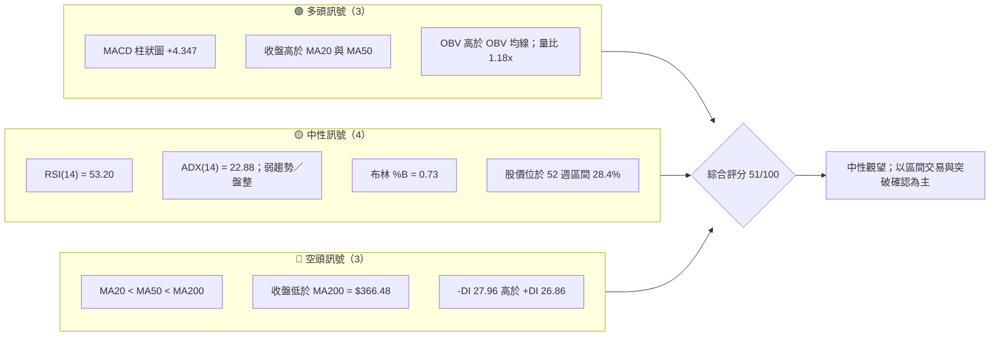
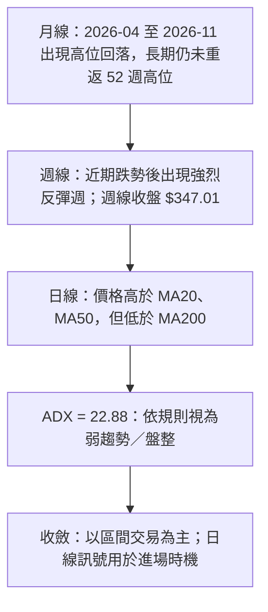
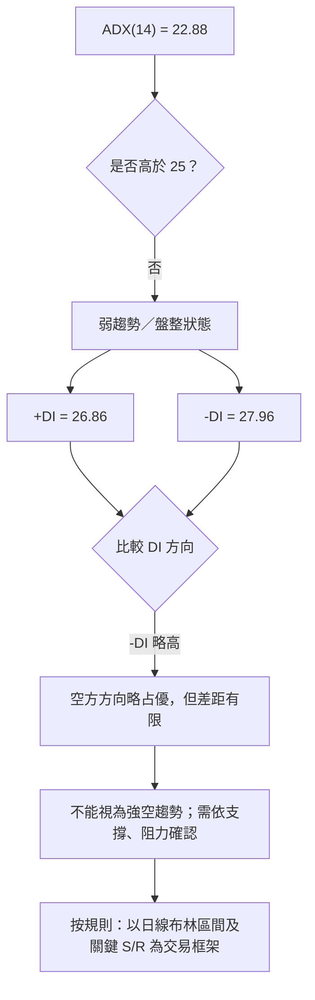
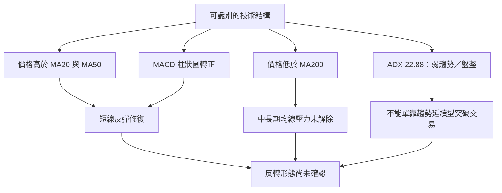
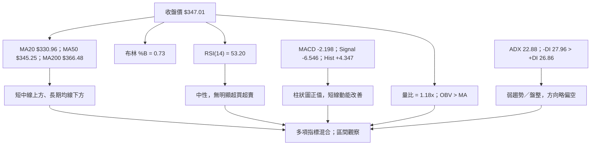
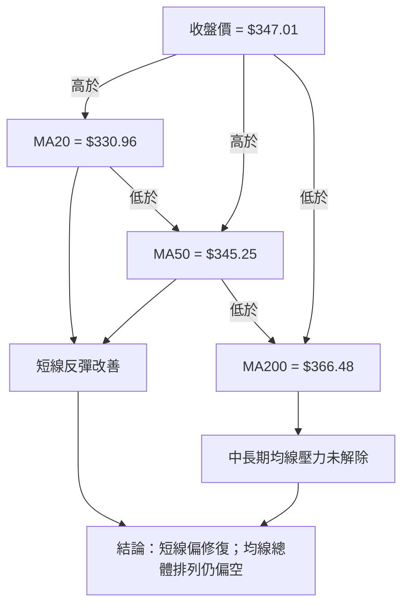
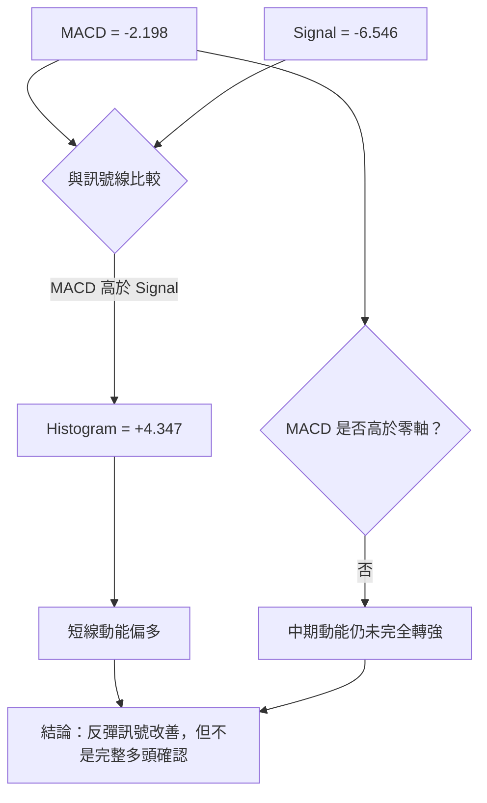
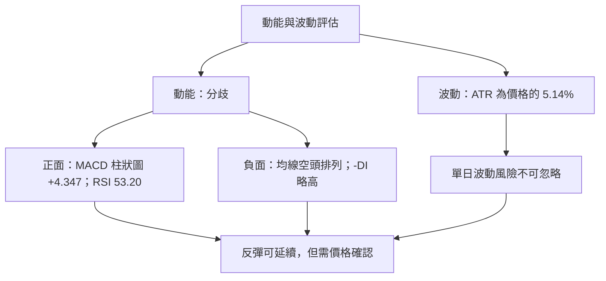
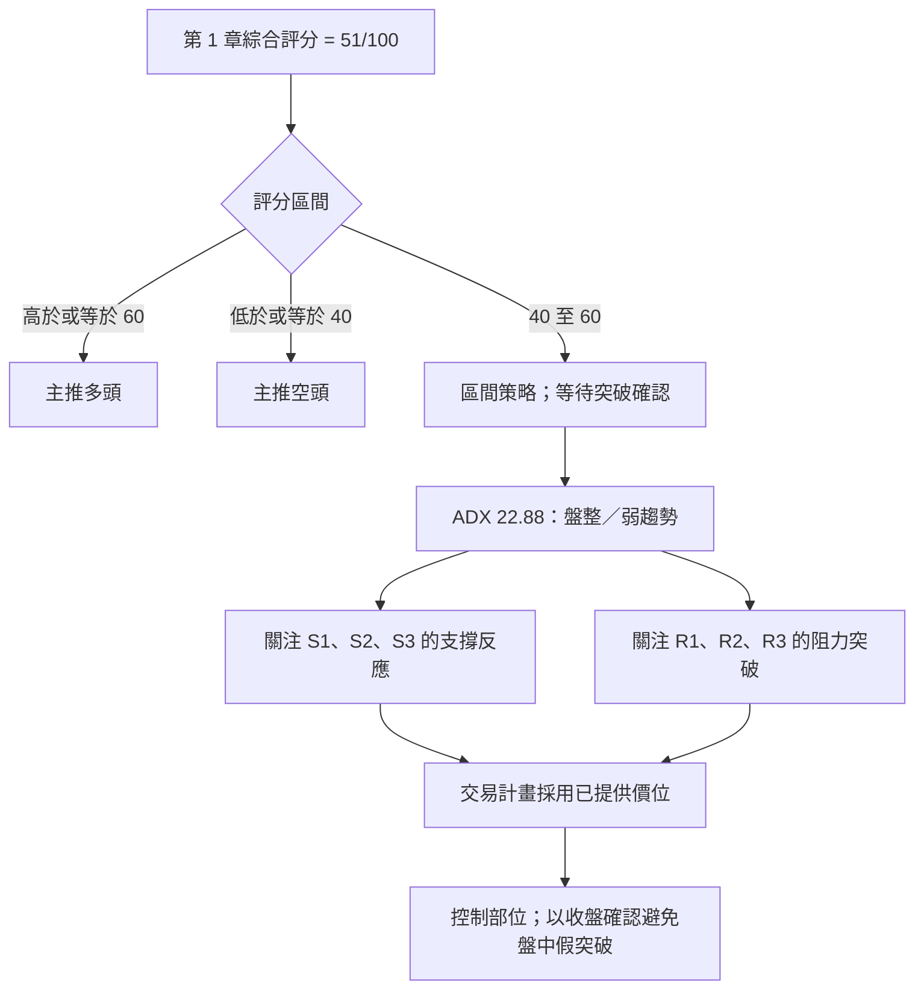
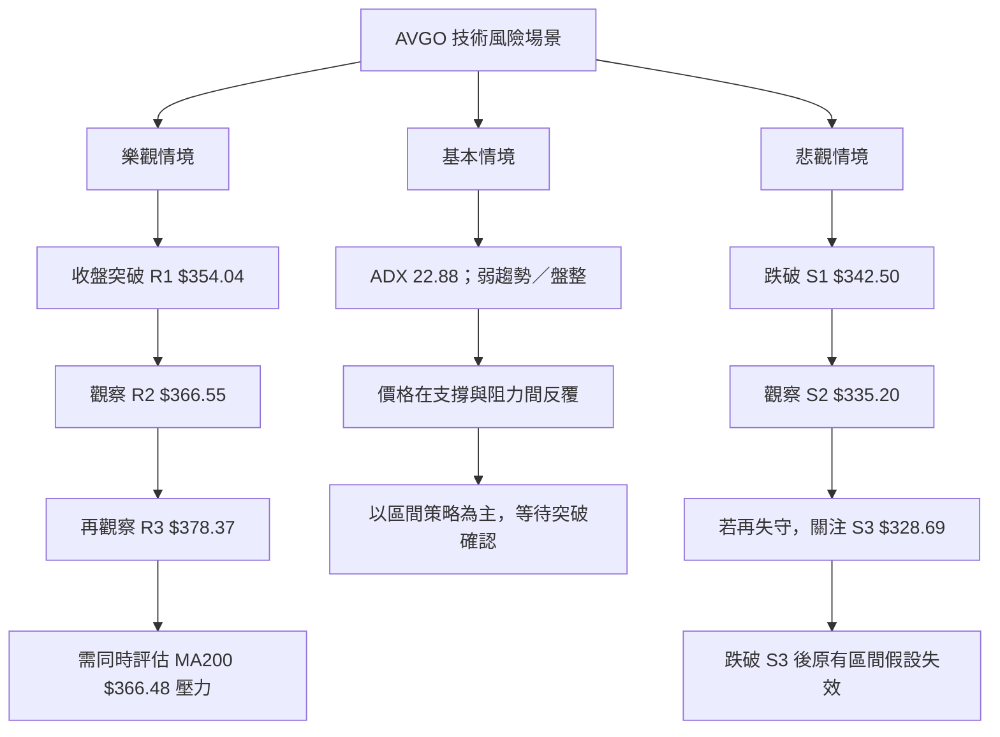

# AVGO 技術分析報告

> **報告日期**：2026-11-14 ｜ **語言**：繁體中文 ｜ **數據來源**：題供 Yahoo Finance 數據包  
> **當前價格**：**$347.01**（2026-11-13 收盤價）

---

## 目錄

| 章節 | 內容 |
|------|------|
| 1. 技術面概覽 | 訊號儀表板、核心指標、評分卡 |
| 2. 趨勢分析 | 多時框趨勢、長中短期走勢 |
| 3. 圖表形態分析 | 形態識別、K 線組合、目標價 |
| 4. 支撐與阻力 | 關鍵價位、斐波那契回調 |
| 5. 技術指標深度解讀 | MA、RSI、MACD、布林通道、成交量 |
| 6. 動能與波動率 | 動能評估、ATR、Beta |
| 7. 多時框架總結 | 時框架評分矩陣 |
| 8. 交易策略建議 | 區間策略、風險報酬比、情境分析 |
| 9. 風險提示與監控 | 監控指標、風險場景 |

---

## 1. 技術面概覽

### 🎯 技術訊號儀表板

AVGO 的短線訊號呈現「反彈動能改善、長中期均線仍偏弱」的混合結構。ADX(14) 為 22.88，低於 25 的趨勢行情參考門檻，因此依本報告的多時框收斂規則，當前優先視為**弱趨勢／盤整環境**，以日線區間和價位確認為主，不將短線反彈直接視為長期趨勢反轉。



### 📊 核心指標速覽表

| 指標類別 | 指標名稱 | 當前數值 | 訊號 | 解讀 |
|----------|----------|----------:|------|------|
| 價格 | 收盤價 | $347.01 | 🟡 | 反彈後收於支撐與阻力區間之間 |
| 均線 | MA20 | $330.96 | 🟢 | 收盤價高於 MA20，短線動能改善 |
| 均線 | MA50 | $345.25 | 🟢 | 收盤價略高於 MA50，但僅高出 $1.76 |
| 均線 | MA200 | $366.48 | 🔴 | 收盤價低於 MA200，長期均線壓力仍在 |
| 動能 | RSI(14) | 53.20 | 🟡 | 中性，未進入超買或超賣區 |
| 動能 | MACD | -2.198 | 🟡 | MACD 線仍低於零軸，但高於訊號線 |
| 動能 | MACD 柱狀圖 | +4.347 | 🟢 | 柱狀圖為正，短線動能改善 |
| 趨勢 | ADX(14) | 22.88 | 🟡 | 弱趨勢／盤整判讀，不宜只用趨勢追價 |
| 波動 | ATR(14) | $17.84 | 🟡 | 約為收盤價的 5.14%，日常波動幅度偏大 |
| 量能 | 最新量／20 日均量 | 1.18x | 🟢 | 最新成交量高於 20 日均量 |
| 量能 | OBV | OBV > MA | 🟢 | 數據快照顯示量能支持近期反彈 |

### 🏆 技術評分卡

以下各項採 0–100 分尺度；六項子評分的算術平均為綜合評分。評分是依目前提供的指標快照作出的技術判讀，不代表統計模型預測。

```text
技術評分卡 — AVGO（2026-11-14）
╔════════════════════════════════════════════════════════════╗
║ 趨勢強度      █████████░░░░░░░░░░░  45/100  🟡           ║
║ 動能指標      ████████████░░░░░░░░  58/100  🟡           ║
║ 支撐穩定度    ███████████░░░░░░░░░  55/100  🟡           ║
║ 成交量配合    ██████████████░░░░░░  70/100  🟢           ║
║ 形態完整度    █████████░░░░░░░░░░░  45/100  🟡           ║
║ 均線排列      ███████░░░░░░░░░░░░░  35/100  🔴           ║
╠════════════════════════════════════════════════════════════╣
║ 六項合計：308 ÷ 6 = 51.33；四捨五入後綜合評分 = 51/100  ║
║ 綜合評級：🟡 中性；優先採區間策略，等待突破確認          ║
╚════════════════════════════════════════════════════════════╝
```

| 子評分 | 分數 | 評分依據 |
|--------|-----:|----------|
| 趨勢強度 | 45/100 | ADX 22.88，未達強趨勢判讀；+DI、-DI 差距有限，且 -DI 略高 |
| 動能指標 | 58/100 | RSI 中性、MACD 柱狀圖轉正；但 MACD 線仍為負值，Stoch %K 低於 %D |
| 支撐穩定度 | 55/100 | 收盤價距 S1 為 1.30%，但近期波動幅度大，支撐尚需後續價格確認 |
| 成交量配合 | 70/100 | 最新成交量為 20 日均量的 1.18 倍，OBV 高於其均線 |
| 形態完整度 | 45/100 | 近期有反彈與週線長上影特徵，但可用資料不足以確認完整反轉形態 |
| 均線排列 | 35/100 | MA20 < MA50 < MA200，收盤價雖高於 MA20、MA50，仍低於 MA200 |

> **綜合評分計算：**（45 + 58 + 55 + 70 + 45 + 35）÷ 6 = 51.33，四捨五入為 **51/100**。第 7、8 章沿用相同評分。

### 🧭 訊號強度條

```text
短線反彈動能   ███████████░░░░░░░░░  55%
中期趨勢強度   ████████░░░░░░░░░░░░  40%
均線結構多方度 ███████░░░░░░░░░░░░░  35%
量能確認度     ██████████████░░░░░░  70%
整體訊號一致性 ██████████░░░░░░░░░░  51%
```

---

## 2. 趨勢分析

### 🌐 多時框趨勢分析



月線顯示，2025 年底至 2026 年 5 月整體走高，之後價格波動增大；2026 年 5 月月收盤 $445.25，至 2026 年 10 月收盤 $326.08，呈現一段明顯回檔。2026 年 11 月收盤回升至 $347.01，但目前仍低於 52 週高點 $493.32，也低於 MA200 $366.48。

在趨勢分類上，不能只依據最新一週的反彈便判定中長期反轉。當前股價高於 MA20、MA50，支持短線反彈延續的可能；但 MA20 < MA50 < MA200 的排列，以及價格低於 MA200，仍顯示中長期均線結構偏弱。

### 📈 長期趨勢 — 過去 12 個月月收盤走勢圖

下圖採 2025-12 至 2026-11 共 12 個月月收盤價。圖中每個數值均為數據包提供的月收盤價；折線位置是視覺化呈現，不代表日內高低點。

```text
AVGO 月線走勢圖（2025-12 至 2026-11）
價格（美元）
$450 ┤                 ●445.25
$425 ┤              ●416.01
$400 ┤ ●399.99                         ●377.06
$375 ┤                                  ●388.57
$350 ┤                                     ●369.67──●351.19──●347.01
$325 ┤       ●344.20──●329.48──●317.80──●308.46                  ●326.08
$300 ┤
     └─────────────────────────────────────────────────────────────
       12月   1月   2月   3月   4月   5月   6月   7月   8月   9月  10月  11月
       2025                         2026
```

#### 12 個月月收盤資料

| 月份 | 收盤價 | 月變動（相對前一月） | 階段特徵 |
|------|-------:|---------------------:|----------|
| 2025-12 | $344.20 | N/A（未提供 2025-11 月收盤作為計算基準） | 高位區間起點 |
| 2026-01 | $329.48 | -4.28% | 回落 |
| 2026-02 | $317.80 | -3.54% | 延續下行 |
| 2026-03 | $308.46 | -2.94% | 月收盤續降 |
| 2026-04 | $416.01 | +34.87% | 強勢反彈 |
| 2026-05 | $445.25 | +7.03% | 延續上行，區間高位 |
| 2026-06 | $377.06 | -15.31% | 顯著回檔 |
| 2026-07 | $388.57 | +3.05% | 反彈但幅度較小 |
| 2026-08 | $369.67 | -4.86% | 回落 |
| 2026-09 | $351.19 | -5.00% | 延續回檔 |
| 2026-10 | $326.08 | -7.15% | 月收盤再降 |
| 2026-11 | $347.01 | +6.42% | 月內截至 11 月 13 日收盤回升 |

> 月變動率以「本月收盤／前月收盤 − 1」計算；2026-11 為截至 2026-11-13 的月內收盤，並非已完成月份。

### 📊 長期走勢分段解讀

| 階段 | 數據範圍 | 走勢特徵 | 技術含義 |
|------|----------|----------|----------|
| 2025-12 至 2026-03 | $344.20 → $308.46 | 月收盤連續走低 | 長期上升趨勢出現明顯修正 |
| 2026-03 至 2026-05 | $308.46 → $445.25 | 兩個月大幅反彈 | 多頭動能曾快速恢復，但需後續延續確認 |
| 2026-05 至 2026-10 | $445.25 → $326.08 | 中間有反彈，總體回落 | 上方供給與均線壓力增加 |
| 2026-10 至 2026-11-13 | $326.08 → $347.01 | 月內反彈 | 短線修復，但尚未突破 MA200 或 R1 |

上述月收盤資料沒有提供每月高低點，因此不將其用來推定月線 K 線形態。

### 📊 中期趨勢（週線分析）

近 20 週收盤從 2026-08-07 的 $426.98 回落至 2026-11-06 的 $293.69，其間反彈幅度有限；最新一週收盤回升至 $347.01，並伴隨週成交量升至 174,139,700。這是明顯的短線反彈訊號，但由於最新週線同時有較長上影，且價格仍在 MA200 下方，尚不能單憑一週反彈確認週線趨勢已完全翻多。

```text
近期週線收盤與關鍵價位示意（非比例圖）
$378.37 ─────────────────────────────── R3
$367.03 ───── 61.8% 斐波那契位 ─────────
$366.55 ─────────────────────────────── R2
$366.48 ───── MA200 ───────────────────
$354.04 ─────────────────────────────── R1
$347.01 ───── 最新收盤 ─────────────────
$342.50 ─────────────────────────────── S1
$335.20 ─────────────────────────────── S2
$328.69 ─────────────────────────────── S3
$293.69 ───── 2026-11-06 週收盤 ────────
```

### ⚡ 趨勢強度評估（ADX 解讀）



| ADX 區間 | 常見技術解讀 | 本次判讀 |
|----------|--------------|----------|
| 低於 20 | 趨勢不明顯，盤整特徵較強 | — |
| 20 至 25 | 弱趨勢與盤整交界 | **ADX 22.88，符合此區間** |
| 高於 25 | 趨勢強度提高 | 未達 |
| 高於 40 | 強趨勢 | 未達 |

> ADX 衡量趨勢強弱，不直接提供多空方向。方向需參考 +DI、-DI；目前 -DI 27.96 略高於 +DI 26.86，故方向略偏空，但不足以支持「強空趨勢」結論。

---

## 3. 圖表形態分析

### 🔍 形態識別系統

可用數據支持的主要判讀是**指標與均線型態**：價格短線回升至 MA20、MA50 上方，MACD 柱狀圖轉正，但價格仍低於 MA200。月線及週線資料不足以驗證頭肩、雙底、三角形等幾何形態，因此不宣稱出現此類完整形態。



### 📐 形態信心度表

| 形態／結構 | 信心度 | 判斷依據 | 完成度 | 目標價 |
|------------|-------:|----------|--------|--------|
| 頭肩頂／頭肩底 | 低於 50%；訊號不足 | 未提供足以確認完整肩部、頭部與頸線的連續高低點資料 | 不確認 | 數據中未偵測到；不設定形態目標 |
| 雙頂／雙底 | 低於 50%；訊號不足 | 雖有週收盤回升與先前低位資料，但沒有足夠波段高低點及頸線證據 | 不確認 | 數據中未偵測到；不設定形態目標 |
| 三角形／旗形 | 低於 50%；訊號不足 | 缺少可確認收斂邊界、旗桿與整理區間的完整價格序列 | 不確認 | 數據中未偵測到；不設定形態目標 |
| 均線型短線反彈 | **60%** | 收盤 $347.01 高於 MA20 $330.96 與 MA50 $345.25；MACD 柱狀圖為正 | 部分形成 | 不適用幾何形態目標；交易目標僅採用已提供 R1–R3 |
| 中長期空頭均線排列 | **80%** | MA20 $330.96 < MA50 $345.25 < MA200 $366.48 | 排列成立 | 不適用形態高度推算；關注已提供阻力位 |

> 信心度是對該結構是否能由現有數據支持的分析判斷，並非統計勝率。若形態信心度低於 50%，本報告不把它作為交易目標價依據。

### 🕯️ 重要 K 線形態分析

下表僅使用題供「近 10 根日 K」及「近 8 根週 K」中的開、高、低、收。形態稱呼採保守標準；未符合明確幾何條件者不勉強命名。

#### 近 10 根日 K：重點 K 棒

| 日期（日 K） | 開 | 高 | 低 | 收 | K 線形態判讀 | 解讀 | 訊號 |
|------|------:|------:|------:|------:|----------|------|------|
| 2026-11-05 | $311.89 | $314.00 | $290.12 | $291.53 | 長陰線，收近低位 | 當日賣壓強，且成交量 53,835,500，明顯高於 20 日均量 | 🔴 |
| 2026-11-06 | $311.13 | $311.52 | $289.77 | $293.69 | 長陰線、收低於開盤 | 延續弱勢；日內低點是近 10 根日 K 中最低值 | 🔴 |
| 2026-11-09 | $305.29 | $323.05 | $304.29 | $319.48 | 強勢收高的陽線 | 在前兩日下跌後反彈，收盤接近日內高位 | 🟢 |
| 2026-11-11 | $350.00 | $356.85 | $344.31 | $345.22 | 陰線 | 高開後收低，日內上方出現賣壓 | 🟡 |
| 2026-11-12 | $356.80 | $369.82 | $354.72 | $364.36 | 陽線 | 收盤高於開盤，接近日內高位；與前一日跌勢不同向 | 🟢 |
| 2026-11-13 | $356.54 | $358.47 | $337.67 | $347.01 | 陰線，帶較長下影 | 收盤低於開盤；下影顯示低位有承接，但未能收復開盤價 | 🟡 |

> 2026-11-05 與 2026-11-06 均出現大幅下跌；2026-11-09 起反彈，但 2026-11-13 收盤仍低於開盤。此組 K 線反映短線波動劇烈，並非單一方向的穩定排列。

#### 近 8 根週 K：重點 K 棒

| 日期（週 K） | 開 | 高 | 低 | 收 | K 線形態判讀 | 解讀 | 訊號 |
|------|------:|------:|------:|------:|----------|------|------|
| 2026-10-09 | $357.79 | $380.84 | $356.14 | $361.54 | 陽線、上影較長 | 曾上探週內高位，但收盤遠低於高點，顯示上方有供給 | 🟡 |
| 2026-10-16 | $359.43 | $360.69 | $328.58 | $328.75 | 長陰線、收近低位 | 週內下跌明顯，賣壓主導 | 🔴 |
| 2026-10-23 | $338.75 | $341.10 | $320.23 | $321.68 | 陰線 | 低點續探，收盤偏弱 | 🔴 |
| 2026-10-30 | $324.53 | $352.40 | $319.30 | $326.08 | 小實體、較長上影 | 週內反彈未能維持，價格高於低點但收盤有限 | 🟡 |
| 2026-11-06 | $328.37 | $335.74 | $289.77 | $293.69 | 長陰線，收近低位 | 週線下跌擴大，週成交量增加 | 🔴 |
| 2026-11-13 | $305.29 | $369.82 | $304.29 | $347.01 | 強勢陽線、長上影 | 週內由低位回升，但最高至 $369.82 後回落，顯示上方仍有賣壓 | 🟢／🟡 |

### 📉 ASCII 走勢形態示意圖

下圖僅示意已提供週收盤價走勢，並標註數據中的關鍵支撐／阻力；折線為視覺導引，不代表未提供的日內價位。

```text
AVGO 近期週線收盤示意
$426.98  ● 2026-08-07
           \
$392.28      ●
               \
$367.78          ●──●
$361.54                    ●
$357.25                       ●──●──●
$352.81                              ●
$347.01                                         ● 最新收盤
$328.75                            ●
$326.08                                       ●
$321.68                                ●
$293.69                                            ●
          8月       9月             10月         11月

價位參照：
R3 $378.37 ─────────────────────────────────────
R2 $366.55 ─────────────────────────────────────
R1 $354.04 ─────────────────────────────────────
現價 $347.01 ───────────────────────────────────
S1 $342.50 ─────────────────────────────────────
S2 $335.20 ─────────────────────────────────────
S3 $328.69 ─────────────────────────────────────
```

### 🎯 形態目標價計算

- 由目前提供的週收盤資料，可觀察到價格自 2026-11-06 收盤 $293.69 回升至 2026-11-13 收盤 $347.01。
- 但資料不足以確認反轉形態的頸線、形態高度或有效突破，因此**不以雙底、頭肩底或其他形態高度推算目標價**。
- 本報告的技術目標僅引用題供關鍵價位 R1、R2、R3；不自行創造新的支撐、阻力或形態目標。

---

## 4. 支撐與阻力

### 🗺️ 關鍵價位分布圖

以下價位直接引用題供「關鍵價位（由 OHLCV 計算）」區塊。圖中垂直排列只表示價位相對高低，不代表各區間有相同距離。

```text
AVGO 價位結構分布圖（美元）
════════════════════════════════════════════════════════
$378.37 ║████████████████████████║ R3 阻力
$366.55 ║██████████████████████  ║ R2 阻力
$354.04 ║██████████████████      ║ R1 阻力
$347.01 ╠════════════════════════╣ 現價（收盤）
$342.50 ║▓▓▓▓▓▓▓▓▓▓▓▓▓▓▓▓▓▓      ║ S1 支撐
$335.20 ║▓▓▓▓▓▓▓▓▓▓▓▓▓▓          ║ S2 支撐
$328.69 ║▓▓▓▓▓▓▓▓▓▓▓▓▓▓▓▓▓▓      ║ S3 支撐
════════════════════════════════════════════════════════
```

### 🚧 阻力位分析表

| 阻力級別 | 價位 | 距離現價 | 形成原因 | 突破難度 | 重要性 |
|----------|------:|---------:|----------|----------|--------|
| R1 | $354.04 | +2.03% | 近一年波段高點聚類；也是近期價格上方的第一道技術參考 | 中 | 高；短線反彈延續需留意能否站上 |
| R2 | $366.55 | +5.63% | 近一年波段高點聚類；與 MA200 $366.48 接近，但兩者是不同來源的技術參考 | 中高 | 高；突破可改善中期結構 |
| R3 | $378.37 | +9.04% | 近一年波段高點聚類 | 高 | 高；屬更高層級的反彈阻力 |

> MA200 為 $366.48，而 R2 為 $366.55。兩者僅相差 $0.07，但本報告分別按均線值與題供阻力值處理，不將其中一個替代另一個。

### 🛡️ 支撐位分析表

| 支撐級別 | 價位 | 距離現價 | 形成原因 | 守住條件與風險 | 重要性 |
|----------|------:|---------:|----------|----------------|--------|
| S1 | $342.50 | -1.30% | 近一年波段低點聚類 | 收盤守住可維持短線反彈結構；但距現價近，可能有短線測試 | 高 |
| S2 | $335.20 | -3.40% | 近一年波段低點聚類 | 若 S1 失守，S2 是下一參考；需配合成交量與收盤確認 | 高 |
| S3 | $328.69 | -5.28% | 近一年波段低點聚類 | 支撐區下沿參考；若失守，區間交易假設將明顯轉弱 | 高 |

### 📐 斐波那契回調位分析

以下回調位直接引用題供數值，不重新計算：

| 回調位 | 價位 |
|--------|------:|
| 23.6% | $445.09 |
| 38.2% | $415.26 |
| 50.0% | $391.15 |
| 61.8% | $367.03 |
| 78.6% | $332.71 |
| 100.0%（52 週低點） | $288.98 |

**現價 $347.01 位於 78.6% 回調位 $332.71 與 61.8% 回調位 $367.03 之間。**  
這表示 AVGO 已回吐 52 週區間漲幅中的相當部分；若價格重新站上 $367.03，則有利於回升至更高的回調參考區。反之，若向下失守 $332.71，需留意接近 $288.98 的 52 週低點區域；但該區域不等同於保證支撐。

```text
52 週區間斐波那契位置（由高至低）
$493.32  0.0%   52 週高點
$445.09 23.6%
$415.26 38.2%
$391.15 50.0%
$367.03 61.8%   ◄ 現價高於此位的反方向位置？否：現價低於此位
$347.01        ◄ 現價
$332.71 78.6%   ◄ 現價高於此位
$288.98 100.0% 52 週低點
```

> 價位上下關係：**$332.71 < $347.01 < $367.03**。

---

## 5. 技術指標深度解讀

### 🎛️ 指標訊號總覽



### 📈 移動平均線排列分析



| 均線 | 數值 | 收盤價相對位置 | 訊號 |
|------|------:|----------------|------|
| MA20 | $330.96 | 收盤高於 MA20 $16.05 | 🟢 短線修復 |
| MA50 | $345.25 | 收盤高於 MA50 $1.76 | 🟡 剛站上，需延續確認 |
| MA200 | $366.48 | 收盤低於 MA200 $19.47 | 🔴 長期壓力 |
| 排列 | MA20 < MA50 < MA200 | 空頭排列 | 🔴 均線結構仍偏弱 |

MA20 的走勢快照為上升，MA50（題供 MA60 的走勢快照）略降，MA120 與 MA240 仍下降。短線均線方向改善與長線均線下行並存，是目前訊號不一致的主要來源。

### 📉 RSI(14) 分析

```text
RSI(14) = 53.20
0        30              50              70       100
|---------|---------------|---------------|---------|
          超賣區          中性區          超買區
                          ▲
                        53.20
強度條：███████████░░░░░░░░ 53.2%
```

- RSI 53.20 處於 30 至 70 的中性區間，沒有顯示明確超買或超賣。
- RSI 位於 50 之上，略支持短線反彈動能，但強度不足以單獨確認趨勢反轉。
- 數據包明確標示：**近 20 根 K 棒首尾價格與 RSI 方向比較，無明顯背離**。
- 因此，RSI 判讀為：**未確認頂背離，也未確認底背離**。

### 📊 MACD(12/26/9) 訊號解讀

| MACD 項目 | 數值 | 解讀 |
|-----------|-----:|------|
| MACD 線 | -2.198 | 仍低於零軸，趨勢位置尚未完全轉正 |
| 訊號線 | -6.546 | 低於 MACD 線 |
| MACD 柱狀圖 | +4.347 | 為正，反映短線動能改善 |



**MACD 背離判斷：**
- 提供資料包含一組 MACD 快照，沒有提供完整峰谷序列或 MACD 歷史高低點。
- 因而**無法確認 MACD 頂背離或底背離**；不以單一快照推定背離。
- MACD 柱狀圖轉正與 OBV 高於均線互相支持短線反彈，但 MA200 下方及 -DI 略高於 +DI，構成尚未解除的反向訊號。

### 📦 布林通道分析

| 布林項目 | 價位／數值 | 與現價關係 |
|----------|-----------:|------------|
| 上軌 | $365.80 | 高於現價 $18.79 |
| 中軌（MA20） | $330.96 | 低於現價 $16.05 |
| 下軌 | $296.12 | 低於現價 $50.89 |
| %B | 0.73 | 位於通道中上部，但未到上軌 |

```text
布林通道位置示意
$365.80  ───────────────────────── 上軌
           （距現價 +$18.79）
$347.01  ────────────────●──────── 現價；%B = 0.73
$330.96  ───────────────────────── 中軌／MA20
$296.12  ───────────────────────── 下軌
```

%B 為 0.73，代表價格位於布林通道中線與上軌之間，短線偏強但尚未觸及上軌。ADX 低於 25，因此按規則，以布林通道作盤整觀察框架；但布林上下軌是指標值，交易策略的正式支撐、阻力及目標價仍採用第 4 章的已提供關鍵價位。

### 💹 成交量分析（量價配合度）

- 最新日成交量為 **31,602,000**，20 日均量為 **26,849,330**，量比 **1.18x**，代表最新日成交量高於 20 日均量。
- 最新一週成交量為 **174,139,700**，是近 20 週列示資料中最高的週成交量；同週收盤從前一週 $293.69 回升至 $347.01，呈現量價同向反彈。
- OBV 高於其均線，數據快照指向量能支持上漲。
- 但單週高量也可能代表波動放大或多空換手，不能只看成交量放大便視為趨勢確認。需觀察後續價格能否守住 S1、並突破 R1。

```text
量價訊號合成
價格反彈      🟢  週收盤 $293.69 → $347.01
最新日量      🟢  量比 1.18x
週成交量      🟢  174,139,700（近 20 週列示值最高）
OBV           🟢  OBV > MA
上方均線確認  🔴  價格仍低於 MA200 $366.48
量價總結      🟡  量能支持反彈，但尚不足以確認中長期反轉
```

---

## 6. 動能與波動率

### ⚡ 動能評估四象限

本次資料未提供以歷史分布標準化的波動率百分位，因此不以「高／低波動」分位作定量判定。以 ATR 占股價 5.14% 作為波動偏大的操作性參考，並以 RSI、MACD、ADX 綜合判斷動能。

| 象限 | 動能 | 波動 | 當前狀態 | 評估 |
|------|------|------|----------|------|
| Q1 | 強 | 低 | — | 理想趨勢機會，但目前未符合低波動條件 |
| Q2 | 弱 | 低 | — | 低波動整理，但目前 ATR 占比不低 |
| Q3 | 強 | 高 | 部分符合 | MACD 柱狀圖轉正、OBV 支持反彈；但波動大、趨勢未確認 |
| Q4 | 弱 | 高 | 部分符合 | MA 空頭排列、-DI 略高於 +DI；但 RSI 與 MACD 動能不完全偏空 |

**當前位置：Q3 與 Q4 訊號交錯，偏向「高波動、動能分歧」。**  
這種結構不適合未設定停損的追價交易，較適合等待支撐／阻力確認後分批操作。



### 📊 ATR 波動率分析

- ATR(14)：**$17.84**。
- ATR 占收盤價比例：**5.14%**。
- ATR 是平均真實波動幅度參考，不是預測明日漲跌，也不是固定停損建議。
- 若部位停損距離遠小於 ATR，容易受到正常日內波動影響；若停損距離過大，則單筆風險金額可能過高。
- 交易策略中的停損價必須遵守題供關鍵價位，因此本報告採用 S3 或 S1 等已列價位，而不以 ATR 另行創造新停損價。

```text
ATR 相對波動條
每股 ATR        $17.84  ████████████████████
ATR / 收盤價      5.14% ██████████░░░░░░░░░░
含義：若使用較窄停損，需考慮 AVGO 正常波動可能觸及停損。
```

### 📐 Beta 與市場相關性

| 指標 | 數值 | 技術風險含義 |
|------|-----:|--------------|
| Beta | 1.508 | 數據顯示 AVGO 對市場波動具有較高敏感度的特徵 |
| Short Ratio | 2.33 | 空頭回補天數參考值；不能單獨推導價格方向 |
| Short % Float | 1.1% | 流通股空頭比例不高，短軋訊號並不突出 |

Beta 不是即時相關係數，也不表示 AVGO 每日必定按大盤的 1.508 倍變動。當大盤波動加劇時，AVGO 的高 Beta 特性意味著應降低單筆風險暴露，並避免只根據個股技術訊號忽略系統性風險。

---

## 7. 多時框架總結

### 📋 時框架評分表

下表綜合月線收盤變化、近 20 週收盤、日線指標與均線快照。評分為技術判讀分數，不替代第 1 章綜合評分；第 1 章定義的全報告綜合評分仍為 **51/100**。

| 時框架 | 趨勢方向 | 動能 | 均線排列 | 形態 | 綜合評分 | 建議 |
|--------|----------|------|----------|------|---------:|------|
| 月線／長期 | 2026 年 5 月後回落，11 月月內反彈 | 中性偏弱 | 月線均線資料未提供，N/A（數據未提供） | 不確認幾何形態 | 45/100 | 不宜將月內反彈視為長期反轉 |
| 週線／中期 | 由 11 月 6 日收盤低位大幅反彈 | 反彈動能改善，最新週線有長上影 | 週線均線數據未提供，N/A（數據未提供） | 反彈週尚待延續確認 | 53/100 | 關注 R1、R2 與支撐守穩 |
| 日線／短期 | 反彈修復 | RSI 中性，MACD 柱狀圖為正 | MA20、MA50 上方；MA200 下方 | 短線反彈，非確認反轉形態 | 56/100 | 以支撐／阻力作區間交易 |

### 🔲 綜合訊號矩陣

| 維度 | 短期（日線） | 中期（週線） | 長期（月線） | 一致性 |
|------|--------------|--------------|--------------|--------|
| 價格方向 | 反彈 | 低位急彈 | 2026-05 後整體回落 | ❌ |
| 動能 | MACD 柱狀圖轉正 | 最新週 RSI 53.2 | 月線動能指標未提供 | 部分 |
| 均線 | 價格高於 MA20、MA50 | 週線均線未提供 | 月線均線未提供 | 部分 |
| 趨勢強度 | ADX 22.88 | 以週收盤反彈為主 | 月線 ADX 未提供 | 盤整／弱趨勢 |
| 量能 | 量比 1.18x，OBV > MA | 最新週量上升 | 月度量能未提供 | 偏支持反彈 |

### ⚖️ 多時框收斂結論

1. **先判斷行情狀態：** ADX(14) = 22.88，低於 25，屬弱趨勢／盤整環境。
2. **主導時框：** 依規則，盤整環境以日線布林通道上下軌及已提供的支撐阻力為主要交易框架；週線與月線用作風險背景。
3. **方向性結論：****中性觀望**，不是強烈看多或強烈看空。
4. **訊號取捨：** 日線 MACD 柱狀圖、RSI 和 OBV 支持短線反彈；但 MA20 < MA50 < MA200、價格低於 MA200、週線上影與 -DI 略高於 +DI，阻止我們把反彈升級為中長期趨勢翻多。
5. **與第 8 章一致性：** 綜合評分 51/100 落在 40–60 中性區，因此第 8 章以區間操作、等待突破確認為主，不同時強推多空趨勢策略。

---

## 8. 交易策略建議

### 🗺️ 策略決策流程圖



> **當前主策略方向 = 中性區間交易（依評分 51/100）；等待突破確認後才提高方向性曝險。**

### 🧭 策略路由與執行原則

- 綜合評分 51/100，落在中性區間，依指定規則採**區間操作**，不同時強力推薦多空兩套趨勢策略。
- 多頭情境是支撐位企穩後的區間反彈，或突破 R1 後的確認交易。
- 若價格失守支撐或技術訊號轉弱，視為主策略風險觸發；本報告不在中性評分下將其包裝為另一套強推空頭策略。
- 布林通道用來判讀盤整位置；實際進出場價、停損、目標價遵守題供 S1–S3、R1–R3。
- 下列成功機率為**情境判斷估計**，不是歷史回測統計；資料未提供策略回測結果。

### 🎯 價格情境階梯

| 觸發條件 | 下一目標 | 後續延伸 | 情境含義 |
|----------|----------|----------|----------|
| 突破並守住 R1 $354.04 | R2 $366.55 | R3 $378.37 | 短線反彈延續；仍需留意 MA200 $366.48 附近的均線壓力 |
| 價格在 S1 $342.50 與 R1 $354.04 之間波動 | — | — | 近端區間震盪，等待收盤突破確認 |
| 跌破 S1 $342.50 | S2 $335.20 | S3 $328.69 | 區間轉弱；需重新評估反彈交易假設 |
| 跌破 S3 $328.69 | 本資料未提供更低的 OHLCV 計算支撐位 | N/A（數據未提供） | 原有區間支撐結構失效，避免以未提供價位推測下行目標 |

### 📊 情境機率分佈

| 情境 | 機率估計 | 主要依據 |
|------|---------:|----------|
| 繼續上行／反彈 | 35% | MACD 柱狀圖 +4.347、RSI 53.20、OBV 高於均線、最新週量高；但尚未站穩 R1 或 MA200 |
| 區間震盪 | 40% | ADX 22.88 低於 25；布林 %B 0.73；多空指標互相矛盾，符合盤整收斂規則 |
| 回落／再探支撐 | 25% | MA20 < MA50 < MA200、-DI 略高於 +DI、最近 52 週區間位置僅 28.4%；但短線動能已有改善 |

> 三種情境機率合計 100%。這是依目前指標快照給出的主觀技術情境權重，不能視作模型預測或保證。

### 🟢 主策略詳情：中性評分下的條件式區間策略

| 策略要素 | 策略 A：支撐反彈條件單 | 策略 B：上破阻力確認單 |
|----------|-------------------------|-------------------------|
| 進場條件 | 價格回落至 S2 區域後止跌，並出現收盤反彈確認；若直接失守 S3，取消 | 價格上破並以收盤確認站上 R1，且未立即跌回 R1 下方 |
| 進場價格 | **$335.20**（S2） | **$354.04**（R1） |
| 目標價 T1 | **$342.50**（S1） | **$366.55**（R2） |
| 目標價 T2 | **$354.04**（R1） | **$378.37**（R3） |
| 止損價格 | **$328.69**（S3） | **$342.50**（S1） |
| 風險報酬比 | 風險 $6.51；T1 獲利 $7.30；**1 : 1.12（以 T1 計）**；T2 獲利 $18.84，**1 : 2.89（以 T2 計）** | 風險 $11.54；T1 獲利 $12.51；**1 : 1.08（以 T1 計）**；T2 獲利 $24.33，**1 : 2.11（以 T2 計）** |
| 進場方式 | 等待支撐反應確認，不預設支撐必然守住 | 等待收盤突破 R1 確認，不以盤中刺穿當作有效突破 |
| 成功機率估計 | 55%（情境估計，非回測） | 48%（情境估計，非回測） |
| 建議倉位 | 最高為總投資組合的 5%–8%，須按可承受損失調整 | 最高為總投資組合的 3%–5%，突破確認前不預先滿倉 |

#### 風險報酬比計算核對

**策略 A：**
- 進場 $335.20；止損 $328.69；每股風險 = $335.20 − $328.69 = **$6.51**。
- T1 $342.50；每股潛在報酬 = $342.50 − $335.20 = **$7.30**。
- T1 比值：$7.30 ÷ $6.51 = 1.121…，即 **1 : 1.12（以 T1 計）**。
- T2 $354.04；每股潛在報酬 = $18.84；$18.84 ÷ $6.51 = 2.894…，即 **1 : 2.89（以 T2 計）**。

**策略 B：**
- 進場 $354.04；止損 $342.50；每股風險 = **$11.54**。
- T1 $366.55；每股潛在報酬 = **$12.51**；$12.51 ÷ $11.54 = 1.084…，即 **1 : 1.08（以 T1 計）**。
- T2 $378.37；每股潛在報酬 = **$24.33**；$24.33 ÷ $11.54 = 2.108…，即 **1 : 2.11（以 T2 計）**。

> 進場價、止損價及目標價均為題供關鍵價位中的已列值，沒有由其他指標估算或創造新價格。上述計算未計佣金、滑價、稅費或隔夜跳空。

### 🔴 反向風險觸發點（對沖提示）

- **跌破 S1 $342.50：** 支撐反彈策略的短線假設轉弱，應降低風險或等待 S2 $335.20 的反應。
- **跌破 S2 $335.20：** 下方進一步關注 S3 $328.69；不應把原有反彈預期視為仍然成立。
- **跌破 S3 $328.69：** 策略 A 的停損觸發；題供數據未提供更低的 OHLCV 聚類支撐，故不提供額外精確下行目標。
- **上破 R1 $354.04 後迅速回落：** 需提防假突破，尤其當成交量無法延續或收盤再度低於 R1 時。
- **無法重返 MA200 $366.48：** 中期均線壓力仍在；即使觸及 R2 $366.55，也需觀察能否形成有效站穩，而非只看盤中觸價。

### ⭐ 整體訊號強度評星

```text
做多訊號強度：★★★☆☆  (3/5 星)
做空訊號強度：★★★☆☆  (3/5 星)
整體可信度：  ★★★☆☆  (3/5 星)

主要原因：
🟢 MACD 柱狀圖轉正、OBV > MA、價格高於 MA20 與 MA50
🔴 均線空頭排列、收盤低於 MA200、-DI 略高於 +DI
🟡 ADX 低於 25，且多空訊號分歧；整體採中性區間策略
```

---

## 9. 風險提示與監控

### ✅ 關鍵監控指標 Checklist

```text
AVGO 技術監控清單 — 2026-11-14
╔══════════════════════════════════════════════════════════╗
║ □ 收盤是否守住 S1 $342.50                              ║
║ □ 若 S1 失守，觀察 S2 $335.20 的收盤反應              ║
║ □ 若 S2 失守，檢查 S3 $328.69 是否被有效跌破          ║
║ □ 突破 R1 $354.04 是否有收盤確認，而非盤中短暫刺穿     ║
║ □ 上攻 R2 $366.55 時，是否能同時消化 MA200 $366.48    ║
║ □ RSI 是否持續維持中性區，或快速轉向超買／超賣區       ║
║ □ MACD 柱狀圖 +4.347 是否延續，或重新轉負              ║
║ □ 量比 1.18x 與 OBV > MA 的量價支持是否持續            ║
║ □ ADX 是否升至 25 以上；若是，重新評估趨勢主導時框     ║
║ □ ATR $17.84（占價 5.14%）是否造成超出計畫的日內波動  ║
╚══════════════════════════════════════════════════════════╝
```

### ⚠️ 風險場景分析



### 🟢 樂觀情境

若價格突破 R1 $354.04 並能以收盤確認，短線反彈結構可望延續至 R2 $366.55；若進一步有量突破，R3 $378.37 是下一個已提供阻力參考。由於 MA200 為 $366.48，R2 與 MA200 幾乎重疊，該區域可能成為重要的中期確認區，而不是理所當然的直通目標。

### 🟡 基本情境

ADX 22.88、RSI 53.20、布林 %B 0.73，配合均線方向分歧，較符合盤整與反彈修復並存的情境。若價格未有效突破 R1，也未失守 S1，應以等待價格確認為主，不宜因短期反彈而擴大倉位。

### 🔴 悲觀情境

若收盤跌破 S1 $342.50，表示短線支撐承受壓力；後續參考 S2 $335.20、S3 $328.69。若連 S3 也失守，區間反彈交易的技術假設失效。由於題供資料未提供更低的 OHLCV 計算支撐位，**不推算也不編造 S3 以下的精確價位**。

### 🛡️ 風險管理重要提醒

1. **按單筆可承受損失反推倉位。**  
   以策略 A 每股風險 $6.51 為例，持倉股數應由投資者可承受的單筆損失除以每股風險計算；不可先決定股數再忽視停損距離。

2. **ATR 顯示日內波動不低。**  
   ATR(14) $17.84、占收盤價 5.14%，意味較窄停損可能被正常波動觸發；然而不可因此任意放寬停損，而應同步降低部位。

3. **使用收盤價確認而非盤中觸價。**  
   AVGO 近期日週波動明顯，R1 短暫突破或支撐盤中跌破，都可能不是有效方向確認。

4. **留意跳空與流動性風險。**  
   停損單在跳空行情下未必能以預設價格成交。上述風險報酬比是理論值，未納入滑價、交易成本及隔夜跳空。

5. **技術訊號不能代替基本面或事件風險判斷。**  
   本報告只分析技術數據；市場消息、財報、產業消息與整體市場變化可能迅速改變技術結構。

6. **不要把單一指標解讀成交易結論。**  
   MACD 柱狀圖轉正、OBV 高於均線為短線支持，但均線空頭排列、價格低於 MA200、ADX 低於 25，均提示反彈尚未形成一致的中長期趨勢訊號。

---

## 📋 報告總結

```text
AVGO 技術分析報告總結
══════════════════════════════════════════════════════════
報告日期：2026-11-14
當前價格：$347.01（2026-11-13 收盤）
分析評級：🟡 中性觀望；ADX 22.88，採區間策略
綜合評分：51/100（六項子評分算術平均）
技術走勢信心：★★★☆☆

關鍵結論：
├─ 長期趨勢：🟡 2026-05 後回落；11 月月內反彈尚未扭轉長期修正
├─ 中期趨勢：🟡 週線由低位反彈，最新週 K 有長上影，尚待確認
├─ 短期趨勢：🟡 價格高於 MA20、MA50；MACD 柱狀圖轉正
├─ 均線背景：🔴 MA20 < MA50 < MA200；收盤仍低於 MA200
├─ 關鍵支撐：$342.50（S1）、$335.20（S2）、$328.69（S3）
├─ 關鍵阻力：$354.04（R1）、$366.55（R2）、$378.37（R3）
├─ 斐波那契區間：現價 $347.01 位於 $332.71 與 $367.03 之間
└─ 分析師平均目標：$529.24（市場分析師共識，非本報告技術目標）

最優策略組合：
1. 🥇 首選：在 S2 $335.20 附近等待止跌確認，停損 $328.69，
   T1 $342.50、T2 $354.04；T1 風險報酬比 1 : 1.12。
2. 🥈 次選：收盤確認突破 R1 $354.04 後再考慮進場，
   停損 $342.50、T1 $366.55、T2 $378.37；T1 比值 1 : 1.08。
3. 🥉 保守選擇：維持觀望，等待突破 R1 或支撐失守後的方向確認。

══════════════════════════════════════════════════════════
```

> ⚠️ **免責聲明**：本報告為 AI 根據題供技術數據所作的分析，僅供研究與學術參考，不構成投資建議。風險報酬比與情境機率均不保證未來結果；實際交易可能受到滑價、跳空、交易成本及市場環境影響。投資有風險，入市需謹慎。

*報告生成時間：2026-11-14 ｜ 數據來源：題供 Yahoo Finance 數據包 ｜ 分析框架：多時框技術分析*