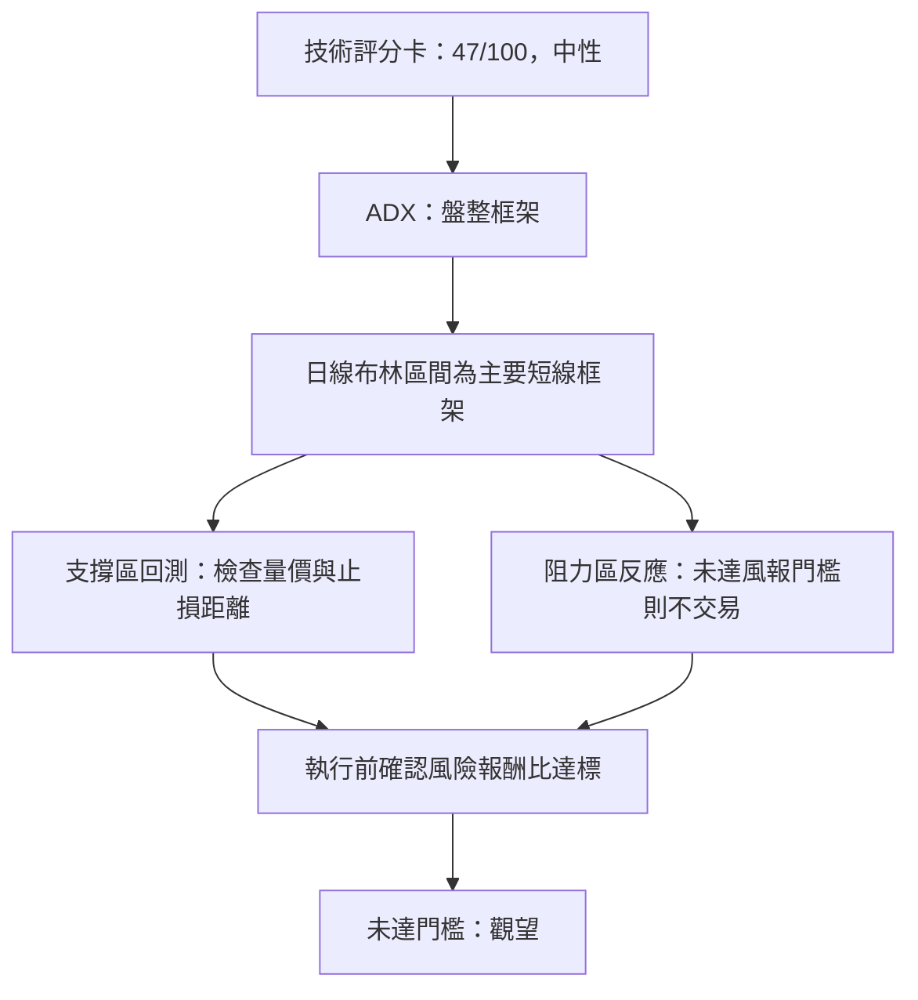

# AVGO 技術分析報告

> **報告日期**：2026-11-20 ｜ **語言**：繁體中文 ｜ **數據來源**：Yahoo Finance ｜ **當前價格**：US$346.65（收盤日：2026-11-19）

---

## 目錄

| 章節 | 內容 |
|------|------|
| [1. 技術面概覽](#1-技術面概覽) | 核心指標速覽、評分卡 |
| [2. 趨勢分析](#2-趨勢分析) | 長中短期走勢、ADX |
| [3. 圖表形態分析](#3-圖表形態分析) | 形態、K線、缺口 |
| [4. 支撐與阻力](#4-支撐與阻力) | 關鍵價位、斐波那契 |
| [5. 技術指標深度解讀](#5-技術指標深度解讀) | MA、RSI、MACD、布林、成交量、進階指標 |
| [6. 動能與波動率](#6-動能與波動率) | ATR、Beta、相對強度 |
| [7. 多時框架總結](#7-多時框架總結) | 時框架評分矩陣 |
| [8. 交易策略建議](#8-交易策略建議) | 歷史基準、策略、風險報酬比 |
| [9. 風險提示與監控](#9-風險提示與監控) | 監控指標、風險場景 |

---

## 1. 技術面概覽

AVGO 短線反彈訊號改善，但整體仍是**中性、偏區間整理**，尚未形成多時框趨勢反轉。日線收在短期均線之上且 MACD 柱轉正，與 OBV 高於均線的訊號互相支持；但週線偏空、月線中性，且價格仍受長期均線與一目雲層壓制。最大反向風險是反彈量能未能持續、A/D 線呈派發跡象，若支撐失守，反彈可能轉為下探。

### 📊 核心指標速覽表

| 指標類別 | 指標名稱 | 當前數值 | 訊號 | 解讀 |
|----------|----------|----------|------|------|
| **價格** | 當前價格 | US$346.65 | 🟡 | 位於短期均線上方、長期均線下方；價位細節見本章標題列。 |
| **均線** | MA20 / MA50 / MA200 | 見第 5 章 | 🟡 | 短線回升，但均線排列仍偏空。 |
| **動能** | RSI(14)（日線） | 見第 5 章 | 🟡 | 中性，未進入超買或超賣區。 |
| **動能** | MACD 柱（日線） | 見第 5 章 | 🟢 | 日線柱值為正，短線動能改善。 |
| **趨勢** | ADX(14) | 見第 2 章 | 🟡 | 趨勢強度偏弱，採盤整框架。 |
| **波動** | ATR(14) | 見第 6 章 | 🟡 | 單日波動幅度偏大，需控制部位與停損距離。 |
| **多時框** | 一致性 | 見第 7 章 | 🔴 | 日、週、月訊號分歧，不支持追價建立方向性大倉。 |

### 🏆 技術評分卡

綜合評分依六項子評分的算術平均計算，四捨五入至整數；評分反映技術結構，不代表報酬保證。

| 維度 | 評分（0–100） | 訊號 | 主要依據（引用數值所在章節） |
|------|---------------|------|------------------------------|
| 趨勢強度 | 45 | 🟡 | ADX 顯示趨勢偏弱，見第 2 章。 |
| 動能指標 | 55 | 🟡 | 日線動能回升，但多時框未一致，見第 5、7 章。 |
| 支撐穩定度 | 60 | 🟡 | 多個波段支撐與成交量分布價值區提供參考，見第 4、5 章；仍須觀察回測反應。 |
| 成交量配合 | 45 | 🟡 | OBV 支持反彈，但量比低於均量且 A/D 走弱，見第 5 章。 |
| 形態完整度 | 40 | 🔴 | 尚未辨識出可信度足夠的完整幾何形態，見第 3 章。 |
| 均線排列 | 35 | 🔴 | 均線排列仍為空頭，見第 5 章。 |
| **綜合評分** | **47** | **中性** | 六項平均：280 ÷ 6，四捨五入至整數。 |

---

## 2. 趨勢分析

**結論：長期走勢仍處於前期上漲後的修正，中期週線偏空，日線反彈則改善短期動能。** ADX 判定目前較符合盤整行情，因此日線布林通道區間是短線規劃的主要框架；週線與月線仍限制追多的信心。

### 📈 長期趨勢（近 12 個月）

下表以近十二個月月收盤資料整理階段；起訖收盤與漲跌幅由價格資料庫月收盤資料計算。階段切分是對已觀察走勢的描述，不是對未來走勢的預測。

| 期間 | 起訖月收盤 | 漲跌幅 | 特徵 |
|------|------------|--------|------|
| 2025-11 至 2026-03 | US$399.99 → US$308.46 | -22.88% | 連續回落，長期上漲後進入明顯修正。 |
| 2026-03 至 2026-05 | US$308.46 → US$445.25 | +44.34% | 急速反彈，收復前段跌幅並創出區間高位。 |
| 2026-05 至 2026-11 | US$445.25 → US$346.65 | -22.15% | 反彈高點後回落，近期有反彈但仍未收復長期均線。 |
| 2025-11 至 2026-11 | US$399.99 → US$346.65 | -13.34% | 十二個月整體收低，長期趨勢尚未重新確認向上。 |

月線 RSI 在最近數月由高位逐步回落，最新月線方向依多時框指標為中性。月 MACD 柱為 N/A（數據未提供），不以月線 MACD 推斷趨勢。

### 📊 中期趨勢（週線）

週線收盤低於週線趨勢均線，週線 RSI 低於中性分界，週線 MACD 柱仍為負值；因此中期方向依多時框指標為偏空。近二十週收盤序列顯示價格由夏季高位一路回落，十一月曾快速反彈，但反彈尚未改變週線偏空分類。

| 週線觀察項目 | 數值／結論 | 訊號與依據 |
|--------------|------------|------------|
| 週線方向 | 偏空 | 依「多時框指標」週線方向照抄。 |
| 趨勢均線 | MA20：US$360.16；收盤在其下方 | 價格仍未站回週線趨勢均線。 |
| 週 RSI(14) | 48.16 | 低於 50，與週線偏空方向一致。 |
| 週 MACD 柱 | -3.821 | 仍為負值；近週數值較前期低點改善，但尚未轉正。 |
| 週收盤序列 | 2026-07-10：US$399.24；2026-11-19：US$346.65 | 期間回落，之後出現反彈；尚未扭轉週線方向。 |

### ⚡ 趨勢強度（ADX）

ADX 顯示趨勢強度未達趨勢行情門檻。方向性指標中，多頭方向指標高於空頭方向指標，表示日線近期多方略占優勢，但在 ADX 偏低時，這不等於已形成強趨勢。依多時框收斂規則，採盤整行情優先框架，以日線布林上下軌作為交易區間參考，並以週線方向限制追價。

| 指標 | 數值 | 判讀 |
|------|------|------|
| ADX(14) | 19.20 | 弱趨勢／盤整；低於 25，未確認強趨勢。 |
| +DI | 31.49 | 高於 -DI，顯示短期多頭方向占優。 |
| -DI | 23.67 | 低於 +DI；但不足以推翻 ADX 的盤整分類。 |
| 規則 14 的優先級 | 盤整行情 | 日線布林通道上下軌作為區間主要依據；週線仍用來控制方向性風險。 |

---

## 3. 圖表形態分析

**結論：沒有足夠資料支持高信心度的頭肩、雙底、旗形等幾何形態。** 可辨識的是日線反彈與均線／動能改善等指標型訊號；由於週線仍偏空且 A/D 走弱，這些訊號不足以單獨判定中期反轉。

### 🔍 形態識別

| 形態 | 信心度 | 判斷依據（引用數據） | 完成度 | 目標價（附計算式） |
|------|--------|----------------------|--------|--------------------|
| 幾何形態（頭肩、雙底、旗形等） | 低 | 僅有月收盤、近十根日 K 與近八根週 K 資料，未能確認足夠的擺動點、頸線或形態高度。 | 訊號不足，僅做指標型解讀。 | 不適用：未確認形態，不推算形態目標。 |
| 日線短期反彈 | 中 | 日線價格重回短期均線上方，MACD 柱轉正；但週線仍偏空且 A/D 下降。 | 反彈已出現，趨勢反轉未確認。 | 不以反彈形態推算目標；使用第 4 章已列價位。 |
| 布林通道位置 | 中 | 收盤位於布林中軌上方、上軌下方；ADX 顯示盤整。 | 仍在通道內，並非已確認的向上突破。 | 不適用：布林位置用於區間判讀，不另創目標價。 |

### 🕯️ 重要 K 線形態與缺口

下表 K 線形態僅依 Yahoo Finance 的近十根日 K OHLC 判斷。所列 K 棒未被認定為缺口 K 棒；缺口事件另於後表完整列示。

| 日期（日 K） | 開 | 高 | 低 | 收 | K 線形態 | 解讀 | 訊號 |
|------|----:|----:|----:|----:|---------|------|------|
| 2026-11-12 | US$356.80 | US$369.82 | US$354.72 | US$364.36 | 中長陽線 | 收盤高於開盤，反映當日買方占優；單根 K 棒不足以確認反轉。 | 🟢 短線偏多 |
| 2026-11-19 | US$362.94 | US$369.26 | US$345.00 | US$346.65 | 長實體黑 K、上影線 | 收盤低於開盤，且日內高點未能維持；與前一段反彈相比，顯示上方供給仍在。 | 🔴 短線偏空 |

依市場脈絡區塊，近六十個交易日內列出的跳空缺口如下。所有缺口均標示已回補，因此不把它們當作未回補的支撐或阻力。

| 日期 | 方向 | 缺口區間 | 幅度 | 是否回補 | 解讀 |
|------|------|----------|------|----------|------|
| 2026-11-11 | 向上跳空 | US$334.67–US$344.31 | 2.9% | 已回補 | 缺口已回補，不視作未回補缺口支撐。 |
| 2026-11-05 | 向下跳空 | US$314.00–US$321.74 | 2.4% | 已回補 | 缺口已回補，無持續缺口壓力。 |
| 2026-10-30 | 向下跳空 | US$331.98–US$338.80 | 2.0% | 已回補 | 缺口已回補，不作為未回補缺口價位。 |
| 2026-10-27 | 向上跳空 | US$332.12–US$336.87 | 1.4% | 已回補 | 缺口已回補，不作為未回補缺口價位。 |
| 2026-09-14 | 向下跳空 | US$349.61–US$360.98 | 3.1% | 已回補 | 缺口已回補，仍需另看波段阻力與均線。 |

---

## 4. 支撐與阻力

**結論：現價位於最近波段支撐與第一道波段阻力之間，短線以區間應對較合適。** 下列波段價位取自程式由 OHLCV 計算的近一年波段高低點聚類；斐波那契價位取自同一關鍵價位區塊。所有價位均是參考區域的中心數值，不代表價格必然在該點反轉。

### 🚧 阻力位分析表

| 阻力級別 | 價位 | 形成原因 | 突破難度（高／中／低） | 重要性 |
|----------|------:|----------|------------------------|--------|
| R1 | US$354.04 | 近一年波段高點聚類。 | 中 | 第一個短線供給觀察點。 |
| R2 | US$368.18 | 近一年波段高點聚類；與斐波那契回調區域相近。 | 中至高 | 若有效站上，反彈結構較有機會延伸。 |
| R3 | US$378.37 | 近一年波段高點聚類。 | 高 | 中短期較上方的波段壓力。 |

### 🛡️ 支撐位分析表

| 支撐級別 | 價位 | 形成原因 | 守住可能性（高／中／低） | 重要性 |
|----------|------:|----------|--------------------------|--------|
| S1 | US$342.50 | 近一年波段低點聚類。 | 中 | 近期回測的第一層波段支撐。 |
| S2 | US$335.20 | 近一年波段低點聚類；與短期整理區相近。 | 中 | 若 S1 失守，下一層觀察支撐。 |
| S3 | US$328.69 | 近一年波段低點聚類；接近成交量分布控制點區域。 | 中 | 支撐結構的較下方參考點。 |

波段支撐與阻力均有多個層級，無須以樞軸點補充。

### 📐 斐波那契回調位分析

| 回調位 | 價位 | 技術意義 |
|--------|------:|----------|
| 23.6% | US$445.09 | 較上方反彈參考位。 |
| 38.2% | US$415.26 | 中期回升可能遇到的回調壓力位。 |
| 50.0% | US$391.15 | 區間中位參考。 |
| 61.8% | US$367.03 | 接近前述上方阻力區，是重要的反彈確認區。 |
| 78.6% | US$332.71 | 位於現價下方，與下方支撐區接近。 |

現價落在 **61.8% 回調位與 78.6% 回調位之間**。價格仍處於近期大幅回落後的較低區域，但尚未收復較上方回調位，故僅能視為反彈空間存在，不能據此單獨確認中期反轉。

---

## 5. 技術指標深度解讀

**結論：日線動能轉好，但均線結構、長期均線與部分量價指標仍相互矛盾。** 日線 RSI 中性、MACD 柱為正、價格高於短期均線，支持短線反彈；空頭排列、收盤低於 MA200，以及 A/D 派發跡象，則限制多頭訊號的可靠度。

### 📈 均線、RSI、MACD、布林通道

| 指標 | 數值 | 訊號 | 解讀 |
|------|------|------|------|
| MA20 / MA50 / MA200 與排列 | MA20：US$333.24；MA50：US$343.79；MA200：US$366.94；MA20 < MA50 < MA200 | 🟡／🔴 | 收盤高於 MA20、MA50，低於 MA200；均線排列仍為空頭，短線回升尚未扭轉長期結構。 |
| RSI(14)（日線）與背離 | RSI：52.56；近二十根 K 棒首尾比較：無明顯背離 | 🟡 | 位於中性區；依程式所用近二十根 K 棒方向比較，沒有明確 RSI 頂背離或底背離。 |
| MACD 線／Signal／柱 | MACD：0.795；Signal：-2.899；Histogram：+3.694 | 🟢 | MACD 線高於 Signal，柱值為正，短線動能改善；但此為日線指標，不代表週線已翻多。 |
| 布林上軌／中軌／下軌／%B | 上軌：US$370.03；中軌：US$333.24；下軌：US$296.45；%B：0.68 | 🟡 | 位於通道中軌與上軌之間，尚未觸及上軌；在 ADX 盤整背景下，適合區間判讀而非追高。 |
| Stoch %K／%D | %K：71.06；%D：72.03 | 🟡 | 數值接近但未交叉確認強勢上攻；與 RSI 中性及 MACD 柱轉正相容，但不構成獨立突破確認。 |

這組指標呈現「短線改善、長線仍受壓」：RSI 中性、MACD 柱轉正、收盤在短期均線上方，三者互相支持短線反彈；但空頭均線排列及價格低於 MA200，與短線多頭訊號矛盾。布林位置仍在通道內，ADX 又屬盤整，故不宜把日線動能改善解讀為已確認的趨勢突破。數據未顯示明確 RSI 背離；MACD 背離亦未由提供資料判定，故不宣稱存在 MACD 背離。

### 💹 成交量（量價配合度）

| 項目 | 數值／結論 | 解讀 |
|------|------------|------|
| 最新成交量 | 25,974,400 股 | 低於二十日均量，但高於五十日均量。 |
| 二十日均量與量比 | 28,183,070 股；0.92 倍 | 量比低於一，代表最新反彈日成交量未高於近期二十日均量，追價確認不足。 |
| 五十日均量 | 25,184,640 股 | 最新成交量略高於五十日均量，對比更長期均量則不算疲弱。 |
| OBV | OBV 高於其均線 | 量能趨勢仍提供上漲支撐，與日線反彈方向相符。 |
| A/D 線（近二十根） | 低於其二十日均值；A/D 下降而價格上漲 | 價格上漲未得到 A/D 同步確認，有派發跡象。 |

整體量價判斷為**部分確認、尚未充分確認**：OBV 支持上漲，但量比偏低且 A/D 下降，兩者相互矛盾。若反彈延續，宜觀察成交量與 A/D 是否同步改善，而非只依賴價格上漲。

### 🧭 進階指標

| 指標 | 數值 | 收盤相對位置 | 解讀 |
|------|------|--------------|------|
| 一目均衡表（轉換線／基準線／雲層） | 轉換線 US$337.06；基準線 US$329.79；最新位置雲層先行帶 A US$359.92、先行帶 B US$383.57；前方雲層先行帶 A US$333.43、B US$335.30 | 收盤在最新雲層下方；轉換線在基準線上方。前方雲層 A 在 B 下方，偏空。 | 轉換線高於基準線反映短線改善，但價格仍在雲層下方，前方雲層偏空；與短期均線、MACD 的改善訊號部分矛盾。 |
| 成交量分布（POC／價值區） | POC：US$327.29；價值區：US$314.52–US$391.15，含 73% 成交量 | 收盤在價值區內 | 表示價格仍位於近一年主要成交分布範圍內；POC 為下方量能集中參考，價值區上緣則涵蓋較高供給區。 |
| 錨定 VWAP（自 52 週高點／低點） | 自 2026-06-03 高點起：US$368.05；自 2026-03-30 低點起：US$375.26 | 收盤低於兩條錨定 VWAP | 自兩個主要錨定點買入的加權均價均高於現價，形成上方成本壓力；與收盤低於 MA200、位於雲層下方的結論互相確認。 |
| A/D 線 | 近二十根：不高於其二十日均值；A/D 下降、價格上漲 | — | 價漲量能分布未同步改善，呈派發跡象；與 OBV 高於均線的訊號矛盾，應降低單看 OBV 的信心。 |

---

## 6. 動能與波動率

**結論：AVGO 的日常波動相對較大，部位與停損需依波動調整。** 相對強度近期優於 VTI 與 SMH，但中期六個月報酬仍落後 VTI；這支持短線相對強勢，卻不足以取代週線偏空與長期均線下方的風險判斷。

### 📊 ATR 波動率分析

| 指標 | 數值 | 解讀 |
|------|------|------|
| ATR(14) | US$18.05 | Wilder 計算法的日線平均真實波幅參考，不等同預期方向。 |
| ATR 佔價格比例 | 5.21% | 單日常態波動幅度偏大，若停損設得過窄，容易受一般波動觸發。 |
| 1.5 倍 ATR 的距離 | US$27.08 | 作為停損距離參考，不是新增支撐或阻力價位。 |
| 2 倍 ATR 的距離 | US$36.10 | 波動放大時的距離參考；實際停損仍須結合已列支撐／阻力與策略風險。 |

策略停損價應依第 8 章的明確交易結構設定；上述 ATR 金額僅為**距離參考**，不應被誤讀為另一組支撐或阻力。

### 📐 Beta 與相對強度

Beta 為 1.508，表示 AVGO 對市場波動的敏感度高於市場基準；在市場回落時，價格可能承受較大幅度波動。以下相對報酬與比值趨勢取自市場脈絡區塊，計算截至 2026-11-18，價格報酬不含股息。

| 比較基準 | 期間 | AVGO 報酬 | 基準報酬 | 超額報酬 | 比值趨勢 |
|----------|------|-----------:|----------:|----------:|----------|
| VTI（美國整體市場） | 1 個月 | +5.9% | -4.7% | +10.6% | 相對走強；比值高於其 50 日均值。 |
| VTI（美國整體市場） | 3 個月 | -2.7% | -4.5% | +1.8% | 相對走強；比值高於其 50 日均值。 |
| VTI（美國整體市場） | 6 個月 | -15.3% | -1.3% | -14.0% | 雖然比值目前高於其 50 日均值，但六個月累積仍落後基準。 |
| SMH（半導體） | 1 個月 | +5.9% | -15.9% | +21.8% | 相對走強；比值高於其 50 日均值。 |
| SMH（半導體） | 3 個月 | -2.7% | -18.3% | +15.6% | 相對走強；比值高於其 50 日均值。 |
| SMH（半導體） | 6 個月 | -15.3% | -18.6% | +3.4% | 相對走強；比值高於其 50 日均值。 |

**對主策略的影響：**相對強度近一至三個月支持等待回檔後的區間多方策略，特別是相對半導體板塊表現較佳；然而，對 VTI 的六個月超額報酬為負，且週線方向偏空，因此相對強勢不能直接視為追多訊號。

---

## 7. 多時框架總結

**結論：多時框訊號分歧，整體方向性結論為中性觀望。** 日線偏多、週線偏空、月線中性；依 ADX 盤整規則，日線布林區間主導短線交易規劃，但週線偏空限制向上突破的信心。多時框方向與一致性依多時框指標區塊照錄，不另行重判。

### 📋 時框架評分表

| 時框架 | 趨勢方向 | RSI(14) | MACD 柱 | 收盤 vs 趨勢均線 | 形態 | 建議 |
|--------|----------|---------|---------|------------------|------|------|
| 日線 | 偏多 | 52.56 | +3.694 | MA50 US$343.79；收盤在上方 | 日線反彈，仍在布林通道內 | 以區間回檔尋找進場，不追高。 |
| 週線 | 偏空 | 48.16 | -3.821 | MA20 US$360.16；收盤在下方 | 回落後反彈，週線趨勢尚未扭轉 | 等待站回週線趨勢均線及週動能改善。 |
| 月線 | 中性 | 69.71 | N/A（數據未提供） | MA10 US$364.67；收盤在下方 | 月線高位回落後整理 | 不以未提供的月 MACD 柱推斷方向。 |

**多時框一致性：1/3（多空分歧）。**

### ⚖️ 多時框收斂結論

目前 ADX 屬盤整行情，因此依規則以日線布林通道上下軌作為短線主要區間；但週線偏空、月線中性，故不把日線偏多訊號擴大為中長期看多判斷。**唯一方向性結論：中性觀望，等待區間價位提供風險報酬合格的進場機會。**此結論與第 8 章的區間策略一致。

---

## 8. 交易策略建議

**當前主策略方向 = 中性區間操作（依評分 47/100）；等待突破或回測確認，不在區間中段追價。**

### 📊 歷史基準機率

今日狀態定義為「RSI(14) 介於 50–70，且收盤低於 MA200」。歷史期間為 2016-11-18 至 2026-11-19，共 2,514 個交易日。下表為價格資料庫依同一狀態計算的歷史頻率；不含股息，**歷史頻率不是預測**。相同狀態的交易日互相重疊，樣本的「段數」較接近獨立事件數。

| 持有期 | 相同狀態樣本（段數） | 上漲比例 | 中位數報酬 | 25%–75% 分位 | 全部交易日上漲比例／中位數 |
|--------|----------------------|----------|------------|--------------|----------------------------|
| 5 日 | 144 日（34 段） | 66% | +1.6% | -1.5% 至 +4.0% | 55%／+0.6% |
| 20 日 | 141 日（32 段） | 71% | +5.9% | -1.4% 至 +10.3% | 62%／+2.4% |
| 60 日 | 139 日（30 段） | 63% | +10.2% | -9.9% 至 +19.5% | 67%／+7.2% |

在短至中期持有期，相同狀態的歷史上漲比例高於全部交易日對照；較長持有期則低於全部交易日對照。樣本段數為三十餘段，且交易日彼此重疊，並非大量獨立事件。因此，這項歷史基準對支撐回測後的區間多方策略有**有限支持**，但不能視為策略成功機率或未來報酬承諾。

### 🎯 價格情境階梯（Price Scenarios）

| 觸發條件 | 下一目標 | 後續延伸 | 可能性（高／中／低） | 依據 |
|----------|----------|----------|----------------------|------|
| 有效突破 R1 | R2 | R3 | 中 | 日線 MACD 柱與 OBV 支持反彈；但週線偏空、A/D 派發，使突破延續仍需確認。 |
| 在現有區間內站穩 | — | — | 中 | ADX 判為盤整，且收盤仍在布林通道內；以區間交易為主，不設定新的臆測目標。 |
| 跌破 S1 | S2 | S3 | 中 | 週線偏空及價格低於長期均線構成下行風險；日線多頭動能使立即破位仍待確認。 |

### 🟢 主策略詳情（中性區間操作）

以下進場／停損／目標只使用已列出的波段價位。策略採條件式掛單思維：價格未到進場位置或未確認區間反應前，不追價。兩組為區間兩端的條件策略，不表示同時建立多空部位。

| 策略要素 | 策略 A：支撐回測做多 | 策略 B：上方阻力反轉做空 |
|----------|----------------------|---------------------------|
| 進場條件 | 回落至 S2 並出現支撐反應；成交量與 OBV 不再轉弱。 | 反彈至 R2 後未能有效站穩，並出現轉弱訊號；不在現價附近預先做空。 |
| 進場價格 | US$335.20 | US$368.18 |
| 目標價 T1 | US$354.04 | US$342.50 |
| 目標價 T2 | US$368.18 | US$335.20 |
| 止損價格 | US$328.69 | US$378.37 |
| 風險報酬比 | 1 : 2.89（以 T1 計；1 : 5.07，以 T2 計） | 1 : 2.52（以 T1 計；1 : 3.24，以 T2 計） |
| 計算核對 | (354.04 − 335.20) ÷ (335.20 − 328.69) = 2.89 | (368.18 − 342.50) ÷ (378.37 − 368.18) = 2.52 |
| 把握度 | 中：歷史基準與短線動能提供部分支持；週線偏空、A/D 走弱，故只在支撐反應確認後考慮。 | 低至中：區間阻力提供條件，但中短期相對強度偏強；須等阻力失敗訊號，不能提前押注反轉。 |
| 建議倉位 | 不超過可投資資金的 5%；依帳戶可承受虧損再縮小。 | 不超過可投資資金的 5%；不與策略 A 同時持倉，依帳戶可承受虧損再縮小。 |
| 財報風險 | 若持有期涵蓋預定財報日，財報可能造成跳空，停損不保證成交。 | 若持有期涵蓋預定財報日，財報可能造成跳空，停損不保證成交。 |

策略 A 的進場價是單一已列價位，不以區間中點計算；兩項策略的 T1 風險報酬比均達最低要求。策略 B 是上方阻力出現反轉後的備選條件，並非目前主方向；若條件未出現，採觀望而非預先放空。

### 🔴 反向風險觸發點（對沖提示）

| 風險觸發 | 對主策略的影響 | 風控動作 |
|----------|----------------|----------|
| 日線支撐失守並延伸至下一支撐層級 | 支撐回測做多的條件轉弱；週線偏空可能主導。 | 不攤平；按預設停損執行，重新評估區間是否下移。 |
| 價格有效站上 R2，並進一步挑戰 R3 | 區間上緣的反轉做空邏輯失效；短線反彈有延伸可能。 | 不在阻力被收復後追加空頭部位，等待重新確認。 |
| 日線跌破布林中軌且 MACD 柱轉弱 | 短線偏多動能與均值回歸假設下降。 | 降低多方暴露，等待支撐重建。 |
| A/D 持續下降而價格上漲 | 反彈量價背離的疑慮增加。 | 避免追價，縮小部位並檢查停損。 |

---

## 9. 風險提示與監控

**結論：近期重點是觀察區間支撐能否守住、反彈能否取得成交量確認，以及財報事件前的跳空風險。** AVGO 的 Beta 與 ATR 均提示價格可能快速波動；任何停損都不能保證在設定價格成交。

### ✅ 關鍵監控指標

| 監控項目 | 價位／日期 | 觸發後的動作 |
|----------|------------|--------------|
| 近端波段支撐 | S1：US$342.50 | 觀察日線收盤及 OBV；若失守，避免把支撐回測多單視作已確認。 |
| 下一層支撐 | S2：US$335.20 | 只有在價格回測並出現止跌訊號時，才評估策略 A；不可單憑觸價買入。 |
| 下方風險位 | S3：US$328.69 | 若策略 A 持倉，依預設停損處理，不以加倉攤平替代風控。 |
| 近端波段阻力 | R1：US$354.04 | 觀察是否有效突破及成交量是否改善；未確認前不追價。 |
| 上方阻力區 | R2：US$368.18 | 觀察週線趨勢均線與阻力反應；做空只在反轉條件成立後評估。 |
| 52 週高點後錨定 VWAP | US$368.05 | 觀察價格能否重新站回，作為上方成本壓力是否緩解的參考。 |
| 下次財報日 | 2026-12-09；距最新收盤日 20 個日曆天 | 財報前檢視部位與隔夜風險；財報可能造成跳空，停損不保證成交。日期可能調整。 |
| 日線量價確認 | OBV 與 A/D | 若 OBV 支持但 A/D 持續下降，降低對反彈延續的信心。 |
| 多時框方向 | 日線偏多、週線偏空、月線中性 | 方向分歧未改善前，維持區間策略與較小風險暴露。 |

### ⚠️ 風險場景

| 情境 | 觸發條件 | 價位參考 | 可能性（高／中／低） | 應對 |
|------|----------|----------|----------------------|------|
| 樂觀 | 突破 R1 後能延續，並收復週線趨勢壓力。 | R1、R2、R3，見第 4 章。 | 中 | 以突破確認後的回測作為觀察，不在單日急漲時追高。 |
| 基本 | ADX 仍處盤整區，價格在支撐與阻力間反覆。 | S1–S3 與 R1–R3，見第 4 章。 | 中 | 以區間邊緣、合格風險報酬比及止損紀律為主。 |
| 悲觀 | 支撐失守，週線偏空延續，且日線動能轉弱。 | S1、S2、S3，見第 4 章。 | 中 | 執行預設停損，不攤平；待價格重新建立支撐後再評估。 |

### 🛡️ 風險管理提醒

- 只在交易條件成立、且以 T1 計算的風險報酬比達標時執行；未達標即觀望。
- 進場前先確定停損，依單筆可承受虧損反推持倉數量；不可因價格接近停損而擴大部位。
- 財報前應重新評估隔夜持倉與跳空風險；停損單不保證能在指定價位成交。
- OBV 與 A/D 訊號不一致時，降低對量能確認的信心；避免只因單一指標轉強就追價。
- 多時框仍分歧時，以區間策略和較小部位為主；若價格突破後未能站穩，不將短線突破直接視為趨勢反轉。

---

## 📋 報告總結

| 項目 | 結論 |
|------|------|
| 報告日期 | 2026-11-20 |
| 當前價格 | US$346.65（2026-11-19 收盤） |
| 綜合評分／方向 | 47/100，中性 |
| 長期／中期／短期趨勢 | 🔴 長期：十二個月整體回落；🔴 中期：週線偏空；🟡 短期：日線反彈但仍屬區間判讀。 |
| 關鍵支撐／關鍵阻力 | 支撐 S1–S3 與阻力 R1–R3，精確價位見第 4 章。 |
| 🥇 最佳機會 | 觀望，等待支撐回測或阻力反轉條件成立；條件策略與風險報酬比見第 8 章。 |
| 最大風險 | 週線偏空、A/D 派發跡象與財報跳空風險同時存在，可能使區間支撐失效。 |

> ⚠️ **免責聲明**：本報告為 AI 自動生成之技術分析，所有數據及估算均基於歷史價格資訊。本報告僅供研究與學術參考，不構成任何投資建議。投資有風險，入市需謹慎。

---

## 資料與來源

| 項目 | 內容 |
|------|------|
| 價格 | 346.65 USD，2026-11-19 收盤（Yahoo Finance 日線） |
| K 棒 | 501 根日線，2024-11-20 至 2026-11-19（Yahoo Finance）；較長期間的價位與基準機率取自價格資料庫 |
| 關鍵價位回溯期間 | 阻力 近一年、支撐 近一年 |
| 下次財報日 | 2026-12-09（Yahoo Finance，日期可能調整） |
| 有回應的資料來源 | Yahoo Finance、Finviz、StockAnalysis、Roic.ai |
| 由程式計算 | 所有指標、R1–S3 與斐波那契價位、多時框方向、相對強度、缺口、歷史基準機率、綜合評分 |
| 撰寫模型 | openai / gpt-6-luna |

> 本區塊由產生報告的程式依實際取得的資料填寫，非模型撰寫。「由程式計算」的數字不是模型的估計；其餘判斷（評分、情境、策略）是模型的分析。
