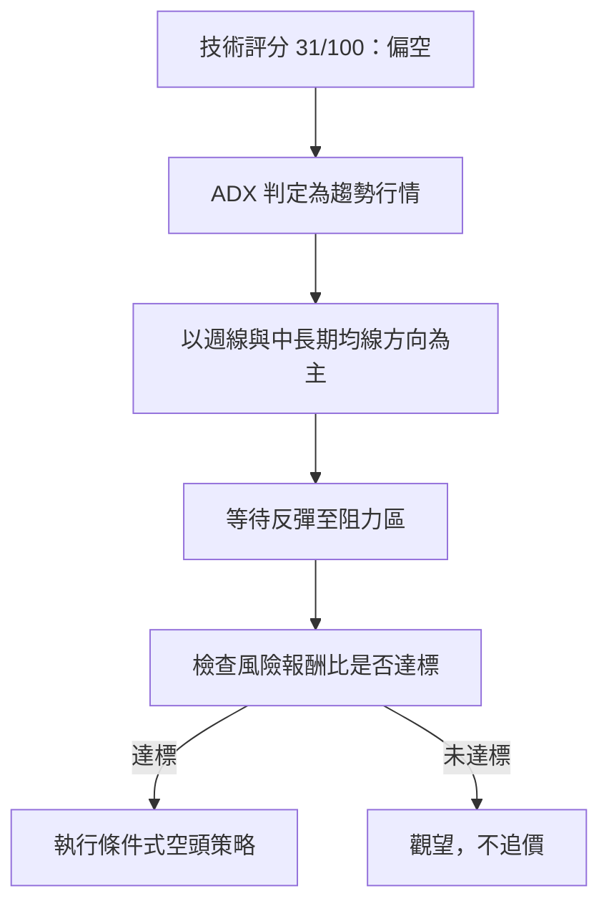

# CRWV 技術分析報告

> **報告日期**：2026-11-28 ｜ **語言**：繁體中文 ｜ **數據來源**：Yahoo Finance ｜ **當前價格**：**$44.15 USD**（收盤日期：2026-11-27）

---

## 目錄

| 章節 | 內容 |
|------|------|
| [1. 技術面概覽](#1-技術面概覽) | 核心指標速覽、評分卡 |
| [2. 趨勢分析](#2-趨勢分析) | 長中短期走勢、ADX |
| [3. 圖表形態分析](#3-圖表形態分析) | 形態、K 線、缺口 |
| [4. 支撐與阻力](#4-支撐與阻力) | 關鍵價位、斐波那契 |
| [5. 技術指標深度解讀](#5-技術指標深度解讀) | MA／RSI／MACD／布林／成交量／進階指標 |
| [6. 動能與波動率](#6-動能與波動率) | ATR、Beta、相對強度 |
| [7. 多時框架總結](#7-多時框架總結) | 時框架方向矩陣 |
| [8. 交易策略建議](#8-交易策略建議) | 歷史基準、策略、風險報酬比 |
| [9. 風險提示與監控](#9-風險提示與監控) | 監控指標、風險場景 |

---

## 1. 技術面概覽

CRWV 的主要技術方向偏空：價格位於中長期均線下方，且週線、月線與日線方向一致。ADX 顯示趨勢強度已達趨勢行情門檻，配合空頭 DI 優勢及相對大盤明顯走弱，現階段不宜只因短線反彈便判定趨勢反轉。主要反向風險是日線 RSI 底背離提示、A/D 線上升，以及近期低點附近出現的買盤吸收跡象；若反彈延續，空方策略應等待阻力區確認，而非在低位追空。

### 📊 核心指標速覽表

| 指標類別 | 指標名稱 | 當前數值 | 訊號 | 解讀 |
|----------|----------|----------|------|------|
| **價格** | 當前價格 | **$44.15** | 🔴 | 位於中長期均線下方，且接近近期支撐帶 |
| **均線** | MA20／MA50／MA200 | 見第 5 章 | 🔴 | 價格低於三條主要均線，排列偏空 |
| **動能** | RSI(14)（日線） | 見第 5 章 | 🟡 | 中性區間；底背離提供反向警訊，但尚不足以確認反轉 |
| **動能** | MACD 柱（日線） | 見第 5 章 | 🟢 | 柱體轉正，短線動能改善，與中長期趨勢偏空有所矛盾 |
| **趨勢** | ADX(14) | 見第 2 章 | 🔴 | 趨勢強度達趨勢行情門檻，空方仍主導 |
| **波動** | ATR(14) | 見第 6 章 | 🔴 | 日常波動相對價格偏高，倉位及止損須保守 |
| **多時框** | 一致性 | 見第 7 章 | 🔴 | 日、週、月方向一致偏空 |

### 🏆 技術評分卡

六項子評分均為整數；綜合評分採算術平均並四捨五入。

| 維度 | 評分（0–100） | 訊號 | 主要依據（引用數值所在章節） |
|------|---------------|------|------------------------------|
| 趨勢強度 | 25 | 🔴 | ADX 顯示趨勢行情，空方 DI 主導，詳見第 2 章 |
| 動能指標 | 45 | 🟡 | 日線 MACD 柱改善但週線動能偏空；RSI 背離未確認反轉，詳見第 5、7 章 |
| 支撐穩定度 | 40 | 🟡 | 價格靠近波段支撐，但仍有下一層支撐，詳見第 4 章 |
| 成交量配合 | 25 | 🔴 | OBV 弱於其均線，量比低於均量；A/D 上升則形成反向訊號，詳見第 5 章 |
| 形態完整度 | 35 | 🔴 | 尚無高信心度的反轉或延續幾何形態，詳見第 3 章 |
| 均線排列 | 15 | 🔴 | 均線呈空頭排列，價格低於主要均線，詳見第 5 章 |
| **綜合評分** | **31** | **偏空** | 六項算術平均為 30.83，四捨五入至整數 |

---

## 2. 趨勢分析

**結論：長期與中期趨勢偏空，短線雖有反彈訊號，但尚未改變主要趨勢。** 月收盤階段顯示股價經歷急升後反覆回落，近期回落加速；週線收盤、週 RSI 與週 MACD 柱均顯示弱勢。ADX 進一步確認目前屬趨勢行情，故依多時框收斂規則，週線及中長期均線方向優先，日線訊號只作為交易時機參考。

### 📈 長期趨勢（近 12 個月）

以下階段以「近 12 個月收盤走勢」月收盤資料整理；漲跌幅以各階段起訖月收盤計算。

| 期間 | 起訖月收盤 | 漲跌幅 | 特徵 |
|------|------------|--------|------|
| 2025-12 至 2026-03 | $71.61 → $77.47 | +8.18% | 先升後回，階段末略高於起點，走勢以整理為主 |
| 2026-04 至 2026-06 | $111.60 → $99.54 | -10.81% | 高位回落，反映上行動能減弱 |
| 2026-07 至 2026-09 | $71.77 → $87.12 | +21.39% | 反彈修復，但仍未形成穩定的長期上升趨勢 |
| 2026-10 至 2026-11 | $54.87 → 最新收盤 | -19.54% | 再度明顯走弱，月 RSI 自中性偏強區回落至中性偏弱區 |

長期月線觀察以方向與階段結構為主，不將兩個月的反彈視為已確認的趨勢反轉。月線趨勢均線及方向仍偏空，詳見第 7 章。

### 📊 中期趨勢（週線）

| 觀察項目 | 週線訊號 | 解讀 |
|----------|----------|------|
| 近 20 週收盤結構 | 由夏季反彈高位下滑，近期收盤仍處於弱勢區 | 反彈高點未扭轉中期下降結構 |
| 週 RSI | 末段讀數處於弱勢區 | 動能仍弱，未見明確中期多頭主導 |
| 週 MACD 柱 | 持續為負，近期仍未翻正 | 中期空方動能尚未解除 |
| 週成交量 | 下跌週成交量一度放大，反彈週成交量也有增加 | 有賣壓釋放，也有反彈承接，但尚未形成持續量價轉強 |
| 多時框指標方向 | 偏空 | 週線收盤低於趨勢均線，方向與日、月線一致 |

週線原始序列顯示，反彈並未穩定突破前期壓力區，近期低位雖有回升，週 MACD 柱仍處負值。因此，週線反彈目前視為下降趨勢中的修復，不作為獨立的做多確認。

### ⚡ 趨勢強度（ADX）

| 指標 | 數值 | 判讀 |
|------|------:|------|
| ADX(14) | 31.05 | 高於趨勢行情門檻，代表趨勢性較強 |
| +DI | 19.41 | 多方方向性力量較弱 |
| −DI | 31.75 | 空方方向性力量高於多方 |

ADX 高於 25，屬**趨勢行情**，不是以日線布林上下軌為主的盤整行情。依規則 14，方向以週線及中長期均線為主，日線只用於尋找進場時機。ADX 只反映趨勢強度、不指示方向；方向須與 DI、均線及多時框結果合併判讀，目前整體偏空。

---

## 3. 圖表形態分析

**結論：目前沒有足夠資料確認高信心度的反轉或延續幾何形態。** 可確認的是均線偏空、日線短期動能出現改善及底背離提示；這些屬指標訊號，不等同於雙底、頭肩底或旗形已完成。近期所列跳空均已回補，因此目前不宜把它們當作未回補缺口支撐或阻力。

### 🔍 形態識別

| 形態 | 信心度 | 判斷依據 | 完成度 | 目標價 |
|------|--------|----------|--------|--------|
| 反轉幾何形態 | 低 | 近端低點後出現反彈，但不足以確認頸線、對稱低點或突破確認 | 訊號不足，僅做指標型解讀 | N/A（數據未提供） |
| 趨勢延續幾何形態 | 低 | 週線及均線方向偏空，但缺乏可稽核的旗形或通道邊界數據 | 訊號不足，僅做指標型解讀 | N/A（數據未提供） |
| 短線動能改善 | 中 | 日線 MACD 柱轉正，且 RSI 背離欄標示底背離；但週線趨勢仍偏空 | 尚未確認為趨勢反轉 | 不適用，非可量度幾何形態 |

本報告不以「形態高度推算」目標價，因目前沒有足夠幾何結構可供計算。

### 🕯️ 重要 K 線形態

下表只引用近十根日 K 及近八根週 K 的開、高、低、收資料。單根 K 線只作形態提示，不能獨立視為反轉確認。

| 日期／時框 | 開 | 高 | 低 | 收 | K 線形態 | 解讀 | 訊號 |
|------|---:|---:|---:|---:|---------|------|------|
| 2026-11-25（日 K） | $39.05 | $43.02 | $37.40 | $42.57 | 收高於開，帶下影線 | 低位有承接，但單根反彈不足以確認反轉 | 🟡 |
| 2026-11-27（日 K） | $43.82 | $44.52 | $40.88 | $44.15 | 收高於開，帶較長下影線 | 顯示盤中低位買盤介入；仍需後續收盤確認 | 🟡 |
| 2026-11-27（週 K） | $50.97 | $51.90 | $37.40 | $44.15 | 收低於開，帶下影線 | 週線仍收跌，低位承接未改變週線偏空方向 | 🔴 |

### 🕳️ 跳空缺口

以下資料取自市場脈絡所列的近期缺口。各缺口均已回補，因此不列作未回補缺口價位。

| 日期 | 方向 | 缺口區間 | 回補狀態 | 技術解讀 |
|------|------|----------|----------|----------|
| 2026-11-23 | 向上跳空 | $43.24–$46.53 | 已回補 | 反彈缺口未保留，不能視為有效支撐 |
| 2026-11-20 | 向下跳空 | $43.24–$44.36 | 已回補 | 下跌缺口已消化，短線仍須看波段支撐反應 |
| 2026-11-11 | 向上跳空 | $51.02–$53.81 | 已回補 | 反彈缺口失守，顯示上方供給仍重 |
| 2026-11-05 | 向下跳空 | $47.29–$48.02 | 已回補 | 缺口回補不代表趨勢反轉 |
| 2026-10-30 | 向下跳空 | $56.90–$60.11 | 已回補 | 反映前段下跌壓力，已非未回補缺口區 |

---

## 4. 支撐與阻力

**結論：上方阻力層級多，與均線及成交量分布所示的上方供給相呼應；下方先看第一支撐，若失守則下一波段支撐是主要風險參考。** 阻力位來自近一年波段高點聚類；支撐位來自近 420 個交易日波段低點聚類。支撐與阻力兩側均已提供至少兩個波段價位，因此本章不另以樞軸點補位。

### 🚧 阻力位分析表

| 阻力級別 | 價位 | 形成原因 | 突破難度 | 重要性 |
|----------|------:|----------|----------|--------|
| R1 | $62.03 | 近一年波段高點聚類 | 中 | 第一個主要反彈阻力，亦是主策略觀察區 |
| R2 | $64.39 | 近一年波段高點聚類 | 中 | 與 R1 形成相鄰供給區，突破後才有望測試更高層級 |
| R3 | $85.37 | 近一年波段高點聚類 | 高 | 長距離上方阻力；另與中長期均線及成交量分布壓力區接近 |

### 🛡️ 支撐位分析表

| 支撐級別 | 價位 | 形成原因 | 守住可能性 | 重要性 |
|----------|------:|----------|------------|--------|
| S1 | $40.58 | 近 420 個交易日波段低點聚類 | 中 | 第一層波段支撐；若失守，短線空方延續風險升高 |
| S2 | $33.51 | 近 420 個交易日波段低點聚類 | 低 | 下一層波段支撐；目前缺乏更下方的波段支撐資料 |

| 補充項目 | 結果 |
|----------|------|
| 支撐資料回溯 | 近 420 個交易日波段低點聚類 |
| 阻力資料回溯 | 近一年波段高點聚類 |
| R3 以上波段阻力 | 數據中未偵測到 |
| S2 以下波段支撐 | 數據中未偵測到 |
| 樞軸補位 | 不需要；兩側波段價位均不少於兩個 |

### 📐 斐波那契回調位分析

斐波那契位依 52 週高低區間計算結果照列；現價位於 78.6% 回調位與 100.0%（52 週低點）之間。這表示價格已回落至該區間下半部，斐波那契位置本身不構成反轉確認，仍須觀察波段支撐及收盤表現。

| 回調位 | 價位 | 技術解讀 |
|--------|------:|----------|
| 23.6% | $114.45 | 較遠上方回調阻力 |
| 38.2% | $99.73 | 上方回調阻力 |
| 50.0% | $87.83 | 中位回調阻力 |
| 61.8% | $75.92 | 上方重要回調阻力 |
| 78.6% | $58.98 | 現價上方第一個主要斐波那契參考位 |
| 100.0%（52 週低點） | $37.40 | 區間低點參考 |

---

## 5. 技術指標深度解讀

**結論：均線、週線動能及一目均衡表一致偏空；日線 MACD 柱、RSI 底背離與 A/D 線則提供短線反向訊號。** 綜合而言，短線反彈風險上升，但多時框趨勢仍偏空，尚未出現足以推翻中長期空方結構的確認訊號。

### 📈 均線、RSI、MACD、布林通道

| 指標 | 數值 | 訊號 | 解讀 |
|------|------|------|------|
| MA20／MA50／MA200 | $48.76／$65.00／$87.00 | 🔴 | 收盤低於三條均線；均線排列為 MA20 < MA50 < MA200，屬空頭排列 |
| RSI(14)（日線）與背離 | RSI 40.83；程式標示底背離，判定方式為比較近 20 根 K 棒首尾的價格與 RSI 方向 | 🟡 | RSI 尚未進入超賣區；底背離是反彈警訊，但未證實趨勢反轉 |
| MACD 線／Signal／柱（日線） | -5.673／-5.930／+0.257 | 🟡 | MACD 線仍為負值，但柱體轉正且高於 Signal，代表短線動能改善，與空頭排列矛盾 |
| 布林上軌／中軌／下軌／%B（日線） | $59.24／$48.76／$38.27／0.28 | 🟡 | %B 位於下半部但未貼近下軌；價格仍低於中軌，偏弱但不屬極端超賣 |

### 指標整合判讀

| 訊號組合 | 判斷 |
|----------|------|
| 均線排列與價格位置 | 空頭確認；反彈仍受主要均線壓制 |
| RSI 底背離與日線 MACD 柱 | 短線改善訊號互相部分確認，但均不足以取代週線方向 |
| 布林位置與 RSI | 均未顯示極端超賣；並不排除價格繼續沿趨勢方向波動 |
| 日線與週線動能 | 日線 MACD 柱偏多，週線 MACD 柱偏空；形成時框矛盾，依 ADX 規則以週線及中長期方向為主 |
| 綜合訊號 | 中長期偏空、短線反彈風險增加；不宜在支撐附近追空，較合適做法是等待反彈至阻力區評估 |

### 💹 成交量（量價配合度）

| 項目 | 數值／訊號 | 解讀 |
|------|------------|------|
| 最新成交量 | 41,728,300 | 低於近期均量，當日量能不足以確認強勢反彈 |
| 20 日均量 | 72,391,010 | 作為近期比較基準 |
| 量比 | 0.58 倍 | 🟡 低於均量；單日反彈的成交量確認不足 |
| 50 日均量 | 58,744,106 | 高於最新成交量，顯示近期活動量仍較當日活躍 |
| OBV 趨勢 | OBV < MA；量能疲弱 | 🔴 OBV 未確認價格走勢的反彈，偏向支持中期量能疲弱判斷 |
| A/D 線（近 20 根） | 高於其 20 日均值；A/D 上升而價格下跌 | 🟢 價跌量能累積出現背離，呈吸籌跡象，與 OBV 的疲弱判讀相矛盾 |

**量價總結：** OBV 未確認反彈，表示短線買盤力度不足；A/D 線上升則暗示下跌期間可能有資金吸收。兩者並不完全一致，故成交量訊號評為偏空但保留反轉風險，而非視作單向確認。

### 🧭 進階指標

下表數值均由日線計算，並依進階指標原始欄位照列。

| 指標 | 數值 | 收盤相對位置 | 解讀 |
|------|------|--------------|------|
| 一目均衡表（轉換線／基準線） | 轉換線 $45.13；基準線 $50.90 | 收盤低於轉換線及基準線 | 轉換線低於基準線，短線結構偏空 |
| 一目均衡表（當前雲層） | 先行帶 A $72.78；先行帶 B $87.36 | 收盤位於雲層下方 | 雲層構成上方趨勢壓力 |
| 一目均衡表（前方 26 根雲層） | 先行帶 A $48.01；先行帶 B $65.31；A 在 B 下方 | 前方雲層偏空 | 前方雲層方向未提供多頭確認 |
| 成交量分布（近 252 個交易日） | POC $81.52；價值區 $62.61–$117.24（含 70% 成交量） | 收盤位於價值區下方 | 目前價格低於高成交量價值區，反彈至該區仍可能遇到供給 |
| 錨定 VWAP（自 52 週高點，2026-05-06） | $77.34 | 收盤在其下方 | 從高點持有的交易者整體成本參考高於現價，偏空 |
| 錨定 VWAP（自 52 週低點，2026-11-25） | $41.73 | 收盤在其上方 | 近期低點後買入者目前有浮盈，支持短線反彈風險 |
| A/D 線（近 20 根） | 高於其 20 日均值；A/D 上升、價格下跌 | — | 吸籌跡象與 OBV 疲弱判讀相矛盾 |

**交叉確認：** 一目均衡表、價值區及自高點錨定 VWAP 均支持中長期偏空判斷，與均線及週線方向一致。自近期低點錨定 VWAP、A/D 線則支持短線承接；其訊號屬反向風險，尚不足以推翻主趨勢。

---

## 6. 動能與波動率

**結論：波動幅度高，止損距離不宜過窄；相對強度明顯落後大盤，Beta 則沒有可用數據。** 對策略執行而言，較適合等待價格反彈至預先定義的阻力位再考慮做空，並以倉位控制單筆風險；在支撐附近追空，容易遭短線波動反抽。

### 📊 ATR 波動率分析

| 項目 | 數值 | 解讀 |
|------|------|------|
| ATR(14) | $6.43 | 以 Wilder 方法計算的平均真實波幅 |
| ATR 佔價格比例 | 14.57% | 相對價格偏高，單日波動對倉位影響顯著 |
| 1.5 倍 ATR 參考距離 | $9.65 | 以 ATR 乘以 1.5 得出，僅作波動距離參考，不是獨立支撐、阻力或下單價 |
| 2 倍 ATR 參考距離 | $12.86 | 以 ATR 乘以 2 得出，提示常態波動區間較寬；策略止損仍須使用第 8 章列明的合法價位 |

### 📐 Beta 與相對強度

| 比較期間 | 本股價格報酬 | VTI 基準報酬 | 超額報酬 |
|----------|--------------:|-------------:|---------:|
| 1 個月 | -28.5% | -6.5% | -22.0% |
| 3 個月 | -51.0% | -7.2% | -43.7% |
| 6 個月 | -60.2% | -5.0% | -55.2% |

| 項目 | 結果 | 解讀 |
|------|------|------|
| 比值趨勢 | 相對走弱；比值低於其 50 日均值 | 本股各期均大幅落後 VTI，支持以反彈做空為主的策略方向 |
| Beta | N/A（數據未提供） | 無法量化相對市場的歷史敏感度，不以其他數據推算 |
| 相對強度結論 | 偏空 | 對空方主策略有支持作用，但不能代替個股價位觸發確認 |

相對強度資料計算至 2026-11-25，為價格報酬且不含股息；它反映歷史相對表現，不是未來報酬保證。

---

## 7. 多時框架總結

**結論：日線、週線、月線三個時框方向一致偏空，與技術評分卡方向相符。** 雖然日線存在短線反彈訊號，週線動能仍為負，且月線價格低於趨勢均線；在 ADX 判定為趨勢行情的前提下，應以週線及中長期均線方向為主。

### 📋 時框架方向矩陣

以下 RSI、MACD 柱、趨勢均線及方向照錄多時框指標區塊；週線與月線最後一根均為截至最新交易日的進行中 K 棒。

| 時框架 | 趨勢方向 | RSI(14) | MACD 柱 | 收盤 vs 趨勢均線 | 形態 | 建議 |
|--------|----------|---------|---------|------------------|------|------|
| 日線 | 偏空 | 40.83 | +0.257 | 收盤 $44.15，低於 MA50 $65.00 | 空頭趨勢中有短線動能改善 | 等待反彈至阻力位，不在支撐附近追空 |
| 週線 | 偏空 | 36.19 | -3.989 | 收盤 $44.15，低於 MA20 $72.88 | 中期下降結構，動能仍負 | 方向以偏空為主，觀察反彈是否受阻 |
| 月線 | 偏空 | 45.46 | N/A（數據未提供） | 收盤 $44.15，低於 MA10 $82.05 | 月線價格與趨勢均線呈弱勢 | 尚無月線反轉確認，不宜因短線回升改判偏多 |

**多時框一致性：3/3 偏空。**

### ⚖️ 多時框收斂結論

| 收斂項目 | 結論 |
|----------|------|
| 行情分類 | ADX 高於趨勢門檻，判定為趨勢行情 |
| 主導時框 | 週線與中長期均線；日線用於尋找進場時機 |
| 日線與週線是否衝突 | 日線 MACD 柱轉正、RSI 有底背離提示；週線 MACD 柱仍負，構成短線與中期訊號差異 |
| 最終方向 | **偏空** |
| 與第 8 章主策略一致性 | 主策略採反彈至阻力區後評估做空；若未觸及條件則觀望，不在低位追空 |

---

## 8. 交易策略建議

**當前主策略方向 = 偏空（依評分 31/100）。** 主策略不是在現價附近追空，而是等待反彈進入已列出的阻力價位，再依預設止損執行；若價格未到觸發區，採觀望。

### 🧭 策略路由

### 📊 歷史基準機率

歷史狀態定義為「RSI(14) 介於 30–50 且收盤在 MA200 下方」。樣本區間為 2025-03-28 至 2026-11-27，共 420 個交易日；下列為本股歷史頻率，不是預測。

| 持有期 | 相同狀態樣本（段數） | 上漲比例 | 中位數報酬 | 25%–75% 分位 | 全部交易日上漲比例／中位數 |
|--------|----------------------|----------|------------|--------------|----------------------------|
| 5 日 | 102 日（19 段） | 50% | +0.1% | -9.7% 至 +8.6% | 45%／-1.7% |
| 20 日 | 88 日（18 段） | 51% | +0.8% | -12.8% 至 +17.8% | 33%／-8.1% |
| 60 日 | 69 日（12 段） | 59% | +5.9% | -13.5% 至 +28.4% | 44%／-8.6% |

相同狀態的交易日會連續出現，且持有期間互相重疊，因此樣本日數不等於獨立事件數；段數才較接近獨立事件，但仍有限。相對全部交易日，這組狀態在短中期的歷史上漲比例並未一致呈現空方優勢，較長持有期的上漲比例反而較高；因此歷史基準對「立即追空」相抵，對「等待阻力確認後執行」僅提供有限支持。歷史頻率不是預測。

| 持有期 | 歷史樣本狀態 |
|--------|--------------|
| 5 日 | 有歷史數據 |
| 20 日 | 有歷史數據 |
| 60 日 | 有歷史數據 |
| 其他持有期 | N/A（歷史樣本不足或未提供） |

### 🎯 價格情境階梯

情境中的價位只使用第 4 章波段支撐／阻力；可能性以高／中／低表示，是技術判斷而非百分比預測。

| 觸發條件 | 下一目標 | 後續延伸 | 可能性 | 依據 |
|----------|----------|----------|--------|------|
| 突破並站穩 R1 | R2 | R3 | 低 | 主要均線及週線仍偏空；須有持續成交量與週線改善才能提高可信度 |
| 於現價附近止跌並維持反彈 | — | — | 中 | 日線有底背離與 A/D 承接跡象，但 OBV 未確認，且多時框仍偏空 |
| 跌破 S1 | S2 | 數據中未偵測到 S2 以下波段支撐 | 中 | 若支撐失守，走勢可能延續弱勢；下方缺乏可引用的下一層波段支撐 |

### 🟢 主策略詳情

策略 A 為條件式空頭策略：等待反彈至第一阻力後觀察是否受阻；只有進場條件成立時才執行。風險報酬比依做空公式計算，並以第一目標價作為檢核依據。

| 策略要素 | 策略 A | 策略 B |
|----------|--------|--------|
| 方向 | 條件式做空 | 不交易 |
| 進場條件 | 價格反彈至 R1，且日線收盤或盤中走勢顯示無法有效突破；如出現放量站穩則取消 | N/A（不列可執行策略） |
| 進場價格 | $62.03 | 此價位不交易（沒有符合最低風險報酬比且由已列價位構成的獨立方案） |
| 目標價 T1 | $40.58 | N/A |
| 目標價 T2 | $33.51 | N/A |
| 止損價格 | $64.39 | N/A |
| 風險報酬比 | **1 : 9.09（以 T1 計）** | N/A |
| 把握度 | 中；方向與週線及均線一致，但相對強度歷史基準不支持無條件追空，且日線有反彈訊號 | N/A |
| 建議倉位 | 風險預算上限為帳戶資金的 0.25%；依實際成交價與止損距離換算股數 | 0 |

風險報酬比可由同一欄價位重算：做空的目標收益為進場價減 T1，風險為止損價減進場價；兩者比值為 21.45 ÷ 2.36 = 9.09。該計算不代表成交概率，也不保證目標價可達。

### 🔴 反向風險觸發點（對沖提示）

| 反向觸發 | 風控含義 |
|----------|----------|
| 有效突破並站穩 R1、其後再突破 R2 | 原空頭進場假設受損；不要在反彈突破後新增空倉 |
| 日線 MACD 柱持續改善，並帶動週線動能轉強 | 短線反彈可能升級為中期修復，需重新檢視空頭策略 |
| 價格守住 S1 並伴隨 A/D 延續上升 | 低位吸收可能持續，應降低追空意願 |
| 觸及策略止損 | 依計畫退出，不以放寬止損方式延後風險確認 |

---

## 9. 風險提示與監控

**結論：主要風險來自高波動、弱勢趨勢延續與技術性反彈並存。** 監控重點是波段支撐是否失守、反彈能否突破阻力、週線動能是否改善，以及成交量訊號是否由背離轉為一致。下次財報日資料未提供，無法評估事件日期與策略持有期間是否重疊。

### ✅ 關鍵監控指標

| 監控項目 | 觸發條件／價位 | 觸發後動作 |
|----------|----------------|------------|
| 第一波段支撐 | $40.58 | 若失守並收盤確認，避免新增多頭部位，觀察下一層波段支撐 |
| 第二波段支撐 | $33.51 | 若價格下探該層，重新評估趨勢延續及短線反彈風險 |
| 第一反彈阻力 | $62.03 | 觀察能否有效突破；若反彈受阻，才評估策略 A |
| 第二反彈阻力 | $64.39 | 若突破此位，策略 A 止損條件觸發，應依計畫退出 |
| 日線與週線動能 | 日線 MACD 柱改善、週線 MACD 柱仍負 | 若週線動能持續轉強，重估空頭優勢 |
| 量價訊號 | OBV 與 A/D 方向是否收斂 | 若 OBV 改善並伴隨價格轉強，降低空頭倉位風險 |
| 下次財報日 | N/A（數據未提供） | 距最新收盤日的日曆天數：N/A（數據未提供）；策略期間是否涵蓋財報日亦無法確認 |

若財報日期後續確認落在策略持有期間內，需考慮財報可能造成跳空，止損單不保證能以設定價成交。

### ⚠️ 風險場景

| 情境 | 觸發條件 | 參考價位 | 可能性 | 應對 |
|------|----------|----------|--------|------|
| 樂觀（對空頭不利） | 日線反彈延續並突破第一、第二阻力，且週線動能改善 | R1 $62.03；R2 $64.39 | 中 | 不追空；若持有策略 A，按止損規則處理 |
| 基本（趨勢延續） | 反彈受阻，價格再次測試第一支撐 | R1 $62.03；S1 $40.58 | 中 | 僅在策略條件成立且風險報酬比達標時執行 |
| 悲觀（空頭加速） | 第一支撐有效跌破，價格向下一層支撐延伸 | S1 $40.58；S2 $33.51 | 中 | 已持空倉者分段管理；未持倉者避免在支撐下方盲目追空 |

上述情境的可能性為定性判斷，不是歷史機率，也不代表預測保證。

### 🛡️ 風險管理提醒

- 僅在策略觸發條件成立時進場；未反彈至預定區域時，以觀望為主。
- 單筆風險預算不超過帳戶資金的 0.25%；依止損距離反推倉位，不以固定股數套用。
- 高 ATR 代表盤中波動可能觸及止損；避免因短線波動擅自移動止損或加碼。
- 若發生跳空或流動性不足，實際止損成交價可能偏離設定價。
- 週線方向仍偏空，但日線背離及 A/D 訊號構成反彈風險；任何一項訊號改善都應重新評估，而非只依單一指標持倉。

---

## 📋 報告總結

| 項目 | 結論 |
|------|------|
| 報告日期 | 2026-11-28 |
| 當前價格 | 同標題及第 1 章速覽所列；收盤日期為 2026-11-27 |
| 綜合評分／方向 | **31/100，偏空** |
| 長期趨勢 | 🔴 月線價格低於趨勢均線，近期月收盤走勢偏弱 |
| 中期趨勢 | 🔴 週線趨勢與動能偏空 |
| 短期趨勢 | 🟡 日線動能有改善及底背離提示，但尚未確認反轉 |
| 關鍵支撐／關鍵阻力 | S1 $40.58；R1 $62.03 |
| 🥇 最佳機會 | 條件式空頭策略 A；僅在反彈至預定阻力且受阻時執行，否則觀望 |
| 最大風險 | 高波動下的技術性反彈與趨勢偏空同時存在，且財報日期未提供 |

---

> ⚠️ **免責聲明**：本報告為 AI 自動生成之技術分析，所有數據及估算均基於歷史價格資訊。本報告僅供研究與學術參考，不構成任何投資建議。投資有風險，入市需謹慎。

---

## 資料與來源

| 項目 | 內容 |
|------|------|
| 價格 | 44.15 USD，2026-11-27 收盤（Yahoo Finance 日線） |
| K 棒 | 420 根日線，2025-03-28 至 2026-11-27（Yahoo Finance）；較長期間的價位與基準機率取自價格資料庫 |
| 關鍵價位回溯期間 | 阻力 近一年、支撐 近 420 個交易日 |
| 有回應的資料來源 | Yahoo Finance、Finviz、StockAnalysis、Roic.ai |
| 由程式計算 | 所有指標、R1–S3 與斐波那契價位、多時框方向、相對強度、缺口、歷史基準機率、綜合評分 |
| 撰寫模型 | openai / gpt-6-luna |

> 本區塊由產生報告的程式依實際取得的資料填寫，非模型撰寫。「由程式計算」的數字不是模型的估計；其餘判斷（評分、情境、策略）是模型的分析。
