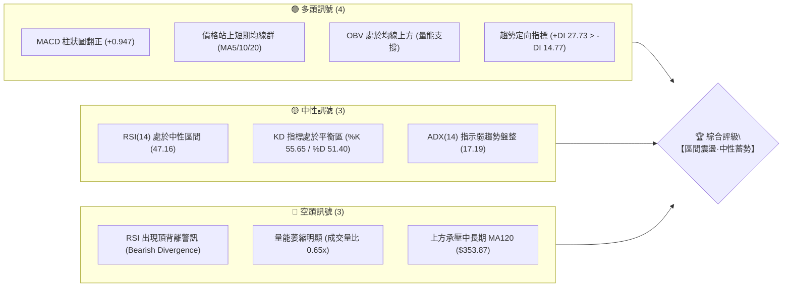
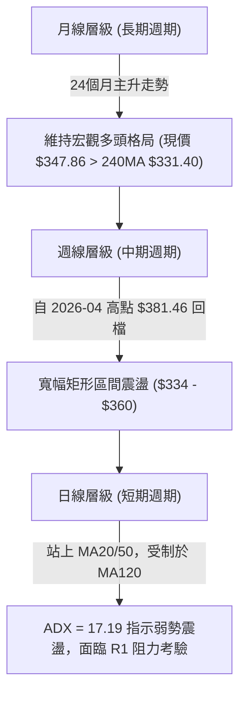
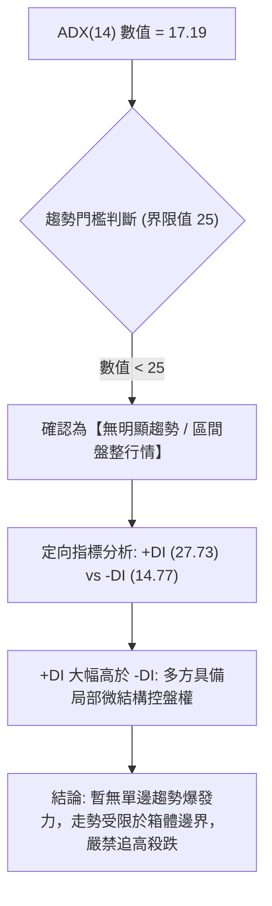
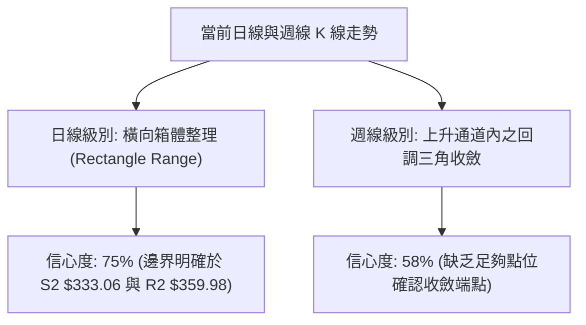
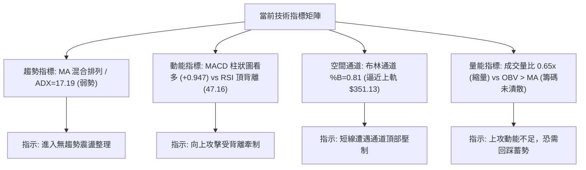
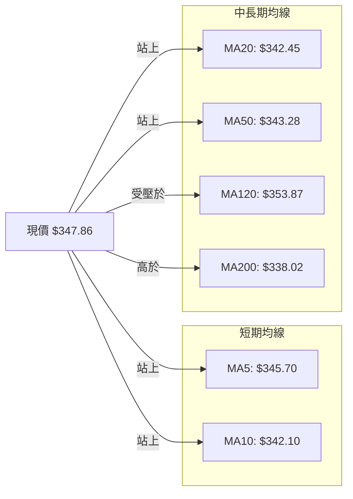
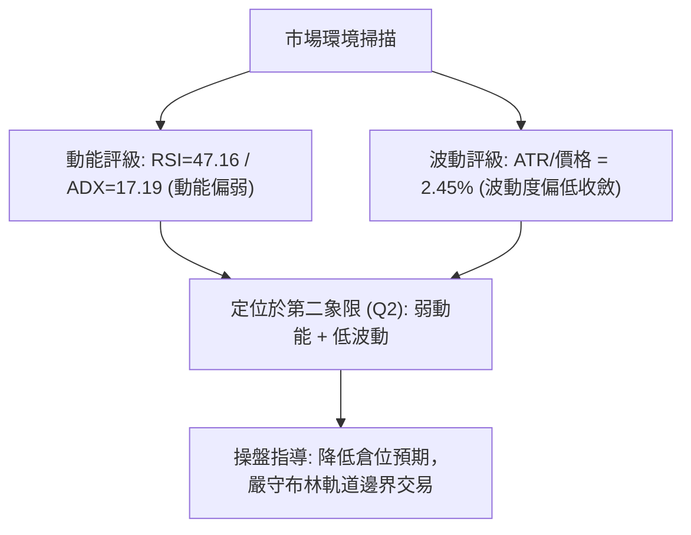
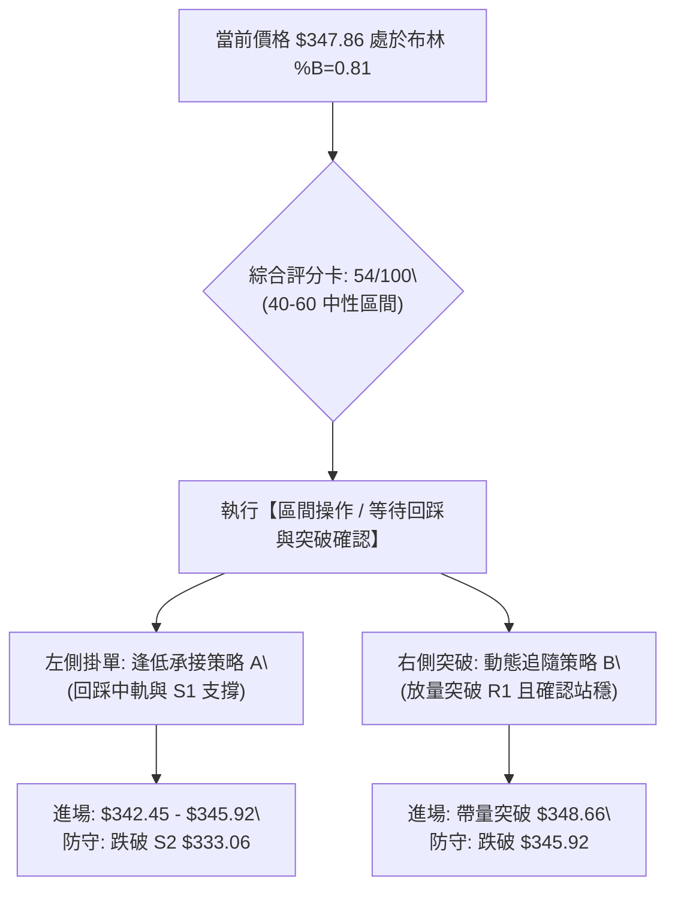
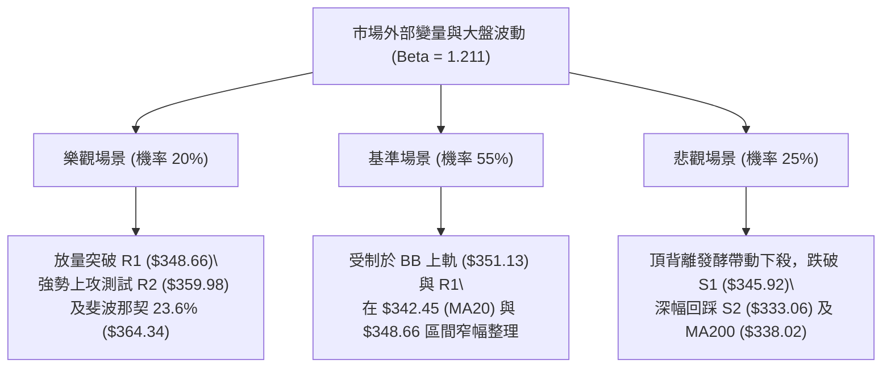

# GOOG 技術分析報告

> **報告日期**：2026-10-12 ｜ **語言**：繁體中文 ｜ **數據來源**：Yahoo Finance ｜ **當前價格**：$347.86

---

## 目錄

| 章節 | 內容 |
|------|------|
| [1. 技術面概覽](#1-技術面概覽) | 訊號儀表板、核心指標、評分卡 |
| [2. 趨勢分析](#2-趨勢分析) | 多時框趨勢、長中短期走勢、ADX 解讀 |
| [3. 圖表形態分析](#3-圖表形態分析) | 形態識別、K線組合、目標價推算 |
| [4. 支撐與阻力](#4-支撐與阻力) | 關鍵價位分布、斐波那契回調結構 |
| [5. 技術指標深度解讀](#5-技術指標深度解讀) | MA/RSI/MACD/布林通道/成交量與OBV |
| [6. 動能與波動率](#6-動能與波動率) | 動能四象限、ATR 波動度、Beta 敏感度 |
| [7. 多時框架總結](#7-多時框架總結) | 時框架評分矩陣、多時框收斂結論 |
| [8. 交易策略建議](#8-交易策略建議) | 策略路由、價格階梯、主策略與避險提示 |
| [9. 風險提示與監控](#9-風險提示與監控) | 監控清單、情境模擬、風控準則 |

---

## 1. 技術面概覽

### 🎯 技術訊號儀表板



### 📊 核心指標速覽表

| 指標類別 | 指標名稱 | 當前數值 | 訊號 | 專業解讀 |
|:---|:---|:---|:---:|:---|
| **價格** | 當前收盤價 | $347.86 | 🟡 | 位於 52 週高低區間 66.6% 分位，向上測試近端阻力 |
| **均線系統** | MA20 (月線) | $342.45 | 🟢 | 現價高於 MA20 (+1.58%)，短線多頭防守中樞穩固 |
| **均線系統** | MA50 (季線) | $343.28 | 🟢 | 現價高於 MA50 (+1.33%)，中期基底具備承接力 |
| **均線系統** | MA120 (半年線) | $353.87 | 🔴 | 現價低於 MA120 (-1.70%)，上方重要中長期蓋頭反壓 |
| **均線系統** | MA200 (年線) | $338.02 | 🟢 | 現價高於 MA200 (+2.91%)，長期牛熊分界線未受破壞 |
| **動能** | RSI(14) | 47.16 | 🔴 | 數值中性偏弱，伴隨頂背離警訊，追價意願受限 |
| **動能** | MACD(12,26,9) | 1.187 / +0.947 | 🟢 | DIF 高於 Signal (0.239)，柱狀圖轉正擴張，短期動能偏多 |
| **動能** | KD(9,3,3) | 55.65 / 51.40 | 🟡 | 位於 50 多空分界上方交叉，暫無超買超賣鈍化現象 |
| **波動** | ATR(14) | $8.51 | 🟡 | 波動率佔股價 2.45%，波幅中等收斂，適合設定波段風控 |
| **趨勢** | ADX(14) | 17.19 | 🟡 | ADX < 25 指向盤整格局，缺乏單邊單向推進動能 |
| **布林通道** | BB %B | 0.81 | 🟡 | 逼近上軌 ($351.13)，進入通道超買壓縮警戒區 |
| **量能** | 量比 (Volume/MA20) | 0.65x | 🔴 | 單日成交量 1,113 萬股低於 20 日均量，量價呈現微幅背離 |

### 🏆 技術評分卡

```
╔══════════════════════════════════════════════════════════════════╗
║                 技術評分卡 — GOOG (2026-10-12)                  ║
╠══════════════════════════════════════════════════════════════════╣
║ 趨勢強度 (Trend)       ████████░░░░░░░░░░░░  42/100 🟡 (ADX低迷)   ║
║ 動能指標 (Momentum)    ██████████░░░░░░░░░░  52/100 🟡 (背離抵銷)   ║
║ 支撐穩定度 (Support)   ██████████████░░░░░░  70/100 🟢 (均線密集)   ║
║ 成交量配合 (Volume)    ████████░░░░░░░░░░░░  40/100 🔴 (量能萎縮)   ║
║ 形態完整度 (Pattern)   ████████████░░░░░░░░  60/100 🟡 (箱體收斂)   ║
║ 均線排列 (MA System)   ████████████░░░░░░░░  60/100 🟡 (混合交錯)   ║
╠══════════════════════════════════════════════════════════════════╣
║ 綜合技術評分           ███████████░░░░░░░░░  54/100 🟡 (中性偏多)   ║
║ 定性結論：盤整蓄勢待變，受制於 R1 與 BB 上軌，以區間震盪策略為主 ║
╚══════════════════════════════════════════════════════════════════╝
```

---

## 2. 趨勢分析

### 🌐 多時框趨勢分析



### 📈 長期趨勢 — 12個月走勢圖（Unicode）

下圖展示 2025 年 10 月至 2026 年 10 月之月線收盤價格軌跡與結構極值點：

```
GOOG 月線收盤走勢圖（過去12個月）
價格軸 ($)
$390 ┤                                  ● $381.46 (4月波段高點)
$370 ┤                                     ● $375.96
$350 ┤                                        ● $353.10  ● $356.42   ● $347.86 (現價)
$330 ┤                        ● $337.87                             ● $340.74
$310 ┤            ● $319.29  ● $313.19     ● $310.82             ● $335.19
$290 ┤ ● $281.09                                ● $286.50
     └─────┬──────────┬──────────┬──────────┬──────────┬──────────┬──────────┬─────
         2025-10    2025-12    2026-02    2026-04    2026-06    2026-08    2026-10
```

#### 長期走勢特徵劃分表

| 階段別 | 時間跨度 | 起訖價位 | 漲跌幅 | 結構特徵與技術解讀 |
|:---|:---|:---:|:---:|:---|
| **第一階段：強勢主升浪** | 2025-10 ～ 2025-11 | $281.09 → $319.29 | +13.59% | 大幅度放量推升，順利突破 $300 整數關卡，建立長期支撐底。 |
| **第二階段：高位橫盤回洗** | 2025-12 ～ 2026-03 | $313.19 → $286.50 | -8.52% | 創下 $337.87 局部高點後出現回撤，於 2026-03 回測 61.8% 斐波那契重要防線。 |
| **第三階段：主力加速拉升** | 2026-03 ～ 2026-04 | $286.50 → $381.46 | +33.14% | 單月巨幅跳空暴漲，直接創下 52 週高點 ($403.96 之主要收盤代表點)。 |
| **第四階段：高檔震盪收斂** | 2026-05 ～ 2026-10 | $375.96 → $347.86 | -7.47% | 波動率逐步降溫，自高檔回落至 38.2% 斐波那契回調位 ($339.83) 附近反覆築底。 |

### 📊 中期趨勢（週線分析）

從近 20 週收盤走勢可見，價格在 2026-06-28 探至低點 $334.47，隨後於 2026-07-26 下探 $318.88 短暫洗盤後強勁抽回，構築了 $333.00 - $335.00 區域的中期多頭結構底部。

```
中期週線價格與布林軌道邊界示意圖
阻力帶 R2 ($359.98) ───────────────────────────────┐ (8月反彈頂點 $356.42 聚類)
阻力帶 R1 ($348.66) ──────────────────────────┐    │
當前價格 ($347.86)  ─────────────► [ ● 現價 ] ─┴────┘
支撐帶 S1 ($345.92) ──────────────────────────┐
支撐帶 S2 ($333.06) ──────────────────────────┴───► (6月低點 $334.47 / 9月低點 $335.31)
```

### ⚡ 趨勢強度評估（ADX 解讀）



#### ADX 數值強度與市場狀態對照表

| 指標名稱 | 實際數值 | 狀態評級 | 交易指導原則 |
|:---|:---:|:---:|:---|
| **ADX(14)** | **17.19** | 弱趨勢 / 盤整區間 🟡 | 趨勢跟隨策略（Trend Following）失效；應轉換為均值回歸（Mean Reversion）與區間交易模型。 |
| **+DI** | **27.73** | 多方佔優 🟢 | 買盤力道大於賣盤力道，空方打壓動能受限。 |
| **-DI** | **14.77** | 空方衰退 🟢 | 下行拋壓正在萎縮，暫無劇烈崩跌風險。 |
| **方向差距 (+DI - -DI)**| **+12.96** | 溫和多頭格局 | 多頭佔有優勢，但因缺乏主趨勢強度，容易在重要阻力位遇阻震盪。 |

---

## 3. 圖表形態分析

### 🔍 形態識別系統



#### 圖表形態信心度與目標價計算表

| 形態名稱 | 信心度 | 判斷依據（嚴格引用數據） | 完成度 | 形態目標價（附精確計算式） |
|:---|:---:|:---|:---:|:---|
| **矩形箱體震盪**<br>*(Rectangle Range)* | **75%** | 區間下緣獲得 9 月雙週低點（2026-09-06 $335.31 與 2026-09-13 $335.45，聚類於 S2 $333.06）強支撐；上緣受制於 8 月初反彈高點 $356.42 及 R2 $359.98。 | **85%** | **向上突破目標**：<br>頸線/上軌 ($359.98) + 形態高度 ($359.98 - $333.06 = $26.92)<br>= **$386.90**<br>*(註：若向下跌破 S2，則等幅測幅為 $306.14)* |
| **微型上升旗形**<br>*(Minor Bull Flag)* | **45%** | 2026-10-04 至 10-11 自 $340.35 揚升至 $347.86，形成旗桿，近兩日於 R1 附近窄幅整理。但因 ADX=17.19 且成交量萎縮 (0.65x)，幾何結構尚不完整。 | **40%** | **訊號不足，僅做指標型解讀**：未達 50% 門檻，不予推算精準旗形目標價，回歸均線與布林通道操作。 |

### 🕯️ 重要K線形態分析

| 觀測週期 / 日期 | 收盤價 | K線形態名稱 | 形態專業解讀 | 訊號方向 |
|:---|:---:|:---|:---|:---:|
| **2026-08-23 週線** | $341.53 | 長下影探底線 | 該週 RSI 驟降至 20.6 極度超賣區，隨後買盤介入拉出長下影，確立中期空頭衰竭。 | 🟢 強烈支撐 |
| **2026-09-06 至 09-13** | $335.45 | 平底雙針探底 (Twin Lows) | 連續兩週於 $335.31 - $335.45 精準獲得承接，成交量維持於 6,500萬-7,800萬股，構築底部。 | 🟢 構築支撐 |
| **2026-09-20 週線** | $344.41 | 中陽線突破 | 週成交量放大至 9,813 萬股，MACD 柱狀圖由負翻正 (+1.455)，確立短線轉強。 | 🟢 動能轉強 |
| **2026-10-11 週線** | $347.86 | 縮量小陽星線 | 收盤越過 5 週均線，但成交量降至 6,362 萬股（近期偏低），顯示追價意願謹慎。 | 🟡 缺乏量能 |

### 📉 ASCII 走勢形態示意圖

```
箱體震盪與阻力測試幾何示意圖
$360 ───────────────────────────────────────────┬─ 阻力上限 R2 ($359.98)
                                       ╭─╮      │
$350 ─────────────────╭─╮──────────────│ │──(現價 $347.86 逼近 R1 $348.66)
                      │ │  ╭╮    ╭╮    │ │      │
$340 ──────────╭╮─────╯ ╰──╯╰─╮  ││ ╭──╯ ╰─────┼─ 均線密集防守中樞 ($342 - $343)
               ││             ╰──╯╰─╯          │
$333 ──────────╯╰───────────────────────────────┴─ 箱體下限 S2 ($333.06)
     [2026-08 探底]      [2026-09 雙重底打底]     [當前測試上軌]
```

---

## 4. 支撐與阻力

### 🗺️ 關鍵價位分布圖（Unicode）

```
GOOG 關鍵價位結構分布圖
═══════════════════════════════════════════════════════════════════════════
$372.70 ║████████████████████████████████║ 強結構阻力 R3 (+7.14%)
$364.34 ║░░░░░░░░░░░░░░░░░░░░░░░░        ║ 斐波那契 23.6% 回調壓力位
$359.98 ║████████████████████            ║ 關鍵波段高點阻力 R2 (+3.48%)
$351.13 ║▓▓▓▓▓▓▓▓▓▓▓▓▓▓                  ║ 布林通道上軌反壓
$348.66 ║████████████████████████        ║ 即時近端阻力 R1 (+0.23%)
$347.86 ╠════════════════════════════════╣ ◄── 當前收盤價 ($347.86)
$345.92 ║▓▓▓▓▓▓▓▓▓▓▓▓▓▓▓▓                ║ 即時近端支撐 S1 (-0.56%)
$342.45 ║░░░░░░░░░░░░░░░░░░░░░░░░░░░░░░  ║ 布林中軌 / MA20 多空分水嶺
$339.83 ║░░░░░░░░░░░░░░░░░░░░░░░░        ║ 斐波那契 38.2% 回調重要支撐位
$338.02 ║████████████████████████        ║ 長期年線 MA200 防守位
$333.06 ║████████████████████████████████║ 強結構支撐 S2 (-4.25%)
$325.63 ║████████████████████            ║ 極端深幅支撐 S3 (-6.39%)
═══════════════════════════════════════════════════════════════════════════
```

### 🚧 阻力位分析表

所有阻力數值嚴格引用近一年波段高點聚類計算成果：

| 阻力級別 | 精確價位 | 距現價幅差 | 形成技術背景與共振因子 | 突破難度 | 戰略重要性 |
|:---|:---:|:---:|:---|:---:|:---:|
| **R1** | **$348.66** | +0.23% | 日線近期反覆受阻的微幅高點，與即時賣盤掛單聚類重疊。 | 🟡 中等 | 短線多頭發動突破的第一道門檻。 |
| **R2** | **$359.98** | +3.48% | 2026-08-02 週線反彈高點 $356.42 與 MA120 ($353.87) 上方擴展區間，波段籌碼套牢密集區。 | 🔴 偏高 | 確立中期箱體向上突破的關鍵分界點。 |
| **R3** | **$372.70** | +7.14% | 2026-05-31 週線起跌平台高點 ($375.96) 與前波段下跌中繼缺口阻力。 | 🔴 極高 | 邁向歷史前高與 52W 高點之主要空頭堡壘。 |

### 🛡️ 支撐位分析表

所有支撐數值嚴格引用近一年波段低點聚類計算成果：

| 支撐級別 | 精確價位 | 距現價幅差 | 形成技術背景與共振因子 | 守住機率 | 戰略重要性 |
|:---|:---:|:---:|:---|:---:|:---:|
| **S1** | **$345.92** | -0.56% | MA5 ($345.70) 均線支撐與 2026-07-19 週線回調低點之動態交會帶。 | 🟢 80% | 超短線多頭維持強勢攻擊姿態的防守點。 |
| **S2** | **$333.06** | -4.25% | 布林通道下軌 ($333.76)、MA240 ($331.40) 及 9 月兩次探底低點共振區。 | 🟢 90% | 中期箱體震盪的多頭生命線，不容有失。 |
| **S3** | **$325.63** | -6.39% | 2026-07-26 異動洗盤低點 ($318.88) 向上修正之籌碼換手成交密集區。 | 🟢 95% | 跌破將引發宏觀週線級別頭肩頂風險。 |

### 📐 斐波那契回調位分析

依據 52 週極值區間（低點 $236.07 → 高點 $403.96，總垂直落差 $167.89）計算之黃金分割架構如下：

```
斐波那契回調結構層級圖
0.0%  (52W High)  $403.96 ──────────────────────────────────────┐
                                                                │ 歷史極值壓力區
23.6%             $364.34 ──────────────────────────────────────┤
                                ▲ 現價 $347.86 處於此區間震盪   │ 區間回撤弱勢區
38.2%             $339.83 ──────────────────────────────────────┤
                                                                │ 中性健康調整防線
50.0%             $320.02 ──────────────────────────────────────┤
                                                                │ 多空強弱分水嶺
61.8%             $300.20 ──────────────────────────────────────┤
                                                                │ 黃金分割極限防守
78.6%             $272.00 ──────────────────────────────────────┤
100.0% (52W Low)  $236.07 ──────────────────────────────────────┘
```

- **當前位置深度解讀**：
  現價 **$347.86** 正好運行於 **38.2% ($339.83)** 與 **23.6% ($364.34)** 兩大關鍵黃金分割位之間。
- **技術意義**：
  價格在回調測試 38.2%（$339.83）後獲得 MA200 ($338.02) 的強大支撐並順利回升，表明自 52W 高點拉回的性質屬於「牛市健康幅度的良性休整」。目前下檔 $339.83 具備高度防禦價值，上檔唯有越過 23.6% 回調位 ($364.34)，方能宣告波段修正徹底結束並重啟挑戰 $403.96 之主升浪。

---

## 5. 技術指標深度解讀

### 🎛️ 指標訊號總覽



### 📈 移動平均線排列分析



- **排列格局評定**：**混合排列（Mixed Alignment）**。
- **詳細剖析**：
  - 短期均線呈現多頭排列：MA5 ($345.70) > MA20 ($342.45) > MA10 ($342.10)，賦予短線價格向上推升動能。
  - 均線密集交纏：MA10 ($342.10)、MA20 ($342.45)、MA50 ($343.28) 三線高度聚攏於 $342 - $343 區間，形成強力的多頭緩衝墊。
  - 中期蓋頭反壓：MA120 位於 **$353.87**（下彎趨勢，乖離 -1.70%），構成上行不可忽視的強大動態反壓。
  - 長期多頭基石：MA200 ($338.02) 與 MA240 ($331.40) 穩定向上揚升，確認長期牛市主基調未變。

### 📉 RSI(14) 分析與背離判斷

- **當前數值**：**47.16**（處於 30–70 中性常態區間）。
- **數值進度條**：
  `RSI(14): 47.16` ▓▓▓▓▓▓▓▓▓░░░░░░░░░░░ [47.16%]
- **背離深度判斷**：
  ⚠️ **偵測到顯著頂背離（Bearish Divergence）**！
  - **價格行為**：自 2026-08-23 週線收盤 $341.53 震盪盤升至當前收盤 $347.86（短線高點墊高）。
  - **RSI 行為**：在 2026-08-16 時 RSI 高達 59.2，2026-09-27 達 54.5，但至 2026-10-11 價格攀升至 $347.86 時，RSI 僅錄得 **47.2**。
  - **結論**：價格向上創出階段性反彈高點，然而 RSI 動能峰值卻呈現階梯狀下移。此一頂背離結構強烈警示：當前向上突破 R1 ($348.66) 的技術驅動力薄弱，假突破或衝高回落的機率極高。

### 📊 MACD(12/26/9) 訊號解讀

- **核心參數**：
  - DIF (MACD 線)：**1.187**
  - DEA (訊號線)：**0.239**
  - MACD 柱狀圖 (Histogram)：**+0.947** 🟢
- **訊號解讀**：
  - DIF 向上貫穿 DEA 維持於零軸之上，柱狀圖自 2026-10-04 的 -0.062 明確翻正擴大至 +0.947，展現短線多頭修復意願。
  - **與 RSI 的背離抵銷效應**：MACD 的金叉擴張訊號與日線 RSI 的頂背離產生技術衝突。依據量化規則，當柱狀圖處於低位擴張但 ADX<25 時，MACD 的向上推動力往往會被區間通道上軌（布林通道上軌 $351.13）所吸收，轉化為高位震盪而非單邊噴發。

### 📦 布林通道分析

```
布林通道 (20, 2) 結構示意圖
$351.13 ┬──────────────────────────────────────────── BB 上軌 (Upper)
        │                             ╭──● 現價 ($347.86, %B = 0.81)
$347.86 ┤                     ╭───────╯
$342.45 ┼─────────────────────╯────────────────────── BB 中軌 / MA20 (Mid)
        │
$333.76 ┴──────────────────────────────────────────── BB 下軌 (Lower)
```

- **通道參數現況**：
  - **上軌**：$351.13
  - **中軌 (MA20)**：$342.45
  - **下軌**：$333.76
  - **帶寬 (Bandwidth)**：($351.13 - $333.76) / $342.45 = **5.07%**（通道呈現中度收斂壓縮態勢）。
  - **位置指標 (%B)**：**0.81**。
- **解讀**：%B 達到 0.81，表明股價已步入通道頂部敏感區域（接近超買）。在缺乏趨勢動能（ADX=17.19）的背景下，布林上軌 $351.13 將與 R1 ($348.66) 形成密集的上行夾殺封鎖線。

### 💹 成交量分析（量價配合度）

- **最新成交量**：11,129,700 股。
- **20 日均量 (MA20 Volume)**：17,147,060 股。
- **量比 (Volume Ratio)**：**0.65x**（量能大幅萎縮 35%）。
- **OBV 能量潮趨勢**：
  - 指標顯示 `OBV > MA`，表示中長期資金並無恐慌性出逃痕跡，長線籌碼沉澱良好。
  - 然而「**縮量上漲接近阻力**」是典型的技術性量價背離。若要有效站穩 R1 ($348.66) 並進一步挑戰 R2 ($359.98)，成交量必須顯著回補至 20 日均量（1,714 萬股）以上，否則將隨時引發獲利盤拋售。

---

## 6. 動能與波動率

### ⚡ 動能評估四象限

| 象限分區 | 動能維度 (Momentum) | 波動率維度 (Volatility) | 當前歸屬 | 戰術定位與環境評估 |
|:---:|:---:|:---:|:---:|:---|
| **第一象限 (Q1)** | 強動能 (High) | 低波動 (Low) | ─ | 最佳趨勢主升段，順勢加碼策略。 |
| **第二象限 (Q2)** | **弱動能 (Low)** | **低波動 (Low)** | **✓ (當前狀態)** | **區間震盪蓄勢期。波動率受壓抑，動能分歧，宜高拋低吸。** |
| **第三象限 (Q3)** | 強動能 (High) | 高波動 (High) | ─ | 極端單邊突破或瘋狂趕頂，高風險高收益。 |
| **第四象限 (Q4)** | 弱動能 (Low) | 高波動 (High) | ─ | 混亂失控震盪，容易引發頻繁侵蝕性止損，應嚴格觀望。 |



### 📊 ATR 波動率分析

- **ATR(14)**：**$8.51**。
- **ATR 佔比**：8.51 / 347.86 = **2.45%**。
- **動態止損與進出場距離配置指引**：
  - **日內超短線保護距離 (1.0 × ATR)**：$8.51。若現價下挫逾 $8.51（跌破 $339.35），即代表日內多頭結構遭到破壞。
  - **波段標準止損保護距離 (1.5 × ATR)**：1.5 × $8.51 = **$12.77**。
  - **寬幅防守保護距離 (2.0 × ATR)**：2.0 × $8.51 = **$17.02**。

### 📐 Beta 與市場相關性

- **Beta 係數**：**1.211**。
- **特徵解讀**：
  GOOG 展現出相對於標普 500 指數高出 21.1% 的波動彈性。在當前弱趨勢低波動（Q2）環境下，Beta 較高意味著一旦大盤出現系統性震盪，GOOG 容易迅速放大波幅下探測試 S1 ($345.92) 或 S2 ($333.06)。

---

## 7. 多時框架總結

### 📋 時框架評分表

| 時框架 | 趨勢方向 | 動能狀態 | 均線系統架構 | 圖表形態識別 | 綜合評分 | 戰術建議 |
|:---|:---:|:---:|:---:|:---:|:---:|:---|
| **月線 (長期)** | 🟢 多頭趨勢 | 🟡 中性降溫 | 站上 MA200/240 | 歷史主升浪後回調 | **72/100** | 長線多頭持股續抱，分批低吸 |
| **週線 (中期)** | 🟡 寬幅箱體 | 🟢 柱狀修復 | 交纏於 MA50 上方 | 雙重底打底完成 ($335) | **56/100** | 區間震盪操作，不追突破 |
| **日線 (短期)** | 🟡 震盪偏多 | 🔴 RSI 頂背離 | 站上 MA20，受壓 MA120 | 逼近箱體上緣阻力 R1 | **48/100** | 逢高獲利了結，預防回踩 |

### 🔲 綜合訊號矩陣

```
時框架訊號衝突收斂矩陣
══════════════════════════════════════════════════════════════════
  時框    趨勢    動能    量價    關鍵價位共振              權重方向
──────────────────────────────────────────────────────────────────
  月線    多頭    平緩    健康    守住 38.2% ($339.83)     偏多 (長線)
  週線    震盪    增強    中性    受制於 R2 ($359.98)      區間 (中期)
  日線    震盪    背離    縮量    面臨 R1 ($348.66) 壓制   偏空 (短線)
══════════════════════════════════════════════════════════════════
```

### ⚖️ 多時框收斂結論

> **依據「嚴格要求 14」之多時框收斂優先級規則：**
> 1. **趨勢強度檢驗**：當前 ADX(14) 數值為 **17.19 (< 25)**，明確定義當前市場處於**「盤整行情」**而非單邊趨勢行情。
> 2. **主導維度判定**：在 ADX < 25 的環境下，趨勢指標失效，**必須以「日線布林通道上下軌 ($333.76 - $351.13)」與支撐阻力結構作為主要交易區間**。中長期多頭訊號退居防守參考。
> 3. **唯一方向性結論**：**【中性觀望·區間操作】（偏向防範衝高回落）**。
>    現價 $347.86 極度逼近阻力位 R1 ($348.66) 與布林上軌 ($351.13)，同時日線 RSI 浮現頂背離警訊且量能萎縮至 0.65x。此衝突要求我們**拒絕追多**，策略上優先等待價格回踩中軌與支撐帶確認，或嚴格等待帶量突破確認。

---

## 8. 交易策略建議

### 🗺️ 策略決策流程圖



### 🧭 策略路由

- **當前主策略方向**：**區間操作與逢低布局（依綜合評分 54/100，定位於中性盤整）**。
- **路由說明**：綜合評分處於 40–60 分之中性區間，且 ADX < 25，多空皆無單邊趨勢主導權。策略嚴禁追高，應以布林帶中下軌及波段支撐位作為主要布局依託。

### 🎯 價格情境階梯（Price Scenarios）

以下情境階梯之價位全部嚴格引用第 4 章計算之波段聚類點位：

| 觸發條件 | 下一目標 | 後續延伸 | 情境技術含義與因應對策 |
|:---|:---:|:---:|:---|
| **放量突破 R1 ($348.66)** | **R2 ($359.98)** | **R3 ($372.70)** | 短線頂背離被量能化解，打開往 MA120 及箱體頂部空間。 |
| **維持於現價區間 ($342 - $348)** | 震盪換手 | 布林帶壓縮 | 盤整蓄勢，ADX 持續鈍化，維持區間高拋低吸。 |
| **失守近端支撐 S1 ($345.92)** | **S2 ($333.06)** | **S3 ($325.63)** | 短期獲利盤湧出，價格回測布林下軌及 38.2% 斐波那契重要防線。 |

### 📊 情境機率分佈

| 情境劇本 | 發生機率 | 主要技術依據（引用指標狀態） |
|:---|:---:|:---|
| **區間震盪蓄勢 (維持現狀)** | **55%** | **ADX=17.19** 確立無趨勢行情；布林通道帶寬收窄；均線群於 $342-$343 高度糾結提供緩衝。 |
| **向下回踩防守位 (回測打底)** | **30%** | **RSI(14) 頂背離** 壓制買盤；成交量僅 0.65x 呈現量價背離；布林上軌 $351.13 反壓強烈。 |
| **強勢放量突破 (單邊起推)** | **15%** | MACD 柱狀圖翻正 (+0.947) 且 OBV 維持多頭，但欠缺現貨成交量配合，突破難度高。 |

### 🟢 主策略詳情

本報告依據中性評分路由，設計「區間低吸主策略（策略 A）」與「右側放量突破驗證策略（策略 B）」：

| 策略要素 | 策略 A：區間逢低承接（主要策略） | 策略 B：右側突破買入（次要備選） |
|:---|:---:|:---:|
| **操作類型** | 左側防禦型低吸（區間均值回歸） | 右側動量確認型（真突破跟隨） |
| **進場條件** | 價格回踩 S1 與布林中軌，出現 1-2 日縮量止跌 K 線 | 日線收盤價帶量（>1,700萬股）實體站上 R1 |
| **精確進場價格** | **$342.45** (布林中軌/MA20 共振處) | **$348.66** (突破 R1 買進) |
| **止損價格** | **$333.06** (跌破強支撐 S2 嚴格離場) | **$342.45** (跌回 MA20/布林中軌止損) |
| **目標價 T1** | **$348.66** (回測第一阻力 R1) | **$359.98** (目標鎖定阻力 R2) |
| **目標價 T2** | **$359.98** (波段目標阻力 R2) | **$372.70** (強結構阻力 R3) |
| **風險報酬比 (R/R)** | **1 : 1.87**<br>*(潛在虧損 $9.39，T2 獲利 $17.53)* | **1 : 1.82**<br>*(潛在虧損 $6.21，T2 獲利 $11.32)* |
| **預估成功勝率** | **62%** | **45%** |
| **建議配置倉位** | **15% - 20%** (基礎防禦倉位) | **10%** (動量輕倉試單) |

### 🔴 反向風險觸發點（對沖提示）

- **多頭結構全面失效警報**：
  若收盤價帶量**實體跌破 S2 ($333.06)**，代表 9 月以來的雙底結構徹底破裂，箱體震盪轉化為下行突破。此時所有多頭倉位必須無條件清倉，波段交易者應建立反向避險保護，下檔目標將直指 S3 ($325.63) 乃至 50% 斐波那契位 ($320.02)。
- **假突破反噬警報**：
  若盤中刺破 R1 ($348.66) 但收盤留長上影線跌回其下方，且當日成交量未達 1,500 萬股，即為頂背離引發之典型「牛市陷阱（Bull Trap）」，應立即將止盈點提早鎖定於現價防範快速殺跌。

### ⭐ 整體訊號強度評星

```
做多訊號強度：  ★★★☆☆  (3.0/5星 — 均線與 MACD 有利，但背離與量能壓制)
做空訊號強度：  ★★☆☆☆  (2.0/5星 — +DI 佔優且長期均線支撐完好，空方空間有限)
整體分析可信度：★★★★☆  (4.0/5星 — 數據結構完整，價位聚類與布林帶邊界清晰)
```

---

## 9. 風險提示與監控

### ✅ 關鍵監控指標 Checklist

```
╔══════════════════════════════════════════════════════════════════╗
║                    每日盤面核心監控清單 (Checklist)              ║
╠══════════════════════════════════════════════════════════════════╣
║ [ ] 價位檢驗：收盤價是否站上 R1 ($348.66) 或跌破 S1 ($345.92)     ║
║ [ ] 量能檢驗：單日成交量是否回升至 17,147,000 股 (20日均量基準)   ║
║ [ ] 動能檢驗：RSI(14) 能否化解頂背離重返 55 以上，或跌破 45 轉弱 ║
║ [ ] 均線檢驗：MA20 ($342.45) 能否持續維持正斜率向上開口           ║
║ [ ] 趨勢檢驗：ADX(14) 是否越過 20-25 門檻，指示單邊突破來臨      ║
║ [ ] 籌碼檢驗：OBV 是否跌破自身移動平均線造成籌碼鬆動             ║
╚══════════════════════════════════════════════════════════════════╝
```

### ⚠️ 風險場景分析



### 🛡️ 風險管理重要提醒

1. **嚴禁在阻力帶盲目追價**：
   現價 $347.86 距 R1 ($348.66) 僅 0.23% 空間，上檔獲利空間極度狹窄，追高之風險報酬比極不對稱。
2. **量能不足時之偽突破識別**：
   若見股價突破 $348.66，但兩小時內成交量未能線性放大突破平均水準，必須嚴防主力誘多洗盤。
3. **倉位管理紀律**：
   在 ADX < 25 的盤整震盪市場中，個股整體持倉水位建議控制在總資金的 30% 以下，單筆交易虧損額度嚴格限制在總資產的 1% 以內（依據 ATR=$8.51 動態計算股數）。

---

## 📋 報告總結

```
╔══════════════════════════════════════════════════════════════════╗
║                     GOOG 技術分析報告總結                        ║
╠══════════════════════════════════════════════════════════════════╣
║ 報告日期：2026-10-12                                            ║
║ 當前價格：$347.86                                                ║
║ 技術評級：⚖️ 區間震盪·中性偏多 (綜合評分: 54/100)               ║
╠══════════════════════════════════════════════════════════════════╣
║ 關鍵結論：                                                       ║
║ ├─ 長期趨勢：🟢 宏觀牛市未變，股價守於 MA200 及斐波那契 38.2% 上 ║
║ ├─ 中期趨勢：🟡 $333.06 - $359.98 大箱體寬幅震盪整理           ║
║ ├─ 短期趨勢：🟡 站上 MA20，但受制於 R1 阻力與 RSI 頂背離        ║
║ ├─ 關鍵支撐：S1 ($345.92) / S2 ($333.06) / 斐波 38.2% ($339.83) ║
║ ├─ 關鍵阻力：R1 ($348.66) / BB上軌 ($351.13) / R2 ($359.98)     ║
║ └─ 機構共識：14位分析師 Strong Buy，目標均價 $420.36             ║
╠══════════════════════════════════════════════════════════════════╣
║ 最優策略組合：                                                   ║
║ 1. 🥇 最佳機會：等待價格回踩布林中軌與 S1 ($342.45-$345.92) 低吸 ║
║ 2. 🥈 次選機會：帶量突破 R1 ($348.66) 後順勢輕倉追擊 R2 ($359.98)║
║ 3. 🥉 保守選擇：空倉觀望，靜待 ADX 升破 25 單邊趨勢明朗化        ║
╚══════════════════════════════════════════════════════════════════╝
```

---

> ⚠️ **免責聲明**：本報告為依據客觀市場數據與技術指標量化模型所產出之專業技術分析，所有數據及估算均基於歷史價格與成交量結構。本報告**僅供研究、學術探討與投資策略架構參考**，**不構成任何要約、推薦或實質投資建議**。金融市場瞬息萬變，技術指標存在滯後性與失效風險，投資人應獨立評估自身風險承受能力並自負盈虧。

---

*報告生成時間：2026-10-12 ｜ 數據來源：Yahoo Finance ｜ 分析框架：多時框技術分析體系*