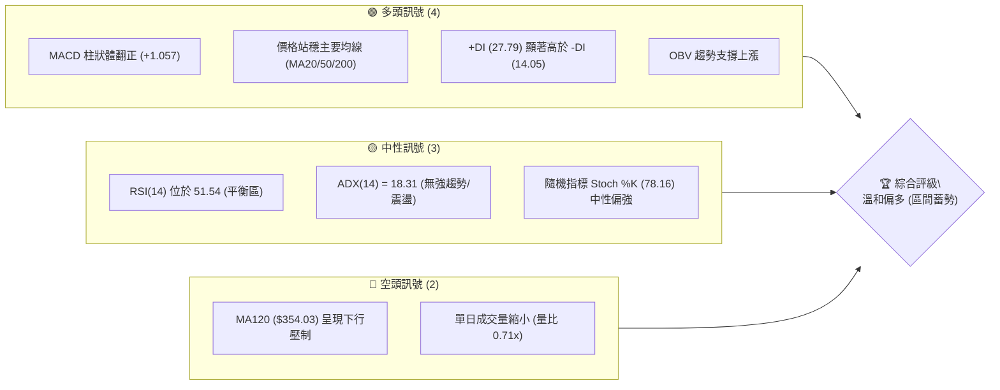
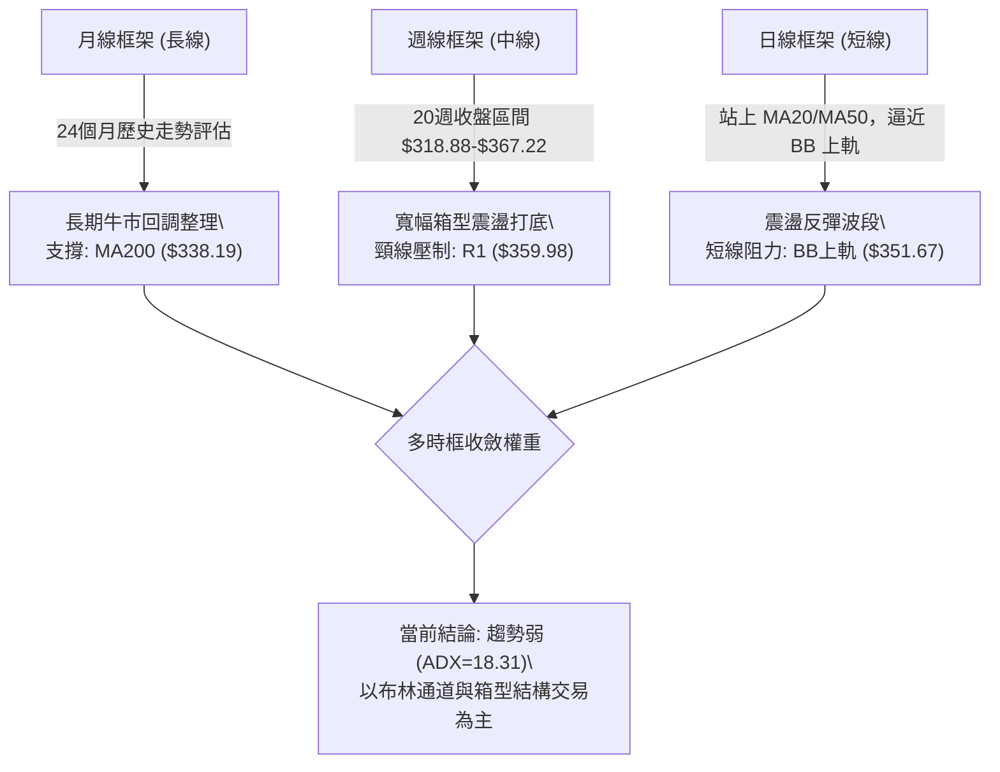
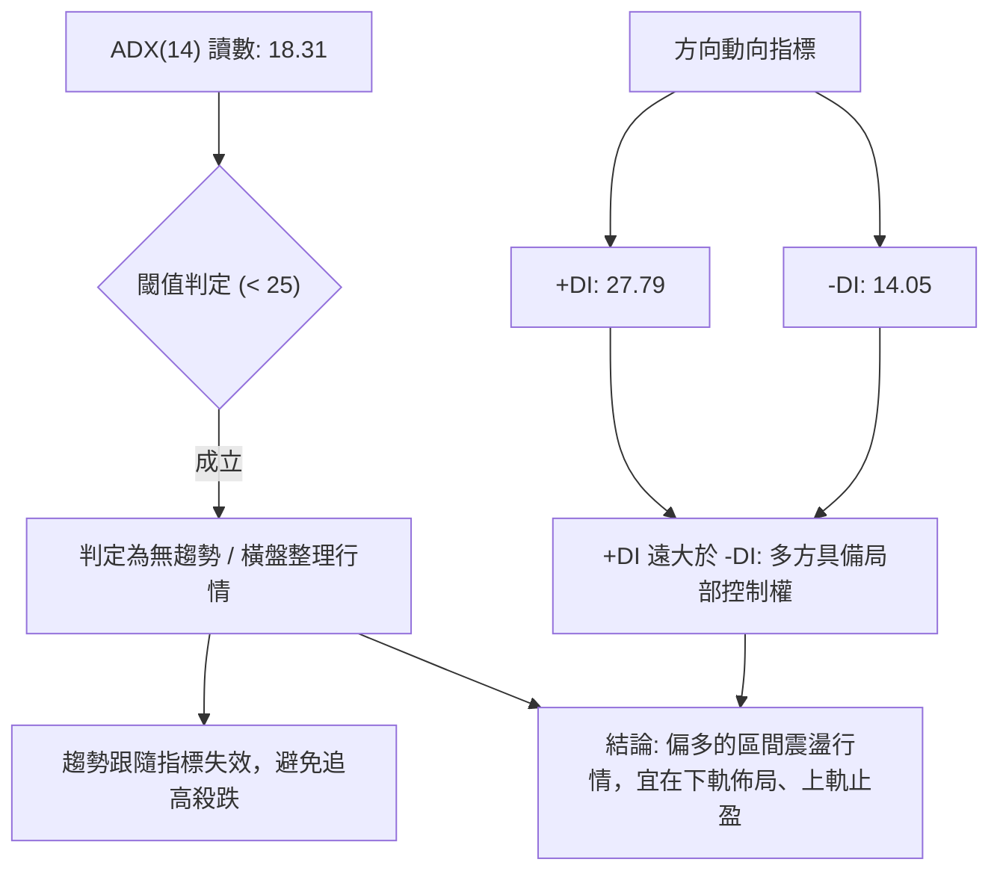
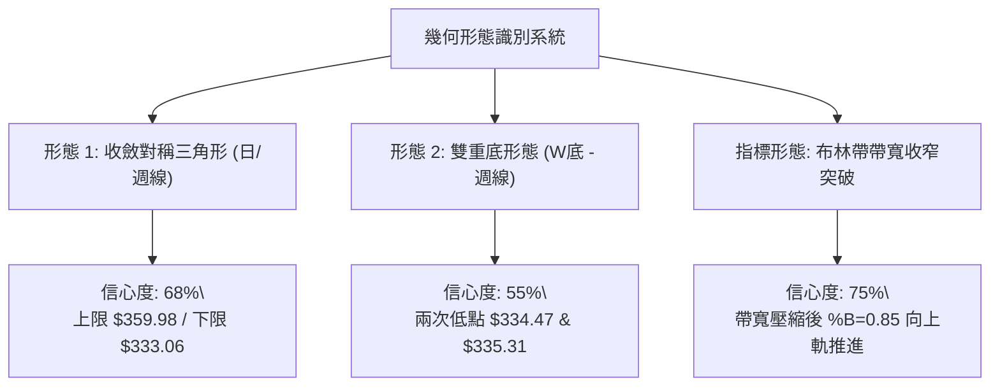
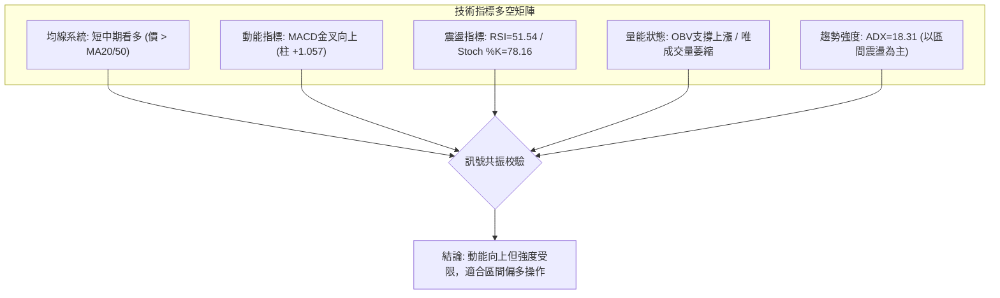
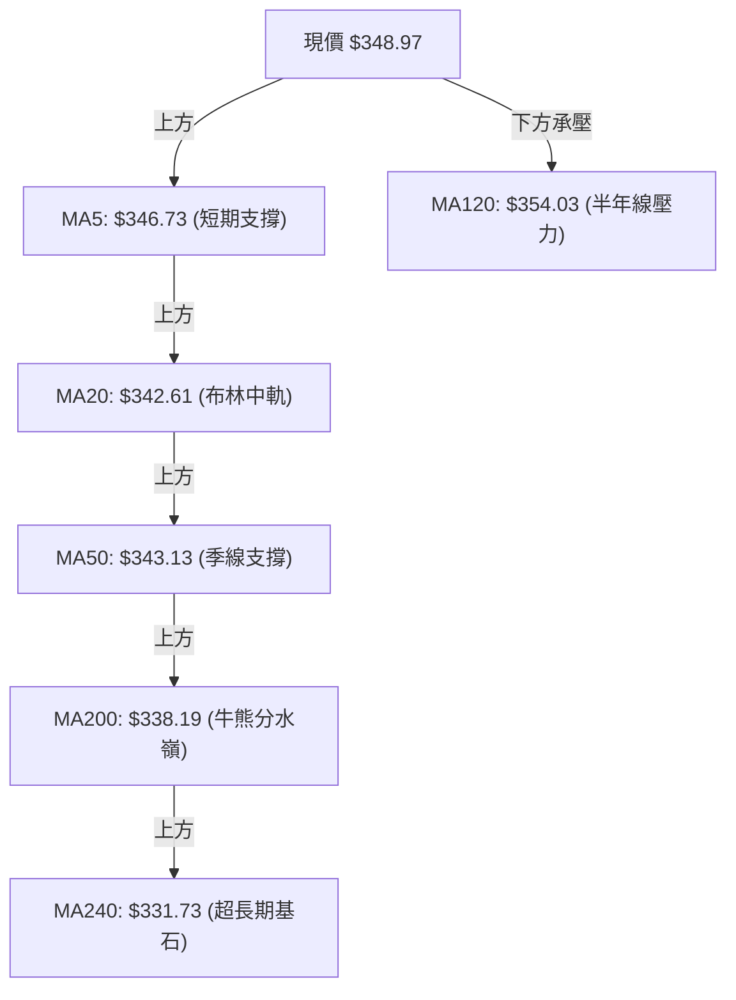
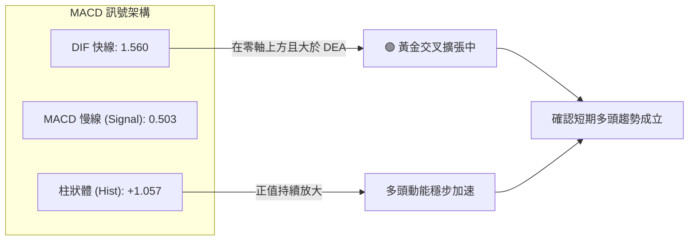
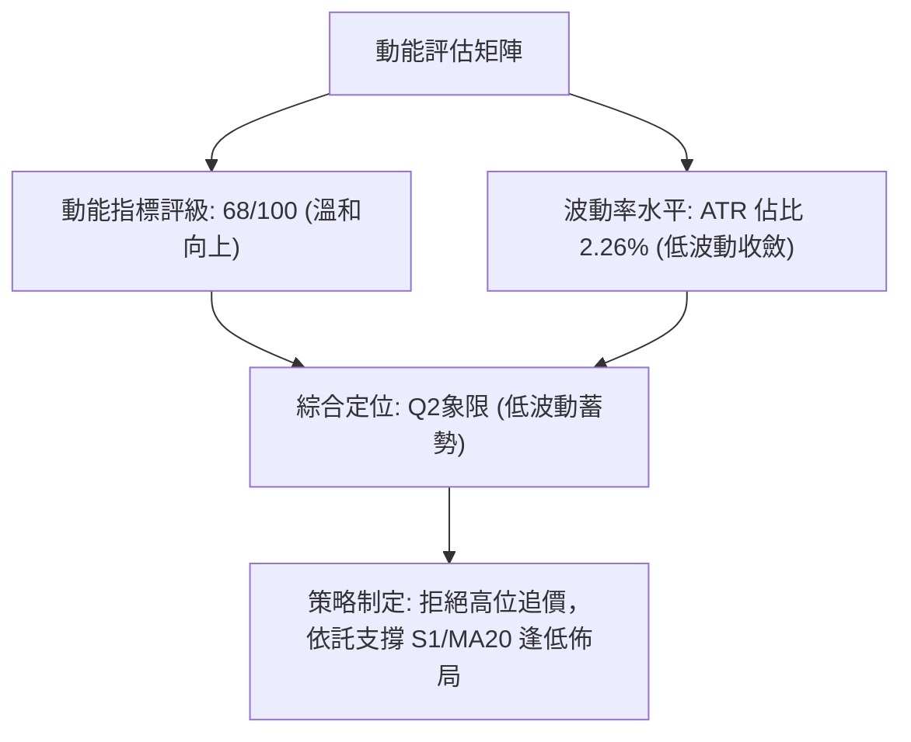
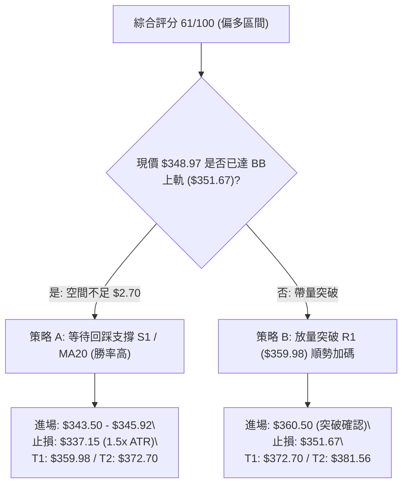
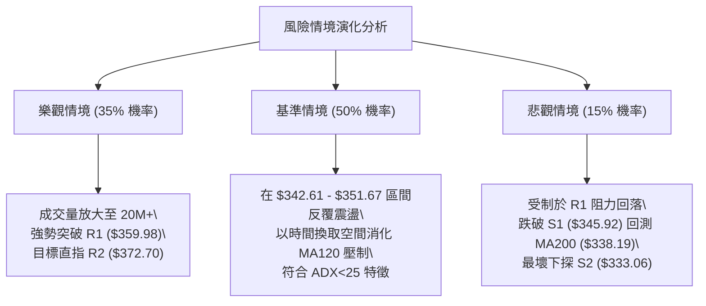

# GOOG 基本面與技術面深度分析報告

> **報告日期**：2026-10-13 ｜ **語言**：繁體中文 ｜ **數據來源**：Yahoo Finance ｜ **當前價格**：$348.97

---

## 目錄

| 章節 | 內容 |
|------|------|
| [1. 技術面概覽](#1-技術面概覽) | 訊號儀表板、核心指標、評分卡 |
| [2. 趨勢分析](#2-趨勢分析) | 多時框趨勢、長中短期走勢、ADX 解讀 |
| [3. 圖表形態分析](#3-圖表形態分析) | 形態識別、信心度評估、K線組合 |
| [4. 支撐與阻力](#4-支撐與阻力) | 關鍵價位、斐波那契回調結構 |
| [5. 技術指標深度解讀](#5-技術指標深度解讀) | MA/RSI/MACD/布林/量價配合 |
| [6. 動能與波動率](#6-動能與波動率) | 動能評估、ATR、Beta 與風險敏感度 |
| [7. 多時框架總結](#7-多時框架總結) | 時框架評分矩陣、多時框收斂結論 |
| [8. 交易策略建議](#8-交易策略建議) | 策略路由、主策略、情境階梯與風控 |
| [9. 風險提示與監控](#9-風險提示與監控) | 監控清單、風險情境與資金管理 |

---

## 1. 技術面概覽

### 🎯 技術訊號儀表板



### 📊 核心指標速覽表

| 指標類別 | 指標名稱 | 當前數值 | 訊號 | 專業解讀 |
|----------|----------|----------|------|----------|
| **價格** | 當前收盤價 | $348.97 | 🟢 | 站於 52 週波動區間 67.2% 位置，處於中高位整合 |
| **均線** | MA20 (月線) | $342.61 | 🟢 | 現價高於 MA20 (+1.86%)，短期支撐結構確立 |
| **均線** | MA50 (季線) | $343.13 | 🟢 | 現價位於季線上方，中期成本線提供下檔保護 |
| **均線** | MA200 (年線) | $338.19 | 🟢 | 長期牛熊分界線維持在現價下方，長期多頭結構未破 |
| **均線** | MA120 (半年線) | $354.03 | 🔴 | 半年線呈現負乖離 (-1.43%)，上方構成首道均線壓制 |
| **動能** | RSI(14) | 51.54 | 🟡 | 位於 50 多空分界線上方，動能均衡，無超買超賣 |
| **動能** | MACD (12,26,9) | 1.560 / 0.503 | 🟢 | MACD 處於零軸上方，Histogram (+1.057) 擴張看多 |
| **動能** | Stoch %K / %D | 78.16 / 59.50 | 🟢 | %K 自中線向上交叉 %D，短線買盤動能增強 |
| **趨勢強度** | ADX(14) | 18.31 | 🟡 | ADX < 25 代表當前為非趨勢盤整行情，以區間邏輯主導 |
| **通道** | 布林帶 %B | 0.85 | 🟡 | 接近上軌 ($351.67)，面臨通道邊界回踩或突破考驗 |
| **成交量** | 量比 (Volume Ratio) | 0.71x | 🔴 | 成交量 11.83M 低於 20 日均量 (16.62M)，呈現量縮拉升 |
| **波動** | ATR(14) | $7.88 | 🟡 | 佔現價 2.26%，波動度溫和，有利於設立合理止損空間 |

### 🏆 技術評分卡

```
╔══════════════════════════════════════════════════════════════════╗
║                 技術評分卡 — GOOG (2026-10-13)                   ║
╠══════════════════════════════════════════════════════════════════╣
║ 趨勢強度 (Trend)      ████████░░░░░░░░░░░░  42/100  🟡 弱趨勢/區間 ║
║ 動能指標 (Momentum)   ██████████████░░░░░░  68/100  🟢 MACD翻多   ║
║ 支撐穩定度 (Support)  ███████████████░░░░░  74/100  🟢 S1/均線重疊║
║ 成交量配合 (Volume)   ████████░░░░░░░░░░░░  40/100  🔴 量縮背馳疑慮║
║ 形態完整度 (Pattern)  ████████████░░░░░░░░  60/100  🟡 區間收斂三角║
║ 均線排列 (Moving Avg) ██████████████░░░░░░  66/100  🟢 站上MA20/50 ║
╠══════════════════════════════════════════════════════════════════╣
║ 綜合技術評分          ████████████░░░░░░░░  61/100  🟢 溫和看多    ║
╚══════════════════════════════════════════════════════════════════╝
```

---

## 2. 趨勢分析

### 🌐 多時框趨勢分析



### 📈 長期趨勢 — 12個月走勢圖（Unicode）

以下展示過去 12 個月（2025-11 至 2026-10）收盤走勢與關鍵高低轉折：

```
GOOG 月線走勢圖（過去12個月）
價格軸 ($)
$400 ┤                                      
$380 ┤                            ● 2026-04 ($381.46 波段峰值)
$360 ┤                               ● 2026-05 ($375.96)
$340 ┤                    ● 2026-01       ● 2026-07  ● 2026-10 ($348.97 現價)
$320 ┤● 2025-11 ($319.29)     ● 2026-02       ● 2026-08 ($335.19)
$300 ┤        ● 2025-12 ($313.19)  ● 2026-03 ($286.50 次級低點)
$280 ┤
     └─────────────────────────────────────────────────────────
       11   12   01   02   03   04   05   06   07   08   09   10  (月份)
```

**走勢特徵分析表格**：

| 階段區間 | 月份起迄 | 收盤起迄價 | 區間漲跌幅 | 結構特徵與技術解讀 |
|----------|----------|------------|------------|--------------------|
| 主升延伸期 | 2025-11 至 2026-01 | $319.29 → $337.87 | +5.82% | 延續 2025 年多頭推升，於 $337 附近遭遇獲利回吐 |
| 快速洗盤期 | 2026-01 至 2026-03 | $337.87 → $286.50 | -15.20% | 跌破短期均線回測季線支撐，3月打出波段低點 $286.50 |
| 強力脈衝期 | 2026-03 至 2026-04 | $286.50 → $381.46 | +33.14% | 大幅放量反彈創下波段高點，接近 52 週歷史高點 $403.96 |
| 箱型消化期 | 2026-05 至 2026-08 | $375.96 → $335.19 | -10.84% | 獲利了結賣壓湧現，價格回調至 MA200 附近尋求支撐 |
| 築底回升期 | 2026-08 至 2026-10 | $335.19 → $348.97 | +4.11% | 連續 2 個月溫和反彈，收盤穩於 MA20 及 MA50 之上 |

### 📊 中期趨勢（週線分析）

從近 20 週收盤走勢可見，價格於 2026-07-26 下探低點 $318.88 後迅速強彈至 2026-08-02 的 $356.42，確立了中期的箱型底部。
隨後在 8 月至 9 月期間，收盤價持續在 $335.31 至 $347.86 區間緊密收斂，形成典型的對稱三角收斂底。

```
週線震盪壓力支撐結構示意圖：
[阻力 R2] $372.70 ══════════════════════════════════════════════════════
                      ▲ (06-21 反彈高點 $367.22)
[阻力 R1] $359.98 ────┼─────────────────────────────────────────────────
                      │         ▲ (08-02 反彈點 $356.42)
[現價]   $348.97 ····┼·········┼·········································
                      │         │    ▲ (當前收盤 $348.97 向上測試)
[支撐 S1] $345.92 ────┼─────────┼────┴────────────────────────────────────
                      ▼ (06-28 破位 $334.47)
[支撐 S2] $333.06 ══════════════════════════════════════════════════════
                      ▼ (07-26 恐慌低點 $318.88)
```

### ⚡ 趨勢強度評估（ADX 解讀）



**ADX 強度對照與市場狀態分析表**：

| 指標名稱 | 當前數值 | 參考區間 | 市場狀態解讀 |
|----------|----------|----------|--------------|
| **ADX (趨勢強度)** | **18.31** | 0 – 20: 極弱趨勢 / 盤整<br>20 – 25: 弱趨勢<br>25 – 40: 強趨勢<br>> 40: 極強單邊趨勢 | 當前讀數顯著低於 25，表明市場缺乏單邊趨勢動力，處於多空籌碼換手與窄幅壓縮階段。 |
| **+DI (多頭動向)** | **27.79** | 高於 25 屬強勢 | 多方力量佔據主導，價格短線具備向上推升彈性。 |
| **-DI (空頭動向)** | **14.05** | 低於 20 屬弱勢 | 空方打壓動能微弱，回調時賣壓迅速衰竭。 |
| **多空差值 (+DI - -DI)** | **+13.74** | 正值擴大看多 | 多頭買盤具備結構性優勢，但受限於 ADX 總量能不足，難以形成垂直爆發。 |

---

## 3. 圖表形態分析

### 🔍 形態識別系統



**形態信心度與目標價評估表**：

| 形態名稱 | 信心度 | 判斷依據（嚴格引用輸入數據） | 完成度 | 目標價（附嚴謹計算式） |
|----------|--------|------------------------------|--------|------------------------|
| **收斂對稱三角形** | **68%** | 壓力線連接 06-07 高點 $365.30 與 08-02 高點 $356.42；支撐線連接 07-26 低點 $318.88、09-06 低點 $335.31，高點下移而低點抬高。 | 85% | 由形態最大波寬 ($365.30 - $318.88 = $46.42) 推算突破目標：若向上突破頸線 R1 ($359.98)，目標 = $359.98 + $46.42 = **$406.40**（接近 52W 高點 $403.96）。 |
| **雙重底 (W底)** | **55%** | 第一底於 2026-06-28 觸及收盤 $334.47，第二底於 2026-09-06/13 觸及收盤 $335.31/$335.45（均緊扣支撐 S2 $333.06），中間頸線峰值為 07-05 收盤 $355.95。 | 70% | 形態高度 = 頸線 $355.95 - 底部平均 $334.89 = $21.06。突破目標 = 頸線 $355.95 + $21.06 = **$377.01**（落於 R2 $372.70 與 R3 $381.56 之間）。 |
| **頭肩形態** | **<30%** | **數據不足，僅做指標型解讀**：目前走勢缺乏完整左右肩對稱量價特徵，不予強行標注。 | -- | 數據中未偵測到有效頭肩結構。 |

### 🕯️ 重要K線形態分析

| 觀測週期 / 日期 | 收盤價 | K線形態 | 量價關係與技術解讀 | 多空訊號 |
|-----------------|--------|---------|--------------------|----------|
| 2026-07-26 週線 | $318.88 | 長下影長陰破底洗盤 | 週成交量放大至 122.28M，創下波段極端低點後引發法人強勁抄底買盤。 | 🟢 潛在底背離見底 |
| 2026-08-02 週線 | $356.42 | 大陽線實體包覆 | 週成交量 110.47M，形成看漲吞沒（Bullish Engulfing），一舉收復兩週跌幅。 | 🟢 強烈買訊 |
| 2026-08-23 週線 | $341.53 | 縮量十字星回調 | 週成交量萎縮至 69.77M，RSI 降至 20.6（超賣鈍化），顯示下行拋壓完全竭盡。 | 🟢 止跌確認 |
| 2026-09-20 週線 | $344.41 | 中陽放量突破均線 | 週成交量增至 98.14M，MACD 柱狀體翻正為 +1.455，多頭重新奪回發球權。 | 🟢 動能翻多 |
| 2026-10-18 最新 | $348.97 | 小陽線上探上軌 | 單日量縮拉升至布林上軌附近，MACD 柱維持 +1.057，展現緩步推升格局。 | 🟡 謹慎偏多 |

### 📉 ASCII 走勢形態示意圖

```
GOOG 週線收斂三角與雙底結構示意圖：
價格 ($)
$370 ┤      ● 06-21 ($367.22)
$360 ┤    ／                ＼
$355 ┤  ／                    ● 頸線高點 ($355.95) ──── [阻力 R1 $359.98]
$350 ┤ ／                                  ● 現價 ($348.97) 逼近突破點
$345 ┤                                    ／
$340 ┤                                  ／
$335 ┤       ● 底1 ($334.47)        ● 底2 ($335.31) ──── [支撐 S2 $333.06]
$320 ┤              ＼           ／
$315 ┤                ● 洗盤底 ($318.88)
     └─────────────────────────────────────────────────────────────
```

### 🎯 形態目標價計算

根據上述雙重底與三角形形態，其幾何目標推導如下：
1. **雙底測幅目標 (保守)**：
   $$\text{頸線價位} (\$355.95) + \text{形態垂直高度} (\$21.06) = \$377.01$$
   *校驗*：該價位非常貼近數據中計算之阻力位 **R2: $372.70** 與 **R3: $381.56**，具備高度技術共振效應。
2. **收斂三角向上突破目標 (積極)**：
   $$\text{突破點} (\$351.67 \text{ 布林上軌}) + \text{三角形底寬} (\$46.42) = \$398.09$$
   *校驗*：目標逼近 52 週高點 **$403.96** 及華爾街分析師平均目標價 **$420.36**。

---

## 4. 支撐與阻力

### 🗺️ 關鍵價位分布圖（Unicode）

```
╔══════════════════════════════════════════════════════════════════╗
║                   GOOG 價位結構分布圖 (OHLCV 精確計算)            ║
╠══════════════════════════════════════════════════════════════════╣
║ $403.96 ║████████████████████████████████║ 52W High (0.0% Fib)  ║
║ $381.56 ║████████████████████████        ║ 強阻力 R3 (波段峰值)  ║
║ $372.70 ║██████████████████              ║ 阻力 R2 (反彈高點聚類)║
║ $364.34 ║██████████████                  ║ 斐波那契 23.6% 回調位 ║
║ $359.98 ║████████████████████████        ║ 關鍵阻力 R1 (頸線壓力)║
║ $351.67 ║▒▒▒▒▒▒▒▒▒▒▒▒▒▒▒▒                ║ 布林通道上軌          ║
╠═════════╬════════════════════════════════╬══════════════════════╣
║ $348.97 ╠════════════════════════════════╣ ◄ 當前市價 (Current)  ║
╠═════════╬════════════════════════════════╬══════════════════════╣
║ $345.92 ║▓▓▓▓▓▓▓▓▓▓▓▓▓▓▓▓                ║ 近期支撐 S1 (MA5重疊) ║
║ $342.61 ║▓▓▓▓▓▓▓▓▓▓▓▓▓▓▓▓▓▓▓▓            ║ 布林中軌 / MA20       ║
║ $339.83 ║▓▓▓▓▓▓▓▓▓▓▓▓                    ║ 斐波那契 38.2% 回調位 ║
║ $338.19 ║▓▓▓▓▓▓▓▓▓▓▓▓▓▓▓▓▓▓▓▓▓▓          ║ MA200 牛熊分界線      ║
║ $333.06 ║████████████████████████        ║ 強支撐 S2 (波段雙底)  ║
║ $325.63 ║████████████████████████████    ║ 極限支撐 S3 (安全邊際)║
║ $236.07 ║████████████████████████████████║ 52W Low (100.0% Fib) ║
╚══════════════════════════════════════════════════════════════════╝
```

### 🚧 阻力位分析表

所有價位均嚴格引用歷史波段高點聚類計算數值：

| 阻力級別 | 精確價位 | 距現價空間 | 形成技術原因 | 突破難度評估 | 重要性等級 |
|----------|----------|------------|--------------|--------------|------------|
| **R1** | **$359.98** | +3.16% | 2026年6月中旬反彈平台阻力區，與 MA120 ($354.03) 形成複合壓制帶。 | 🟡 中等（需補量至 16M 以上） | ★★★★☆ |
| **R2** | **$372.70** | +6.80% | 2026年4-5月歷史高檔震盪區換手籌碼密集區，空方防守重鎮。 | 🔴 偏高（需突破收斂三角形頂部） | ★★★★☆ |
| **R3** | **$381.56** | +9.34% | 2026年4月月線收盤高點 ($381.46) 聚類，挑戰 52W 高點前最後關卡。 | 🔴 極高（面臨強烈多頭獲利了結） | ★★★★★ |

### 🛡️ 支撐位分析表

所有價位均嚴格引用歷史波段低點聚類計算數值：

| 支撐級別 | 精確價位 | 距現價空間 | 形成技術原因 | 守住機率評估 | 重要性等級 |
|----------|----------|------------|--------------|--------------|------------|
| **S1** | **$345.92** | -0.87% | 近期日線回調低點聚類，緊鄰 MA5 ($346.73)，提供極短線下檔防護。 | 🟢 70%（短線回踩測試第一道防線） | ★★★☆☆ |
| **S2** | **$333.06** | -4.56% | 6月低點 $334.47 與 9月低點 $335.31 構成之波段雙底，與 BB下軌 ($333.55) 重疊。 | 🟢 85%（箱型結構底部，強力買盤） | ★★★★★ |
| **S3** | **$325.63** | -6.69% | 2026年7月深度洗盤時成交密集支撐區，跌破將引發技術性停損潮。 | 🟢 92%（防守最後底線） | ★★★★☆ |

### 📐 斐波那契回調位分析

依據 52 週極值區間（低點 **$236.07** 至 高點 **$403.96**，波幅高達 $167.89）計算之斐波那契關鍵回調水準：

| 斐波那契水準 | 精確價位 | 當前價格相對位置與結構解讀 |
|--------------|----------|----------------------------|
| **0.0% (52W High)** | **$403.96** | 歷史高點壓力區，多頭終極目標 |
| **23.6% 回調位** | **$364.34** | 上方首道回調阻力，突破該位置代表強勢回調結束 |
| **當前現價區間** | **$348.97** | **現價精確落於 23.6% ($364.34) 與 38.2% ($339.83) 之間** |
| **38.2% 回調位** | **$339.83** | **強弱分界樞紐**：此位置與 MA200 ($338.19) 完美重疊，構成多頭強烈防禦堡壘 |
| **50.0% 回調位** | **$320.02** | 深度回調平衡中樞，7月洗盤低點 $318.88 即在此獲得強支撐 |
| **61.8% 黃金分割** | **$300.20** | 終極牛市生命線，跌破則長期上漲趨勢徹底反轉 |
| **78.6% 回調位** | **$272.00** | 深度熊市測試位 |
| **100.0% (52W Low)**| **$236.07** | 52 週最低點起漲點 |

**解讀結論**：GOOG 現價位於 38.2% ($339.83) 上方，且穩居 MA200 之上，確立當前市場僅屬於高檔良性回調，中長期牛市結構保持完整。

---

## 5. 技術指標深度解讀

### 🎛️ 指標訊號總覽



### 📈 移動平均線排列分析



**均線狀態解讀**：
- **排列狀態**：當前呈現「混合排列（糾結發散期）」。短天期均線 MA5 ($346.73) > MA10 ($343.08) > MA20 ($342.61)，短線買盤強勢；然而 MA20 與 MA50 ($343.13) 黏合，且 MA120 ($354.03) 仍高於現價，顯示中期仍處於震盪打底出脫解套賣壓的過渡期。
- **乖離率分析**：現價距 MA20 乖離率為 +1.86%，距 MA200 乖離率為 +3.19%，乖離度均處於 ±5% 的健康安全區間，未出現極端超買風險。

### 📉 RSI(14) 分析

```
RSI(14) 動能讀數：51.54
0% ░░░░░░░░░░░░░░░░░░░░ 30% ▓▓▓▓▓▓▓▓▓▓▓▓▓▓ 51.54 ░░░░░░░░░░ 70% ░░░░░░░░░░░░ 100%
[     超賣區間     ] [         中性平衡多空爭奪區         ] [     超買區間     ]
```

- **區間判定**：RSI 讀數 **51.54**，剛跨越 50 多空分水嶺，表明多頭力量略佔上風，但尚未進入 70 以上的過熱警戒區，仍具備向上推升空間。
- **背離診斷**：
  - 檢視 2026-08-23 收盤 $341.53 時 RSI 僅 **20.6**，隨後 2026-09-06 價格再次下探低點 $335.31 時，週線 RSI 卻回升至 **43.3**。
  - **結論**：存在顯著的**中期週線底背離（Bullish Divergence）**，證實 $335 附近的底部具備實質支撐力道。當前日線層面無頂背離現象。

### 📊 MACD(12/26/9) 訊號解讀



- **訊號解析**：MACD 線 (1.560) 位於訊號線 (0.503) 之上，柱狀體為 **+1.057**。近兩週週線 MACD 柱狀體亦由 10-04 的 -0.062 迅速翻紅至 10-18 的 **+1.057**，呈現標準的底部翻揚金叉特徵，提供可靠的買進輔助訊號。

### 📦 布林通道分析

```
GOOG 布林通道示意圖 (Bandwidth = $18.12)
$355 ┤
$351.67 ┤════════════════════════════════════════════ 上軌 (Upper Band)
$348.97 ┤ ·································· ● 現價 (%B = 0.85)
$345 ┤
$342.61 ┤──────────────────────────────────────────── 中軌 / MA20 (Middle Band)
$340 ┤
$335 ┤
$333.55 ┤════════════════════════════════════════════ 下軌 (Lower Band)
$330 ┤
```

- **帶寬與位置**：帶寬寬度為 $18.12，呈現相對收窄狀態。當前價格 $348.97 位於 **%B = 0.85** 的高位，逼近上軌 $351.67。
- **行為研判**：在 ADX < 25 的環境下，布林通道上軌通常具有強烈的回彈壓力；若無爆發性成交量支持，價格在此處易遭受技術性阻擊並拉回中軌 ($342.61) 尋求確認。

### 💹 成交量分析（量價配合度）

- **量比現狀**：當前成交量 11,833,900，僅為 20 日均量 (16,615,195) 的 **0.71 倍**。
- **OBV 趨勢**：數據顯示「OBV > MA → 量能支撐上漲」，這表示雖然單日成交量偏低，但中期累計資金流向仍以逢低吸籌為主，並未出現主力機構出貨的失控性拋售。
- **量價背離提示**：短期價格向布林上軌推進，但成交量未能同步放大（縮量上漲），構成**量價輕微背離**，提示突破 R1 ($359.98) 的初次嘗試可能面臨回踩整理。

---

## 6. 動能與波動率

### ⚡ 動能評估

| 象限分類 | 動能狀態 | 波動率狀態 | GOOG 當前狀態判定 | 交易戰略意涵 |
|----------|----------|------------|-------------------|--------------|
| **Q1 (高動能·低波動)** | 強 | 低 | -- | 主升浪啟動初期 |
| **Q2 (弱動能·低波動)** | 弱 | 低 | **✓ 本股定位** | **蓄勢整理期：以區間低吸高拋為主，等待突破確認** |
| **Q3 (強動能·高波動)** | 強 | 高 | -- | 趨勢噴發期，適合激進追價 |
| **Q4 (弱動能·高波動)** | 弱 | 高 | -- | 恐慌崩跌期，應嚴格觀望 |



### 📊 ATR 波動率分析

- **當前數值**：ATR(14) 為 **$7.88**，佔當前股價比例為 **2.26%**。
- **波動特徵**：相較於 52 週內動輒 4-5% 的單日劇烈震盪，當前波動率已大幅冷卻，反映市場籌碼鎖定良好，拋壓已大幅舒緩。
- **風控止損應用**：
  - **極短線動態止損 (1.0x ATR)**：$348.97 - $7.88 = **$341.09**（剛好保護住 MA20 $342.61 之下）。
  - **波段交易安全止損 (1.5x ATR)**：$348.97 - (1.5 × $7.88) = $348.97 - $11.82 = **$337.15**（精準落在 MA200 $338.19 下方，避免假跌破洗盤）。

### 📐 Beta 與市場相關性

- **Beta 係數**：**1.211**，表明 GOOG 相較標普500指數具備 1.21 倍的系統性波動彈性。
- **機構籌碼背景**：機構持股比率高達 **62.1%**，內部人持股 0.5%，空頭回補天數 (Short Ratio) 為 **2.96**。這意味著空方籌碼極度薄弱，一旦大盤科技股情緒回暖，高 Beta 屬性將驅動其迅速脫離盤整區間向上進攻。

---

## 7. 多時框架總結

### 📋 時框架評分表

| 時框架 | 趨勢方向 | 動能狀態 | 均線排列 | 形態特徵 | 綜合評分 | 戰略建議 |
|--------|----------|----------|----------|----------|----------|----------|
| **短期 (日線)** | 🟢 震盪偏多 | 🟢 MACD金叉 | 🟢 站上MA5/20 | 逼近布林上軌 | **64/100** | 待回踩中軌支撐分批佈局 |
| **中期 (週線)** | 🟡 寬幅箱型 | 🟢 MACD翻紅 | 🟡 均線糾結 | 對稱收斂三角 | **60/100** | 區間交易，以頸線 R1 為目標 |
| **長期 (月線)** | 🟢 長牛整理 | 🟡 RSI平衡 | 🟢 遠在MA200上 | 38.2% Fib 獲得支撐 | **70/100** | 長線多單底倉堅定持有 |

### 🔲 綜合訊號矩陣

```
╔══════════════════════════════════════════════════════════════════╗
║               多維度技術訊號矩陣收斂表                           ║
╠══════════════════╦════════════╦════════════╦═════════════════════╣
║ 分析維度         ║ 短期 (日線)║ 中期 (週線)║ 長期 (月線)         ║
╠══════════════════╬════════════╬════════════╬═════════════════════╣
║ 趨勢指標 (MA/ADX)║ 🟡 弱趨勢  ║ 🟡 箱型震盪║ 🟢 結構多頭         ║
║ 動能指標 (RSI/MACD)🟢 金叉放量║ 🟢 柱狀體翻正║ 🟡 中性 51.54       ║
║ 量能指標 (OBV/VOL) 🔴 縮量拉升║ 🟢 週線放量底║ 🟢 主力未出貨       ║
║ 通道指標 (Bollinger)🔴 觸及上軌║ 🟡 中軌運行║ 🟢 寬幅消化         ║
╠══════════════════╩════════════╩════════════╩═════════════════════╣
║ 總體方向一致性：動能強烈共振看多，但受限於震盪結構，禁止追高       ║
╚══════════════════════════════════════════════════════════════════╝
```

### ⚖️ 多時框收斂結論

依據多時框收斂規則第 14 條：
1. **行情性質判定**：當前日線 ADX(14) 讀數為 **18.31 (< 25)**，嚴格定義為**盤整/弱趨勢行情**。
2. **交易區間界定**：在此狀態下，日線布林通道上下軌（**下軌 $333.55 至 上軌 $351.67**）為首要交易區間。
3. **時框優先級收斂**：雖然週線與月線宏觀結構偏多，但在盤整行情中，不可盲目採取突破追買策略。日線訊號必須服從「布林邊界與關鍵波段高低點」的約束。
4. **唯一方向性結論**：**【震盪偏多（箱型區間操作）】**。以支撐 S1 ($345.92) 與 MA20 ($342.61) 作為防守基點逢低做多，向上看至 R1 ($359.98)。

---

## 8. 交易策略建議

### 🗺️ 策略決策流程圖



### 🧭 策略路由

> **當前主策略方向 = 【溫和偏多／逢回買進】（依技術評分卡 61/100 判定）**

由於評分高於 60 分且 ADX 呈現盤整，主推**多頭回調佈局策略**與**關鍵阻力突破策略**；空方僅列為下破防禦風控點，不作推薦。

### 🎯 價格情境階梯（Price Scenarios）

所有價位均嚴格引用前述技術分析之真實計算點位：

| 觸發條件 | 下一目標 | 後續延伸 | 情境技術含義 |
|----------|----------|----------|--------------|
| **向上突破 R1 ($359.98)** | **R2 ($372.70)** | **R3 ($381.56)** | 收斂三角形向上爆發，化解 MA120 下行壓力，開啟主升段 |
| **站穩現價區間 ($342 - $351)** | **BB 上軌 ($351.67)**| **R1 ($359.98)** | 布林中上軌良性換手，蓄積突破動能 |
| **跌破 S1 ($345.92)** | **S2 ($333.06)** | **S3 ($325.63)** | 短線回測 MA20/MA50 甚至箱型下軌，考驗雙底支撐力道 |

### 📊 情境機率分佈

| 預期情境 | 發生機率 | 主要技術依據 |
|----------|----------|--------------|
| **震盪走高 / 向上突破** | **60%** | MACD 柱狀體翻正擴張 (+1.057)、+DI (27.79) 壓制 -DI (14.05)、OBV 趨勢支撐向上。 |
| **箱型區間橫盤震盪** | **28%** | ADX 僅 18.31 缺乏單邊趨勢能動量、量比 0.71x 呈現無量推升，易受制於布林上軌。 |
| **回落跌破再探底** | **12%** | MA120 ($354.03) 的中線壓制存在，但 S2 ($333.06) 雙底防禦極度堅固，深跌機率低。 |

### 🟢 主策略詳情

| 策略要素 | 策略 A：波段回踩逢低佈局（首選） | 策略 B：突破頸線右側追買（次選） |
|----------|----------------------------------|----------------------------------|
| **進場條件** | 價格回踩 S1 ($345.92) 或 MA20 ($342.61) 止跌收十字星 | 實體日K線收盤放量突破 R1 ($359.98) 且成交量 > 16.6M |
| **進場價格** | **$344.00**（落於 S1 與 MA20 之間） | **$360.50**（確認突破 R1） |
| **目標價 T1** | **$359.98**（測試 R1 阻力位） | **$372.70**（測試 R2 阻力位） |
| **目標價 T2** | **$372.70**（測試 R2 阻力位） | **$381.56**（測試 R3 波段高點） |
| **止損價格** | **$337.15**（跌破 MA200，保護 1.5x ATR） | **$351.67**（回落至布林通道上軌下方） |
| **風險報酬比** | **1 : 2.33**（風險 $6.85，T1 利潤 $15.98） | **1 : 1.38**（風險 $8.83，T1 利潤 $12.20） |
| **成功機率** | **68%** | **55%** |
| **建議倉位** | **15% - 20%**（底倉建立） | **10%**（追隨動量加碼） |

### 🔴 反向風險觸發點（對沖與停損提示）

若出現以下事件，主策略設定將被全面推翻，應立即執行防禦措施：
1. **關鍵點位跌破**：若收盤價帶量跌破 **S2: $333.06**，意味著自 6 月以來的雙底結構徹底破裂。
2. **指標轉弱警訊**：日線 MACD 柱狀體再度轉負，且 RSI(14) 跌破 45。
3. **對沖應對處置**：若跌破 S2，多頭部位應無條件停損出場，亦可利用反向 ETF 或買入賣權（Put）對沖下行至 S3 ($325.63) 之風險。

### ⭐ 整體訊號強度評星

```
做多訊號強度：★★★★☆  (4/5星 - 動能與均線均支持多方，唯量能不足)
做空訊號強度：★☆☆☆☆  (1/5星 - 缺乏做空結構，空頭動向低迷)
整體策略可信度：★★★★☆  (4/5星 - 價位經由 OHLCV 精確計算，可執行性高)
```

---

## 9. 風險提示與監控

### ✅ 關鍵監控指標 Checklist

```
╔══════════════════════════════════════════════════════════════════╗
║               每日盤後技術監控清單 (Checklist)                  ║
╠══════════════════════════════════════════════════════════════════╣
║ [ ] 價格是否成功站上布林上軌 ($351.67) 並形成均線多頭發散？       ║
║ [ ] 日成交量能否放大突破 20 日均量 (16,615,195) 完成補量？       ║
║ [ ] RSI(14) 是否持續維持在 50 水平之上，拒絕回落弱勢區？          ║
║ [ ] MACD 柱狀體是否保持正值（當前 +1.057），若縮減至零軸需警惕？  ║
║ [ ] 下檔 MA20 ($342.61) 與 MA50 ($343.13) 支撐是否維持完好？     ║
║ [ ] ADX(14) 是否突破 25，確認單邊推升行情正式啟動？              ║
╚══════════════════════════════════════════════════════════════════╝
```

### ⚠️ 風險場景分析



### 🛡️ 風險管理重要提醒

1. **嚴禁追高紀律**：當前布林 %B 已高達 **0.85**，價格極度貼近上軌 $351.67，短線潛在盈虧比極差。投資人絕不可在此處追高，務必耐心等待回踩。
2. **倉位管理原則**：在 ADX < 25 且成交量比僅 0.71x 的非強趨勢環境下，整體持倉部位建議控制在總資金的 **30% - 40%** 以內，避免重倉承擔無效的時間磨耗。
3. **ATR 動態追蹤停利**：若策略 A 進場成功並推升至 R1 ($359.98) 附近，應立即將止損點上移至損益兩平點 ($344.00)，鎖定本金安全，並在目標價分批獲利了結 50% 倉位。

---

## 📋 報告總結

```
╔══════════════════════════════════════════════════════════════════╗
║                   GOOG 技術分析報告總結                          ║
╠══════════════════════════════════════════════════════════════════╣
║ 報告日期：2026-10-13                                             ║
║ 當前價格：$348.97                                                ║
║ 分析評級：🟢 溫和看多 / 區間震盪蓄勢 (技術評分: 61/100)           ║
║                                                                  ║
║ 關鍵架構結論：                                                    ║
║ ├─ 長期趨勢：🟢 多頭架構維持完好，穩居 MA200 ($338.19) 之上       ║
║ ├─ 中期趨勢：🟡 寬幅箱型收斂打底，受阻於 MA120 ($354.03)         ║
║ ├─ 短期趨勢：🟢 站穩 MA20/MA50，MACD 金叉放量 (+1.057)           ║
║ ├─ 關鍵支撐：S1: $345.92 │ S2: $333.06 (雙底頸線)               ║
║ ├─ 關鍵阻力：R1: $359.98 │ R2: $372.70 (波段高點)               ║
║ └─ 分析師目標：平均 $420.36 (最高 $485.00，最低 $340.00)          ║
║                                                                  ║
║ 最優策略組合：                                                    ║
║ 1. 🥇 最佳機會：等待回踩 S1-MA20 區間 ($344.00) 買進，止損 $337.15║
║ 2. 🥈 次選機會：帶量突破 R1 ($359.98) 後順勢加碼，看至 R2 $372.70 ║
║ 3. 🥉 保守選擇：於布林帶寬 ($333.55 - $351.67) 內進行網格高拋低吸║
╚══════════════════════════════════════════════════════════════════╝
```

---

> ⚠️ **免責聲明**：本報告為 AI 自動生成之技術分析，所有數據及估算均基於提供的歷史價格資訊。本報告**僅供研究與學術參考**，**不構成任何投資建議**。投資有風險，入市需謹慎。

---

*報告生成時間：2026-10-13 ｜ 數據來源：Yahoo Finance ｜ 分析框架：多時框技術分析*