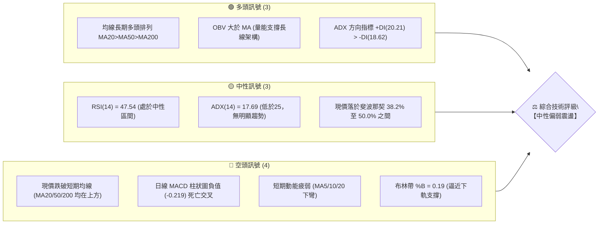
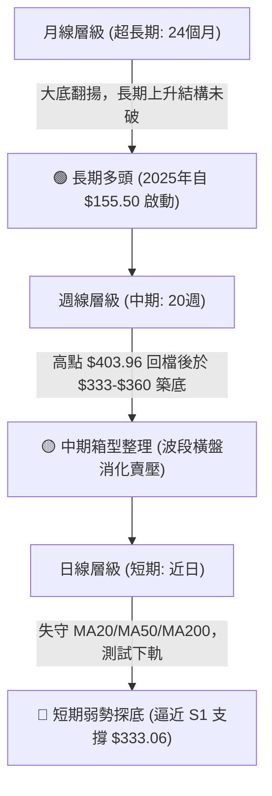
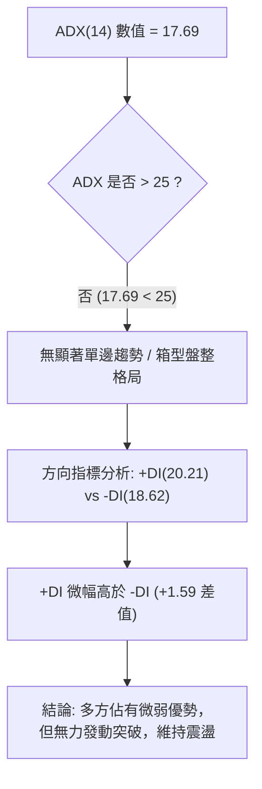
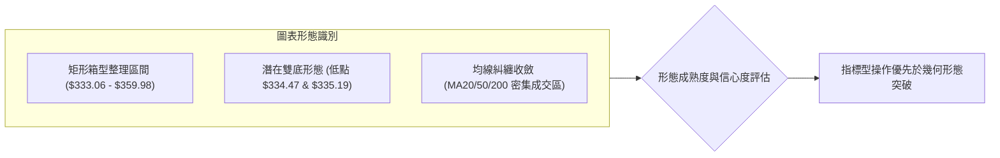
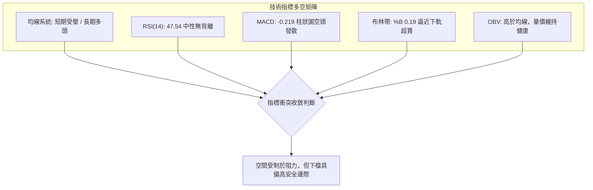
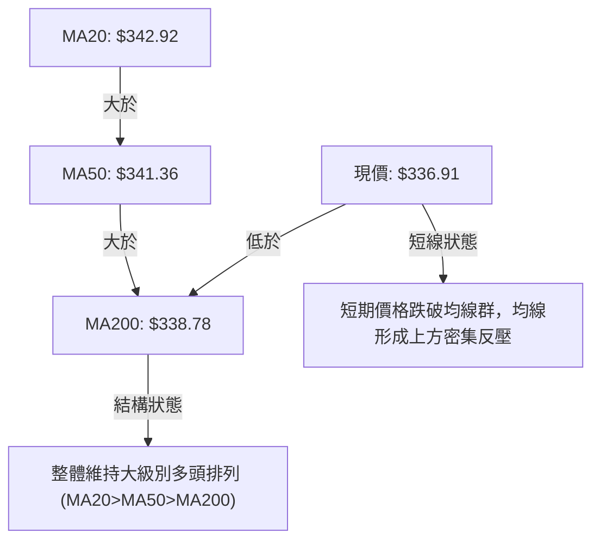
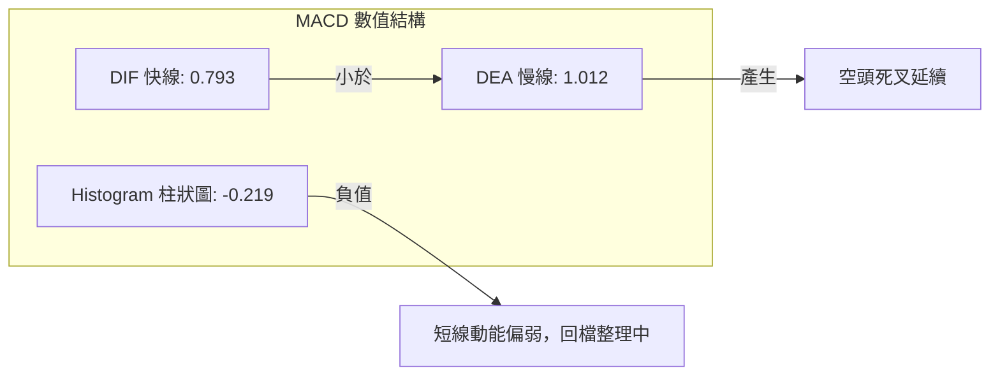
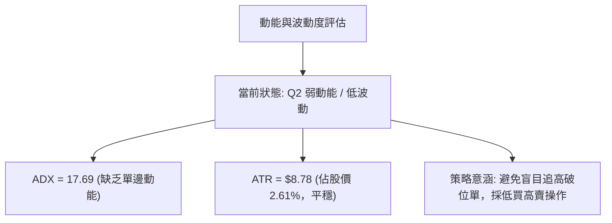
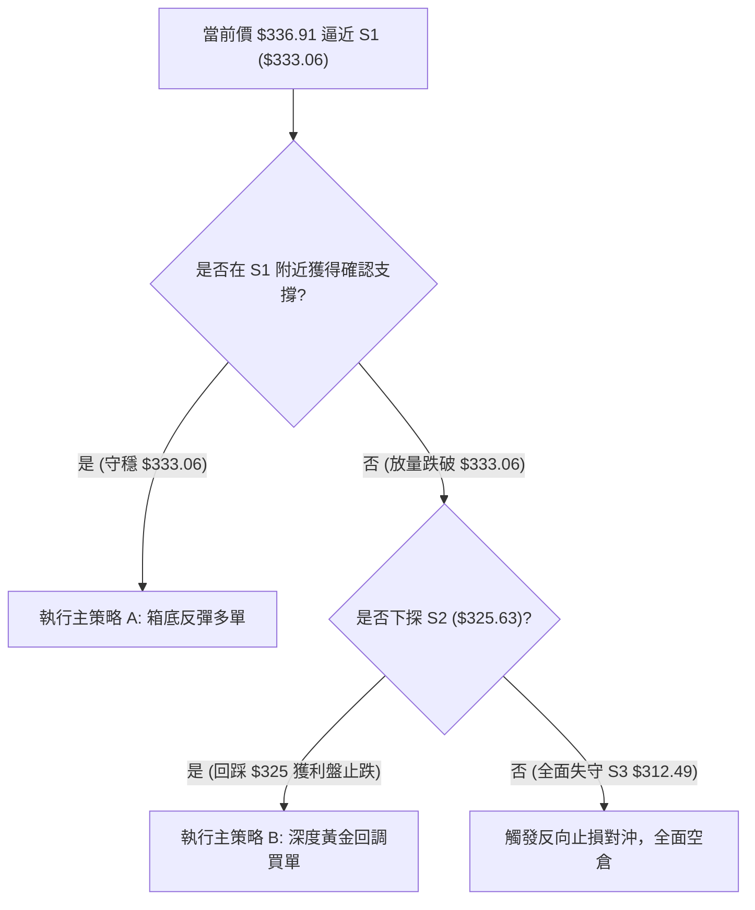
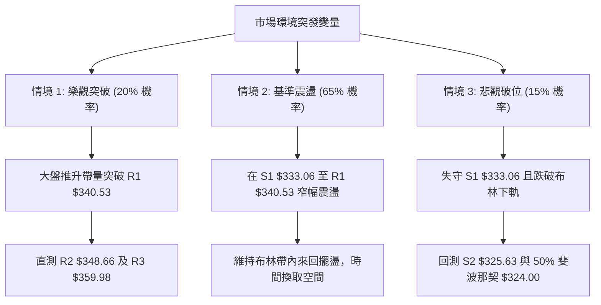

# GOOG 技術分析報告

> **報告日期**：2026-10-19 ｜ **語言**：繁體中文 ｜ **數據來源**：Yahoo Finance ｜ **當前價格**：$336.91

---

## 目錄

| 章節 | 內容 |
|------|------|
| [1. 技術面概覽](#1-技術面概覽) | 訊號儀表板、核心指標、評分卡 |
| [2. 趨勢分析](#2-趨勢分析) | 多時框趨勢、長中短期走勢 |
| [3. 圖表形態分析](#3-圖表形態分析) | 形態識別、K線組合、目標價 |
| [4. 支撐與阻力](#4-支撐與阻力) | 關鍵價位、斐波那契回調 |
| [5. 技術指標深度解讀](#5-技術指標深度解讀) | MA/RSI/MACD/布林/成交量 |
| [6. 動能與波動率](#6-動能與波動率) | 動能評估、ATR、Beta |
| [7. 多時框架總結](#7-多時框架總結) | 時框架評分矩陣、收斂結論 |
| [8. 交易策略建議](#8-交易策略建議) | 價格情境、主策略詳情、風險報酬比 |
| [9. 風險提示與監控](#9-風險提示與監控) | 監控指標、風險情境、風控原則 |

---

## 1. 技術面概覽

### 🎯 技術訊號儀表板



### 📊 核心指標速覽表

| 指標類別 | 指標名稱 | 當前數值 | 訊號 | 解讀 |
|:---|:---|:---|:---:|:---|
| **價格** | 當前收盤價 | $336.91 | 🔴 | 位於 52 週區間之 58.1%，短線受壓於多重均線下方 |
| **均線** | MA20 (月線) | $342.92 | 🔴 | 價格在均線下方 -1.75%，形成第一道動態阻力 |
| **均線** | MA50 (季線) | $341.36 | 🔴 | 價格在均線下方 -1.30%，中短期動能放緩 |
| **均線** | MA200 (年線) | $338.78 | 🔴 | 價格微幅失守年線 -0.55%，短線測試長期持股成本 |
| **動能** | RSI(14) | 47.54 | 🟡 | 位於 30–70 中性區間，無超買超賣，多空處於拉鋸 |
| **動能** | MACD (12,26,9) | 0.793 / 1.012 | 🔴 | DIF 低於 DEA，MACD 柱狀圖為 -0.219，空頭占優 |
| **動能** | KD指標 (%K/%D) | 18.85 / 40.59 | 🟢 | %K 進入超賣區 (<20)，暗示短線隨時具備反彈動能 |
| **趨勢** | ADX(14) | 17.69 | 🟡 | ADX < 25，顯示缺乏單邊趨勢，典型寬幅箱型盤整 |
| **通道** | 布林通道 %B | 0.19 | 🟡 | 價格貼近下軌 ($333.10)，具備超跌反彈契機 |
| **成交量** | 20日成交量比 | 1.04x | 🟢 | 最新量 16.95M 高於均量 16.23M，量能未出現恐慌潰敗 |
| **波動** | ATR(14) | $8.78 | 🟡 | 波動率佔股價 2.61%，處於合理波動範圍，有利區間操作 |

### 🏆 技術評分卡

```
╔══════════════════════════════════════════════════════════════╗
║             技術評分卡 — GOOG (2026-10-19)                   ║
╠══════════════════════════════════════════════════════════════╣
║ 趨勢強度 (ADX/方向)   ███████░░░░░░░░░░░░░  35/100  🔴 弱趨勢 ║
║ 動能指標 (RSI/MACD)   ████████░░░░░░░░░░░░  42/100  🔴 偏空   ║
║ 支撐穩定度 (S1-S3)    █████████████░░░░░░░  65/100  🟢 良好   ║
║ 成交量配合 (OBV/量比) ████████████░░░░░░░░  60/100  🟢 配合   ║
║ 形態完整度 (箱型/雙底)██████████░░░░░░░░░░  50/100  🟡 中性   ║
║ 均線排列 (多頭但壓制) ████████░░░░░░░░░░░░  40/100  🔴 短壓   ║
╠══════════════════════════════════════════════════════════════╣
║ 綜合評分              ██████████░░░░░░░░░░  48/100  🟡 中性   ║
╚══════════════════════════════════════════════════════════════╝
```

---

## 2. 趨勢分析

### 🌐 多時框趨勢分析



### 📈 長期趨勢 — 12個月走勢圖（Unicode）

```
GOOG 月線收盤走勢圖（2025-11 至 2026-10）
價格軸 ($)
$400 ┤                                
$380 ┤                            ● $381.46 (4月突破)
$360 ┤                                ● $375.96
$340 ┤                    ● $337.87       ● $353.10  ● $356.42   ● $340.74
$320 ┤        ● $319.29       ● $310.82                              ● $336.91 (現價)
$300 ┤            ● $313.19       ● $286.50                  ● $335.19
$280 ┤  ● $281.09
     └─────────────────────────────────────────────────────────────────────────►
        11月  12月  01月  02月  03月  04月  05月  06月  07月  08月  09月  10月
       (2025)                      (2026)
```

**12個月走勢特徵分析表格**：

| 階段 | 期間 | 價格區間 ($) | 漲跌幅 | 核心技術特徵 |
|:---|:---:|:---:|:---:|:---|
| **主升攻擊段** | 2025-11 ~ 2026-01 | $281.09 → $337.87 | +20.20% | 均線發散，月線量價齊揚，突破 $300 大關 |
| **劇烈洗盤段** | 2026-02 ~ 2026-03 | $337.87 → $286.50 | -15.20% | 獲利了結賣壓湧現，回踩年線支撐完成籌碼換手 |
| **歷史新高段** | 2026-04 ~ 2026-05 | $286.50 → $381.46 | +33.14% | 創 52 週新高 $403.96，形成中長期天花板 |
| **箱型收斂段** | 2026-06 ~ 2026-10 | $381.46 → $336.91 | -11.68% | 波動率逐步萎縮，於 $333–$360 區間進行時間換取空間的收斂整理 |

### 📊 中期趨勢（週線分析）

從最近 20 週收盤走勢可見，價格於 2026-06-28 創下 $334.47 低點、2026-07-26 探底 $318.88 後迅速強彈，此後 8 月至 10 月收盤價密集收在 $335.19 至 $347.86 之間。週成交量由 6 月下旬的 1.88 億股大幅萎縮至近期的 6,300 萬至 7,900 萬股，量能持續遞減，呈現典型的「量縮收斂」中性格局。

```
中期壓力與支撐示意圖 (週線層級)
$360.00 ────────────────────────────────────────── 阻力區頂部 (R3: $359.98)
           ▲               ▲
           │               │
$342.92 ───┼─────── MA20 / 中軌 ────────────────── 震盪中軸 (多空分水嶺)
           │               │
           ▼               ▼
$333.06 ────────────────────────────────────────── 支撐區底部 (S1: $333.06 / 下軌)
```

### ⚡ 趨勢強度評估（ADX 解讀）



| 指標變數 | 當前讀數 | 狀態判斷 | 實戰策略指引 |
|:---|:---:|:---:|:---|
| **ADX (14)** | **17.69** | 弱趨勢 (<25) | 嚴禁採用突破追價策略，以布林通道與支撐阻力做高拋低吸 |
| **+DI (14)** | **20.21** | 多方動能 | 買盤力道偏弱，無法維持持續推升力道 |
| **-DI (14)** | **18.62** | 空方動能 | 空方拋壓亦未失控，無崩跌破位危機 |
| **ADX 趨勢** | 走平 | 震盪收斂 | 靜待 ADX 向上穿越 20-25 確立新一輪波段方向 |

---

## 3. 圖表形態分析

### 🔍 形態識別系統



**形態信心度與目標價評估表**：

| 形態名稱 | 信心度 | 判斷依據（引用實際數據） | 完成度 | 目標價（附嚴謹計算式） |
|:---|:---:|:---|:---:|:---|
| **矩形箱型整理** | **85%** | 價格受制於 R1($340.53)-R3($359.98) 且獲得 S1($333.06) 支撐 | 75% | 箱底 $333.06 至箱頂 $359.98 震盪；突破向上測 $386.90 ($359.98 + $26.92) |
| **波段雙底形態** | **60%** | 兩次下探：6月收盤 $334.47 與 8月收盤 $335.19 均在 S1 附近獲得支撐 | 55% | 頸線為 7月反彈高點 $356.42；若突破頸線，量度目標 = $356.42 + ($356.42 - $334.47) = **$378.37** |
| **頭肩頂形態** | **25%** | 數據不足（僅高點 $403.96，右肩結構未形成且頸線未跌破） | 15% | **訊號不足，僅做指標型解讀** |

### 🕯️ 重要K線形態分析

| 月份 | 收盤價 ($) | K線形態 | 技術解讀 | 訊號 |
|:---:|:---:|:---|:---|:---:|
| **2026-04** | $381.46 | 長紅突破棒 | 突破前期高點，引發爆發性多頭行情，奠定全年頂部 | 🟢 |
| **2026-06** | $353.10 | 長陰吞噬棒 | 跌破前月低點，回吐多數漲幅，確認波段拉回走勢 | 🔴 |
| **2026-08** | $335.19 | 下影探底線 | 於 $333-$335 區域獲得買盤介入，確認 S1 支撐有效性 | 🟢 |
| **2026-09** | $340.74 | 小紅紡錘線 | 多空進入平衡區，震盪幅度大幅收斂 | 🟡 |
| **2026-10** | $336.91 | 窄幅十字變盤線 | 逼近下軌與均線密集區，顯示市場觀望，等待方向突破 | 🟡 |

### 📉 ASCII 走勢形態示意圖

```
GOOG 箱型收斂與潛在雙底結構示意圖
$360.00 ┤                     頸線阻力 / 箱頂 (R3: $359.98)
         │                     ╭───────╮
$350.00 ┤             ╭───────╯       ╰───────╮ (7月: $356.42)
         │             │                       ╰────────╮
$340.00 ┤     ╭───────╯                                 ╰───● 現價 $336.91
         │     │                                             │
$333.06 ┤─────┴─────────────────────────────────────────────┴──── 箱底支撐 (S1)
               低點 1: $334.47 (6月)         低點 2: $335.19 (8月)
               └───────────────────────┴─────────────────────┘
                               潛在雙底打底區間
```

### 🎯 形態目標價計算

1. **箱型突破目標價**：
   - 箱體高度 = 阻力 R3 ($359.98) - 支撐 S1 ($333.06) = **$26.92**
   - 向上突破目標價 = R3 ($359.98) + $26.92 = **$386.90**
   - 向下跌破目標價 = S1 ($333.06) - $26.92 = **$306.14** (接近 61.8% 斐波那契回調位 $305.13)
2. **潛在雙底量度目標價**：
   - 頸線位置 = $356.42 (2026-07收盤價)
   - 底部最低收盤價 = $334.47 (2026-06-28收盤價)
   - 形態高度 = $356.42 - $334.47 = **$21.95**
   - 形態完成目標價 = $356.42 + $21.95 = **$378.37**

---

## 4. 支撐與阻力

### 🗺️ 關鍵價位分布圖（Unicode）

```
GOOG 價位結構分布圖 (由實際 OHLCV 與聚類計算)
══════════════════════════════════════════════════════════════════
$403.96 ║██████████████████████████████║ 52W 歷史最高點 / 0.0% Fib
$366.22 ║▓▓▓▓▓▓▓▓▓▓▓▓▓▓▓▓▓▓▓▓▓▓▓▓      ║ 23.6% 斐波那契回調位
$359.98 ║████████████████████████████  ║ 強阻力 R3 (近一年波段高點聚類)
$352.74 ║▒▒▒▒▒▒▒▒▒▒▒▒▒▒▒▒▒▒▒▒▒▒        ║ 布林帶上軌
$348.66 ║████████████████████          ║ 中度阻力 R2 (反彈高點聚類)
$342.92 ║──────────────────────────────║ MA20 / 布林中軌
$342.87 ║▓▓▓▓▓▓▓▓▓▓▓▓▓▓▓▓▓▓            ║ 38.2% 斐波那契回調位
$340.53 ║████████████████              ║ 即期阻力 R1 (短期均線密集區)
$336.91 ╠══════════════════════════════╣ ◄ 當前收盤價 ($336.91)
$333.10 ║▒▒▒▒▒▒▒▒▒▒▒▒▒▒▒▒▒▒▒▒▒▒        ║ 布林帶下軌
$333.06 ║▓▓▓▓▓▓▓▓▓▓▓▓▓▓▓▓▓▓▓▓▓▓▓▓      ║ 即期關鍵支撐 S1 (波段低點聚類)
$325.63 ║████████████████████          ║ 中度支撐 S2 (波段回檔低點)
$324.00 ║▓▓▓▓▓▓▓▓▓▓▓▓▓▓▓▓▓▓            ║ 50.0% 斐波那契重要心理關卡
$312.49 ║████████████████████████████  ║ 強支撐 S3 (中長線核心防線)
$244.03 ║██████████████████████████████║ 52W 歷史最低點 / 100.0% Fib
══════════════════════════════════════════════════════════════════
```

### 🚧 阻力位分析表

所有阻力價位均嚴格取自數據來源中之近一年波段高點聚類：

| 阻力級別 | 價位 ($) | 距現價幅幅 | 形成原因與籌碼解讀 | 突破難度 | 重要性 |
|:---|:---:|:---:|:---|:---:|:---:|
| **R1** | **$340.53** | +1.08% | MA50 ($341.36) 與 MA20 ($342.92) 下方防線，密集換手套牢區 | 🟡 中等 | ★★★☆☆ |
| **R2** | **$348.66** | +3.49% | 2026-10-11 反彈高點 ($347.86) 聚類，短線獲利了結壓制點 | 🔴 較高 | ★★★★☆ |
| **R3** | **$359.98** | +6.85% | 7月份波段頂部密集區 ($356.42-$357.93)，多頭大級別反轉頸線 | 🔴 極高 | ★★★★★ |

### 🛡️ 支撐位分析表

所有支撐價位均嚴格取自數據來源中之近一年波段低點聚類：

| 支撐級別 | 價位 ($) | 距現價幅幅 | 形成原因與籌碼解讀 | 守住機率 | 重要性 |
|:---|:---:|:---:|:---|:---:|:---:|
| **S1** | **$333.06** | -1.14% | 布林下軌 ($333.10) 重合處，6月及8月多次探底低點共振 | 🟢 70% | ★★★★☆ |
| **S2** | **$325.63** | -3.35% | 逼近 50% 斐波那契回調位 ($324.00)，波段強支撐防禦線 | 🟢 85% | ★★★★★ |
| **S3** | **$312.49** | -7.25% | 2026-02 月線收盤 ($310.82) 與 7/26 週低點 ($318.88) 下緣 | 🟢 95% | ★★★★★ |

### 📐 斐波那契回調位分析

依據 52 週波段區間（最高點 $403.96 至最低點 $244.03，波幅 $159.93）之精確回調位：

| 回調比例 | 斐波那契價位 ($) | 當前價格相對位置與技術意義 |
|:---:|:---:|:---|
| **0.0%** (52W High) | **$403.96** | 歷史極限高點，中期多頭終極目標 |
| **23.6%** | **$366.22** | 強勢回檔分水嶺，站上重啟大多頭 |
| **38.2%** | **$342.87** | **當前關鍵阻力**：與 MA20 ($342.92) 完全重疊，構成現階段天花板 |
| **現價落點** | **$336.91** | **落於 38.2% ($342.87) 與 50.0% ($324.00) 之間**，屬於正常回檔整理中段 |
| **50.0%** | **$324.00** | 多空強弱分界線，下方 S2 ($325.63) 形成強力共振保護 |
| **61.8%** | **$305.13** | 黃金分割強支撐，多頭最後防線 |
| **78.6%** | **$278.26** | 深度回調防禦點 |
| **100.0%** (52W Low) | **$244.03** | 52 週最低點，週期循環起點 |

---

## 5. 技術指標深度解讀

### 🎛️ 指標訊號總覽



### 📈 移動平均線排列分析



**移動平均線狀態詳解**：
- **MA5 ($344.79) / MA10 ($345.25)**：短期均線下彎，短線空方主導節奏，與現價負乖離約 -2.3% 至 -2.4%。
- **MA20 ($342.92)**：月線下穿成阻力，即為多空轉折第一哨站。
- **MA60 ($342.24) / MA120 ($354.12)**：中期成本線壓制，顯示上方累積一定程度的套牢籌碼。
- **MA240 ($332.85)**：超長期均線向上揚升（現價在其上方 +1.22%），提供強勁的底部分割支撐，與 S1 ($333.06) 構成多方防守重鎮。

### 📉 RSI(14) 分析

```
RSI(14) 當前讀數: 47.54
0 ─────────── 30 ──────────────────────── 70 ────────── 100
[  超賣區  ]    [         中性區間         ]    [ 超買區 ]
                ████████████░░░░░░░░░░░░ (47.54)
```

- **區間解讀**：RSI 位於 47.54，處於 40–60 平衡軸心，未進入 70 超買或 30 超賣。
- **背離判斷**：
  - 比對近期走勢：2026-09-06 價格收 $335.31，RSI 為 43.3；2026-10-18 價格收 $336.91，RSI 為 47.5。
  - **背離結論**：價格與指標同步走平，**無明顯頂背離或底背離**現象，確認當前市場處於純粹的籌碼整理期。

### 📊 MACD(12/26/9) 訊號解讀



- **柱狀圖動態**：MACD 柱狀圖由前週的 +0.947 轉為當前 -0.219，柱體翻綠，確認日線層級動能回檔。
- **背離評估**：MACD 快慢線仍在零軸上方（0.793/1.012），屬於「多頭市場中的次級修正」，並未跌入深淵負值區，空方力道有限。

### 📦 布林通道分析

```
GOOG 布林通道示意圖 (帶寬: $19.64, %B = 0.19)
$352.74 ┬────────────────────────────────────────── 布林上軌 (Resistance)
         │
$342.92 ┼────────────────────────────────────────── 布林中軌 (MA20)
         │  
$336.91 ┼───► 現價 ($336.91，落於中下軌之間)
         │
$333.10 ┴────────────────────────────────────────── 布林下軌 (Support)
```

- **布林帶指標解讀**：
  - %B = (現價 - 下軌) / (上軌 - 下軌) = (336.91 - 333.10) / (352.74 - 333.10) = **0.19**
  - 當 %B < 0.20 時，代表價格已進入通道極端超賣區域，向下空間受通道下軌 ($333.10) 強力收斂保護，技術性反彈概率顯著升高。
  - 通道上下軌間距僅約 $19.64 (約 5.8% 帶寬)，顯示波動率已大幅壓縮，即將迎來變盤窗口。

### 💹 成交量分析（量價配合度）

```
量能比較：
最新成交量:   █████████████████ 16.95M
20日均量:     ████████████████  16.23M (量比: 1.04x)
50日均量:     ████████████████  16.12M
```

- **OBV 趨勢**：官方數據確認「OBV > MA → 量能支撐上漲」。這代表儘管短期價格回檔，但大級別累積能量線未破均線，資金未出現實質性出逃。
- **量價配合**：最新量比為 1.04x，量能平穩，下跌未伴隨異常巨量，屬於健康的量縮洗盤格局。

---

## 6. 動能與波動率

### ⚡ 動能評估分析

動能評估展示當前股價在「動能強度」與「波動率」兩維度之定位：

| 象限 | 動能維度 | 波動維度 | 技術特徵 | GOOG 當前狀態評估 |
|:---:|:---:|:---:|:---|:---:|
| **Q1** | 強動能 | 低波動 | 穩步單邊推升，最佳波段做多契機 | — |
| **Q2** | **弱動能** | **低波動** | **動能指標中性鈍化，帶寬收斂盤整** | **✓ 當前所處位置 (ADX=17.69, ATR=8.78)** |
| **Q3** | 強動能 | 高波動 | 爆發突破或恐慌宣洩，高風險高收益 | — |
| **Q4** | 弱動能 | 高波動 | 震盪幅度劇烈但方向不明，易雙向洗盤 | — |



### 📊 ATR 波動率分析

- **ATR(14)** 數值為 **$8.78**，波動比率為 2.61%。
- **實戰風控距離設定**：
  - **日內正常雜訊過濾區**：0.5 × ATR = **$4.39**
  - **短線交易安全止損距離**：1.0 × ATR = **$8.78**
  - **波段交易安全止損距離**：1.5 × ATR = **$13.17**
  - 應用解析：若於 S1 ($333.06) 建立多單，若設定 1.0 ATR 止損，價位為 $324.28，恰好落在 50% 斐波那契回調位 ($324.00) 與 S2 ($325.63) 下方，能有效避免市場雜訊引發的假跌破洗盤。

### 📐 Beta 與市場相關性

- **Beta 係數**：**1.211**。
- **市場屬性**：GOOG 的系統性風險略高於標普500指數（市場波動 1%，GOOG 理論波動 1.21%），展現出科技龍頭股的典型進攻屬性。在盤整行情中，Beta 效應將放大區間震盪的高低點落差，提供更豐厚的區間交易利潤空間。

---

## 7. 多時框架總結

### 📋 時框架評分表

| 時框架 | 趨勢方向 | 動能指標 | 均線系統 | 形態結構 | 綜合評分 | 操作指引 |
|:---|:---:|:---:|:---:|:---:|:---:|:---|
| **長期 (月線)** | 🟢 多頭偏強 | 🟡 中性平穩 | 🟢 向上多頭排列 | 🟢 底部穩固墊高 | **75/100** | 核心部位續抱，長多格局未變 |
| **中期 (週線)** | 🟡 橫向震盪 | 🟡 零軸糾纏 | 🟡 均線收斂走平 | 🟡 箱型整理格局 | **50/100** | 箱型區間操作，高拋低吸 |
| **短期 (日線)** | 🔴 弱勢探底 | 🔴 柱狀圖負值 | 🔴 跌破MA20/50 | 🔴 貼近下軌偏弱 | **38/100** | 靜待下軌支撐確立，不追空 |

### 🔲 綜合訊號矩陣

```
時框維度協同矩陣：
┌──────────────────┬────────────────────┬────────────────────┐
│ 長期 (月線): 偏多 │ 中期 (週線): 盤整   │ 短期 (日線): 偏空   │
│ 權重: 30%        │ 權重: 40%          │ 權重: 30%          │
└─────────┬────────┴─────────┬──────────┴─────────┬──────────┘
          ▼                  ▼                    ▼
     提供防禦底線        主導主要操作框架      尋找短線進場點
  (年線/S2/S3具支撐)     ($333 - $359 震盪)   (等待超賣反彈機會)
```

### ⚖️ 多時框收斂結論

依據多時框收斂規則嚴格檢驗：
1. **行情屬性判定**：當前 ADX(14) 為 **17.69**，顯著低於 25，**明確屬於「盤整行情」**。
2. **主導時框規則**：在盤整行情下，依規則「**以日線布林通道上下軌為主要交易區間**」，均線方向退居輔助參考。
3. **方向性唯一結論**：**【中性觀望，區間低吸操作】**。日線雖跌破短期均線呈現偏弱格局，但布林 %B 已逼近下軌超賣區（0.19），且下方緊臨關鍵支撐 S1 ($333.06) 與布林下軌 ($333.10)。因此，短期的偏空訊號不能作為追空的理由，反而應依據盤整規則，在下軌支撐區尋找勝率極高的高拋低吸買點。

---

## 8. 交易策略建議

### 🗺️ 策略決策流程圖



### 🧭 策略路由

> **當前主策略方向 = 【中性區間操作，偏向支撐位低吸】（依綜合評分 48/100）**
> 
> 依據系統評分規則，綜合評分落在 40–60 區間，明確界定為**「區間震盪操作」**。策略完全鎖定日線布林通道上下軌及 S1/R2 關鍵價位，採取逢低佈局反彈、逢高調節之區間震盪戰術。

### 🎯 價格情境階梯（Price Scenarios）

所有價位完全引用第 4 章由 OHLCV 與聚類計算之實際數值：

| 觸發條件 | 第一目標 (T1) | 後續延伸 (T2) | 市場情境技術含義 |
|:---|:---:|:---:|:---|
| **向上突破 R1 $340.53** | **R2 $348.66** | **R3 $359.98** | 收復 MA20，短期轉強，重返箱體上軌攻擊段 |
| **守穩現價至 S1 $333.06** | **R1 $340.53** | **R2 $348.66** | 區間震盪築底，下軌超賣修復反彈 |
| **向下跌破 S1 $333.06** | **S2 $325.63** | **S3 $312.49** | 箱底失守，回測 50% 斐波那契回調位尋求強支撐 |

### 📊 情境機率分佈

| 預測情境 | 發生機率 | 主要技術指標支撐依據 |
|:---|:---:|:---|
| **區間下軌反彈 (震盪上行)** | **55%** | 布林 %B (0.19) 超賣、KD 指標超賣 (<20)、OBV 仍高於均線支撐 |
| **狹幅窄幅橫盤 (持續鈍化)** | **30%** | ADX 僅 17.69 極度缺乏動能、成交量處於均量水位附近，多空均不願表態 |
| **破位回落再探底 (向下修正)**| **15%** | 均線群 (MA20/50/200) 於上方壓制、MACD 柱狀圖仍為負值 (-0.219) |

### 🟢 主策略詳情

本策略專為當前 48/100 中性區間格局量身定制：

| 策略要素 | 策略 A：布林下軌支撐反彈策略 (主選) | 策略 B：突破 R1 追擊波段策略 (次選) |
|:---|:---:|:---:|
| **進場條件** | 股價回踩 S1 且 KD 指標黃金交叉確認 | 股價帶量向上實質突破 R1 阻力位 |
| **進場價格** | **$333.50** (貼近 S1 $333.06 與下軌 $333.10) | **$341.00** (確認突破 R1 $340.53) |
| **第一目標 (T1)** | **$342.92** (布林中軌 / MA20) | **$348.66** (波段阻力 R2) |
| **第二目標 (T2)** | **$348.66** (波段阻力 R2) | **$359.98** (箱頂強阻力 R3) |
| **止損價格** | **$328.80** (跌破 S1 逾 1.2%，約 0.5 ATR) | **$336.50** (跌回 MA200 關鍵防線下方) |
| **獲利/風險空間** | 賺 $9.42 / 賠 $4.70 (至 T1) | 賺 $7.66 / 賠 $4.50 (至 T1) |
| **風險報酬比 (R:R)**| **2.00 : 1** (以 T1 計算) / **3.23 : 1** (以 T2 計算) | **1.70 : 1** (以 T1 計算) / **4.22 : 1** (以 T2 計算) |
| **預估勝率** | **65%** | **55%** |
| **建議倉位** | **15% - 20%** (區間策略控制部位) | **10% - 15%** (順勢突破部位) |

### 🔴 反向風險觸發點（對沖提示）

- **全面破位警報**：若日線收盤價帶量**跌破 $333.06 (S1)**，即宣告雙底形態失敗，下軌支撐無效。
- **風控處置作為**：
  1. 立即停止任何多頭抄底策略，執行策略 A 止損。
  2. 若現貨部位偏高，可於跌破 $333.06 後建立對沖空單，目標下看 **S2 ($325.63)** 及 **50% Fib ($324.00)**。
  3. 待價格下探至 S2-S3 區間並出現底背離時，再行平倉對沖部位並重新佈局。

### ⭐ 整體訊號強度評星

```
做多訊號強度：★★★☆☆  (3.0/5星 — 具備通道下軌超賣保護，但均線反壓嚴重)
做空訊號強度：★★☆☆☆  (2.0/5星 — 動能偏弱但下方重重技術支撐，盈虧比差)
整體趨勢可信度：★★☆☆☆  (2.5/5星 — ADX<25 缺乏方向，屬於純震盪市)
```

---

## 9. 風險提示與監控

### ✅ 關鍵監控指標 Checklist

```
╔══════════════════════════════════════════════════════════════════╗
║               GOOG 技術面日常監控清單 (Checklist)               ║
╠══════════════════════════════════════════════════════════════════╣
║ [ ] 價格是否跌破 S1 $333.06？ (破位警報，需執行停損)             ║
║ [ ] RSI(14) 是否跌破 40 或反彈突破 55？ (動能方向確認)          ║
║ [ ] MACD 柱狀圖是否收斂翻紅 (突破 0 軸)？ (短線轉強訊號)         ║
║ [ ] ADX 是否自 17.69 向上突破 25？ (趨勢行情啟動訊號)           ║
║ [ ] 價格能否有效收復 MA20 ($342.92)？ (收復則轉為中性偏多)       ║
║ [ ] 成交量是否異常放大至 2,500 萬股以上？ (突破或破位確認)       ║
║ [ ] 布林通道帶寬是否開始向外擴張？ (低波動結束，面臨變盤)       ║
╚══════════════════════════════════════════════════════════════════╝
```

### ⚠️ 風險場景分析



### 🛡️ 風險管理重要提醒

1. **嚴禁追漲殺跌**：ADX 為 17.69，市場缺乏延續性單邊行情，在阻力位 R1 ($340.53) 追高極易遭反噬，在支撐位 S1 ($333.06) 殺跌極易賣在最低點。
2. **波動率壓縮警訊**：布林帶帶寬已壓縮至 $19.64，根據歷史規律，極度壓縮的帶寬通常預示著未來 1–3 週內將出現暴烈性的方向選擇，需密切留意方向突破。
3. **倉位配置紀律**：在 ADX 低於 25 的盤整期間，總倉位建議維持在 30%–40% 以內，單一交易策略風險暴露嚴格限制在總資金的 1%–1.5% 範圍內。

---

## 📋 報告總結

```
╔══════════════════════════════════════════════════════════════════╗
║                   GOOG 技術分析報告總結                          ║
╠══════════════════════════════════════════════════════════════════╣
║ 報告日期：2026-10-19                                             ║
║ 當前價格：$336.91                                                ║
║ 分析評級：⚖️ 中性觀望（箱型下軌超賣反彈機會）                    ║
║                                                                  ║
║ 關鍵技術維度結論：                                               ║
║ ├─ 長期趨勢：🟢 多頭架構 (MA20>MA50>MA200，OBV 支撐長期多頭)    ║
║ ├─ 中期趨勢：🟡 箱型盤整 (ADX=17.69，受制於 $333–$360 區間)      ║
║ ├─ 短期趨勢：🔴 弱勢探底 (承壓於 MA20/50，但已逼近布林下軌超賣區)║
║ ├─ 關鍵支撐：S1: $333.06 ｜ S2: $325.63 ｜ 50% Fib: $324.00     ║
║ ├─ 關鍵阻力：R1: $340.53 ｜ R2: $348.66 ｜ R3: $359.98          ║
║ └─ 機構共識：14位分析師 Strong Buy ｜ 目標均價: $420.79        ║
║                                                                  ║
║ 最優操作策略組合：                                               ║
║ 1. 🥇 最佳機會：在 S1 ($333.06) 至下軌 ($333.10) 逢低佈局反彈多單║
║    (進場 $333.50，止損 $328.80，目標 $342.92 / $348.66)         ║
║ 2. 🥈 次選機會：突破 R1 ($340.53) 順勢跟進，上看 R2 ($348.66)   ║
║ 3. 🥉 保守選擇：空倉觀望，靜待 ADX > 25 且突破布林帶寬時再進場    ║
╚══════════════════════════════════════════════════════════════════╝
```

---

> ⚠️ **免責聲明**：本報告為依據客觀技術指標與歷史行情數據生成之量化技術分析，所有數據及計算模型均基於提供的市場公開資訊。本報告**僅供研究與學術參考**，**不構成任何要約、招攬或投資建議**。市場有風險，交易需嚴格執行停損風控。

---

*報告生成時間：2026-10-19 ｜ 數據來源：Yahoo Finance ｜ 分析框架：多時框技術分析體系*