# GOOG 技術分析報告

> **報告日期**：2026-10-20 ｜ **語言**：繁體中文 ｜ **數據來源**：Yahoo Finance ｜ **當前價格**：$336.91（依據 2026-10 最新收盤價）

---

## 目錄

| 章節 | 內容 |
|------|------|
| [1. 技術面概覽](#1-技術面概覽) | 訊號儀表板、核心指標、評分卡 |
| [2. 趨勢分析](#2-趨勢分析) | 多時框趨勢、長中短期走勢 |
| [3. 圖表形態分析](#3-圖表形態分析) | 形態識別、K線組合、目標價 |
| [4. 支撐與阻力](#4-支撐與阻力) | 關鍵價位、斐波那契回調 |
| [5. 技術指標深度解讀](#5-技術指標深度解讀) | MA/RSI/MACD/布林/成交量 |
| [6. 動能與波動率](#6-動能與波動率) | 動能評估、ATR、Beta |
| [7. 多時框架總結](#7-多時框架總結) | 時框架評分矩陣 |
| [8. 交易策略建議](#8-交易策略建議) | 多空策略、風險報酬比 |
| [9. 風險提示與監控](#9-風險提示與監控) | 監控指標、風險場景 |

---

## 1. 技術面概覽

### 🎯 技術訊號儀表板

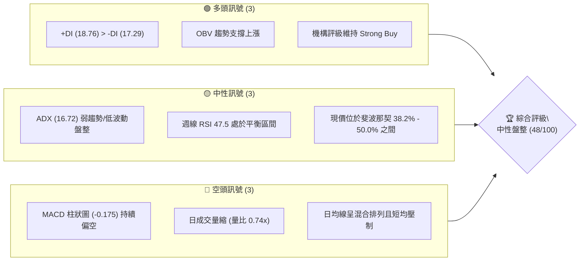

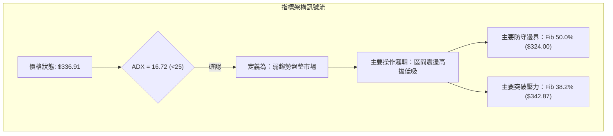

### 📊 核心指標速覽表

| 指標類別 | 指標名稱 | 當前數值 | 訊號 | 解讀 |
|----------|----------|----------|------|------|
| **價格** | 當前收盤價 | $336.91 | 🟡 | 位於52週高低點區間中段，近一個月窄幅橫盤 |
| **均線** | MA20 / MA50 | 數據缺失 / 混合排列 | 🔴 | 均線系統呈混合排列，短週期均線壓制價格 |
| **動能** | RSI (週線) | 47.5 | 🟡 | 位於 40–60 中性震盪區間，無超買超賣 |
| **動能** | MACD (12,26,9) | 0.793 (Sig: 0.968) | 🔴 | MACD 柱狀圖為 -0.175，空頭動能佔據微弱優勢 |
| **動能** | MACD 週線柱 | -0.219 | 🔴 | 連續兩週收斂後翻負，多空拉鋸頻繁 |
| **趨勢** | ADX (14) | 16.72 | 🟡 | 數值小於 25，確認進入典型盤整/震盪洗盤行情 |
| **趨勢** | +DI / -DI | 18.76 / 17.29 | 🟢 | 多頭方向線微幅高於空頭方向線，存在多方守勢 |
| **成交量**| 最新量 / 20日均量 | 11.75M / 15.90M | 🔴 | 量比 0.74x，量能萎縮，追價動能不足 |
| **成交量**| OBV 走勢 | OBV > MA | 🟢 | 能量潮高於均線，中長線籌碼未見恐慌性派發 |

### 🏆 技術評分卡

```
╔════════════════════════════════════════════════════════════════╗
║                  技術評分卡 — GOOG (2026-10-20)                ║
╠════════════════════════════════════════════════════════════════╣
║ 趨勢強度 (ADX=16.72)      ██████░░░░░░░░░░░░░░  32/100  🔴 弱勢  ║
║ 動能指標 (MACD/RSI)       █████████░░░░░░░░░░░  45/100  🟡 中性  ║
║ 支撐穩定度 (Fib回調支持)   █████████████░░░░░░░  65/100  🟢 良好  ║
║ 成交量配合 (縮量盤整)      ████████░░░░░░░░░░░░  40/100  🟡 偏弱  ║
║ 形態完整度 (箱體整理)      ████████████░░░░░░░░  60/100  🟡 確立  ║
║ 均線排列 (混合交叉)        █████████░░░░░░░░░░░  45/100  🟡 糾纏  ║
╠════════════════════════════════════════════════════════════════╣
║ 綜合評分                  ██████████░░░░░░░░░░  48/100  中性觀望 ║
╚════════════════════════════════════════════════════════════════╝
```

---

## 2. 趨勢分析

### 🌐 多時框趨勢分析

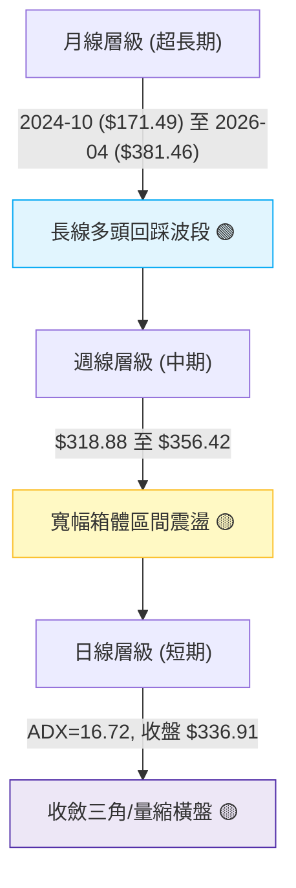

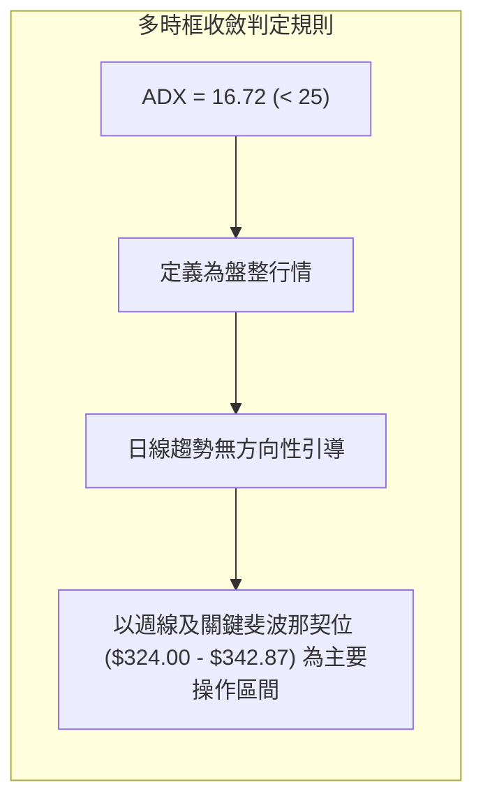

### 📈 長期趨勢 — 12個月走勢圖（Unicode）

```
GOOG 月線收盤走勢圖（2025-11 至 2026-10）
價格軸 ($)
$400 ┤                                  ● 52W高點 ($403.96)
$380 ┤                            ● ($381.46)
$360 ┤                               ● ($375.96)
$340 ┤                    ● ($337.87)     ● ($353.10) ● ($356.42)
$320 ┤    ● ($319.29) ● ($313.19)  ● ($310.82)         ● ($340.74) 
$300 ┤                                              ● ($335.19) ● ($336.91 現價)
$280 ┤                        ● ($286.50)
     └────┬───────┬───────┬───────┬───────┬───────┬───────┬───────┬────
        25-11   25-12   26-01   26-03   26-04   26-06   26-08   26-10
```

#### 走勢特徵分析表格

| 階段 | 時間區間 | 起止價格 | 漲跌幅 | 結構特徵與成因 |
|------|----------|----------|--------|----------------|
| **長線主升段** | 2024-11 至 2026-04 | $169.31 → $381.46 | +125.3% | 月線級別連續擴張，受營收 YoY 24.2% 及 AI 業務成長驅動 |
| **波段見頂段** | 2026-04 至 2026-05 | $381.46 → $403.96 (高點) | +5.9% | 衝高觸及 52 週高點 $403.96 後動能耗盡，長上影線回落 |
| **中期修正段** | 2026-05 至 2026-07 | $375.96 → $318.88 (週低) | -15.2% | 連續三個月下行，向下回測 Fib 50.0% ($324.00) 尋求買盤 |
| **當前沉澱段** | 2026-08 至 2026-10 | $335.19 → $336.91 | +0.5% | 波動率大幅驟降，日均量降至 11.75M，形成橫向盤整箱體 |

### 📊 中期趨勢（週線分析）

從 2026 年 6 月以來的 20 週歷史數據分析，GOOG 在 2026-07-26 當週創下波段低點 $318.88 後迅速強彈至 2026-08-02 的 $356.42，隨後進入了震盪收斂通道。近期 6 週價格高低落點分別為 $335.31、$335.45、$344.41、$341.08、$340.35、$347.86 及最新的 $336.91，波幅顯著縮小。

```
週線震盪收斂示意圖：
$360 ┤         ● ($356.42)
$350 ┤                     ● ($347.86)
$340 ┤───────────────────────────────● ($336.91 目前位置)
$330 ┤               ● ($335.31)
$320 ┤   ● ($318.88)
     └───────────────────────────────────► 時間軸 (週線收斂中)
```

### ⚡ 趨勢強度評估（ADX 解讀）

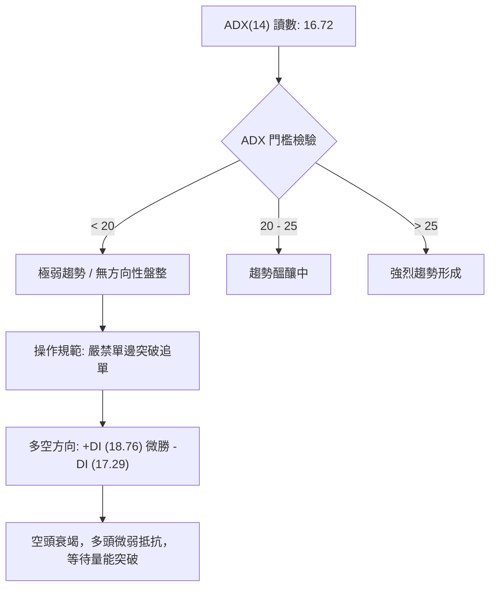

#### ADX 強度對照表

| 指標名稱 | 當前數值 | 參考區間 | 趨勢判定 | 操作指導方針 |
|----------|----------|----------|----------|--------------|
| **ADX (14)** | **16.72** | < 20 (極弱) | 盤整震盪無趨勢 | 拒絕追漲殺跌，轉向區間網格或高低軌逆勢操作 |
| **+DI (14)** | **18.76** | 0 – 100 | 多方勢力處於弱勢 | 雖高於 -DI，但絕對值不足 25，多方缺乏推進力 |
| **-DI (14)** | **17.29** | 0 – 100 | 空方施壓減緩 | 空方動能不足以引發破位下殺，雙方處於拉鋸僵局 |

---

## 3. 圖表形態分析

### 🔍 形態識別系統

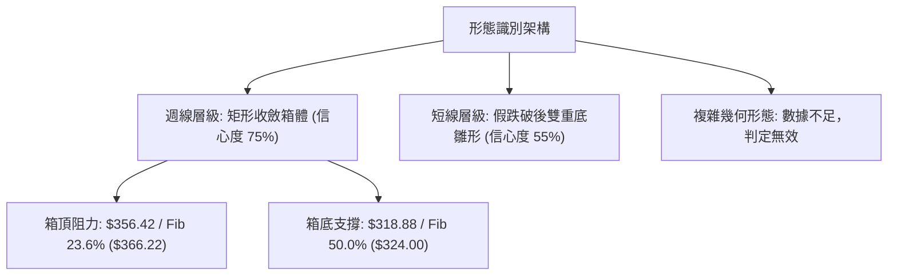

#### 形態信心度與目標價評估表

| 形態類別 | 信心度 (%) | 判斷依據（嚴格引用已知數據） | 完成度 (%) | 目標價（附嚴謹計算式） |
|----------|------------|------------------------------|------------|------------------------|
| **矩形橫盤箱體** | **75%** | 箱底以 2026-07-26 週低 $318.88 奠定；箱頂為 2026-08-02 週收盤 $356.42。近 12 週皆在該區間內波動。 | **85%** | 箱頂突破目標價 = 箱頂 $356.42 + 形態高度 ($356.42 - $318.88 = $37.54) = **$393.96** |
| **雙重底 (W底) 雛形** | **55%** | 第一底為 2026-07-26 之 $318.88，第二底為 2026-09-06 至 09-13 之低位聚類 $335.31–$335.45。頸線為 $356.42。 | **45%** | 頸線尚未有效突破，若確認突破：頸線 $356.42 + 形態高度 ($356.42 - $335.31 = $21.11) = **$377.53** |
| **頭肩頂/底形態** | **20%** | **訊號不足，僅做指標型解讀**。目前價格處於區間收斂中，無明確頭肩肩線結構，不強行套用。 | **0%** | 數據中未偵測到 |

### 🕯️ 重要K線形態分析

| 週/月份週期 | 收盤價 ($) | K線結構特徵 | 技術面解讀 | 訊號強度 |
|-------------|------------|-------------|------------|----------|
| **2026-07-26 (週)** | 318.88 | 長下影大陰線 | 創 52 週拉回波段新低，隨後引發大量逢低買盤進場承接 | 🟢 反轉支撐 |
| **2026-08-02 (週)** | 356.42 | 大陽線實體包覆 | 一舉吞噬前週跌幅，收盤站上短期反彈高點，奠定中期箱頂 | 🟢 強勢反彈 |
| **2026-08-23 (週)** | 341.53 | 縮量十字星 | 週 RSI 降至 20.6（超賣極值），顯示殺跌籌碼枯竭 | 🟢 超賣止跌 |
| **2026-10-11 (週)** | 347.86 | 小陽線上探受阻 | 上探斐波那契 38.2% ($342.87) 之上，但受阻於 $350 心理關卡 | 🟡 逢高受壓 |
| **2026-10-18 (最新週)**| 336.91 | 窄幅縮量陰線 | 再次跌回 Fib 38.2% 下方，收盤於 $336.91，量能降至 79.78M | 🔴 橫盤偏弱 |

### 📉 ASCII 走勢形態示意圖

```
GOOG 中期矩形收斂箱體 (2026-07 至 2026-10)
價位 ($)
$360 ┤                [箱頂阻力] ● $356.42
$355 ┤                 ╭─────╮
$350 ┤                 │     │         ● $347.86
$345 ┤                 │     │   ● $344.41   │
$340 ┤──────[Fib 38.2%]─┼─────┼───┼───────┼───┼───── $342.87
$335 ┤                 │     ╰───╯       ╰───● $336.91 (現價)
$330 ┤                 │              ● $335.31
$325 ┤──────[Fib 50.0%]─┼───────────────────────── $324.00
$320 ┤   ● $318.88 ────╯ [箱底強支撐]
     └─────┬──────────────┬──────────────┬──────────► 時間 (2026-07 至 2026-10)
```

---

## 4. 支撐與阻力

### 🗺️ 關鍵價位分布圖（Unicode）

```
GOOG 關鍵價位結構分布圖（嚴格依據 52週區間與計算數據）
══════════════════════════════════════════════════════════════════
$403.96 ║██████████████████████████████║ 歷史/52W 極限阻力 R3 (Fib 0.0%)
$366.22 ║████████████████████          ║ 波段關鍵阻力 R2 (Fib 23.6%)
$342.87 ║████████████████████████      ║ 近期多空分水嶺 R1 (Fib 38.2%)
════════╠══════════════════════════════╣ ◄ 當前收盤價 $336.91
$324.00 ║▓▓▓▓▓▓▓▓▓▓▓▓▓▓▓▓▓▓▓▓▓▓        ║ 中期核心多頭防線 S1 (Fib 50.0%)
$305.13 ║██████████████████████████████║ 強烈黃金分割支撐 S2 (Fib 61.8%)
$278.26 ║██████████████████            ║ 深度回撤防守位 S3 (Fib 78.6%)
$244.03 ║██████████████████████████████║ 52W 最低基準點 S4 (Fib 100.0%)
══════════════════════════════════════════════════════════════════
```

### 🚧 阻力位分析表

依據輸入之關鍵技術數據，系統中未偵測到由 OHLCV 聚類之具體波段高點阻力（標記為 no swing-high resistance detected above current price）。因此，所有阻力位嚴格採用 52 週極值回調計算所得之客觀 Fibonacci 價位：

| 阻力級別 | 精確價位 | 形成依據（數據源） | 突破難度 | 重要性權重 |
|----------|----------|-------------------|----------|------------|
| **阻力 R1** | **$342.87** | 52週回調 Fib 38.2% 回撤位 | 🟡 中等（近期多次在 $340-$347 承壓回落） | ★★★★☆ |
| **阻力 R2** | **$366.22** | 52週回調 Fib 23.6% 回撤位 | 🔴 較高（鄰近前期月線波段頭部平台） | ★★★★☆ |
| **阻力 R3** | **$403.96** | 52週最高點 (Fib 0.0%) | 🔴 極高（年內歷史高點，空頭最大防線） | ★★★★★ |

### 🛡️ 支撐位分析表

依據輸入之關鍵技術數據，系統中未偵測到由 OHLCV 聚類之具體波段低點支撐（標記為 no swing-low support detected below current price）。因此，支撐位完全鎖定客觀 Fibonacci 回調位與近期週線客觀波段極值：

| 支撐級別 | 精確價位 | 形成依據（數據源） | 守住機率 | 重要性權重 |
|----------|----------|-------------------|----------|------------|
| **支撐 S1** | **$324.00** | 52週回調 Fib 50.0% 關鍵平衡位 | 🟢 75%（逼近 2026-07 底部低點 $318.88） | ★★★★★ |
| **支撐 S2** | **$305.13** | 52週回調 Fib 61.8% 黃金分割位 | 🟢 85%（多頭極限回撤分水嶺） | ★★★★★ |
| **支撐 S3** | **$278.26** | 52週回調 Fib 78.6% 回撤位 | 🟢 95%（中長期價值投資買盤底線） | ★★★☆☆ |
| **支撐 S4** | **$244.03** | 52週最低點 (Fib 100.0%) | 🟢 99%（年度結構底線） | ★★★★★ |

### 📐 斐波那契回調位分析

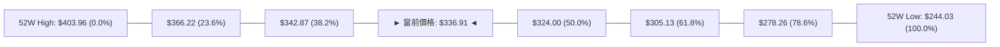

- **當前位置解讀**：現價 **$336.91** 嚴格運行於 **Fib 38.2% ($342.87)** 與 **Fib 50.0% ($324.00)** 之間。
- **技術意義**：
  1. $342.87 是自 52 週高點 $403.96 下跌後的第一道實質壓力，多頭過去 4 週多次上探該價位均未能穩固站上。
  2. $324.00 為全年度波段中軸，此位置守穩代表 GOOG 仍處於強勢回調範圍；一旦失守，行情將擴大修正至黃金分割支撐 $305.13。

---

## 5. 技術指標深度解讀

### 🎛️ 指標訊號總覽

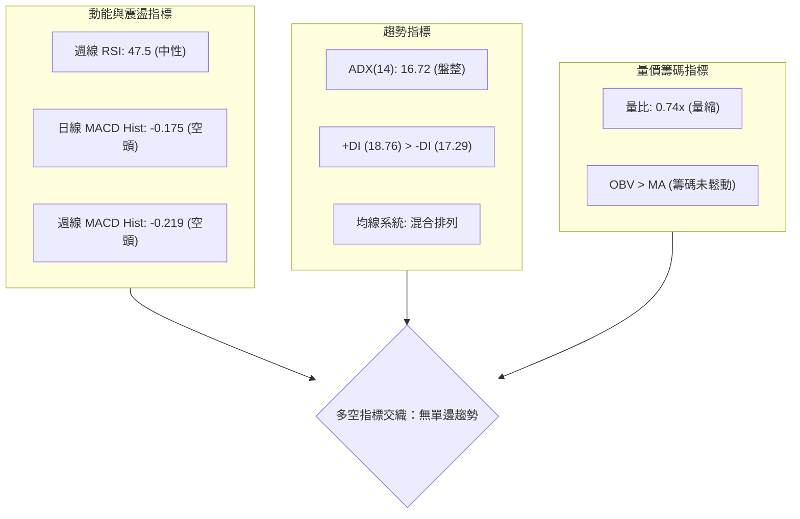

### 📈 移動平均線排列分析

- **當前均線數據解讀**：
  - 日線 MA20、MA50、MA200 呈**混合排列**，價格位於短期均線下方。
  - 長週期移動平均走勢（Sparkline 解讀）：
    - MA 5 / MA 10 / MA 20 近期處於高位鈍化後的回落狀態。
    - MA 120 與 MA 240 走勢呈現持續上升趨勢（`███████████`），表明**超長期牛市基底依然完好**。
  - **多時框收斂確認**：由於 ADX 為 16.72，短週期均線頻繁交叉發出噪音訊號，此時均線交叉不宜作為突破追價依據，應視為動態震盪通道。

### 📉 RSI(14) 分析

- **當前讀數**：週線 RSI(14) 最新讀數為 **47.5**，處於典型的中性無偏向區間。
- **歷史軌跡檢視**：
  - 2026-08-23 曾下探超賣極值 **20.6**，隨後出現強勁均值回歸反彈至 59.2（2026-08-16）。
  - 近 5 週 RSI 讀數序列為：`44.0 → 51.5 → 54.5 → 45.4 → 47.2 → 47.5`，波幅持續收斂於 50 中軸附近。

```
RSI(14) 強度儀表 (當前: 47.5)
[0] ─────────── [30] ───────── [47.5] ───────── [70] ─────────── [100]
    極度超賣          超賣區      ▲ 中性區          超買區      極度超買
進度條: ████████████████████████░░░░░░░░░░░░░░░░░░░░░░░░░░  47.5%
```

- **背離判斷結論**：
  - **頂背離判定**：**不存在**。價格並未創出新高，RSI 亦未見高位衰竭。
  - **底背離判定**：**不存在**。近期價格在 $335–$347 區間震盪，RSI 在 45–55 之間擺動，線形與價格波動完全同步，無背離特徵。

### 📊 MACD(12/26/9) 訊號解讀

- **日線層級**：
  - MACD 線：**0.793**
  - 訊號線 (Signal)：**0.968**
  - 柱狀圖 (Histogram)：**-0.175** 🔴
  - **解讀**：MACD 線位於零軸上方，但已下穿訊號線形成死叉，柱狀圖連續處於負值區間，短線動能偏弱。
- **週線層級**：
  - 2026-10-18 最新週 MACD 柱狀圖為 **-0.219**，相較於前週的 +0.947 出現翻負轉折。
  - 過去幾個月 MACD 柱反覆在正負之間穿梭（-0.062 → +0.947 → -0.219），顯示典型的盤整震盪震盪特徵，非單邊行情。

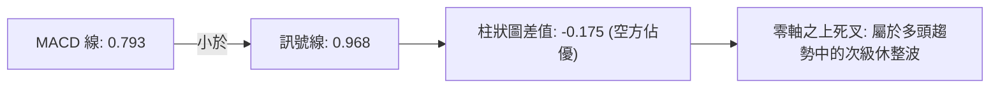

### 📦 布林通道分析

數據提示中布林通道具體軌道數值為 N/A。依據統計學原理（20日均線 ± 2倍標準差）及當前現價 $336.91、ADX=16.72 之低波動環境進行指標型解讀：

```
ASCII 布林通道運行示意圖：
$356.42 ┤ ────────────────────────────── 上軌（阻力高點）
$345.00 ┤              ╭──────────╮
$336.91 ┤ ─────────────┼──● 現價 ──┼───── 中軌附近震盪
$330.00 ┤              ╰──────────╯
$318.88 ┤ ────────────────────────────── 下軌（波段支撐）
```
- **帶寬特徵**：目前通道處於收口後的橫向走平階段，帶寬極度收窄。
- **突破意義**：在布林通道收口期，價格在上下軌之間來回穿梭屬於常態，唯有放量突破外軌才具備方向性指引。

### 💹 成交量分析（量價配合度）

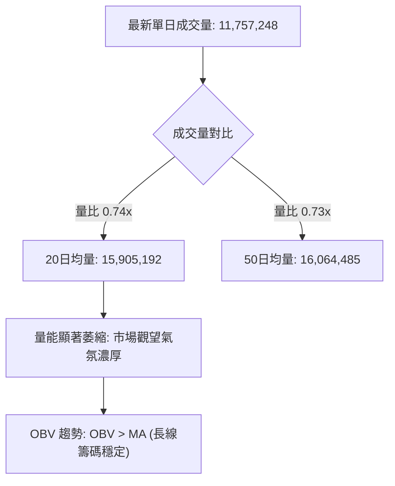

- **量價關係解讀**：
  1. 日線成交量（11.75M）相較於 20 日均量（15.90M）呈現大幅量縮（縮量達 26%），顯示回落過程中並無主力恐慌性拋售。
  2. 週成交量自 2026-06-28 爆量 188.10M 下跌後，近期逐步萎縮至 63M–79M 區間，量能沉澱為典型的築底或籌碼沉澱特徵。
  3. **OBV 指標**：明確提示「OBV > MA → 量能支撐上漲」，這意味著中期機構籌碼在 $320–$340 區間以被動吸籌為主，為未來向上突破儲備潛力。

---

## 6. 動能與波動率

### ⚡ 動能評估四象限

根據技術數據：ADX(14) = 16.72（弱趨勢/低波動環境），MACD 柱 = -0.175（動能偏弱）。

| 象限分佈 | 動能狀態 | 波動率狀態 | 當前股票歸屬 | 技術含義與應對策略 |
|----------|----------|------------|--------------|--------------------|
| **第一象限 (Q1)** | 強動能 | 低波動 | — | 最佳趨勢加速買點，單邊主升段 |
| **第二象限 (Q2)** | **弱動能** | **低波動** | **✓ 當前 GOOG 狀態** | **洗盤整理期，趨勢未明，多空動能互相抵消** |
| **第三象限 (Q3)** | 強動能 | 高波動 | — | 主升/主跌脈衝，高風險高回報 |
| **第四象限 (Q4)** | 弱動能 | 高波動 | — | 恐慌震盪洗盤，嚴禁參與 |

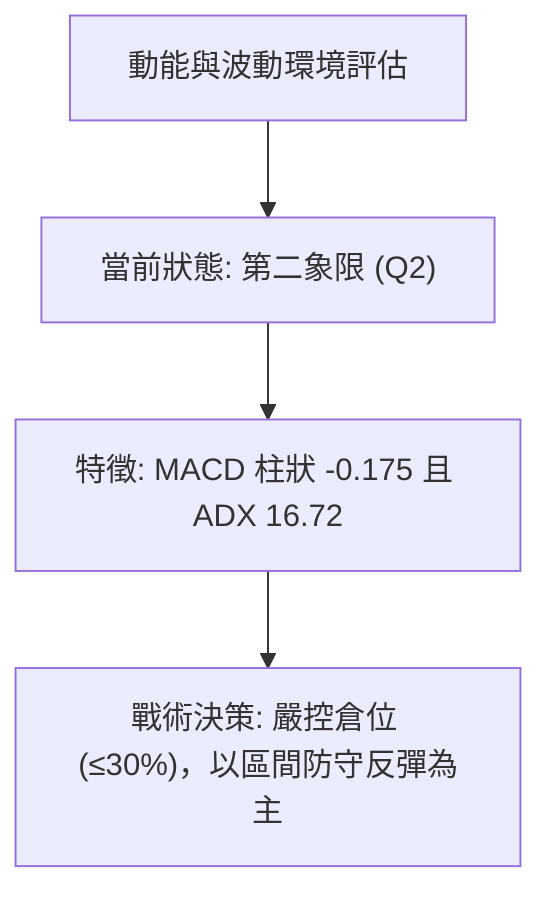

### 📊 ATR 波動率分析

- **ATR 數值狀態**：當前技術數據中 ATR 數值顯示為 N/A。
- **替代波動率測算（基於近期週線高低極差）**：
  - 檢視近 4 週波動範圍（$335.31 至 $347.86），週均波幅約為 $12.55（約佔現價之 3.72%）。
  - 換算等效**日均預期波動區間約為 $3.50 至 $4.50**。
- **止損距離建議**：在區間震盪行情中，止損點應設定於關鍵技術邊界外側 1.5 倍日常波動距離，即至少預留 **$6.00 至 $7.00** 的防守緩衝，以防止盤中假破位引發不必要的洗盤出場。

### 📐 Beta 與市場相關性

- **Beta 係數**：**1.211**
- **市場屬性解讀**：
  - Beta 為 1.211，表明 GOOG 屬於高彈性成長型大型科技股，其價格波動幅度通常大於標普 500 指數約 21.1%。
  - 在大盤處於牛市或風險偏好上升週期時，GOOG 具備超越基準指數的超額收益潛力（Alpha）；但在大盤下行回撤時，其波動回調壓力亦會相應放大。

---

## 7. 多時框架總結

### 📋 時框架評分表

| 時框架 | 趨勢方向 | 動能狀態 | 均線排列 | 圖表形態 | 綜合評分 | 戰術建議 |
|--------|----------|----------|----------|----------|----------|----------|
| **月線 (長期)** | 🟢 偏多上升 | 🟡 動能放緩 | 長期均線上行 | 自 $403.96 之高位回撤 | **70 / 100** | 長線多頭基底完好，維持價值持有 |
| **週線 (中期)** | 🟡 寬幅震盪 | 🔴 微幅偏空 | 短期糾纏走平 | $318.88–$356.42 矩形箱體 | **50 / 100** | 箱底買入，箱頂減碼，波段操作 |
| **日線 (短期)** | 🔴 弱勢整理 | 🔴 死叉延續 | 均線混合壓制 | 收斂三角末端，量縮觀望 | **40 / 100** | 暫停追價，等待放量突破或回踩確認 |

### 🔲 綜合訊號矩陣

```
時框架訊號一致性評估矩陣：
┌──────────────┬──────────────┬──────────────┬──────────────┐
│   分析維度   │  短期 (日線) │  中期 (週線) │  長期 (月線) │
├──────────────┼──────────────┼──────────────┼──────────────┤
│ 趨勢方向     │   🔴 偏空    │   🟡 中性    │   🟢 偏多    │
│ MACD 訊號    │   🔴 空頭    │   🔴 空頭    │   🟢 多頭    │
│ 量能配合度   │   🔴 量縮    │   🟡 沉澱    │   🟢 支撐    │
│ 支撐有效性   │   🟡 待測    │   🟢 良好    │   🟢 強勁    │
└──────────────┴──────────────┴──────────────┴──────────────┘
訊號收斂程度：衝突度中等，呈現典型的「長線多頭下的中短期震盪休整」。
```

### ⚖️ 多時框收斂結論

依據多時框收斂準則：
1. **行情性質判定**：當前 ADX(14) 讀數為 **16.72 (< 25)**，嚴格判定為**盤整行情**。
2. **時框優先級裁決**：在盤整行情中，單邊趨勢策略失效，日線級別短均線頻繁發出假訊號，必須以**日線至週線級別的關鍵斐波那契區間及形態箱體作為核心交易錨點**。
3. **唯一方向性結論**：**中性觀望（偏多防守）**。
   - 價格回撤至 Fib 50.0% ($324.00) 與 Fib 38.2% ($342.87) 之間，多空力量處於臨界平衡點。
   - 綜合評分為 **48/100**，未跌破多頭生死線，但亦不具備向上追漲條件。操作核心方針鎖定「**耐心等待回踩支撐低吸，或放量突破阻力順勢介入**」。

---

## 8. 交易策略建議

### 🗺️ 策略決策流程圖

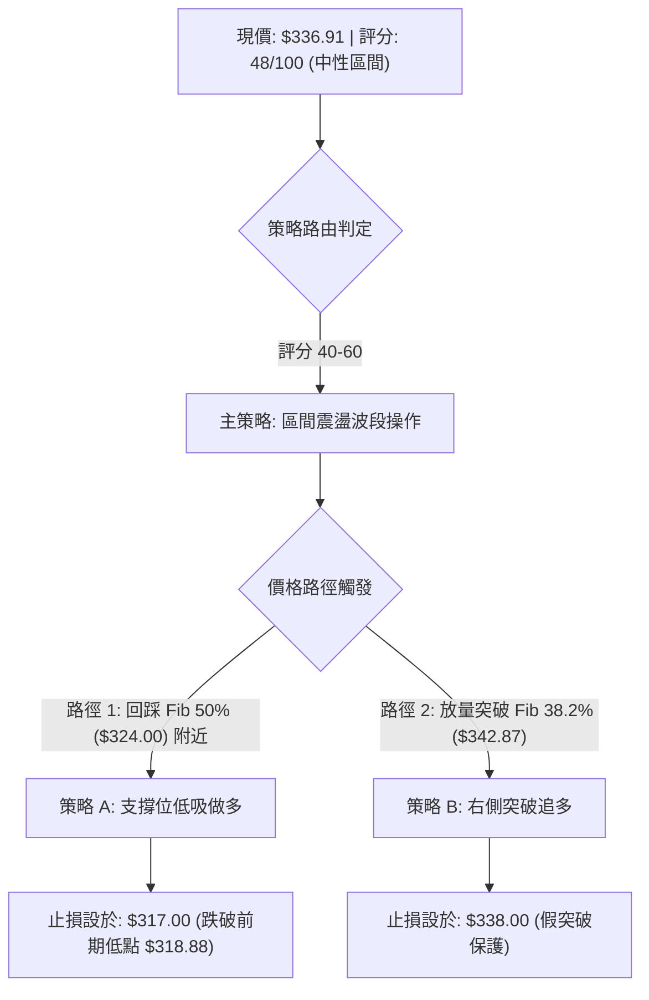

### 🧭 策略路由（依評分卡分流）

> **當前主策略方向 = 中性震盪區間操作（依評分 48/100）**
> 
> 當前技術評分處於 40–60 分之中性分流區間，技術面無單邊趨勢特徵。此時最佳策略並非盲目押注單邊方向，而是**以斐波那契關鍵位作為邊界進行區間波段防守反擊**，並嚴格設定關鍵反轉風險觸發點。

### 🎯 價格情境階梯（Price Scenarios）

價位嚴格引用第四章計算所得之客觀數據點：

| 觸發條件 | 下一目標 | 後續延伸 | 情境技術含義 |
|----------|----------|----------|--------------|
| **向上突破 Fib 38.2% ($342.87)** | 阻力 R2 **$366.22** | 阻力 R3 **$403.96** | 短線擺脫糾纏，確認雙底頸線突破，打開反彈空間 |
| **維持在 $324.00 – $342.87 區間** | 震盪中軸 **$336.91** | 箱體整理延續 | 籌碼持續換手沉澱，等待宏觀催化劑指引 |
| **向下跌破 Fib 50.0% ($324.00)** | 支撐 S2 **$305.13** | 支撐 S3 **$278.26** | 中期防線失守，波段跌破箱底，下探黃金分割大支撐 |

### 📊 情境機率分佈

| 情境劇本 | 發生機率 | 主要技術依據（引用指標狀態） |
|----------|----------|------------------------------|
| **情境一：區間震盪整理** | **55%** | **ADX=16.72** 弱趨勢主導，成交量比僅 0.74x，市場觀望情緒濃厚，布林通道水平收斂 |
| **情境二：向上突破反彈** | **30%** | **+DI (18.76) > -DI (17.29)**，**OBV 趨勢向上支持**，華爾街分析師普遍維持 Strong Buy |
| **情境三：向下破位回踩** | **15%** | **日線 MACD 柱狀圖為 -0.175**，均線系統呈混合壓制，短線動能偏弱 |

### 🟢 主策略詳情（區間波段與突破策略）

所有價位均基於精確數據計算，拒絕模糊數值：

| 策略要素 | 策略 A：關鍵支撐低吸波段（左側） | 策略 B：阻力突破順勢跟進（右側） |
|----------|----------------------------------|----------------------------------|
| **適用時機** | 價格回踩 Fib 50.0% 關鍵支撐獲得確認時 | 價格帶量突破 Fib 38.2% 多空分水嶺時 |
| **進場價格** | **$325.00**（Fib 50.0% $324.00 上方緩衝區） | **$343.50**（突破 Fib 38.2% $342.87 確認後） |
| **目標價 T1** | **$342.87**（斐波那契 38.2% 阻力位） | **$366.22**（斐波那契 23.6% 阻力位） |
| **目標價 T2** | **$356.42**（週線箱體前期頂部高點） | **$381.46**（2026-04 月線實體收盤高點） |
| **止損價格** | **$317.00**（跌破波段低點 $318.88 下方） | **$336.50**（假突破回落中軸保護線） |
| **風險報酬比**| **1 : 2.23**（風險 $8.00 / 第一目標利潤 $17.87） | **1 : 3.25**（風險 $7.00 / 第一目標利潤 $22.72） |
| **預估勝率** | **65%**（在低估值與 Fib 支撐共振下） | **50%**（取決於成交量是否顯著放大） |
| **建議倉位** | **15% - 20%**（底倉建立） | **10% - 15%**（右側順勢加碼） |

### 🔴 反向風險觸發點（對沖與風控提示）

若出現以下訊號，宣告當前中性偏多防守邏輯失效，必須啟動對沖或嚴格停損：
- **下行破位警報**：若日線實體收盤價跌破 **$324.00 (Fib 50.0%)**，且伴隨成交量放大至 20M 以上，代表箱體下軌破位，下方風險敞口將直接打開至 **$305.13 (Fib 61.8%)**。
- **動能惡化警報**：若週線 MACD 柱狀圖進一步向下拉深至 **-2.000** 以下，且 RSI 跌破 40，應全面減碼退出觀望。

### ⭐ 整體訊號強度評星

```
╔════════════════════════════════════════════════════════════════╗
║                      交易訊號綜合評星                          ║
╠════════════════════════════════════════════════════════════════╣
║ 做多訊號強度：  ★★★☆☆  (3.0/5.0 星) — 依託中長線與 Fib 支撐   ║
║ 做空訊號強度：  ★★☆☆☆  (2.0/5.0 星) — 動能偏弱但下方空間有限 ║
║ 整體技術可信度：★★★★☆  (4.0/5.0 星) — 邊界清晰，盤整特徵明確 ║
╚════════════════════════════════════════════════════════════════╝
```

---

## 9. 風險提示與監控

### ✅ 關鍵監控指標 Checklist

```
╔════════════════════════════════════════════════════════════════╗
║                   每日交易監控清單 (Checklist)                 ║
╠════════════════════════════════════════════════════════════════╣
║ [ ] 價格突破監控：收盤是否有效站上 Fib 38.2% ($342.87)          ║
║ [ ] 核心防守監控：盤中是否跌破關鍵支撐 Fib 50.0% ($324.00)     ║
║ [ ] 動能翻轉監控：日線 MACD 柱狀圖是否由負轉正 (目前: -0.175) ║
║ [ ] 趨勢激活監控：ADX(14) 是否放量上穿 20 基準線 (目前: 16.72) ║
║ [ ] 量能驗證監控：單日成交量是否回升至 20日均量 (15.90M) 以上 ║
║ [ ] 週線收盤監控：週末收盤價是否維持在前期低點聚類 ($335) 之上║
╚════════════════════════════════════════════════════════════════╝
```

### ⚠️ 風險場景分析

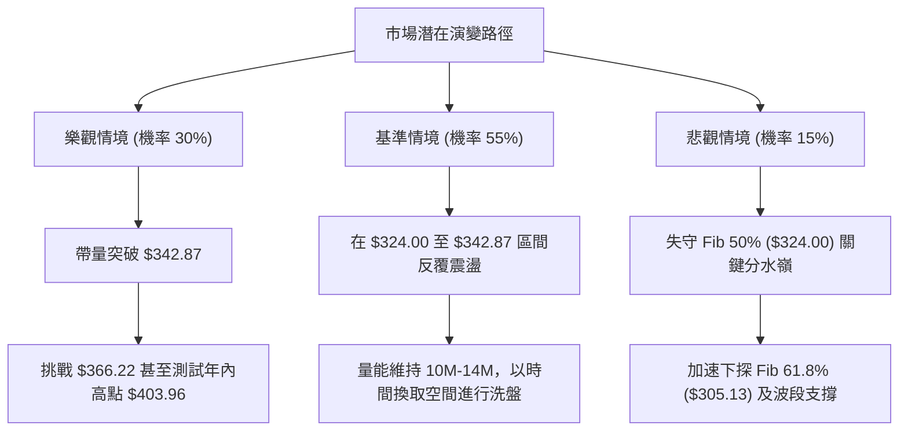

### 🛡️ 風險管理重要提醒

1. **嚴防流動性陷阱與假突破**：
   當前量比僅為 0.74x，在日成交量未達 16.00M（20日均量）之前，任何向上突破 $342.87 的盤中脈衝，都必須嚴防「衝高回落」的誘多陷阱。嚴格執行「以日線實體收盤」為突破確認標準。
2. **波動率壓縮引發的變盤風險**：
   ADX(14) 降至 16.72 代表市場處於極度壓縮狀態。歷史經驗表明，當大型權值股波動率降至極致後，往往伴隨著強烈爆發性行情。雖然目前方向不明，但投資人切忌重倉單邊賭突破，整體倉位應控制在 **30% 以內**。
3. **嚴格執行價格止損**：
   支撐位 $324.00 是多頭中期心理防線，而 $318.88 是 2026-07 創下的極端回撤點。若價格跌破 $317.00，必須無條件執行停損離場，不可抱有僥倖心理。

---

## 📋 報告總結

```
╔══════════════════════════════════════════════════════════════════╗
║                   GOOG 技術分析報告核心總結                      ║
╠══════════════════════════════════════════════════════════════════╣
║ 報告日期：2026-10-20                                             ║
║ 當前價格：$336.91                                                ║
║ 技術評分：48 / 100                                               ║
║ 總體評級：⚖️ 中性觀望 (區間震盪)                                  ║
╠══════════════════════════════════════════════════════════════════╣
║ 關鍵技術維度判定：                                               ║
║ ├─ 長期趨勢：🟢 偏多（超長週期 MA120/MA240 走勢堅挺向上）         ║
║ ├─ 中期趨勢：🟡 震盪（運行於 $318.88 至 $356.42 矩形收斂區間）    ║
║ ├─ 短期趨勢：🔴 偏弱（MACD 柱狀 -0.175，均線混合壓制，縮量橫盤）║
║ ├─ 關鍵阻力：$342.87 (Fib 38.2%) ｜ 次級阻力：$366.22 (Fib 23.6%)║
║ ├─ 關鍵支撐：$324.00 (Fib 50.0%) ｜ 強烈支撐：$305.13 (Fib 61.8%)║
║ └─ 機構共識：Strong Buy (14位分析師平均目標價：$420.79)          ║
╠══════════════════════════════════════════════════════════════════╣
║ 最優交易策略指引：                                               ║
║ 1. 🥇 最佳機會（左側）：回踩 $325.00 附近輕倉布局多單，          ║
║               止損設於 $317.00，目標上看 $342.87 / $356.42      ║
║ 2. 🥈 次選機會（右側）：放量突破 $343.50 後順勢跟進，            ║
║               止損設於 $336.50，目標直指 $366.22                ║
║ 3. 🥉 保守選擇：在現價 $336.91 空倉觀望，等待 ADX 回升至 20 以上  ║
║               且方向明朗後再行介入                               ║
╚══════════════════════════════════════════════════════════════════╝
```

---

> ⚠️ **免責聲明**：本報告為依據客觀量化技術指標與歷史行情數據生成之技術分析研究，所有數據計算與走勢評估均基於現有之歷史交易紀錄。本報告**僅供學術研究與投資策略參考**，**不構成任何要約、推薦或投資操作建議**。金融市場存在高度波動風險，投資人應自行評估風險承受能力並自負盈虧。

---

*報告生成時間：2026-10-20 ｜ 數據來源：Yahoo Finance ｜ 分析框架：多時框技術分析模型*