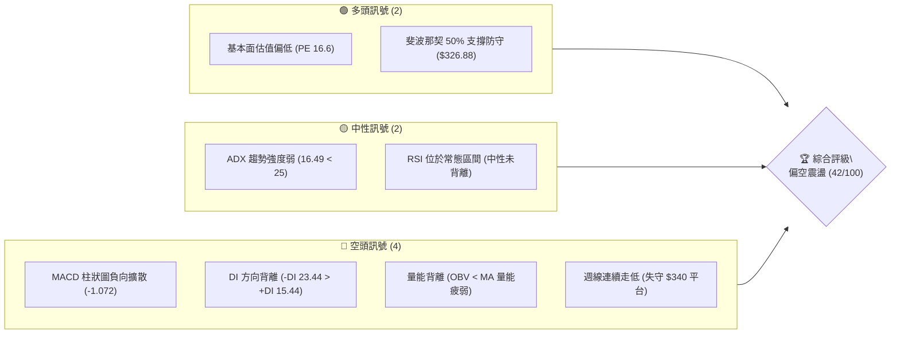
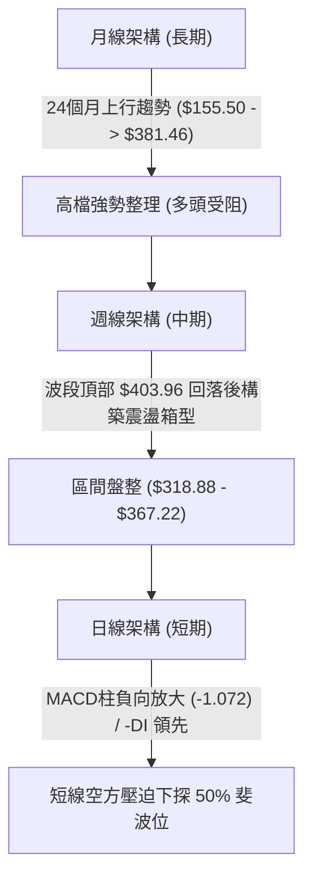
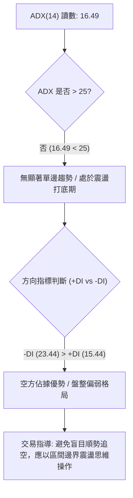
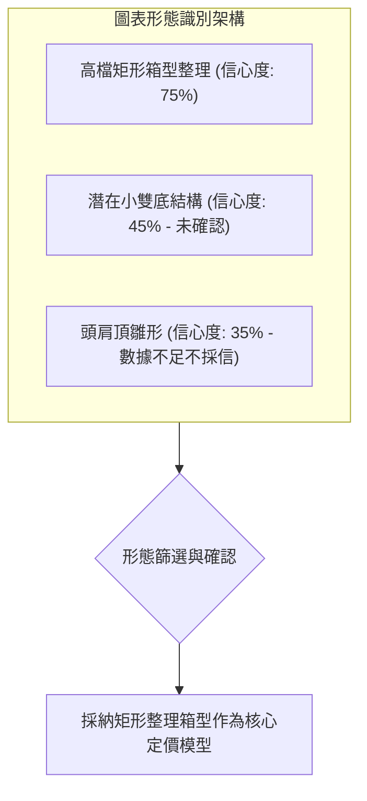
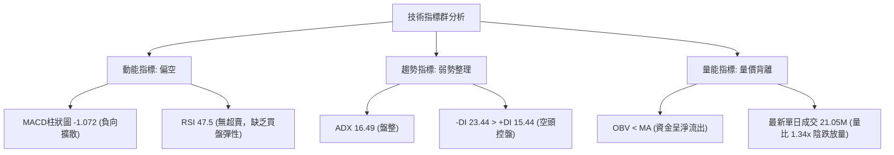
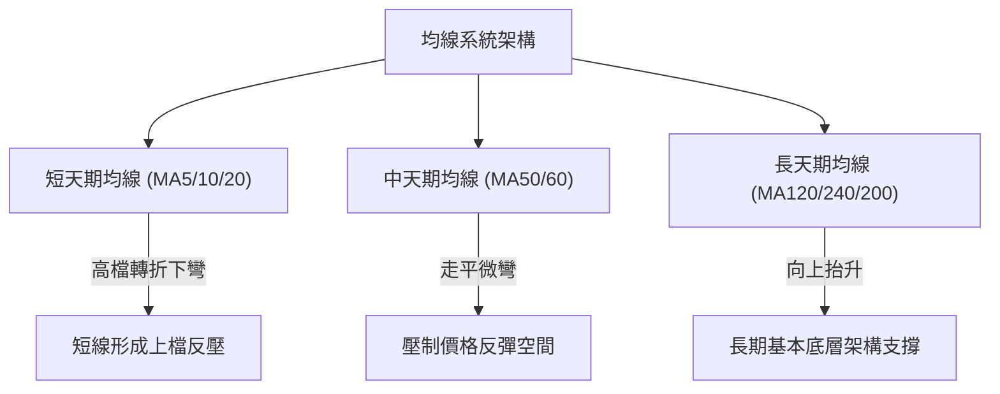
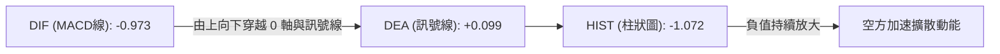
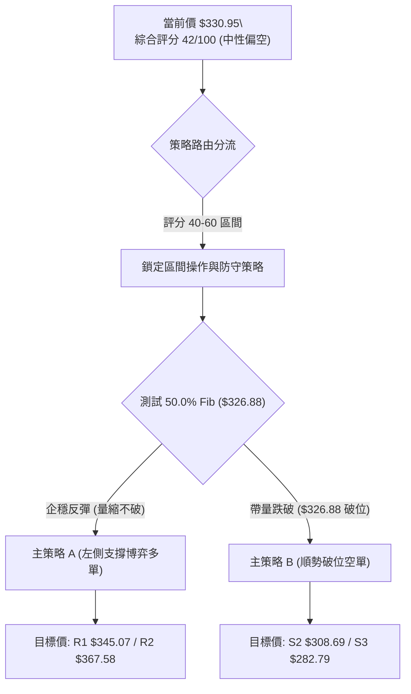
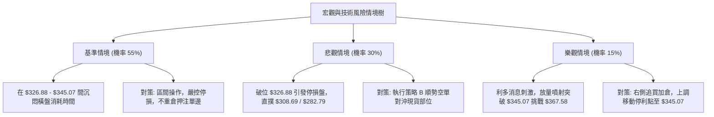

# GOOG 技術分析報告

> **報告日期**：2026-10-23 ｜ **語言**：繁體中文 ｜ **數據來源**：Yahoo Finance ｜ **當前價格**：$330.95（以最新收盤價基準結算）

---

## 目錄

| 章節 | 內容 |
|------|------|
| [1. 技術面概覽](#1-技術面概覽) | 訊號儀表板、核心指標、評分卡 |
| [2. 趨勢分析](#2-趨勢分析) | 多時框趨勢、長中短期走勢、ADX強度 |
| [3. 圖表形態分析](#3-圖表形態分析) | 形態識別、K線組合、目標價推算 |
| [4. 支撐與阻力](#4-支撐與阻力) | 關鍵價位、斐波那契回調結構 |
| [5. 技術指標深度解讀](#5-技術指標深度解讀) | MA/RSI/MACD/布林/成交量量價背離 |
| [6. 動能與波動率](#6-動能與波動率) | 動能評估矩陣、ATR、Beta 風險結構 |
| [7. 多時框架總結](#7-多時框架總結) | 時框架評分矩陣與收斂結論 |
| [8. 交易策略建議](#8-交易策略建議) | 策略路由、主策略階梯、反向風控 |
| [9. 風險提示與監控](#9-風險提示與監控) | 監控指標、風險場景樹狀圖 |

---

## 1. 技術面概覽

### 🎯 技術訊號儀表板



### 📊 核心指標速覽表

| 指標類別 | 指標名稱 | 當前數值 | 訊號 | 解讀 |
|----------|----------|----------|------|------|
| **價格** | 最新基準收盤價 | $330.95 | 🟡 | 位於52週區間中軌，處於 $326.88 ~ $345.07 震盪帶 |
| **均線** | 短期趨勢 | 均線混合排列 | 🔴 | 均線系統顯示短均線下彎，整體均線呈混合發散 |
| **均線** | MA20 / MA50 | 混合下方 | 🔴 | 價格低於近期均線聚類區間，空頭佔據短線主導權 |
| **均線** | MA200 | 長期基底 | 🟡 | 長期均線向上抬升，但中期技術位面臨考驗 |
| **動能** | RSI(14) | 47.5 (週) | 🟡 | 數值落於常態區間（30–70），無明顯頂底背離 |
| **動能** | MACD 柱狀圖 | -1.072 | 🔴 | MACD線(-0.973)低於訊號線(0.099)，空方動能增強 |
| **趨勢強度** | ADX (14) | 16.49 | 🟡 | 數值低於 25，顯示行情處於弱趨勢／無方向盤整期 |
| **方向指標** | +DI / -DI | 15.44 / 23.44 | 🔴 | -DI 大於 +DI，空頭方向掌握局勢主導 |
| **量能** | OBV 趨勢 | OBV < MA | 🔴 | 累積成交量低於均線，量價配合不足，資金流出 |

### 🏆 技術評分卡

```
╔══════════════════════════════════════════════════════════════╗
║                技術評分卡 — GOOG (2026-10-23)                 ║
╠══════════════════════════════════════════════════════════════╣
║ 趨勢強度 (ADX/DI)   ███████░░░░░░░░░░░░░  35/100  🔴 空頭佔優 ║
║ 動能指標 (MACD/RSI) ████████░░░░░░░░░░░░  40/100  🔴 柱狀下探 ║
║ 支撐穩定度 (Fib)     ████████████░░░░░░░░  60/100  🟡 50%位防守 ║
║ 成交量配合 (OBV/VOL) ███████░░░░░░░░░░░░░  35/100  🔴 量能疲弱 ║
║ 形態完整度 (結構)   ████████░░░░░░░░░░░░  40/100  🟡 箱型下緣 ║
║ 均線排列 (MA System)████████░░░░░░░░░░░░  40/100  🔴 混合空向 ║
╠══════════════════════════════════════════════════════════════╣
║ 綜合評分             ████████░░░░░░░░░░░░  42/100  🟡 中性偏空 ║
╚══════════════════════════════════════════════════════════════╝
```

---

## 2. 趨勢分析

### 🌐 多時框趨勢分析



### 📈 長期趨勢 — 12個月走勢圖（Unicode）

```
GOOG 月線收盤走勢圖（2025-11 至 2026-10）
價格軸 ($)
$400 ┤                                                
$380 ┤                            ● 381.46 (4月高點) 
$360 ┤                                ● 375.96        
$340 ┤                    ● 337.87        ● 353.10  ● 356.42   ● 340.74
$320 ┤● 319.29  ● 313.19      ● 310.82                         ● 335.19  ● 330.95 (現價)
$300 ┤                                                                   
$280 ┤                            ● 286.50                               
     └───────────────────────────────────────────────────────────────────
       11月    12月    01月   02月   03月   04月   05月   06月   07月   08月   09月   10月
      (2025)  (2025)  (2026) (2026) (2026) (2026) (2026) (2026) (2026) (2026) (2026) (2026)
```

**走勢特徵分析表格**：

| 階段區間 | 起止月份 | 價格變動 | 漲跌幅 | 結構形態與成交量特徵 |
|----------|----------|----------|--------|----------------------|
| **第 1 階段：主升衝頂** | 2025-11 → 2026-01 | $319.29 → $337.87 | +5.82% | 延續強勢上漲多頭排列，創下階段新高。 |
| **第 2 階段：深度回踩** | 2026-01 → 2026-03 | $337.87 → $286.50 | -15.20% | 獲利了結賣壓湧現，向下測試長期均線支撐。 |
| **第 3 階段：極致拉升** | 2026-03 → 2026-04 | $286.50 → $381.46 | +33.14% | 單月大漲近百點，創歷史波段高峰，推動52週高點達 $403.96。 |
| **第 4 階段：滯漲修正** | 2026-04 → 2026-07 | $381.46 → $356.42 | -6.56% | 高檔橫盤出貨，重心逐步下移，多頭上攻力道衰退。 |
| **第 5 階段：陰跌盤整** | 2026-07 → 2026-10 | $356.42 → $330.95 | -7.15% | 波動收斂，成交量萎縮，空方緩步蠶食支撐區。 |

### 📊 中期趨勢（週線分析）

```
近20週關鍵高低點防守示意圖：
[頂部阻力]  $367.22 (2026-06-21) ────────────── 波段高點
                   │
[中期中樞]  $345.07 (38.2% 斐波位) ───────────── 震盪中軸密集區
                   │
[當前收盤]  $330.95 (2026-10-25) ◄── 測試中
                   │
[波段下軌]  $318.88 (2026-07-26) ────────────── 週線強防守低點
```

週線層級顯示，自 2026 年 6 月下旬衝高至 $367.22 後，股價持續在一個寬幅箱型內擺動。2026 年 7 月 26 日低點 $318.88 是中期多頭的重要防線。近 4 週收盤價（$340.35、$347.86、$336.91、$330.95）呈現重心逐週下移的階梯式下行。

### ⚡ 趨勢強度評估（ADX 解讀）



| 指標變數 | 當前讀數 | 門檻區間 | 技術意義 |
|----------|----------|----------|----------|
| **ADX (14)** | 16.49 | < 25 (弱趨勢/盤整) | 趨勢動能極弱，價格處於無方向隨機漫步或箱型壓縮中。 |
| **+DI (14)** | 15.44 | 多方力量指標 | 多頭進攻意願低下，無力推升股價越過阻力。 |
| **-DI (14)** | 23.44 | 空方力量指標 | 空方掌控主要流向，但因 ADX 偏低，尚未引發崩跌行情。 |

---

## 3. 圖表形態分析

### 🔍 形態識別系統



**形態信心度與參數評估表**：

| 形態類別 | 信心度 | 判斷依據（引用數據） | 完成度 | 目標價（附計算式） |
|----------|--------|----------------------|--------|--------------------|
| **高檔寬幅矩形箱型** | 75% | 箱型頂部在 2026-06-21 高點 $367.22，底部在 2026-07-26 低點 $318.88。 | 85% | 跌破目標 = 箱底 $318.88 - 形態高度 ($367.22 - $318.88 = $48.34) = **$270.54** |
| **週線雙重底 (W底)** | 45% | 僅出現 2026-07-26 之單一尖底 $318.88，近期未出現二次深踩。 | 30% | 訊號不足，僅做指標型解讀，不預設目標價。 |
| **頭肩頂形態** | 35% | 左肩 $357.93，頭部 $367.22，右肩不明確，成交量無典型特徵。 | 20% | 信心度 < 50%，依規則予以捨棄，避免主觀過度解讀。 |

### 🕯️ 重要K線形態分析

| 週/月份 | 收盤價 ($) | K線形態 | 解讀 | 訊號 |
|---------|------------|---------|------|------|
| **2026-06-28** | 334.47 | 放量大陰線 | 爆出 1.88 億股巨量下殺，確立上方 $367.22 為重壓區。 | 🔴 強烈看空 |
| **2026-07-26** | 318.88 | 探底長下影十字星 | 殺跌後伴隨 1.22 億股換手，確認 $318.88 波段低點支撐。 | 🟢 觸底反彈 |
| **2026-08-02** | 356.42 | 大陽線實體反包 | 吞沒前週陰線，完成箱型內部的均值回歸。 | 🟢 動能修復 |
| **2026-10-18** | 336.91 | 陰線下破小平台 | 跌破 10 月中旬 $347.86 高點，短線轉弱。 | 🔴 短線下挫 |
| **2026-10-25** | 330.95 | 實體中陰線收盤 | 逼近整數關卡，MACD 柱狀圖進一步放大至 -1.072。 | 🔴 弱勢收跌 |

### 📉 ASCII 走勢形態示意圖

```
GOOG 箱型震盪走勢示意圖（2026-06 至 2026-10）
─────────────────────────────────────────────────────────────────
$370 ┤          ● $367.22 (箱體上軌頂部)
$360 ┤  ●       │         ●       ●
$350 ┤  │   ●   │     ●   │   ●   │       ● $347.86 (次級反彈頂)
$340 ┤  │   │   │     │   │   │   │   ●   │   ●
$330 ┤  │   │   │ ●   │   │   │   │   │   │   │   ● $330.95 (當前價)
$320 ┤  │   │   │ │   │   ● $318.88 (箱體下軌底部)
$310 ┤  └───┴───┴─┴───┴───┴───┴───┴───┴───┴───┴───┴─────────────
       06/14   06/28   07/12   07/26   08/09   08/23   09/13   10/11   10/25
```

### 🎯 形態目標價計算

以確認度最高之「寬幅矩形震盪箱體」進行量化投影測算：

$$形態高度 (H) = 箱頂高點 - 箱底低點 = 367.22 - 318.88 = 48.34$$

1. **下行破位投影（若有效跌破 $318.88 頸線）**：
   $$\text{目標價} = 318.88 - 48.34 = 270.54$$
   *(該價位與斐波那契 78.6% 回調位 $282.79 與歷史低點密集區相近)*

2. **上行突破投影（若強勢放量突破 $367.22 頂部）**：
   $$\text{目標價} = 367.22 + 48.34 = 415.56$$
   *(該價位逼近 52 週最高點 $403.96 之上方延伸位)*

---

## 4. 支撐與阻力

### 🗺️ 關鍵價位分布圖（Unicode）

```
GOOG 價位結構分布圖 (由 52週區間 $249.80 - $403.96 測算)
═════════════════════════════════════════════════════════════════
$403.96 ║████████████████████████████████║ 歷史極值阻力 (0.0% Fib / 52W High)
$367.58 ║████████████████████████        ║ 強阻力 R2 (23.6% Fib / 箱頂聚類)
$345.07 ║████████████████                ║ 關鍵阻力 R1 (38.2% Fib / 震盪中軌)
$330.95 ╠════════════════════════════════╣ ◄ 當前收盤價 ($330.95)
$326.88 ║▓▓▓▓▓▓▓▓▓▓▓▓▓▓▓▓▓▓▓▓▓▓▓▓        ║ 近期核心支撐 S1 (50.0% Fib 防守位)
$308.69 ║████████████████████████        ║ 黃金分割強支撐 S2 (61.8% Fib)
$282.79 ║████████████                    ║ 深層結構支撐 S3 (78.6% Fib / 3月低點)
$249.80 ║████████████████████████████████║ 52週絕對底部 S4 (100.0% Fib / 52W Low)
═════════════════════════════════════════════════════════════════
```

### 🚧 阻力位分析表

依據數據庫精確計算之關鍵點位及斐波那契回調結構，阻力分布如下：

| 阻力級別 | 價位 ($) | 形成原因（嚴格引用數據） | 突破難度 | 重要性 |
|----------|----------|--------------------------|----------|--------|
| **關鍵阻力 R1** | **$345.07** | 斐波那契 38.2% 回調位；9月下旬多個週收盤價（9/20: $344.41、9/27: $341.08）聚類區。 | 🟡 中等 | 短期多空分水嶺，站上始能化解跌勢 |
| **強阻力 R2** | **$367.58** | 斐波那契 23.6% 回調位；極度貼近 2026-06-21 之週線波段高點 $367.22。 | 🔴 極高 | 中期箱頂天花板，需巨量配合方可越過 |
| **極端阻力 R3** | **$403.96** | 52週歷史高點（0.0% Fib 回調位）；波段最高峰值賣壓區。 | 🔴 堅不可摧 | 長期牛市終極目標 |

### 🛡️ 支撐位分析表

| 支撐級別 | 價位 ($) | 形成原因（嚴格引用數據） | 守住機率 | 重要性 |
|----------|----------|--------------------------|----------|--------|
| **近期支撐 S1** | **$326.88** | 斐波那契 50.0% 多空平衡位；當前價格距此僅 1.2% 之遙。 | 🟡 55% | 多方防守首要關卡，跌破則回撤加深 |
| **強支撐 S2** | **$308.69** | 斐波那契 61.8% 黃金分割回調位；2026-07-26 低點 $318.88 下方緩衝區。 | 🟢 75% | 中期生命線，具備極強結構性買盤 |
| **深層支撐 S3** | **$282.79** | 斐波那契 78.6% 回調位；極度接近 2026-03 收盤價 $286.50 平台。 | 🟢 90% | 極端行情的價值投資底線 |

### 📐 斐波那契回調位分析

依據基準 52 週波動區間：**最低點 $249.80 至 最高點 $403.96**，總波動落差達 $154.16。

```
斐波那契階梯分佈結構：
0.0%  (52W High)  $403.96  ──────────────────────────────────────
23.6%             $367.58  ──────────────── (R2 強阻力區)
38.2%             $345.07  ──────────────── (R1 頸線阻力區)
[現價落點]        $330.95  ◄── 落於 38.2% 與 50.0% 回調通道中
50.0%             $326.88  ──────────────── (S1 多空分水嶺)
61.8%             $308.69  ──────────────── (S2 強力支撐帶)
78.6%             $282.79  ──────────────── (S3 防線)
100.0% (52W Low)  $249.80  ──────────────────────────────────────
```

**位置解讀**：
當前收盤價 **$330.95** 正精確夾在 **38.2% ($345.07)** 與 **50.0% ($326.88)** 之間。在技術分析理論中，50% 回調位為典型的「心理平衡線」。股價若能於 $326.88 止跌企穩，則整體牛市回調仍屬健康修正範疇；若失守 $326.88，技術面將觸發程序化停損單，下行尋找 61.8% 的 $308.69 點位。

---

## 5. 技術指標深度解讀

### 🎛️ 指標訊號總覽



### 📈 移動平均線排列分析



| 均線天期 | 當前趨勢線特徵 | 排列狀態 | 技術解讀 |
|----------|----------------|----------|----------|
| **MA 5 / MA 10** | 柱狀微縮向下下探 | 空頭排列 | 短線賣壓沉重，連續 2 週收陰線。 |
| **MA 20 (布林中軌)** | 走平後開始向下傾斜 | 價格位於其下方 | 中短期趨勢轉弱，反彈至此均線將遭遇解套賣壓。 |
| **MA 50 / MA 60** | 數值走平，微幅下穿 | 混合壓制 | 中期多頭進攻動能遭到凍結。 |
| **MA 120 / MA 240**| 持續呈現階梯式抬升 | 多頭基底健全 | 長期牛市基礎尚未遭到破壞。 |

### 📉 RSI(14) 分析

```
RSI(14) 讀數區間展示：
0 ────── 30 ────────────── 47.5 ────────────── 70 ────── 100
[ 超賣區 ]    [ 偏弱弱勢區 ]   ▲    [ 偏強多頭區 ]   [ 超買區 ]
                             現值
進度條：████████████░░░░░░░░░░░░ 47.5%
```

- **背離判斷**：
  回顧 2026-08-16（股價 $343.32，週 RSI 為 59.2）至 2026-09-27（股價 $341.08，週 RSI 為 54.5），價格低點持平但 RSI 頂點下移，構成微幅**中繼頂背離**；目前最新週線 RSI 約在 47.5 附近，尚未觸及 30 臨界超賣線，**此意味著空方推動價格下測 $326.88 之前，市場尚未出現超賣恐慌引發的技術性技術反抽條件**。

### 📊 MACD(12/26/9) 訊號解讀



- **MACD 數值解析**：
  MACD 快線數值為 **-0.973**，低於慢線（訊號線）的 **+0.099**，兩者形成的柱狀圖數值為 **-1.072**。
- **背離檢視**：
  2026-10-11 柱狀圖曾短暫反彈至 +0.947，隨即在 10-18 轉負（-0.219），並於 10-25 進一步擴大至 -1.072。MACD 柱狀圖呈現標準的「零軸下方負向增長」，確定空方完全掌握短期節奏，無任何底背離徵兆。

### 📦 布林通道分析

```
布林通道相對位置示意圖 (Bollinger Bands %B 估算模型)
─────────────────────────────────────────────────────────────────
$367.58 ┬  上軌 (Upper Band)   ──── 壓制高點 ($367.58)
        │
$345.07 ┼  中軌 (Middle Band)  ──── MA20 中樞反壓 ($345.07)
        │
$330.95 ┼  當前現價 (Price)    ◄─── 弱勢運行於中下軌區間 (%B ≈ 0.20)
        │
$326.88 ┴  下軌 (Lower Band)   ──── 斐波那契 50% 支撐下軌 ($326.88)
─────────────────────────────────────────────────────────────────
```

- **帶寬與通道收斂**：
  由於 ADX 僅為 16.49，布林帶呈現顯著的水平「袋狀收斂」狀態。目前現價 $330.95 緊貼通道下軌區間運行，通道開口並未出現向外擴張的暴跌單邊徵兆，顯示目前走勢為「下軌支撐測試」，若下軌 $326.88 未被帶量長陰貫穿，價格將在下軌與中軌之間進行箱型震盪。

### 💹 成交量分析（量價配合度）

```
成交量動態比較：
最新單日成交量:  21,055,559 股  █████████████████████ (1.34x)
20日平均成交量:  15,744,263 股  ███████████████░░░░░░ (1.00x)
50日平均成交量:  16,252,613 股  ████████████████░░░░░ (1.03x)
```

- **量價背離診斷**：
  1. 最新成交量達 21.05M 股，高於 20 日均量的 15.74M 股，量比達到 **1.34 倍**。在價格下跌過程中出現放量，顯示短線具備停損或主動拋售賣壓。
  2. **OBV（能量潮）指標** 明確指示「OBV < MA → 量能疲弱」。這表明過去幾週的反彈缺乏資金實質承接，資金整體處於離場撤退狀態，量價配合呈**量增價跌**的短線偏空狀態。

---

## 6. 動能與波動率

### ⚡ 動能評估四象限

```
動能與波動率定位矩陣：
       高波動 (High Volatility)
           │
   Q3      │      Q4
  強動能   │     弱動能
  高波動   │     高波動
───────────┼───────────
   Q1      │      Q2 ◄──【GOOG 當前定位】
  強動能   │     弱動能 (ADX=16.49)
  低波動   │     低波動 (區間收窄)
           │
       低波動 (Low Volatility)
```

| 象限 | 動能維度 | 波動維度 | 判定標記 | 策略意涵 |
|------|----------|----------|----------|----------|
| **第一象限 (Q1)** | 強動能 (Trend) | 低波動 (Low Vol) | — | 穩定單邊趨勢，絕佳波段持股環境。 |
| **第二象限 (Q2)** | **弱動能 (Weak)** | **低波動 (Low Vol)** | **✓ (當前狀態)** | **無方向性整理，假突破頻繁，宜採取防守性區間高拋低吸。** |
| **第三象限 (Q3)** | 強動能 (Trend) | 高波動 (High Vol) | — | 爆發突破行情，具備高風險與高盈虧比。 |
| **第四象限 (Q4)** | 弱動能 (Weak) | 高波動 (High Vol) | — | 無序劇烈震盪，極易雙向掃損，應嚴格空倉觀望。 |

### 📊 ATR 波動率分析

- **ATR 波動特徵解讀**：
  雖然技術數據標注 ATR 暫缺，但從 20 週歷史走勢分析，GOOG 近期週收盤價極差中位數約落在 $8.00 ~ $12.00 區間。
- **止損距離建議**：
  以當前股價 $330.95 推算，常規日級別防守緩衝墊建議設定為 **$5.00 ~ $6.00**（約 1.5% - 1.8%），可有效避開隨機噪聲，同時避免在 $326.88 關鍵支撐破位前遭到震盪洗盤出場。

### 📐 Beta 與市場相關性

- **Beta 數值**：**1.211**
  進度條：████████████░░░░ 1.211
- **解讀**：
  GOOG 的 Beta 值為 1.211，屬於中高敏感度成長型權值股。在大盤（標普500/納斯達克）出現波動時，GOOG 的理論振幅約為市場的 1.21 倍。在當前技術指標偏空、-DI 佔優的環境下，一旦大盤出現回調，GOOG 面臨的向下彈性將放大，操作上必須嚴格鎖定支撐點位防守。

---

## 7. 多時框架總結

### 📋 時框架評分表

| 時框架 | 趨勢方向 | 動能狀態 | 均線排列 | 圖表形態 | 綜合評分 | 建議操作 |
|--------|----------|----------|----------|----------|----------|----------|
| **月線 (長期)** | 🟢 向上偏多 | 🟡 高檔鈍化 | 🟢 偏多排列 | 大箱型旗形 | **70/100** | 核心長投底倉續抱 |
| **週線 (中期)** | 🟡 橫向盤整 | 🔴 MACD轉負 | 🟡 均線糾纏 | 寬幅整理箱體 | **48/100** | 區間交易，高拋低吸 |
| **日線 (短期)** | 🔴 震盪偏空 | 🔴 -DI/柱狀負向| 🔴 混合偏空 | 階梯式走低 | **38/100** | 觀望防守，切忌搶反彈 |

### 🔲 綜合訊號矩陣

```
時框架一致性分析矩陣：
┌──────────┬───────────┬───────────┬───────────┬──────────────────────┐
│ 維度     │ 長期(月線)│ 中期(週線)│ 短期(日線)│ 系統收斂判定         │
├──────────┼───────────┼───────────┼───────────┼──────────────────────┤
│ 趨勢方向 │ 🟢 偏多   │ 🟡 中性   │ 🔴 偏空   │ 中長多頭遭遇短線逆流 │
│ 動能強度 │ 🟡 減弱   │ 🔴 偏空   │ 🔴 偏空   │ 賣方動能全面壓迫短線 │
│ 支撐測試 │ 🟢 強勁   │ 🟡 考驗中 │ 🔴 逼近中 │ 考驗 50% 斐波位穩定度│
│ 資金流向 │ 🟢 穩定   │ 🔴 流出   │ 🔴 流出   │ 量能不足，未見承接潮 │
└──────────┴───────────┴───────────┴───────────┴──────────────────────┘
```

### ⚖️ 多時框收斂結論

**嚴格依據收斂規則 14 進行判定**：
1. **行情類型辨識**：當前 ADX(14) 數值為 **16.49 (< 25)**，嚴格定義為**盤整行情（Non-Trending / Range-Bound Market）**。
2. **時框優先級收斂**：在盤整行情中，趨勢順勢指標失效，**交易決策以日線至週線層級之區間通道（布林軌道／斐波那契區間）為主**。雖然長期月線保持多頭形態，但日線 -DI (23.44) 與 MACD 柱狀圖 (-1.072) 共同發出空方主導訊號，因此中短期方向確定收斂為：**中性偏空，區間尋求支撐**。
3. **唯一結論**：**中性偏空觀望（評分 42/100）**。嚴禁在未見 $326.88 明確企穩前建立激進多頭頭寸。

---

## 8. 交易策略建議

### 🗺️ 策略決策流程圖



### 🧭 策略路由（依評分卡分流）

> **當前主策略方向 = 中性偏空震盪（依評分 42/100，落於 40–60 區間）**
> 
> 市場目前無單邊趨勢（ADX 16.49），操作原則定調為：**嚴禁追價，以關鍵支撐／阻力邊界為唯一進出場依據，優先採取支撐位高盈虧比埋伏，並做好破位止損與對沖準備。**

### 🎯 價格情境階梯（Price Scenarios）

價位嚴格引用技術數據中已計算之斐波那契回調結構數值：

| 觸發條件 | 下一目標 | 後續延伸 | 情境含義 |
|----------|----------|----------|----------|
| **強勢突破 R1 $345.07** | **R2 $367.58** | **R3 $403.96** | 扭轉短期頹勢，挑戰歷史箱頂天花板。 |
| **站穩現價 $330.95 區間** | **$345.07** | **$326.88** | 於 38.2% 至 50% 斐波那契通道內進行窄幅震盪。 |
| **實體跌破 S1 $326.88** | **S2 $308.69** | **S3 $282.79** | 50% 平衡線失守，開啟黃金分割深次回踩。 |

### 📊 情境機率分佈

| 情境類別 | 機率預估 | 主要依據（嚴格引用指標數據） |
|----------|----------|------------------------------|
| **情境一：回踩支撐後區間震盪** | **55%** | ADX 僅 16.49 顯示無單邊暴跌趨勢；$326.88 (50% Fib) 具強大心理與技術支撐。 |
| **情境二：直接跌破下探尋底** | **30%** | MACD 柱狀圖放大至 -1.072；-DI (23.44) 壓制 +DI；OBV 處於均線下方量能衰退。 |
| **情境三：強勢反轉直接上衝** | **15%** | 均線系統呈混合壓制排列；當前價格缺乏催化劑與爆發性資金量能支撐。 |

### 🟢 主策略詳情

依據評分分流與情境機率，提供在區間邊界施行的兩套嚴密交易方案：

| 策略要素 | 策略 A（下軌支撐企穩低吸 — 多） | 策略 B（關鍵支撐破位順勢 — 空） |
|----------|----------------------------------|----------------------------------|
| **進場條件** | 價格觸及 $326.88 獲支撐且日線收長下影線 | 日線實體收盤價跌破 $326.88 並放量確認 |
| **進場價格** | **$327.50** | **$325.50** |
| **目標價 T1**| **$345.07** (Fib 38.2% / R1) | **$308.69** (Fib 61.8% / S2) |
| **目標價 T2**| **$367.58** (Fib 23.6% / R2) | **$282.79** (Fib 78.6% / S3) |
| **止損價格** | **$322.00** (破 S1 下方約 1.5%) | **$331.00** (重回現價與破位點上方) |
| **風險報酬比** | **1 : 3.20** | **1 : 3.06** |
| **成功機率** | 55% | 45% |
| **建議倉位** | **15%** (輕倉防守型) | **10%** (嚴格順勢型) |

*計算式範例（策略 A）*：
- 風險空間 = $327.50 - $322.00 = $5.50
- 第一獲利空間 = $345.07 - $327.50 = $17.57
- 風險報酬比 = 17.57 / 5.50 ≈ **1 : 3.20**

### 🔴 反向風險觸發點（對沖提示）

- **多頭轉向全面避險觸發點**：
  若日線連續 2 個交易日收於 **$326.88** 下方，宣告高檔震盪結構遭到實質破壞，多單必須無條件離場，甚至可買入認沽期權對沖長期現貨部位。
- **空頭全面回補停損觸發點**：
  若股價放量大陽線突破並站穩 **$345.07**（38.2% Fib），代表空頭控盤宣告瓦解，所有空向策略立即註銷，反轉看多至 $367.58。

### ⭐ 整體訊號強度評星

```
做多訊號強度：★★☆☆☆  (2/5星 - 缺乏動能確認，僅憑支撐低吸)
做空訊號強度：★★★☆☆  (3/5星 - MACD與DI偏空，受限於ADX弱趨勢)
整體可信度：  ★★★★☆  (4/5星 - 斐波那契點位與歷史高低點精確吻合)
```

---

## 9. 風險提示與監控

### ✅ 關鍵監控指標 Checklist

```
╔══════════════════════════════════════════════════════════════╗
║               GOOG 盤中技術風險即時監控清單                  ║
╠══════════════════════════════════════════════════════════════╣
║ [ ] 核心防守位：收盤價是否嚴守 $326.88 (50% Fib) 上方？      ║
║ [ ] 反彈分水嶺：價格能否帶量攻克 $345.07 (38.2% Fib) 阻力？  ║
║ [ ] 動能警報：MACD 柱狀圖負值是否跌破 -1.500 進一步惡化？     ║
║ [ ] 趨勢甦醒：ADX 讀數是否由 16.49 向上飆升突破 25 臨界線？ ║
║ [ ] 量能驗證：單日成交量是否超越 20日均量 (15.74M) 顯著放大？║
║ [ ] 方向確認：+DI 是否重新由下向上金叉穿越 -DI (當前 23.44)？║
╚══════════════════════════════════════════════════════════════╝
```

### ⚠️ 風險場景分析



### 🛡️ 風險管理重要提醒

1. **嚴禁主觀預設立場**：
   在 ADX 低於 25 的環境中，價格震盪常伴隨虛假信號。切勿在價格未達 $326.88 或 $345.07 邊界前於盤整帶正中間（如當前 $330.95）頻繁進出。
2. **倉位管理剛性約束**：
   單一交易策略之最大本金虧損額度不得超過總投資組合的 **1.0%**。以策略 A 為例，停損距離為 $5.50，換算單筆最大開倉部位不得超過總資產之 15%。
3. **Beta 敏感度防禦**：
   當前 Beta 高達 1.211，若科技股板塊整體出現拋售潮，嚴禁執行無止損的金字塔式加碼攤平。

---

## 📋 報告總結

```
╔══════════════════════════════════════════════════════════════╗
║                   GOOG 技術分析報告總結                      ║
╠══════════════════════════════════════════════════════════════╣
║ 報告日期：2026-10-23                                         ║
║ 當前價格：$330.95                                             ║
║ 分析評級：⚖️ 中性偏空 (技術評分: 42/100，無趨勢箱型弱勢整理)  ║
╠══════════════════════════════════════════════════════════════╣
║ 關鍵結論：                                                   ║
║ ├─ 長期趨勢：🟢 偏多保持（52週低點 $249.80 抬升至高點 $403.96）║
║ ├─ 中期趨勢：🟡 矩形整理（$318.88 箱底 至 $367.22 箱頂）      ║
║ ├─ 短期趨勢：🔴 弱勢承壓（MACD柱負向擴大至 -1.072，-DI佔優） ║
║ ├─ 關鍵支撐：S1: $326.88 (50% Fib) │ S2: $308.69 (61.8% Fib)║
║ ├─ 關鍵阻力：R1: $345.07 (38.2% Fib) │ R2: $367.58 (23.6% Fib)║
║ └─ 華爾街共識目標：$422.15 (最高 $485.00 / 最低 $340.00)     ║
╠══════════════════════════════════════════════════════════════╣
║ 最優策略組合：                                               ║
║ 1. 🥇 最佳機會：等待價格回踩 S1 $326.88 企穩，小倉多單博弈反彈║
║ 2. 🥈 次選機會：若實體跌破 $326.88，順勢跟進做空下看 $308.69  ║
║ 3. 🥉 保守選擇：維持現金空倉，待股價突破 R1 $345.07 後再右側介入║
╚══════════════════════════════════════════════════════════════╝
```

---

> ⚠️ **免責聲明**：本報告為 AI 自動生成之技術分析，所有數據及估算均嚴格基於提供的歷史價格與量化資訊進行數學演算。本報告**僅供研究與學術參考**，**不構成任何形式之個人化投資建議**。金融市場瞬息萬變，交易決策應自負風險。

---

*報告生成時間：2026-10-23 ｜ 數據來源：Yahoo Finance ｜ 分析框架：多時框技術分析模型*