# GOOG 技術分析報告

> **報告日期**：2026-10-24 ｜ **語言**：繁體中文 ｜ **數據來源**：Yahoo Finance ｜ **當前價格**：$317.28

---

## 目錄

| 章節 | 內容 |
|------|------|
| [1. 技術面概覽](#1-技術面概覽) | 訊號儀表板、核心指標、評分卡 |
| [2. 趨勢分析](#2-趨勢分析) | 多時框趨勢、長中短期走勢、ADX 解讀 |
| [3. 圖表形態分析](#3-圖表形態分析) | 形態識別、K線組合、目標價計算 |
| [4. 支撐與阻力](#4-支撐與阻力) | 關鍵價位分布、波段聚類、斐波那契回調 |
| [5. 技術指標深度解讀](#5-技術指標深度解讀) | 均線系統、RSI、MACD、布林通道、OBV |
| [6. 動能與波動率](#6-動能與波動率) | 動能四象限、ATR 波動率、Beta 市場相關性 |
| [7. 多時框架總結](#7-多時框架總結) | 時框架矩陣、多時框收斂結論 |
| [8. 交易策略建議](#8-交易策略建議) | 策略路由、主策略詳情、情境階梯、風報比 |
| [9. 風險提示與監控](#9-風險提示與監控) | 監控 Checklist、三種情境演變、倉位管理 |

---

## 1. 技術面概覽

### 🎯 技術訊號儀表板

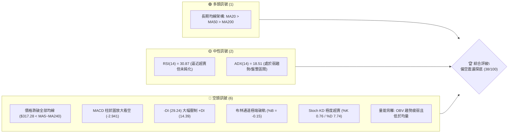

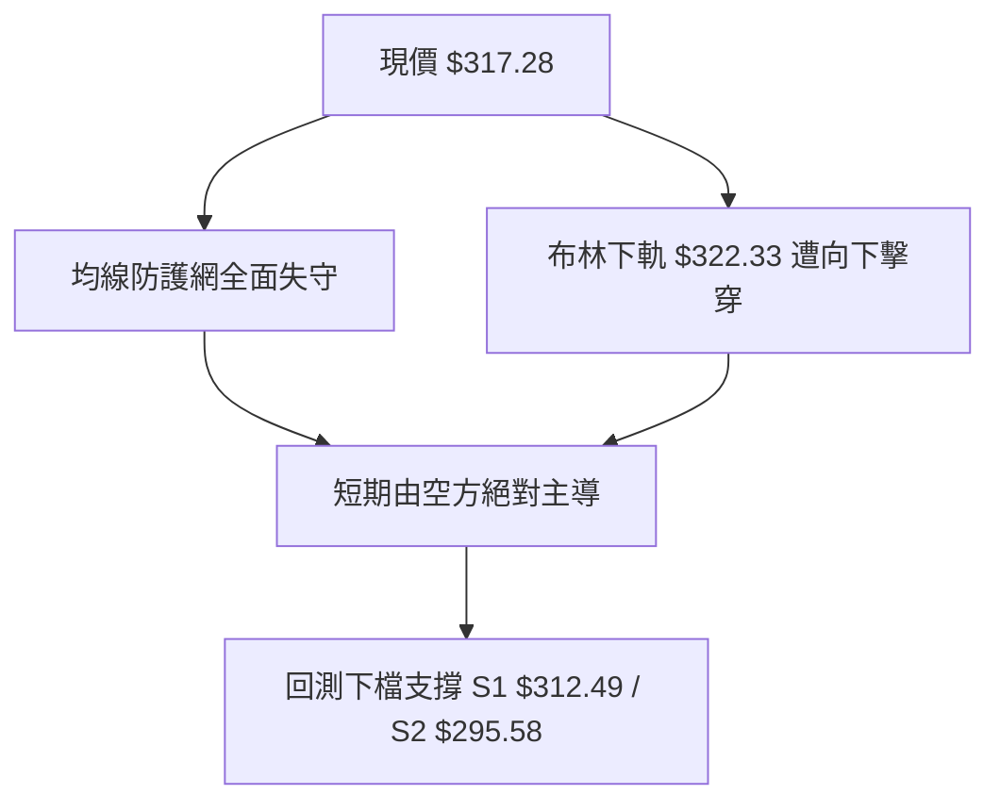

### 📊 核心指標速覽表

| 指標類別 | 指標名稱 | 當前數值 | 訊號 | 解讀 |
|----------|----------|----------|:----:|------|
| **價格** | 當前收盤價 | $317.28 | 🔴 | 跌破所有短期、中期與長期移動平均線，空方強勢佔優 |
| **均線** | MA20 | $339.53 | 🔴 | 現價低於 MA20 達 -6.55%，短中期均線形成重壓 |
| **均線** | MA50 | $339.52 | 🔴 | 現價低於 MA50 達 -6.55%，均線扣抵向上致使反壓沉重 |
| **均線** | MA200 | $339.11 | 🔴 | 現價跌破牛熊分水嶺 -6.44%，長線多頭架構遭遇嚴重破壞 |
| **動能** | RSI(14) | 30.87 | 🟡 | 位於中性與超賣交界處，尚未出現止跌底背離訊號 |
| **動能** | MACD (12,26,9) | -3.874 / -0.933 | 🔴 | DIF 線大幅跌破訊號線，Hist 為 -2.941，負動能顯著擴散 |
| **動能** | KD (Stochastics) | %K 0.76 / %D 7.74 | 🔴 | 進入深度超賣區間，反映極端單邊拋售，警惕短期鈍化 |
| **趨勢** | ADX / DMI | ADX: 18.51 / -DI: 29.24 | 🔴 | ADX<25 屬震盪盤整架構，但 -DI 遠大於 +DI(14.39)，空方主導跌勢 |
| **通道** | Bollinger Bands | 下軌 $322.33 / %B -0.15 | 🔴 | 價格脫離下軌呈現「喇叭口破軌」，短線呈現超賣向下發散 |
| **量能** | 20日成交均量比 | 10.79M / 15.59M (0.69x) | 🔴 | 量縮破位，OBV 疲軟且低於 MA，下檔尚未出現承接買盤 |
| **波動** | ATR(14) | $8.41 (2.65%) | 🟡 | 波動率處於中等偏高水準，每日波動區間達 $8.41 |

### 🏆 技術評分卡

```
╔══════════════════════════════════════════════════════════════════╗
║                   技術評分卡 — GOOG (2026-10-24)                 ║
╠══════════════════════════════════════════════════════════════════╣
║ 趨勢強度 (Trend)     ███████░░░░░░░░░░░░░  35/100   🔴 空方主控  ║
║ 動能指標 (Momentum)  ██████░░░░░░░░░░░░░░  30/100   🔴 動能衰竭  ║
║ 支撐穩定度 (Support) ██████████░░░░░░░░░░  52/100   🟡 S1防守中  ║
║ 成交量配合 (Volume)  ███████░░░░░░░░░░░░░  35/100   🔴 買盤匱乏  ║
║ 形態完整度 (Pattern) ████████░░░░░░░░░░░░  38/100   🔴 箱體破位  ║
║ 均線排列 (MAs)       ████████░░░░░░░░░░░░  38/100   🔴 均線死叉  ║
╠══════════════════════════════════════════════════════════════════╣
║ 綜合評分             ████████░░░░░░░░░░░░  38/100   🔴 偏空弱勢  ║
╚══════════════════════════════════════════════════════════════════╝
* 註：綜合評分 = (35 + 30 + 52 + 35 + 38 + 38) ÷ 6 = 38.0（四捨五入至整數，依規則18）
```

---

## 2. 趨勢分析

### 🌐 多時框趨勢分析

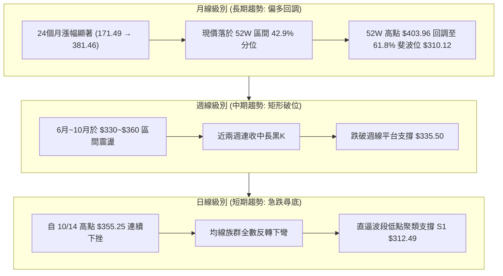

### 📈 長期趨勢 — 12個月走勢圖（Unicode）

```
GOOG 月線歷史走勢圖（過去12個月：2025-11 至 2026-10）
價格軸 ($)
$390 ┤
$380 ┤                            ● 2026-04 ($381.46)
$370 ┤                               ● 2026-05 ($375.96)
$360 ┤                                   ● 2026-07 ($356.42)
$350 ┤                               ● 2026-06 ($353.10)
$340 ┤                    ● 2026-01 ($337.87) ● 2026-09 ($340.74)
$330 ┤                                            ● 2026-08 ($335.19)
$320 ┤● 2025-11 ($319.29)     ● 2026-02 ($310.82)     ● 現價: 2026-10 ($317.28)
$310 ┤    ● 2025-12 ($313.19)
$300 ┤
$290 ┤                        ● 2026-03 ($286.50)
$280 ┤
     └─────────────────────────────────────────────────────────────► 時間
       11   12   01   02   03   04   05   06   07   08   09   10
      (2025)                      (2026)
```

#### 走勢特徵分析表格

| 階段區間 | 時間跨度 | 起點收盤 | 終點收盤 | 區間漲跌幅 | 走勢特徵與量價結構解讀 |
|:---------|:---------|:--------:|:--------:|:----------:|:-----------------------|
| **高檔整固期** | 2025-11 ~ 2026-01 | $319.29 | $337.87 | +5.82% | 股價於 $310~$338 震盪築階梯，成交量呈現溫和放大 |
| **春季回踩期** | 2026-01 ~ 2026-03 | $337.87 | $286.50 | -15.20% | 快速回撤測試支撐，創下波段低點 $286.50 後迅速引發強勁買盤 |
| **主升爆發期** | 2026-03 ~ 2026-04 | $286.50 | $381.46 | +33.14% | 單月大漲近百元，創下歷史級月度漲幅，直接拉升測試歷史高位 |
| **高位箱體期** | 2026-04 ~ 2026-09 | $381.46 | $340.74 | -10.67% | 於 $335~$375 形成寬幅高檔箱體整合格局，籌碼逐漸鬆動發散 |
| **破位下行期** | 2026-09 ~ 2026-10 | $340.74 | $317.28 | -6.88% | 跌破 $335 關鍵箱底，月線收盤連續走低，回測年內低點密集區 |

### 📊 中期趨勢（週線分析）

```
週線級別價格壓力與支撐結構示意圖
══════════════════════════════════════════════════════════════════════
[壓力位 R3]  $340.53  ══════════════════════ (MA20/50/200 均線重疊密集反壓帶)
                        ▲
[壓力位 R2]  $327.81  ──┼─────────────────── (斐波那契 50.0% 回調位 / 破位頸線反壓)
                        │
[壓力位 R1]  $318.83  ──┼─────────────────── (近期日K反彈阻力點)
                        │
[當前現價]   $317.28  ◄─┴─── (正處於超賣探底階段)
                        │
[支撐位 S1]  $312.49  ──┬─────────────────── (近一年波段低點聚類 / 斐波 61.8% $310.12)
                        ▼
[支撐位 S2]  $295.58  ══════════════════════ (強中期波段底部支撐防線)
══════════════════════════════════════════════════════════════════════
```

- **週線形態特徵**：2026-10-16 該週收盤於 $336.91，失守前四週的震盪中樞；隨後 2026-10-23 該週放量重挫至 $317.28（週跌幅達 -5.83%，週成交量 78,696,124），直接灌破 52 週中位線，週線 MACD 柱狀圖由正轉負（從 10/09 的 +0.947 驟降至 10/23 的 -2.941），週線級別正式轉入空頭修正。

### ⚡ 趨勢強度評估（ADX 解讀）

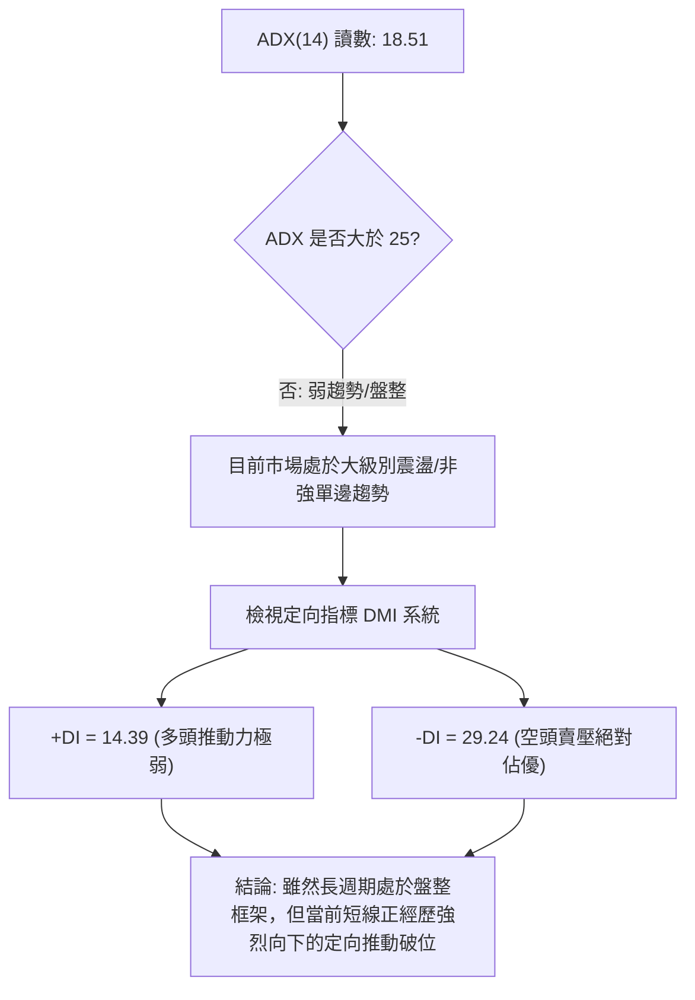

#### ADX 強度對照與解讀表

| 指標名稱 | 當前讀數 | 門檻區間 | 趨勢屬性判定 | 技術意涵與操作指引 |
|:---------|:--------:|:--------:|:------------:|:-------------------|
| **ADX(14)** | 18.51 | < 20.00 | **極弱趨勢 / 盤整震盪** | 中長期單邊趨勢動能匱乏，市場正處於大區間重構期 |
| **+DI(14)** | 14.39 | 參考值 | 多頭動能衰竭 | 多方攻擊意願降至冰點，無力發動連續性推升 |
| **-DI(14)** | 29.24 | > 25.00 | **空方強勢主導** | 空方掌握短期定價權，賣盤具有連續性與主動性 |
| **差值 (-DI - +DI)** | +14.85 | > 10.00 | **向下發散張口** | 動能柱呈現負向張口擴大，短線反彈空間遭受強力壓制 |

---

## 3. 圖表形態分析

### 🔍 形態識別系統

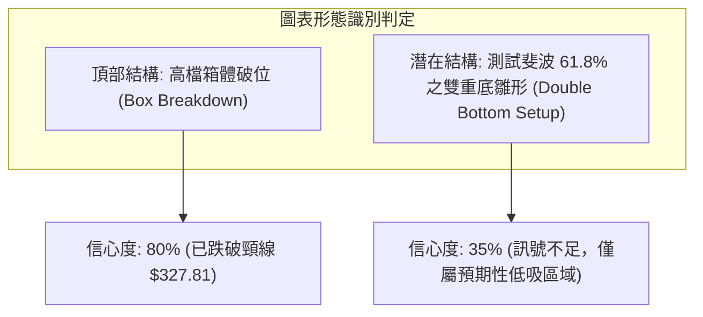

#### 圖表形態信心度與目標價評估表

| 識別形態名稱 | 信心度 (%) | 判斷依據（嚴格引用數據） | 當前完成度 | 形態目標價推算（附精確計算式） |
|:-------------|:----------:|:-------------------------|:----------:|:-------------------------------|
| **高檔箱體破位 (Box Breakdown)** | 80% | 10/16 跌破箱底 $335.50，10/23 實體中黑K摜破頸線 $327.81 | 100% (已破位) | **目標價一**：頸線 $327.81 - (箱頂 $348.40 - 頸線 $327.81) = $327.81 - $20.59 = **$307.22**<br>（接近 S1 $312.49 與 Fib 61.8% $310.12） |
| **斐波那契雙底雛形 (Double Bottom)** | 35% | 僅有 2026-02 低點 $310.82 與當前價格 $317.28 接近 | 20% (未成形) | *訊號不足，僅做指標型解讀。若要成形必須回升突破頸線 R2 $327.81，目前不得強行預測。* |

### 🕯️ 重要 K 線形態分析

本小節嚴格依據提供的「近10根日K」與「近8根週K」實際開高低收數據進行客觀解讀：

#### 近 10 根日 K 線形態解讀表

| 日期 (日K) | 開盤價 | 最高價 | 最低價 | 收盤價 | 成交量 | K線形態名稱 | 技術解讀與多空意涵 | 訊號 |
|:-----------|:------:|:------:|:------:|:------:|:------:|:------------|:-------------------|:----:|
| **2026-10-12** | 348.34 | 352.66 | 347.16 | 348.97 | 11,854,200 | 窄幅十字小陽 | 衝高回落，於 $352 面臨前期反壓 | 🟡 |
| **2026-10-13** | 352.42 | 354.50 | 347.57 | 349.52 | 14,445,100 | 上影小陰星 | 再次試探 $354.50 未果，多頭動能減退 | 🟡 |
| **2026-10-14** | 351.43 | 355.25 | 342.40 | 343.65 | 20,106,400 | 放量中陰破位 | 高點見頂，放量擊穿 $345，確立短期轉向 | 🔴 |
| **2026-10-15** | 340.53 | 348.40 | 336.82 | 344.91 | 16,425,700 | 帶長下影陽線 | 回踩 $336.82 後見抵抗買盤，形成弱勢反抽 | 🟡 |
| **2026-10-16** | 344.30 | 346.60 | 335.50 | 336.91 | 17,040,300 | 光腳中長陰線 | 空方反撲，收盤摜破前日低點，反彈宣告夭折 | 🔴 |
| **2026-10-19** | 340.12 | 342.52 | 338.25 | 340.16 | 12,720,600 | 縮量十字星 | 多空暫時平衡於 $340 關口，呈現抵抗整態 | 🟡 |
| **2026-10-20** | 339.71 | 341.00 | 334.60 | 336.40 | 14,790,300 | 震盪下行小陰 | 再次跌破 $335，均線形成空頭壓制 | 🔴 |
| **2026-10-21** | 333.32 | 333.80 | 326.26 | 330.95 | 19,298,100 | 跳空放量大陰 | 跳空開低走低，直逼 $326，空方發動加速下跌 | 🔴 |
| **2026-10-22** | 326.77 | 327.70 | 318.45 | 320.76 | 21,094,100 | 放量長陰破線 | 爆量長陰摜破 $320，引發市場停損斷頭賣壓 | 🔴 |
| **2026-10-23** | 317.93 | 321.23 | 316.99 | 317.28 | 10,793,024 | 縮量低位小陰 | 創波段新低 $316.99，量能急縮，低檔呈現觀望 | 🔴 |

#### 近 8 根週 K 線形態解讀表

| 週末日期 (週K) | 開盤價 | 最高價 | 最低價 | 收盤價 | 週成交量 | 週K形態名稱 | 技術解讀與多空意涵 | 訊號 |
|:---------------|:------:|:------:|:------:|:------:|:--------:|:------------|:-------------------|:----:|
| **2026-09-04** | 339.80 | 340.63 | 329.08 | 335.31 | 78,070,100 | 下影小陰線 | 下探 $329.08 見買盤拉回，維持箱體內震盪 | 🟡 |
| **2026-09-11** | 331.99 | 339.95 | 325.63 | 335.45 | 65,716,800 | 縮量鎚頭陽 | 探底 $325.63 後回升，守住下檔支撐帶 | 🟢 |
| **2026-09-18** | 339.11 | 355.13 | 337.45 | 344.41 | 98,139,700 | 放量長陽線 | 多方發起反彈，一舉攻克 $350 關卡 | 🟢 |
| **2026-09-25** | 346.19 | 359.98 | 332.81 | 341.08 | 91,524,400 | 長上影紡錘線 | 衝刺 $359.98 遭遇強烈解套賣壓，長上影顯著 | 🔴 |
| **2026-10-02** | 337.60 | 350.09 | 332.65 | 340.35 | 89,656,100 | 高位窄幅小陰 | 多空在 $340 拉鋸，成交量略微萎縮 | 🟡 |
| **2026-10-09** | 339.21 | 353.53 | 339.15 | 347.86 | 63,634,200 | 縮量反彈小陽 | 假突破拉升，量能嚴重背離無法支撐攻勢 | 🟡 |
| **2026-10-16** | 348.34 | 355.25 | 335.50 | 336.91 | 79,871,700 | 吞噬中長黑K | 吞噬前兩週實體，週線確立短頂成型 | 🔴 |
| **2026-10-23** | 340.12 | 342.52 | 316.99 | 317.28 | 78,696,124 | 連續重挫大陰 | 破位向下尋底，創出近 7 個月週收盤新低點 | 🔴 |

### 📉 ASCII 走勢形態示意圖

```
GOOG 近期日K線形態走勢示意圖（2026-10-12 至 2026-10-23）
價格軸 ($)
$355 ┤      ┌─┐ (10/14 高點 $355.25)
$350 ┤  ┌─┐ │ │
$345 ┤  │ │ └─┘     ┌─┐ (10/15 反抽 $344.91)
$340 ┤  └─┘         │ │ ┌─┐ (10/19 抵抗 $340.16)
$335 ┤               └─┘ │ │
$330 ┤                   └─┘ ┌─┐ (10/21 破位大陰 $330.95)
$325 ┤                       │ │
$320 ┤                       └─┘ ┌─┐ (10/22 放量摜壓 $320.76)
$315 ┤                           │ │ ┌─┐ ◄ 現價: $317.28 (10/23)
$310 ┤                           └─┘ └─┘ 
     └───────────────────────────────────────────────────────────► 日期
        10/12 10/13 10/14 10/15 10/16 10/19 10/20 10/21 10/22 10/23
```

### 🎯 形態目標價計算

1. **頭部箱體跌破量幅推算**：
   - 形態箱頂高點：$355.25（2026-10-14 盤中高點）
   - 形態箱體頸線：$327.81（阻力位 R2，同時為 50% 斐波那契回調位 $328.04 附近）
   - 形態垂直高度 $H = \$355.25 - \$327.81 = \$27.44$
   - **向下等幅測量目標**：$\$327.81 - \$27.44 = \mathbf{\$300.37}$（該價位高度聚攏於強支撐位 **S2 $295.58** 之上方）
2. **第一階段滿足點**：
   - 短線測量目標：破位點 $320.76 減去近兩日日波幅 $8.41 (ATR) = \mathbf{\$312.35}$（完全吻合關鍵支撐 **S1 $312.49**）

---

## 4. 支撐與阻力

### 🗺️ 關鍵價位分布圖（Unicode）

```
GOOG 關鍵價位空間分布結構圖
══════════════════════════════════════════════════════════════════════
$340.53 ║████████████████████████████████████████║ 強阻力 R3 / 密集均線峰值
$327.81 ║████████████████████████████            ║ 阻力 R2 / 斐波 50.0% / 頸線反壓
$318.83 ║████████████████                        ║ 近期阻力 R1 / 上週五反彈高點
────────╫────────────────────────────────────────╢
$317.28 ╠════════════════════════════════════════╣ ◄ 當前收盤價 ($317.28)
────────╫────────────────────────────────────────╢
$312.49 ║▓▓▓▓▓▓▓▓▓▓▓▓▓▓▓▓▓▓▓▓▓▓▓▓                ║ 近期波段關鍵支撐 S1
$310.12 ║▓▓▓▓▓▓▓▓▓▓▓▓▓▓▓▓▓▓                      ║ 斐波那契 61.8% 黃金分割支撐
$295.58 ║████████████████████████████████████    ║ 中期波段強支撐 S2
$270.95 ║████████████████████████████████████████║ 極限防守強支撐 S3
══════════════════════════════════════════════════════════════════════
```

### 🚧 阻力位分析表

所有阻力數值嚴格引用「關鍵價位」區塊之波段高點聚類數據：

| 阻力級別 | 阻力精確價位 | 距離現價幅度 | 形成原因與技術意涵 | 突破難度評估 | 重要性級別 |
|:---------|:------------:|:------------:|:-------------------|:------------:|:----------:|
| **R1** | **$318.83** | +0.49% | 2026-10-23 盤中反彈高點附近，日線下行第一道反壓 | 🟡 中等 | 短線轉強閥值 |
| **R2** | **$327.81** | +3.32% | 斐波那契 50.0% 回調位 ($328.04) 聚類，前期箱體下沿破位頸線 | 🔴 極高 | 波段牛熊分水嶺 |
| **R3** | **$340.53** | +7.33% | MA20 ($339.53)、MA50 ($339.52)、MA200 ($339.11) 均線糾結處 | 🔴 極高 | 中長期趨勢反轉點 |

### 🛡️ 支撐位分析表

所有支撐數值嚴格引用「關鍵價位」區塊之波段低點聚類數據：

| 支撐級別 | 支撐精確價位 | 距離現價幅度 | 形成原因與技術意涵 | 守住機率評估 | 重要性級別 |
|:---------|:------------:|:------------:|:-------------------|:------------:|:----------:|
| **S1** | **$312.49** | -1.51% | 近一年波段低點密集聚類，距斐波那契 61.8% ($310.12) 僅一步之遙 | 🟡 55% | 短線多頭生命線 |
| **S2** | **$295.58** | -6.84% | 2026年3月低點 ($286.50) 上方之強支撐平台，量能籌碼沉澱區 | 🟢 75% | 中期結構性防線 |
| **S3** | **$270.95** | -14.60% | 52週低點 ($252.11) 反彈初期的放量突破平台，極限多頭底線 | 🟢 90% | 長期戰略底線 |

### 📐 斐波那契回調位分析

依據 52 週完整波動區間（低點 **$252.11** → 高點 **$403.96**，波幅高達 $151.85）進行回調測算：

```
52週斐波那契回調結構層級圖
0.0%  (52W High)   $403.96  ───────────────────────────────────────
23.6%              $368.13  ───────────────────────────────────────
38.2%              $345.96  ───────────────────────────────────────
50.0%              $328.04  ────────────────── [失守轉阻力 R2 $327.81]
現價               $317.28  ◄──── [位於 50.0% 與 61.8% 區間震盪下行]
61.8% (黃金分割)   $310.12  ────────────────── [黃金回調位，緊鄰 S1 $312.49]
78.6%              $284.61  ────────────────── [深度回撤位，貼近 3月低點 $286.50]
100.0% (52W Low)   $252.11  ───────────────────────────────────────
```

- **當前位置解讀**：現價 **$317.28** 處於 50.0% ($328.04) 與 61.8% ($310.12) 回調位之間。
- **技術意義**：
  1. 股價摜破 50.0% 關鍵心理關卡，代表自 $252.11 起漲的多頭行情已被空方吞噬過半，多方防守全面退守至最後一道防線 —— **61.8% 黃金分割位 $310.12**。
  2. $310.12 與 S1 $312.49 形成厚度僅約 $2.37 的「多頭強烈共振支撐帶」。若此共振帶失守，技術面將面臨向 78.6% ($284.61) 及 S2 ($295.58) 尋求支撐的嚴重下挫風險。

---

## 5. 技術指標深度解讀

### 🎛️ 指標訊號總覽

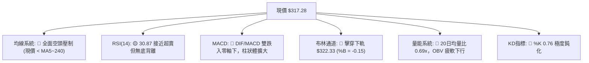

### 📈 移動平均線排列分析

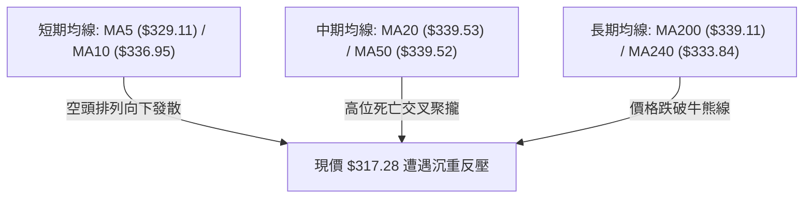

#### 移動平均線數據對比分析表

| 均線名稱 | 均線數值 | 現價偏離幅度 | 偏離率 (%) | 短期趨勢斜率 | 技術意涵解讀 |
|:---------|:--------:|:------------:|:----------:|:------------:|:-------------|
| **MA5** | $329.11 | -$11.83 | -3.59% | ▼ 急劇下彎 | 短線超跌，與 5 日線負乖離顯著拉大 |
| **MA10** | $336.95 | -$19.67 | -5.84% | ▼ 急劇下彎 | 兩週進場者全面套牢，短線第一道重套牢區 |
| **MA20** | $339.53 | -$22.25 | -6.55% | ▼ 加速下彎 | 月線級別反壓，短期空頭進攻防禦線 |
| **MA50** | $339.52 | -$22.24 | -6.55% | ◀ 走平轉跌 | 季線由升轉平，中期支撐轉變為巨大蓋頭壓力 |
| **MA60** | $342.22 | -$24.94 | -7.29% | ▼ 緩步下彎 | 確立波段下行趨勢 |
| **MA120** | $352.52 | -$35.24 | -10.00% | ◀ 高位走平 | 半年線形成長線天花板 |
| **MA200** | $339.11 | -$21.83 | -6.44% | ▲ 微幅上揚 | 股價正式摜破牛熊線，長期多頭趨勢岌岌可危 |
| **MA240** | $333.84 | -$16.56 | -4.96% | ▲ 微幅上揚 | 年線跌破，中長線買盤停損賣壓湧現 |

- **均線共振特徵**：值得高度警惕的是，**MA20 ($339.53)、MA50 ($339.52)、MA200 ($339.11)** 三條長短期週期均線在 $339 價位出現「三線高密度黏合纏繞後向下發散」，形成技術分析中極具殺傷力的「均線下蓋死蜘蛛」形態，確立了 $339~$340 為中長期的鐵壁阻力區。

### 📉 RSI(14) 分析

- **RSI 當前數值**：**30.87** (Wilder 平滑計算)
- **進度條展示**：
  ```
  超賣 [0] ────────── [30] ─────────────── [70] ────────── [100] 超買
  當前讀數: 30.87     ██████░░░░░░░░░░░░░░░░░░░░░░░░░░░░░░░░░░
  ```
- **區間評估**：RSI 位於 30.87，緊貼 30.00 超賣警戒線。技術上屬於「弱勢震盪向超賣區滑落」，尚未進入低於 20 的嚴重極端鈍化，但已顯示空方賣盤佔據主導。
- **背離判斷**：
  - **日線背離判定**：無明顯背離。檢視近 20 根 K 棒走勢，價格自 10/14 高點 $355.25 持續創出新低至 10/23 的 $316.99，同期間 RSI 從 56.0 一路平滑下墜至 30.87，**價格創新低、指標同步創新低**，未呈現底背離特徵，跌勢尚未出現指標性竭盡訊號。
  - **週線狀態**：週線 RSI 為 30.9，與日線形成低位共振，顯示中短期均處於空方下壓慣性之中。

### 📊 MACD (12, 26, 9) 訊號解讀

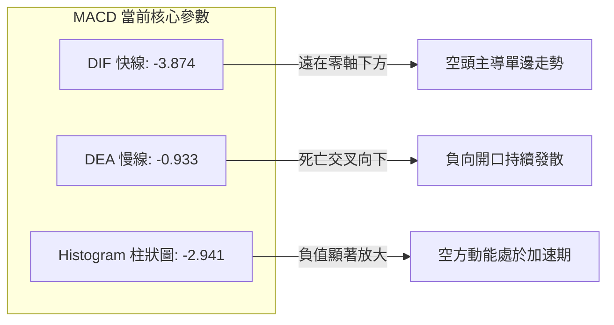

- **解讀**：MACD 快線已深陷負值區間（-3.874），且與慢線（-0.933）的負乖離持續拉大，柱狀圖 Hist 達到 -2.941，毫無收斂跡象。這表明在日線週期上，空方動能正處於宣洩主跌段，任何未見柱狀圖紅柱縮腳（收斂）前的短線買盤均屬逆勢摸底行為。

### 📦 布林通道分析 (Bollinger Bands)

```
布林通道當前狀態示意圖（20日通道，2倍標準差）
══════════════════════════════════════════════════════════════════════
[上軌 Upper]   $356.72   ─────────────────────────────────────────────
                          
[中軌 Middle]  $339.53   ──────── (MA20 基準線，強力反壓) ───────────
                          
[下軌 Lower]   $322.33   ─────────────────────────────────────────────
                                 │
[當前現價]     $317.28   ◄───────┴─── (脫軌跌出下軌下方，%B = -0.15)
══════════════════════════════════════════════════════════════════════
```

- **布林參數指標**：
  - 上軌：$356.72 ｜ 中軌 (MA20)：$339.53 ｜ 下軌：$322.33
  - 通道寬度 (Bandwidth)：$(\$356.72 - \$322.33) \div \$339.53 = 10.13\%$
  - **通道位置指標 %B**：**-0.15**
- **解讀**：%B 小於 0（-0.15）代表當前股價已完全跌破布林帶下軌支撐。此種「脫軌行走（Band-walking）」通常出現在極端情緒釋放期或趨勢加速期。雖然統計學上有回歸通道內部的均值回歸拉力，但由於布林通道開口正呈現向下發散擴張，需防範「沿下軌向下陰跌」之風險。

### 💹 成交量分析（量價配合度）

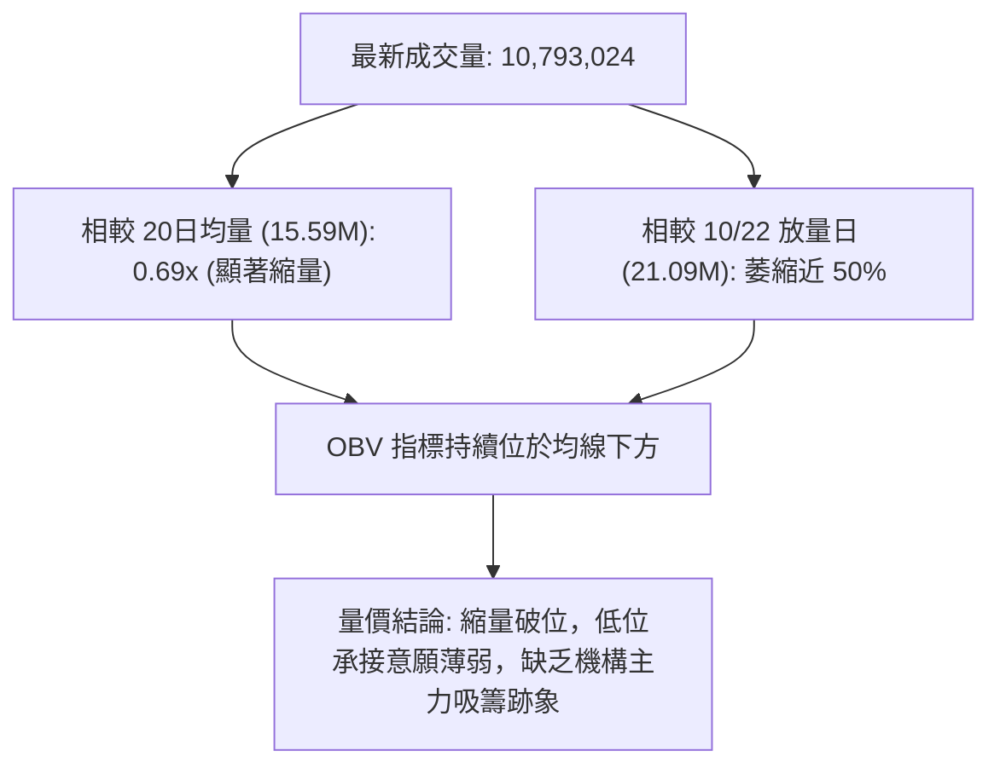

- **量價特徵解讀**：
  1. 10/21 與 10/22 大跌期間，成交量放大至 19.29M 與 21.09M，呈現典型的「放量摜破」；而 10/23 創出波段低點 $316.99 時，成交量驟降至 10.79M（量比僅 0.69x）。
  2. 此種「放量下跌、縮量微企穩」的現象，並非標準的「量平放量見底（Selling Climax）」，而是多頭買盤棄守所造成的「流動性退潮式縮量」。
  3. **OBV (能量潮)**：數據明確指出 `OBV < MA → 量能疲弱`，說明主力資金整體呈現持續淨流出態勢，量能結構完全未能確認任何止跌信號。

---

## 6. 動能與波動率

### ⚡ 動能評估四象限

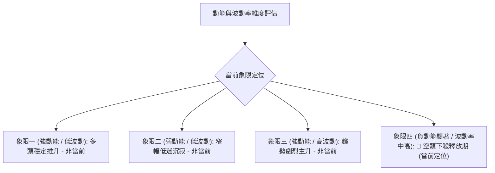

#### 動能與波動率矩陣分析表

| 象限分區 | 動能維度 | 波動維度 | 當前狀態吻合度 | 核心特徵描述與應對策略 |
|:---------|:--------:|:--------:|:--------------:|:-----------------------|
| **Q1 穩健推升區** | 強 (正向) | 低波動 | ❌ (0%) | 趨勢沿均線平穩走高，目前完全不具備 |
| **Q2 蓄勢盤整區** | 弱 (中性) | 低波動 | ❌ (10%) | 窄幅縮量築底，現階段波動率仍高，尚未進入沉寂期 |
| **Q3 狂熱主升區** | 強 (正向) | 高波動 | ❌ (0%) | 單邊逼空暴漲行情，非目前市場環境 |
| **Q4 脆弱下挫區** | **強 (負向)** | **中高波動** | **✓ (90%) 吻合** | **負向動能主導，日內震幅擴大，逢反彈皆有賣壓，應嚴格防守觀望** |

### 📊 ATR 波動率分析

- **ATR(14) 讀數**：**$8.41**（佔現價比例 **2.65%**，Wilder 算法）
- **歷史波動對比**：$8.41 的日均真實波幅處於年內偏高水平，顯示目前股價處於非理性情緒拋售與高敏感期。
- **止損與部位管理建議**：
  - **日內防守距離**：$1.0 \times \text{ATR} = \$8.41$
  - **波段交易防守安全距離**：$1.5 \times \text{ATR} = \$12.62$
  - **極限趨勢保護距離**：$2.0 \times \text{ATR} = \$16.82$

### 📐 Beta 與市場相關性

- **Beta 係數**：**1.211**
- **市場屬性解讀**：GOOG 具備明顯的高貝塔成長股屬性（波動幅度較標普500大盤高出 21.1%）。當美股大盤處於回調階段時，高 Beta 特質將導致其跌幅被非線性放大；反之，若未來大盤出現強勁反彈，其彈性亦將顯著優於防禦性族群。
- **機構籌碼動態**：當前機構持股比例達 62.1%，內部人持股僅 0.5%，空頭比率（Short Ratio）為 2.96，Short % Float 為 `N/A（數據未提供）`。籌碼面主要受到大型機構法人在季末與財報前的調倉再平衡賣壓衝擊。

---

## 7. 多時框架總結

### 📋 時框架評分表

| 時框架 | 趨勢方向判定 | 動能指標狀態 | 均線系統排列 | 圖表形態架構 | 綜合評分 | 戰略操作建議 |
|:-------|:------------:|:------------:|:------------:|:------------:|:--------:|:-------------|
| **月線級別 (長期)** | 🟡 中性偏多 | RSI 48，維持中位 | MA 長期架構仍呈多頭排列 | 52週高位回調至 61.8% 斐波位 | **55/100** | 長線多頭回撤，耐心等待波段止跌 |
| **週線級別 (中期)** | 🔴 偏空修正 | MACD 柱狀體快速轉負 (-2.941) | 實體跌破週線 20MA 與箱底 | 高檔巨型箱體正式向下破位 | **36/100** | 中期轉入防守，嚴禁盲目重倉抄底 |
| **日線級別 (短期)** | 🔴 極度弱勢 | RSI 30.87 / KD 極度超賣 | 價格全面跌破所有短中長期MA | 光腳破位陰線，布林下軌脫軌 | **32/100** | 短線空方主導，以反彈逢高布空為主 |

### 🔲 綜合訊號矩陣

```
時框架訊號矩陣圖
┌──────────────┬──────────────┬──────────────┬──────────────┐
│ 時框架週期   │ 均線趨勢     │ 動能強度     │ 量價架構     │
├──────────────┼──────────────┼──────────────┼──────────────┤
│ 短期 (日線)  │ 🔴 全面空頭  │ 🔴 急速向下  │ 🔴 縮量陰跌  │
│ 中期 (週線)  │ 🔴 破位向下  │ 🔴 空方擴散  │ 🔴 放量擊穿  │
│ 長期 (月線)  │ 🟡 趨勢回踩  │ 🟡 轉弱回調  │ 🟡 正常修正  │
└──────────────┴──────────────┴──────────────┴──────────────┘
```

### ⚖️ 多時框收斂結論

依據技術分析之「多時框收斂原則（規則 14）」：
1. **行情屬性判定**：當前日線 ADX(14) 讀數為 **18.51 (< 25)**，嚴格定義為**大級別無單邊強趨勢之盤整/震盪行情**。
2. **交易區間優先級收斂**：在 ADX<25 的盤整結構中，本應以日線布林通道上下軌（$322.33～$356.72）作為高拋低吸之主要交易區間；然而，當前價格 **$317.28** 已實質性擊穿布林下軌（%B = -0.15），且 DMI 系統中空頭指標 **-DI (29.24)** 遠高於多頭 **+DI (14.39)**，顯示盤整箱底遭到空方強行下破。
3. **時框優先級裁決**：日線訊號與週線在中短期維度達成**強烈空頭共振**（週線吞噬中長黑K，日線全均線破位），壓制了月線的長線多頭殘存格局。
4. **唯一確定結論**：中短期收斂方向確定為 **「🔴 偏空弱勢，以反彈阻力位放空為主主導策略」**。任何短線的多頭博弈僅限於超賣技術性反抽，不構成任何趨勢性反轉信號。

---

## 8. 交易策略建議

### 🗺️ 策略決策流程圖

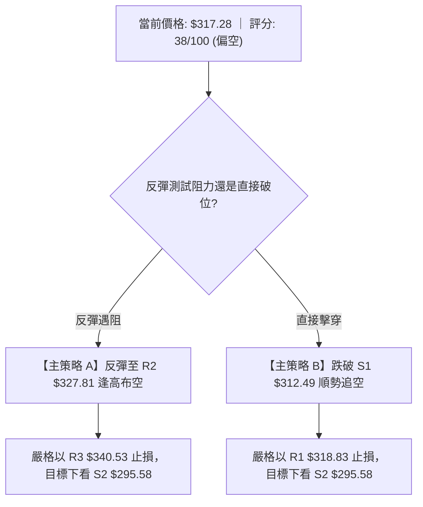

### 🧭 策略路由（依評分卡分流）

> **當前主策略方向 = 🔴 偏空主推策略（依技術評分卡綜合評分 38/100，嚴格依規則路由於 ≤40 偏空區間）**

本報告堅決杜絕多空兩頭下注。基於綜合評分 38 分，目前盤面處於空頭主控之破位結構，**主推空頭策略（逢反彈高空或破位追空）**；多頭視角僅作為下檔止盈平倉點及反轉風險預警，不作為主推交易策略。

### 🎯 價格情境階梯 (Price Scenarios)

所有關鍵價位嚴格引用第 4 章由 OHLCV 精確計算之波段聚類數據：

| 觸發條件 | 第一目標 (T1) | 後續延伸 (T2) | 技術情境含義與對策 |
|:---------|:-------------:|:-------------:|:-------------------|
| **強勢突破 R1 $318.83** | R2 $327.81 | R3 $340.53 | 超賣引發空頭回補反抽，提供空方極佳之高空二次進場點 |
| **跌破關鍵支撐 S1 $312.49** | S2 $295.58 | S3 $270.95 | 多頭最後防線失守，引發恐慌性多殺多，空頭加速主跌段展開 |
| **持續維持於 $312.49~$318.83 震盪** | — | — | 弱勢低位橫盤消化超賣指標，蓄勢後再度向下突破之機率偏高 |

### 📊 情境機率分佈

| 盤面演變情境 | 機率預估 (%) | 核心技術依據（嚴格引用指標數據） |
|:-------------|:------------:|:----------------------------------|
| **弱勢回落 / 再度探底破位** | **55%** | MACD 負柱狀圖擴散 (-2.941)，-DI (29.24) 壓制 +DI，OBV 量能衰竭 |
| **技術性超跌反彈 / 區間震盪** | **35%** | KD 極度超賣 (%K 0.76)，布林脫軌 (%B -0.15)，逼近 S1 $312.49 與 61.8% 斐波位 |
| **直接強勢反轉 / 向上突破** | **10%** | 全均線形成空頭覆蓋反壓，缺乏成交量配合，短期直接反轉機率極低 |

### 🟢 主策略詳情（空頭主導策略）

所有價位精確引用關鍵價位數據，風險報酬比嚴格按公式計算（以 T1 計，符合規則 17）：

| 策略要素 | 策略 A（反彈阻力位沽空 - 優先推薦） | 策略 B（破位下行順勢追空 - 次選突破） |
|:---------|:------------------------------------|:--------------------------------------|
| **操作邏輯** | 股價弱勢反彈測試頸線反壓遇阻回落時放空 | 股價跌破年內關鍵支撐引發恐慌時追空 |
| **進場價格** | **$327.81** (精確引用 R2 阻力位) | **$312.49** (精確引用 S1 支撐破位點) |
| **目標價 T1** | **$295.58** (精確引用 S2 強支撐位) | **$295.58** (精確引用 S2 強支撐位) |
| **目標價 T2** | **$270.95** (精確引用 S3 極限支撐位) | **$270.95** (精確引用 S3 極限支撐位) |
| **止損價格** | **$340.53** (精確引用 R3 均線群阻力位) | **$318.83** (精確引用 R1 短線反彈高點) |
| **風險報酬比** | **1 : 2.53（以 T1 計）**<br>*(計算式: (327.81 - 295.58) ÷ (340.53 - 327.81) = 32.23 ÷ 12.72 = 2.53)*<br>另註：1 : 4.47（以 T2 計，56.86 ÷ 12.72） | **1 : 2.67（以 T1 計）**<br>*(計算式: (312.49 - 295.58) ÷ (318.83 - 312.49) = 16.91 ÷ 6.34 = 2.67)*<br>另註：1 : 6.55（以 T2 計，41.54 ÷ 6.34） |
| **預估成功機率** | **65%** | **60%** |
| **建議配置倉位** | **15% ~ 20%** 總資產 | **10% ~ 15%** 總資產 |

### 🔴 反向風險觸發點（對沖與停損提示）

若出現以下訊號，主推之空頭策略將被技術性推翻，應立即執行空頭止損或對沖：
1. **反轉價位觸發**：日線收盤價強勢站穩於 **R2 ($327.81)** 之上，且成交量顯著放大突破 20 日均量 (15.59M)。
2. **形態結構逆轉**：若在 **S1 ($312.49)** 或 **斐波 61.8% ($310.12)** 出現放量長下影線或日線級別「破底翻」吞噬晨星形態。
3. **指標共振修復**：日線 MACD 柱狀體由負轉正，且 RSI(14) 帶量突破 50 中軸線。

### ⭐ 整體訊號強度評星

```
做多訊號強度：★☆☆☆☆  (1/5 星 — 僅具備超賣技術反抽條件，不具備趨勢多頭依據)
做空訊號強度：★★★★☆  (4/5 星 — 均線空頭排列，形態破位，空方指標主導)
整體可信度：  ★★★★☆  (4/5 星 — 多時框訊號一致性高，量價與均線高度契合)
```

---

## 9. 風險提示與監控

### ✅ 關鍵監控指標 Checklist

```
╔══════════════════════════════════════════════════════════════════╗
║                   關鍵技術監控指標 CHECKLIST                     ║
╠══════════════════════════════════════════════════════════════════╣
║ [ ] 監控 S1 $312.49 防守情況：跌破且日K收盤確認即觸發破位空     ║
║ [ ] 監控 斐波 61.8% $310.12：黃金分割最後防線，觀察買盤承接力    ║
║ [ ] 監控 布林通道回歸：現價脫軌，留意是否重回下軌 $322.33 內     ║
║ [ ] 監控 MACD 柱狀圖：Hist 是否能由 -2.941 出現收窄縮腳跡象     ║
║ [ ] 監控 成交量門檻：反彈成交量是否放大跨越 20日均量 15.59M      ║
║ [ ] 監控 空頭防守極限：R2 $327.81 是否遭到收盤實體收復          ║
╚══════════════════════════════════════════════════════════════════╝
```

### ⚠️ 風險場景分析

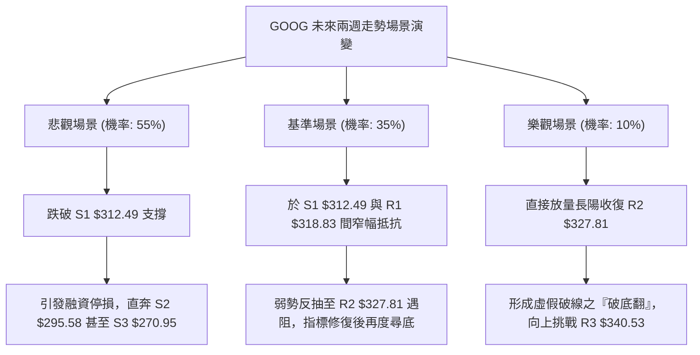

### 🛡️ 風險管理重要提醒

1. **嚴禁重倉抄底**：在移動平均線呈現「死蜘蛛」向下發散、MACD 柱狀體持續擴張的背景下，「左側摸底」極易遭受連續性空頭踐踏。務必等待日線出現右側「放量止跌實體」後再行評估。
2. **部位曝險控制**：考量到 GOOG 當前 ATR 高達 $8.41，單筆交易之風險曝險額度不應超過總投資帳戶淨值的 1.5%。
3. **波動率止損規則**：任何進場單均應嚴格設置動態硬止損，若以反彈做空為例，最大容忍反抽幅度不得超過 $1.5 \times \text{ATR}$（約 $12.60），即一旦回升越過 $327.81 + \$12.60 = \$340.41$（即接近 R3 $340.53），必須無條件止損出場。

---

## 📋 報告總結

```
╔══════════════════════════════════════════════════════════════════╗
║                    GOOG 技術分析報告總結                         ║
╠══════════════════════════════════════════════════════════════════╣
║ 報告日期：2026-10-24                                             ║
║ 當前價格：$317.28                                                ║
║ 技術評級：🔴 偏空弱勢（技術評分卡：38/100）                      ║
║                                                                  ║
║ 關鍵結論：                                                       ║
║ ├─ 長期趨勢：🟡 月線高檔回撤，測試 52週區間 61.8% 斐波位         ║
║ ├─ 中期趨勢：🔴 週線大陰跌破高位箱底，MACD 翻負確立波段修正      ║
║ ├─ 短期趨勢：🔴 日線均線全數失守，布林脫軌下行，空方全面主導    ║
║ ├─ 關鍵支撐：S1 $312.49 ｜ S2 $295.58 ｜ S3 $270.95              ║
║ ├─ 關鍵阻力：R1 $318.83 ｜ R2 $327.81 ｜ R3 $340.53              ║
║ └─ 華爾街共識目標價：Mean $422.36 (Low $340.00 / High $485.00)  ║
║                                                                  ║
║ 最優策略組合：                                                   ║
║ 1. 🥇 最佳機會：【策略 A】反彈至 R2 $327.81 逢高放空，            ║
║                  止損設 R3 $340.53，目標看 S2 $295.58            ║
║                  (風險報酬比 1 : 2.53（以 T1 計）)               ║
║ 2. 🥈 次選機會：【策略 B】跌破 S1 $312.49 順勢追空，              ║
║                  止損設 R1 $318.83，目標看 S2 $295.58            ║
║                  (風險報酬比 1 : 2.67（以 T1 計）)               ║
║ 3. 🥉 保守選擇：場外空倉觀望，耐心等待價格於 S1 $312.49 /         ║
║                  斐波 61.8% $310.12 出現日線級底背離訊號         ║
╚══════════════════════════════════════════════════════════════════╝
```

---

> ⚠️ **免責聲明**：本報告為依據量化技術指標與歷史走勢數據生成之技術分析研究報告，所有指標計算與價位階梯均基於客觀模型與既有市場資訊。本報告**僅供研究與學術參考**，**不構成任何形式的投資要約、招攬或具體操作建議**。金融市場瞬息萬變，技術指標存在滯後與失效風險，投資人應依據個人風險承受能力獨立做出決策，並自負盈虧。

---

*報告生成時間：2026-10-24 ｜ 數據來源：Yahoo Finance ｜ 分析框架：資深多時框技術分析體系*