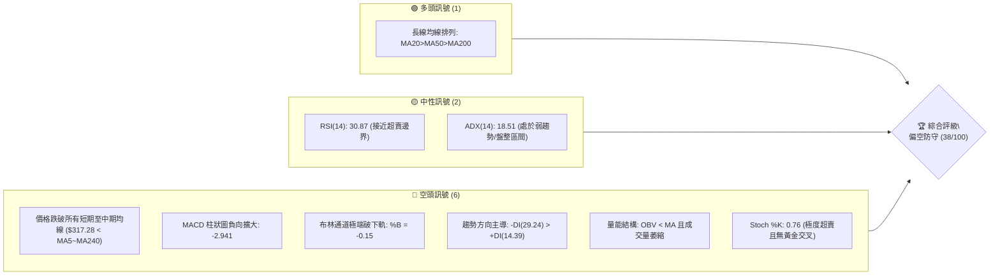
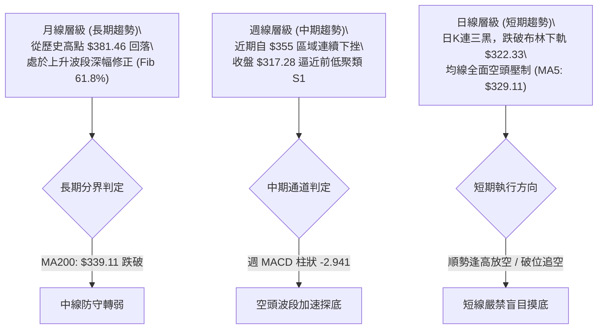
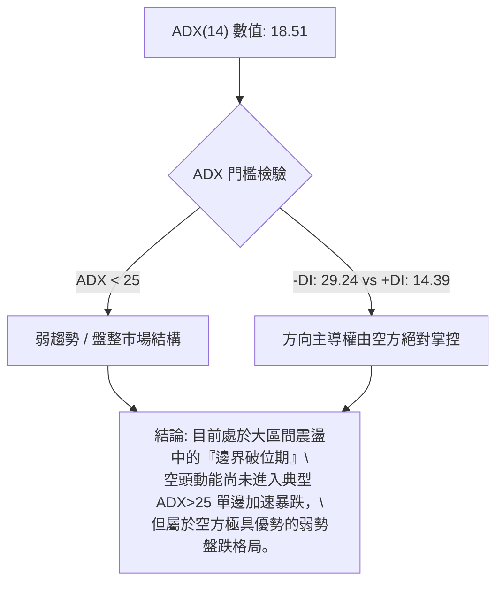
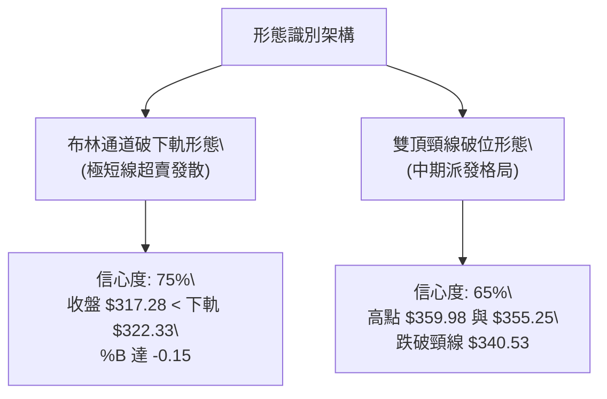
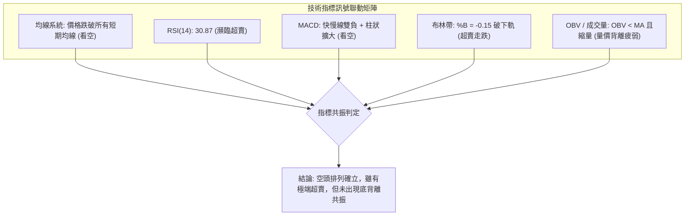
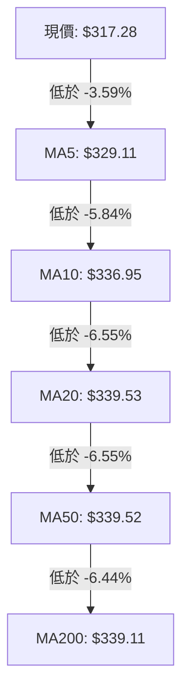
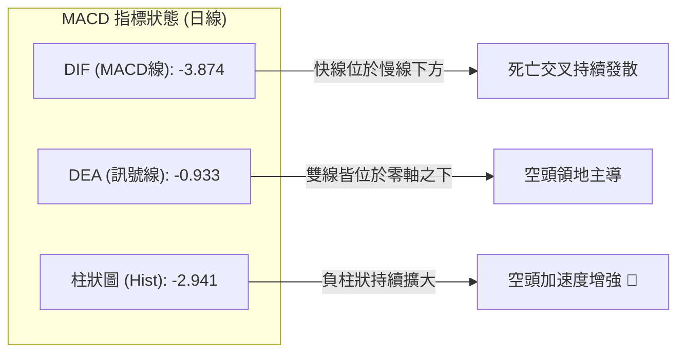
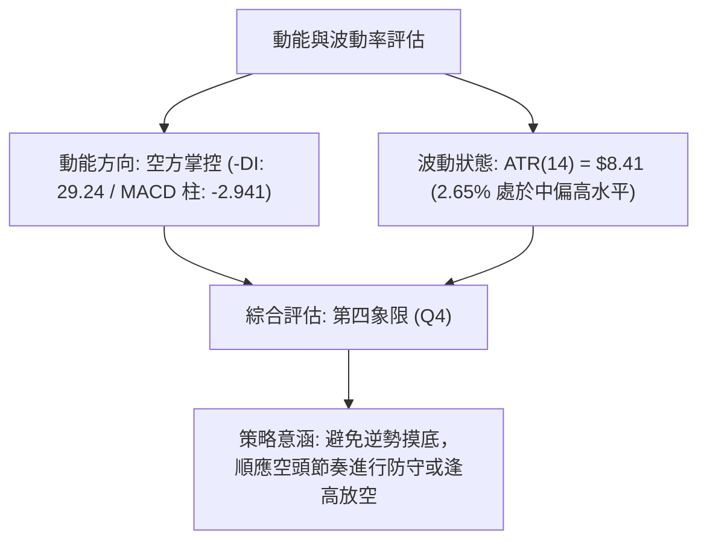
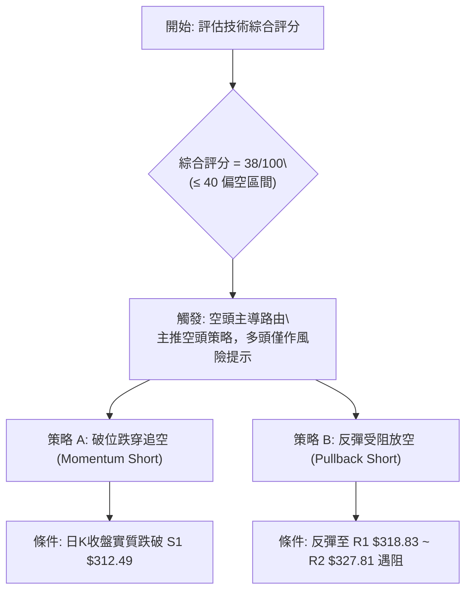
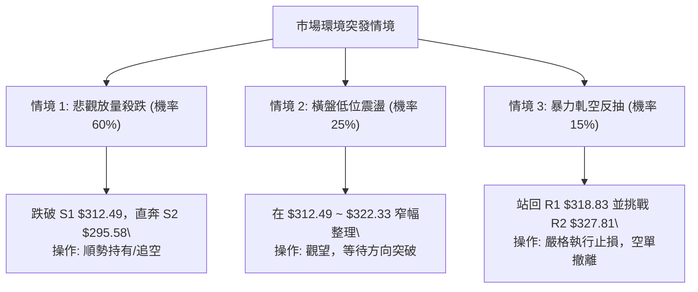

# GOOG 技術分析報告

> **報告日期**：2026-10-26 ｜ **語言**：繁體中文 ｜ **數據來源**：Yahoo Finance ｜ **當前價格**：$317.28

---

## 目錄

| 章節 | 內容 |
|------|------|
| [1. 技術面概覽](#1-技術面概覽) | 訊號儀表板、核心指標、評分卡 |
| [2. 趨勢分析](#2-趨勢分析) | 多時框趨勢、長中短期走勢 |
| [3. 圖表形態分析](#3-圖表形態分析) | 形態識別、K線組合、目標價 |
| [4. 支撐與阻力](#4-支撐與阻力) | 關鍵價位、斐波那契回調 |
| [5. 技術指標深度解讀](#5-技術指標深度解讀) | MA/RSI/MACD/布林/成交量 |
| [6. 動能與波動率](#6-動能與波動率) | 動能評估、ATR、Beta |
| [7. 多時框架總結](#7-多時框架總結) | 時框架評分矩陣 |
| [8. 交易策略建議](#8-交易策略建議) | 多空策略、風險報酬比 |
| [9. 風險提示與監控](#9-風險提示與監控) | 監控指標、風險場景 |

---

## 1. 技術面概覽

### 🎯 技術訊號儀表板



### 📊 核心指標速覽表

| 指標類別 | 指標名稱 | 當前數值 | 訊號 | 解讀 |
|----------|----------|----------|------|------|
| **價格** | 當前收盤價 | $317.28 | 🔴 | 創近半年波段新低，處於52週區間42.9%位置 |
| **均線** | MA20 | $339.53 | 🔴 | 價格低於MA20達 -6.55%，短中期下行壓力沉重 |
| **均線** | MA50 | $339.52 | 🔴 | 價格低於MA50，均線走平並開始下彎 |
| **均線** | MA200 | $339.11 | 🔴 | 價格摜破牛熊分界線MA200達 -6.44% |
| **動能** | RSI(14) | 30.87 | 🟡 | 位於臨界超賣邊界，未見明顯底背離 |
| **動能** | MACD | -3.874 (柱: -2.941) | 🔴 | 快慢線雙雙落入零軸下方，空頭動能擴散中 |
| **動能** | Stoch %K / %D | 0.76 / 7.74 | 🟡 | 進入極度超賣區（<20），具備技術反抽條件但未確認 |
| **通道** | 布林帶寬 (%B) | -0.15 (下軌 $322.33) | 🔴 | 跌破布林下軌，呈現超賣走跌開口走勢 |
| **趨勢** | ADX(14) | 18.51 (-DI: 29.24) | 🔴 | ADX<25顯示大格局偏盤整，但空方-DI壓制多方+DI |
| **量能** | 最新量 / 20日均量 | 10.82M / 15.59M (0.69x) | 🔴 | 下跌伴隨縮量，OBV < MA，買盤承接力道薄弱 |
| **波動** | ATR(14) | $8.41 (2.65%) | 🟡 | 波動度處於中等水平，每日價格震幅約 $8.41 |

### 🏆 技術評分卡

```
╔══════════════════════════════════════════════════════════════════╗
║                   技術評分卡 — GOOG (2026-10-26)                 ║
╠══════════════════════════════════════════════════════════════════╣
║ 趨勢強度      ██████░░░░░░░░░░░░░░  30/100  🔴 空頭主導 (-DI壓制) ║
║ 動能指標      ███████░░░░░░░░░░░░░  35/100  🔴 MACD向下發散       ║
║ 支撐穩定度    █████████░░░░░░░░░░░  45/100  🟡 臨近S1與Fib 61.8%  ║
║ 成交量配合    ███████░░░░░░░░░░░░░  35/100  🔴 量比0.69x買盤渙散  ║
║ 形態完整度    █████████░░░░░░░░░░░  45/100  🟡 破位布林帶下軌     ║
║ 均線排列      ████████░░░░░░░░░░░░  38/100  🔴 價格跌破所有均線   ║
╠══════════════════════════════════════════════════════════════════╣
║ 綜合評分      ████████░░░░░░░░░░░░  38/100  🔴 偏空弱勢格局       ║
╚══════════════════════════════════════════════════════════════════╝
```
*(註：綜合評分 = (30 + 35 + 45 + 35 + 45 + 38) ÷ 6 = 38.0，四捨五入為 38/100，符合規則 18)*

---

## 2. 趨勢分析

### 🌐 多時框趨勢分析



### 📈 長期趨勢 — 12個月走勢圖（Unicode）

```
GOOG 月線走勢圖（2025-11 至 2026-10）
價格軸 ($)
$390 ┤
$380 ┤                            ● $381.46 (2026-04 頂部)
$370 ┤                               ● $375.96
$360 ┤                                        ● $356.42
$350 ┤                                    ● $353.10
$340 ┤                    ● $337.87                   ● $340.74
$330 ┤                                            ● $335.19
$320 ┤● $319.29                                        ● $317.28 (現在)
$310 ┤    ● $313.19       ● $310.82
$300 ┤
$290 ┤                ● $286.50
     └─────────────────────────────────────────────────────────────
       11   12   01   02   03   04   05   06   07   08   09   10  (月份)
     (2025)               (2026)
```

#### 走勢特徵分析表格

| 階段 | 時間區間 | 起訖價格 | 漲跌幅 | 走勢特徵與結構解讀 |
|------|----------|----------|--------|--------------------|
| 主升起漲段 | 2025-11 ~ 2026-01 | $319.29 → $337.87 | +5.82% | 溫和放量走高，突破前期平台阻力 |
| 中期震盪回洗 | 2026-01 ~ 2026-03 | $337.87 → $286.50 | -15.20% | 快速回踩波段低點 $286.50，籌碼快速換手 |
| 爆發衝頂段 | 2026-03 ~ 2026-04 | $286.50 → $381.46 | +33.14% | 出現單月暴漲，觸及52週歷史高點 $403.96 之次高收盤價 |
| 高檔作頭盤跌 | 2026-04 ~ 2026-08 | $381.46 → $335.19 | -12.13% | 連續4個月震盪回落，形成頭部派發結構 |
| 弱勢破位探底 | 2026-08 ~ 2026-10 | $335.19 → $317.28 | -5.34% | 反彈至 $340.74 無力，10月加速摜破多道均線支撐 |

### 📊 中期趨勢（週線分析）

從近20週的收盤數據檢視，GOOG 於 2026-07-24 曾創下波段低點 $318.88，隨後反彈至 2026-10-09 的高點 $347.86（週K高點 $353.53）。然而，近兩週遭遇強烈賣壓：
- 2026-10-16 收 $336.91（週跌 -3.15%）
- 2026-10-23 收 $317.28（週跌 -5.83%），直接跌破7月份低點 $318.88

```
GOOG 週線近期壓力與支撐結構示意圖
價格 ($)
$355.25 ┬─── 近兩週反彈高點壓力區 (R3 附近: $340.53 ~ $355.25)
        │
$340.53 ┼─── 週線中樞壓力位 R3 (近20週震盪密集成交區)
        │
$327.81 ┼─── 短線反彈第一道反壓 R2
        │
$318.83 ┼─── 前期週線低點頸線位 R1 ($318.88 週收盤聚類) ─── 跌破轉為壓力
$317.28 ┼─── [當前價格] 跌破週線支撐，加速向下探底
        │
$312.49 ┴─── 近期關鍵低點支撐聚類 S1 (波段多頭最後防線)
```

### ⚡ 趨勢強度評估（ADX 解讀）



#### ADX 數值強度對照表

| 指標變數 | 當前讀數 | 基準區間 | 趨勢研判 | 操作指引 |
|----------|----------|----------|----------|----------|
| **ADX(14)** | 18.51 | < 25: 弱趨勢/區間震盪<br>25-50: 強趨勢<br>> 50: 極端單邊 | 盤整行情中空頭主導 | 避免追高殺跌，以通道上下軌或關鍵支撐阻力為交易界限 |
| **+DI (多方)** | 14.39 | 0 ~ 100 | 多方動能極度微弱 | 多頭買盤力道潰散，缺乏主動推升意願 |
| **-DI (空方)** | 29.24 | 0 ~ 100 | 空方力量明顯居高 | 空方主控市場走勢，任何微幅反彈皆受壓制 |

---

## 3. 圖表形態分析

### 🔍 形態識別系統



#### 圖表形態信心度表格（依規則 15）

| 形態名稱 | 信心度 | 判斷依據（引用數據） | 完成度 | 目標價（附精確計算式） |
|----------|--------|----------------------|--------|------------------------|
| **布林帶下軌破位走跌** | 75% | 收盤價 $317.28 明顯跌破布林下軌 $322.33，%B 為 -0.15 | 85% | 跌破下軌後通常尋求前波波段支撐點聚類 S1：**$312.49** |
| **中期雙重頂破位** | 65% | 2026-09-25高點 $359.98 與 2026-10-16高點 $355.25 形成雙頂，頸線為 R3 $340.53，已被帶量擊穿 | 80% | 頸線 $340.53 − (雙頂平均高點 $357.62 − 頸線 $340.53) = $340.53 − $17.09 = **$323.44**（已達成，下一延伸目標為 S1 **$312.49**） |
| **頭肩頂形態** | 35% | 數據中左肩與頭部結構不對稱，僅有連續回落 | 20% | *訊號不足，僅做指標型解讀，不預設目標價* |

### 🕯️ 重要 K 線形態分析

依規則 19，僅使用數據中提供的「近10根日K」與「近8根週K」四個價格嚴格判讀：

#### 近10根日K形態精確分析

| 日期 | 開 | 高 | 低 | 收 | 成交量 | K線形態 | 技術解讀與訊號 |
|------|----|----|----|----|--------|---------|----------------|
| 2026-10-12 | 348.34 | 352.66 | 347.16 | 348.97 | 11,854,200 | 小陽十字線 | 高檔震盪，多空拉鋸 🟡 |
| 2026-10-13 | 352.42 | 354.50 | 347.57 | 349.52 | 14,445,100 | 上影小陰線 | 衝高 $354.50 受阻，上方賣壓浮現 🔴 |
| 2026-10-14 | 351.43 | 355.25 | 342.40 | 343.65 | 20,106,400 | 放量大長黑 | 創高 $355.25 後反轉殺跌，典型穿頭破腳吞噬 🔴 |
| 2026-10-15 | 340.53 | 348.40 | 336.82 | 344.91 | 16,425,700 | 下影長陽線 | 觸及 $336.82 出現買盤抵抗，小幅修復 🟢 |
| 2026-10-16 | 344.30 | 346.60 | 335.50 | 336.91 | 17,040,300 | 光腳中長陰 | 跌破前日低點，收在全日偏低位置，多頭潰敗 🔴 |
| 2026-10-19 | 340.12 | 342.52 | 338.25 | 340.16 | 12,720,600 | 縮量十字星 | 跳空低開後微幅收斂，觀望情緒濃烈 🟡 |
| 2026-10-20 | 339.71 | 341.00 | 334.60 | 336.40 | 14,790,300 | 實體中陰線 | 破線下行，跌破 $338 平台 🔴 |
| 2026-10-21 | 333.32 | 333.80 | 326.26 | 330.95 | 19,298,100 | 放量空頭黑K | 跳空下殺，單日放量至19.29M，賣壓全面出籠 🔴 |
| 2026-10-22 | 326.77 | 327.70 | 318.45 | 320.76 | 21,094,100 | 放量加速陰線 | 量能放大至21.09M，直逼波段前低 $318.45 🔴 |
| 2026-10-23 | 317.75 | 321.23 | 316.99 | 317.28 | 10,825,000 | 縮量弱勢實體小黑K | 創波段新低 $316.99，反彈無力，收於最低點附近 🔴 |

#### 近8根週K形態精確分析

| 週末日期 | 開 | 高 | 低 | 收 | 週成交量 | 週K形態 | 技術解讀與訊號 |
|----------|----|----|----|----|----------|---------|----------------|
| 2026-09-04 | 339.80 | 340.63 | 329.08 | 335.31 | 78,070,100 | 下影小陰線 | 下探 $329.08 後獲得支撐 🟡 |
| 2026-09-11 | 331.99 | 339.95 | 325.63 | 335.45 | 65,716,800 | 縮量探底長下影陽K | 探底 $325.63 回升，短線築底 🟢 |
| 2026-09-18 | 339.11 | 355.13 | 337.45 | 344.41 | 98,139,700 | 放量大實體陽K | 週漲明顯，多頭強勢上攻 🟢 |
| 2026-09-25 | 346.19 | 359.98 | 332.81 | 341.08 | 91,524,400 | 長上影高檔震盪陰K | 衝高 $359.98 受阻回落，顯露派發跡象 🔴 |
| 2026-10-02 | 337.60 | 350.09 | 332.65 | 340.35 | 89,656,100 | 窄幅震盪小陽星 | 圍繞 $340 整理，多空膠著 🟡 |
| 2026-10-09 | 339.21 | 353.53 | 339.15 | 347.86 | 63,634,200 | 縮量突破陽K | 再次挑戰高點 $353.53，但量能不足（僅63.6M） 🟡 |
| 2026-10-16 | 348.34 | 355.25 | 335.50 | 336.91 | 79,871,700 | 上影長實體陰K | 形成黃昏之星組合，確立週線假突破 🔴 |
| 2026-10-23 | 340.12 | 342.52 | 316.99 | 317.28 | 78,728,100 | 週線單邊斷頭大黑K | 擊穿所有短期支撐，週跌 -5.83%，直撲破位區 🔴 |

### 📉 ASCII 走勢形態示意圖

```
GOOG 日線雙頂破位與通道示意圖
價格 ($)
$355.25 ┬              ╭──頂部1──╮              ╭──頂部2──╮
        │              │ 10-14   │              │ 10-16   │
$348.00 ┤              │ $355.25 │              │ $346.60 │
        │              ╰────┬────╯              ╰────┬────╯
$340.53 ┼───────────────────┼────────────────────────┼───── 頸線/壓力 R3 ($340.53)
        │                   ╰────── 跌破頸線 ────────╯
$330.95 ┤                             ▼
        │                              ● 10-21 ($330.95)
$322.33 ┼ - - - - - - - - - - - - - - - - - - - - - - - - - - - 布林下軌 ($322.33)
        │                                  ▼
$320.76 ┤                                   ● 10-22 ($320.76)
        │                                       ▼
$317.28 ┼ ◄ 現價 ($317.28)                      ● 10-23 ($317.28) 破軌下行
        │
$312.49 ┴ ────────────────────────────────────────────────── 近期波段關鍵支撐 S1
```

### 🎯 形態目標價計算

1. **雙重頂形態測量目標**：
   - 形態頸線：$340.53
   - 雙頂平均高位：$357.62
   - 垂直高度 $H = \$357.62 - \$340.53 = \$17.09$
   - 破位第一目標價 $T1 = \$340.53 - \$17.09 = \$323.44$（已於 2026-10-22 跌破）
   - 破位延伸第二目標價（1.618倍高度）$T2 = \$340.53 - (\$17.09 \times 1.618) = \$340.53 - \$27.65 = \$312.88$（精確指向支撐區聚類 S1：**$312.49**）

---

## 4. 支撐與阻力

### 🗺️ 關鍵價位分布圖（Unicode）

```
GOOG 價位結構分布圖
═════════════════════════════════════════════════════════════════════
$340.53 ║████████████████████████████████║ 強阻力 R3 / 雙頂頸線 / MA20
$327.81 ║████████████████████            ║ 阻力 R2 / 斐波那契 50.0%
$318.83 ║████████████████████████        ║ 關鍵反壓 R1 / 前波低點聚類
$317.28 ╠════════════════════════════════╣ ◄ 當前收盤價 ($317.28)
$312.49 ║▓▓▓▓▓▓▓▓▓▓▓▓▓▓▓▓▓▓▓▓            ║ 近期波段核心支撐 S1
$310.12 ║▓▓▓▓▓▓▓▓▓▓▓▓▓▓▓▓▓▓▓▓▓▓▓▓        ║ 斐波那契 61.8% 黃金分割位
$295.58 ║████████████████████████████████║ 核心強支撐 S2 / 前期大平台底
$270.95 ║████████████████████████████████║ 極限強支撐 S3 / 長線多頭生死線
═════════════════════════════════════════════════════════════════════
```

### 🚧 阻力位分析表

*(價位嚴格引用自數據之「關鍵價位」區塊)*

| 阻力級別 | 價位 | 距現價幅幅 | 形成原因與技術意涵 | 突破難度 | 重要性 |
|----------|------|------------|--------------------|----------|--------|
| **R1** | **$318.83** | +0.49% | 2026-07-24週線收盤低點（$318.88）聚類區，跌破後形成的即時頂底互換反壓 | 中等 | 🟢 短線生命線 |
| **R2** | **$327.81** | +3.32% | 近一年波段密集低點轉換位，且貼近斐波那契50%（$328.04） | 高 | 🟡 中期多空分水嶺 |
| **R3** | **$340.53** | +7.33% | 密集高點頸線、MA20 ($339.53)、MA50 ($339.52) 與 MA200 ($339.11) 均線交匯重壓區 | 極高 | 🔴 趨勢扭轉核心關卡 |

### 🛡️ 支撐位分析表

*(價位嚴格引用自數據之「關鍵價位」區塊)*

| 支撐級別 | 價位 | 距現價幅幅 | 形成原因與技術意涵 | 守住機率 | 重要性 |
|----------|------|------------|--------------------|----------|--------|
| **S1** | **$312.49** | -1.51% | 近一年波段次級低點聚類，緊鄰斐波那契61.8%黃金支撐位（$310.12） | 55% | 🟡 短線多頭最後防線 |
| **S2** | **$295.58** | -6.84% | 2026年3月份波段洗盤低點（$286.50）上方之成交量密集聚類大支撐 | 75% | 🔴 中期強力防禦堡壘 |
| **S3** | **$270.95** | -14.60% | 52週低點（$252.11）前之主要波段底部支撐群 | 90% | 🔴 長期價值投資底線 |

### 📐 斐波那契回調位分析

*(依據52週高點 $403.96 與52週低點 $252.11 計算之標準回調位)*

```
斐波那契回調階梯（52W 區間: $252.11 → $403.96）
0.0%  (52W High) ─── $403.96
23.6% ────────────── $368.13
38.2% ────────────── $345.96
50.0% ────────────── $328.04
═════════════════════════════ ◄ 阻力區間 R2 ($327.81 ~ $328.04)
                     $317.28 ◄ 當前收盤價（落於 50.0% ~ 61.8% 之間）
61.8% ────────────── $310.12 ◄ 黃金分割強支撐（與 S1 $312.49 形成雙重支撐帶）
78.6% ────────────── $284.61
100.0%(52W Low)  ─── $252.11
```

- **位置解讀**：現價 $317.28 正處於 50.0% ($328.04) 至 61.8% ($310.12) 的回調走廊中。50% 回調位已於 10-22 正式跌破，意味著自 $252.11 至 $403.96 的整個年度升幅已回吐過半。
- **支撐重疊度**：61.8% 回調位 **$310.12** 與波段低點聚類 **S1 ($312.49)** 僅差距 $2.37，在此形成寬度僅 0.7% 的「雙重支撐緩衝帶」。若此緩衝帶失守，技術結構將滑向 78.6% （$284.61）與 S2（$295.58）。

---

## 5. 技術指標深度解讀

### 🎛️ 指標訊號總覽



### 📈 移動平均線排列分析



#### 均線矩陣詳細分析

| 均線天期 | 當前數值 | 價格相距 ($) | 價格相距 (%) | 走勢特徵與型態 |
|----------|----------|--------------|--------------|----------------|
| **MA5** | $329.11 | -$11.83 | -3.59% | 短期陡峭下墜，呈現壓制形態 |
| **MA10** | $336.95 | -$19.67 | -5.84% | 加速向下發散，形成第一道反彈壓力 |
| **MA20** | $339.53 | -$22.25 | -6.55% | 中期生命線下彎，與 MA50 形成死叉隱憂 |
| **MA50** | $339.52 | -$22.24 | -6.55% | 走平後下傾，中線多頭防線全面失守 |
| **MA60** | $342.22 | -$24.94 | -7.29% | 季線下行，呈現中長線套牢壓力 |
| **MA120**| $352.52 | -$35.24 | -10.00% | 半年線高懸於上方，波段強壓 |
| **MA200**| $339.11 | -$21.83 | -6.44% | 牛熊分水嶺被跌破，長期多頭結構嚴重受損 |
| **MA240**| $333.84 | -$16.56 | -4.96% | 年線失守，長線籌碼鬆動 |

- **均線排列特徵解讀**：表面上長線均線仍有 `MA20 ($339.53) > MA50 ($339.52) > MA200 ($339.11)` 的微弱多頭排序，但三者數值極度糾結（差距小於 $0.42），且收盤價 $317.28 已經**全數跌破所有天期的均線**。這代表多頭均線結構已完全名存實亡，呈現標準的「破位斷頭」走勢。

### 📉 RSI(14) 分析

- **當前數值**：30.87（Wilder 計算）
- **指標進度條**：
  ```
  RSI(14) 強度: [██████░░░░░░░░░░░░░░] 30.87% (中性偏超賣)
  0 (極度超賣)         30 (超賣區間)        70 (超買區間)        100
  ```
- **超買超賣研判**：RSI 跌至 30.87，已觸及 30 的經典超賣門檻。然而，Stoch %K 已經來到 0.76 的極端低位，顯示短期拋壓雖極為沉重，但由於缺乏大資金進場，RSI 尚未鈍化或出現拐頭。
- **背離分析判斷**：
  - 檢視近 20 根 K 棒（日線層級）：價格自 10-14 高點 $355.25 震盪下行至 10-23 低點 $316.99，創波段新低；同期間 RSI 由約 56 下挫至 30.87，同步創下近期新低。
  - **結論**：價格與 RSI 走勢方向完全一致，**無明顯底背離**。這意味著當前的下跌是真實賣壓驅動，而非技術性假摔。

### 📊 MACD(12/26/9) 訊號解讀



- **MACD 訊號解讀**：DIF (-3.874) 遠低於 DEA (-0.933)，柱狀圖為 -2.941。週線 MACD 柱狀圖亦由前期的正值轉為 -2.941（2026-10-23），日週兩級別呈現「雙重共振轉空」，並未出現任何柱狀收斂或背離走勢，空方動能處於主動攻擊期。

### 📦 布林通道分析

```
GOOG 布林通道日線分布示意圖
價格 ($)
$356.72 ┬────────────────────────────────────────── 布林上軌 ($356.72)
        │
$339.53 ┼────────────────────────────────────────── 布林中軌 (MA20: $339.53)
        │
$322.33 ┼────────────────────────────────────────── 布林下軌 ($322.33)
        │   ▼ 跌破下軌
$317.28 ┴── ● 現價 ($317.28)  [%B = -0.15，開口擴張向下]
```

- **通道帶寬與位置**：上軌 $356.72、中軌 $339.53、下軌 $322.33。帶寬為 $34.39。
- **%B 指標解析**：當前 %B 數值為 **-0.15**（低於 0 代表價格跌穿下軌）。在布林通道理論中，當價格連續多日沿著下軌運行且跌破下軌，若通道呈現開口向外擴張（當前 MA5 與 MA20 快速下行拉開帶寬），屬於典型的「弱勢單邊貼軌下殺」，絕不可因超賣盲目介入接刀。

### 💹 成交量分析（量價配合度）

```
量能結構與均量對比
最新日成交量  :  10,825,000 [███████████░░░░░] 69.4% (萎縮)
20日平均成交量 :  15,594,505 [████████████████] 100.0%
50日平均成交量 :  16,169,928 [█████████████████] 103.7%
```

- **量比分析**：最新日量 10.82M，相對於 20 日均量 15.59M，量比僅為 **0.69x**。
- **量價背離研判**：
  - 10-21（19.29M）與 10-22（21.09M）大跌時顯著放量，顯示機構或停損賣盤集中湧出。
  - 10-23 創下新低 $316.99 時，量能急凍至 10.82M。雖然下跌縮量代表賣壓在短線上略有枯竭，但**買盤更顯匱乏**，缺乏承接資金進場。
  - **OBV 走勢**：數據明確標示 `OBV < MA`，量能趨勢疲弱，呈現空頭量價架構（跌有量、彈無量）。

---

## 6. 動能與波動率

### ⚡ 動能評估四象限

| 象限 | 動能維度 | 波動維度 | GOOG 當前狀態 | 技術環境評估 |
|------|----------|----------|:-------------:|--------------|
| **第一象限 (Q1)** | 強動能 (多方) | 低波動 | — | 穩定多頭慢牛行情 |
| **第二象限 (Q2)** | 弱動能 (多方無力) | 低波動 | — | 窄幅橫盤整理期 |
| **第三象限 (Q3)** | 強動能 (單邊強勢) | 高波動 | — | 爆發型突破走勢 |
| **第四象限 (Q4)** | **弱動能 (空方主導)** | **中高波動** | **✓ (落入此區)** | **破位下殺，高風控警戒區** |



### 📊 ATR 波動率分析

- **ATR(14) 讀數**：**$8.41**（佔現價 $317.28 之 2.65%，採 Wilder 平滑計算）。
- **波動性解讀**：每日平均波動區間達 $8.41，表明當前處於波動率擴張階段。短線價格容易出現單日 $8 ~ $10 的劇烈震盪。
- **風控止損距離建議**：
  - **短線交易止損**：建議採用 1.0 倍 ATR（即 **$8.41**）。
  - **波段交易止損**：建議採用 1.5 ~ 2.0 倍 ATR（即 **$12.62 ~ $16.82**），以防止日內雜訊引發無效觸發。

### 📐 Beta 與市場相關性

- **Beta 數值**：**1.211**
- **相關性評估**：GOOG 具備高於大盤（S&P 500）21.1% 的波動敏感度。在整體市場情緒低迷或 ETF 出現淨賣出時（如近期新聞披露：10月15、20、21日 ETF 均為 GOOG 淨賣方），GOOG 將承受大於大盤的放大下行壓力。

---

## 7. 多時框架總結

### 📋 時框架評分表

| 時框架 | 趨勢方向 | 動能狀態 | 均線排列 | 形態結構 | 綜合評分 | 建議指引 |
|--------|----------|----------|----------|----------|:--------:|----------|
| **月線 (長期)** | 震盪偏多 | 高檔回落 | 均線多頭但跌破分界 | 自 $381.46 回撤深幅修正 | **52/100** | 核心長線部位減碼觀望 🟡 |
| **週線 (中期)** | 明顯轉空 | MACD柱狀翻負 | 均線糾結死叉向下 | 雙頂頸線破位 | **35/100** | 波段順勢放空 / 嚴禁抄底 🔴 |
| **日線 (短期)** | 強烈看空 | 極度超賣無背離 | 價格跌破所有均線 | 沿布林下軌破軌跌穿 | **28/100** | 逢反彈阻力做空 🔴 |

### 🔲 綜合訊號矩陣

```
┌─────────────────┬───────────┬───────────┬───────────┐
│ 分析維度        │ 短期 (日) │ 中期 (週) │ 長期 (月) │
├─────────────────┼───────────┼───────────┼───────────┤
│ 均線系統        │ 🔴 極弱   │ 🔴 偏弱   │ 🟡 中性   │
│ 動能指標 (MACD) │ 🔴 弱勢   │ 🔴 轉負   │ 🟡 減弱   │
│ 擺盪指標 (RSI)  │ 🟡 超賣   │ 🔴 走跌   │ 🟡 走平   │
│ 型態結構        │ 🔴 破軌   │ 🔴 破頸   │ 🟡 修正   │
│ 量能結構 (OBV)  │ 🔴 渙散   │ 🔴 偏空   │ 🟡 正常   │
└─────────────────┴───────────┴───────────┴───────────┘
```

### ⚖️ 多時框收斂結論

依「嚴格要求 14」進行多時框收斂收束：
1. **行情屬性判定**：當前 ADX(14) 讀數為 **18.51 (< 25)**，大格局定義為**弱趨勢 / 寬幅區間盤整行情**。然而在日線與週線層級，價格已實質跌破布林下軌 $322.33 與週線低點頸線 $318.88，-DI (29.24) 顯著高於 +DI (14.39)，空方掌握絕對主導權。
2. **時框優先級衝突取捨**：雖然長期月線與年線 MA200 仍處於歷史較高水位，但中短期日線與週線全部出現實質破位。依規則，盤整行情中日線布林帶為核心界限，但此時日線已呈現「破下軌發散」，不可視為常態布林通道下軌反彈買點。
3. **收斂唯一方向**：**偏空防守（綜合評分 38/100）**。此結論與第 1 章之 38/100 評分完全一致，並在第 8 章全面主推空頭與防守策略。

---

## 8. 交易策略建議

### 🗺️ 策略決策流程圖



### 🧭 策略路由（依評分卡分流）

> **當前主策略方向 = 空頭主導 / 逢高反彈放空（依評分 38/100）**
> 
> *依規則 18 與評分卡結論，GOOG 綜合評分為 38/100（≤ 40），技術面進入偏空弱勢格局。主策略全面配置空頭交易模組，多頭反彈僅作為反向風險觸發與空頭回補依據。*

### 🎯 價格情境階梯（Price Scenarios）

*(價位嚴格引用自關鍵價位 S1~S3 與 R1~R3)*

| 觸發條件 | 下一目標 | 後續延伸 | 情境技術含義 |
|----------|----------|----------|--------------|
| **向上突破 R1 ($318.83)** | R2 ($327.81) | R3 ($340.53) | 短線超賣技術性反抽，測試均線反壓 |
| **維持於現價區間震盪** | S1 ($312.49) | R1 ($318.83) | 弱勢築底整理，多空短暫拉鋸 |
| **向下跌破 S1 ($312.49)** | S2 ($295.58) | S3 ($270.95) | 中期支撐崩解，啟動深幅探底行情 |

### 📊 情境機率分佈

| 預測情境 | 機率 | 主要指標依據與技術支撐 |
|----------|:----:|------------------------|
| **弱勢下行 / 跌破探底** | **60%** | MACD 柱狀 -2.941 負向放大、-DI (29.24) 主導、均線全面壓制 |
| **區間弱勢震盪** | **25%** | ADX = 18.51 (< 25) 顯示缺乏單邊持續暴跌動能，Stoch < 10 極度超賣 |
| **強勢反彈反轉** | **15%** | 買盤缺乏（量比僅 0.69x）、OBV < MA，反彈空間高度受限於 R1/R2 |

### 🟢 主策略詳情（空頭主導）

*(嚴格依規則 17 計算風險報酬比，價位完全引用自關鍵價位與斐波那契點位)*

| 策略要素 | 策略 A（破位追空策略） | 策略 B（反彈高空策略） |
|----------|------------------------|------------------------|
| **策略類型** | 破位順勢空單 (Breakdown Short) | 反彈受阻放空 (Pullback Short) |
| **進場條件** | 跌破並收盤低於 S1 關鍵低點 | 盤中反彈觸及阻力位 R2 出現滯漲 |
| **進場價格** | **$312.49** (引用支撐 S1) | **$327.81** (引用阻力 R2) |
| **目標價 T1** | **$295.58** (引用支撐 S2) | **$310.12** (引用 Fib 61.8%) |
| **目標價 T2** | **$284.61** (引用 Fib 78.6%) | **$295.58** (引用支撐 S2) |
| **止損價格** | **$318.83** (引用阻力 R1) | **$340.53** (引用阻力 R3) |
| **風報比 (以 T1 計)**| **1 : 2.67** *(詳細計算見下方)* | **1 : 1.39** *(詳細計算見下方)* |
| **風報比 (以 T2 計)**| **1 : 4.40** *(詳細計算見下方)* | **1 : 2.53** *(詳細計算見下方)* |
| **預估勝率** | 60% | 65% |
| **建議倉位** | 10% ~ 15% 總資金 | 15% ~ 20% 總資金 |

#### 精確風險報酬比計算驗證（依規則 17）
- **策略 A 計算式**：
  - 進場價 = $312.49，止損價 = $318.83，風險（Stop）= $318.83 − $312.49 = **$6.34**
  - 目標 T1 = $295.58，報酬 1（Reward 1）= $312.49 − $295.58 = **$16.91**
  - 風報比 (T1) = $16.91 ÷ $6.34 = **2.67** $\rightarrow$ **1 : 2.67（以 T1 計）**
  - 目標 T2 = $284.61，報酬 2（Reward 2）= $312.49 − $284.61 = **$27.88**
  - 風報比 (T2) = $27.88 ÷ $6.34 = **4.40** $\rightarrow$ **1 : 4.40（以 T2 計）**
- **策略 B 計算式**：
  - 進場價 = $327.81，止損價 = $340.53，風險（Stop）= $340.53 − $327.81 = **$12.72**
  - 目標 T1 = $310.12，報酬 1（Reward 1）= $327.81 − $310.12 = **$17.69**
  - 風報比 (T1) = $17.69 ÷ $12.72 = **1.39** $\rightarrow$ **1 : 1.39（以 T1 計）**
  - 目標 T2 = $295.58，報酬 2（Reward 2）= $327.81 − $295.58 = **$32.23**
  - 風報比 (T2) = $32.23 ÷ $12.72 = **2.53** $\rightarrow$ **1 : 2.53（以 T2 計）**

### 🔴 反向風險觸發點（對沖提示）

若市場出現超預期走勢，以下為推翻空頭主策略之關鍵閥值：
1. **反彈收復 R1 ($318.83)**：若日K以大陽線重新收復 $318.83，代表短線布林破軌假突破，超賣空頭部位應立即減半或將止損下移至保本價。
2. **強勢站上 R3 ($340.53)**：若價格帶量站穩 $340.53，將同時收復 MA20、MA50、MA200，此時多空結構徹底反轉，**必須無條件全面停損所有空單部位**，反手評估多頭策略。

### ⭐ 整體訊號強度評星

```
做多訊號強度：★☆☆☆☆  (1/5星) ── 僅極度超賣，無底背離確認
做空訊號強度：★★★★☆  (4/5星) ── 均線破位、動能發散、空頭量價配合
整體可信度：  ★★★★☆  (4/5星) ── 多時框架一致偏空，訊號高度收斂
```

---

## 9. 風險提示與監控

### ✅ 關鍵監控指標 Checklist

```
╔══════════════════════════════════════════════════════════════════╗
║                   GOOG 技術面日常風控監控清單                     ║
╠══════════════════════════════════════════════════════════════════╣
║ [ ] 價格是否跌破 S1 $312.49？ (若跌破觸發策略 A 破位做空)        ║
║ [ ] RSI(14) 是否在 30 附近出現底背離？ (若出現則警惕反彈)        ║
║ [ ] 日成交量是否暴增突破 2,000 萬股？ (研判是否為恐慌出清低點)  ║
║ [ ] 日K收盤價是否重返布林下軌 $322.33 之內？ (研判修復力道)     ║
║ [ ] MACD 柱狀圖是否由 -2.941 開始翻揚收斂？ (動能耗竭指標)       ║
║ [ ] 價格是否意外突破 R1 $318.83？ (空單防守第一警報線)           ║
╚══════════════════════════════════════════════════════════════════╝
```

### ⚠️ 風險場景分析



### 🛡️ 風險管理重要提醒

1. **資金與部位管理**：由於目前日線處於極度超賣邊界（Stoch %K: 0.76），空單追空具備一定程度之波動拉回風險。建議單筆交易虧損額度嚴格控制於總資金之 **1.0% ~ 1.5%** 範圍內，單一標的總曝險不超過 20%。
2. **隔夜跳空風險**：近期科技巨頭財報與宏觀數據頻繁發布，跌破關鍵點位時常伴隨大幅跳空。凡進場之策略單，務必設置硬性條件單（Hard Stop），切忌憑盤中主觀情緒隨意取消止損。
3. **極度超賣之下的反抽陷阱**：在弱趨勢（ADX=18.51）中，超賣往往能產生急促的 1~2 日反抽，但若無法帶量衝破 R2 ($327.81)，反彈皆為空頭派發與逃命波，切勿將技術性反彈誤判為長線大反轉。

---

## 📋 報告總結

```
╔══════════════════════════════════════════════════════════════════╗
║                     GOOG 技術分析報告總結                        ║
╠══════════════════════════════════════════════════════════════════╣
║ 報告日期：2026-10-26                                             ║
║ 當前價格：$317.28                                                ║
║ 分析評級：🔴 偏空弱勢格局（技術評分 38/100）                     ║
║                                                                  ║
║ 關鍵結論：                                                       ║
║ ├─ 長期趨勢：🟡 中性偏弱（月線高檔派發修正，逼近Fib 61.8% $310.12）║
║ ├─ 中期趨勢：🔴 確立看空（跌破雙頂頸線 $340.53，週線大黑K）       ║
║ ├─ 短期趨勢：🔴 強烈看空（跌破布林下軌 $322.33，均線全面下彎壓制）║
║ ├─ 關鍵支撐：S1: $312.49 ｜ S2: $295.58 ｜ S3: $270.95           ║
║ ├─ 關鍵阻力：R1: $318.83 ｜ R2: $327.81 ｜ R3: $340.53           ║
║ └─ 52週區間：$252.11 ~ $403.96（現處於 42.9% 分位）               ║
║                                                                  ║
║ 最優策略組合：                                                   ║
║ 1. 🥇 最佳機會：策略 A 破位順勢做空（跌破 S1 $312.49 追空，       ║
║                 目標 $295.58，止損 $318.83，風報比 1:2.67）      ║
║ 2. 🥈 次選機會：策略 B 反彈遇阻放空（反彈至 R2 $327.81 佈空，     ║
║                 目標 $310.12，止損 $340.53，風報比 1:1.39）      ║
║ 3. 🥉 保守選擇：多頭完全離場觀望，耐心等待價格於 S2 $295.58 附近  ║
║                 出現實質底背離訊號後再行佈局                     ║
╚══════════════════════════════════════════════════════════════════╝
```

---

> ⚠️ **免責聲明**：本報告為 AI 自動生成之技術分析，所有數據及估算均基於提供的歷史價格資訊。本報告**僅供研究與學術參考**，**不構成任何投資建議**。投資有風險，入市需謹慎。

---

*報告生成時間：2026-10-26 ｜ 數據來源：Yahoo Finance ｜ 分析框架：多時框技術分析*