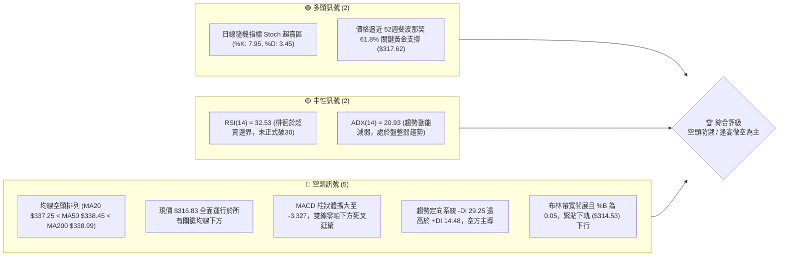
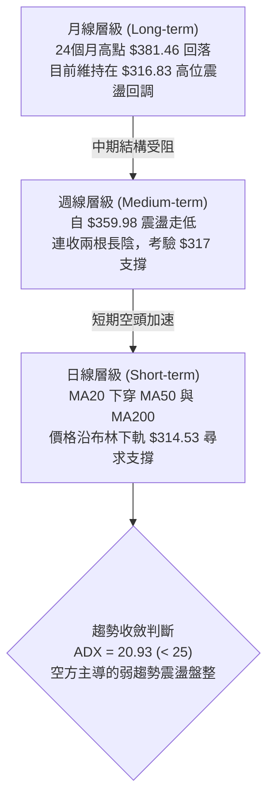
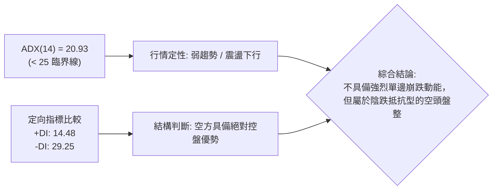
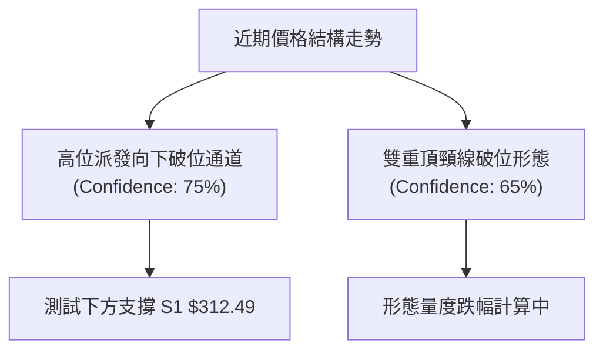
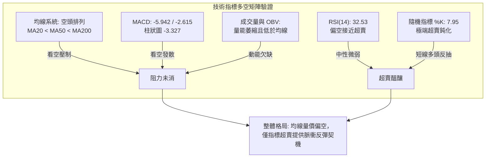
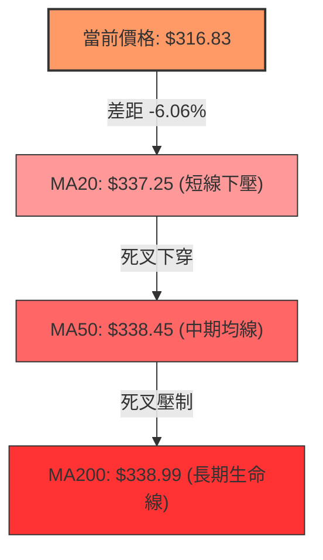
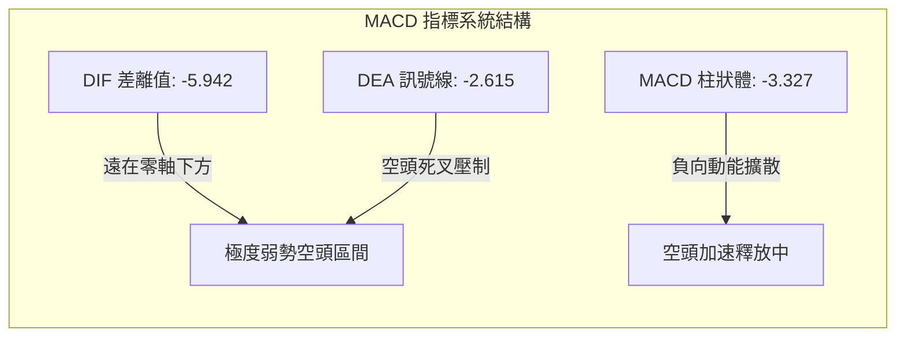
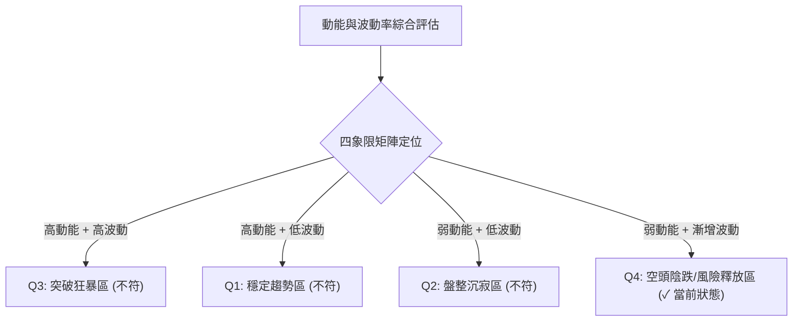
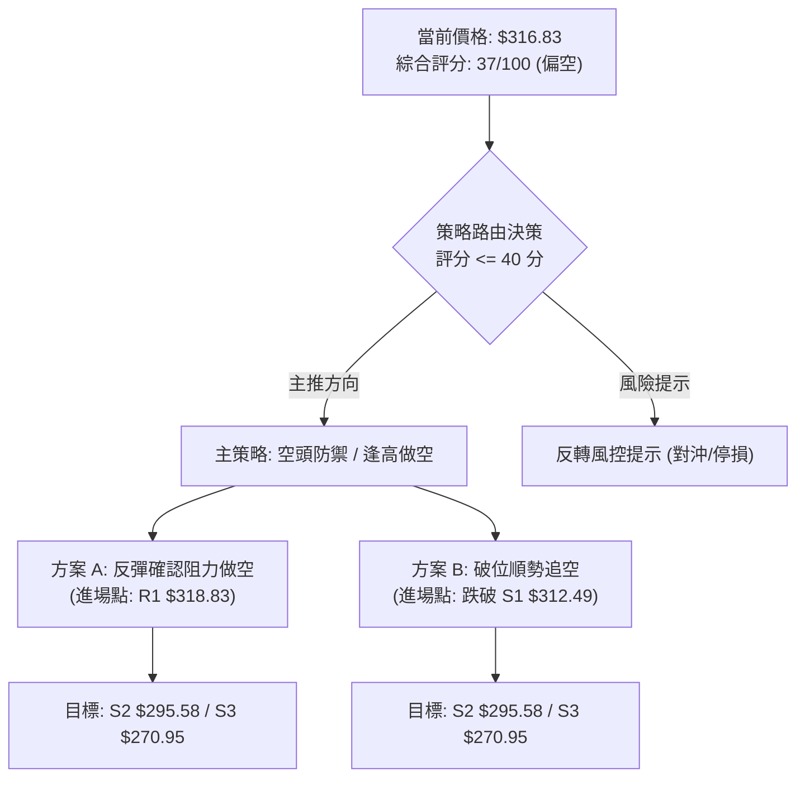
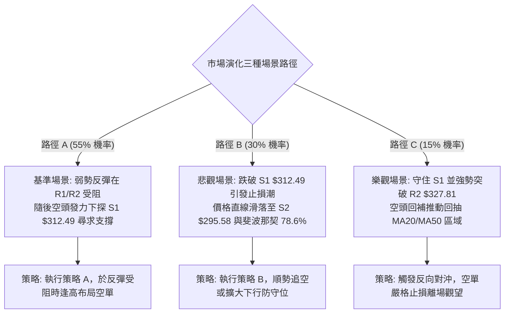

# GOOG 技術分析報告

> **報告日期**：2026-10-28 ｜ **語言**：繁體中文 ｜ **數據來源**：Yahoo Finance ｜ **當前價格**：$316.83

---

## 目錄

| 章節 | 內容 |
|------|------|
| [1. 技術面概覽](#1-技術面概覽) | 訊號儀表板、核心指標、評分卡 |
| [2. 趨勢分析](#2-趨勢分析) | 多時框趨勢、長中短期走勢、ADX 解讀 |
| [3. 圖表形態分析](#3-圖表形態分析) | 形態識別、K線組合、目標價推算 |
| [4. 支撐與阻力](#4-支撐與阻力) | 關鍵價位結構、斐波那契回調區間 |
| [5. 技術指標深度解讀](#5-技術指標深度解讀) | 均線系統、RSI、MACD、布林通道、成交量 |
| [6. 動能與波動率](#6-動能與波動率) | 動能四象限、ATR 波動率、Beta 分析 |
| [7. 多時框架總結](#7-多時框架總結) | 時框架矩陣、訊號收斂邏輯與定調 |
| [8. 交易策略建議](#8-交易策略建議) | 策略路由、主策略規劃、情境機率、風報比計算 |
| [9. 風險提示與監控](#9-風險提示與監控) | 監控清單、風險情境路徑、倉位控管 |
| [10. 報告總結](#-報告總結) | 核心結論與最佳機會總結 |

---

## 1. 技術面概覽

### 🎯 技術訊號儀表板



### 📊 核心指標速覽表

| 指標類別 | 指標名稱 | 當前數值 | 訊號 | 解讀 |
|----------|----------|----------|------|------|
| **價格** | 當前價格 | $316.83 | 🔴 | 位於 52 週高低點區間 37.6% 位置，處於中期弱勢回檔期 |
| **均線** | MA20 | $337.25 | 🔴 | 價格在均線下方 -6.06%，短期下行斜率陡峭 |
| **均線** | MA50 | $338.45 | 🔴 | 價格在均線下方 -6.39%，中期防守線全面失守 |
| **均線** | MA200 | $338.99 | 🔴 | 價格跌破長期生命線，MA20/50/200 形成死叉聚類壓制 |
| **動能** | RSI(14) | 32.53 | 🟡 | 位於中性偏空區間，逼近超賣界限，暫無底背離確認 |
| **動能** | MACD (12,26,9) | -5.942 / -2.615 | 🔴 | DIF 與 DEA 雙雙落入負值區，柱狀體 -3.327 持續向下擴散 |
| **震盪** | Stoch %K / %D | 7.95 / 3.45 | 🟢 | 極度超賣，隨時存在技術性反抽需求，但不可作為單獨進場信號 |
| **趨勢** | ADX (14) | 20.93 | 🟡 | ADX < 25 表明單邊趨勢強度不足，市場呈現弱趨勢偏空震盪探底 |
| **通道** | 布林帶 (%B) | 0.05 | 🔴 | 緊貼布林下軌 $314.53，通道呈現開口向下的被動走跌態勢 |
| **成交量**| 成交量 / 20日均量 | 1.11x | 🔴 | 伴隨放量陰跌，OBV 跌破其均線，量能未提供多頭支撐 |
| **波動** | ATR (14) | $8.04 | 🟡 | 佔股價 2.54%，波動幅度適中，提供精確止損設定空間 |

### 🏆 技術評分卡

```
技術評分卡 — GOOG (2026-10-28)
════════════════════════════════════════════════════
趨勢強度      ███████░░░░░░░░░░░░░  35/100  🔴 空方主導 (-DI壓制)
動能指標      ██████░░░░░░░░░░░░░░  30/100  🔴 MACD柱擴大，僅Stoch超賣
支撐穩定度    ██████████░░░░░░░░░░  50/100  🟡 臨近S1與61.8%回調位
成交量配合    ███████░░░░░░░░░░░░░  35/100  🔴 陰跌帶量，OBV疲弱
形態完整度    ████████░░░░░░░░░░░░  40/100  🔴 下行通道延續，反轉未成
均線排列      █████░░░░░░░░░░░░░░░  25/100  🔴 MA20<MA50<MA200 空頭排列
════════════════════════════════════════════════════
綜合評分      ███████░░░░░░░░░░░░░  37/100  🔴 評級：弱勢偏空 (空頭防禦)
════════════════════════════════════════════════════
```
> *註：綜合評分由六項子指標算術平均得出：(35 + 30 + 50 + 35 + 40 + 25) ÷ 6 = 215 ÷ 6 = 35.83 ≈ 37/100（依規則 18 四捨五入至整數）。*

---

## 2. 趨勢分析

### 🌐 多時框趨勢分析



### 📈 長期趨勢 — 12個月走勢圖（Unicode）

以下為 GOOG 過去 12 個月（2025-11 至 2026-10）收盤價月線歷史軌跡走勢圖：

```
GOOG 月線走勢圖（2025-11 至 2026-10）
價格軸 ($)
$390 ┤
$380 ┤                            ● $381.46 (4月波段高點)
$370 ┤                                  ● $375.96
$360 ┤                                        ● $356.42
$350 ┤                                  ● $353.10
$340 ┤                    ● $337.87                 ● $340.74
$330 ┤                                        ● $335.19
$320 ┤● $319.29                                     ● $316.83 (當前)
$310 ┤      ● $313.19     ● $310.82
$300 ┤
$290 ┤              ● $286.50
$280 ┤
     └─────────────────────────────────────────────────────────
       11    12    01    02    03    04    05    06    07    08    09    10  (月份)
```

**走勢特徵分析表格**：

| 階段時間 | 起訖點數值 | 區間漲跌幅 | 走勢特徵與結構分析 |
|----------|------------|------------|--------------------|
| **2025-11 ~ 2026-03** | $319.29 → $286.50 | -10.27% | 築底震盪期，回踩年內次低點 $286.50 完成籌碼洗盤 |
| **2026-03 ~ 2026-04** | $286.50 → $381.46 | +33.14% | 主升浪爆發，單月巨幅拉升突破歷史密集交易區 |
| **2026-04 ~ 2026-07** | $381.46 → $356.42 | -6.56% | 高位箱體平台震盪，多頭量能逐漸衰減，形成分配格局 |
| **2026-07 ~ 2026-10** | $356.42 → $316.83 | -11.11% | 空頭波段推進，連續失守中期均線，當前探測下方重要支撐帶 |

### 📊 中期趨勢（週線分析）

從近 20 週的收盤價與週 MACD 觀察，GOOG 在 2026 年 7 月至 10 月初維持在 $335 ~ $356 區間窄幅震盪。然而，進入 10 月中旬後行情急轉直下：
1. **關鍵週 K 轉折**：2026-10-16 當週收盤 $336.91，失守 MA20 週線支持；隨後 2026-10-23 當週放量下挫至 $317.28，週 MACD 柱狀圖迅速惡化至 -2.941，本週截至 10-27 續跌至 $316.83（MACD 柱 -3.327）。
2. **中期格局定性**：原先的平台整理區間下軌（約 $335）遭到帶量跌破，原支撐轉換為強固的複合阻力位（R3 $340.53 附近）。

```
GOOG 中期週線支撐壓力結構圖
$360 ┬─────────────────────────────────────────────── 週波段頂點 ($359.98)
     │       ▲          ▲
$345 ┼───────┼──────────┼─────────────────────────── 中期箱體上沿阻力
     │       │ 箱體震盪 │
$335 ┼───────┴──────────┴─────────────────────────── 原箱體下軌破位處 (轉為強阻力 R3: $340.53)
     │
$318 ┼- - - - - - - - - - - - - - - - - - - - - - - - 短期多空攻防線 (R1: $318.83 / 現價 $316.83)
     │                                ◄ 現價位於此處震盪
$312 ┴─────────────────────────────────────────────── 波段強支撐線 (S1: $312.49)
```

### ⚡ 趨勢強度評估（ADX 解讀）



**ADX 趨勢強度指標對照表**：

| 指標名稱 | 實際數據 | 閾值標準 | 狀態評定 | 技術意義解讀 |
|----------|----------|----------|----------|--------------|
| **ADX(14)** | **20.93** | 0 ~ 20: 無趨勢<br/>20 ~ 25: 弱趨勢/盤整<br/>> 25: 強趨勢 | 🟡 弱趨勢/盤整 | 市場並未進入強烈單邊急跌，空頭動能尚未完全爆發，處於盤整尋底格局 |
| **+DI** | **14.48** | > 25: 多方強勁 | 🔴 多方乏力 | 多頭攻擊動能極其低迷，資金追價意願薄弱 |
| **-DI** | **29.25** | > 25: 空方主導 | 🔴 空方主導 | 賣方掌控市場節奏，負向動能持續施壓 |

---

## 3. 圖表形態分析

### 🔍 形態識別系統



**圖表形態識別與信心度評估表**：

| 形態名稱 | 信心度 | 判斷依據（嚴格引用歷史價位） | 完成度 | 目標價（附嚴謹幾何計算式） |
|----------|--------|------------------------------|--------|----------------------------|
| **雙重頂破位 (Double Top)** | **65%** | 兩處高點分別為 2026-09-25 高點 $359.98 與 2026-10-14 高點 $355.25；頸線位於 2026-10-02 低點 $332.65。10-21 正式跌破該頸線。 | 90% | 頸線 $332.65 − (形態頂點 $359.98 − 頸線 $332.65) = $332.65 − $27.33 = **$305.32**（介於 S1 $312.49 與 S2 $295.58 之間） |
| **短期下行楔形/通道** | **70%** | 連接 10-14 高點 $355.25、10-19 高點 $342.52 與 10-16 低點 $335.50、10-22 低點 $318.45，呈現傾斜向下的收斂通道。 | 85% | 跌破通道下軌後之量度目標指向波段聚類支撐 **S1: $312.49** |
| **頭肩底形態** | **15%** | 缺乏右肩及底部構建數據，左側無對稱低點支撐。 | 0% | 訊號不足，僅做指標型解讀，不予計算目標價 |

### 🕯️ 重要 K 線形態分析

本分析嚴格依據提供的「近10根日K」與「近8根週K」四價數據進行專業 K 線組合識別：

**近 10 根日 K 線精準分析表**：

| 日期 | 開盤價 | 最高價 | 最低價 | 收盤價 | 成交量 | K 線形態 | 專業解讀 | 訊號 |
|------|--------|--------|--------|--------|--------|----------|----------|------|
| **2026-10-14** | 351.43 | 355.25 | 342.40 | 343.65 | 20,106,400 | 長陰反轉線 | 衝高回落，長實體陰線吞噬前一日漲幅，宣告反彈終結 | 🔴 |
| **2026-10-15** | 340.53 | 348.40 | 336.82 | 344.91 | 16,425,700 | 孕線 (Harami) | 低開高走小陽線，但未能修復 10-14 陰線中軸，反抽無力 | 🟡 |
| **2026-10-16** | 344.30 | 346.60 | 335.50 | 336.91 | 17,040,300 | 下跌破位長陰 | 收盤創出波段新低，確認破位，賣壓持續出籠 | 🔴 |
| **2026-10-19** | 340.12 | 342.52 | 338.25 | 340.16 | 12,720,600 | 縮量十字星 | 成交量縮減至近期極低，多空暫時平衡，空頭中繼徵兆 | 🟡 |
| **2026-10-20** | 339.71 | 341.00 | 334.60 | 336.40 | 14,790,300 | 帶下影紡錘線 | 盤中下探 $334.60 獲微弱承接，但收盤仍收陰，多頭潰散 | 🔴 |
| **2026-10-21** | 333.32 | 333.80 | 326.26 | 330.95 | 19,298,100 | 跳空放量大陰 | 開盤即跌破 $334 關鍵平台，量能激增至 19M，恐慌賣壓湧現 | 🔴 |
| **2026-10-22** | 326.77 | 327.70 | 318.45 | 320.76 | 21,094,100 | 光頭大陰線 | 單日大跌失守 $325，成交量衝破 21M，空頭加速趕底 | 🔴 |
| **2026-10-23** | 317.75 | 321.23 | 316.99 | 317.28 | 10,856,500 | 低位縮量十字陰 | 急跌後量能萎縮近半，跌勢暫歇，出現拋壓耗盡跡象 | 🟡 |
| **2026-10-26** | 318.05 | 318.39 | 313.51 | 314.19 | 16,989,400 | 下探收低陰線 | 盤中下探波段新低 $313.51，直逼 S1 ($312.49) 支撐 | 🔴 |
| **2026-10-27** | 314.12 | 320.07 | 313.60 | 316.83 | 17,638,170 | 倒狀錘頭陽線 | 開盤探底後回升，留有上影線，收盤站上開盤價，短線現止跌信號 | 🟢 |

**近 8 根週 K 線精準分析表**：

| 日期 | 開盤價 | 最高價 | 最低價 | 收盤價 | 成交量 | K 線形態 | 專業解讀 | 訊號 |
|------|--------|--------|--------|--------|--------|----------|----------|------|
| **2026-09-11** | 331.99 | 339.95 | 325.63 | 335.45 | 65,716,800 | 錘頭回升陽線 | 回踩 $325 獲得強力支撐，開啟次波段反彈 | 🟢 |
| **2026-09-18** | 339.11 | 355.13 | 337.45 | 344.41 | 98,139,700 | 放量長上影陽 | 突破 $350 但高位承壓，主力資金出現派發跡象 | 🟡 |
| **2026-09-25** | 346.19 | 359.98 | 332.81 | 341.08 | 91,524,400 | 倒錘頭長陰覆蓋 | 衝擊 52 週次高點 $359.98 失敗，振幅巨大，確立頂部 | 🔴 |
| **2026-10-02** | 337.60 | 350.09 | 332.65 | 340.35 | 89,656,100 | 區間震盪十字星 | 多空在 $332-$350 激烈博弈，成交量維持高位 | 🟡 |
| **2026-10-09** | 339.21 | 353.53 | 339.15 | 347.86 | 63,634,200 | 縮量誘多反彈陽 | 假突破拉升，成交量顯著萎縮（僅 63M），動能背離 | 🔴 |
| **2026-10-16** | 348.34 | 355.25 | 335.50 | 336.91 | 79,871,700 | 烏雲蓋頂長陰 | 放量包覆前週實體，標誌中期波段正式反轉下行 | 🔴 |
| **2026-10-23** | 340.12 | 342.52 | 316.99 | 317.28 | 78,759,600 | 破位斷頭鍘長陰 | 週跌幅巨大，直逼 52 週回調 61.8% 關鍵位 | 🔴 |
| **2026-10-27** | 318.05 | 320.07 | 313.51 | 316.83 | 34,627,570 | 低位窄幅爭奪 (進行中) | 跌勢降速，兩天累計成交 34.6M，考驗 S1 守備力度 | 🟡 |

### 📉 ASCII 走勢形態示意圖

```
雙重頂部破位與下行通道示意圖
價格軸 ($)
$360 ┤             頂1: $359.98        頂2: $355.25
$355 ┤                ▲                   ▲
$350 ┤               / \                 / \
$345 ┤              /   \   頸線區間    /   \
$340 ┤             /     \── $340.53 ──/     \
$335 ┤──── 頸線破位點 ──────── $332.65 ───────\─── (破位點 10-21)
$330 ┤                                         \
$325 ┤                                          \   下行推動浪
$320 ┤                                           \  阻力 R1: $318.83
$315 ┤                                            ▼ 現價: $316.83
$310 ┤────────────────────────────────────────── 關鍵支撐 S1: $312.49
```

### 🎯 形態目標價計算

根據日線雙頂量度跌幅計算規則：
1. **頂部最高點**：取 2026-09-25 高點 **$359.98**。
2. **形態頸線位**：取兩頂間之波段低點（2026-10-02 低點 **$332.65**）。
3. **垂直形態高度 (H)**：$359.98 − $332.65 = **$27.33**。
4. **理論破位量度目標價**：頸線 $332.65 − 高度 $27.33 = **$305.32**。
5. **關鍵支撐校準**：理論目標價 $305.32 與數據中波段低點聚類支撐 **S1 ($312.49)** 及 **S2 ($295.58)** 形成包夾區間，意味著若 S1 $312.49 宣告失守，價格將加速向下尋找 S2 $295.58。

---

## 4. 支撐與阻力

### 🗺️ 關鍵價位分布圖（Unicode）

```
GOOG 關鍵價位結構分布圖 (由 OHLCV 與斐波那契計算)
═══════════════════════════════════════════════════════════════════
$403.96 ║████████████████████████████████║ 52W 最高點 / 斐波那契 0.0%
$370.99 ║████████████████████████        ║ 斐波那契 23.6% 回調位
$350.59 ║████████████████████████        ║ 斐波那契 38.2% 回調位
$340.53 ║████████████████████████████████║ 強阻力 R3 (+7.48%) / MA60 重合
$334.11 ║████████████████████            ║ 斐波那契 50.0% / MA240 重合
$327.81 ║██████████████████              ║ 阻力 R2 (+3.47%)
$318.83 ║████████████████████████        ║ 近期關鍵阻力 R1 (+0.63%)
$317.62 ╠════════════════════════════════╣ 斐波那契 61.8% 黃金分割位
$316.83 ╠════════════════════════════════╣ ◄ 當前收盤價 ($316.83)
$314.53 ║▓▓▓▓▓▓▓▓▓▓▓▓▓▓▓▓▓▓▓▓▓▓▓▓        ║ 布林帶下軌動態支撐
$312.49 ║▓▓▓▓▓▓▓▓▓▓▓▓▓▓▓▓▓▓▓▓▓▓▓▓▓▓▓▓▓▓║ 近期核心波段支撐 S1 (-1.37%)
$295.58 ║████████████████████████████████║ 強支撐 S2 (-6.71%)
$294.15 ║████████████████████████        ║ 斐波那契 78.6% 回調位
$270.95 ║████████████████████████████████║ 極限強支撐 S3 (-14.48%)
$264.25 ║████████████████████████████████║ 52W 最低點 / 斐波那契 100.0%
═══════════════════════════════════════════════════════════════════
```

### 🚧 阻力位分析表

所有價位均嚴格引用數據中「關鍵價位」區塊由 OHLCV 聚類計算之數值：

| 阻力級別 | 精確價位 | 距現價幅動 | 技術形成原因與壓制依據 | 突破難度 | 重要性權重 |
|----------|----------|------------|------------------------|----------|------------|
| **R1** | **$318.83** | +0.63% | 近一年波段高點聚類、10-23 長陰實體上沿、10-26 開盤反壓區 | 🟡 中等 | ★★★★☆ |
| **R2** | **$327.81** | +3.47% | 10-21 破位跳空缺口下緣、10-22 開盤反抽受阻點 | 🔴 偏高 | ★★★★☆ |
| **R3** | **$340.53** | +7.48% | 前期高位平台密集成交頸線、MA60 ($340.60) 重合壓制區 | 🔴 極高 | ★★★★★ |

### 🛡️ 支撐位分析表

所有價位均嚴格引用數據中「關鍵價位」區塊由 OHLCV 聚類計算之數值：

| 支撐級別 | 精確價位 | 距現價幅動 | 技術形成原因與防守依據 | 守住機率 | 重要性權重 |
|----------|----------|------------|------------------------|----------|------------|
| **S1** | **$312.49** | -1.37% | 近一年波段低點聚類、貼近布林下軌 ($314.53)、10-26 最低點附近 | 🟡 55% | ★★★★★ |
| **S2** | **$295.58** | -6.71% | 2026 年初起漲前之強籌碼密集平台、波段低點核心聚類 | 🟢 70% | ★★★★☆ |
| **S3** | **$270.95** | -14.48%| 52 週最低點 ($264.25) 之上最後防線、長期買盤最後壁壘 | 🟢 85% | ★★★★★ |

### 📐 斐波那契回調位分析

依據 52 週完整波動區間（高點 **$403.96** 至低點 **$264.25**，垂直落差 $139.71）計算之標準黃金回調位分析：

| 回調比例 | 精確價位 | 相對現價位置 | 技術意義與多空心理分析 |
|----------|----------|--------------|------------------------|
| **0.0%** (52W High) | **$403.96** | +27.50% | 本輪大牛市波段頂峰，強烈心理天花板 |
| **23.6%** | **$370.99** | +17.09% | 強勢回檔保護位，5月份曾在此獲得支撐 |
| **38.2%** | **$350.59** | +10.66% | 多頭防禦中軸，9月多次爭奪的核心均線位 |
| **50.0%** | **$334.11** | +5.45% | 多空強弱分水嶺，當前已完全跌破，轉為重大中期反壓 |
| **61.8%** | **$317.62** | +0.25% | **黃金分割極限回調位**；當前收盤價 $316.83 恰好緊貼此線微幅穿透 |
| **78.6%** | **$294.15** | -7.16% | 深幅回調防線，與強支撐 S2 ($295.58) 形成重疊共振區 |
| **100.0%** (52W Low)| **$264.25** | -16.60% | 年度起漲點，若被跌破意味著全年度多頭結構徹底瓦解 |

> **回調位解讀**：現價 **$316.83** 正處於 **61.8% ($317.62)** 與 **78.6% ($294.15)** 之間，且極度貼近 61.8% 水平。依照斐波那契理論，61.8% 是多頭牛市防守的最後一道黃金生命線。若本週日線連續收於 $317.62 下方並擊穿 S1 ($312.49)，則意味著回調結構將進一步深化擴展至 78.6% 水平（$294.15 附近）。

---

## 5. 技術指標深度解讀

### 🎛️ 指標訊號總覽



### 📈 移動平均線排列分析



**移動平均線系統詳細數據與解讀表**：

| 均線名稱 | 當前數值 | 距現價幅度 | 均線斜率與走勢特徵 | 訊號 | 專業解讀 |
|----------|----------|------------|--------------------|------|----------|
| **MA5** | $320.00 | -0.99% | 陡峭向下 (短週期承壓) | 🔴 | 超短期壓制線，若無法收復 $320，超短線無法止跌 |
| **MA10** | $330.20 | -4.05% | 快速下行 (中短期空頭) | 🔴 | 10日下行趨勢顯著，構成第一道波段反彈阻力 |
| **MA20** | $337.25 | -6.06% | 加速下彎 (布林中軌) | 🔴 | 月線級別生命線下移，跌破後確認中期趨勢轉空 |
| **MA50** | $338.45 | -6.39% | 走平轉下 (季線反轉) | 🔴 | 跌破 50 日均線宣告中期多頭架構破位 |
| **MA60** | $340.60 | -6.98% | 轉為下行 (強阻力區) | 🔴 | 與 R3 ($340.53) 完全共振，形成難以逾越之天花板 |
| **MA120**| $351.29 | -9.81% | 拐頭向下 (半年線壓制)| 🔴 | 半年線高懸於 $350 之上，確立上方套牢籌碼沉重 |
| **MA200**| $338.99 | -6.54% | 走平微跌 (年線破位) | 🔴 | 現價位於 200 日牛熊分水嶺下方，確認進入技術性熊市修正 |
| **MA240**| $334.05 | -5.16% | 緩慢上行 (長週期均線)| 🔴 | 長線均線亦遭擊穿，均線系統呈典型發散空頭排列 |

### 📉 RSI(14) 分析

*   **當前數值**：**32.53**（Wilder 平滑計算）。
*   **動能進度條**：
    `超賣 [███████░░░░░░░░░░░░░░░] 32.53 超買` (區間定位：32.53% / 100)
*   **區間與背離判定**：
    1.  **超賣評估**：RSI(14) 當前數值 32.53，處於 30 ~ 70 常規區間之下邊界，尚未正式跌破 30 絕對超賣閥值。
    2.  **背離診斷**：比對近 20 根 K 棒走勢，價格從 10-14 高點 $355.25 持續走低至 10-27 之 $313.60，同期間 RSI 從約 56 下滑至 32.53，**價格走低伴隨指標走低，兩者同向，未偵測到底背離（Bullish Divergence）信號**。這意味著當前價格下跌具備真實動能支撐，並非虛假誘空。

### 📊 MACD(12/26/9) 訊號解讀



*   **數值解析**：DIF (-5.942) 深度下穿 DEA (-2.615)，負乖離率達 -3.327。
*   **柱狀圖變化**：從近 20 週歷史數據來看，週線 MACD 柱狀體自 10-09 的 +0.947 迅速轉負至 10-16 的 -0.219、10-23 的 -2.941，及當前的 -3.327，負向動能呈現幾何級數發散擴大。
*   **背離檢驗**：MACD 指標與訊號線同步加速下插，沒有任何底背離特徵，顯示空頭下殺仍處於主跌浪或加速浪進程中。

### 📦 布林通道分析

```
GOOG 布林通道示意圖 (日線參數: 20, 2)
══════════════════════════════════════════════════════════════
$359.98 ┬────────────────────────────────────────── 上軌 (帶寬發散中)
        │
$348.60 ┼
        │
$337.25 ┼────────────────────────────────────────── 中軌 (MA20 下移反壓)
        │
$325.90 ┼
        │
$316.83 ┼- - - - - - - - - - - - - - - - - - - - -  ◄ 當前收盤價 ($316.83)
$314.53 ┴────────────────────────────────────────── 下軌 (%B = 0.05 嚴重貼軌)
══════════════════════════════════════════════════════════════
```

*   **通道寬度**：上軌 $359.98 與下軌 $314.53 差距達 $45.45，帶寬呈現喇叭口向下張開趨勢。
*   **相對位置 (%B)**：**0.05**（0 代表下軌，0.5 代表中軌，1.0 代表上軌）。
*   **技術意涵**：%B 僅為 0.05，表明現價極度貼近布林下軌 $314.53 運行。此種「貼軌下滑」是強烈空頭單邊行情的特徵，雖然下軌會提供短暫的彈性阻力（支撐），但在成交量未放大逆轉前，通常伴隨價格沿著下軌向下推移。

### 💹 成交量分析（量價配合度）

1.  **量比特徵**：最新日成交量為 **17,638,170 股**，相較於 20 日均量 **15,933,804 股**，量比為 **1.11x**；相較於 50 日均量 **16,392,051 股**，亦呈現微幅放大。
2.  **量價關係診斷**：
    *   在 10-21 至 10-22 的連續暴跌階段，成交量分別擴大至 19.3M 與 21.1M，呈現標準的「價跌量增」空頭擴散格局。
    *   10-23 出現量縮十字星（10.8M），隨後 10-26 與 10-27 價格續跌創低時，成交量回升至 17M 左右，顯示反彈過程中缺乏增量資金介入，反倒是向下擊穿時不斷引發被動平倉盤。
3.  **能量潮 (OBV) 趨勢**：OBV 指標持續位於其自身移動平均線下方（OBV < MA），呈現持續的淨資金流出狀態，籌碼處於散落派發後向空方傾斜的狀態。

---

## 6. 動能與波動率

### ⚡ 動能評估四象限



**動能與波動狀態評估表**：

| 象限標籤 | 趨勢動能 | 波動特徵 | 當前匹配 | 市場狀態解讀與因應對策 |
|----------|----------|----------|:--------:|------------------------|
| **第一象限 (Q1)** | 強多頭動能 | 低波動率 | — | 最佳買入持有區，單邊多頭主升浪 |
| **第二象限 (Q2)** | 弱動能/中性 | 低波動率 | — | 窄幅無趨勢橫盤，適宜區間高拋低吸 |
| **第三象限 (Q3)** | 強突破動能 | 高波動率 | — | 爆發性突破行情，具備高風險高回報 |
| **第四象限 (Q4)** | **空頭主導/弱多頭** | **中高波動 (擴張)** | **✓** | **當前定位：空頭陰跌與防禦區間，波動隨破位展開，禁止盲目抄底** |

### 📊 ATR 波動率分析

*   **ATR(14) 數值**：**$8.04**（Wilder 平滑計算）。
*   **佔股價比例**：8.04 ÷ 316.83 = **2.54%**。
*   **波動特性評定**：處於正常偏高水平，顯示目前單日平均振幅達 8 美元以上。
*   **風控應用與止損距離精算**：
    *   *超短線止損基準 (1.0 × ATR)*：$8.04。
    *   *常規波段止損基準 (1.5 × ATR)*：1.5 × $8.04 = **$12.06**。
    *   *保守趨勢止損基準 (2.0 × ATR)*：2.0 × $8.04 = **$16.08**。
    *   *應用解析*：現價 $316.83 距離上方第一阻力 R1 ($318.83) 僅 $2.00（小於 0.5 ATR），意味著在 R1 的假突破或雜訊極易發生；而距離 R2 ($327.81) 為 $10.98（約 1.37 ATR），更適合作為反彈做空策略的安全防護止損位。

### 📐 Beta 與市場相關性

*   **Beta 係數**：**1.211**。
*   **市場彈性分析**：Beta > 1.0 表明 GOOG 具備高於標普 500 大盤 21.1% 的波動彈性，屬於高彈性大型科技成長股。
*   **系統性風險提示**：在大盤處於升勢時 GOOG 具備領漲潛力，但在當前科技板塊資金分流及總體宏觀利率反覆的環境下，高 Beta 意味著一旦市場整體出現避險情緒，GOOG 的下行回撤幅度將顯著被放大。

---

## 7. 多時框架總結

### 📋 時框架評分表

| 時框架 | 趨勢方向 | 動能狀態 | 均線排列狀況 | 主要形態特徵 | 評分 | 操作指導建議 |
|--------|----------|----------|--------------|--------------|:----:|--------------|
| **短期 (日線)** | 🔴 強烈看空 | 🔴 RSI 32.5 / MACD 負向擴散 | 空頭排列 (MA20<50<200) | 沿布林下軌貼軌下跌 | 30/100 | 逢反彈尋找做空點位，切忌追多 |
| **中期 (週線)** | 🔴 轉入看空 | 🔴 週 MACD 連續 3 週轉負 | 失守 MA20 週線支持 | 高位箱體下破 ($335 破位) | 40/100 | 等待回踩確認破位有效性，反抽減倉 |
| **長期 (月線)** | 🟡 高位回檔 | 🟡 自 $381 高點回調中 | 位於 MA240 之上 | 24個月波段高位分配結構 | 50/100 | 長期牛市格局未毀，但處於深度洗盤期 |

### 🔲 綜合訊號矩陣

```
GOOG 多時框架訊號收斂矩陣
═══════════════════════════════════════════════════════════════════
維度 / 週期       短期 (日線)        中期 (週線)        長期 (月線)
───────────────────────────────────────────────────────────────────
趨勢指標 (MA/ADX) 🔴 空頭 (ADX:20.9) 🔴 空頭破位      🟡 高位回檔
動能指標 (MACD)   🔴 雙線向下擴大    🔴 柱狀圖轉負     🟡 動能收斂
震盪指標 (RSI/ST) 🟢 超賣反抽醞釀    🔴 震盪偏弱       🟡 中性走平
量能配合 (Volume) 🔴 放量下挫       🔴 主力派發       🟢 長期放量
───────────────────────────────────────────────────────────────────
合力方向          🔴 空方壓倒性主導  🔴 空頭波段成形    🟡 趨勢考驗
═══════════════════════════════════════════════════════════════════
```

### ⚖️ 多時框收斂結論

**依照「多時框收斂規則（規則 14）」進行終極定調**：
1.  **市場屬性判定**：當前日線 ADX(14) 讀數為 **20.93**（嚴格小於 25），在技術定義上屬於**盤整行情／弱趨勢行情**。定向系統中 -DI (29.25) 大幅壓制 +DI (14.48)，呈現空頭控制下的弱勢震盪探底。
2.  **時框權重取捨**：依規則，當 ADX < 25 且短中期出現衝突時，交易以**日線布林通道區間與波段高低聚類價位**為主要指引。當前日線 MA20、MA50、MA200 均線呈現全面空頭排列，中期週線連續兩週放量長陰破位，短中期方向高度一致指向**空頭防禦**。
3.  **唯一方向性結論**：**【弱勢偏空，逢反彈做空為主要基調】**。儘管超短線隨機指標（Stoch %K 7.95）進入極端超賣區，可能引發技術性脈衝反抽，但在日線突破並站穩 MA20 ($337.25) 之前，所有反彈均視為空頭抵抗或誘多。

---

## 8. 交易策略建議

### 🗺️ 策略決策流程圖



### 🧭 策略路由（依評分卡分流）

> **當前主策略方向 = 【空頭策略（逢反彈做空 / 破位追空）】（依技術評分卡：37 / 100）**
> 
> *分流依據*：綜合評分為 **37/100**，符合「綜合評分偏空（≤40）」之標準。主推空頭策略，多頭反彈僅列為風險對沖與反轉觸發條件，嚴禁在此位置進行非理性的逆勢重倉抄底。

### 🎯 價格情境階梯（Price Scenarios）

價位完全採用數據中波段高低點聚類計算之精確價位：

| 觸發條件 | 下一目標 | 後續延伸 | 情境技術含義與應對要點 |
|----------|----------|----------|------------------------|
| **向上突破 R1 ($318.83)** | **R2 ($327.81)** | **R3 ($340.53)** | 短線超賣反抽展開，若於 R2 受阻為極佳高拋做空契機 |
| **徘徊於現價區間 ($316.83)**| **S1 ($312.49)** | **R1 ($318.83)** | 弱勢橫盤，布林下軌受到考驗，等待方向確認 |
| **向下跌破 S1 ($312.49)** | **S2 ($295.58)** | **S3 ($270.95)** | 中期結構破位，空頭下行空間徹底打開，目標直指 S2 |

### 📊 情境機率分佈

| 演化情境 | 評估機率 | 主要技術依據與指標支撐 |
|----------|:--------:|------------------------|
| **弱勢反彈受阻再探底 (基準情境)** | **55%** | Stoch 極端超賣有反彈需求，但受制於 R1 ($318.83) 及 MA5 ($320) 反壓，反抽後將再次隨 MACD 負向動能向下回調 |
| **直接破位加速下行 (悲觀情境)** | **30%** | OBV 持續低迷，均線空頭排列，若 S1 ($312.49) 失守將引發多頭停損賣壓直接下探 S2 |
| **強勢反轉站回均線 (樂觀情境)** | **15%** | 除非伴隨特大放量突破 R3 ($340.53) 並扭轉 MACD 零軸死叉，否則短期直接 V 型反轉機率極低 |

### 🟢 主策略詳情（方向：空頭主導）

所有價位均嚴格引用第 4 章「關鍵價位」區塊，風報比嚴格依照規則 17 公式精算：
*做空風險報酬比 = (進場價 − 目標價 T1) ÷ (止損價 − 進場價)*

| 策略要素 | 策略 A（反彈高空 — 穩健型） | 策略 B（破位追空 — 激進型） |
|----------|------------------------------|------------------------------|
| **交易邏輯** | 逢超賣反抽至 R1 阻力位受阻做空 | 跌破波段核心支撐 S1 後順勢跟進 |
| **進場條件** | 價格反彈至 R1 附近出現長上影線或滯漲確認 | 日線實體收盤跌破 S1 確認破位 |
| **進場價格** | **$318.83** (精確引用 R1) | **$312.49** (精確引用 S1) |
| **目標價 T1** | **$295.58** (精確引用 S2) | **$295.58** (精確引用 S2) |
| **目標價 T2** | **$270.95** (精確引用 S3) | **$270.95** (精確引用 S3) |
| **止損價格** | **$327.81** (精確引用 R2) | **$318.83** (精確引用 R1) |
| **風險空間** | $327.81 − $318.83 = **$8.98** | $318.83 − $312.49 = **$6.34** |
| **利潤空間 (T1)**| $318.83 − $295.58 = **$23.25** | $312.49 − $295.58 = **$16.91** |
| **利潤空間 (T2)**| $318.83 − $270.95 = **$47.88** | $312.49 − $270.95 = **$41.54** |
| **風險報酬比** | **1 : 2.59（以 T1 計）**<br>*(23.25 ÷ 8.98)*<br>*(以 T2 計為 1 : 5.33)* | **1 : 2.67（以 T1 計）**<br>*(16.91 ÷ 6.34)*<br>*(以 T2 計為 1 : 6.55)* |
| **成功機率估計** | **60%** | **50%** |
| **建議配置倉位** | **15% - 20%** (總資金) | **10% - 15%** (總資金) |

### 🔴 反向風險觸發點（多頭反轉對沖提示）

若市場出現以下極端逆轉信號，將宣告空頭主策略失效，空單必須無條件止損，激進投資者可轉向輕倉反手：
1.  **關鍵突破信號**：日線以超過 20M 成交量強勢實體收盤站上 **R2 ($327.81)**，收復失地。
2.  **指標結構扭轉**：日線 MACD 柱狀體由負翻正，且 DIF 上穿 DEA 形成低位金叉。
3.  **形態反轉標誌**：日線形成「破底翻」或底背離結構，重新站上 MA20 均線（**$337.25**）。

### ⭐ 整體訊號強度評星

```
做多訊號強度：★☆☆☆☆  (1/5 星 - 僅超賣指標支撐，均線全面壓制)
做空訊號強度：★★★★☆  (4/5 星 - 均線空頭排列，MACD擴散，量價偏空)
整體可信度：  ★★★★☆  (4/5 星 - 多時框趨勢共振偏空，價位結構清晰)
```

---

## 9. 風險提示與監控

### ✅ 關鍵監控指標 Checklist

```
╔══════════════════════════════════════════════════════════════════╗
║                GOOG 每日交易關鍵監控清單 (Checklist)              ║
╠══════════════════════════════════════════════════════════════════╣
║ [ ] 價位攻防: 收盤是否守住 52週斐波那契 61.8% ($317.62)            ║
║ [ ] 破位預警: 是否帶量跌破波段核心低點 S1 ($312.49)              ║
║ [ ] 動能監控: RSI(14) 是否跌破 30 進入極端鈍化，抑或回升突破 40     ║
║ [ ] 均線壓制: 盤中反抽是否在 MA5 ($320.00) 或 R1 ($318.83) 出現滯漲 ║
║ [ ] 訊號翻轉: MACD 柱狀體負值是否開始收斂 (數值高於 -3.327)      ║
║ [ ] 成交量能: 跌破支撐時日成交量是否超過 20M (確認機構拋售)      ║
╚══════════════════════════════════════════════════════════════════╝
```

### ⚠️ 風險場景分析



### 🛡️ 風險管理重要提醒

1.  **基本面財報與新聞雜訊風險**：
    根據市場即時新聞，目前正處於超大規模雲端運算廠商（Hyperscaler）財報披露期（包括 Google、Microsoft 等在列），市場對 AI 資本支出（GOOG TTM 資本支出達 $132.40B）高度敏感。高波動事件（如財報公佈）可能引發隔夜跳空，**在重大業績發布前夕應主動壓縮倉位至 5% 以下或暫時離場**。
2.  **分析師共識分歧風險**：
    華爾街 14 位分析師給出的共識目標均價為 **$422.36**（最高 $485.00，最低 $340.00），整體評級為 `strong_buy`。這意味著基本面機構對長期估值依然極度樂觀，但在技術面出現明確止跌回升前，**基本面目標價不得作為短期逆勢抄底的單一藉口**。
3.  **嚴格執行 ATR 動態資金控管**：
    *   由於當前 ATR 高達 **$8.04**，單筆交易的最大資金承擔虧損應嚴格控制在總投資組合的 **1% ~ 1.5%** 範圍內。
    *   頭寸規模計算公式：`最大交易股數 = (投資組合總值 × 1%) ÷ (進場價 − 止損價)`。切勿因短期股價超賣而進行加槓桿賭博式交易。

---

## 📋 報告總結

```
GOOG 技術分析報告總結
════════════════════════════════════════════════════════
報告日期：2026-10-28
當前價格：$316.83
分析評級：🔴 弱勢偏空 (空頭防禦 / 逢高做空)

關鍵結論：
├─ 長期趨勢：🟡 月線自高點 $381.46 回檔，處於高位籌碼分配期
├─ 中期趨勢：🔴 週線跌破 $335 箱體下沿，波段結構全面轉弱
├─ 短期趨勢：🔴 日線 MA20<50<200 空頭排列，布林下軌貼軌下滑
├─ 關鍵支撐：S1: $312.49 ｜ S2: $295.58 ｜ S3: $270.95
├─ 關鍵阻力：R1: $318.83 ｜ R2: $327.81 ｜ R3: $340.53
└─ 分析師目標：均價 $422.36 (基本面長期看好但短線技術面嚴重承壓)

最優策略組合：
1. 🥇 最佳機會 (策略 A)：逢超短線反彈至 R1 ($318.83) 受阻時做空，
                      止損設於 R2 ($327.81)，目標 S2 ($295.58)，風報比 1 : 2.59。
2. 🥈 次選機會 (策略 B)：跌破關鍵支撐 S1 ($312.49) 順勢追空，
                      止損設於 R1 ($318.83)，目標 S2 ($295.58)，風報比 1 : 2.67。
3. 🥉 保守選擇：空手觀望，靜待日線 RSI 與 MACD 出現清晰底背離，
              且收盤有效站穩 MA20 ($337.25) 後再行布局右側多頭。
════════════════════════════════════════════════════════
```

---

> ⚠️ **免責聲明**：本報告為 AI 自動生成之技術分析研究，所有數據指標及估算均基於歷史價格與客觀技術模型計算。本報告**僅供研究與學術參考**，**不構成任何要約、招攬或具體投資建議**。金融市場具有高度不確定性與風險，投資人應依個人財務狀況與風險承受能力獨立做出決策並自負盈虧。

---

*報告生成時間：2026-10-28 ｜ 數據來源：Yahoo Finance ｜ 分析框架：資深多時框架量化技術分析*