# GOOG 技術分析報告

> **報告日期**：2026-10-29 ｜ **語言**：繁體中文 ｜ **數據來源**：Yahoo Finance ｜ **當前價格**：$321.89

---

## 目錄

| 章節 | 內容 |
|------|------|
| [1. 技術面概覽](#1-技術面概覽) | 訊號儀表板、核心指標、評分卡 |
| [2. 趨勢分析](#2-趨勢分析) | 多時框趨勢、長中短期走勢 |
| [3. 圖表形態分析](#3-圖表形態分析) | 形態識別、K線組合、目標價 |
| [4. 支撐與阻力](#4-支撐與阻力) | 關鍵價位、斐波那契回調 |
| [5. 技術指標深度解讀](#5-技術指標深度解讀) | MA/RSI/MACD/布林/成交量 |
| [6. 動能與波動率](#6-動能與波動率) | 動能評估、ATR、Beta |
| [7. 多時框架總結](#7-多時框架總結) | 時框架評分矩陣 |
| [8. 交易策略建議](#8-交易策略建議) | 多空策略、風險報酬比 |
| [9. 風險提示與監控](#9-風險提示與監控) | 監控指標、風險場景 |

---

## 1. 技術面概覽

### 🎯 技術訊號儀表板

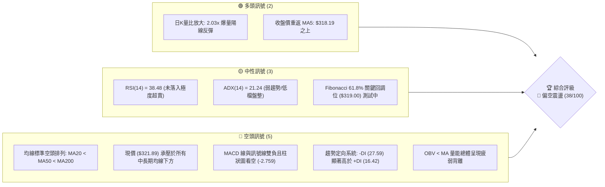

### 📊 核心指標速覽表

| 指標類別 | 指標名稱 | 當前數值 | 訊號 | 解讀 |
|----------|----------|----------|:----:|------|
| **價格** | 當前收盤價 | $321.89 | 🔴 | 位於 52 週區間 40.3% 分位，受制於多重均線壓制 |
| **均線** | MA5 | $318.19 | 🟢 | 現價高於 MA5（+$3.70，+1.16%），短線跌勢初現降速 |
| **均線** | MA20 | $336.31 | 🔴 | 現價低於 MA20（-$14.42，-4.29%），月線下行形成動態反壓 |
| **均線** | MA50 | $338.06 | 🔴 | 現價低於 MA50（-$16.17，-4.78%），中期多空分水嶺失守 |
| **均線** | MA200 | $338.94 | 🔴 | 現價低於 MA200（-$17.05，-5.03%），跌破年線長期支撐 |
| **均線架構** | 排列形態 | 空頭排列 | 🔴 | MA20 < MA50 < MA200，各週期均線均呈向下發散結構 |
| **動能** | RSI(14) | 38.48 | 🟡 | 位於中性偏弱區間（30–70），無極度超賣，無底背離 |
| **動能** | MACD (12,26,9) | -6.064 | 🔴 | MACD 線低於訊號線（-3.305），柱狀圖 -2.759 維持負值 |
| **擺動** | KD (%K / %D) | 20.08 / 9.89 | 🟡 | %K 上穿 %D 自超賣邊界拐頭，但動能仍受空方壓制 |
| **趨勢** | ADX / ±DI | ADX: 21.24 | 🟡 | ADX < 25 表明處於盤整或弱趨勢，-DI (27.59) > +DI (16.42) 空方主導 |
| **通道** | 布林通道 %B | 0.20 | 🟡 | 位於下軌 ($312.65) 與中軌 ($336.31) 之間偏下緣位置 |
| **成交量** | 成交量 / 20日均量 | 33.36M / 16.40M | 🟢 | 量比 2.03x，財報後放量下影反彈，但需觀察量能持續性 |
| **波動** | ATR(14) | $7.92 | 🟡 | 佔現價 2.46%，波動率中等偏高，短線單日震盪幅度擴大 |

### 🏆 技術評分卡

```
╔════════════════════════════════════════════════════════════════════════╗
║                   技術評分卡 — GOOG (2026-10-29)                      ║
╠════════════════════════════════════════════════════════════════════════╣
║ 趨勢強度      ███████░░░░░░░░░░░░░  35/100  🔴 空頭主導 / ADX弱趨勢     ║
║ 動能指標      ██████░░░░░░░░░░░░░░  30/100  🔴 MACD負向擴大/RSI偏弱    ║
║ 支撐穩定度    ███████████░░░░░░░░░  55/100  🟡 Fib 61.8% / S1 發揮支撐 ║
║ 成交量配合    █████████░░░░░░░░░░░  45/100  🟡 爆量反彈但整體OBV偏弱   ║
║ 形態完整度    ████████░░░░░░░░░░░░  40/100  🟡 處於箱體下緣未形成底形  ║
║ 均線排列      █████░░░░░░░░░░░░░░░  25/100  🔴 MA20<MA50<MA200空頭排列 ║
╠════════════════════════════════════════════════════════════════════════╣
║ 綜合評分      ████████░░░░░░░░░░░░  38/100  🔴 評級：偏空震盪          ║
║ (依規則18算術平均: (35+30+55+45+40+25) ÷ 6 = 38.33 → 四捨五入為 38)     ║
╚════════════════════════════════════════════════════════════════════════╝
```

---

## 2. 趨勢分析

### 🌐 多時框趨勢分析

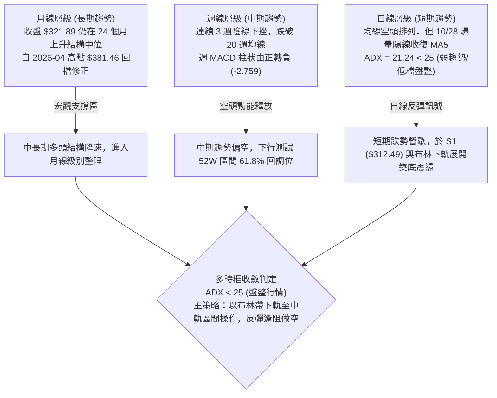

### 📈 長期趨勢 — 12 個月走勢圖（Unicode）

以下為 GOOG 過去 12 個月（2025-11 至 2026-10）月線收盤價走勢圖，標記歷史峰值與主要波動轉折點：

```
GOOG 月線走勢圖（過去12個月：2025-11 至 2026-10）
價格軸 ($)
$390 ┤
$380 ┤                            ● $381.46 (2026-04 歷史高點)
$370 ┤                                █
$360 ┤                                █   ● $356.42
$350 ┤                                █   █
$340 ┤                    ● $337.87   █   █   █       ● $340.74
$330 ┤                    █           █   █   █   █   █
$320 ┤● $319.29           █   ● $310.82   █   █   █   █   █   ● $321.89 (當前)
$310 ┤    █   ● $313.19   █   █       █   █   █   █   █   █   █
$300 ┤    █   █           █   █       █   █   █   █   █   █   █
$290 ┤    █   █           █   █   ● $286.50 (2026-03 波段低點)
     └────┬───┬───────────┬───┬───┬───┬───┬───┬───┬───┬───┬────
        25-11 25-12     26-01 26-02 26-03 26-04 26-05 26-06 26-07 26-08 26-09 26-10
```

**12 個月走勢特徵分析表**：

| 時間階段 | 起訖月份 | 起訖收盤價 | 漲跌幅 | 階段走勢特徵分析 |
|----------|----------|------------|:------:|------------------|
| **第 1 階段** | 2025-11 → 2026-01 | $319.29 → $337.87 | +5.82% | 年底作帳推升，高檔窄幅震盪強勢走升 |
| **第 2 階段** | 2026-01 → 2026-03 | $337.87 → $286.50 | -15.20% | 第一季估值修正，下探波段低位 $286.50（接近 S2 $295.58 支撐區） |
| **第 3 階段** | 2026-03 → 2026-04 | $286.50 → $381.46 | +33.14% | 財報強勁與 AI 催化，單月暴漲突破 $380 創歷史波段天價 |
| **第 4 階段** | 2026-04 → 2026-07 | $381.46 → $356.42 | -6.56% | 高檔獲利了結，維持高位箱體橫盤，回測 $350 關卡 |
| **第 5 階段** | 2026-07 → 2026-10 | $356.42 → $321.89 | -9.69% | 財報 AI 資本支出疑慮引發連續回調，跌破 MA200 尋求支撐 |

### 📊 中期趨勢（週線分析）

從近 20 週收盤走勢觀察，自 2026-06-18 收盤價 $367.22 以來，股價呈現典型的「震盪下行旗形」結構。近 3 週呈現加速探底走勢：
- 2026-10-09 當週高點來到 $353.53，收於 $347.86（RSI 為 56.0）；
- 隨後兩週連續下挫，2026-10-23 週收盤重挫至 $317.28（RSI 跌至 30.9，週 MACD 柱擴大至 -2.941）；
- 本週（截至 2026-10-28）最低下探 $313.51，收於 $321.89，週成交量達 68,137,000，出現下影線防守特徵。

```
中期週線空間結構（近期關鍵高低位）
$360 ───────────────────────────── 波段阻力區（2026-09-25 高點 $359.98）
  │
$348 ───────────────────────────── 關鍵週線頸線 R3: $348.66
  │
$336 ───────────────────────────── 中期均線聚合區（MA20: $336.31 / MA50: $338.06）
  │
$321.89 ══════════════════════════ ◄ 當前收盤價
  │
$312.49 ───────────────────────────── 近期波段關鍵支撐 S1（本週低點 $313.51 獲得支撐）
  │
$295.58 ───────────────────────────── 中期強支撐 S2（對應 Fib 78.6% $295.90）
```

### ⚡ 趨勢強度評估（ADX 解讀）

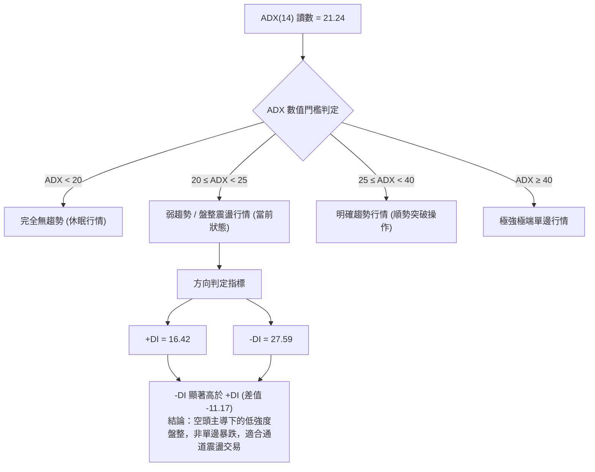

| 指標名稱 | 實際數值 | 參考標準區間 | 趨勢判定結論 |
|----------|:--------:|:------------:|--------------|
| **ADX(14)** | **21.24** | 0 – 100（25 為強弱分水嶺） | 處於 20–25 區間，屬**弱趨勢/區間震盪**，空方未達失控單邊趨勢 |
| **+DI (14)** | **16.42** | 0 – 100 | 多方進攻動能疲乏，處於歷史相對低位 |
| **-DI (14)** | **27.59** | 0 – 100 | 空方掌控市場主導權，但未突破 35 以上的極端空頭閾值 |

---

## 3. 圖表形態分析

### 🔍 形態識別系統

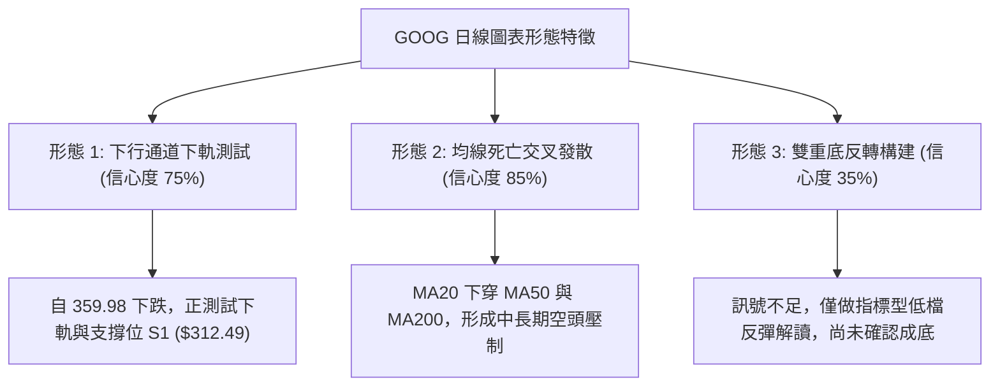

**圖表形態信心度評估表（依規則 15）**：

| 形態名稱 | 信心度 | 判斷依據（引用技術數據） | 完成度 | 目標價（附計算式，依規則 13） |
|----------|:------:|--------------------------|:------:|--------------------------------|
| **下行通道下軌測試** | **75%** | 價格沿布林通道下軌（$312.65）運行，於波段低點 S1（$312.49）止跌 | 80% | 反彈目標為布林中軌（即 MA20: $336.31）與 R2（$340.53） |
| **均線空頭排列發散** | **85%** | MA20 ($336.31) < MA50 ($338.06) < MA200 ($338.94) 成立 | 100% | 下行延伸測幅依波段低點聚類支撐 S2: $295.58 |
| **雙重底反轉形態** | **35%** | 近兩日探低 $313.51 與 $313.58，但未突破頸線，數據不足以確立幾何雙底 | 20% | *訊號不足，僅做指標型超賣反彈解讀，不計算形態目標價* |

### 🕯️ 重要 K 線形態分析

依規則 19，以下嚴格依據數據中「近 10 根日 K」與「近 8 根週 K」實際價格數據進行專業解讀：

| 日期（週期） | 開盤價 | 最高價 | 最低價 | 收盤價 | 成交量 | K 線形態 | 專業技術解讀 | 訊號 |
|:------------:|:------:|:------:|:------:|:------:|:------:|:--------:|--------------|:----:|
| **2026-10-21 (日)** | 333.32 | 333.80 | 326.26 | 330.95 | 19,298,100 | 中黑實體K線 | 跳空低開跌破 333，全日弱勢無像樣反彈，空方擴大拋壓 | 🔴 |
| **2026-10-22 (日)** | 326.77 | 327.70 | 318.45 | 320.76 | 21,094,100 | 長黑實體破位K | 放量跌破 320 關卡，下影線僅 2.31 美元，賣壓沉重 | 🔴 |
| **2026-10-23 (日)** | 317.75 | 321.23 | 316.99 | 317.28 | 10,856,500 | 低檔窄幅陰十字星 | 成交量急劇萎縮至 10.85M，顯示殺跌動能暫時衰竭 | 🟡 |
| **2026-10-26 (日)** | 318.05 | 318.39 | 313.51 | 314.19 | 16,989,400 | 低檔下探黑K線 | 盤中下探波段新低 313.51（逼近 S1: $312.49），空頭探底 | 🔴 |
| **2026-10-27 (日)** | 314.40 | 320.07 | 313.58 | 316.83 | 17,786,400 | 長下影小陽紡錘線 | 二次測試 313.58 未破前低，盤中拉升至 320，低檔買盤浮現 | 🟢 |
| **2026-10-28 (日)** | 319.88 | 323.13 | 319.68 | 321.89 | 33,361,200 | 放量實體中陽線 | 成交量暴增至 33.36M（量比 2.03x），收於最高點附近，站回 MA5 | 🟢 |
| **2026-10-16 (週)** | 348.34 | 355.25 | 335.50 | 336.91 | 79,871,700 | 週線長陰吞噬 | 衝高 355 後大幅回落，收盤跌破均線密集區，確立中期翻空 | 🔴 |
| **2026-10-23 (週)** | 340.12 | 342.52 | 316.99 | 317.28 | 78,759,600 | 週線光腳大黑K | 單週重挫 19.63 美元 (-5.83%)，長黑直逼 61.8% 斐波回調位 | 🔴 |
| **2026-10-28 (週)** | 318.05 | 323.13 | 313.51 | 321.89 | 68,137,000 | 帶下影線反彈週陽K | 探底 313.51 後獲 S1 支撐回升，目前形成低檔抵抗形態 | 🟡 |

### 📉 ASCII 走勢形態示意圖

```
GOOG 近期日線探底反彈與均線壓制形態
價格 ($)
$348.66 ┬──┐ [R3 關鍵阻力]
        │  └───┐ 10/15 (高點 $348.40)
$340.53 ┼──────┴──┐ [R2 / MA60: $339.71]
        │         └──┐ 10/19 ($340.16)
$336.31 ┼────────────┴──┐ [MA20: $336.31 / BB中軌]
        │               └──┐ 10/21 ($330.95)
$327.81 ┼──────────────────┴──┐ [R1 阻力位]
        │                         └──┐ 10/22 ($320.76)
$321.89 ┼────────────────────────────┼───● 10/28 (現價: $321.89 帶量陽線)
        │                                ▲
$318.19 ┼────────────────────────────────┼─── [MA5 支撐]
        │                            ┌───┘ 10/27 ($316.83 長下影線)
$312.49 ┴────────────────────────────┴─────● [S1 支撐 / 10/26 低點 $313.51]
```

### 🎯 形態目標價計算

依據數據中的關鍵價位與通道形態嚴謹推算：
1. **反彈測幅目標（向上通道修復）**：
   - 形態底部支撐位：波段低點聚類支撐 $S1 = \$312.49$。
   - 第一反彈阻力位：波段高點聚類阻力 $R1 = \$327.81$。
   - 第二強阻力位：波段高點聚類阻力 $R2 = \$340.53$（高度重合布林中軌 MA20: $336.31 與 MA50: $338.06）。
2. **破位測幅目標（空頭延續下行）**：
   - 若跌破 $S1 = \$312.49$，則滿足下行箱體破位條件，目標指向下一個波段低點聚類強支撐 $S2 = \$295.58$（距離現價 -8.17%）。

---

## 4. 支撐與阻力

### 🗺️ 關鍵價位分布圖（Unicode）

```
GOOG 價位結構分布圖（數據嚴格引用自 OHLCV 聚類計算與斐波那契點位）
═════════════════════════════════════════════════════════════════════
$403.96 ║████████████████████████████████████║ 52W 最高點 / Fib 0.0%
        ║                                    ║
$371.52 ║████████████████                    ║ Fib 23.6% 回調位
        ║                                    ║
$351.44 ║████████████████████                ║ Fib 38.2% 回調位
        ║                                    ║
$348.66 ║████████████████████████████████    ║ 強阻力 R3 (+8.32%)
$340.53 ║████████████████████████            ║ 阻力 R2 (+5.79%)
$335.22 ║██████████████████                  ║ Fib 50.0% / 重合 MA20 ($336.31)
$327.81 ║████████████████████████████        ║ 關鍵近期阻力 R1 (+1.84%)
$321.89 ╠════════════════════════════════════╣ ◄ 當前價格 ($321.89)
$319.00 ║▓▓▓▓▓▓▓▓▓▓▓▓▓▓▓▓▓▓▓▓▓▓▓▓▓▓▓▓▓▓▓▓    ║ 黃金分割 Fib 61.8% 關鍵防線
$312.49 ║▓▓▓▓▓▓▓▓▓▓▓▓▓▓▓▓▓▓▓▓▓▓▓▓▓▓▓▓▓▓▓▓▓▓▓▓║ 近期核心支撐 S1 (-2.92%) / BB下軌
$295.58 ║████████████████████████████████    ║ 強支撐 S2 (-8.17%) / Fib 78.6%
$270.95 ║████████████████████████████████████║ 極限強支撐 S3 (-15.83%)
$266.47 ║████████████████████████████████████║ 52W 最低點 / Fib 100.0%
═════════════════════════════════════════════════════════════════════
```

### 🚧 阻力位分析表

阻力位完全引用數據中「關鍵價位」區塊之波段高點聚類數值：

| 阻力級別 | 價位 | 距現價幅離 | 形成技術依據 | 突破難度 | 重要性 |
|:--------:|:----:|:----------:|--------------|:--------:|:------:|
| **R1** | **$327.81** | +1.84% | 近一年波段高點聚類位，近 5 日震盪平台上緣，10/22 高點 ($327.70) 密集區 | 🟡 中等 | 短線反彈第一道防線，站穩方能化解續跌壓力 |
| **R2** | **$340.53** | +5.79% | 近一年波段高點聚類位，10/15 開盤價 ($340.53) 與 10/19 收盤價 ($340.16) 共振，緊貼 MA50 ($338.06) | 🔴 高 | 中期多空生命線，此處匯聚月線與季線強大拋壓 |
| **R3** | **$348.66** | +8.32% | 近一年波段高點聚類位，10/15 衝高波段頂部 ($348.40) 與週線頸線位置 | 🔴 極高 | 波段反轉確認點，唯有突破此位多頭結構方能重啟 |

### 🛡️ 支撐位分析表

支撐位完全引用數據中「關鍵價位」區塊之波段低點聚類數值：

| 支撐級別 | 價位 | 距現價幅離 | 形成技術依據 | 守住機率 | 重要性 |
|:--------:|:----:|:----------:|--------------|:--------:|:------:|
| **S1** | **$312.49** | -2.92% | 近一年波段低點聚類位，布林通道下軌 ($312.65) 與本週低點 ($313.51) 重合防禦區 | 70% | 短線多頭最後防線，失守將開啟加速破位探底通道 |
| **S2** | **$295.58** | -8.17% | 近一年波段低點聚類位，高度契合斐波那契 78.6% 回調位 ($295.90) | 85% | 中期強力價值支撐區，2026 年初起漲籌碼密集區 |
| **S3** | **$270.95** | -15.83% | 近一年波段低點聚類位，逼近 52 週低點 ($266.47) 之最後防線 | 95% | 長期戰略底線，極端黑天鵝事件方可能回測 |

### 📐 斐波那契回調位分析

依據 52 週完整波段（低點 $266.47 → 高點 $403.96，總波段落差 $137.49）計算之黃金分割回調結構如下：

| 回調比例 | 價位 | 當前相對位置與技術解讀 |
|:--------:|:----:|------------------------|
| **0.0%** (52W High) | **$403.96** | 歷史峰值，長期牛市極限目標 |
| **23.6%** | **$371.52** | 強勢多頭回檔極限，當前股價已大幅失守 |
| **38.2%** | **$351.44** | 原始牛市回撤位，現已轉化為中長期重要反壓區 |
| **50.0%** | **$335.22** | 多空中性平衡中軸，重疊 MA20 ($336.31) 與 MA240 ($334.20) |
| **61.8%** | **$319.00** | **黃金分割關鍵支撐** ◄ **現價 ($321.89) 正在此位上方獲得支撐** |
| **78.6%** | **$295.90** | 深度回調防守位，重合 S2 強支撐 ($295.58) |
| **100.0%** (52W Low) | **$266.47** | 52 週最低點，整輪週期的起漲基石 |

**斐波那契技術解讀**：
當前收盤價 **$321.89** 恰好落在 **50.0% ($335.22)** 與 **61.8% ($319.00)** 關鍵回調區間內，且緊貼黃金分割 61.8%（$319.00）上方。在技術分析經典理論中，61.8% 為強趨勢回撤的「生死防線」；10/28 股價於 $319.68 止跌回升並收在 $321.89，確認了 $319.00 防線的初步有效性。若後續能守穩 $319.00，將具備向上回抽 50.0%（$335.22）之技術條件。

---

## 5. 技術指標深度解讀

### 🎛️ 指標訊號總覽

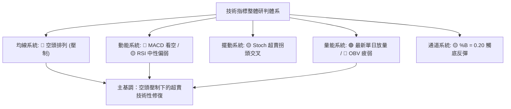

### 📈 移動平均線排列分析

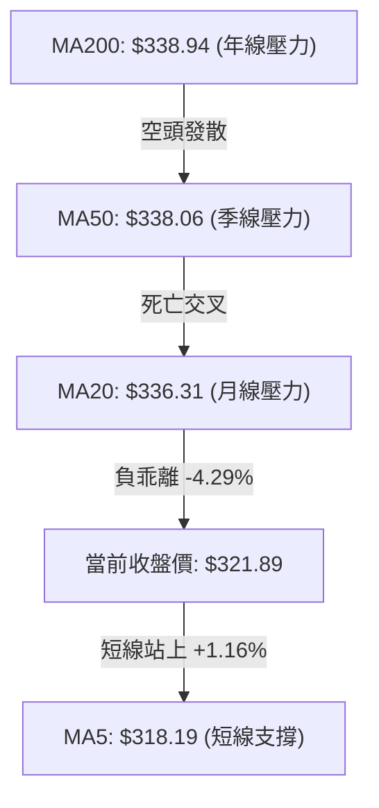

**移動平均線詳細數據解讀**：

| 均線名稱 | 數值 | 現價與均線差距 | 幅度 (%) | 均線走勢軌跡特徵 | 訊號評估 |
|:--------:|:----:|:--------------:|:--------:|------------------|:--------:|
| **MA 5** | $318.19 | +$3.70 | +1.16% | 短期均線自低檔向上勾頭，短線止跌訊號 | 🟢 看多 |
| **MA 10** | $328.03 | -$6.14 | -1.87% | 下行斜率較陡，構成現價與 R1 ($327.81) 間直接阻力 | 🔴 看空 |
| **MA 20** | $336.31 | -$14.42 | -4.29% | 月線下穿 MA50 形成死叉，持續下壓 | 🔴 看空 |
| **MA 50** | $338.06 | -$16.17 | -4.78% | 中期生命線轉為下彎，中期趨勢受阻 | 🔴 看空 |
| **MA 60** | $339.71 | -$17.82 | -5.25% | 季線下壓，重疊 R2 阻力區間 | 🔴 看空 |
| **MA 120** | $350.68 | -$28.79 | -8.21% | 半年線高懸於 $350 關卡之上 | 🔴 看空 |
| **MA 200** | $338.94 | -$17.05 | -5.03% | 跌破牛熊分界線，長期均線支撐轉為重壓 | 🔴 看空 |
| **MA 240** | $334.20 | -$12.31 | -3.68% | 長期年線密集區，呈現橫向走平 | 🔴 看空 |

### 📉 RSI(14) 分析

- **RSI(14) 讀數**：**38.48**
- **強度指示條**：
  ```
  超賣 [0] ────────── [30] ──────●──── [50] ─────────────── [70] ────────── [100] 超買
  RSI(14): 38.48     █████████████░░░░░░░░░░░░░░░░░░░░░ (中性偏弱)
  ```
- **區間評估**：當前 RSI 位於 38.48，處於 30 至 70 的中性區間偏下緣。雖然未跌破 30 達到極端超賣，但已進入多頭隨時可能引發技術反彈的敏感敏感區。
- **背離分析結論**：經檢驗近 20 根 K 棒（首尾價格由 10/01 附近至 10/28），價格創出波段新低 $313.51，而 RSI 同步下探至 30–38 區間，**無明顯頂背離或底背離**。指標與價格走勢保持同步，表明當前的回調屬於健康的動能釋放，尚未出現趨勢耗竭的底背離結構。

### 📊 MACD(12, 26, 9) 訊號解讀

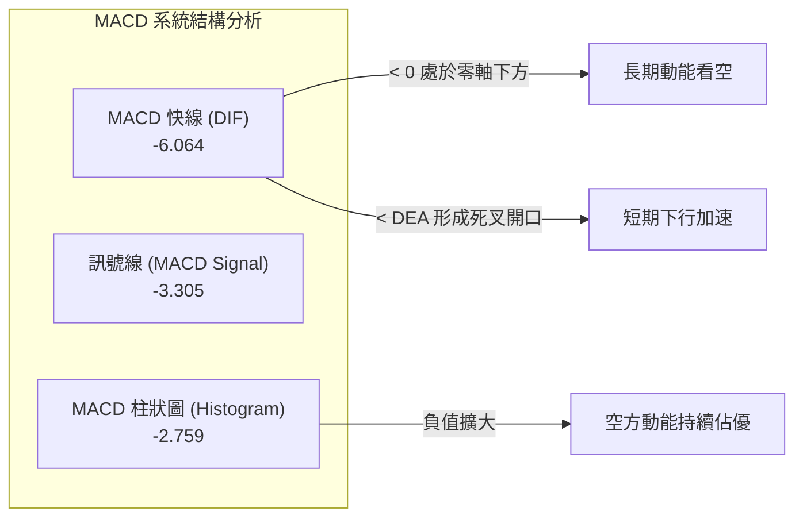

- **MACD 線**：-6.064 ｜ **訊號線 (Signal)**：-3.305 ｜ **柱狀圖 (Hist)**：-2.759
- **解讀**：快線在零軸之下持續低於慢線，柱狀圖負值為 -2.759，表明中期下行動能尚未完全衰竭。然而，伴隨 10/28 日線帶量陽線，柱狀圖負值已較前日出現邊際收斂跡象，需密切關注快線是否能在 -6 附近走平並形成零軸下方的低位金叉。

### 📦 布林通道分析

```
GOOG 布林通道示意圖 (20, 2)
══════════════════════════════════════════════════════════════════════
$359.97 ┬────────────────────────────────────────── BB 上軌 (通道擴張)
        │
$336.31 ┼────────────────────────────────────────── BB 中軌 (MA20 基準線)
        │
$321.89 ┼───────────────────────────● (現價位置：%B = 0.20)
        │                       ▲
$312.65 ┴───────────────────────┴────────────────── BB 下軌 (支撐測試)
══════════════════════════════════════════════════════════════════════
```

- **通道參數與數值**：
  - **上軌**：$359.97
  - **中軌 (MA20)**：$336.31
  - **下軌**：$312.65
  - **帶寬 (Bandwidth)**：($359.97 - $312.65) ÷ $336.31 = 14.07%
  - **布林 %B**：0.20（0 代表下軌，0.5 代表中軌，1 代表上軌）
- **通道行為解析**：%B 讀數為 0.20，表明股價正運行於下軌（$312.65）上方的超賣防禦區。10/26 股價觸及 $313.51 時，%B 一度跌破 0.10，隨後快速脫離下軌邊界向中軌靠攏，顯示布林下軌提供強力的統計學動態支撐，反彈首要阻力即為布林中軌（$336.31）。

### 💹 成交量分析（量價配合度）

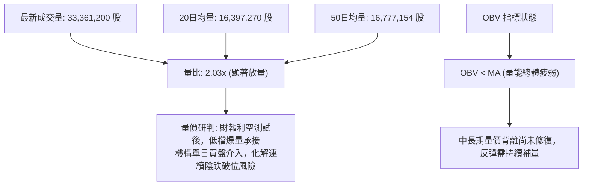

- **量價配合狀況**：最新成交量暴增至 3,336 萬股，達到 20 日均量的 **2.03 倍**，為典型「放量止跌中陽線」。此種在關鍵支撐位（S1: $312.49 / 61.8% Fib: $319.00）出現的倍量陽線，代表市場短線主力資金進行逢低抄底。
- **OBV 趨勢**：然而，中長期 OBV 仍然低於其均線，顯示在 10 月中旬以來的下跌過程中沉積了較多套牢籌碼，單日的爆量尚未能扭轉整體量能退潮的空頭格局，量能結構總體評估為「短線放量反彈，中線量能尚疲」。

---

## 6. 動能與波動率

### ⚡ 動能評估四象限

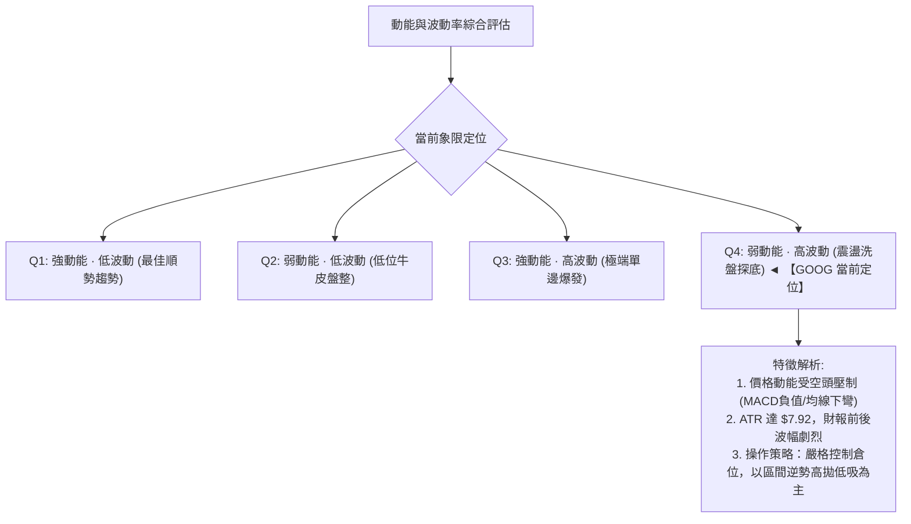

| 象限標籤 | 動能狀態 | 波動水平 | GOOG 當前狀態 | 技術操作意涵 |
|:--------:|:--------:|:--------:|:-------------:|--------------|
| **第一象限 (Q1)** | 強 (多頭) | 低波動 | 否 | 穩健上升趨勢，適合長線持有加碼 |
| **第二象限 (Q2)** | 弱 (中性) | 低波動 | 否 | 窄幅橫盤築底，波動收窄等待突破 |
| **第三象限 (Q3)** | 強 (趨勢) | 高波動 | 否 | 單邊主升浪或主跌浪，高收益高風險 |
| **第四象限 (Q4)** | **弱 (偏空)** | **中高波動** | **✓ (當前狀態)** | **多空交鋒劇烈，逢高面臨拋壓，逢低獲得承接，適合短線區間操作** |

### 📊 ATR 波動率分析

- **ATR(14) 數值**：**$7.92**（Wilder 平滑）
- **價格波動佔比**：$7.92 ÷ $321.89 = **2.46%**
- **歷史波動對比**：屬於近期較高波動水平，主要受大型科技股財報期 AI 資本支出消息面干擾所驅動。
- **止損與風控設置建議**：
  - **短線交易止損保護距離**：$1.0 \times \text{ATR} \approx \$7.92$
  - **波段交易防守安全緩衝**：$1.5 \times \text{ATR} \approx \$11.88$
  - **當前價格對應安全下限**：$\$321.89 - \$7.92 = \$313.97$（完美契合 10/26 低點 $313.51 與支撐 S1 $312.49 之保護範圍）

### 📐 Beta 與市場相關性

- **Beta 係數**：**1.211**
- **市場特徵解讀**：
  - GOOG 的 Beta 為 1.211，表示其對標普 500 指數與那斯達克 100 指數具有 **21.1% 的額外波動放大效應**。
  - 當大盤回調 1% 時，理論上 GOOG 將下挫 1.21%；反之，大盤反彈時其彈性亦高於市場平均水平。
  - 當前市場因科技巨頭財報分化與利率高位震盪，高 Beta 屬性意味著投資者必須採取更寬的止損距離與更嚴格的部位控管。

---

## 7. 多時框架總結

### 📋 時框架評分表

| 時框架 | 趨勢方向 | 動能狀態 | 均線排列 | 圖表形態 | 綜合評分 | 建議策略權重 |
|:------:|:--------:|:--------:|:--------:|:--------:|:--------:|:------------:|
| **月線 (長期)** | 🟡 中性偏多 | 🟡 中性格局 | 🟢 多頭支撐 | 高檔箱體整理 ($286–$381) | **58/100** | 長線防守逢低配置 |
| **週線 (中期)** | 🔴 偏空修正 | 🔴 動能走弱 | 🔴 跌破20週均線 | 旗形下行通道整理 | **35/100** | 中期減碼反彈做空 |
| **日線 (短期)** | 🔴 空頭壓制 | 🟡 超賣反彈 | 🔴 MA20<50<200空排 | 布林下軌獲得支撐放量 | **38/100** | 區間震盪短線博弈 |

### 🔲 綜合訊號矩陣

```
時框架訊號收斂一致性檢驗
─────────────────────────────────────────────────────────────
週期層級     趨勢訊號     動能訊號     均線訊號     量價訊號
月線 (長期)    🟢 多頭       🟡 中性       🟢 看多       🟡 中性
週線 (中期)    🔴 看空       🔴 看空       🔴 看空       🔴 疲弱
日線 (短期)    🔴 看空       🟡 轉強       🔴 看空       🟢 爆量
─────────────────────────────────────────────────────────────
矩陣衝突檢驗：中期與短期趨勢一致偏空，但日線出現低檔放量反彈訊號。
```

### ⚖️ 多時框收斂結論（依規則 14）

1. **行情屬性判定**：
   - 當前 **ADX(14) 讀數為 21.24**，嚴格滿足 **ADX < 25 之「盤整行情」定義**。
   - 根據規則 14 之盤整收斂規則：**在 ADX < 25 的盤整市場中，不宜採取單邊盲目追空或激進追高，必須以「日線布林通道上下軌（$312.65 ～ $359.97）」為核心交易區間**。
2. **時框優先級收斂**：
   - 雖然長期月線維持在 $286.50 之上的寬幅震盪結構，但中期週線與日線均線呈現標準空頭排列（MA20 < MA50 < MA200），價格運行於年線下方，中期空方動能佔據優勢。
   - 綜合評分卡最終評分為 **38/100**（符合 $\le 40$ 偏空格局）。
3. **唯一方向性結論**：
   - **偏空震盪（反彈逢阻做空為主導，布林下軌短線博弈為輔）**。短期反彈僅視為技術性抽腳，反彈接近關鍵阻力位 R1（$327.81）及 R2（$340.53）時，為順應中期趨勢之主要建倉做空時機。

---

## 8. 交易策略建議

### 🗺️ 策略決策流程圖

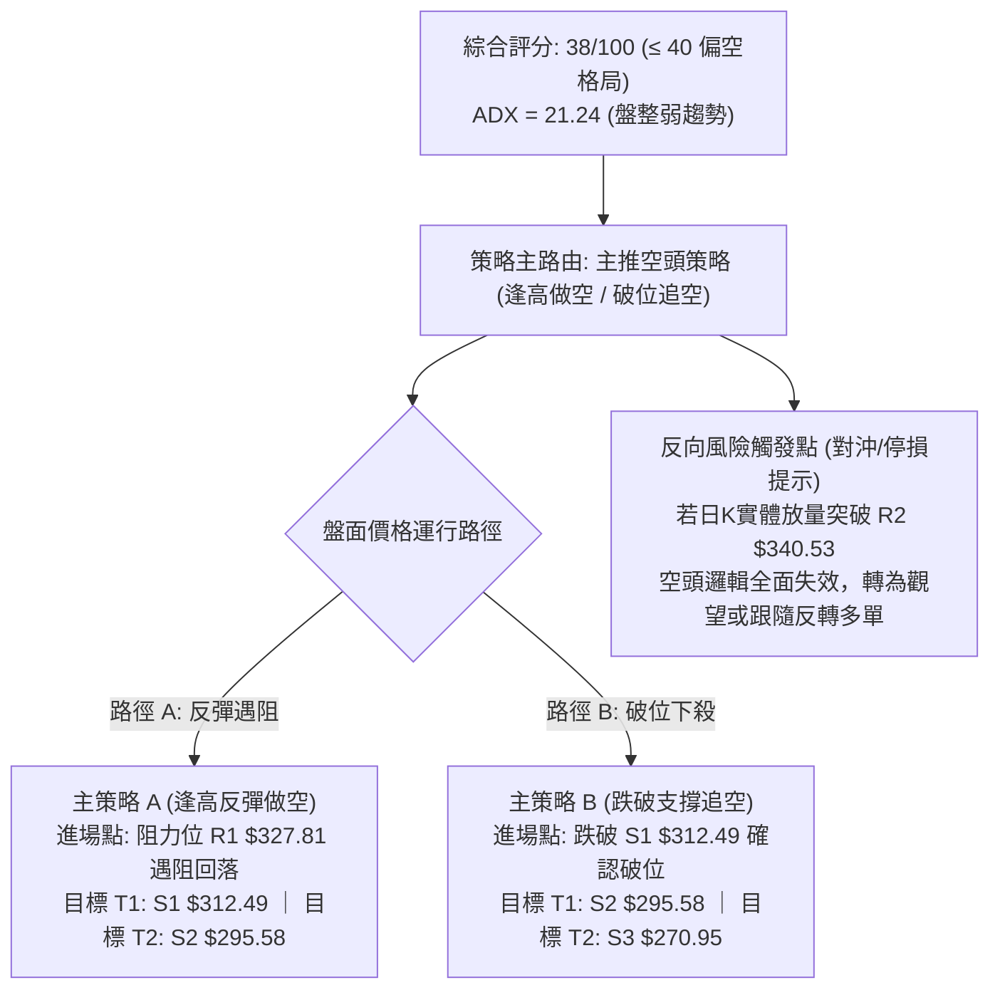

### 🧭 策略路由（依評分卡分流）

> **當前主策略方向 = 偏空操作（依綜合評分 38/100，嚴格依規則路由主推空頭策略）**

### 🎯 價格情境階梯（Price Scenarios）

價位完全嚴格引用數據中「關鍵價位」區塊之客觀數值：

| 觸發條件 | 下一目標 | 後續延伸 | 情境技術含義 |
|----------|:--------:|:--------:|--------------|
| **強勢突破 R1 $327.81** | **R2 $340.53** | **R3 $348.66** | 短線超賣反彈擴大，測試月線與季線強反壓區 |
| **現價 $321.89 區間震盪** | **$319.00 (Fib 61.8%)** | **$327.81 (R1)** | 於 61.8% 斐波那契位與布林下軌間進行底部築底換手 |
| **有效跌破 S1 $312.49** | **S2 $295.58** | **S3 $270.95** | 宣告下行箱體破位，空頭動能釋放，加速下探 78.6% 回調位 |

### 📊 情境機率分佈

| 預測情境 | 發生機率 | 主要技術數據依據 |
|----------|:--------:|------------------|
| **情境一：反彈遇阻回落（主情境）** | **55%** | 均線空頭排列（MA20<50<200），-DI (27.59) 掌控局面，反彈缺乏中長期量能支持，易在 R1/R2 受阻 |
| **情境二：區間震盪築底** | **30%** | ADX = 21.24 < 25 屬典型盤整行情，S1 ($312.49) 與布林下軌提供強支撐，10/28 放量 2.03x 形成防守 |
| **情境三：直接破位深跌** | **15%** | RSI(14)=38.48 尚未進入超賣背離，但基本面財報消化仍需時間，若外部大盤劇烈回調可能跌破 S1 |

### 🟢 主策略詳情（方向：主推空頭策略）

以下策略數值均直接引用數據「關鍵價位」之精確數值，風險報酬比嚴格按公式 $(進場價 - 目標價) \div (止損價 - 進場價)$ 精確計算（依規則 17）：

| 策略要素 | 策略 A（逢高反彈遇阻做空） | 策略 B（跌破關鍵支撐追空） |
|----------|----------------------------|----------------------------|
| **策略類型** | 順應中線空頭反彈做空 | 突破下行箱體順勢追空 |
| **進場條件** | 股價反彈至 R1 遇阻回落收陰線 | 日K實體收盤跌破 S1 支撐確認破位 |
| **進場價格** | **$327.81**（精確引用 R1） | **$312.49**（精確引用 S1） |
| **目標價 T1** | **$312.49**（精確引用 S1） | **$295.58**（精確引用 S2） |
| **目標價 T2** | **$295.58**（精確引用 S2） | **$270.95**（精確引用 S3） |
| **止損價格** | **$340.53**（精確引用 R2） | **$321.89**（精確引用當前收盤價） |
| **風險報酬比** | **1 : 1.20（以 T1 計）**<br/>*(計算式: (327.81 - 312.49) ÷ (340.53 - 327.81) = 15.32 ÷ 12.72 = 1.204)*<br/>**1 : 2.53（以 T2 計）**<br/>*(計算式: (327.81 - 295.58) ÷ (340.53 - 327.81) = 32.23 ÷ 12.72 = 2.533)* | **1 : 1.80（以 T1 計）**<br/>*(計算式: (312.49 - 295.58) ÷ (321.89 - 312.49) = 16.91 ÷ 9.40 = 1.798)*<br/>**1 : 4.42（以 T2 計）**<br/>*(計算式: (312.49 - 270.95) ÷ (321.89 - 312.49) = 41.54 ÷ 9.40 = 4.419)* |
| **成功機率** | **65%** | **55%** |
| **建議倉位** | **15% - 20%**（輕倉試單） | **10% - 15%**（突破加碼） |

### 🔴 反向風險觸發點（對沖與止損提示）

若出現以下技術情境，主推空頭邏輯即刻推翻，空單必須無條件止損，轉入防守或反轉應對：
1. **日線收盤站穩 R2 ($340.53)**：收復此位意味著同時收復 MA50（$338.06）與布林中軌（$336.31），均線空頭結構遭到直接破壞，宣告中期跌勢終結。
2. **日線級別 MACD 於零軸下方出現黃金交叉**，伴隨柱狀圖轉為正值且成交量持續維持在 2,000 萬股以上。
3. **對沖建議**：多頭反轉確認點設於突破 **$340.53**；若發生突破，空單全數平倉，並可反手配置多單，上行目標依序看至 **R3 ($348.66)** 及斐波那契 38.2% 回調位 **$351.44**。

### ⭐ 整體訊號強度評星

```
做多訊號強度：★★☆☆☆  (2/5 星 - 僅具備超賣反彈與下影線防守特徵)
做空訊號強度：★★★★☆  (4/5 星 - 均線空排、MACD負值、-DI主導)
整體可信度：  ★★★★☆  (4/5 星 - 關鍵價位聚類明確，量價確認充分)
```

---

## 9. 風險提示與監控

### ✅ 關鍵監控指標 Checklist

```
╔════════════════════════════════════════════════════════════════════════╗
║                   GOOG 每日交易關鍵技術監控 Checklist                 ║
╠════════════════════════════════════════════════════════════════════════╣
║ [ ] 價位監控：收盤價是否持續守穩斐波那契 61.8% 防線 $319.00             ║
║ [ ] 支撐防守：本週波段低點 $313.51 與 S1 $312.49 是否被實體黑K跌破      ║
║ [ ] 阻力壓制：反彈測試 R1 $327.81 與 MA10 $328.03 時是否出現長上影阻力  ║
║ [ ] 均線動態：價格是否受制於 MA20 ($336.31) 與 MA50 ($338.06) 動態下移 ║
║ [ ] 動能指標：MACD 柱狀圖（當前 -2.759）是否連續縮腳走平                ║
║ [ ] 擺動指標：RSI(14) 能否穩步突破 45 阻力關卡（當前 38.48）          ║
║ [ ] 量能變化：後續反彈成交量能否穩定在 20 日均量 (1,639 萬股) 之上     ║
║ [ ] 趨勢指標：ADX(14)（當前 21.24）是否突破 25，引發單邊破位加速       ║
╚════════════════════════════════════════════════════════════════════════╝
```

### ⚠️ 風險場景分析

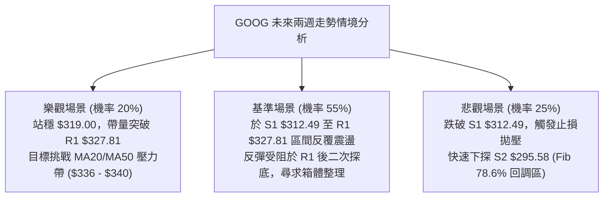

### 🛡️ 風險管理重要提醒

1. **財報與 AI 資本支出消息面風險**：近期科技板塊對雲端運算與 AI 晶片資本支出的獲利轉化極為敏感。新聞顯示 Alphabet 財報引發市場對高額資本支出的疑慮（TTM 資本支出達 $1,324 億美元），導致股價短期承壓。技術操作必須嚴格設定客觀止損點，不可憑主觀信仰硬扛單。
2. **波動率與止損風控設定**：GOOG 當前 ATR 為 **$7.92**，日內波動較大。空頭進場建議嚴格以 **R2 ($340.53)** 或高於進場點 $1.5 \times \text{ATR}$（約 $11.88 美元）為硬止損邊界，切忌在無風險保護下進行逆勢滿倉操作。
3. **倉位管理守則**：在多時框評分僅為 **38/100** 的空頭主導環境下，總持倉水位應嚴格控制在 **30% 以下**，單一交易策略風險曝險額度不應超過總投資組合淨值的 **1.5% - 2.0%**。

---

## 📋 報告總結

```
╔════════════════════════════════════════════════════════════════════════╗
║                      GOOG 技術分析報告總結                             ║
╠════════════════════════════════════════════════════════════════════════╣
║ 報告日期：2026-10-29                                                   ║
║ 當前價格：$321.89                                                      ║
║ 綜合評分：38/100  (評級：🔴 偏空震盪)                                  ║
║                                                                        ║
║ 關鍵技術結論：                                                         ║
║ ├─ 長期趨勢 (月線)：🟡 中性整理，受制於歷史峰值回檔，維持在牛市中軌    ║
║ ├─ 中期趨勢 (週線)：🔴 空頭下行通道，跌破中長期均線，MACD 柱狀負向擴大 ║
║ ├─ 短期趨勢 (日線)：🔴 空頭排列壓制，但 10/28 爆量陽線 (2.03x) 初顯支撐║
║ ├─ 關鍵支撐：S1 $312.49 ｜ S2 $295.58 ｜ 斐波那契 61.8% $319.00         ║
║ ├─ 關鍵阻力：R1 $327.81 ｜ R2 $340.53 ｜ R3 $348.66                   ║
║ └─ 分析師共識目標價：Mean $422.36 (Low $340.00 / High $485.00)         ║
║                                                                        ║
║ 最優策略組合建議：                                                     ║
║ 1. 🥇 最佳機會 (主推)：策略 A — 逢反彈至 R1 $327.81 遇阻做空，         ║
║    止損設於 R2 $340.53，目標看至 S1 $312.49 (風報比 1 : 1.20)          ║
║ 2. 🥈 次選機會 (破位)：策略 B — 若實體黑K跌破 S1 $312.49 順勢追空，    ║
║    止損設於 $321.89，目標看至 S2 $295.58 (風報比 1 : 1.80)             ║
║ 3. 🥉 保守選擇 (防守)：空手觀望，靜待股價於 $312.49 ～ $319.00 構築     ║
║    二次底部並突破 MA20 ($336.31) 後再行順勢介入。                     ║
╚════════════════════════════════════════════════════════════════════════╝
```

---

> ⚠️ **免責聲明**：本報告為依據客觀市場量化技術數據生成之研究報告，所有指標解讀、圖表形態分析與價位測算均基於歷史價格與成交量資訊。本報告**僅供學術研究與投資決策參考**，**不構成任何形式的個別投資邀約或實盤交易建議**。金融市場具有高度不確定性與虧損風險，投資人應獨立評估風險承受能力並審慎決策。

---
*報告生成時間：2026-10-29 ｜ 數據來源：Yahoo Finance ｜ 分析框架：多時框技術分析模型*