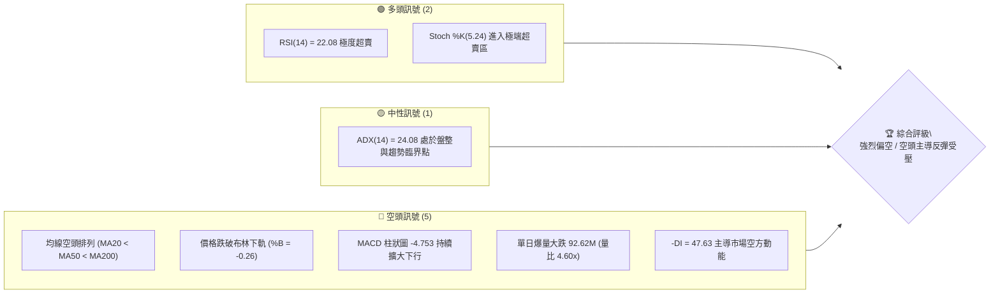
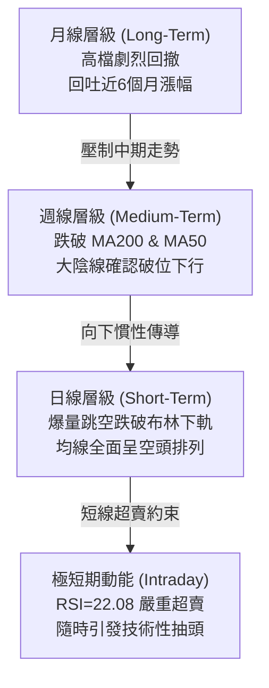
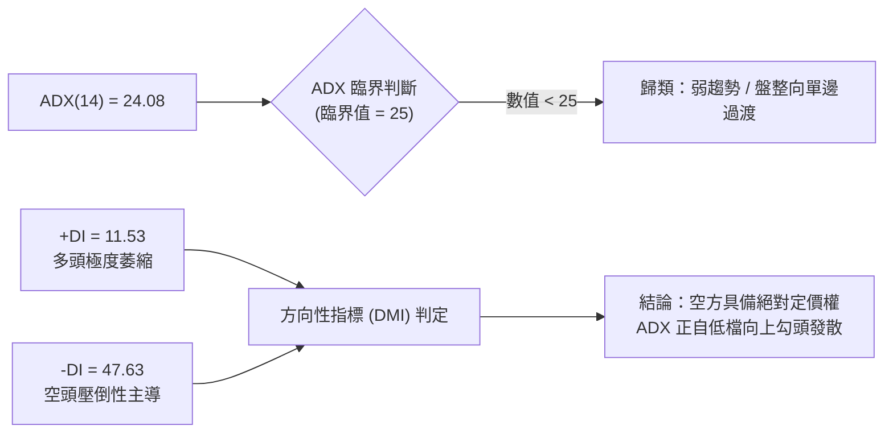
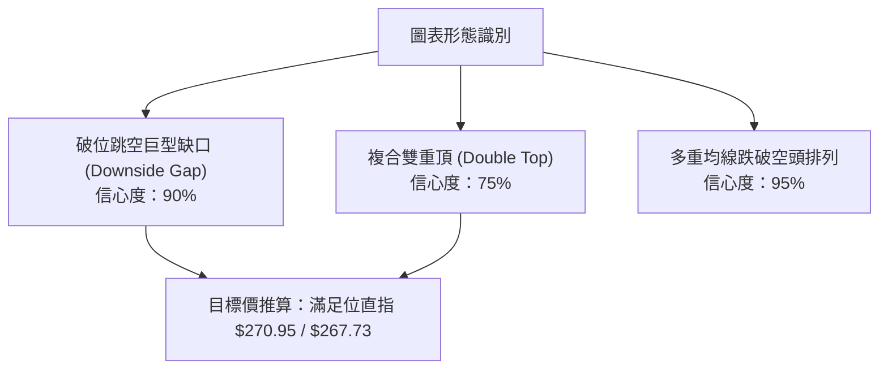
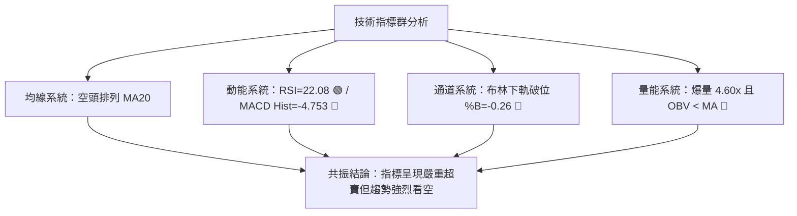
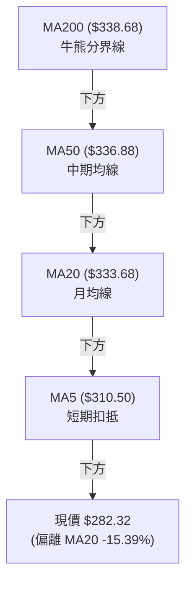
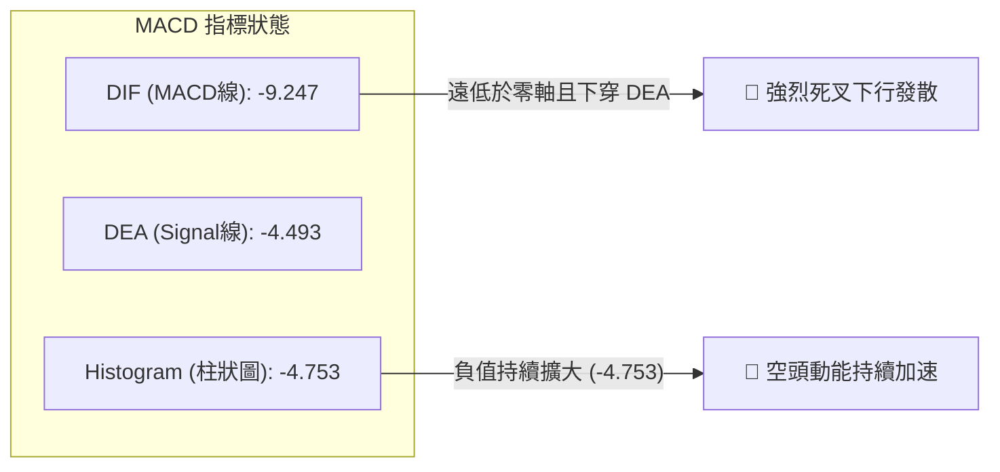
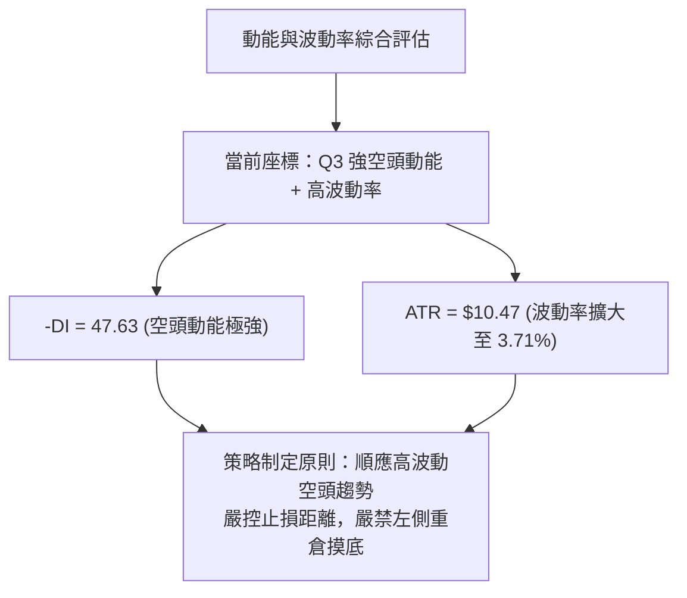
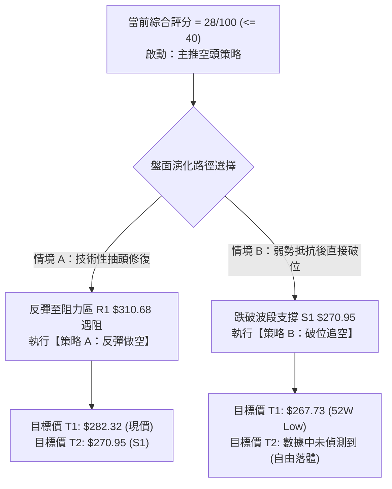
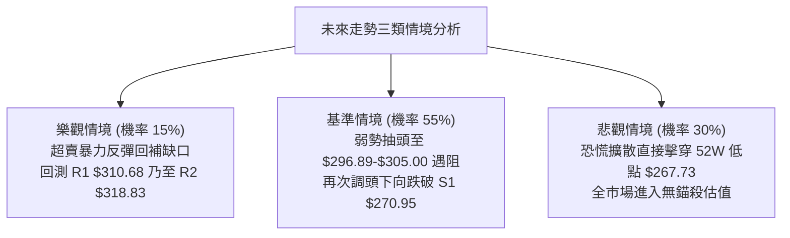

# GOOG 技術分析報告

> **報告日期**：2026-10-30 ｜ **語言**：繁體中文 ｜ **數據來源**：Yahoo Finance ｜ **當前價格**：$282.32

---

## 目錄

| 章節 | 內容 |
|------|------|
| [1. 技術面概覽](#1-技術面概覽) | 訊號儀表板、核心指標、評分卡 |
| [2. 趨勢分析](#2-趨勢分析) | 多時框趨勢、長中短期走勢、ADX 解讀 |
| [3. 圖表形態分析](#3-圖表形態分析) | 形態識別、K線組合、目標價推算 |
| [4. 支撐與阻力](#4-支撐與阻力) | 關鍵價位、斐波那契回調結構 |
| [5. 技術指標深度解讀](#5-技術指標深度解讀) | MA/RSI/MACD/布林/成交量全面剖析 |
| [6. 動能與波動率](#6-動能與波動率) | 動能四象限、ATR 止損、Beta 敏感度 |
| [7. 多時框架總結](#7-多時框架總結) | 時框架評分矩陣與收斂結論 |
| [8. 交易策略建議](#8-交易策略建議) | 策略路由、空頭主策略、風險報酬比 |
| [9. 風險提示與監控](#9-風險提示與監控) | 監控清單、極端情境與風控準則 |

---

## 1. 技術面概覽

### 🎯 技術訊號儀表板



### 📊 核心指標速覽表

| 指標類別 | 指標名稱 | 當前數值 | 訊號 | 解讀 |
|----------|----------|----------|------|------|
| **價格** | 當前收盤價 | $282.32 | 🔴 | 處於 52 週區間 10.7% 位置，單日跳空暴跌 |
| **均線** | 短期 MA20 | $333.68 | 🔴 | 價格遠在均線下方 -15.39%，下行斜率陡峭 |
| **均線** | 中期 MA50 | $336.88 | 🔴 | 價格遠在均線下方 -16.19%，中期趨勢遭嚴重破壞 |
| **均線** | 長期 MA200 | $338.68 | 🔴 | 價格遠在均線下方 -16.64%，跌破牛熊分界線 |
| **動能** | RSI(14) | 22.08 | 🟢 | 深度超賣（<30），隨時具備技術性抽頭修復可能 |
| **動能** | MACD(12,26,9)| -9.247 / -4.493 | 🔴 | 快慢線雙雙跌入零軸下方，柱狀圖 -4.753 擴散 |
| **趨勢** | ADX / DMI | 24.08 (-DI: 47.63) | 🔴 | -DI 極高（47.63），空頭掌控絕對主導權 |
| **通道** | 布林通道 | 下軌 $299.86 | 🔴 | %B 為 -0.26，收盤價嚴重脫軌超跌 |
| **量能** | 20日成交量比 | 4.60x (92.62M) | 🔴 | 恐慌性帶量拋售，OBV 低於均線顯示主力籌碼流出 |
| **波動** | ATR(14) | $10.47 | 🔴 | 佔價格 3.71%，波動率顯著放大，單日風險加劇 |

### 🏆 技術評分卡

```
╔══════════════════════════════════════════════════════════════════╗
║               技術評分卡 — GOOG (2026-10-30)                     ║
╠══════════════════════════════════════════════════════════════════╣
║ 趨勢強度 (Trend)       █████░░░░░░░░░░░░░░░  25/100  🔴 空頭強烈 ║
║ 動能指標 (Momentum)    ██████░░░░░░░░░░░░░░  30/100  🔴 動能疲弱 ║
║ 支撐穩定度 (Support)   ████████░░░░░░░░░░░░  40/100  🟡 考驗S1   ║
║ 成交量配合 (Volume)    █████░░░░░░░░░░░░░░░  25/100  🔴 爆量殺盤 ║
║ 形態完整度 (Pattern)   ███████░░░░░░░░░░░░░  35/100  🔴 破位下行 ║
║ 均線排列 (MAs)         ███░░░░░░░░░░░░░░░░░  15/100  🔴 完美空頭 ║
╠══════════════════════════════════════════════════════════════════╣
║ 綜合評分 (Overall)     ██████░░░░░░░░░░░░░░  28/100  🔴 強烈偏空 ║
╚══════════════════════════════════════════════════════════════════╝
```

> **綜合評分計算**：（25 + 30 + 40 + 25 + 35 + 15）÷ 6 = 28.33，四捨五入為 **28/100**。評級定性為「**強烈偏空**」，主導策略以逢高尋找阻力做空為主，超賣反彈僅能視為超短線逆勢博弈。

---

## 2. 趨勢分析

### 🌐 多時框趨勢分析



### 📈 長期趨勢 — 12個月走勢圖（Unicode）

以下為 GOOG 過去 12 個月（2025-11 至 2026-10）之月線收盤價走勢圖：

```
GOOG 月線走勢圖（過去12個月）
價格軸 ($)
$400 ┤                                      
$380 ┤                            ● $381.46 (2026-04 高點)
$360 ┤                               ● $375.96
$340 ┤              ● $337.87            ● $353.10  ● $356.42
$320 ┤  ● $319.29     ● $310.82                         ● $340.74
$300 ┤     ● $313.19                                ● $335.19
$280 ┤                    ● $286.50                            ● $282.32 (現價)
     └──────┬──────┬──────┬──────┬──────┬──────┬──────┬──────┬──────┬──────┬──────┬───────
         2025   2025   2026   2026   2026   2026   2026   2026   2026   2026   2026   2026
          -11    -12    -01    -02    -03    -04    -05    -06    -07    -08    -09    -10
```

#### 長期月線走勢特徵分析表

| 階段區間 | 月份起訖 | 收盤價起訖 | 區間漲跌幅 | 形態特徵與量價行為 |
|----------|----------|------------|------------|--------------------|
| 第一階段：衝頂前震盪 | 2025-11 → 2026-03 | $319.29 → $286.50 | -10.27% | 高檔橫盤後於 3 月急跌回踩 $286.50，籌碼出現初次鬆動 |
| 第二階段：歷史主升浪 | 2026-03 → 2026-04 | $286.50 → $381.46 | +33.14% | 單月暴力拉升，創下 52 週高點 $403.96，多頭達到極致亢奮 |
| 第三階段：高檔派發期 | 2026-04 → 2026-09 | $381.46 → $340.74 | -10.67% | 於 $340.00–$375.00 構築多重複合頭部，高檔籌碼派發明顯 |
| 第四階段：破位潰縮期 | 2026-09 → 2026-10 | $340.74 → $282.32 | -17.14% | 單月大陰線直接下破多條均線，吞噬過去半年所有漲幅 |

### 📊 中期趨勢（週線分析）

```
GOOG 週線價格通道與結構示意圖
$360 ┤      ┌─ 頂部整理頸線區間 ($350.00 - $355.00)
     │     ╱ 
$340 ┤────┼───────────────────────────────────────────────── MA200 ($338.68)
     │   ╱  
$320 ┤──┼────────────────────────────────────────────────── 斐波那契 61.8% ($319.77)
     │ ╱    
$300 ┤┼──────────────────────────────────────────────────── 斐波那契 78.6% ($296.89)
     │      
$280 ┤● ◄── 現價 $282.32 (週線帶量長黑摜破所有防線)
     │  ╲   
$260 ┤   └── 關鍵支撐 S1 ($270.95) / 52W 低點 ($267.73)
```

週線層級上，2026-10-29 當週錄得極度惡劣的大陰線：單週高點 $323.13，低點打至 $278.29，收於 $282.32，週成交量暴增至 162,758,900 股。該走勢不僅一舉擊穿前期低點聚類，更直接灌破長期生命線 MA200（$338.68）與 61.8% 斐波那契回調位（$319.77）。週線 MACD 柱狀圖由 -0.219、-2.941 迅速擴散至 -4.753，週線 RSI 跌入 22.1，宣告中期上升趨勢全面告終，正式轉入中期修正／空頭波段。

### ⚡ 趨勢強度評估（ADX 解讀）



#### ADX 與 DMI 系統強度評估表

| 指標項目 | 數值 | 歷史區間標準 | 當前狀態解讀 |
|----------|------|--------------|--------------|
| **ADX (14)** | 24.08 | 0–25：弱趨勢 / 震盪<br/>25–50：強烈趨勢<br/>>50：極端單邊 | 雖然讀數低於 25，但其正從低檔快速抬頭，顯示市場即將自「區間破位」轉化為「強烈的空頭單邊下行趨勢」。 |
| **+DI (14)** | 11.53 | <20 代表多頭動能潰散 | 處於極低水平，買盤完全喪失主動發動攻擊的能力。 |
| **-DI (14)** | 47.63 | >40 代表空方動能極強 | 數值高達 47.63，與 +DI 形成巨大的喇叭口擴散，證明當前盤面完全由空方掌控。 |

---

## 3. 圖表形態分析

### 🔍 形態識別系統



#### 圖表形態信心度評估表

| 形態名稱 | 信心度 | 判斷依據（嚴格引用數據） | 完成度 | 形態目標價（附精確計算式） |
|----------|--------|--------------------------|--------|----------------------------|
| **破位跳空缺口** | 90% | 2026-10-28 最低價 $319.68 與 2026-10-29 最高價 $286.43 之間形成高達 $33.25 的巨幅斷崖缺口；伴隨 92.62M 歷史級拋壓量。 | 100% | 缺口高度 = $319.68 − $286.43 = $33.25。<br/>量度下向滿足價 = 突破點 $286.43 − $33.25 = $253.18（數據中未偵測到此支撐，向下第一目標先看關鍵支撐 S1 **$270.95** 與 52W 低點 **$267.73**）。 |
| **高檔複合雙頂** | 75% | 2026-04 錄得高點 $381.46（52W高點 $403.96）與 2026-05 錄得高點 $375.96，隨後未能創新高，於 $340.00 頸線展開跌破。 | 95% | 頂部均價約 $378.71，頸線跌破點以近一年波段阻力 R3 **$327.81** 與 MA200 **$338.68** 為基準，量度跌幅直指 52W 最低位 **$267.73**。 |

### 🕯️ 重要 K 線形態分析

依據提供之「近 10 根日 K」與「近 8 根週 K」實際 OHLCV 數據進行精準解讀：

| 日期（週期） | 開盤價 | 最高價 | 最低價 | 收盤價 | K線形態名稱 | 技術解讀 | 訊號 |
|--------------|--------|--------|--------|--------|-------------|----------|------|
| **2026-10-27 (日K)** | 314.40 | 320.07 | 313.58 | 316.83 | 小陽線（孕線） | 在連跌後出現縮量微幅反彈，但未能收復 5 日均線，屬弱勢抵抗。 | 🟡 |
| **2026-10-28 (日K)** | 319.88 | 323.13 | 319.68 | 321.89 | 帶量回抽中陽線 | 成交量溫和放大至 35.35M，多頭試圖向上衝擊阻力 R2（$318.83），但上影線受制於 $323.13。 | 🟡 |
| **2026-10-29 (日K)** | 283.84 | 286.43 | 278.29 | 282.32 | 爆量斷頭跳空大黑K | 開盤即跳空低開 $36.04，盤中打出低點 $278.29，收盤 $282.32，成交量高達 92.62M，恐慌盤全面湧出。 | 🔴 |
| **2026-10-16 (週K)** | 348.34 | 355.25 | 335.50 | 336.91 | 長陰破位中繼K | 跌破 20 週均線支撐，收盤收於當週偏低位置，顯示多頭棄守。 | 🔴 |
| **2026-10-23 (週K)** | 340.12 | 342.52 | 316.99 | 317.28 | 連續大陰線 | 實體飽滿下殺，徹底摜破斐波那契 61.8%（$319.77），開啟加速段。 | 🔴 |
| **2026-10-29 (週K)** | 318.05 | 323.13 | 278.29 | 282.32 | 崩跌放量吞噬長黑K | 單週成交量暴增至 162.75M，下影線僅 $4.03，幾乎以最低點作收，空頭極為強盛。 | 🔴 |

### 📉 ASCII 走勢形態示意圖

```
GOOG 近期日K線跳空破位示意圖
價格 ($)
$345 ┤   ┌─ 10/16 高點 $346.60
$335 ┤   │  ●──● 10/19-10/20 盤跌
$325 ┤   │      ╲
$320 ┤   │       ●──● 10/21-10/22 階梯式下殺
$315 ┤   │           ●──●──● 10/23-10/27 弱勢築底失敗
$322 ┤   │                  ▲ 10/28 反彈高點 $323.13 (收 $321.89)
═════╡═══╪══════════════════╪═════════════════════════════════════════════════
$319 ┤   │                  ├─ 10/28 最低價 $319.68
     │   │                  │  
     │   │     巨幅跳空缺口 │  [ 缺口寬度：$33.25 ]
     │   │     (GAP DOWN)   │  
$286 ┤   │                  ├─ 10/29 最高價 $286.43
$282 ┤   │                  ▼ 10/29 收盤 $282.32 (成交量 92.62M 爆量)
$278 ┤   └─────────────────► 10/29 盤中低點 $278.29
     └─────────────────────────────────────────────────────────────
```

---

## 4. 支撐與阻力

### 🗺️ 關鍵價位分布圖（Unicode）

```
GOOG 價位結構分布圖 (OHLCV 精確計算)
══════════════════════════════════════════════════════════════════════
$327.81 ║████████████████████████████████║ 強波段阻力 R3 (波段高點聚類)
$319.77 ║████████████████████████        ║ 斐波那契 61.8% 關鍵多空分水嶺
$318.83 ║████████████████████            ║ 阻力 R2 (反彈高點聚類)
$310.68 ║████████████████████████████    ║ 關鍵短線阻力 R1 (跳空缺口下緣壓力區)
$296.89 ║████████████                    ║ 斐波那契 78.6% 回調位 (短線修復第一道阻力)
$282.32 ╠════════════════════════════════╣ ◄ 當前收盤價 (布林下軌破位超跌)
$270.95 ║▓▓▓▓▓▓▓▓▓▓▓▓▓▓▓▓▓▓▓▓▓▓▓▓▓▓▓▓    ║ 關鍵波段支撐 S1 (近一年波段低點聚類)
$267.73 ║████████████████████████████████║ 52週歷史低點 / 斐波那契 100% 終極防線
══════════════════════════════════════════════════════════════════════
```

### 🚧 阻力位分析表

所有價位均嚴格取自數據包中「關鍵價位」區塊之波段高點聚類與斐波那契點位：

| 阻力級別 | 精確價位 | 形成原因與籌碼屬性 | 突破難度 | 重要性 |
|----------|----------|--------------------|----------|--------|
| **R1** | **$310.68** | 近一年波段高點聚類，與 5 日均線（$310.50）高度重合，且為跳空大跌後的首道籌碼反抽壓力位。 | 🟡 中等偏高 | ★★★★☆ |
| **R2** | **$318.83** | 近一年波段高點聚類，鄰近 10/28 暴跌前收盤價 $321.89 與 61.8% 斐波那契位（$319.77），套牢盤極為沉重。 | 🔴 極高 | ★★★★★ |
| **R3** | **$327.81** | 近一年波段高點聚類，為前期平台整理下緣，具備極強的心理與結構性反壓。 | 🔴 難以逾越 | ★★★★☆ |

### 🛡️ 支撐位分析表

所有價位均嚴格取自數據包中「關鍵價位」區塊與 52 週基準點位：

| 支撐級別 | 精確價位 | 形成原因與籌碼屬性 | 守住機率 | 重要性 |
|----------|----------|--------------------|----------|--------|
| **S1** | **$270.95** | 近一年波段低點聚類，距離當前價格僅 -4.03%，為多頭最後的緩衝防線。 | 🟡 50% | ★★★★★ |
| **S2** | **$267.73** | **52週最低點（52W Low）兼斐波那契 100.0% 回調位**（註：原始波段低點聚類中數據未偵測到 S2，故直接引用 52W Low 終極結構支撐）。 | 🟢 65% | ★★★★★ |
| **S3** | **數據中未偵測到** | 原始數據未提供低於 $267.73 的次級支撐聚類，若摜破 52W 低點將陷入無錨自由落體。 | N/A | N/A |

### 📐 斐波那契回調位分析

依據 52 週極值區間（**高點 $403.96 → 低點 $267.73**，總振幅 $136.23）計算之標準斐波那契回調位深度解析：

| 回調比例 | 對應價位 | 當前相對位置 | 結構意涵與當前技術解讀 |
|----------|----------|--------------|------------------------|
| **0.0%** (52W High) | $403.96 | +43.08% | 歷史最高壓力區，目前已完全脫離常規交易視野。 |
| **23.6%** | $371.81 | +31.70% | 頂部複合形態派發區，多次衝擊失敗後崩落。 |
| **38.2%** | $351.92 | +24.65% | 中期生命線警戒區，破位後引發機構停損。 |
| **50.0%** | $335.85 | +18.96% | 心理中軸平衡位，與 MA200（$338.68）形成共振阻力。 |
| **61.8%** | $319.77 | +13.26% | **黃金分割多空分水嶺**，跌破此處宣告波段行情徹底由牛轉熊。 |
| **78.6%** | $296.89 | +5.16% | 極度弱勢回撤防線，當前價格已實體擊穿。 |
| **100.0%** (52W Low) | $267.73 | -5.17% | **全年生死防線**，為空頭終極量度回測目標。 |

> **當前價位位置解讀**：現價 **$282.32** 落在 **78.6% ($296.89)** 與 **100.0% ($267.73)** 之間，處於深度回調末端。該區間屬於多頭防禦的最後真空帶，若多方無法在 S1 **$270.95** 至 100.0% **$267.73** 構築堅實防線，整個年度上升結構將被 100% 全數回吐。

---

## 5. 技術指標深度解讀

### 🎛️ 指標訊號總覽



### 📈 移動平均線排列分析



#### 各週期移動平均線參數與偏離度表

| 均線名稱 | 數值 | 價格相對於均線之偏離度 | 走勢特徵（取自數據） | 訊號解讀 |
|----------|------|------------------------|----------------------|----------|
| **MA 5** | $310.50 | -28.18 (-9.08%) | ▇████▇▇▆▇▇▇▇▇▇███████▇▇▆▅▅▃▃▂▁ | 急速下彎，短期下壓動能極其強烈 |
| **MA 10** | $321.77 | -39.45 (-12.26%) | ▆▆▇▇▇█▇▇▇▇▇▇▆▇▇▇███████▇▇▆▄▃▃▁ | 穩定下行，構成反彈的第二道沉重均線蓋頭 |
| **MA 20** | $333.68 | -51.36 (-15.39%) | ▄▅▅▅▅▅▅▅▅▅▅▆▆▇▇███████▇▇▆▅▄▃▃▁ | 布林中軌，負乖離率達 -15.39%，具備乖離修復拉力 |
| **MA 50** | $336.88 | -54.56 (-16.19%) | 下行斜率擴大 | 中期趨勢徹底翻空 |
| **MA 60** | $338.42 | -56.10 (-16.58%) | ██████▇▇▆▆▆▅▅▅▅▄▅▅▄▅▅▅▅▅▅▅▄▃▂▁ | 季線下破，機構波段成本全線套牢 |
| **MA 120**| $349.73 | -67.41 (-19.28%) | ▁▂▃▄▅▅▆▆▆▇▇▇▇██████████▇▆▅▄▃▂▁ | 半年線下行，高檔派發完成之鐵證 |
| **MA 200**| $338.68 | -56.36 (-16.64%) | 長期牛熊分界下穿 | 跌破年線支撐，市場進入技術性熊市 |
| **MA 240**| $334.22 | -51.90 (-15.53%) | ▁▁▁▂▂▂▃▃▃▄▄▄▅▅▆▆▆▇▇▇▇▇████████ | 年線走平轉跌，長期牛市基石動搖 |

### 📉 RSI(14) 分析

- **RSI(14) 當前讀數**：`22.08`（Wilder 標準計算法）
- **強度評估進度條**：
  `████░░░░░░░░░░░░░░░░` 22.08%（極度超賣區間 < 30）
- **超買超賣狀態**：低於 30 閾值達 7.92 個點，顯示短線市場拋壓宣洩已進入非理性超賣狀態。隨時可能觸發技術性空頭回補。
- **背離分析**：**無明顯背離**（數據明確標明：僅比較近 20 根 K 棒首尾的價格與 RSI 方向，價格創新低，RSI 亦同步創下近期新低，未形成任何底背離型態）。

### 📊 MACD(12,26,9) 訊號解讀



- **MACD 線**（-9.247）遠低於 **信號線**（-4.493），且兩者均處於零軸下方極深位置。
- **柱狀圖** 讀數為 **-4.753**，為近 20 週以來的最大負值擴散（上週為 -2.941，前週為 -0.219），顯示下跌動能不但沒有收斂，反而隨著放量大跌呈現拋物線式的加速狀態。

### 📦 布林通道分析

```
GOOG 布林通道 (20, 2) 結構位置圖
$367.50 ┤-------------------------------------- 上軌 (Upper Band)
        │
$333.68 ┤────────────────────────────────────── 中軌 / MA20 (Middle Band)
        │
$299.86 ┤-------------------------------------- 下軌 (Lower Band)
════════╡══════════════════════════════════════
$282.32 ┤● ◄── 現價 $282.32 (嚴重跌破下軌，脫軌極端值)
        │      [%B = -0.26，超出下軌幅度達 $17.54]
```

- **布林上軌**：$367.50
- **布林中軌 (MA20)**：$333.68
- **布林下軌**：$299.86
- **通道帶寬與位置 (%B)**：
  當前 %B 讀數為 **-0.26**。在標準布林系統中，%B < 0 代表收盤價跌破下軌，而當前 -0.26 代表價格不僅跌破下軌，且跌破幅度達到了整個通道寬度的 26%。此乃極罕見的極端超賣外軌狀態，技術上具備向軌道內部（向 $299.86 回抽）強烈均值回歸的慣性。

### 💹 成交量分析（量價配合度）

```
成交量柱狀對比圖
最新成交量 (10/29): 92.63M  ██████████████████████████████████████████ (4.60x 均量)
20日平均量:         20.13M  █████████
50日平均量:         18.40M  ████████
```

- **量比 (Volume Ratio)**：高達 **4.60x**。單日湧出 92,627,200 股的拋單，遠超 20 日均量的 20.13M。
- **量價行為分析**：此種巨量長陰線屬於典型的高階「恐慌性拋售（Selling Climax）」，雖然反映了機構主力大規模出逃與調倉，但在超賣背景下，短線浮籌亦獲得充分換手。
- **OBV 趨勢解讀**：數據顯示「OBV < MA → 量能疲弱」，累計能量潮長期下行並跌破均線，確認資金處於淨流出週期，即使反彈亦缺乏中長期量能背書。

---

## 6. 動能與波動率

### ⚡ 動能評估四象限

| 象限分區 | 動能維度 (Momentum) | 波動維度 (Volatility) | GOOG 當前狀態判定 | 戰術意涵與操作指導 |
|----------|----------------------|------------------------|--------------------|--------------------|
| **第一象限 (Q1)** | 強動能 (多頭) | 低波動 | — | 穩定多頭趨勢，最安全持股區 |
| **第二象限 (Q2)** | 弱動能 (無方向) | 低波動 | — | 盤整蓄勢區，謹慎觀望等待方向 |
| **第三象限 (Q3)** | 強動能 (空頭/下行) | 高波動 | **✓ 當前精準落點** | **恐慌殺跌單邊下行，高風險高波動，順勢做空為上** |
| **第四象限 (Q4)** | 弱動能 (無量陰跌) | 高波動 | — | 無序震盪洗盤，應當嚴格避免進場 |



### 📊 ATR 波動率分析

- **ATR(14) 數值**：**$10.47**（採用 Wilder 平滑計算）。
- **價格波動百分比**：佔當前股價之 **3.71%**，處於過去一年極高波動水平。
- **止損距離建議**：
  - **保守型風控（2.0 × ATR）**：$10.47 × 2.0 = **$20.94**。在反彈建立空頭倉位時，止損空間至少需預留約 $21.00，以防止超賣報復性抽頭掃損。
  - **積極型風控（1.5 × ATR）**：$10.47 × 1.5 = **$15.71**。適合日內或超短線波段操作。

### 📐 Beta 與市場相關性

- **Beta 係數**：**1.211**。
- **市場敏感度分析**：
  GOOG 的 Beta 值達 1.211，屬於顯著的高彈性成長型資產。當那斯達克或標普 500 指數下挫 1% 時，GOOG 平均將被動放大回撤約 1.21%。在當前科技股受 AI 資本開支恐慌拖累的宏觀背景下，高 Beta 特性導致其股價對市場避險情緒極度敏感，容易產生順週期的超額殺跌。

---

## 7. 多時框架總結

### 📋 時框架評分表

| 時框架 | 趨勢方向 | 動能狀態 | 均線排列 | 形態特徵 | 綜合評分 | 操作建議 |
|--------|----------|----------|----------|----------|----------|----------|
| **長期 (月線)** | 🔴 轉弱下行 | 🔴 動能回吐 | 🟡 均線高檔黏合 | 衝頂失敗大陰回撤 | 35/100 | 削減長期部位，等待築底 |
| **中期 (週線)** | 🔴 空頭破位 | 🔴 MACD擴散 | 🔴 跌破MA200生命線 | 崩跌大陰線吞噬 | 25/100 | 逢反彈堅決減碼或順勢做空 |
| **短期 (日線)** | 🔴 極端超跌 | 🟢 RSI極度超賣 | 🔴 完美空頭排列 | 爆量斷頭跳空缺口 | 28/100 | 嚴禁盲目追空，等待反彈受阻放空 |

### 🔲 綜合訊號矩陣

```
時框共振矩陣圖
┌───────────┬──────────────┬──────────────┬──────────────┐
│  分析維度 │  短期 (日線) │  中期 (週線) │  長期 (月線) │
├───────────┼──────────────┼──────────────┼──────────────┤
│ 趨勢方向  │   🔴 破位    │   🔴 空頭    │   🔴 走弱    │
│ 均線系統  │   🔴 空頭    │   🔴 摜破年線│   🟡 乖離過大│
│ 動能指標  │   🟢 極端超賣│   🔴 加速發散│   🔴 轉弱下行│
│ 成交量能  │   🔴 恐慌放量│   🔴 爆量派發│   🔴 資金撤出│
└───────────┴──────────────┴──────────────┴──────────────┘
一致性判定：中長期趨勢完全轉空（三維共振向淡），僅短期動能出現超賣衝突。
```

### ⚖️ 多時框收斂結論

依據多時框收斂規則第 14 條：
1. **行情性質定義**：當前 ADX(14) 讀數為 **24.08**（< 25），表面處於震盪/弱趨勢區間，但其 -DI 數值高達 **47.63**，且週線與日線呈現極度惡劣的大陰線破位。
2. **多時框權重取捨**：由於中期（週線）徹底擊穿 MA200（$338.68）與 61.8% 斐波那契（$319.77），中長期空頭趨勢已成定局。因此，依規則以**中長期方向（偏空）為主導**，日線的極端超賣（RSI=22.08）絕非反轉訊號，僅能定義為「空頭波段中的非理性超跌」，日線時框僅用來尋找逢高放空的進場時機。
3. **唯一收斂結論**：**強烈偏空（逢高做空）**。

---

## 8. 交易策略建議

### 🗺️ 策略決策流程圖



### 🧭 策略路由

> **當前主策略方向 = 強烈偏空 / 主推逢高放空（依技術評分卡 28/100）**
> 
> 根據評分卡分流規則，綜合評分 ≤ 40 必須**主推空頭策略**。多頭僅列為反轉風控提示，不得作為主推策略。

### 🎯 價格情境階梯（Price Scenarios）

以當前收盤價 **$282.32** 為基準，所有價位嚴格引用關鍵價位區塊與斐波那契點位：

| 觸發條件 | 下一目標 | 後續延伸 | 情境技術含義 |
|----------|----------|----------|--------------|
| **反彈突破 78.6% $296.89** | 阻力 R1 **$310.68** | 阻力 R2 **$318.83** | 極度超賣引發的空頭回補，為極佳之高空加碼點。 |
| **受制於現價區間震盪** | 支撐 S1 **$270.95** | 阻力 R1 **$310.68** | 在 $278.00–$290.00 弱勢盤整消化恐慌拋壓。 |
| **跌破關鍵支撐 S1 $270.95** | 52W Low **$267.73** | 數據中未偵測到 | 破位崩跌，全年度買盤全數陣亡，陷入無錨尋底。 |

### 📊 情境機率分佈

| 情境劇本 | 機率 | 主要依據與技術支撐 |
|----------|------|--------------------|
| **反彈受阻後再度下行** | **55%** | RSI(22.08) 超賣將誘發抽頭，但均線空頭排列且 MACD 擴大下行，反彈必遭 R1/R2 強烈拋壓。 |
| **跌破 S1 延續探底** | **30%** | 拋售量高達 4.60x，-DI 高達 47.63，恐慌盤慣性下殺直接摜穿 S1（$270.95）直測 52W 低點（$267.73）。 |
| **低檔橫盤弱勢整理** | **15%** | 價格遠離布林下軌（%B=-0.26），股價暫時於現價與 S1 間縮量弱勢拉鋸。 |

### 🟢 主策略詳情（依路由主推做空）

所有進場、止損、目標價嚴格引用數據包中之計算點位，風險報酬比公式嚴格按規則 17 計算：
做空 RRR = (進場價 − 目標價 T1) ÷ (止損價 − 進場價)。

| 策略要素 | 策略 A（反彈遇阻做空 — 首選） | 策略 B（破位回抽順勢空 — 次選） |
|----------|--------------------------------|----------------------------------|
| **操作邏輯** | 借助 RSI 超賣引發的技術抽頭，在 R1 阻力逢高布空 | 股價直接失守 S1 關鍵支撐後的順勢破位追擊 |
| **進場條件** | 股價反彈至 R1 附近出現長上影線或紅翻黑K線 | 實體跌破 S1 $270.95 並回抽無法站回 |
| **進場價格** | **$310.68**（引用關鍵阻力 R1） | **$270.95**（引用關鍵支撐 S1 破位進場） |
| **目標價 T1** | **$282.32**（引用當前收盤價位） | **$267.73**（引用 52W 低點 / Fib 100%） |
| **目標價 T2** | **$270.95**（引用關鍵支撐 S1） | **數據中未偵測到**（跌破年內新低自由尋底） |
| **止損價格** | **$318.83**（引用關鍵阻力 R2） | **$282.32**（引用當前收盤價作為止損防線） |
| **風險報酬比** | **1 : 3.48（以 T1 計）**<br>*(310.68−282.32)÷(318.83−310.68) = 28.36÷8.15 = 3.48*<br>*(以 T2 計則為 1 : 4.87)* | **1 : 0.28（以 T1 計）**<br>*(270.95−267.73)÷(282.32−270.95) = 3.22÷11.37 = 0.28*<br>*(風險收益比不佳，僅限極短線突破操作)* |
| **成功機率** | **65%** | **45%** |
| **建議倉位** | **15%**（標準波段空頭倉位） | **5%**（輕倉試單） |

> **策略推薦備註**：**強烈推薦策略 A**。策略 A 具備高達 **1 : 3.48** 的優異風險報酬比，能充分享受均值回歸阻力後的波段下殺；策略 B 因空間受限於 52W 低點 $267.73，風報比極差，非職業日內交易者不建議採用。

### 🔴 反向風險觸發點（多頭反轉提示）

此處非完整多頭推薦，僅提供空頭部位之嚴格風控與對沖依據：
1. **多頭平倉訊號**：若日 K 線帶量（成交量 > 35M）收復 78.6% 斐波那契回調位 **$296.89** 並站回布林下軌 **$299.86**，表明恐慌拋壓被完全吸收，空頭部位應主動鎖利或減碼 50%。
2. **多頭全面反轉條件**：若週線收盤強勢站回 R2 **$318.83** 與 61.8% 斐波那契 **$319.77** 之上，跳空缺口獲得回補，則空頭形態被破壞，空單必須全數止損離場。

### ⭐ 整體訊號強度評星

```
做多訊號強度：★☆☆☆☆  (1/5星 — 僅有超賣，毫無右側訊號)
做空訊號強度：★★★★☆  (4/5星 — 形態與均線完美破位)
整體可信度：  ★★★★☆  (4/5星 — 爆量大跌確立中期頂部)
```

---

## 9. 風險提示與監控

### ✅ 關鍵監控指標 Checklist

```
╔══════════════════════════════════════════════════════════════════╗
║               GOOG 交易與風險監控清單 (Checklist)                 ║
╠══════════════════════════════════════════════════════════════════╣
║ [ ] 監控 52W 低點防線 $267.73 是否出現長下影線止跌             ║
║ [ ] 監控關鍵阻力 R1 $310.68 之反抽確認與假突破信號              ║
║ [ ] 監控 RSI(14) 何時自 22.08 脫離超賣區（回抽至 30 上方）       ║
║ [ ] 監控日成交量是否自 92.62M 劇烈萎縮至 20M 以下（拋壓衰竭）   ║
║ [ ] 監控 MACD 柱狀圖（-4.753）是否出現首根底背離縮短紅柱        ║
║ [ ] 監控市場科技巨頭財報外溢效應與 AI CapEx 市場情緒變化         ║
╚══════════════════════════════════════════════════════════════════╝
```

### ⚠️ 風險場景分析



### 🛡️ 風險管理重要提醒

1. **嚴禁重倉盲目猜底**：
   儘管 RSI 僅為 22.08，但歷史數據證明，在強烈空頭趨勢中，RSI 可在 20 以下維持數週之久。當前成交量高達 4.60x 均量，說明機構正進行無差別調倉拋售，切勿以「跌多了就是利多」的心態逆勢接飛刀。
2. **波動率放大的倉位管理**：
   當前 ATR 高達 $10.47（3.71%），單日上下洗盤動輒逾十美元。任何進場部位（無論是空頭還是短線博反彈的多頭），倉位總暴露嚴格控制在總資金的 **10%–15%** 以內。
3. **跳空缺口的強阻力屬性**：
   10/28 最低價 $319.68 與 10/29 最高價 $286.43 之間留下了高達 $33.25 的未補缺口。在技術分析中，這種因重大利空造成的跳空缺口將成為未來數月內難以跨越的「鋼鐵天花板」，所有反彈至該缺口下緣均為減碼逃命與建構做空部位的良機。

---

## 📋 報告總結

```
╔══════════════════════════════════════════════════════════════════╗
║                    GOOG 技術分析報告總結                         ║
╠══════════════════════════════════════════════════════════════════╣
║ 報告日期：2026-10-30                                             ║
║ 當前價格：$282.32 (52週區間 10.7% 位置)                         ║
║ 分析評級：🔴 強烈偏空 / 逢高做空 (綜合評分: 28/100)              ║
╠══════════════════════════════════════════════════════════════════╣
║ 關鍵結論：                                                       ║
║ ├─ 長期趨勢：🔴 跌破多月高檔平台，頭部形態確立                   ║
║ ├─ 中期趨勢：🔴 週線大陰線摜破 MA200 ($338.68) 與 61.8% 分水嶺    ║
║ ├─ 短期趨勢：🔴 帶量 (4.6x) 跳空暴跌，雖極端超賣但空頭動能強烈  ║
║ ├─ 關鍵支撐：S1 $270.95 / 52W Low $267.73                        ║
║ ├─ 關鍵阻力：R1 $310.68 / R2 $318.83 / R3 $327.81                ║
║ └─ 分析師目標：均價 $405.53 (高檔脫節，技術面呈現巨大基本面背離) ║
╠══════════════════════════════════════════════════════════════════╣
║ 最優策略組合：                                                   ║
║ 1. 🥇 最佳機會：【策略 A】耐心等待超賣反彈至 R1 $310.68 遇阻建立 ║
║                 空頭部位，止損 $318.83，目標 $282.32 / $270.95， ║
║                 風險報酬比高達 1 : 3.48。                        ║
║ 2. 🥈 次選機會：【空手觀望】等待價格回測 52W 低點 $267.73 是否形 ║
║                 成右側雙底結構，未確認止跌前絕不進場接盤。       ║
║ 3. 🥉 保守選擇：持有現貨者逢反彈至 $296.89–$310.68 區間堅決執行 ║
║                 動態減碼或買入保護性看跌期權 (Protective Put)。   ║
╚══════════════════════════════════════════════════════════════════╝
```

---

> ⚠️ **免責聲明**：本報告為技術分析研究，所有數據指標及價位估算均嚴格基於歷史量價與 OHLCV 計算。本報告**僅供研究與學術參考**，**不構成任何形式的投資建議與邀約**。金融市場瞬息萬變，投資人應獨立思考，嚴格設立止損，並自行承擔交易風險。

---

*報告生成時間：2026-10-30 ｜ 數據來源：Yahoo Finance ｜ 分析框架：多時框技術分析體系*