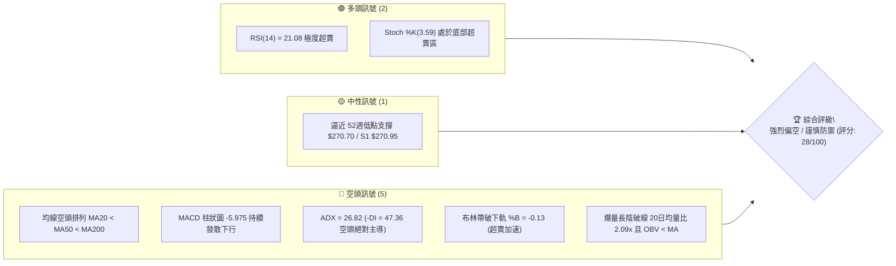
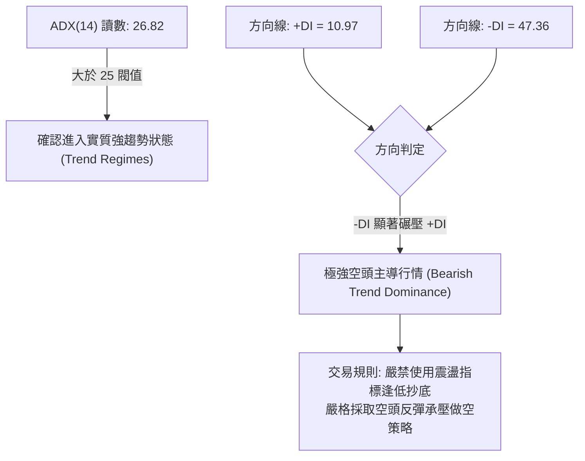
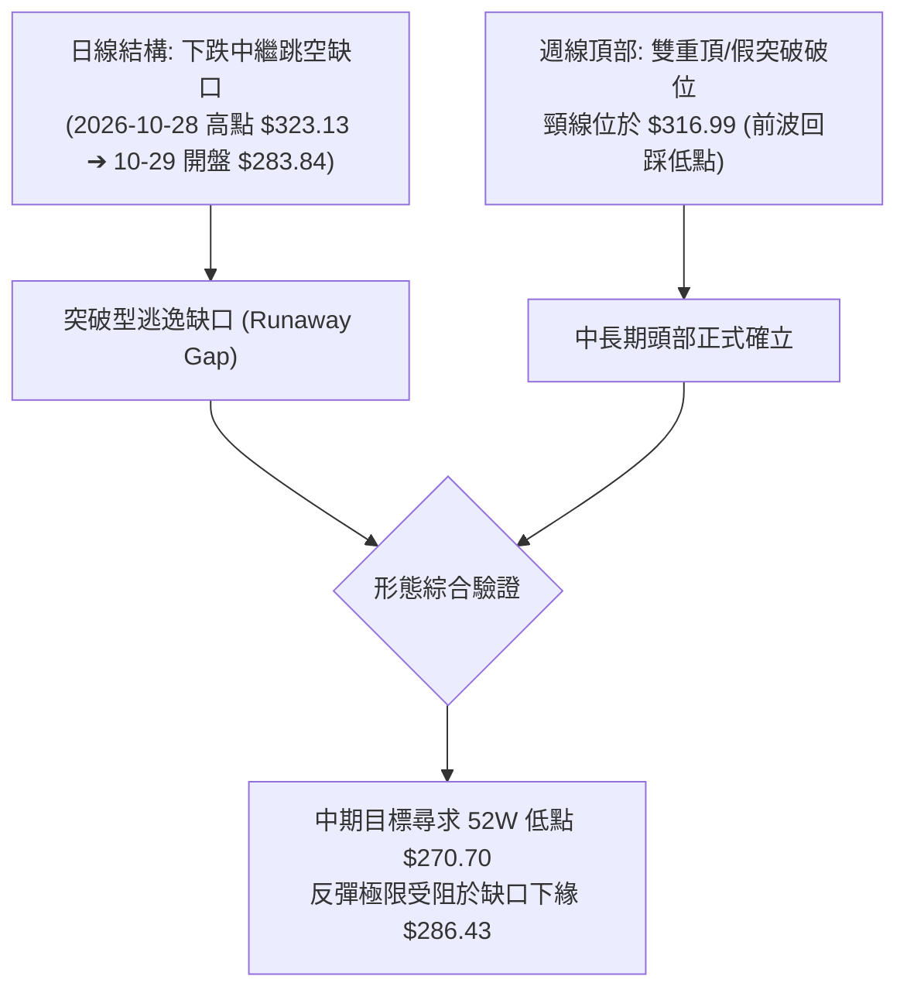
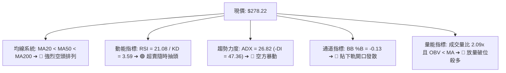
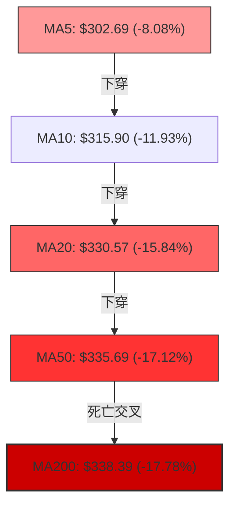
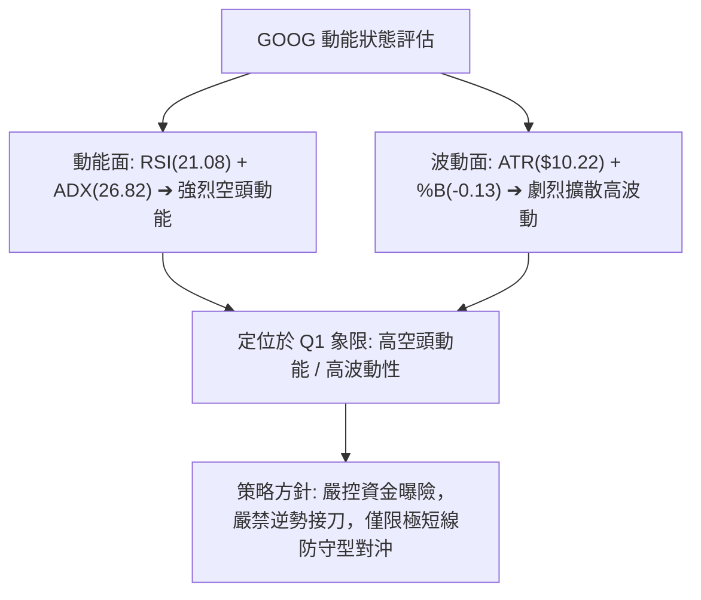
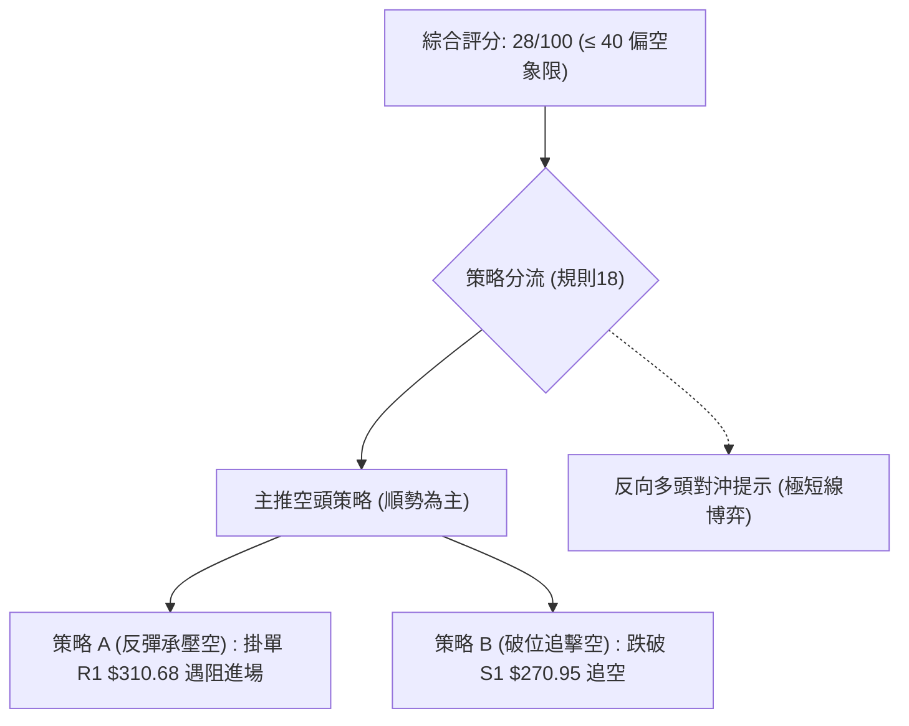
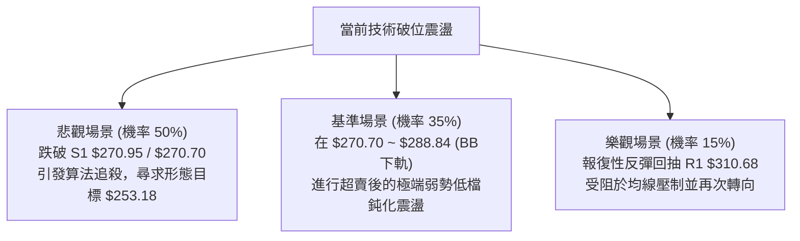

# GOOG 技術分析報告

> **報告日期**：2026-10-31 ｜ **語言**：繁體中文 ｜ **數據來源**：Yahoo Finance ｜ **當前價格**：$278.22

---

## 目錄

| 章節 | 內容 |
|------|------|
| [1. 技術面概覽](#1-技術面概覽) | 訊號儀表板、核心指標、評分卡 |
| [2. 趨勢分析](#2-趨勢分析) | 多時框趨勢、長中短期走勢 |
| [3. 圖表形態分析](#3-圖表形態分析) | 形態識別、K線組合、目標價 |
| [4. 支撐與阻力](#4-支撐與阻力) | 關鍵價位、斐波那契回調 |
| [5. 技術指標深度解讀](#5-技術指標深度解讀) | MA/RSI/MACD/布林/成交量 |
| [6. 動能與波動率](#6-動能與波動率) | 動能評估、ATR、Beta |
| [7. 多時框架總結](#7-多時框架總結) | 時框架評分矩陣 |
| [8. 交易策略建議](#8-交易策略建議) | 多空策略、風險報酬比 |
| [9. 風險提示與監控](#9-風險提示與監控) | 監控指標、風險場景 |

---

## 1. 技術面概覽

### 🎯 技術訊號儀表板



### 📊 核心指標速覽表

| 指標類別 | 指標名稱 | 當前數值 | 訊號 | 解讀 |
|:---|:---|:---:|:---:|:---|
| **價格** | 當前收盤價 | $278.22 | 🔴 | 位於 52 週價格區間 5.6%，逼近全年最低點 |
| **均線** | MA20 | $330.57 | 🔴 | 現價低於 MA20 -15.84%，短期趨勢極度疲弱 |
| **均線** | MA50 | $335.69 | 🔴 | 現價低於 MA50，中期生命線全面下彎失守 |
| **均線** | MA200 | $338.39 | 🔴 | 現價跌破長期牛熊分界線，形成典型空頭排列 |
| **動能** | RSI(14) | 21.08 | 🟢 | Wilder 計算值，進入極度超賣區（<30），隨時有技術性抽頭可能 |
| **動能** | MACD(12,26,9) | -11.962 | 🔴 | 快線與慢線(-5.987)呈空頭交叉，柱狀圖 -5.975 擴大看空 |
| **動能** | Stoch %K / %D | 3.59 / 9.64 | 🟢 | 深度超賣鈍化，處於極端值 |
| **趨勢強度** | ADX(14) | 26.82 | 🔴 | 突破 25 臨界線確認強趨勢；-DI(47.36) 遠大於 +DI(10.97)，為強空頭趨勢 |
| **波動** | ATR(14) | $10.22 | 🔴 | 佔股價 3.67%，日均震幅劇烈擴大，單日風險顯著提升 |
| **通道** | 布林通道 (%B) | -0.13 | 🔴 | 跌破下軌 ($288.84)，進入極端下行擴散通道 |
| **量能** | 20日成交量比 | 2.09x | 🔴 | 單日成交量 45,000,800 股，放量下殺且 OBV 低於均線 |

### 🏆 技術評分卡

```
╔══════════════════════════════════════════════════════════════╗
║                 技術評分卡 — GOOG (2026-10-31)               ║
╠══════════════════════════════════════════════════════════════╣
║ 趨勢強度 (ADX/趨勢方向)    ████░░░░░░░░░░░░░░░░  20/100  🔴   ║
║ 動能指標 (RSI/MACD/KD)     ████████░░░░░░░░░░░░  40/100  🟡   ║
║ 支撐穩定度 (S1/52W低點)    ██████░░░░░░░░░░░░░░  30/100  🔴   ║
║ 成交量配合 (量比/OBV)      ████░░░░░░░░░░░░░░░░  20/100  🔴   ║
║ 形態完整度 (K線/跳空缺口)  ██████░░░░░░░░░░░░░░  30/100  🔴   ║
║ 均線排列 (MA5/20/50/200)   ████░░░░░░░░░░░░░░░░  20/100  🔴   ║
╠══════════════════════════════════════════════════════════════╣
║ 綜合評分 (六項算術平均)    ██████░░░░░░░░░░░░░░  28/100  🔴   ║
║ 評級結論：強烈空頭主導 (Strong Bearish / 尋底階段)          ║
╚══════════════════════════════════════════════════════════════╝
```

---

## 2. 趨勢分析

### 🌐 多時框趨勢分析

```mermaid
graph TD
    A["月線框架 (長週期)<br/>高點回落 ($381.46 → $278.22)<br/>方向: 長期上升結構遭破壞"] --> D{"多時框綜合收斂"}
    B["週線框架 (中週期)<br/>跌破 MA200 ($338.39)<br/>週 MACD 柱狀 -5.975 發散<br/>方向: 強烈空頭中繼"} --> D
    C["日線框架 (短週期)<br/>向下跳空破底 ($283.84)<br/>ADX = 26.82 (-DI = 47.36)<br/>方向: 加速空頭噴出"] --> D
    D --> E["收斂結論: ADX > 25 強空頭趨勢確立<br/>操作主軸: 順勢偏空反彈做空，切勿盲目接刀"]
```

### 📈 長期趨勢 — 12個月走勢圖（Unicode）

```
GOOG 月線走勢圖（2025-11 至 2026-10）
價格軸 ($)
$390 ┤                                  
$380 ┤                                  ●(04月高點: 381.46)
$370 ┤                                      ●(05月: 375.96)
$360 ┤                                          ●(07月: 356.42)
$350 ┤                                      ●(06月: 353.10)
$340 ┤                                              ●(09月: 340.74)
$330 ┤                      ●(01月: 337.87)     ●(08月: 335.19)
$320 ┤●(11月: 319.29)                               
$310 ┤    ●(12月: 313.19)   ●(02月: 310.82)         
$300 ┤                                              
$290 ┤                          ●(03月: 286.50)     
$280 ┤                                                  ●(10月現價: 278.22)
$270 ┤                                                  ─(52W低點: 270.70)
     └───────────────────────────────────────────────────────────────────
       11   12   01   02   03   04   05   06   07   08   09   10  (月份)
```

#### 長期走勢特徵分析表

| 階段時間 | 區間收盤價 | 漲跌幅 | 走勢特徵與結構分析 |
|:---|:---:|:---:|:---|
| **2025-11 ~ 2026-01** | $319.29 → $337.87 | +5.82% | 延續強勢上漲多頭排列，創下階段波段新高 |
| **2026-02 ~ 2026-03** | $310.82 → $286.50 | -15.20% | 初次高檔大幅拉回洗盤，快速打出階段低點 |
| **2026-04 ~ 2026-05** | $381.46 → $375.96 | +33.14% | 暴力拉升衝擊 52 週歷史高點 $403.96 形成雙重頂部架構 |
| **2026-06 ~ 2026-09** | $353.10 → $340.74 | -3.50% | 頂部震盪築頂平台，均線反覆糾結但始終無法突破 $360 |
| **2026-10 (當前)** | $340.74 → $278.22 | -18.35% | 破位跳水大長陰，全數跌破年線，月線呈現極度空頭破位 |

### 📊 中期趨勢（週線分析）

```
GOOG 週線壓力與支撐階梯架構
═══════════════════════════════════════════════════════════════════
$359.98 ──────────────── 週線近8週波段最高點 (2026-09-25 高點)
          │
$347.86 ──┴───────────── 2026-10-09 波段反彈高點收盤 (強大中期壓力區)
            │
$338.39 ────┴─────────── MA200 牛熊分界線 (失守轉為強阻力)
              │
$318.05 ──────┴───────── 2026-10-30 本週開盤價 (向下跳空跌破頸線)
                │
$278.22 ────────┴─────── 當前收盤價 (週線長黑 K 棒爆量下挫)
                  │
$270.70 ──────────┴───── 52週最低點支撐 / 斐波那契 100% 回調位
═══════════════════════════════════════════════════════════════════
```

週線指標分析：近三週連續收黑（$336.91 → $317.28 → $278.22），週成交量由 7,987 萬股激增至 208,266,400 股，週 RSI 潰縮至 21.1，週 MACD 柱狀體由 -0.219 迅速擴散至 -5.975，顯示中期上升循環被徹底粉碎，賣壓呈恐慌性宣洩。

### ⚡ 趨勢強度評估（ADX 解讀）



#### ADX 趨勢強度對照表

| 指標變數 | 當前讀數 | 基準閥值 | 狀態評估 | 戰略含義 |
|:---|:---:|:---:|:---:|:---|
| **ADX (14)** | 26.82 | > 25 | 強烈趨勢形成 | 脫離無方向盤整期，空方動能具有持續慣性 |
| **+DI (14)** | 10.97 | < 20 | 多頭動能匱乏 | 多方買盤全無抵抗能力，反彈均為虛火 |
| **-DI (14)** | 47.36 | > 40 | 空頭極端主導 | 賣壓強勁，呈現典型的非理性殺跌階段 |

---

## 3. 圖表形態分析

### 🔍 形態識別系統



#### 圖表形態信心度分析表

| 形態類別 | 信心度 | 判斷依據（引用技術數據） | 完成度 | 目標價（附嚴謹計算式） |
|:---|:---:|:---|:---:|:---|
| **大型雙重頂 (Double Top)** | 85% | 2026-04月收盤 $381.46 與 52W高點 $403.96 形成雙峰，2026-10-30 實體跌破近8週頸線低點 $316.99 | 90% | 頸線 $316.99 − (高點 $403.96 − 頸線 $316.99) = **$230.02** (數據中未偵測到該歷史價位，僅為幾何推算) |
| **向下逃逸跳空 (Breakaway Gap)** | 95% | 2026-10-28 低點 $319.68 與 2026-10-29 高點 $286.43 留下巨大跳空缺口，量能暴增至 93,133,900 股 | 100% | 缺口高度 $33.25，由破位點 $319.68 扣除得 **$286.43** (已達成並超跌至現價 $278.22) |
| **頭肩底 (Reverse H&S)** | 0% | 數據中未偵測到底部打底結構，均線全線向下 | 0% | 訊號不足，僅做指標型解讀 |

### 🕯️ 重要K線形態分析

嚴格依據數據中「近 10 根日 K」與「近 8 根週 K」之開、高、低、收價位進行客觀形態識別：

| 日期（日K/週K） | 開 | 高 | 低 | 收 | K線形態 | 解讀 | 訊號 |
|:---|:---:|:---:|:---:|:---:|:---:|:---|:---:|
| **2026-10-27 (日K)** | 314.40 | 320.07 | 313.58 | 316.83 | 紡錘小陽線 | 試圖在 $313 上方盤整止血，但反彈無量，實體狹窄 | 🟡 |
| **2026-10-28 (日K)** | 319.88 | 323.13 | 319.68 | 321.89 | 弱勢中陽線 | 成交量溫和放大至 3,535 萬股，反彈測試 MA5 遇阻 | 🟡 |
| **2026-10-29 (日K)** | 283.84 | 286.43 | 278.29 | 282.32 | 惡性跳空大黑K | 巨量 9,313 萬股向下跳空 36 點開出，盤中毫無反抗，形成恐慌賣壓 | 🔴 |
| **2026-10-30 (日K)** | 279.69 | 281.86 | 275.35 | 278.22 | 破底陰十字下影K | 跌破前日低點創 $275.35 新低，收盤留下影線但仍收最低區間，空方續強 | 🔴 |
| **2026-10-23 (週K)** | 340.12 | 342.52 | 316.99 | 317.28 | 長黑破線K棒 | 週跌幅逾 20 點，長黑摜破 MA20、MA50，確立波段反轉 | 🔴 |
| **2026-10-30 (週K)** | 318.05 | 323.13 | 275.35 | 278.22 | 巨量崩跌大陰線 | 歷史天量 208,266,400 股擊潰 MA200，全週暴跌 -12.31%，極度空頭 | 🔴 |

### 📉 ASCII 走勢形態示意圖

```
GOOG 近10日 跳空破位形態分解
價位 ($)
$342.52 ──┐(10-19 高點)
          │
$336.40 ──┼──┐(10-20)
          │  │
$326.26 ──┼──┼──┐(10-21)
          │  │  │
$323.13 ──┼──┼──┼─────┐(10-28 反彈阻力)
          │  │  │     │
$318.05 ──┴──┴──┴──┬──┴── 缺口上軌 ($319.68)
════════════════════│════════════════════════════════ 跳空崩跌缺口區間 ($33.25)
$286.43 ────────────┴───── 缺口下軌 (10-29 反彈高點)
$282.32 ───────────────┬── (10-29 收盤)
$278.22 ───────────────┼── 現價 (10-30 收盤)
$275.35 ───────────────┴── 破底低點
```

### 🎯 形態目標價計算

1. **缺口理論量度目標**：
   - 突破前基準點（10-28 收盤）：$321.89
   - 缺口形成震幅：$319.68 (前日低) − $286.43 (次日高) = $33.25
   - 第一目標跌幅滿足點 = $286.43 − $33.25 = **$253.18**（數據中未偵測到該歷史價位，僅為形態投影推算）
2. **頸線破位跌幅滿足點**：
   - 近期週線雙頂頸線位：$316.99
   - 週線高點平台：$359.98
   - 垂直震幅高度 = $359.98 − $316.99 = $42.99
   - 形態等幅對稱滿足價 = 頸線 $316.99 − 震幅 $42.99 = **$274.00**（目前現價 $278.22 極度接近此等幅滿足區，低點 $275.35 已初步回測此帶）

---

## 4. 支撐與阻力

### 🗺️ 關鍵價位分布圖（Unicode）

```
GOOG 價位結構分布圖
═══════════════════════════════════════════════════════════════
$327.81 ║████████████████████████████████║ 強阻力 R3 (波段高點聚類)
$318.83 ║████████████████████████        ║ 阻力 R2 (頸線阻力重合)
$310.68 ║████████████████████████████    ║ 關鍵阻力 R1 (反彈首要考驗)
$299.22 ║▓▓▓▓▓▓▓▓▓▓▓▓▓▓▓▓▓▓            ║ 斐波那契 78.6% 回調壓力
$288.84 ║▓▓▓▓▓▓▓▓▓▓▓▓                    ║ 布林通道下軌破位反壓
$278.22 ╠════════════════════════════════╣ ◄ 現價 (收盤價)
$270.95 ║████████████████████████████████║ 核心支撐 S1 (波段低點聚類)
$270.70 ║████████████████████████████████║ 52W 最低點 / Fib 100.0%
═══════════════════════════════════════════════════════════════
```

### 🚧 阻力位分析表

所有阻力位數值嚴格引用自數據之「關鍵價位」與指標計算：

| 阻力級別 | 精確價位 | 距現價空間 | 形成原因與技術意涵 | 突破難度 | 重要性 |
|:---|:---:|:---:|:---|:---:|:---:|
| **R1** | **$310.68** | +11.67% | 近一年波段高點聚類、接近 MA10 ($315.90) | ★★★★☆ | 極高（反彈第一道天花板） |
| **R2** | **$318.83** | +14.60% | 波段高點聚類、10-23 週收盤頸線 $317.28 平台 | ★★★★★ | 重大（多空分水嶺） |
| **R3** | **$327.81** | +17.83% | 波段高點聚類、貼近 MA20 ($330.57) 及月均線帶 | ★★★★★ | 終極（中期空頭防守點） |

### 🛡️ 支撐位分析表

所有支撐位數值嚴格引用自數據之「關鍵價位」與歷史低點聚類：

| 支撐級別 | 精確價位 | 距現價空間 | 形成原因與技術意涵 | 守住機率 | 重要性 |
|:---|:---:|:---:|:---|:---:|:---:|
| **S1** | **$270.95** | -2.61% | 近一年波段低點聚類，與 52W 低點 $270.70 共振 | 45% | 極高（短線唯一多頭壁壘） |
| **52W Low** | **$270.70** | -2.70% | 52 週最低價、斐波那契 100% 絕對回調位 | 40% | 生死線（破位將引發機構停損） |
| **S2 / S3** | **N/A** | N/A | **數據中未偵測到**（低於 $270.70 之更深支撐數據未提供） | N/A | N/A |

### 📐 斐波那契回調位分析

依據 52 週波動區間 $270.70（低點）→ $403.96（高點）精確展開：

```
斐波那契回調階梯位階
0.0%  (52W High) ────────────────────────────── $403.96
23.6%            ────────────────────────────── $372.51
38.2%            ────────────────────────────── $353.06
50.0%            ────────────────────────────── $337.33 (與 MA200 $338.39 共振)
61.8%            ────────────────────────────── $321.61 (黃金分割位，已告失守)
78.6%            ────────────────────────────── $299.22 (深層回調支撐轉阻力)
現價位階: $278.22 ──► 位於 78.6% ($299.22) 與 100.0% ($270.70) 之間
100.0% (52W Low) ────────────────────────────── $270.70
```

#### 斐波那契位階解讀
當前收盤價 $278.22 已經徹底摜破了極具防禦意義的 61.8% 黃金分割點 ($321.61) 及 78.6% 深度防線 ($299.22)。現價正垂直朝向 100.0% 全回撤位置（$270.70）尋求最後落點。這意味著過去一年由 $270.70 啟動、最高抵達 $403.96 的完整上升多頭浪潮，已經回吐了 94.4% 的所有漲幅。若 $270.70 遭實體日 K 跌破，則整個 52 週多頭循環將被全數歸零並轉入歷史級深淵。

---

## 5. 技術指標深度解讀

### 🎛️ 指標訊號總覽



### 📈 移動平均線排列分析



#### 移動平均線數據分析
當前均線系統呈現無可置疑的**標準極端空頭排列**：
- **MA5 ($302.69)** < **MA10 ($315.90)** < **MA20 ($330.57)** < **MA60 ($337.11)** < **MA200 ($338.39)** < **MA120 ($348.83)**。
- 現價 $278.22 與 MA20 乖離率高達 **-15.84%**，與長期生命線 MA200 乖離達 **-17.78%**。
- 負乖離過大雖蘊含技術性修復動能，但所有短期與中期均線呈現 45 度向下扣殺姿態，任何未站上 MA5 ($302.69) 的反彈都屬於標準的「均線壓制性誘多」。

### 📉 RSI(14) 分析

```
RSI(14) 當前數值: 21.08 (Wilder)
0 ═══════════ 20 ════ 30 ════════════════ 70 ════════════ 100
[████████░░░░░░░░░░░░░░░░░░░░░░░░░░░░░░░░░░░░░░░░░] 21.08%
               ▲
               極度超賣警戒區 (< 30)
```

- **區間研判**：RSI(14) 讀數為 21.08，已深陷 30 以下的嚴重超賣區。
- **背離分析**：根據數據「RSI 背離：無明顯背離（僅比較近20根K棒首尾的價格與RSI方向）」，股價由 10-19 之 $340.16 崩跌至 $278.22，RSI 同步由中性滑落至 21.08，**不存在任何底背離特徵**。此乃標準的「指標隨價格同向破位殺跌」，代表賣壓尚未完成籌碼換手。

### 📊 MACD(12,26,9) 訊號解讀

```
DIF (MACD線):     -11.962 ──┐ (雙線零軸下方加速下墜)
                             ├─► MACD Hist (柱狀圖): -5.975 (強烈看空擴散)
DEA (Signal線):   -5.987  ──┘
```

- **訊號解析**：快線 DIF (-11.962) 遠低於慢線 DEA (-5.987)，柱狀圖值達 **-5.975**。
- **背離檢視**：對照近 20 週數據，週 MACD 柱狀體由 10-09 的 +0.947 轉為 10-16 的 -0.219，並迅速於 10-30 擴大至 -5.975。日線與週線的 MACD 柱狀綠體同步放大擴散，**未見收斂或底背離跡象**，確認當前空頭浪潮仍在主跌段發酵。

### 📦 布林通道分析

```
GOOG 布林通道示意圖 (週期20, 2個標準差)
═══════════════════════════════════════════════════════════════
$372.31 ────────────────────────────── BB 上軌
          │
          │
$330.57 ──┼─────────────────────────── BB 中軌 (MA20)
          │
$288.84 ──┴─────────────────────────── BB 下軌
═══════════════════════════════════════════════════════════════
$278.22 ◄══ 現價 (破軌超跌，BB %B = -0.13)
```

- **帶寬與位置**：上軌 $372.31，中軌 $330.57，下軌 $288.84。
- **%B 指標解讀**：當前 %B 為 **-0.13**（%B < 0 代表實體完全跌出布林通道下軌之外）。
- **通道特徵**：通道口呈現喇叭狀強制向下擴張（Walking the Band 下軌漫步），這是行情最具破壞力的空頭下衝信號。

### 💹 成交量分析（量價配合度）

```
成交量比率柱狀圖對比
最新成交量 (10-30) : 45,000,800  [████████████████████] (量比: 2.09x)
20日均量           : 21,526,595  [██████████░░░░░░░░░░] 基量
50日均量           : 19,028,778  [█████████░░░░░░░░░░░] 基量
```

- **量能屬性**：10-29 伴隨 93,133,900 股的天量崩跌，10-30 續放 45,000,800 股，量比高達 2.09 倍。
- **OBV（能量潮）檢視**：數據明確標示「OBV趨勢：OBV < MA → 量能疲弱」。
- **量價定性**：巨量破位長黑，成交量與價格呈現「價跌量增」，籌碼大量拋出，主力資金明顯出逃，尚未出現量縮止跌訊號。

---

## 6. 動能與波動率

### ⚡ 動能評估

#### 動能與波動率狀態矩陣

| 象限 | 動能維度 | 波動維度 | 當前狀態標註 | 技術含義與操作指引 |
|:---:|:---:|:---:|:---:|:---|
| **Q1** | 強空頭動能 | 高波動率 | **✓ 當前 GOOG 所處位置** | **處於主跌擴散期，恐慌情緒高漲，高風險，順勢放空或空手觀望** |
| **Q2** | 強多頭動能 | 低波動率 | — | 最佳順勢牛市波段 |
| **Q3** | 弱動能 | 低波動率 | — | 狹幅無聊盤整，等待方向確認 |
| **Q4** | 弱動能 | 高波動率 | — | 趨勢末端洗盤震盪，多空拉鋸 |



### 📊 ATR 波動率分析

- **ATR(14) 讀數**：**$10.22**（佔股價比例高達 **3.67%**，Wilder 演算法）。
- **波動含義**：GOOG 單日理論合理跳動震幅即達 10 美元以上，意味著普通日內雜訊極易觸發過窄的止損。
- **止損距離建議**：
  - 順勢空單：止損建議設為 1.5 倍 ATR = $10.22 × 1.5 = **$15.33**。
  - 逆勢博弈多單：防守必須貼緊結構性支撐 S1 ($270.95)，最大虧損容忍不得超過 1.0 倍 ATR ($10.22)。

### 📐 Beta 與市場相關性

- **Beta 數值**：**1.211**。
- **市場特徵**：Beta > 1 顯示 Alphabet 對標普 500 指數具有放大 1.21 倍的系統性波動敏感度。
- **當前解讀**：在大盤科技板塊（新聞顯示 Amazon, Intel 財報引發 AI 拋售，大盤下挫）走弱的環境下，高 Beta 特性導致 GOOG 遭受雙重流動性抽離，跌幅加劇。

---

## 7. 多時框架總結

### 📋 時框架評分表

| 時框架 | 趨勢方向 | 動能狀態 | 均線排列 | 圖表形態 | 綜合評分 | 操作建議 |
|:---|:---:|:---:|:---:|:---:|:---:|:---|
| **短期 (日線)** | 🔴 極空 | 🟢 極度超賣 (RSI 21.08) | 🔴 空頭排列 | 下跌跳空巨量破位 | **25/100** | 逢反彈不過缺口做空，不追殺 |
| **中期 (週線)** | 🔴 強空 | 🔴 MACD柱擴散 (-5.975) | 🔴 跌破MA200 | 雙重頂頸線實體跌破 | **28/100** | 中期上升結構瓦解，偏空處置 |
| **長期 (月線)** | 🟡 轉弱 | 🔴 自高位大幅滑落 | 🟡 仍高於兩年前底部 | 歷史高點 $403 假突破 | **35/100** | 長線牛市暫告段落，進入深幅修正 |

### 🔲 綜合訊號矩陣

```
時框維度       趨勢指標 (MA/ADX)   動能指標 (MACD/RSI)   量價配合 (Volume/OBV)   維度總結
───────────────────────────────────────────────────────────────────────────
短期 (日線)    🔴 負向加速        🟡 超賣隨時有抽頭     🔴 放量大跌/OBV疲弱     🔴 空方掌控
中期 (週線)    🔴 均線失守        🔴 動能紅翻綠加速     🔴 兩億股巨量下殺       🔴 破位確立
長期 (月線)    🟡 回撤至區間低位  🔴 動能頂部鈍化回落   🟡 籌碼鬆動換手         🟡 考驗牛熊界限
───────────────────────────────────────────────────────────────────────────
```

### ⚖️ 多時框收斂結論

依據多時框收斂規則（規則 14）：當前 **ADX(14) = 26.82 > 25**，市場屬於明確的「**強趨勢行情**」。在此架構下，**分析權重必須以中長期（週線 / MA200 牛熊分界線）方向為主導**，日線指標僅能用於微觀結構中尋求進場時機與風控點。

1. **矛盾收斂**：日線 RSI(14) = 21.08 及 Stoch %K = 3.59 出現極端超賣，理論上存在技術性抽頭需求；然而，週線級別以 208,266,400 股的天量摜破 MA200 ($338.39)，中長期空頭趨勢具有絕對支配力。
2. **唯一方向結論**：**偏空（主跌中繼，嚴防陰跌破底）**。日線超賣不得作為抄底買入信號，任何技術性乖離修復反彈，均屬於多頭逃命波與空頭逢高佈局點。

---

## 8. 交易策略建議

### 🗺️ 策略決策流程圖



### 🧭 策略路由

> **當前主策略方向 = 偏空做空為主（依綜合評分 28/100，嚴格觸發 ≤40 偏空路由）**

### 🎯 價格情境階梯（Price Scenarios）

所有價位均嚴格引用第 4 章及數據核心數值：

| 觸發條件 | 下一目標 | 後續延伸 | 情境含義 |
|:---|:---:|:---:|:---|
| **反彈受阻於 R1 $310.68** | 下測現價 $278.22 | 探測 S1 $270.95 | 短線超賣修復結束，回歸主跌浪 |
| **失守 52W 低點 $270.70 / S1 $270.95** | 恐慌跌破 | 數據中未偵測到 | 破底引發停損賣盤，全面失控尋底 |
| **強勢突破 R1 $310.68** | 上測 R2 $318.83 | 挑戰 R3 $327.81 | 短線超賣強烈修復，空頭回補浪潮 |

### 📊 情境機率分佈

| 情境劇本 | 機率 | 主要技術依據 |
|:---|:---:|:---|
| **情境一：弱勢反抽後下探底 (主基調)** | **60%** | ADX 26.82 強趨勢成立，均線全空頭排列，OBV < MA，成交量破位爆發 |
| **情境二：直接跌破 S1 $270.95 破底** | **25%** | MACD 柱狀體 -5.975 持續發散，-DI 47.36 空頭絕對碾壓，恐慌拋售未止 |
| **情境三：V型強勁反彈突破 R1 $310.68** | **15%** | 僅憑藉 RSI 21.08 極度超賣，無形態與量能支撐，難以持續突破重層均線 |

### 🟢 主策略詳情（空頭專屬策略）

嚴格依據規則 17 計算風險報酬比：`(進場價 − 目標價 T1) ÷ (止損價 − 進場價)`：

| 策略要素 | 策略 A（反彈高空 — 逢阻力進場） | 策略 B（破位追空 — 順勢灌破進場） |
|:---|:---|:---|
| **進場條件** | 價格超賣反彈至 R1 承壓滯漲時進場 | 日 K 實體跌破核心支撐 S1 時順勢進場 |
| **進場價格** | **$310.68**（R1 阻力位） | **$270.95**（S1 跌破確認點） |
| **目標價 T1** | **$278.22**（現價 / 破位中繼點） | **$253.18**（由形態缺口高度推算） |
| **目標價 T2** | **$270.70**（52W 最低點） | **N/A**（數據中未偵測到後續支撐） |
| **止損價格** | **$327.81**（R3 強阻力點） | **$278.22**（回抽現價結構點） |
| **風險報酬比** | **1 : 1.89（以 T1 計）** <br/>*(310.68−278.22)÷(327.81−310.68) = 32.46÷17.13 = 1.89*<br/>另列：**1 : 2.33（以 T2 計）** | **1 : 2.44（以 T1 計）** <br/>*(270.95−253.18)÷(278.22−270.95) = 17.77÷7.27 = 2.44* |
| **成功機率** | **65%** | **55%** |
| **建議倉位** | **15%**（常規頭寸） | **10%**（動量突破輕倉） |

### 🔴 反向風險觸發點（對沖提示）

若出現以下情境，宣告空頭主策略失效，空單必須無條件離場觀望：
1. **收盤站穩 R1 $310.68**：若日 K 實體收復 R1，代表向下逃逸缺口遭到多頭強力反撲，短線空頭力竭，極可能向 R2 ($318.83) 甚至 R3 ($327.81) 展開深幅反彈。
2. **底背離成形**：股價後續若跌破 $270.70 但日線 RSI 未能跌破 21.08 且出現勾頭向上，形成實質日線底背離時，必須立刻平倉空單避險。

### ⭐ 整體訊號強度評星

```
做多訊號強度：★☆☆☆☆  (1/5星 — 僅超賣支撐，勝率極低)
做空訊號強度：★★★★☆  (4/5星 — 趨勢確立，空頭能量充足)
整體可信度：  ★★★★☆  (4/5星 — 多時框共振破位，訊號明確)
```

---

## 9. 風險提示與監控

### ✅ 關鍵監控指標 Checklist

```
╔══════════════════════════════════════════════════════════════╗
║               GOOG 日常交易風險監控清單 (Checklist)           ║
╠══════════════════════════════════════════════════════════════╣
║ [ ] 價格能否守住 52W 低點 $270.70 (跌破觸發無底深淵賣壓)      ║
║ [ ] RSI(14) 能否脫離超賣區回升至 30 以上 (脫離即有反彈動能)    ║
║ [ ] 成交量是否萎縮至 20日均量 ($21.5M) 以下 (縮量方能止血)   ║
║ [ ] 日 K 實體能否回補 10-29 缺口下緣 $286.43                 ║
║ [ ] ADX 讀數是否由 26.82 進一步衝破 30 (空頭趨勢加速警訊)    ║
╚══════════════════════════════════════════════════════════════╝
```

### ⚠️ 風險場景分析



### 🛡️ 風險管理重要提醒

1. **ATR 劇烈擴散風險**：當前 ATR 高達 $10.22（佔比 3.67%），極高波動意味著市場流動性溢價嚴重。任何單筆交易之部位風險暴露，絕不可超過整體投資組合淨值的 **1.0%**。
2. **財報與外圍情緒衝擊**：基本面新聞顯示，市場對 Alphabet 及大型科技巨頭資本支出（Capex 達 $159.80B）過度膨脹、壓縮自由現金流（FCF Yield 僅 0.58%）產生實質性擔憂。在此基本面共振弱勢期，技術指標的反彈隨時會被機構拋盤無情打斷。
3. **左側交易禁忌**：在成交量未顯著降溫、MA5 ($302.69) 仍以極陡角度下壓之前，嚴禁任何形式的「摸底抄底」行為，嚴格遵守「順勢而為、右側確認」的專業紀律。

---

## 📋 報告總結

```
╔══════════════════════════════════════════════════════════════╗
║                   GOOG 技術分析報告總結                       ║
╠══════════════════════════════════════════════════════════════╣
║ 報告日期：2026-10-31                                         ║
║ 當前價格：$278.22                                            ║
║ 分析評級：🔴 強烈偏空 / 防禦觀望 (綜合評分: 28/100)           ║
║                                                              ║
║ 關鍵結論：                                                   ║
║ ├─ 長期趨勢：🟡 自歷史高位 $403.96 深度修正，牛市根基動搖      ║
║ ├─ 中期趨勢：🔴 跌破週線 MA200 ($338.39)，巨量破位確立轉熊   ║
║ ├─ 短期趨勢：🔴 跳空暴跌，ADX=26.82，-DI=47.36 空方絕對掌控   ║
║ ├─ 關鍵支撐：S1 $270.95 / 52W Low $270.70                    ║
║ ├─ 關鍵阻力：R1 $310.68 / R2 $318.83 / R3 $327.81            ║
║ └─ 分析師共識目標：$403.87 (與現有技術面產生嚴重背離)        ║
║                                                              ║
║ 最優策略組合：                                               ║
║ 1. 🥇 最佳機會：反彈至阻力 R1 $310.68 承壓佈局空單 (策略 A)   ║
║ 2. 🥈 次選機會：實體破位 S1 $270.95 後輕倉追擊空單 (策略 B)   ║
║ 3. 🥉 保守選擇：空手完全觀望，等待日線構築雙底形態再行進場   ║
╚══════════════════════════════════════════════════════════════╝
```

---

> ⚠️ **免責聲明**：本報告為技術分析研究成果，所有數據與價位推算均嚴格基於提供之歷史市場資訊。本報告**僅供研究與學術參考**，**不構成任何個人化投資決策或買賣建議**。市場具有高度不確定性與波動風險，交易決策應獨立審慎評估，入市需自負盈虧。

---

*報告生成時間：2026-10-31 ｜ 數據來源：Yahoo Finance ｜ 分析框架：多時框技術分析*