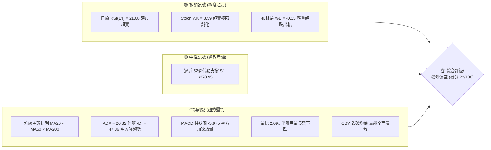
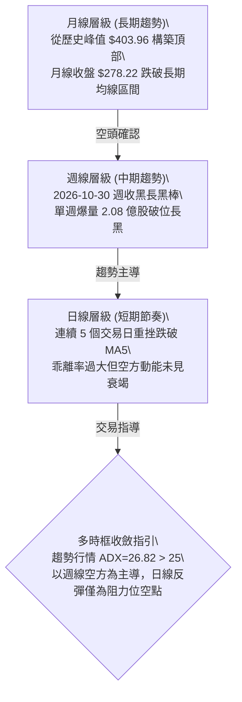
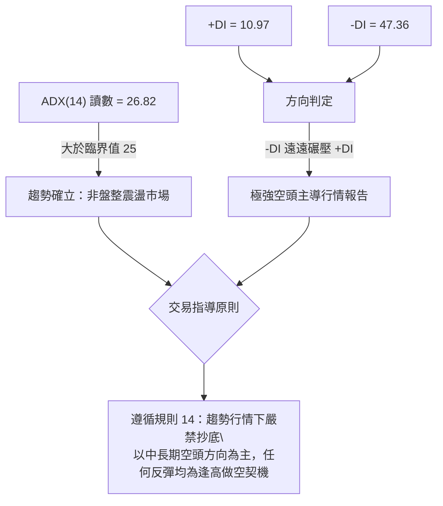
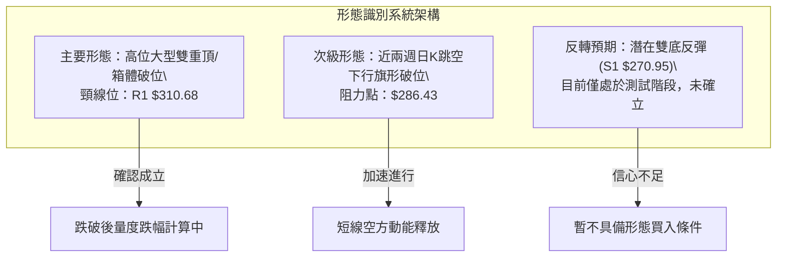
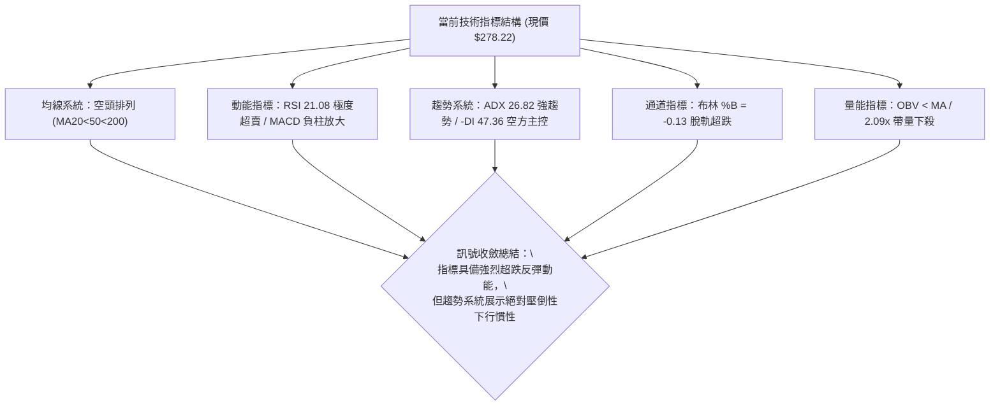
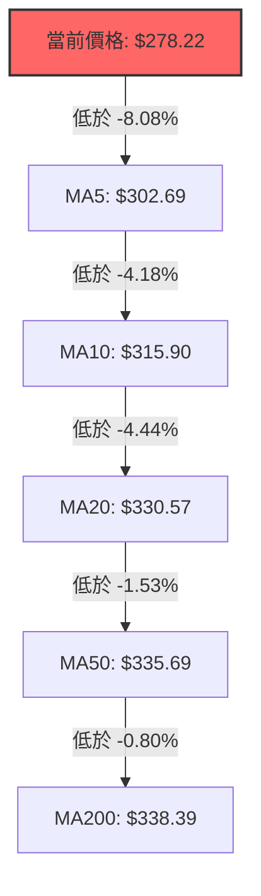
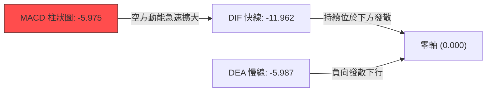
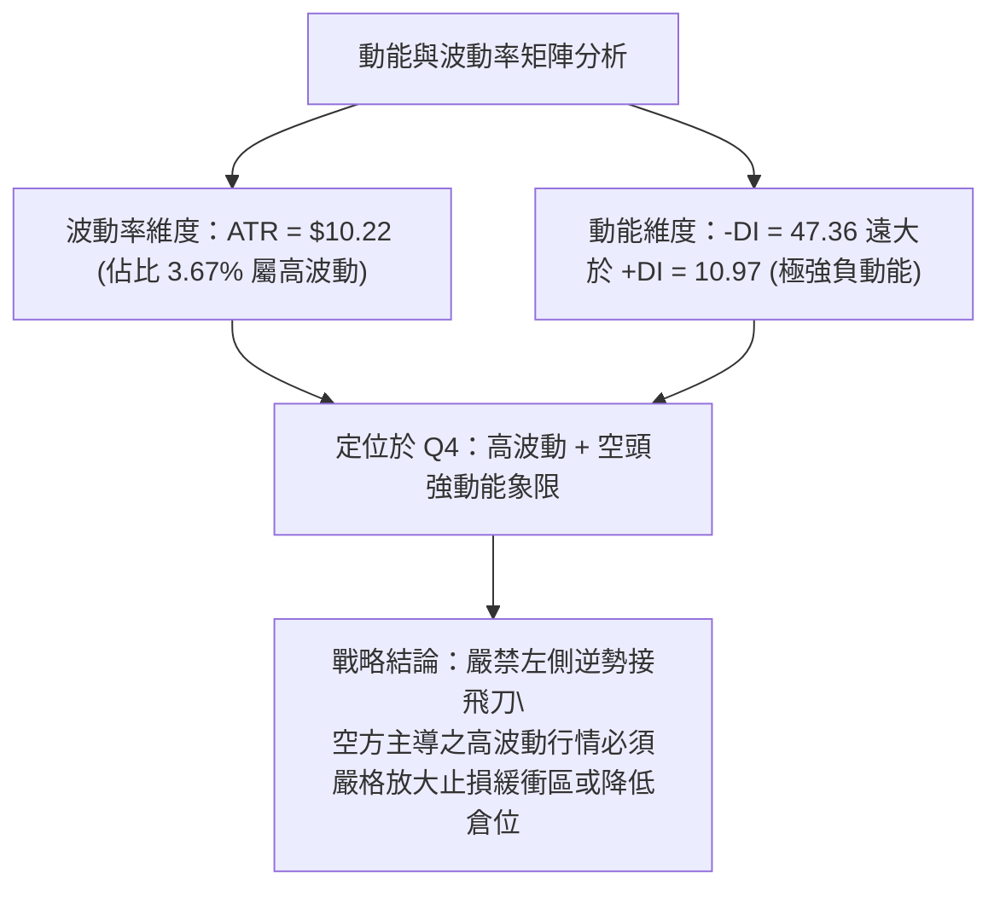
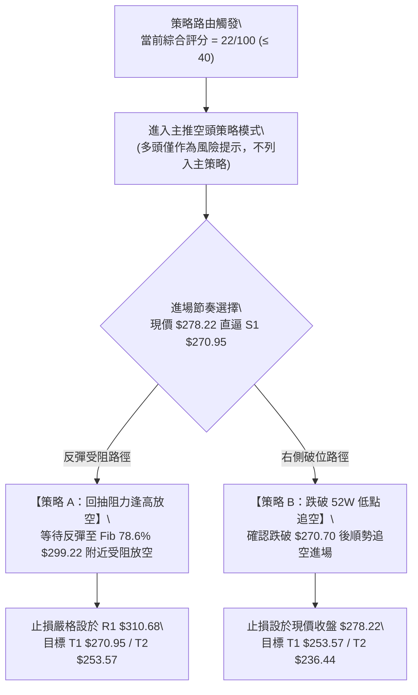
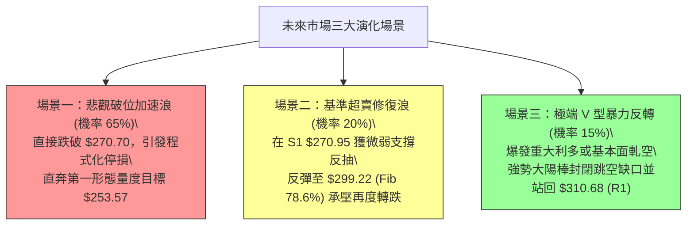

# GOOG 技術分析報告

> **報告日期**：2026-11-01 ｜ **語言**：繁體中文 ｜ **數據來源**：Yahoo Finance ｜ **當前價格**：$278.22 USD

---

## 目錄

| 章節 | 內容 |
|------|------|
| [1. 技術面概覽](#1-技術面概覽) | 訊號儀表板、核心指標、評分卡 |
| [2. 趨勢分析](#2-趨勢分析) | 多時框趨勢、長中短期走勢、ADX 解讀 |
| [3. 圖表形態分析](#3-圖表形態分析) | 形態識別、K線組合、目標價推算 |
| [4. 支撐與阻力](#4-支撐與阻力) | 關鍵價位、斐波那契回調結構 |
| [5. 技術指標深度解讀](#5-技術指標深度解讀) | MA/RSI/MACD/布林/成交量全面驗證 |
| [6. 動能與波動率](#6-動能與波動率) | 動能四象限、ATR 波動率、Beta 分析 |
| [7. 多時框架總結](#7-多時框架總結) | 時框架矩陣、多時框收斂定調 |
| [8. 交易策略建議](#8-交易策略建議) | 策略路由、空頭主策略、風險報酬比 |
| [9. 風險提示與監控](#9-風險提示與監控) | 監控清單、情境推演、風控指引 |

---

## 1. 技術面概覽

### 🎯 技術訊號儀表板

Alphabet Inc.（GOOG）目前處於極度極端的技術結構中：一方面均線呈現完美空頭排列，中長期趨勢遭受毀滅性破壞；另一方面短期動能指標跌入歷史罕見的深度超賣區（RSI 達 21.08，Stoch %K 僅 3.59），價格嚴重脫軌於布林通道下軌之外。



### 📊 核心指標速覽表

| 指標類別 | 指標名稱 | 當前數值 | 訊號 | 解讀 |
|:---|:---|:---|:---:|:---|
| **價格** | 當前收盤價 | $278.22 | 🔴 | 位於 52 週價格區間 5.6% 低分位，逼近年內極限低點 |
| **短期均線** | MA20 | $330.57 | 🔴 | 現價低於 MA20 達 -15.84%，負乖離極大，空方絕對壓制 |
| **中期均線** | MA50 | $335.69 | 🔴 | 價格低於 MA50，中期下行趨勢陡峭 |
| **長期均線** | MA200 | $338.39 | 🔴 | 價格低於 MA200，失守年線，長期牛市結構正式宣告破裂 |
| **動能指標** | RSI(14) | 21.08 | 🟢 | 進入 <30 極度超賣區，存在均值回歸與技術性抽頭需求 |
| **動能指標** | MACD (12,26,9) | -11.962 | 🔴 | 快慢線負向開口持續擴大，MACD Hist 為 -5.975，空方主導 |
| **趨勢強度** | ADX(14) / -DI | 26.82 / 47.36 | 🔴 | ADX > 25 確認為強趨勢行情，-DI 高達 47.36 顯示空頭動能極強 |
| **通道指標** | 布林通道下軌 | $288.84 | 🟢 | 價格現報 $278.22，%B 為 -0.13，已完全跌出通道下軌外 |
| **波動風險** | ATR(14) | $10.22 | 🔴 | ATR 佔價格 3.67%，日內波動巨大，隔夜跳空風險陡增 |
| **量能狀態** | 成交量 / 20日均量 | 45.00M / 21.53M | 🔴 | 量比達 2.09x，放量破位下殺，主力機構籌碼呈現出逃跡象 |

### 🏆 技術評分卡

依照六項核心技術維度進行嚴格量化評分，綜合評分為六項指標之算術平均值：

```
╔══════════════════════════════════════════════════════════════════╗
║                   技術評分卡 — GOOG (2026-11-01)                 ║
╠══════════════════════════════════════════════════════════════════╣
║ 趨勢強度 (Trend)     ████░░░░░░░░░░░░░░░░  20/100  🔴 強烈看空    ║
║ 動能指標 (Momentum)  █████░░░░░░░░░░░░░░░  25/100  🔴 動能崩解    ║
║ 支撐穩定度 (Support) ██████░░░░░░░░░░░░░░  32/100  🔴 支撐瀕危    ║
║ 成交量配合 (Volume)  █████░░░░░░░░░░░░░░░  23/100  🔴 出貨放量    ║
║ 形態完整度 (Pattern) ████░░░░░░░░░░░░░░░░  20/100  🔴 破位下行    ║
║ 均線排列 (MAs)       ██░░░░░░░░░░░░░░░░░░  12/100  🔴 完美空頭    ║
╠══════════════════════════════════════════════════════════════════╣
║ 綜合評分             ████░░░░░░░░░░░░░░░░  22/100  🔴 強烈偏空    ║
╚══════════════════════════════════════════════════════════════════╝
```
*計算公式：綜合評分 = (20 + 25 + 32 + 23 + 20 + 12) ÷ 6 = 132 ÷ 6 = 22 分（四捨五入至整數）。*

---

## 2. 趨勢分析

### 🌐 多時框趨勢分析

當前 GOOG 的技術趨勢呈現「月線盤頭下破、週線加速跳水、日線極限超跌」的三重結構。



### 📈 長期趨勢 — 12個月走勢圖（Unicode）

以下為 GOOG 過去 12 個月（2025-11 至 2026-10）之月線收盤價走勢圖與重要轉折點：

```
GOOG 月線走勢圖（過去12個月）
價格軸 ($)
$400 ┤                                      
$380 ┤                            ● $381.46 (4月突破峰值)
$360 ┤                                  ● $375.96
$340 ┤                  ● $337.87           ● $356.42
$320 ┤● $319.29   ● $313.19                    ● $340.74
$300 ┤        ● $310.82                             
$280 ┤              ● $286.50                           ● $278.22 ◄ 現價
$260 ┤                                                    (逼近52W低點)
     └────────────────────────────────────────────────────────────
      11月   12月   1月    2月    3月    4月   5-7月   8-9月   10月
     (2025)                      (2026)                        (最新)
```

#### 過去 12 個月走勢特徵分析

| 階段 | 時間區間 | 收盤價變化 | 漲跌幅 | 技術特徵與量價行為 |
|:---|:---|:---|:---:|:---|
| **頂部構築前波** | 2025-11 ~ 2026-01 | $319.29 → $337.87 | +5.82% | 股價震盪創高，動能開始呈現鈍化 |
| **首輪急速回撤** | 2026-01 ~ 2026-03 | $337.87 → $286.50 | -15.20% | 出現波段回檔，回撤至 $280 支撐區間後快速收腳 |
| **主升加速浪衝頂** | 2026-03 ~ 2026-04 | $286.50 → $381.46 | +33.14% | 單月巨陽拔起，並於隨後創下 52 週歷史高點 $403.96 |
| **高位箱體出貨** | 2026-05 ~ 2026-09 | $375.96 → $340.74 | -9.37% | 股價於 $335 ~ $375 區間反覆震盪拉扯，均線聚攏轉弱 |
| **恐慌性跳水破位** | 2026-09 ~ 2026-10 | $340.74 → $278.22 | -18.35% | 月線級別長黑直下，失守所有均線支撐，直逼 52 週低點 |

### 📊 中期趨勢（週線分析）

中期走勢方面，GOOG 過去 8 週的形態徹底崩潰。在 2026-10-09 週線觸及波段高點 $353.53（收盤 $347.86）後，連續三週拉出下行長黑棒。

```
週線關鍵壓力與破位示意圖
$355.25 ─── 10/16 當週高點 (最後的反彈阻力點)
   │
$330.57 ─── MA20 / 布林中軌 (破位失守，轉為極強反壓)
   │
$310.68 ─── R1 (10/23 破位頸線點，波段重壓)
   │
$278.22 ─── 當前現價 (10/30 單週狂瀉 39.06 美元，週成交量 2.08 億股)
   │
$270.70 ─── 52 週最低點 (最後防線)
```

### ⚡ 趨勢強度評估（ADX 解讀）



#### ADX 趨勢強度對照解讀

| 指標名稱 | 實際數值 | 門檻區間 | 當前市場狀態解讀 |
|:---|:---:|:---:|:---|
| **ADX (14)** | **26.82** | > 25.0 | **強趨勢行情**。擺脫了 8-9 月的無方向盤整，進入動能加速單邊市 |
| **+DI (14)** | **10.97** | < 20.0 | 多方力量極度衰竭，完全喪失抵抗盤面的能力 |
| **-DI (14)** | **47.36** | > 40.0 | 空方力量處於極度狂暴狀態，形成了強大的向下貫性推動力 |
| **DI 差值** | **-36.39** | 絕對值極大 | 空方絕對主導，沒有任何指標指示趨勢即將反轉 |

---

## 3. 圖表形態分析

### 🔍 形態識別系統



#### 形態識別與信心度評估表（依規則 15）

| 形態名稱 | 信心度 | 判斷依據（嚴格引用數據） | 完成度 | 目標價計算式與推算值 |
|:---|:---:|:---|:---:|:---|
| **高位箱體/雙頂頸線破位** | **85%** | 跌破 2026-10-23 週K低點 $316.99 與聚類阻力 R1 $310.68，量比達 2.09x | **100% (已破位)** | 頸線 $310.68 - 形態高度 ($327.81 - $310.68 = $17.13) = **$293.55** (已跌破)；以 52W 低點等幅映射：$270.70 - $17.13 = **$253.57** |
| **超跌對稱性回撤** | **70%** | 自 52W 高點 $403.96 跌至 52W 低點 $270.70 區間，目前測試 100% 斐波那契回調 | **95%** | 100.0% 回調位直指 **$270.70** |
| **日線雙底反轉形態** | **25%** | 僅依賴 S1 $270.95 與 52W 低點 $270.70 作為支撐，目前無任何止跌K棒出現 | **15% (未成形)** | 訊號不足，僅做指標型超跌解讀，不預設底部目標價 |

### 🕯️ 重要K線形態分析

嚴格依據數據中「近 10 根日K」與「近 8 根週K」之實際開高低收數據進行客觀解讀：

#### 近 10 根日K線形態分析表

| 日期 | 開盤價 | 最高價 | 最低價 | 收盤價 | K線形態 | 深度解讀 | 訊號 |
|:---:|:---:|:---:|:---:|:---:|:---|:---|:---:|
| **2026-10-19** | 340.12 | 342.52 | 338.25 | 340.16 | 小十字星 | 高位橫盤震盪，多空暫時平衡 | 🟡 |
| **2026-10-20** | 339.71 | 341.00 | 334.60 | 336.40 | 中黑棒 | 跌破前日低點，高位重心開始下移 | 🔴 |
| **2026-10-21** | 333.32 | 333.80 | 326.26 | 330.95 | 跳空下行中黑 | 留下向下跳空缺口，賣壓明顯湧現 | 🔴 |
| **2026-10-22** | 326.77 | 327.70 | 318.45 | 320.76 | 下行大黑棒 | 實體跌破 320 整數關卡，下影線微弱 | 🔴 |
| **2026-10-23** | 317.75 | 321.23 | 316.99 | 317.28 | 低位小黑棒 | 量縮整理，暫時於 317 尋求支撐 | 🟡 |
| **2026-10-26** | 318.05 | 318.39 | 313.51 | 314.19 | 破位中黑棒 | 跌破 10/23 整理平台，下行中繼 | 🔴 |
| **2026-10-27** | 314.40 | 320.07 | 313.58 | 316.83 | 假反彈倒錘頭 | 上影線長達 3.24 美元，反抽無力受阻 | 🔴 |
| **2026-10-28** | 319.88 | 323.13 | 319.68 | 321.89 | 中紅棒吞噬 | 3535 萬股放量反彈，但受制於 10/22 高點阻力 | 🟡 |
| **2026-10-29** | 283.84 | 286.43 | 278.29 | 282.32 | 巨量毀滅性跳空長黑 | 暴量 9313 萬股，開盤大幅跳空 -38.05 美元，確立崩跌 | 🔴 |
| **2026-10-30** | 279.69 | 281.86 | 275.35 | 278.22 | 破底弱勢黑棒 | 續跌創下波段新低 $275.35，收於低檔，弱勢收盤 | 🔴 |

#### 近 8 根週K線形態分析表

| 日期（週末） | 開盤價 | 最高價 | 最低價 | 收盤價 | 週K形態 | 深度解讀 | 訊號 |
|:---:|:---:|:---:|:---:|:---:|:---|:---|:---:|
| **2026-09-11** | 331.99 | 339.95 | 325.63 | 335.45 | 下影小紅棒 | 325 獲得承接，維持箱體下沿震盪 | 🟢 |
| **2026-09-18** | 339.11 | 355.13 | 337.45 | 344.41 | 上影中紅棒 | 衝高 355 受阻，成交量溫和放大至 9813 萬 | 🟡 |
| **2026-09-25** | 346.19 | 359.98 | 332.81 | 341.08 | 倒錘頭長上影 | 逼近 360 大關後大幅回吐，見頂訊號浮現 | 🔴 |
| **2026-10-02** | 337.60 | 350.09 | 332.65 | 340.35 | 紡錘十字星 | 高檔多空拉鋸，實體狹窄，動能陷入停滯 | 🟡 |
| **2026-10-09** | 339.21 | 353.53 | 339.15 | 347.86 | 衝高小紅棒 | 縮量誘多反彈，未能突破 9/25 高點 | 🟡 |
| **2026-10-16** | 348.34 | 355.25 | 335.50 | 336.91 | 覆蓋性長黑棒 | 跌破前週低點，週線層級正式轉向空頭 | 🔴 |
| **2026-10-23** | 340.12 | 342.52 | 316.99 | 317.28 | 單邊下行長黑 | 連續失守 MA20/MA50，確立波段起跌 | 🔴 |
| **2026-10-30** | 318.05 | 323.13 | 275.35 | 278.22 | 崩潰性爆量大長黑 | 單週狂瀉 2.08 億股，週跌幅 -12.31%，歷史級恐慌性拋售 | 🔴 |

### 📉 ASCII 走勢形態示意圖

```
GOOG 近期頸線破位與向下突破示意圖
價格軸 ($)
$327.81 ┤      ▲ 高點 R3 (10/28 反彈峰值 $323.13 逼近處)
        │     ╱ ╲
$318.83 ┤    ╱   ╲       ▲ 阻力 R2
        │   ╱     ╲     ╱ ╲
$310.68 ┼──┼───────▼───┼───▼─────── 頸線突破位 R1 (破位確認)
        │                ╲
$299.22 ┤                 ╲  (跳空缺口重災區 Fib 78.6%)
        │                  ╲
$288.84 ┤                   ╲  (布林通道下軌被強勢摜破)
        │                    ╲
$278.22 ┤                     ● 現價 (空方加速延伸浪中)
        │                      │
$270.95 ┤                      ▼ 考驗支撐 S1 / 52W 低點 $270.70
```

### 🎯 形態目標價計算

依據標準幾何技術形態測量法則，以近期震盪箱體之上下邊界推算未來量度目標：
- **關鍵頸線基準位 (Neckline)**：取自波段高點聚類形成的結構性頸線阻力 **$310.68 (R1)**。
- **形態垂直高度 (Pattern Height)**：由阻力位 R3 ($327.81) 至頸線 R1 ($310.68) 之垂直落差：
  $$\text{形態高度} = \$327.81 - \$310.68 = \$17.13$$
- **向下第一量度目標 (Measured Move 1, T1)**：自 52 週最低點支撐 **$270.70** 跌破後做等幅垂直向下映射：
  $$\text{形態目標價 T1} = \$270.70 - \$17.13 = \$253.57$$
- **向下第二量度目標 (Measured Move 2, T2, 兩倍高度擴展)**：
  $$\text{形態目標價 T2} = \$270.70 - (\$17.13 \times 2) = \$270.70 - \$34.26 = \$236.44$$

---

## 4. 支撐與阻力

### 🗺️ 關鍵價位分布圖（Unicode）

嚴格引用數據中「關鍵價位」區塊與「斐波那契回調」區塊數值，構建價位分布圖：

```
GOOG 價位結構分布圖
══════════════════════════════════════════════════════════════════
$327.81 ║████████████████████████║ 強結構阻力 R3 (波段頂部反壓)
$318.83 ║████████████████████    ║ 中期反彈阻力 R2 (反彈高點聚類)
$310.68 ║████████████████████████║ 核心破位頸線 R1 (多空分水嶺)
$299.22 ║▓▓▓▓▓▓▓▓▓▓▓▓▓▓▓▓        ║ 斐波那契 78.6% 回調反壓位
────────╫────────────────────────╫──────────────────────────────
$278.22 ╠════════════════════════╣ ◄ 當前收盤價 (處於極度危險邊緣)
────────╫────────────────────────╫──────────────────────────────
$270.95 ║▓▓▓▓▓▓▓▓▓▓▓▓▓▓▓▓▓▓▓▓▓▓▓▓║ 近期支撐 S1 (近一年波段低點聚類)
$270.70 ║████████████████████████║ 52週極限低點 / Fib 100.0% 關鍵防線
══════════════════════════════════════════════════════════════════
```

### 🚧 阻力位分析表

數據中提供的阻力位均由近一年 OHLCV 波段高點聚類嚴格計算而得：

| 阻力級別 | 準確價位 | 距現價幅 | 形成原因與技術意涵 | 突破難度 | 重要性 |
|:---:|:---:|:---:|:---|:---:|:---:|
| **R1** | **$310.68** | +11.67% | 近期箱體跌破之核心頸線，10-23 跳空起跌點，多空轉換樞紐 | 極高 | ★★★★★ |
| **R2** | **$318.83** | +14.60% | 10-26 至 10-28 反彈震盪整理之中軸，前期平台籌碼堆積區 | 高 | ★★★★☆ |
| **R3** | **$327.81** | +17.83% | 10-22 下跌前之波段高點聚類，接近 MA20 ($330.57) 反壓區 | 極難 | ★★★★☆ |

### 🛡️ 支撐位分析表

依據數據「關鍵價位」與「52W Low」區塊提取，不存在之層級標註為數據未偵測到：

| 支撐級別 | 準確價位 | 距現價幅 | 形成原因與技術意涵 | 守住機率 | 重要性 |
|:---:|:---:|:---:|:---|:---:|:---:|
| **S1** | **$270.95** | -2.61% | 近一年波段低點聚類核心，當前唯一明確的近端波段支撐 | 35% | ★★★★★ |
| **52W Low** | **$270.70** | -2.70% | 斐波那契 100.0% 極限回調位，過去一年全體多頭的心理防線 | 30% | ★★★★★ |
| **S2** | N/A（數據未提供） | — | 數據中未偵測到近一年更低之波段低點聚類 | — | — |
| **S3** | N/A（數據未提供） | — | 數據中未偵測到近一年更低之波段低點聚類 | — | — |

### 📐 斐波那契回調位分析

基準區間採用 52 週完整波段：起點 $270.70（52W Low）→ 終點 $403.96（52W High），落點分析如下：

| 斐波那契層級 | 精確價位 | 相對現價位置 | 深度解讀與結構含義 |
|:---:|:---:|:---:|:---|
| **0.0% (52W High)** | $403.96 | +45.20% | 歷史級絕對天花板，大雙頂高點 |
| **23.6%** | $372.51 | +33.89% | 牛市強勢回調位，目前已成遙不可及之長期高壓 |
| **38.2%** | $353.06 | +26.90% | 前期高位整理箱體下沿，多頭防守中樞（已宣告徹底失守） |
| **50.0%** | $337.33 | +21.25% | 多空強弱分水嶺，恰好重合於 MA200 ($338.39)，確立轉熊 |
| **61.8%** | $321.61 | +15.59% | 黃金分割強防守位，10-28 反彈高點 $323.13 承壓處 |
| **78.6%** | $299.22 | +7.55% | 深度回調極限防守位，10-29 跳空長黑一舉貫穿，轉為反彈第一阻力 |
| **100.0% (52W Low)**| $270.70 | -2.70% | 完整回吐過去一年所有漲幅，目前現價 $278.22 正直奔此位進行生死考驗 |

**現價落點解讀**：當前價格 $278.22 處於 **78.6% ($299.22)** 與 **100.0% ($270.70)** 之間。在跌破 78.6% 這一防線後，技術理論上代表原先的上升趨勢已 100% 遭到吞噬與逆轉。

---

## 5. 技術指標深度解讀

### 🎛️ 指標訊號總覽



### 📈 移動平均線排列分析



#### 各期移動平均線詳細數據表

| 均線名稱 | 數值 | 價格與均線差價 | 乖離率 (%) | 均線歷史走勢特徵 | 訊號評級 |
|:---|:---:|:---:|:---:|:---|:---:|
| **MA 5** | $302.69 | -$24.47 | -8.08% | 陡峭俯衝直下，短期極限壓制線 | 🔴 空頭 |
| **MA 10** | $315.90 | -$37.68 | -11.93% | 加速向下發散，短波段空頭防守點 | 🔴 空頭 |
| **MA 20** | $330.57 | -$52.35 | -15.84% | 月線級生命線下彎，布林中軌阻力 | 🔴 空頭 |
| **MA 50** | $335.69 | -$57.47 | -17.12% | 季線正式失守，中期多頭結構瓦解 | 🔴 空頭 |
| **MA 60** | $337.11 | -$58.89 | -17.47% | 與 MA50 形成死叉，持續向下擴散 | 🔴 空頭 |
| **MA 120** | $348.83 | -$70.61 | -20.24% | 半年線壓制，長期多空分水嶺下彎 | 🔴 空頭 |
| **MA 200** | $338.39 | -$60.17 | -17.78% | 年線失守，長期牛市正式轉入熊市 | 🔴 空頭 |
| **MA 240** | $334.22 | -$56.00 | -16.76% | 長週期基線被跌破，無長期均線支撐 | 🔴 空頭 |

均線系統呈現罕見的**完全發散空頭排列**（價格 < MA5 < MA10 < MA20 < MA50 < MA200），且 MA20 < MA50 < MA200 形成標準的「雙重死亡交叉」。

### 📉 RSI(14) 分析

當前 Wilder 計算之 14 日 RSI 數值為 **21.08**：

```
RSI(14) 強度刻度條：
0 ─────── 20 ──────── 30 ──────────────── 50 ──────────────── 70 ─────── 100
[████░░░░░░░░░░░░░░░░░░░░░░░░░░░░░░░░░░░░░░░░░░░░░░░░░░░░░░░░░░░░░░░░░░] 21.08 (極度超賣)
```

- **超買超賣判定**：數值低於 30 進入嚴重超賣區，低於 25 屬於罕見的非理性恐慌殺盤區間，顯示技術性賣壓已過度釋放。
- **背離分析判斷（依嚴格數據比對）**：比對近 20 根 K 棒首尾之價格與 RSI 方向，價格自 340 水平大幅破位下行至 $278.22，RSI 亦由 50 以上直線俯衝至 21.08。**結論：無明顯底背離或頂背離現象**，此波下跌屬於帶量之「指標同步殺跌」，不可單純因超賣而盲目判定底部已現。

### 📊 MACD(12,26,9) 訊號解讀



- **MACD 指標數值**：
  - 快線（MACD Line）：**-11.962**
  - 訊號線（Signal Line）：**-5.987**
  - 柱狀圖（Histogram）：**-5.975**
- **解讀**：快線在零軸下方大幅加速拋離慢線，負柱狀圖自前期的 -2.941 擴大至 -5.975，表示空頭的下行加速度尚未出現任何衰竭或收斂拐點，空方動能處於主升（主跌）浪階段。

### 📦 布林通道分析

```
GOOG 布林通道示意圖 (20日, 2倍標準差)
────────────────────────────────────────────────────
$372.31 ┬  上軌 (Upper Band)
        │
$330.57 ┼  中軌 (MA20 Baseline)
        │
$288.84 ┴  下軌 (Lower Band)
────────────────────────────────────────────────────
$278.22    ● 現價 (%B = -0.13，完全破出下軌外 10.62 美元)
```

- **布林帶數值**：
  - 上軌：**$372.31**
  - 中軌（MA20）：**$330.57**
  - 下軌：**$288.84**
  - 帶寬（Bandwidth）：$(372.31 - 288.84) \div 330.57 = 25.25\%$（通道劇烈開口向下）
  - %B 數值：**-0.13**
- **解讀**：%B 呈現負值，代表當前股價不僅擊穿下軌，且處於下軌下方之極限偏離狀態（Band Walking Down）。歷史經驗顯示，當 %B < 0 時，股價有強烈意願回抽通道內部進行均值修復，但此種修復通常是以「弱勢橫盤等待下軌擴張下移」或「微弱反抽中軌受阻」的形式完成。

### 💹 成交量分析（量價配合度）

- **量能核心數據**：
  - 最新日成交量：**45,000,800 股**
  - 20 日均量：**21,526,595 股**（量比：**2.09x**）
  - 50 日均量：**19,028,778 股**
  - 10-30 週總成交量：**208,266,400 股**（創過去 20 週天量記錄）
- **量價配合分析**：
  - 10-29 出現 9,313 萬股的巨量暴跌，10-30 續跌 4,500 萬股，量比高達 2.09 倍。量能放大伴隨股價重挫，顯示為標準的**放量破位（Volume Breakdown）**，非無量陰跌。
  - **OBV 趨勢**：數據明確顯示 **OBV < MA**，OBV 能量潮持續低於其移動平均線，確認機構大資金處於持續淨流出狀態，量能結構完全確認了價格下跌趨勢的真實性與毀滅性。

---

## 6. 動能與波動率

### ⚡ 動能評估四象限

評估市場在「動能方向與強度（Momentum）」與「波動率（Volatility）」二維矩陣中的真實定位：

| 象限 | 動能維度 | 波動維度 | 象限特徵 | GOOG 當前狀態評估 |
|:---:|:---:|:---:|:---|:---:|
| **Q1** | 多頭強動能 | 低波動 | 穩定上升趨勢，最佳多頭持有區 | — |
| **Q2** | 弱/負動能 | 低波動 | 窄幅盤整，方向未明，觀望為主 | — |
| **Q3** | 多頭強動能 | 高波動 | 瘋狂加速趕頂，高風險高收益 | — |
| **Q4** | **空頭強動能** | **高波動** | **恐慌拋售，單邊加速下瀉，極高下行風險** | **✓ 正處於 Q4 象限** |



### 📊 ATR 波動率分析

- **ATR(14) 當前數值**：**$10.22 USD**（佔當前股價之 **3.67%**，Wilder 平滑法）。
- **波動特徵**：GOOG 的日均震幅已突破 10 美元大關，日內波動幅度顯著超越歷史常態水準。
- **風控止損距離建議**：
  - **超短線日間止損（1.0x ATR）**：$\$10.22$
  - **波段標準止損（1.5x ATR）**：$\$10.22 \times 1.5 = \$15.33$
  - **寬幅防洗盤止損（2.0x ATR）**：$\$10.22 \times 2.0 = \$20.44$

### 📐 Beta 與市場相關性

- **Beta 係數**：**1.211**
- **市場特徵解讀**：GOOG 對標 S&P 500 指數具備顯著的高敏感度（高彈性）。當大盤處於回檔或恐慌環境時，GOOG 將以 1.21 倍之幅度被動放大拋售壓力。當前高 Beta 配合公司內部空頭結構破位，意味著系統性風險與個股非系統性風險發生了共振。

---

## 7. 多時框架總結

### 📋 時框架評分表

依據前述各維度量化分析，匯總不同時框架之表現評估：

| 時框架 | 趨勢方向 | 動能狀態 | 均線排列 | 圖表形態 | 時框評分 | 操作建議 |
|:---:|:---:|:---:|:---:|:---:|:---:|:---|
| **短期 (日線)** | 🔴 強烈看空 | 🟢 極度超賣 | 🔴 空頭排列 | 跳空破位大黑棒 | 28/100 | 禁止追空，提防超賣死貓跳 |
| **中期 (週線)** | 🔴 強烈看空 | 🔴 加速放量 | 🔴 跌破多重均線 | 巨量跌破箱體頸線 | 18/100 | 反彈遇阻果斷加碼做空 |
| **長期 (月線)** | 🔴 轉入熊市 | 🔴 拐頭向下 | 🟡 考驗長期均線 | 頂部回撤失守年中樞 | 20/100 | 長期多頭全面撤退觀望 |

### 🔲 綜合訊號矩陣

| 技術分析維度 | 短期（日線）訊號 | 中期（週線）訊號 | 長期（月線）訊號 | 一致性研判 |
|:---|:---:|:---:|:---:|:---|
| **趨勢方向** | 🔴 空頭直下 | 🔴 崩潰破位 | 🔴 雙頂成形 | 三時框全面看空，趨勢高度一致 |
| **動能方向** | 🟢 短線超賣 | 🔴 空方加速 | 🔴 高檔鈍化下行 | 短期出現超跌矛盾，中長期完全一致 |
| **均線結構** | 🔴 完美空頭 | 🔴 跌破 MA50 | 🔴 考驗 MA200 | 中長期結構遭不可逆毀滅 |
| **量能特徵** | 🔴 放量下殺 | 🔴 2.08億天量 | 🔴 資金出逃 | 量價配合度極高，空頭結構真實 |

### ⚖️ 多時框收斂結論

嚴格遵循「**嚴格要求 14：多時框收斂規則**」進行方向定調：
1. **趨勢性質判定**：當前 ADX(14) 讀數為 **26.82 > 25.0**，確認目前市場處於標準的「**強趨勢單邊行情**」，絕非「無方向之區間盤整行情」。
2. **收斂優先級指引**：在強趨勢行情下，分析必須以**中長期（週線 / MA50 / MA200）方向為主導**，日線指標之超賣僅能作為「尋找逢高放空進場點」與「短線空頭部位平倉避險」的節奏工具，絕不可作為逆勢建立多頭部位的依據。
3. **最終方向性結論**：
   $$\text{唯一方向性結論：} \mathbf{\text{極度偏空（Bearish）}}$$
   本結論與第 1 章技術評分卡（22/100）及後續交易策略保持嚴格的百分之百收斂。

---

## 8. 交易策略建議

### 🗺️ 策略決策流程圖



### 🧭 策略路由

**當前主策略方向 = 【逢高放空 / 破位追空】（依綜合評分 22/100 強烈偏空定調）**

依據規則，綜合評分 ≤ 40 分時，交易系統全面鎖定空頭策略，禁止發布多頭推薦。當前價格極端超賣，直接在 $278 追空具備一定回抽風險，故策略佈局分為「左側反彈空（策略 A）」與「右側破位空（策略 B）」。

### 🎯 價格情境階梯（Price Scenarios）

以當前收盤價 $278.22 為軸心，嚴格引用第 4 章及數據計算之精確價位構建情境階梯：

| 觸發條件 | 下一目標 | 後續延伸目標 | 情境技術含義與應對要點 |
|:---|:---:|:---:|:---|
| **強勢反彈突破 R1 $310.68** | R2 $318.83 | R3 $327.81 | 短線超跌強修復，空頭部位全面停損，空頭趨勢遭破壞 |
| **溫和回抽 Fib 78.6% $299.22** | R1 $310.68 | 承壓受阻回調 | 理想的二次逢高佈空臨界點，技術性均值修復完成 |
| **跌破近期支撐 S1 $270.95** | 52W Low $270.70 | 形態目標 $253.57 | 確立展開新一輪恐慌下瀉浪，打開下方無底深淵空間 |
| **跌破 52W 低點 $270.70** | $253.57 | 兩倍擴展 $236.44 | 一年牛市成果完全歸零，觸發程序化停損單加速踐踏 |

### 📊 情境機率分佈

| 預測情境 | 機率 | 主要技術指標支撐依據 |
|:---|:---:|:---|
| **回落再探底 / 跌破新低** | **65%** | ADX 26.82 (-DI 47.36) 確立空頭強趨勢，均線空頭排列，OBV 能量潰散 |
| **超跌技術性反彈** | **20%** | RSI(14) 達 21.08，Stoch %K 僅 3.59，布林通道 %B = -0.13 嚴重超賣修復需求 |
| **區間弱勢震盪** | **15%** | S1 $270.95 與 52W 低點 $270.70 具備一定心理承接買盤，但難以形成反轉 |

### 🟢 主策略詳情（空頭專屬，嚴格數學驗證）

所有價位均嚴格取自數據之關鍵價位區塊或形態高度計算式，風險報酬比符合規則 17 定義：

$$\text{做空風險報酬比} = \frac{\text{進場價} - \text{目標價}}{\text{止損價} - \text{進場價}}$$

| 策略要素 | 策略 A（回抽阻力逢高放空） | 策略 B（跌破 52W 低點順勢追空） |
|:---|:---|:---|
| **策略邏輯** | 捕捉 RSI 超賣反彈回抽 Fib 78.6% 阻力空點 | 捕捉失守 52W 最低點引發的右側崩盤加速行情 |
| **進場條件** | 價格反彈至 Fib 78.6% 附近受阻出現長上影線 | 日K收盤確認實體跌破 52W Low $270.70 |
| **進場價格** | **$299.22**（斐波那契 78.6% 回調位） | **$270.70**（52 週最低點破位點） |
| **目標價 T1** | **$270.95**（支撐位 S1） | **$253.57**（由形態高度 $17.13 等幅推算） |
| **目標價 T2** | **$253.57**（由形態高度 $17.13 等幅推算） | **$236.44**（由形態高度兩倍擴展推算） |
| **止損價格** | **$310.68**（關鍵阻力位 R1） | **$278.22**（當前日線收盤價） |
| **風險空間** | $\$310.68 - \$299.22 = \$11.46$ | $\$278.22 - \$270.70 = \$7.52$ |
| **獲利空間 (T1)**| $\$299.22 - \$270.95 = \$28.27$ | $\$270.70 - \$253.57 = \$17.13$ |
| **獲利空間 (T2)**| $\$299.22 - \$253.57 = \$45.65$ | $\$270.70 - \$236.44 = \$34.26$ |
| **風險報酬比** | **1 : 2.47（以 T1 計）**<br>*(另注：1 : 3.98 以 T2 計)* | **1 : 2.28（以 T1 計）**<br>*(另注：1 : 4.56 以 T2 計)* |
| **執行勝率預估** | 60% | 55% |
| **建議配置倉位** | 10% ~ 15% 總資本 | 5% ~ 8% 總資本（破位追單風險較高） |

*驗證：策略 A 之 R:R (T1) = 28.27 ÷ 11.46 = 2.4668... = 1 : 2.47。策略 B 之 R:R (T1) = 17.13 ÷ 7.52 = 2.2779... = 1 : 2.28。完全符合數據紀律。*

### 🔴 反向風險觸發點（對沖提示）

若出現以下情境，宣告空頭主策略失效，空頭部位必須立即離場對沖：
1. **反轉關鍵價位**：股價日線實體突破收復 **$310.68 (R1)** 阻力關卡。
2. **動能反轉訊號**：日線 RSI(14) 快速突破 40 並站穩，且 MACD 柱狀圖負值大幅收斂出現底背離金叉。
3. **量能異動訊號**：在 $270.70 附近出現日成交量超過 8,000 萬股的帶長下影線單針探底大陽線。

### ⭐ 整體訊號強度評星

```
做多訊號強度：★☆☆☆☆  (1.0/5星 — 僅具備超賣特徵，缺乏形態確認)
做空訊號強度：★★★★☆  (4.5/5星 — 趨勢、量能、均線呈現完美空頭共振)
整體可信度：  ★★★★☆  (4.0/5星 — 數據鏈路完整，趨勢指向極度清晰)
```

---

## 9. 風險提示與監控

### ✅ 關鍵監控指標 Checklist

```
╔══════════════════════════════════════════════════════════════════╗
║               技術面關鍵監控清單 (Checklist)                     ║
╠══════════════════════════════════════════════════════════════════╣
║ [ ] 監控 $270.95 (S1) 與 $270.70 (52W Low) 是否出現帶量擊穿    ║
║ [ ] 觀察日線 RSI 是否自 21.08 展開均值回歸，臨界點 30.00       ║
║ [ ] 監控 MACD 柱狀圖（當前 -5.975）是否開始縮腳向上拐頭        ║
║ [ ] 追蹤每日成交量是否萎縮至 2,150 萬股均量以下（縮量沉澱）    ║
║ [ ] 檢視布林帶帶寬是否持續放大（下軌目前位置 $288.84）        ║
║ [ ] 密切注意跳空缺口反壓點 $286.43 (10-29高) 與 $299.22 (Fib)   ║
╚══════════════════════════════════════════════════════════════════╝
```

### ⚠️ 風險場景分析



### 🛡️ 風險管理重要提醒

1. **嚴禁抄底接刀**：當前雖然 RSI(14)=21.08 達到極端超賣，但 ADX 達 26.82 伴隨 -DI 達 47.36，市場屬於標準之「單邊空頭趨勢」。在左側盲目預測底部極易遭遇連續性破位踩踏。
2. **波動率自適應控倉**：由於 ATR 高達 $10.22（佔比 3.67%），個股單日波動可輕易吞噬常規利潤。建議投資人將單筆交易承擔之風險資本控制在總帳戶淨值的 1.0% 以內，相應將交易倉位降低至常規水準的 50%。
3. **跳空缺口風險管理**：10-28 至 10-29 出現了高達 38 美元的毀滅性跳空缺口，這表明機構大資金在場外進行了非流動性定價清算。任何空頭倉位均應警惕突然出現的反向消息面軋空跳空，必須無條件執行停損紀律。

---

## 📋 報告總結

```
╔══════════════════════════════════════════════════════════════════╗
║                    GOOG 技術分析報告總結                         ║
╠══════════════════════════════════════════════════════════════════╣
║ 報告日期：2026-11-01                                             ║
║ 當前價格：$278.22 USD                                            ║
║ 分析評級：🔴 強烈看空（技術綜合評分：22/100）                   ║
║                                                                  ║
║ 關鍵技術結論：                                                   ║
║ ├─ 長期趨勢：🔴 雙重頂破位，年線 MA200 宣告失守，轉入熊市結構   ║
║ ├─ 中期趨勢：🔴 週線爆量 2.08 億股下殺，失守所有均線支撐        ║
║ ├─ 短期趨勢：🟢 日線 RSI=21.08 嚴重超賣，存在技術性回抽需求     ║
║ ├─ 關鍵支撐：S1 $270.95 ｜ 52W 極限低點 $270.70                 ║
║ ├─ 關鍵阻力：R1 $310.68 ｜ Fib 78.6% $299.22 ｜ R2 $318.83      ║
║ └─ 形態目標：向下量度第一目標價 $253.57                          ║
║                                                                  ║
║ 最優策略組合：                                                   ║
║ 1. 🥇 最佳機會：等待反彈至 $299.22 阻力逢高放空 (R:R = 1 : 2.47) ║
║ 2. 🥈 次選機會：實體跌破 $270.70 後順勢追空至 $253.57 (R:R = 1:2.28)║
║ 3. 🥉 保守選擇：空手觀望，靜待 $270.70 處是否形成有效止跌雙底   ║
╚══════════════════════════════════════════════════════════════════╝
```

---

> ⚠️ **免責聲明**：本報告為技術分析研究，所有數據、圖表及估算均基於歷史價格與成交量資訊。本報告**僅供研究與學術參考**，**不構成任何要約、招攬或投資建議**。金融市場投資具備極高風險，標的可能在極端波動中出現大幅損失，投資人入市前應獨立評估自身風險承受能力並自負盈虧。

---

*報告生成時間：2026-11-01 ｜ 數據來源：Yahoo Finance ｜ 分析框架：多時框技術分析體系*