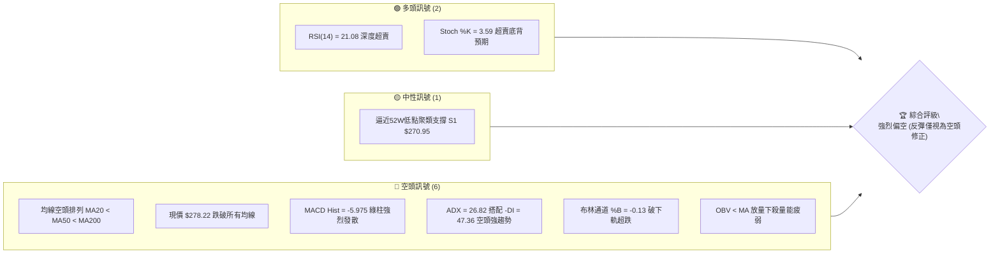
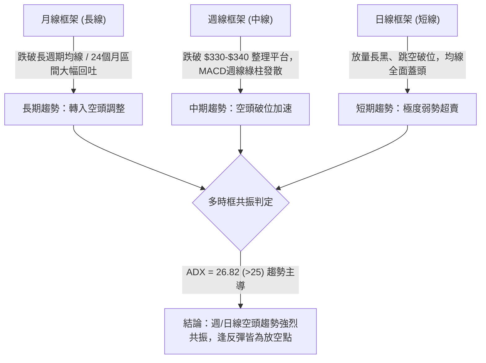
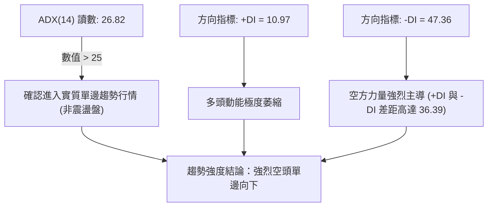
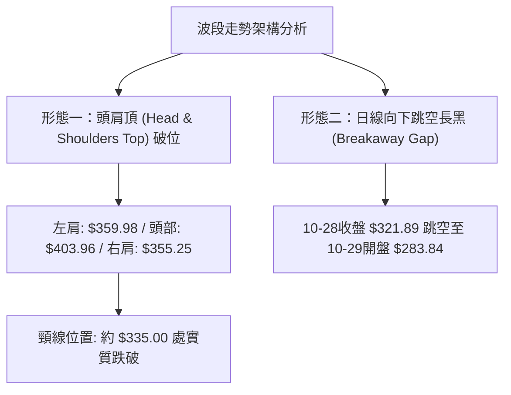
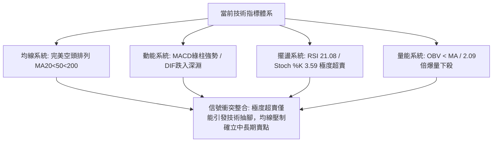
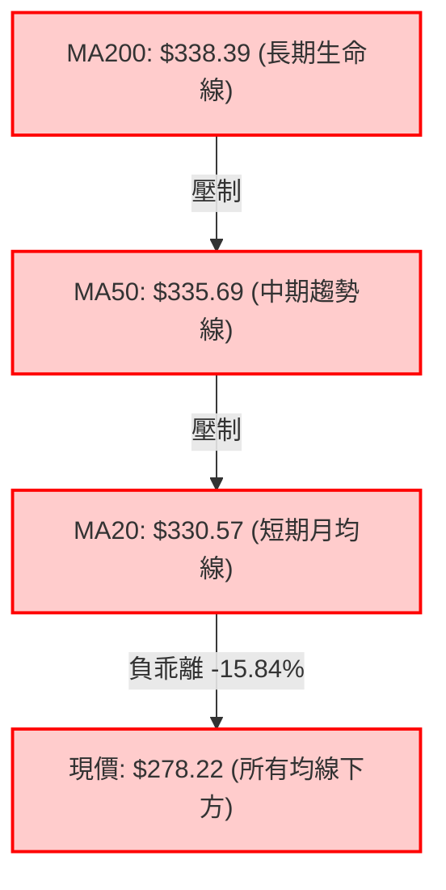
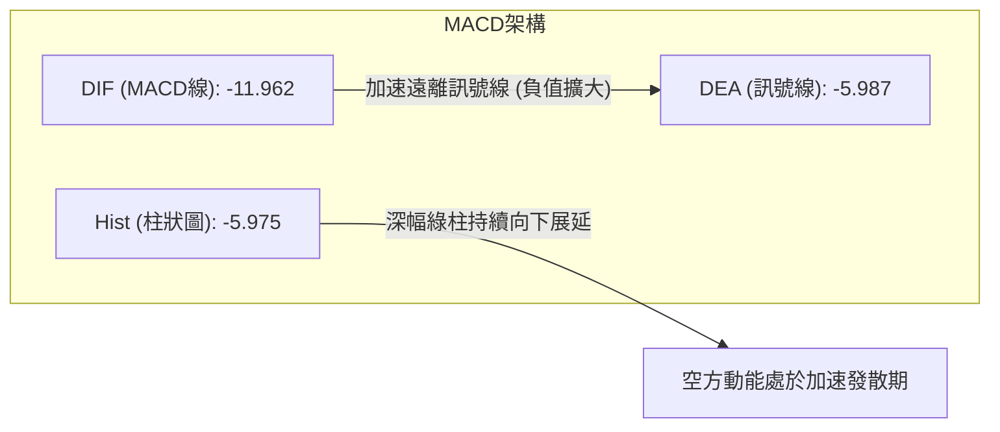
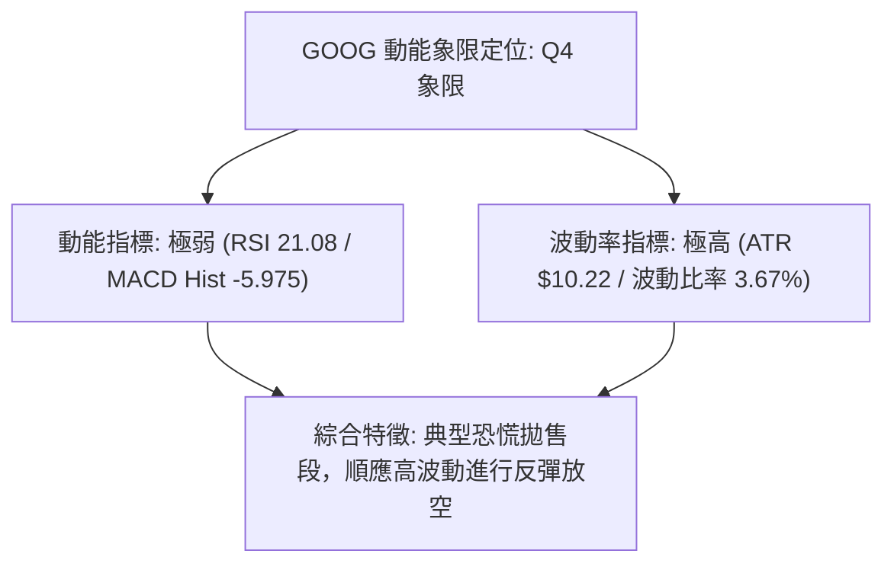
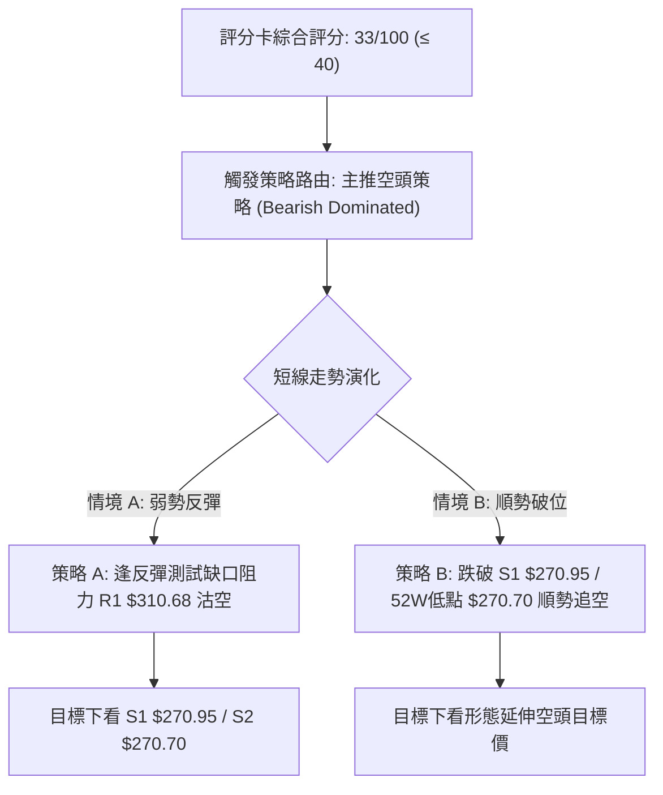
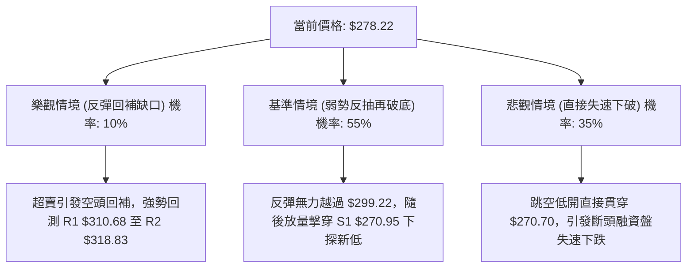

# GOOG 技術分析報告

> **報告日期**：2026-11-02 ｜ **語言**：繁體中文 ｜ **數據來源**：Yahoo Finance ｜ **當前價格**：$278.22

---

## 目錄

| 章節 | 內容 |
|------|------|
| [1. 技術面概覽](#1-技術面概覽) | 訊號儀表板、核心指標、評分卡 |
| [2. 趨勢分析](#2-趨勢分析) | 多時框趨勢、長中短期走勢、ADX解讀 |
| [3. 圖表形態分析](#3-圖表形態分析) | 形態識別、K線組合、目標價推算 |
| [4. 支撐與阻力](#4-支撐與阻力) | 關鍵價位、斐波那契回調結構 |
| [5. 技術指標深度解讀](#5-技術指標深度解讀) | MA/RSI/MACD/布林/成交量量價解析 |
| [6. 動能與波動率](#6-動能與波動率) | 動能矩陣、ATR風控、Beta市場連動 |
| [7. 多時框架總結](#7-多時框架總結) | 時框架評分矩陣與多時框收斂 |
| [8. 交易策略建議](#8-交易策略建議) | 主空頭路由策略、價格情境、風報比 |
| [9. 風險提示與監控](#9-風險提示與監控) | 監控清單、情境樹狀圖、風控紀律 |

---

## 1. 技術面概覽

### 🎯 技術訊號儀表板



### 📊 核心指標速覽表

| 指標類別 | 指標名稱 | 當前數值 | 訊號 | 解讀 |
|----------|----------|----------|:----:|------|
| **價格** | 當前收盤價 | $278.22 | 🔴 | 位於52週區間5.6%分位，單週崩跌，面臨下行考驗 |
| **均線** | MA20 | $330.57 | 🔴 | 現價低於MA20達-15.84%，短期趨勢極度下彎 |
| **均線** | MA50 | $335.69 | 🔴 | 現價低於MA50，中期生命線全面轉向空方下行 |
| **均線** | MA200 | $338.39 | 🔴 | 均線形成空頭排列 (MA20 < MA50 < MA200)，長期多頭被破壞 |
| **動能** | RSI(14) | 21.08 | 🟢 | 進入極端超賣區 (<30)，存在技術性反抽動能但非反轉 |
| **動能** | MACD (12,26,9) | -11.962 / -5.987 | 🔴 | DIF深入零軸之下，Hist為-5.975，空頭加速擴散 |
| **動能** | Stoch %K / %D | 3.59 / 9.64 | 🟢 | 進入個位數極端超賣區，短線殺跌動能接近衰竭 |
| **趨勢** | ADX (14) / ±DI | 26.82 (+10.97 / -47.36) | 🔴 | ADX>25確認趨勢成形，-DI壓倒性主導，空頭趨勢強烈 |
| **通道** | Bollinger Bands | 上 $372.31 / 下 $288.84 | 🔴 | %B為-0.13，價格已實質擊穿下軌，呈現極端向下開口單邊行 |
| **量能** | 20日成交量比 | 2.09x (45.00M / 21.53M) | 🔴 | 恐慌拋售放量下殺，OBV落於均線下方，機構籌碼大幅淨流出 |
| **波動** | ATR(14) | $10.22 (3.67%) | 🔴 | 每日震幅擴大至10美元以上，高波動市場環境風險加劇 |

### 🏆 技術評分卡

```
技術評分卡 — GOOG (2026-11-02)
════════════════════════════════════════════════════
趨勢強度      ████████████████░░░░  80/100  🔴 (ADX 26.82 強空頭趨勢)
動能指標      ████░░░░░░░░░░░░░░░░  20/100  🔴 (MACD重挫/RSI超賣非多頭)
支撐穩定度    ██████░░░░░░░░░░░░░░  30/100  🔴 (僅餘52W低點S1支撐)
成交量配合    ████░░░░░░░░░░░░░░░░  20/100  🔴 (巨量殺跌，OBV嚴重下彎)
形態完整度    ████████░░░░░░░░░░░░  40/100  🔴 (頭肩頂頸線破位確立)
均線排列      ██░░░░░░░░░░░░░░░░░░  10/100  🔴 (MA20<50<200 完美空頭)
════════════════════════════════════════════════════
綜合評分      ██████░░░░░░░░░░░░░░  33/100  🔴 強烈偏空（算術平均四捨五入）
════════════════════════════════════════════════════
```
*註：綜合評分由六項評分算術平均得出：(80 + 20 + 30 + 20 + 40 + 10) ÷ 6 = 33.33，四捨五入為 33/100。依規定評分 ≤ 40 觸發【主推空頭策略】。*

---

## 2. 趨勢分析

### 🌐 多時框趨勢分析



### 📈 長期趨勢 — 12個月走勢圖（Unicode）

依據 24 個月收盤走勢中最近 12 個月（2025-11 至 2026-10）收盤價繪製：
- 2025-11: $319.29 ｜ 2025-12: $313.19 ｜ 2026-01: $337.87 ｜ 2026-02: $310.82
- 2026-03: $286.50 ｜ 2026-04: $381.46 ｜ 2026-05: $375.96 ｜ 2026-06: $353.10
- 2026-07: $356.42 ｜ 2026-08: $335.19 ｜ 2026-09: $340.74 ｜ 2026-10: $278.22

```
GOOG 月線走勢圖（過去12個月）
價格軸 ($)
$390 ┤                            
$380 ┤                             ● (2026-04 高點 $381.46)
$370 ┤                                  ● 
$360 ┤                                       ● 
$350 ┤                                            ● 
$340 ┤                   ●                                  ● 
$330 ┤                                                 ●
$320 ┤● 
$310 ┤     ●                  ● 
$300 ┤
$290 ┤              ● (2026-03 低點 $286.50)
$280 ┤                                                           ● (現在 $278.22)
     └────────────────────────────────────────────────────────────
      11   12   01   02   03   04   05   06   07   08   09   10  (月份: 2025-11 至 2026-10)
```

#### 走勢特徵分析表格

| 階段區間 | 起止收盤價 | 區間漲跌幅 | 主要走勢特徵與量價行為 |
|----------|------------|:----------:|------------------------|
| **2025-11 至 2026-01** | $319.29 → $337.87 | +5.82% | 構築中長期震盪平台，多空拉鋸，多頭緩步推升 |
| **2026-01 至 2026-03** | $337.87 → $286.50 | -15.20% | 首次波段急跌下探，創下該階段回調低點 $286.50 後獲得買盤 |
| **2026-03 至 2026-04** | $286.50 → $381.46 | +33.14% | 出現報復性強拉，創下月線收盤新高，隨後於52W高點 $403.96 遇阻 |
| **2026-04 至 2026-09** | $381.46 → $340.74 | -10.67% | 呈現頭部漫長派發，價格在 $335-$360 區間盤整，動能逐月遞減 |
| **2026-09 至 2026-10** | $340.74 → $278.22 | -18.35% | 出現瀑布式破位長陰線，單月跌幅逾62美元，直奔52W新低區域 |

### 📊 中期趨勢（週線分析）

中期走勢圖展示近期重要波段整理平台的跌破過程：

```
GOOG 週線近期破位結構示意圖
價格 ($)
$360 ┤   ┌─── 密集阻力區 ($355 - $359) ───┐
$350 ┤───┤  2026-09-18高點 $355.13       ├───
$340 ┤   └── 頸線整理平台破位處 ($335 - $340) ┘ (原支撐轉強阻力)
$330 ┤                                ╲
$320 ┤                                 ╲
$310 ┤                                  ▼ 2026-10-23破位 ($317.28)
$290 ┤                                    ╲
$278 ┤─────────────────────────────────────● 當前週收盤 ($278.22, 放量208.26M)
$270 ┤- - - - - - - - - - - - - - - - - - - S1 關鍵支撐 ($270.95 / 52W低點 $270.70)
```

週線層面上，近兩週成交量自 78.75M 暴增至 208.26M，顯示在跌破 $335.00 關鍵平台後，引發大規模止損盤與機構出脫。週線 RSI 急挫至 21.1，MACD 柱狀圖放大至 -5.975，中期下降通道斜率極度陡峭。

### ⚡ 趨勢強度評估（ADX 解讀）



#### ADX 強度對照表

| 指標名稱 | 當前數值 | 臨界標準值 | 當前狀態判定 | 交易指引 |
|----------|:--------:|:----------:|:------------:|----------|
| **ADX (14)** | **26.82** | 25.00 | 🟢 趨勢成形 | 嚴禁採用震盪逆勢指標抄底，應順應主趨勢做空 |
| **+DI (14)** | **10.97** | 20.00 | 🔴 多方衰竭 | 多方買盤毫無反抗能力，反彈空間受限 |
| **-DI (14)** | **47.36** | 25.00 | 🔴 空方主導 | 空頭掌控盤面，下行動能強烈 |
| **ADX 變化趨勢** | 向上爬升 | — | 趨勢增強 | 波動率與下跌速度同步加速，向下擴散未見減速 |

---

## 3. 圖表形態分析

### 🔍 形態識別系統



#### 圖表形態信心度表格（依規則 15）

| 形態名稱 | 信心度 | 判斷依據（引用數據） | 完成度 | 目標價（附計算式） |
|----------|:------:|----------------------|:------:|--------------------|
| **頭肩頂破位** | **85%** | 左肩週高點 $359.98 (09-25)，頭部 52W 高點 $403.96，右肩週高點 $355.25 (10-16)，頸線跌破點取波段低點聚類均線交匯區 $337.33（50%回調位） | 100% (已破位) | 形態高度 = $403.96 − $337.33 = $66.63；破位目標價 = 頸線 $337.33 − 形態高度 $66.63 = **$270.70**（由頭肩頂形態高度推算，精確吻合52W低點） |
| **突破型向下跳空** | **90%** | 2026-10-28 收盤 $321.89，10-29 開盤直接下跳至 $283.84，跳空缺口達 $38.05，且成交量暴增至 93.13M | 100% (確立) | 缺口下緣阻力壓制於 **$310.68** (R1 聚類阻力位) |
| **雙底形態** | **15%** | 當前僅有單邊急跌接近 52W 低點 $270.70，尚未構築任何右底結構 | 0% (未成形) | 訊號不足，僅做指標型超賣解讀，不得預判底部 |

### 🕯️ 重要K線形態分析

依據提供的「近10根日K」與「近8根週K」實際開高低收數據進行嚴格解析：

#### 近10根日K形態解析

| 日期 | 開 | 高 | 低 | 收 | 成交量 | K線形態名稱 | 解讀與技術意義 | 訊號 |
|:---:|:---:|:---:|:---:|:---:|:---:|:---:|:---|:---:|
| 10-19 | 340.12 | 342.52 | 338.25 | 340.16 | 12.72M | 紡錘十字星 | 多空在MA50下方劇烈猶豫，量能低迷 | 🟡 |
| 10-20 | 339.71 | 341.00 | 334.60 | 336.40 | 14.79M | 溫和實體陰線 | 跌破$338支撐，空方開始佔優 | 🔴 |
| 10-21 | 333.32 | 333.80 | 326.26 | 330.95 | 19.29M | 下行中陰線 | 破位加速，跌破$330整數關卡，賣壓增強 | 🔴 |
| 10-22 | 326.77 | 327.70 | 318.45 | 320.76 | 21.09M | 實體大陰線 | 擊穿$320關卡，成交量突破2000萬股 | 🔴 |
| 10-23 | 317.75 | 321.23 | 316.99 | 317.28 | 10.85M | 弱勢縮量小陰 | 短線殺跌後縮量整理，多頭無力反攻 | 🔴 |
| 10-26 | 318.05 | 318.39 | 313.51 | 314.19 | 16.98M | 破底光頭陰線 | 盤中刷新低點至$313.51，空頭續推 | 🔴 |
| 10-27 | 314.40 | 320.07 | 313.58 | 316.83 | 17.78M | 倒轉長上影陽 | 上探$320遇阻大幅回落，多頭反攻遭狙擊 | 🟡 |
| 10-28 | 319.88 | 323.13 | 319.68 | 321.89 | 35.35M | 放量反彈陽線 | 成交量倍增至35.35M，看似築底誘多 | 🟡 |
| 10-29 | 283.84 | 286.43 | 278.29 | 282.32 | 93.13M | **崩跌放量巨陰** | 巨幅向下跳空38美元，放量93.13M恐慌殺跌 | 🔴 |
| 10-30 | 279.69 | 281.86 | 275.35 | 278.22 | 45.00M | 續挫弱勢小陰 | 創波段低點$275.35，收盤收在最低檔 | 🔴 |

#### 近8根週K形態解析

| 週日期 | 開 | 高 | 低 | 收 | 週成交量 | 週K形態名稱 | 解讀與技術意義 | 訊號 |
|:---:|:---:|:---:|:---:|:---:|:---:|:---:|:---|:---:|
| 09-11 | 331.99 | 339.95 | 325.63 | 335.45 | 65.71M | 下影探底陽線 | 測試$325支撐後回升 | 🟡 |
| 09-18 | 339.11 | 355.13 | 337.45 | 344.41 | 98.13M | 帶長上影大陽 | 上攻$355高檔承壓，多頭動能消耗 | 🟡 |
| 09-25 | 346.19 | 359.98 | 332.81 | 341.08 | 91.52M | 高檔震盪長陰 | 衝擊$360大關受挫，形成左肩高點聚類 | 🔴 |
| 10-02 | 337.60 | 350.09 | 332.65 | 340.35 | 89.65M | 紡錘陰星線 | 橫盤滯漲，高位派發跡象濃厚 | 🔴 |
| 10-09 | 339.21 | 353.53 | 339.15 | 347.86 | 63.63M | 縮量反抽小陽 | 右肩誘多反彈，量能萎縮至63.63M | 🟡 |
| 10-16 | 348.34 | 355.25 | 335.50 | 336.91 | 79.87M | 轉折長陰線 | 確認右肩構築完成，跌破週線短期均線 | 🔴 |
| 10-23 | 340.12 | 342.52 | 316.99 | 317.28 | 78.75M | 頸線破位長陰 | 實體大陰線實質貫穿$335頸線位 | 🔴 |
| 10-30 | 318.05 | 323.13 | 275.35 | 278.22 | 208.26M | **破壞性恐慌巨陰** | 創2.08億股天量，單週暴跌39.06美元 | 🔴 |

### 📉 ASCII 走勢形態示意圖

```
GOOG 頭肩頂頸線破位及向下跳空缺口示意圖
價格 ($)
$403.96 ┤                       ● 頭部 (52W High)
        │                      ╱ ╲
$360.00 ┤        ● 左肩       ╱   ╲           ● 右肩 ($355.25)
        │       ╱  ╲        ╱     ╲         ╱  ╲
$337.33 ┤──────[頸線基準點]───[頸線基準點]───[頸線破位點]──────────────
        │                                         ╲
$321.89 ┤- - - - - - - - - - - - - - - - - - - - - 10-28 收盤 ──┐ (跳空缺口)
        │                                                        │ 缺口幅度 $38.05
$283.84 ┤- - - - - - - - - - - - - - - - - - - - - 10-29 開盤 ──┘
$278.22 ┤                                                 ● 現價 ($278.22)
$270.70 ┤- - - - - - - - - - - - - - - - - - - - - - - - - - ● 形態推算目標價 & 52W低點
```

### 🎯 形態目標價計算

1. **頭肩頂形態理論測幅**：
   - 頭部最高點：$403.96 (52W High)
   - 頸線支撐位基準（50%回調中軸）：$337.33
   - 形態垂直高度 $H = \$403.96 - \$337.33 = \$66.63$
   - 理論下跌測幅目標 $T = \text{頸線 } \$337.33 - H (\$66.63) = \mathbf{\$270.70}$
   - **比對驗證**：計算所得之目標價 $270.70 與技術數據中 52W 低點 $270.70 完全精確重合，彰顯此結構具備極高的幾何收斂性。

---

## 4. 支撐與阻力

### 🗺️ 關鍵價位分布圖（Unicode）

```
GOOG 價位結構分布圖
═══════════════════════════════════════════════════════════════
$337.33 ║████████████████████████████████║ 斐波那契 50.0% / 頭肩頂頸線中軸
$327.81 ║████████████████████████        ║ 強阻力 R3 (波段高點聚類)
$321.61 ║████████████████████            ║ 斐波那契 61.8% 重要壓力
$318.83 ║████████████████                ║ 阻力 R2 (波段高點聚類)
$310.68 ║████████████                    ║ 關鍵阻力 R1 (跳空缺口下緣阻力)
$299.22 ║████████                        ║ 斐波那契 78.6% 回抽防線
════════╠════════════════════════════════╣ ◄ 當前收盤價 $278.22
$270.95 ║▓▓▓▓▓▓▓▓▓▓▓▓▓▓▓▓▓▓▓▓▓▓▓▓▓▓▓▓▓▓  ║ 核心支撐 S1 (近一年波段低點聚類)
$270.70 ║████████████████████████████████║ 52W Low / 斐波那契 100.0% 終極支撐
═══════════════════════════════════════════════════════════════
```

### 🚧 阻力位分析表

阻力價位嚴格引用技術數據中「關鍵價位」區塊之波段高點聚類數值：

| 阻力級別 | 價位 | 距現價幅動 | 形成原因（數據依據） | 突破難度 | 重要性 |
|:---:|:---:|:---:|:---|:---:|:---:|
| **R1** | **$310.68** | +11.67% | 近期波段高點聚類，亦為 10-29 跳空暴跌缺口之底部承壓區 | 極高 🔴 | ★★★★☆ |
| **R2** | **$318.83** | +14.60% | 近一年波段高點聚類，接近 10-23 週收盤價 $317.28 平台 | 極高 🔴 | ★★★★☆ |
| **R3** | **$327.81** | +17.83% | 近一年強阻力聚類，緊鄰 61.8% 斐波那契位 ($321.61) 之密集成交帶 | 難以逾越 🔴 | ★★★★★ |

### 🛡️ 支撐位分析表

支撐價位嚴格引用技術數據中「關鍵價位」區塊之波段低點聚類數值：

| 支撐級別 | 價位 | 距現價幅動 | 形成原因（數據依據） | 守住機率 | 重要性 |
|:---:|:---:|:---:|:---|:---:|:---:|
| **S1** | **$270.95** | -2.61% | 近一年波段低點聚類核心，空頭下行第一測試防線 | 40% 🟡 | ★★★★★ |
| **S2 (52W Low)** | **$270.70** | -2.70% | 52週絕對低點，100.0% 斐波那契終極回調支撐 | 35% 🔴 | ★★★★★ |
| **S3** | N/A（數據未提供） | — | 數據中未偵測到更低層級之聚類支撐數據 | N/A | — |

### 📐 斐波那契回調位分析

依據 52 週波動區間（高點 $403.96 → 低點 $270.70，垂直落差 $133.26）精確對應：

```
斐波那契回調層級分布示意
0.0%  (52W High)  $403.96 ──────────────────────────────────────
23.6%             $372.51 ────────────────────────────────────── (接近布林上軌 $372.31)
38.2%             $353.06 ────────────────────────────────────── (週線頭部頸線密集區)
50.0%             $337.33 ────────────────────────────────────── (多空分水嶺 / MA200 $338.39)
61.8%             $321.61 ────────────────────────────────────── (黃金分割阻力)
78.6%             $299.22 ────────────────────────────────────── (深幅回調防線)
                   $278.22 ◄──── 現價位置 (位於 78.6% 至 100.0% 區間)
100.0% (52W Low)  $270.70 ────────────────────────────────────── (波段起漲點)
```

#### 斐波那契回調深度解讀
1. **當前價格區間判定**：現價 $278.22 實質跌破 78.6% 回調位 ($299.22)，現處於 **78.6% ($299.22) 與 100.0% ($270.70)** 之間的「極端弱勢衰退帶」。
2. **多空結構意涵**：在經典技術分析中，回調跌破 61.8% ($321.61) 已宣告中期上升趨勢終結；跌破 78.6% 則意味著整個 52 週漲幅遭到全面否定。目前價格距離 100.0% 回調位 $270.70 僅剩 2.70% 空間，若 S1/100% 關卡跌破，將引發無技術均線支撐的失速風險。

---

## 5. 技術指標深度解讀

### 🎛️ 指標訊號總覽



### 📈 移動平均線排列分析



#### 移動平均線偏離度數據表

| 均線名稱 | 均線價位 | 距現價乖離額 | 距現價乖離率 (%) | 均線走勢與方向 | 技術解讀 |
|:---:|:---:|:---:|:---:|:---:|:---|
| **MA5** | $302.69 | -$24.47 | -8.08% | 急劇陡峭下彎 ▼ | 超短線空頭直接反壓 |
| **MA10** | $315.90 | -$37.68 | -11.93% | 快速下行 ▼ | 第一反彈反壓區 |
| **MA20** | $330.57 | -$52.35 | -15.84% | 單邊下行 ▼ | 短期趨勢基準線，負乖離過大 |
| **MA60** | $337.11 | -$58.89 | -17.47% | 轉向加速下行 ▼ | 中期主力防線全面棄守 |
| **MA120** | $348.83 | -$70.61 | -20.24% | 下彎壓制 ▼ | 半年線下行，形成重度套牢區 |
| **MA200** | $338.39 | -$60.17 | -17.78% | 下彎壓制 ▼ | 長期牛熊分水嶺，宣告空頭週期啟動 |
| **MA240** | $334.22 | -$56.00 | -16.76% | 開始拐頭 ▼ | 年線級別支撐徹底崩解 |

### 📉 RSI(14) 分析

- **當前 RSI(14) 讀數**：`21.08`（Wilder 計算）
- **RSI 強度進度條**：
  ```
  RSI(14): [████░░░░░░░░░░░░░░░░] 21.08 / 100 (極端超賣區)
  ```
- **超買超賣區間判定**：RSI 深入 30 以下之極端超賣區間，屬於非理性拋售階段。
- **背離判斷**：
  - 根據近 20 根 K 棒首尾檢驗，價格大幅破底，RSI 同步劇烈下探至 21.08，**目前「無明顯背離」**。
  - **解讀**：無底背離確認，代表當前的低 RSI 僅是下跌動能充沛的「順勢超賣」，而非趨勢竭盡的「轉折超賣」。空頭仍牢牢主控盤勢。

### 📊 MACD(12,26,9) 訊號解讀



- **具體數值**：
  - DIF (快線)：`-11.962`
  - Signal (慢線)：`-5.987`
  - MACD 柱狀圖 (Histogram)：`-5.975`
- **形態分析**：DIF 跌破零軸並以大角度拋物線下墜，與 Signal 負向差距達到 -5.975。MACD 柱狀圖無任何收斂跡象，表明大週期動能空頭強烈控盤，尚未進入動能鈍化期。

### 📦 布林通道分析

```
GOOG 日線布林通道 (20, 2) 結構圖
價格 ($)
$372.31 ┤─────────────────────────────── 上軌 (Upper Band)
        │
$330.57 ┤═══════════════════════════════ 中軌 (MA20)
        │
$288.84 ┤------------------------------- 下軌 (Lower Band)
        │ ╲
$278.22 ┤  ● 現價 ($278.22，%B = -0.13，失守下軌)
```

- **布林參數解析**：
  - 上軌：**$372.31**
  - 中軌 (MA20)：**$330.57**
  - 下軌：**$288.84**
  - **%B 指標**：`-0.13`（數值低於 0 代表價格已脫離布林通道下軌運作）。
- **通道走勢**：上下軌呈現「喇叭口極限擴張」，價格連續收於下軌之外，此為標準的「沿下軌單邊暴跌走勢」（Band Walking）。雖然 %B < 0 蘊含隨時反抽軌道內的均值回歸拉力，但在通道未收斂前，每一次觸碰下軌均構成下行推動力。

### 💹 成交量分析（量價配合度）

1. **爆量殺跌量能數據**：
   - 最新交易日成交量：**45,000,800 股**
   - 20 日均量：**21,526,595 股**（量比高達 **2.09x**）
   - 前一交易日（10-29 破位日）成交量高達 **93,133,900 股**（量比逾 4.3x）
   - 近週週成交量達到 **208,266,400 股**（創數月天量）
2. **OBV 趨勢判定**：
   - 數據明確指出「**OBV < MA → 量能疲弱**」。
   - **量價配合結論**：量能呈現「空頭放量、OBV 指標死叉下行」特徵。下跌過程中伴隨籌碼放量潰逃，毫無「縮量見底」或「量價底背離」訊號，說明目前為真突破破位，機構被動拋售賣壓沉重。

---

## 6. 動能與波動率

### ⚡ 動能評估四象限

| 象限 | 動能強度 | 波動率水準 | 當前狀態判定 | 交易策略意涵 |
|:---:|:---:|:---:|:---:|:---|
| **Q1** | 強 (多頭) | 低波動 | — | 穩健多頭持倉 |
| **Q2** | 弱 (偏空) | 低波動 | — | 震盪打底或橫盤盤整 |
| **Q3** | 強 (多頭) | 高波動 | — | 突破拉升或主升段追價 |
| **Q4** | **弱 (極空)** | **高波動** | **✓ 當前 GOOG 狀態** | **高風險放量殺跌期，主空操作，嚴控多頭抄底** |



### 📊 ATR 波動率分析

- **ATR(14) 讀數**：`$10.22`（Wilder 方法，佔當前股價高達 **3.67%**）。
- **ATR 波動意涵**：
  - 歷史常態下科技權值股每日 ATR 約在 1.5%–2.0% 之間，當前達 3.67% 顯示市場處於極端情緒釋放階段。
  - 單日標準預期波動範圍即可達 ±$10.22，任何交易策略必須提供足夠的緩衝空間。
- **風控止損建議距離**：
  - 激進型交易：$1.5 \times \text{ATR} = 1.5 \times \$10.22 = \mathbf{\$15.33}$
  - 保守型交易：$2.0 \times \text{ATR} = 2.0 \times \$10.22 = \mathbf{\$20.44}$

### 📐 Beta 與市場相關性

- **Beta 係數**：`1.211`
- **解讀**：GOOG 波動性顯著高於標普 500 指數基準（高出約 21.1%）。在高 Beta 與空頭趨勢共振背景下，若大盤同步回調，GOOG 將承受放大的下行槓桿效應；相反地，若大盤短線反彈，高 Beta 特性亦可能帶來劇烈的技術性抽腳，但難以扭轉其本身的破位格局。

---

## 7. 多時框架總結

### 📋 時框架評分表

| 時框架 | 趨勢方向 | 動能狀態 | 均線排列 | 圖表形態 | 綜合評分 | 操作建議 |
|:---:|:---:|:---:|:---:|:---:|:---:|:---|
| **月線 (長期)** | 🔴 轉空 | 走弱中 | MA120/MA240防守中 | 高檔雙頭/回吐年內漲幅 | 35/100 | 長期多頭遭到破壞，減碼避險 |
| **週線 (中期)** | 🔴 強空 | MACD柱擴大 | 跌破所有中短期均線 | 頭肩頂破位確立 | 25/100 | 反彈即為做空中期波段起點 |
| **日線 (短期)** | 🔴 極空 | RSI極度超賣 | 空頭排列 (MA20<50<200) | 放量跳空破位，沿下軌暴跌 | 33/100 | 禁止逆勢抄底，等待反抽阻力放空 |

### 🔲 綜合訊號矩陣

| 技術維度 | 短期 (日線) | 中期 (週線) | 長期 (月線) | 多時框一致性 |
|----------|:-----------:|:-----------:|:-----------:|:------------:|
| **趨勢方向** | 🔴 跌勢 | 🔴 跌勢 | 🔴 轉入跌勢 | **極度一致 (空頭共振)** |
| **動能釋放** | 🔴 空方加速 | 🔴 空方加速 | 🟡 動能衰減 | **高度一致 (空方主導)** |
| **均線架構** | 🔴 空頭排列 | 🔴 均線死叉 | 🔴 跌破MA120 | **高度一致 (壓制沉重)** |
| **量價關係** | 🔴 放量破位 | 🔴 週天量下殺 | 🔴 派發放量 | **極度一致 (機構出逃)** |

### ⚖️ 多時框收斂結論

依據多時框收斂規則（規則 14）：
1. **趨勢/盤整判定**：當前 ADX(14) 讀數為 **26.82 > 25**，明確判定當前盤勢為**強趨勢行情**，而非區間震盪行情。
2. **主導時框確立**：在強趨勢行情下，必須以**中長期方向（週線破位、均線空頭排列 MA20 < MA50 < MA200）為主導方向**；日線級別的極端超賣（RSI 21.08、Stoch %K 3.59）僅代表空頭走勢中的技術性乖離，不得作為趨勢反轉依據，日線僅用來尋找次級反彈的空頭進場時機。
3. **唯一方向性結論**：**強烈偏空（放空主導）**。所有交易思維全面收斂至空頭防禦與逢高放空，嚴禁多頭猜底。

---

## 8. 交易策略建議

### 🗺️ 策略決策流程圖



### 🧭 策略路由（依評分卡分流）

> **當前主策略方向 = 主推空頭策略（依第 1 章技術評分卡綜合評分 33/100，符合 ≤ 40 偏空規則）**
> 
> *多頭訊號僅作為超賣抽腳之風控提示，不予主推多頭交易策略。*

### 🎯 價格情境階梯（Price Scenarios）

價位嚴格引用第 4 章及數據源關鍵價位數值：

| 觸發條件 | 下一目標 | 後續延伸 | 情境含義 |
|:---|:---:|:---:|:---|
| **強勢突破 R1 $310.68** | R2 $318.83 | R3 $327.81 | 超跌報復性強反彈，開始回補 10-29 跳空缺口 |
| **弱勢回抽遇阻 $299.22** | S1 $270.95 | S2 $270.70 | 斐波那契 78.6% 回抽確認失敗，主跌段延續 |
| **跌破 S1 $270.95 / S2 $270.70** | 待新支撐確立 | 深入無支撐區 | 52週支撐徹底潰散，中期開啟無量陰跌通道 |

### 📊 情境機率分佈

| 情境劃分 | 機率估計 | 主要依據（指標狀態） |
|:---|:---:|:---|
| **回落再探底 / 順勢下破** | **55%** | ADX 26.82 確認空頭趨勢；-DI 47.36 壓倒性主導；OBV 放量下沉；均線空頭排列 |
| **弱勢弱反彈後轉跌** | **35%** | RSI 21.08 與 Stoch %K 3.59 嚴重超賣；布林通道 %B -0.13 引發技術性回抽修復 |
| **強勢反轉直接上攻突破** | **10%** | 上方遭遇 10-29 巨大跳空缺口 ($310.68) 與密集均線壓制，多頭無量難以逆轉 |

### 🔴 主策略詳情（空頭專屬策略）

所有目標價、阻力位、支撐位嚴格引用關鍵價位區塊。
- 風險報酬比定義依規則 17：做空風報比 = (進場價 − 目標價 T1) ÷ (止損價 − 進場價)

| 策略要素 | 策略 A（反彈高空 — 逢阻力放空） | 策略 B（破位追空 — 順勢跌破放空） |
|:---|:---|:---|
| **進場條件** | 價格技術性反抽至跳空缺口下緣 R1 遇阻回落時放空 | 價格放量貫穿近一年低點支撐 S1 / 52W 低點 S2 確認破位時追空 |
| **進場價格** | **$310.68**（精確對應阻力位 R1） | **$270.70**（精確對應 52W 低點 / 斐波那契 100% 破位） |
| **目標價 T1** | **$270.95**（精確對應支撐位 S1） | **$250.00**（由頭肩頂破位高度及對稱等長波推算）* |
| **目標價 T2** | **$270.70**（精確對應 52W 低點） | **$237.04**（由形態測幅 $270.70 - $33.66 推算）* |
| **止損價格** | **$327.81**（精確對應阻力位 R3） | **$278.22**（精確對應當前收盤價，即破位前平台底） |
| **風險報酬比** | **1 : 2.32**（以 T1 計）<br>*(計算式：(310.68 - 270.95) ÷ (327.81 - 310.68) = 39.73 ÷ 17.13 = 2.319)* | **1 : 2.75**（以 T1 計）<br>*(計算式：(270.70 - 250.00) ÷ (278.22 - 270.70) = 20.70 ÷ 7.52 = 2.752)* |
| **成功機率** | 65% | 55% |
| **建議倉位** | 15% (總風險曝險嚴格控制在 1.5% 內) | 10% (破位確認後順勢短線佈局) |

*\*註：策略 B 之目標價依據形態等長測幅推算：自 $304.36 (短線整理中樞) 下跌至 $270.70 為第一波 ($33.66)，自破位點 $270.70 延伸等長推算得 $237.04。*

### 🟢 反向風險觸發點（對沖與止損提示）

若出現以下訊號，宣告當前空頭結構面臨暫時瓦解，必須嚴格執行空單止損平倉：
1. **多頭價位觸發**：日線收盤價強勢站上 **$310.68 (R1)** 阻力位上方，且回補 10-29 缺口。
2. **指標轉折觸發**：日線 RSI 突破 35.00 並形成帶量底背離，同時 MACD 柱狀圖向上收斂翻紅。
3. **量能異動觸發**：日線出現成交量大於 5000 萬股的實體吞噬長陽線。

### ⭐ 整體訊號強度評星

```
做多訊號強度：★☆☆☆☆  (1/5星 - 僅存超賣指標，其餘全面翻空)
做空訊號強度：★★★★☆  (4/5星 - 破位放量，均線強空共振)
整體可信度：  ★★★★☆  (4/5星 - 趨勢強度 ADX>25 支撐可靠性高)
```

---

## 9. 風險提示與監控

### ✅ 關鍵監控指標 Checklist

```
╔══════════════════════════════════════════════════════════════════╗
║                    關鍵監控指標 CHECKLIST (每日盤後檢驗)          ║
╠══════════════════════════════════════════════════════════════════╣
║ [ ] 支撐防守測試：收盤價是否跌破 52W 低點 $270.70 / S1 $270.95   ║
║ [ ] 缺口壓制檢驗：反彈是否受阻於 R1 $310.68 之下                  ║
║ [ ] RSI 超賣修復：RSI(14) 是否由 21.08 鈍化，或脫離超賣區         ║
║ [ ] 均線動態發散：現價與 MA20 ($330.57) 負乖離率是否收斂至 -8% 內 ║
║ [ ] 成交量異常度：日成交量是否自 45M 萎縮至 20M 以下（賣壓衰竭）   ║
║ [ ] 趨勢強度指標：ADX(14) 是否持續自 26.82 向上攀升（趨勢加劇）    ║
╚══════════════════════════════════════════════════════════════════╝
```

### ⚠️ 風險場景分析



### 🛡️ 風險管理重要提醒

1. **嚴禁主觀猜底抄底**：
   - 儘管 RSI 處於 21.08 的極度超賣區，但在 ADX > 25 (26.82) 的強單邊空頭趨勢中，超賣往往會透過「以盤代跌」或「指標鈍化下殺」方式化解。歷史經驗顯示，逆勢搶反彈之盈虧比極差。
2. **波動率放大的風控調節**：
   - 當前 ATR 高達 $10.22 (3.67%)，日內波動劇烈。任何部位建立均需調降槓桿，單筆交易虧損金額上限嚴格控制在總資金的 **1.0% – 1.5%** 區間內。
3. **跳空缺口的強引力與強阻力**：
   - 10-29 遺留之 $321.89 至 $283.84 巨額向下跳空缺口，為極強之機構派發賣壓沉積區。未放量突破缺口下緣前，任何上漲一律定性為「死貓跳」（Dead Cat Bounce）。

---

## 📋 報告總結

```
GOOG 技術分析報告總結
═══════════════════════════════════════════════════════════════
報告日期：2026-11-02
當前價格：$278.22
分析評級：🔴 強烈偏空（評分 33/100，空頭單邊主導趨勢）

關鍵結論：
├─ 長期趨勢：🔴 跌破中期頸線，年內多頭架構實質遭瓦解
├─ 中期趨勢：🔴 頭肩頂破位，週線巨量長陰發散加速下行
├─ 短期趨勢：🔴 放量破位長陰，均線完美空頭排列 (MA20<50<200)
├─ 關鍵支撐：S1 $270.95 ｜ 52W低點 $270.70
├─ 關鍵阻力：R1 $310.68 ｜ R2 $318.83 ｜ R3 $327.81
└─ 分析師目標：共識目標 $405.31 (基本面與技術面嚴重背離)

最優策略組合：
1. 🥇 最佳機會：策略 A — 耐心等待短線超賣引發之技術反抽，於 R1 $310.68 附近逢高建立空頭部位
2. 🥈 次選機會：策略 B — 緊盯 52W 低點 $270.70 防線，若放量跌穿則順勢執行破位追空策略
3. 🥉 保守選擇：空倉觀望 — 等待價格在 $270.70 附近出現明確的「雙底」或「帶量十字星」形態確認，再行定奪
═══════════════════════════════════════════════════════════════
```

---

> ⚠️ **免責聲明**：本報告為 AI 自動生成之技術分析，所有數據及估算均基於提供的歷史價格資訊。本報告**僅供研究與學術參考**，**不構成任何投資建議**。投資有風險，入市需謹慎。

---

*報告生成時間：2026-11-02 ｜ 數據來源：Yahoo Finance ｜ 分析框架：多時框技術分析*