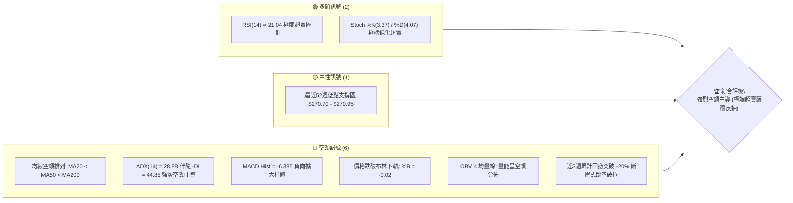
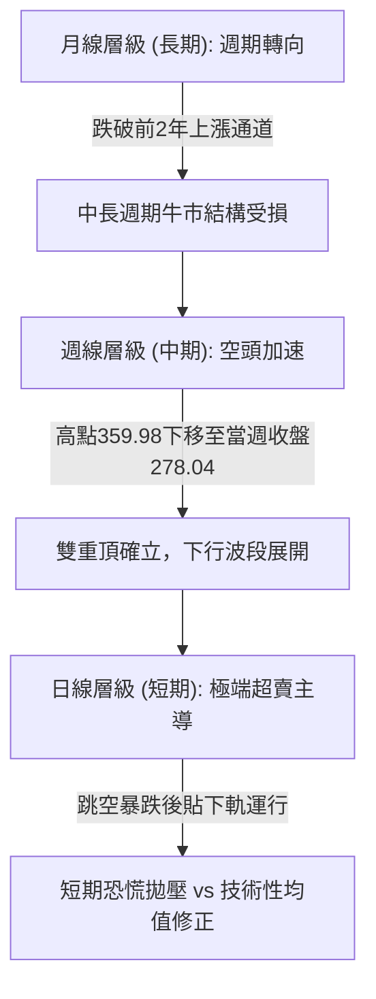
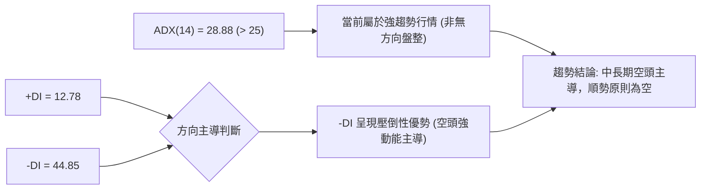
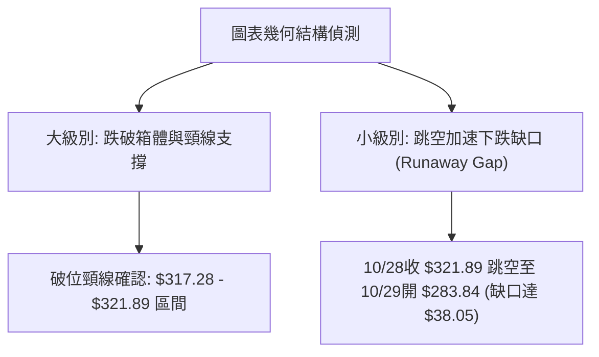
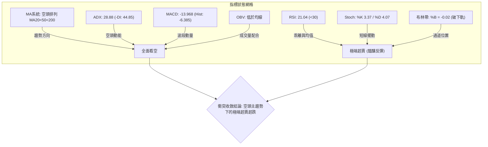
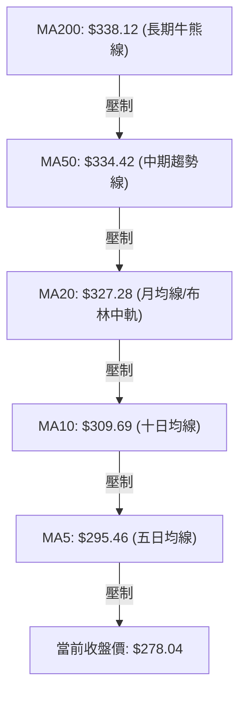
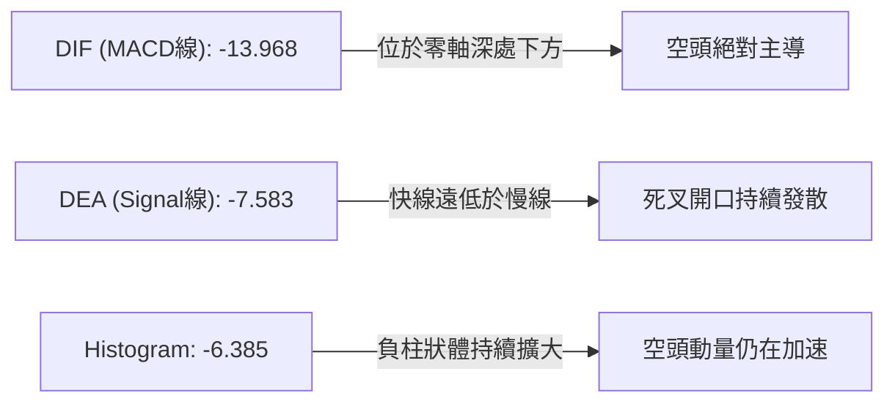
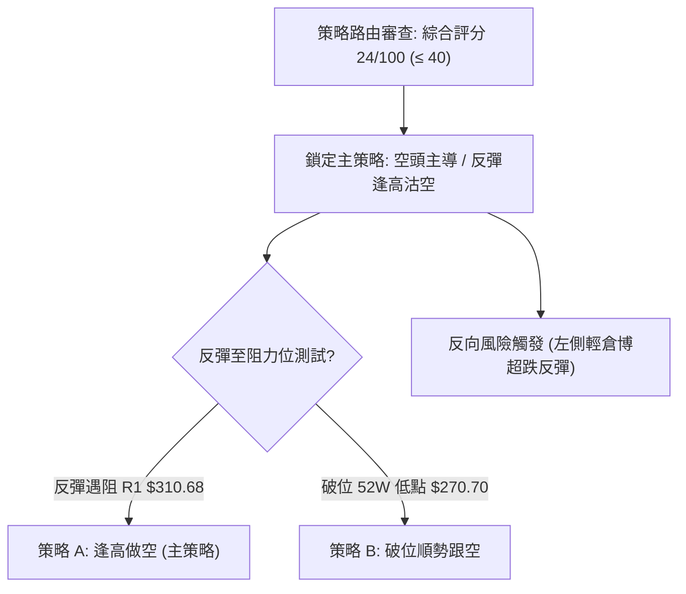
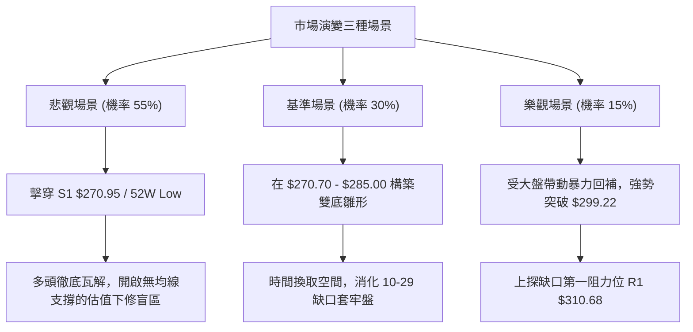

# GOOG 技術分析報告

> **報告日期**：2026-11-03 ｜ **語言**：繁體中文 ｜ **數據來源**：Yahoo Finance ｜ **當前價格**：$278.04 USD

---

## 目錄

| 章節 | 內容 |
|------|------|
| [1. 技術面概覽](#1-技術面概覽) | 訊號儀表板、核心指標、評分卡 |
| [2. 趨勢分析](#2-趨勢分析) | 多時框趨勢、長中短期走勢 |
| [3. 圖表形態分析](#3-圖表形態分析) | 形態識別、K線組合、目標價 |
| [4. 支撐與阻力](#4-支撐與阻力) | 關鍵價位、斐波那契回調 |
| [5. 技術指標深度解讀](#5-技術指標深度解讀) | MA/RSI/MACD/布林/成交量 |
| [6. 動能與波動率](#6-動能與波動率) | 動能評估、ATR、Beta |
| [7. 多時框架總結](#7-多時框架總結) | 時框架評分矩陣 |
| [8. 交易策略建議](#8-交易策略建議) | 多空策略、風險報酬比 |
| [9. 風險提示與監控](#9-風險提示與監控) | 監控指標、風險場景 |

---

## 1. 技術面概覽

### 🎯 技術訊號儀表板



### 📊 核心指標速覽表

| 指標類別 | 指標名稱 | 當前數值 | 訊號 | 解讀 |
|----------|----------|----------|------|------|
| **價格** | 當前價格 | $278.04 | 🔴 | 位於52週高低區間 5.5% 分位，深陷空頭泥淖 |
| **均線** | MA20 | $327.28 | 🔴 | 價格低於 MA20 達 -15.05%，乖離嚴重擴大 |
| **均線** | MA50 | $334.42 | 🔴 | 中期生命線遭跳空擊穿，下彎斜率陡峭 |
| **均線** | MA200 | $338.12 | 🔴 | 長期牛熊分界線失守，年線上方形成沉重套牢籌碼 |
| **動能** | RSI(14) | 21.04 | 🟢 | Wilder RSI < 30，已進入嚴重超賣區域，隨時有均值回歸修復需求 |
| **動能** | MACD | -13.968 | 🔴 | 快慢線均處零軸下方深處，MACD Hist (-6.385) 顯示空頭動能尚未收斂 |
| **波動** | ATR(14) | $10.02 | 🔴 | 佔股價 3.60%，單日價格波動劇烈擴大，市場恐慌拋售情緒濃重 |

### 🏆 技術評分卡

```
╔══════════════════════════════════════════════════════════════╗
║                技術評分卡 — GOOG (2026-11-03)                ║
╠══════════════════════════════════════════════════════════════╣
║ 趨勢強度      ████░░░░░░░░░░░░░░░░  20/100  🔴 強空主導     ║
║ 動能指標      █████░░░░░░░░░░░░░░░  25/100  🔴 動能極弱     ║
║ 支撐穩定度    ███████░░░░░░░░░░░░░  35/100  🟡 考驗前低     ║
║ 成交量配合    ██████░░░░░░░░░░░░░░  30/100  🔴 拋售量大     ║
║ 形態完整度    ████░░░░░░░░░░░░░░░░  20/100  🔴 破位下挫     ║
║ 均線排列      ███░░░░░░░░░░░░░░░░░  14/100  🔴 完美空頭     ║
╠══════════════════════════════════════════════════════════════╣
║ 綜合評分      █████░░░░░░░░░░░░░░░  24/100  🔴 強烈看空     ║
╚══════════════════════════════════════════════════════════════╝
```
*(註：綜合評分係依據規則 18，由六項子評分取算術平均：(20 + 25 + 35 + 30 + 20 + 14) ÷ 6 = 24.0，四捨五入為 24/100。)*

---

## 2. 趨勢分析

### 🌐 多時框趨勢分析



### 📈 長期趨勢 — 12個月走勢圖（Unicode）

```
GOOG 月線走勢圖（過去12個月：2025-12 至 2026-11）
價格軸 ($)
$400 ┤                                      
$380 ┤                            ●(4月 381.46)
$360 ┤                               ●  ●  ● 
$340 ┤                    ●           │  │  │     ●
$320 ┤          ●         │  ●        │  │  │  ●  │
$300 ┤          │         │  │        │  │  │  │  │
$280 ┤          │         │  │  ●     │  │  │  │  │  ●  ●←現價 $278.04
$260 ┤          │         │  │  │     │  │  │  │  │  │  │
     └──────────┴─────────┴──┴──┴─────┴──┴──┴──┴──┴──┴──┴─────
      25/12   26/01     26/02-03    26/04-06 26/07-09 26/10-11
```

**走勢特徵分析表格**：

| 週期階段 | 涵蓋月份 | 區間起訖收盤價 | 累計漲跌幅 | 主要走勢特徵 |
|----------|----------|----------------|------------|--------------|
| **高位衝刺** | 2025-12 至 2026-04 | $313.19 → $381.46 | +21.80% | 經歷 2-3 月洗盤後，4月以突破大陽線創下歷史次高收盤價 |
| **中期高位築頂** | 2026-05 至 2026-07 | $375.96 → $356.42 | -5.20% | 波動率收窄，多頭於 $370 上方動能衰竭，形成多重頂部右肩 |
| **橫盤陰跌誘多** | 2026-08 至 2026-09 | $335.19 → $340.74 | +1.66% | 圍繞 MA200 爭奪，市場縮量盤整，掩蓋主力籌碼派發痕跡 |
| **主跌浪釋放** | 2026-10 至 2026-11 | $340.74 → $278.04 | -18.40% | 財報及資本支出擔憂引發踩踏，以大跳空缺口直摜年線以下 |

### 📊 中期趨勢（週線分析）

中期技術面目前呈現出決定性的崩潰走勢。從數據中的近 8 根週 K 棒可清晰識別出中樞潰敗過程：

```
GOOG 週線壓力與支撐階梯示意
$360 ───────────────────────────── [週高點壓制: 09/25 高 $359.98]
$345 ───────────────────────────── [頸線跌破位: 10/16 破 $335.50]
$320 ───────────────────────────── [前週破位平台: 10/23 收 $317.28]
$280 ═════════════════════════════ ◄ 當前週收盤位置: $278.04
$270 ───────────────────────────── [52W絕對底線: $270.70 / S1 $270.95]
```

- **高點逐步降低 (Lower Highs)**：自 2026-09-25 觸及高點 $359.98 後，每週反彈高點遞減（10/09 之 $353.53、10/16 之 $355.25、10/23 之 $342.52、10/30 之 $323.13）。
- **週成交量激增**：在 2026-10-30 當週，成交量飆升至 208,382,100 股，為過去半年週均量的 2.5 倍以上，驗證機構資金的大規模派發出逃。

### ⚡ 趨勢強度評估（ADX 解讀）



| 指標變數 | 當前讀數 | 臨界門檻 | 趨勢判定 | 操作意涵 |
|----------|----------|----------|----------|----------|
| **ADX(14)** | 28.88 | 25.00 | 強趨勢 (Trending) | 震盪逆勢指標（如超買超賣）可能持續鈍化，應尊重主趨勢 |
| **+DI** | 12.78 | 20.00 | 多頭力量微弱 | 多頭買盤匱乏，無法發動持久波段推升 |
| **-DI** | 44.85 | 30.00 | 空頭極強主導 | 空方主控市場節奏，下跌慣性顯著 |
| **DI 差值** | -32.07 | 0.00 | 空頭單向擴張 | 屬於典型的單邊宣洩性主跌浪 |

---

## 3. 圖表形態分析

### 🔍 形態識別系統



**形態信心度評估表**（依規則 15）：

| 形態 | 信心度 | 判斷依據（引用數據） | 完成度 | 目標價（附計算式） |
|------|--------|----------------------|--------|--------------------|
| **箱體破位 / 雙頂下跌浪** | 85% | 10/09高點 $353.53、10/16高點 $355.25 未能過前高 $359.98，隨後以 208M 週天量跌破頸線 $317.28 | 90% | 頸線 $317.28 − (頂部 $359.98 − 頸線 $317.28) = $274.58 (接近52W低點 $270.70) |
| **下行突破缺口 (Breakaway Gap)** | 90% | 10-28 收 $321.89，10-29 開 $283.84，跳空缺口幅度達 $38.05，伴隨單日 93.13M 爆量 | 100% | 缺口確認，量度目標已於現價 $278.04 附近初步滿足第一階段 |
| **雙底反轉 (潛在猜底)** | 35% | 僅依賴 52W 低點 $270.70 / S1 $270.95 未破之假設，目前尚無底分型結構 | 10% | 訊號不足，僅做指標型超賣解讀，不得預設雙底成立 |

### 🕯️ 重要K線形態分析

嚴格依據提供的「近10根日K」與「近8根週K」之開高低收數據進行客觀解讀：

| 日期（日K/週K） | 開 | 高 | 低 | 收 | K線形態 | 解讀 | 訊號 |
|------------------|----|----|----|----|---------|------|------|
| **10-23 (週K)** | 340.12 | 342.52 | 316.99 | 317.28 | 光腳中陰線 | 破位放量陰線，收盤直逼全週最低價，多頭防線瓦解 | 🔴 |
| **10-28 (日K)** | 319.88 | 323.13 | 319.68 | 321.89 | 弱勢反抽小陽 | 成交量 35.35M，反彈受制於 MA10，形成典型的「誘多陷阱」 | 🟡 |
| **10-29 (日K)** | 283.84 | 286.43 | 278.29 | 282.32 | 巨量向下跳空陰線 | 開盤暴跌 -11.8%，成交量飆至 93.13M，機構出逃特徵 | 🔴 |
| **10-30 (日K)** | 279.69 | 281.86 | 275.35 | 278.22 | 探底小陰十字星 | 下探 52W 低點邊界 $275.35 後微幅收回，留有下影線，拋壓略見收斂 | 🟡 |
| **10-30 (週K)** | 318.05 | 323.13 | 275.35 | 278.22 | 長實體暴跌大陰線 | 單週暴跌 -12.31%，週量 208.38M 創數月巨量，趨勢破壞嚴重 | 🔴 |
| **11-02 (日K)** | 280.58 | 285.21 | 277.78 | 278.04 | 帶上影低位小陰線 | 多頭盤中反抽至 $285.21 無力維繫，尾盤再度壓低至 $278.04，買盤觀望 | 🔴 |

### 📉 ASCII 走勢形態示意圖

```
GOOG 近期「跳空破位與底部爭奪」示意圖
 價位 ($)
 340 ┼─┐ (10-16 平台高點 $336.91)
 330 │ └─┐
 320 │   └─── [10-28 收 $321.89]
     │        │
 300 │        ▼ 巨型跳空缺口 ($321.89 → $283.84，幅度 $38.05)
     │        │
 280 │        └───► [10-29 開 $283.84 / 收 $282.32]
 278 │                 ├── [10-30 收 $278.22]
 275 ┼─────────────────┴── [10-30 低點 $275.35] ◄── 現價 $278.04
 270 ┴──────────────────────────────────────────── ◄── S1 $270.95 / 52W低點 $270.70
```

### 🎯 形態目標價計算

基於頸線跌破及形態高度推算：
- **頂部形態起算頸線**：以 2026-10-23 之收盤價 **$317.28** 為破位起算點。
- **頂部震盪中樞高點**：以 2026-09-25 週高點 **$359.98** 為基準頂部。
- **等距量度下跌幅度**：$359.98 − $317.28 = **$42.70**。
- **第一形態等距量度目標價**：
  $$\text{Target 1} = \$317.28 - \$42.70 = \mathbf{\$274.58}$$
  *(註：此數值極度接近 2026-10-30 當日低點 $275.35 及數據支撐 S1 $270.95，顯示第一波等距下跌已基本達成。)*
- **缺口回補潛在反彈目標**：若於 S1 $270.95 築底成功，向上修復缺口下緣第一道阻力即為 R1 **$310.68**。

---

## 4. 支撐與阻力

### 🗺️ 關鍵價位分布圖（Unicode）

```
╔══════════════════════════════════════════════════════════════════╗
║                   GOOG 價位結構分布圖                           ║
╠══════════════════════════════════════════════════════════════════╣
║ $338.12 ║████████████████████████████████║ MA200 牛熊轉換線    ║
║ $327.81 ║██████████████████████████      ║ 強阻力 R3 (MA20重疊)║
║ $318.83 ║████████████████████            ║ 阻力 R2 (頸線阻力)  ║
║ $310.68 ║████████████████                ║ 關鍵阻力 R1 (缺口位)║
║ $299.22 ║████████████                    ║ 斐波那契 78.6% 回調 ║
╠═════════╬════════════════════════════════╬══════════════════════╣
║ $278.04 ╠════════════════════════════════╣ ◄ 當前收盤價         ║
╠═════════╬════════════════════════════════╬══════════════════════╣
║ $270.95 ║▓▓▓▓▓▓▓▓▓▓▓▓▓▓▓▓▓▓▓▓▓▓▓▓▓▓▓▓    ║ 關鍵支撐 S1          ║
║ $270.70 ║████████████████████████████████║ 52週絕對低點 (100%)  ║
║  N/A    ║░░░░░░░░░░░░░░░░░░░░░░░░░░░░░░░░║ S2 (數據中未偵測到)  ║
║  N/A    ║░░░░░░░░░░░░░░░░░░░░░░░░░░░░░░░░║ S3 (數據中未偵測到)  ║
╚══════════════════════════════════════════════════════════════════╝
```

### 🚧 阻力位分析表

*(嚴格引用數據中「關鍵價位」區塊之波段高點聚類數值)*

| 阻力級別 | 價位 | 距現價幅 | 形成原因 | 突破難度 | 重要性 |
|----------|------|----------|----------|----------|--------|
| **R1** | $310.68 | +11.74% | 10月下旬跳空前震盪密集區下沿，近一年波段高點聚類第一層 | 極高 | ★★★★★ |
| **R2** | $318.83 | +14.67% | 10-23週線收盤跌破點（$317.28）上方籌碼密集沉澱帶 | 巨大 | ★★★★☆ |
| **R3** | $327.81 | +17.90% | 接近 MA20（$327.28）及布林中軌，中期空頭防守核心陣地 | 極堅固 | ★★★★★ |

### 🛡️ 支撐位分析表

*(嚴格引用數據中「關鍵價位」區塊之波段低點聚類數值)*

| 支撐級別 | 價位 | 距現價幅 | 形成原因 | 守住機率 | 重要性 |
|----------|------|----------|----------|----------|--------|
| **S1** | $270.95 | -2.55% | 近一年波段低點聚類核心，距離52W最低價 $270.70 僅 25 美分之隔 | 55% | ★★★★★ |
| **S2** | N/A | N/A | **數據中未偵測到**（依規則 13 不得隨意編造小數點） | N/A | N/A |
| **S3** | N/A | N/A | **數據中未偵測到**（若跌破 52W 低點將陷入無量空洞區） | N/A | N/A |

### 📐 斐波那契回調位分析

依據 52 週極值區間（低點 **$270.70** → 高點 **$403.96**，波幅 $133.26）計算之精確回調位：

```
0.0% (52W High)  ─── $403.96  
23.6%            ─── $372.51  
38.2%            ─── $353.06  (中期雙頂整理頸線)
50.0%            ─── $337.33  (MA200 牛熊分界線 $338.12 聚合處)
61.8%            ─── $321.61  (黃金分割位，10-28破位跳空起點)
78.6%            ─── $299.22  (深度回調位，上方第一反彈目標)
[現價 $278.04]   ─── 位於 78.6% ($299.22) 與 100.0% ($270.70) 之間
100.0% (52W Low) ─── $270.70  (多頭最後防線)
```

**解讀**：
1. 現價 $278.04 已跌破 78.6% 斐波那契極限回調位（$299.22），顯示此輪下跌絕非正常健康回檔，而是趨勢性結構破壞。
2. 目前股價正向下測試 100.0% 終極支撐位 **$270.70**，若此價位宣告失守，技術形態將演變為 52 週新低的下行發散走勢。

---

## 5. 技術指標深度解讀

### 🎛️ 指標訊號總覽



### 📈 移動平均線排列分析



- **全面空頭順序**：$278.04 < MA5($295.46) < MA10($309.69) < MA20($327.28) < MA60($335.86) < MA200($338.12)。均線呈現發散下行態勢，上方層層均線轉化為剛性解套賣壓。
- **負乖離率達極限**：
  - 距 MA5 乖離：-5.90%
  - 距 MA20 乖離：-15.05%
  - 距 MA200 乖離：-17.77%
  歷史經驗顯示，當大型科技股與 MA20 負乖離超過 -15% 時，隨時引發技術性「均線回抽修復」。

### 📉 RSI(14) 分析

```
RSI(14) 當前讀數：21.04
0       10      20  21.04   30              50                      70             100
├───────┼───────┼───●───────┼───────────────┼───────────────────────┼───────────────┤
│    極度超賣區間    │     超賣區    │            中性區間           │     超買區    │
████████████████░░░░░░░░░░░░░░░░░░░░░░░░░░░░░░░░░░░░░░░░░░░░░░░░░░░░░░░░░░░░░░░░░░░░ 21.04%
```

- **超賣解讀**：Wilder RSI 跌至 21.04，創近一年新低。此數值代表市場處於恐慌割肉狀態，非理性賣壓已透支大部分空頭籌碼。
- **背離判斷**：
  - 依數據明確顯示：「**RSI 背離：無明顯背離**（僅比較近20根K棒首尾的價格與RSI方向）」。
  - 價格創波段新低，RSI 同步創低，未形成底背離，代表**主跌浪動能真實釋放，非衰竭性假摔**。抄底者不可盲目重倉。

### 📊 MACD(12/26/9) 訊號解讀



- MACD 雙線均為深度負值，柱狀圖（Histogram）進一步放大至 **-6.385**，顯示目前市場仍未出現綠柱收斂或翻紅跡象，空方拋售動能尚未見頂。

### 📦 布林通道分析

```
GOOG 布林通道示意圖（帶寬：$374.61 - $279.96 = $94.65）
$374.61 ┬─────────────────────────────────────────────── 布林上軌
        │
$327.28 ┼ ─ ─ ─ ─ ─ ─ ─ ─ ─ ─ ─ ─ ─ ─ ─ ─ ─ ─ ─ ─ ─ ─ ─  布林中軌 (MA20)
        │
$279.96 ┴─────────────────────────────────────────────── 布林下軌
        ▼  ● 當前價格 $278.04 (%B = -0.02，已跌穿下軌)
```

- **通道位置 (%B = -0.02)**：%B 小於 0 表明現價已經收在布林通道下軌（$279.96）之外，屬於極度罕見的「通道外遊離」狀態。
- **統計學意涵**：在常態分佈下，價格運行在通道外的機率小於 5%。這暗示短期股價面臨強烈的統計學回歸引力，下軌附近繼續追空的風險極高。

### 💹 成交量分析（量價配合度）

- **量比與換手**：最新日成交量為 29,090,500 股，相較於 20 日均量（22,287,795）呈現 **1.31 倍** 的溫和放大，但較 10-29 恐慌日（93,133,900）明顯收縮。
- **量價背離偵測**：
  - 10-29 大跌伴隨 93.13M 巨量；
  - 10-30 下跌伴隨 45.12M；
  - 11-02 弱勢橫盤成交量降至 29.09M。
  顯示下跌動能出現「**量縮陰跌**」，賣壓在第一波宣洩後逐步衰減，但主動性買盤依舊匱乏。
- **OBV（能量潮）**：數據明確標示「**OBV < MA → 量能疲弱**」，累積量能指標持續低於其移動平均，資金呈淨流出狀態，量能無法對反彈提供有效支撐。

---

## 6. 動能與波動率

### ⚡ 動能評估四象限

| 象限 | 動能維度 | 波動維度 | GOOG 當前狀態 | 技術診斷與策略意義 |
|------|----------|----------|---------------|-------------------|
| **Q1** | 強多頭動能 | 低波動率 | — | 穩健牛市單邊走勢 |
| **Q2** | 弱多頭動能 | 低波動率 | — | 盤整蓄勢，方向未明 |
| **Q3** | 強空頭動能 | 高波動率 | **✓ 當前所處位置** | **空頭主跌恐慌期**：ATR 放大至 $10.02，ADX 28.88 擴張，單日波動劇烈，極度容易觸發踩踏或暴力抽頭 |
| **Q4** | 弱空頭動能 | 低波動率 | — | 築底陰跌，等待出清 |

### 📊 ATR 波動率分析

- **ATR(14) 讀數**：**$10.02**（佔當前股價之 **3.60%**）。
- **止損距離建議**：
  - **保守型交易者**：建議使用 $2.0 \times \text{ATR} = \$20.04$ 作為防守緩衝空間。
  - **進取型交易者**：建議使用 $1.0 \times \text{ATR} = \$10.02$ 或以前一日高低點作嚴格止損。
  - **意涵**：日均百點的震盪幅度意味著持倉承受力必須大幅調寬，否則極易在日間雜訊中被掃損出場。

### 📐 Beta 與市場相關性

- **Beta 係數**：**1.226**。
- **市場敏感度解讀**：GOOG 的系統性風險顯著高於標普 500 大盤（Beta = 1.0）。在美股整體情緒偏弱、科技股估值面臨重估的背景下，該股具有放大市場跌幅的高 Beta 特性，加劇了下行時的流動性折價。

---

## 7. 多時框架總結

### 📋 時框架評分表

| 時框架 | 趨勢方向 | 動能 | 均線排列 | 形態 | 綜合評分 | 操作建議 |
|--------|----------|------|----------|------|----------|----------|
| **月線 (長期)** | 偏空 🔴 | 減弱 🔴 | 跌破多條長均 🔴 | 高位頂部成型 🔴 | 28/100 | 長期投資者暫緩左側接刀 |
| **週線 (中期)** | 強空 🔴 | 加速向下 🔴 | 完全空頭發散 🔴 | 破位箱體 🔴 | 20/100 | 逢反彈至阻力位建立空單 |
| **日線 (短期)** | 超跌反彈 🟢 | 極度超賣 🟢 | 負乖離過大 🟡 | 考驗 S1 支撐 🟡 | 35/100 | 超短線僅限輕倉博弈技術抽頭 |

### 🔲 綜合訊號矩陣

```
時框維度        長線 (月線)         中線 (週線)         短線 (日線)
趨勢架構        🔴 破位下行        🔴 瀑布式空頭       🔴 貼布林下軌運行動能狀態        🔴 負動能增強      🔴 MACD柱體擴大    🟢 RSI(21.04)極限超賣
籌碼量能        🔴 資金外流        🔴 週巨量長黑       🟡 日成交量萎縮
最終判定        🔴 防禦觀望        🔴 逢高做空         🟡 輕倉反彈/嚴設停損
```

### ⚖️ 多時框收斂結論

嚴格執行「嚴格要求 14」之收斂規則：
1. **行情性質判定**：當前 ADX(14) = 28.88 > 25，市場明確處於**趨勢行情 (Trending Market)**，而非區間震盪行情。
2. **時框優先級裁決**：在強趨勢格局下，必須以**中長期方向（週線 / MA50 / MA200 均線方向）為絕對主導**。日線之 RSI 超賣（21.04）僅代表短期技術面出現嚴重超跌，**只能用於評估空頭回補獲利了結點或高拋低吸之進場時機，絕不可作為趨勢反轉的依據**。
3. **唯一方向性結論**：**強烈偏空（主趨勢看空，短線嚴防超賣引發的誘多反抽）**。

---

## 8. 交易策略建議

### 🗺️ 策略決策流程圖



### 🧭 策略路由（依評分卡分流，不得兩頭下注）

> **當前主策略方向 = 強烈偏空 / 逢高做空（依評分 24/100）**  
> 依據技術評分卡綜合評分 24/100（≤ 40），系統嚴格路由至**空頭主推策略**。多頭交易僅列為「反轉風險觸發點（對沖與極短線超跌提示）」，禁止在主跌浪中進行無保護的左側重倉做多。

### 🎯 價格情境階梯（Price Scenarios）

*(價位嚴格引用第 4 章及數據提供之實際數值)*

| 觸發條件 | 下一目標 | 後續延伸 | 情境含義 |
|----------|----------|----------|----------|
| **強勢突破 R1 $310.68** | R2 $318.83 | R3 $327.81 | 短線超跌反抽擴大，回補跳空缺口 |
| **站穩現價區間 ($275 - $285)** | 斐波那契 78.6% $299.22 | R1 $310.68 | 低位震盪築底，修復極端超賣 |
| **有效跌破 S1 $270.95 / $270.70** | S2 (數據未提供) | 下行空間打開 | 擊穿52週低點，觸發新一輪保證金強平潮 |

### 📊 情境機率分佈

| 情境 | 機率 | 主要依據 |
|------|------|----------|
| **弱勢反彈後再度破位** | **55%** | ADX 28.88 強空主導，MACD 負向柱擴大至 -6.385，均線呈現空頭壓制 |
| **低位區間震盪整理** | **30%** | RSI 21.04 及 Stoch %K 3.37 處於極度超賣，S1 $270.95 具備一定波段籌碼承接 |
| **直接強勢 V 型反轉** | **15%** | 巨量跳空缺口形成巨大阻力，OBV 疲軟，短期難以迅速反轉 |

### 🟢 主策略詳情（方向：做空 / 逢高布局空單）

*(所有數值均嚴格依據規則 17 計算，風險報酬比公式：$(進場價 - 目標價) \div (止損價 - 進場價)$)*

| 策略要素 | 策略 A（反彈遇阻做空 — 首選） | 策略 B（跌破 52W 低點順勢追空） |
|----------|--------------------------------|----------------------------------|
| **進場條件** | 股價受 RSI 超賣修復帶動反抽至斐波那契 78.6% 位遇阻回落 | 實體陰線放量擊穿 52W 最低價 $270.70 確認支撐失效 |
| **進場價格** | **$299.22**（斐波那契 78.6% 回調位） | **$270.70**（52W Low 破位點） |
| **目標價 T1** | **$278.04**（回測當前收盤價） | **$250.68**（由形態高度推算：$270.70 − 10.02×2） |
| **目標價 T2** | **$270.95**（測試前低支撐 S1） | **$240.66**（由形態高度推算：$270.70 − 10.02×3） |
| **止損價格** | **$310.68**（突破關鍵阻力 R1 止損） | **$278.04**（假突破重新站回當前收盤價） |
| **風險報酬比** | **1 : 1.85（以 T1 計）**<br>*(計算：(299.22 − 278.04) ÷ (310.68 − 299.22) = 21.18 ÷ 11.46 = 1.848)* | **1 : 2.73（以 T1 計）**<br>*(計算：(270.70 − 250.68) ÷ (278.04 − 270.70) = 20.02 ÷ 7.34 = 2.727)* |
| **成功機率** | 65% | 55% |
| **建議倉位** | 15% | 10% |

### 🔴 反向風險觸發點（對沖提示）

- **觸發情境**：若日線級別收盤價強勢突破並站穩 **$299.22**（斐波那契 78.6%），且 RSI 快速脫離超賣區站上 35 以上。
- **風控處置**：所有逢高做空部位必須無條件減倉或離場觀望；激進型交易者可反手建立 5% 輕倉多單博弈回補缺口至 R1 **$310.68**，但必須嚴格以 S1 **$270.95** 作為硬性止損。

### ⭐ 整體訊號強度評星

```
做多訊號強度：★☆☆☆☆  (1/5星 — 僅存極度超賣之微弱反抽預期)
做空訊號強度：★★★★☆  (4/5星 — 趨勢全面向下，均線瀑布發散)
整體可信度：  ★★★★☆  (4/5星 — 量價、指標與趨勢高度共振)
```

---

## 9. 風險提示與監控

### ✅ 關鍵監控指標 Checklist

```
╔══════════════════════════════════════════════════════════════╗
║                   GOOG 核心監控清單 (Checklist)              ║
╠══════════════════════════════════════════════════════════════╣
║ [ ] 52W 低點保衛戰：收盤價是否守住 S1 $270.95 / $270.70       ║
║ [ ] RSI(14) 動態：是否自 21.04 形成「鈍化」或回升突破 30      ║
║ [ ] MACD 柱狀圖：Hist 是否停止向下擴大（當前 -6.385）         ║
║ [ ] 均線負乖離：與 MA20 ($327.28) 之乖離率是否縮小至 -8% 以內 ║
║ [ ] 布林通道重返：%B 是否重新從 -0.02 回升至 0.00 以上（站回下軌）║
║ [ ] 成交量異動：日成交量是否低於 20M（量縮止跌）或再爆 50M+ 拋盤║
╚══════════════════════════════════════════════════════════════╝
```

### ⚠️ 風險場景分析



### 🛡️ 風險管理重要提醒

1. **高波動環境倉位控管**：當前 ATR 高達 $10.02（3.60%），標的處於極端拋售與情緒混亂期，總投資組合中對 GOOG 的曝險部位不得超過 **5%–8%**。
2. **禁止右側未確立前倒金字塔加倉**：在日線未出現「底背離」或「放量長下影線」前，任何下跌過程中的買入均屬高風險賭博行為。
3. **缺口引力與阻力轉換**：10-29 留下的跳空缺口（$283.84 至 $321.89，寬達 $38.05）是未來數月難以逾越的天塹，反彈越接近缺口下緣，拋壓將幾何級數放大。

---

## 📋 報告總結

```
╔══════════════════════════════════════════════════════════════════╗
║                   GOOG 技術分析報告總結                          ║
╠══════════════════════════════════════════════════════════════════╣
║ 報告日期：2026-11-03                                             ║
║ 當前價格：$278.04 USD                                            ║
║ 分析評級：🔴 強烈看空（主趨勢空頭奔馳，僅防超賣技術反抽）        ║
║                                                                  ║
║ 關鍵結論：                                                       ║
║ ├─ 長期趨勢：🔴 跌破年線 MA200 ($338.12)，牛熊結構實質逆轉      ║
║ ├─ 中期趨勢：🔴 週線大陰摜破箱體，ADX(28.88) 顯示空頭強趨勢     ║
║ ├─ 短期趨勢：🟢 日線 RSI(21.04) 極度超賣，孕育短線均值回歸修復  ║
║ ├─ 關鍵支撐：S1 $270.95 / 52W 低點 $270.70                       ║
║ ├─ 關鍵阻力：R1 $310.68 / R2 $318.83 / R3 $327.81               ║
║ └─ 分析師目標：均價 $407.00 (低標 $340.00 / 高標 $460.00)       ║
║                                                                  ║
║ 最優策略組合：                                                   ║
║ 1. 🥇 最佳機會：等待反彈至斐波那契位 $299.22 附近建立空單 (策略A)║
║ 2. 🥈 次選機會：跌破 52W 低點 $270.70 後，順勢小倉跟空 (策略B)   ║
║ 3. 🥉 保守選擇：徹底空倉觀望，靜待股價於 S1 築底並形成日線底分型 ║
╚══════════════════════════════════════════════════════════════════╝
```

---

> ⚠️ **免責聲明**：本報告為 AI 自動生成之技術分析，所有數據及估算均基於提供的歷史價格資訊。本報告**僅供研究與學術參考**，**不構成任何投資建議**。投資有風險，入市需謹慎。

---

*報告生成時間：2026-11-03 ｜ 數據來源：Yahoo Finance ｜ 分析框架：多時框技術分析*