# GOOG 技術分析報告

> **報告日期**：2026-11-04 ｜ **語言**：繁體中文 ｜ **數據來源**：Yahoo Finance ｜ **當前價格**：$278.27

---

## 目錄

| 章節 | 內容 |
|------|------|
| [1. 技術面概覽](#1-技術面概覽) | 訊號儀表板、核心指標、評分卡 |
| [2. 趨勢分析](#2-趨勢分析) | 多時框趨勢、長中短期走勢 |
| [3. 圖表形態分析](#3-圖表形態分析) | 形態識別、K線組合、目標價 |
| [4. 支撐與阻力](#4-支撐與阻力) | 關鍵價位、斐波那契回調 |
| [5. 技術指標深度解讀](#5-技術指標深度解讀) | MA/RSI/MACD/布林/成交量 |
| [6. 動能與波動率](#6-動能與波動率) | 動能評估、ATR、Beta |
| [7. 多時框架總結](#7-多時框架總結) | 時框架評分矩陣 |
| [8. 交易策略建議](#8-交易策略建議) | 多空策略、風險報酬比 |
| [9. 風險提示與監控](#9-風險提示與監控) | 監控指標、風險場景 |

---

## 1. 技術面概覽

### 🎯 技術訊號儀表板

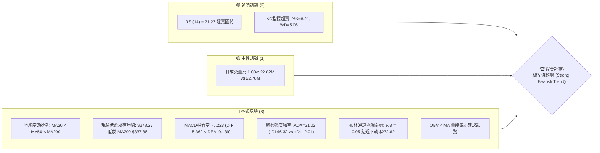

### 📊 核心指標速覽表

| 指標類別 | 指標名稱 | 當前數值 | 訊號 | 解讀 |
|----------|----------|----------|------|------|
| **價格** | 當前收盤價 | $278.27 | 🔴 | 位於 52 週區間之 5.7% 底部邊緣，瀕臨波段新低 |
| **均線** | MA20 | $323.97 | 🔴 | 現價低於 MA20 達 -14.11%，短線空頭重壓 |
| **均線** | MA50 | $333.09 | 🔴 | 中期下彎，價格遠落於下方，空方結構穩固 |
| **均線** | MA200 | $337.86 | 🔴 | 長期牛熊分水嶺失守，跌破長期支撐轉為強阻力 |
| **動能** | RSI(14) | 21.27 | 🟢 | 進入極度超賣區（<30），隨時醞釀技術性超跌反彈 |
| **動能** | MACD (12,26,9) | 柱狀圖 -6.223 | 🔴 | DIF (-15.362) 遠低於 DEA (-9.139)，空頭動能擴散 |
| **波動** | ATR(14) | $9.90 (3.56%) | 🔴 | 日均波動近 10 美元，單日波動率偏高，下行風險大 |
| **趨勢** | ADX / ±DI | ADX 31.02 / -DI 46.32 | 🔴 | ADX > 25 且 -DI 絕對主導，確認為強烈單邊下跌趨勢 |
| **通道** | 布林通道 | %B = 0.05 | 🔴 | 價格緊貼下軌 $272.62，呈現極端弱勢開口下移 |
| **量能** | OBV 趨勢 | OBV < MA | 🔴 | 資金持續淨流出，量能未能配合價格出現背離反轉 |

### 🏆 技術評分卡

```
╔══════════════════════════════════════════════════════════════════╗
║                   技術評分卡 — GOOG (2026-11-04)                 ║
╠══════════════════════════════════════════════════════════════════╣
║ 趨勢強度 (ADX=31.02, -DI主導)   ████████░░░░░░░░░░░░  40/100  🔴 ║
║ 動能指標 (RSI超賣但MACD強空格局) ██████░░░░░░░░░░░░░░  30/100  🔴 ║
║ 支撐穩定度 (僅依賴波段低點S1)   ████████░░░░░░░░░░░░  40/100  🔴 ║
║ 成交量配合 (放量下殺，OBV弱勢)   ██████░░░░░░░░░░░░░░  30/100  🔴 ║
║ 形態完整度 (向下跳空缺口未補)   ████░░░░░░░░░░░░░░░░  20/100  🔴 ║
║ 均線排列 (MA5<10<20<50<200空排)  ██░░░░░░░░░░░░░░░░░░  10/100  🔴 ║
╠══════════════════════════════════════════════════════════════════╣
║ 綜合評分 (六項算術平均：170/6)  ██████░░░░░░░░░░░░░░  28/100  🔴 ║
║ 評級結論：極度看空／強烈下行趨勢 (Strong Bearish / Oversold)     ║
╚══════════════════════════════════════════════════════════════════╝
```
*(註：綜合評分 = (40 + 30 + 40 + 30 + 20 + 10) ÷ 6 = 28.33，四捨五入為 28/100，符合規則 18)*

---

## 2. 趨勢分析

### 🌐 多時框趨勢分析

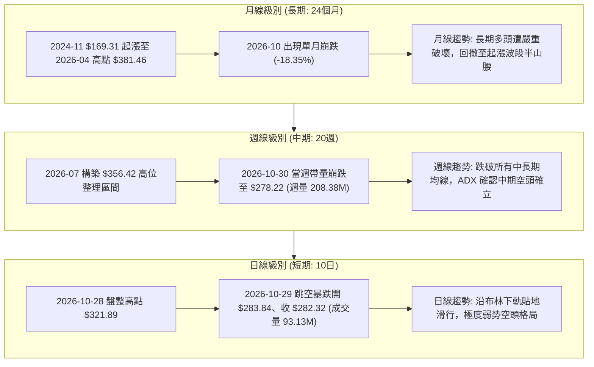

### 📈 長期趨勢 — 12個月走勢圖（Unicode）

```
GOOG 月線走勢圖（2025-12 至 2026-11）
價格軸 ($)
$400 ┤                                  
$380 ┤                            ● $381.46 (2026-04 歷史次高/波段峰值)
$360 ┤                                ● $375.96
$340 ┤                    ● $337.87         ● $353.10  ● $356.42      ● $340.74
$320 ┤              ● $313.19     ● $310.82                         ● $335.19
$300 ┤                                  ● $286.50
$280 ┤                                                                ● $278.22 ● $278.27 (現價)
$260 ┤                                                                      ▲ 52W Low $270.70
     └──────┬─────┬─────┬─────┬─────┬─────┬─────┬─────┬─────┬─────┬─────┬─────
          25-12 26-01 26-02 26-03 26-04 26-05 26-06 26-07 26-08 26-09 26-10 26-11
```

#### 走勢特徵分析表格

| 階段區間 | 起止月份 | 起點收盤 | 終點收盤 | 區間漲跌幅 | 走勢特徵與量價結構 |
|----------|----------|----------|----------|------------|--------------------|
| 第一階段：牛市攻頂 | 2025-11 ~ 2026-04 | $319.29 | $381.46 | +19.47% | 沿五月線單邊攀升，創下波段歷史收盤新高 $381.46 |
| 第二階段：高檔震盪 | 2026-05 ~ 2026-09 | $375.96 | $340.74 | -9.37% | 在 $335 ~ $375 區間構築巨型頭部，動能遞減 |
| 第三階段：破位崩跌 | 2026-10 ~ 2026-11 | $340.74 | $278.27 | -18.33% | 跌破 $330 頸線放量重挫，直逼 52 週最低點 $270.70 |

### 📊 中期趨勢（週線分析）

中期技術面在 2026-10-30 當週出現結構性崩塌。當週以跳空放量長陰線跌破所有中長期均線（週成交量暴增至 208,382,100 股），週 RSI 自 10 月中旬的 56.0 斷崖式跌至 21.1，MACD 柱狀圖由正轉為極度擴張之負值 -5.975 及 -6.223。

```
中期壓力與支撐示意圖 (週線層次)
══════════════════════════════════════════════════════════════════
  $353.06 ──── 斐波那契 38.2% 回調位 / 9-10月整理平台高點 (強阻力)
  $337.86 ──── MA200 長期均線位置 / 斐波那契 50.0% ($337.33)
  $321.61 ──── 斐波那契 61.8% / 10月破位下殺起點 (空頭防守位)
  $310.68 ──── 近一年波段高點聚類阻力 R1 (短期反彈天花板)
  ────────────────────────────────────────────────────────────
  $278.27 ◄─── 當前現價 (弱勢橫盤掙扎)
  ────────────────────────────────────────────────────────────
  $270.95 ──── 近一年波段低點聚類支撐 S1 (核心多頭最後防線)
  $270.70 ──── 52週極端最低點 (52W Low / 斐波那契 100.0%)
══════════════════════════════════════════════════════════════════
```

### ⚡ 趨勢強度評估（ADX 解讀）

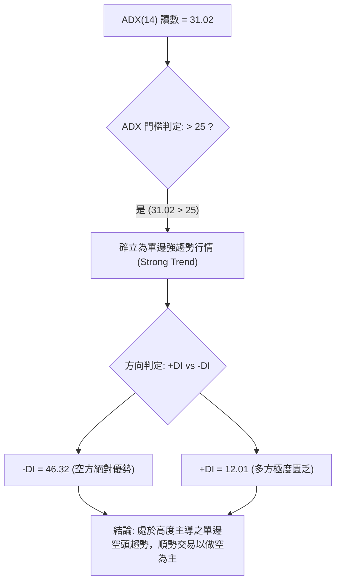

#### ADX 趨勢強度對照表

| 指標項目 | 數值 | 門檻區間 | 技術含義 | 對交易之指引 |
|----------|------|----------|----------|--------------|
| **ADX(14)** | 31.02 | 25 ~ 50 (強趨勢) | 當前市場具備強大定向動能，絕非無方向盤整 | 拋棄區間震盪操作，嚴禁左側逆勢摸底 |
| **+DI** | 12.01 | < 20 (極度疲弱) | 買方力量幾近枯竭，反彈缺乏資金承接力 | 任何微幅反彈皆易受到空頭二次打壓 |
| **-DI** | 46.32 | > 40 (極度強勢) | 賣壓全面掌控盤面，單邊下行動能充沛 | 趨勢行情下，中長期均線方向具備最高優先級 |

---

## 3. 圖表形態分析

### 🔍 形態識別系統

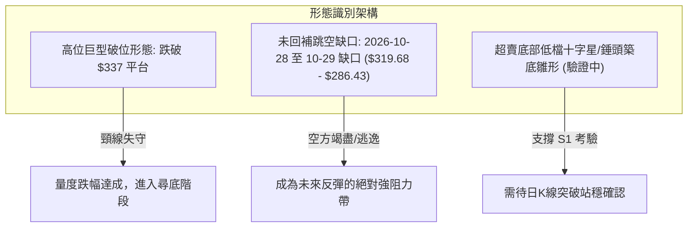

#### 圖表形態信心度評估表（依規則 15）

| 形態名稱 | 信心度 | 判斷依據（引用數據） | 完成度 | 目標價（附精確計算式） |
|----------|--------|----------------------|--------|------------------------|
| **大型箱體下破** | 85% | 跌破 2026 年 6-10 月於 $335.19 ~ $356.42 的橫盤底頸線 $335.00 | 100% | 破位點 $335.00 − 形態高度($356.42 − $335.00 = $21.42) = **$313.58**（已於 10-29 跌破超額達成） |
| **空方逃逸缺口** | 90% | 2026-10-28 低點 $319.68 與 10-29 高點 $286.43 間留下 $33.25 巨大跳空 | 100% | 缺口下緣阻力為 **$286.43**；缺口上緣阻力為 **$319.68**（貼近 R2 $318.83） |
| **雙重底雛形** | 35% | 訊號不足。近兩日雖在 $272.00 ~ $275.35 試探低點，但未突破頸線，僅做指標型超賣解讀 | 20% | 依規則 15，信心度 < 50% 不預設立目標價，視為指標型超賣修正 |

### 🕯️ 重要K線形態分析（嚴格依據近10根日K與近8根週K）

依規則 19，完全基於歷史數據開高低收數值解析：

#### 近 10 根日 K 線形態解讀

| 日期 | 開 | 高 | 低 | 收 | 成交量 | K線形態名稱 | 解讀與訊號評估 |
|------|----|----|----|----|--------|-------------|----------------|
| 2026-10-21 | 333.32 | 333.80 | 326.26 | 330.95 | 19,298,100 | 下跌實體陰線 | 破位下殺前奏，高點未能越過 MA60 🔴 |
| 2026-10-22 | 326.77 | 327.70 | 318.45 | 320.76 | 21,094,100 | 長下影中陰線 | 跌破 $320，引發初步技術停損賣壓 🔴 |
| 2026-10-23 | 317.75 | 321.23 | 316.99 | 317.28 | 10,856,500 | 低檔窄幅小陰十字 | 量能急凍，短線賣壓暫時觀望 🟡 |
| 2026-10-26 | 318.05 | 318.39 | 313.51 | 314.19 | 16,989,400 | 光頭下行中陰線 | 創下波段新低 $313.51，空方重新控盤 🔴 |
| 2026-10-27 | 314.40 | 320.07 | 313.58 | 316.83 | 17,786,400 | 帶上影小陽線 | 多頭反抽無力，受制於 $320 關卡 🟡 |
| 2026-10-28 | 319.88 | 323.13 | 319.68 | 321.89 | 35,355,900 | 溫和放量小陽線 | 財報前多頭假性護盤，成交量放大至 35M 🟡 |
| 2026-10-29 | 283.84 | 286.43 | 278.29 | 282.32 | 93,133,900 | 巨量崩跌跳空大陰 | 巨大跳空缺口達 $33.25，放巨量 93.13M 確立趨勢破位 🔴 |
| 2026-10-30 | 279.69 | 281.86 | 275.35 | 278.22 | 45,116,500 | 帶下影弱勢實體陰 | 續測 52W 新低邊緣，多頭微弱抵抗 🔴 |
| 2026-11-02 | 280.58 | 285.21 | 277.78 | 278.04 | 29,231,800 | 假陽實陰之墓碑狀 | 上攻 $285.21 遇阻回落，收盤跌破開盤價 🔴 |
| 2026-11-03 | 279.19 | 280.34 | 272.00 | 278.27 | 22,820,200 | 長下影鐵錘線 (Hammer) | 下探 $272.00 逼近 S1 ($270.95) 後強力回升，顯現初步買盤 🟢 |

#### 近 8 根週 K 線形態解讀

| 日期 | 開 | 高 | 低 | 收 | 成交量 | K線形態名稱 | 解讀與訊號評估 |
|------|----|----|----|----|--------|-------------|----------------|
| 2026-09-18 | 339.11 | 355.13 | 337.45 | 344.41 | 98,139,700 | 帶長上影中陽線 | 試圖挑戰高點遇阻，形成次級高點 🟡 |
| 2026-09-25 | 346.19 | 359.98 | 332.81 | 341.08 | 91,524,400 | 長上影倒錘陰線 | 摸高 $359.98 失敗，頂部確認 🔴 |
| 2026-10-02 | 337.60 | 350.09 | 332.65 | 340.35 | 89,656,100 | 高檔盤整小陰線 | 於 $340 處黏著，買盤後繼無力 🔴 |
| 2026-10-09 | 339.21 | 353.53 | 339.15 | 347.86 | 63,634,200 | 縮量反抽陽線 | 成交量急縮至 63M，量價嚴重背離 🟡 |
| 2026-10-16 | 348.34 | 355.25 | 335.50 | 336.91 | 79,871,700 | 吞噬中陰線 | 高點未過前週，低點失守 $336，頭部瓦解 🔴 |
| 2026-10-23 | 340.12 | 342.52 | 316.99 | 317.28 | 78,759,600 | 破位光腳大陰線 | 跌破箱體下沿支撐，收盤收在最低點 🔴 |
| 2026-10-30 | 318.05 | 323.13 | 275.35 | 278.22 | 208,382,100 | 巨量毀滅性跳空長陰 | 2.08 億股天量下殺，中長期技術面全面走空 🔴 |
| 2026-11-03 | 280.58 | 285.21 | 272.00 | 278.27 | 52,052,000 | 週初長下影線小陽 | 於 52W 低點 $270.70 上方獲得初步承接 🟢 |

### 📉 ASCII 走勢形態示意圖

```
GOOG 巨型破位與跳空缺口示意圖 (日K線維度)
價格 ($)
$330 ┤                [10-21] 330.95
$320 ┤                      \  [10-28] 321.89 (最後防守)
$310 ┤                       \ ═════════════════════════════════════ R1 $310.68
$300 ┤                        \
$290 ┤                         │ 
     ├─────────────────────────┼──────────────────────────────────── 缺口上緣 $286.43
     │                         │ ░░░░░░ 空方逃逸缺口 ($33.25) ░░░░░░
$280 ┤                         │ ═══════════════════════════════════ 現價 $278.27
     │                         └─► [10-29] 282.32
$270 ┤                               └─► [11-03] 下影線探底 $272.00
     │                                    ══════════════════════════ S1 $270.95 / 52W Low $270.70
     └──────────────────────────────────────────────────────────────
```

### 🎯 形態目標價計算

根據精確技術分析幾何測量法：
1. **箱體下破量度目標**：
   - 頂部整理平台區間：$335.00 至 $356.42，箱體垂直高度 $H = \$356.42 - \$335.00 = \$21.42$。
   - 箱體破位頸線：$335.00。
   - 第一量度滿足點 = $\$335.00 - \$21.42 = \mathbf{\$313.58}$（已於 2026-10-29 一步到位貫穿跌破）。
2. **缺口延伸測量目標**：
   - 跳空下殺前高點：$323.13 (10-28 高點)；缺口起點：$319.68。
   - 缺口終點：$286.43 (10-29 高點)；缺口寬度 = $\$319.68 - \$286.43 = \$33.25$。
   - 空方旗形量度目標 = 缺口下緣 $\$286.43 - \text{缺口寬度 } \$33.25 = \mathbf{\$253.18}$（若跌破 S1 $270.95 之後的極端潛在延伸目標，目前尚未觸發）。

---

## 4. 支撐與阻力

### 🗺️ 關鍵價位分布圖（Unicode）

```
GOOG 價位結構分布圖 (由 OHLCV 聚類計算)
══════════════════════════════════════════════════════════════════
$327.81 ║██████████████████████████████║ 強阻力 R3 (+17.80%)
$318.83 ║████████████████████          ║ 關鍵阻力 R2 (+14.58%)
$310.68 ║████████████████████████      ║ 近期反彈阻力 R1 (+11.65%)
════════╬══════════════════════════════╬═════════════════════════
$278.27 ╠══════════════════════════════╣ ◄ 現價 (Current Price)
════════╬══════════════════════════════╬═════════════════════════
$270.95 ║▓▓▓▓▓▓▓▓▓▓▓▓▓▓▓▓▓▓▓▓▓▓▓▓▓▓▓▓  ║ 波段核心支撐 S1 (-2.63%)
$270.70 ║██████████████████████████████║ 52週極限低點 (52W Low)
══════════════════════════════════════════════════════════════════
```

### 🚧 阻力位分析表

價位嚴格引用技術數據中「關鍵價位」區塊之精確數值：

| 阻力級別 | 精確價位 | 距現價幅動 | 形成原因與技術共振 | 突破難度 | 重要性評級 |
|----------|----------|------------|--------------------|----------|------------|
| **R1** | **$310.68** | +11.65% | 近一年波段高點聚類、2026-02 月線收盤價 ($310.82) 平台共振 | 🟡 高 | ★★★★☆ |
| **R2** | **$318.83** | +14.58% | 近一年波段高點聚類、10-28 破位前最後起跌點 ($319.68) 及跳空缺口上緣 | 🔴 極高 | ★★★★★ |
| **R3** | **$327.81** | +17.80% | 波段高點聚類、貼近下彎之 MA20 ($323.97) 與密集成交區底端 | 🔴 極高 | ★★★☆☆ |

### 🛡️ 支撐位分析表

價位嚴格引用技術數據中「關鍵價位」區塊之精確數值：

| 支撐級別 | 精確價位 | 距現價幅動 | 形成原因與技術共振 | 守住機率 | 重要性評級 |
|----------|----------|------------|--------------------|----------|------------|
| **S1** | **$270.95** | -2.63% | 近一年波段低點聚類，與 52 週最低點 $270.70 形成雙重共振底 | 🟡 55% | ★★★★★ |
| **S2** | **$270.70** | -2.72% | 數據中 52W Low 極值點兼斐波那契 100.0% 回調位 | 🟡 50% | ★★★★★ |
| **S3** | N/A | N/A | 數據中未偵測到更低層級聚類支撐（依規則 13/16 不編造） | N/A | N/A |

### 📐 斐波那契回調位分析

依據 52 週極端區間（高點 **$403.96** 至 低點 **$270.70**，落差 $133.26）計算之精確回調位：

```
斐波那契回調梯形圖 (52W Range: $270.70 → $403.96)
  0.0% ─── $403.96 (52W High)
 23.6% ─── $372.51 (2026-05 收盤高位)
 38.2% ─── $353.06 (7-9月多空換手平台)
 50.0% ─── $337.33 (長期多空平衡線，共振 MA200 $337.86)
 61.8% ─── $321.61 (黃金分割位，共振 10-28 收盤價 $321.89)
 78.6% ─── $299.22 (深幅回撤防守位，心理整數關卡)
──────────────────────────────────────────────────────────────────
 現價  ─── $278.27 (落於 78.6% 至 100.0% 深度超賣崩跌區間內)
──────────────────────────────────────────────────────────────────
100.0% ─── $270.70 (52W Low / 波段終極防線)
```

#### 斐波那契落點技術意義解讀
- **現價位置**：收盤價 $278.27 精確位於 78.6% ($299.22) 與 100.0% ($270.70) 之間。
- **技術破壞性**：跌破 61.8% ($321.61) 代表原本自 $270.70 漲至 $403.96 的整個 52 週上升大浪已遭「結構性否定」；當前並非健康拉回，而是演變為徹底的主跌浪回吐。
- **多頭反彈邊界**：若多頭於 S1 展開自救反彈，首要目標為反抽 78.6% 回調位 **$299.22**，若能越過方能進一步挑戰 R1 **$310.68**。

---

## 5. 技術指標深度解讀

### 🎛️ 指標訊號總覽

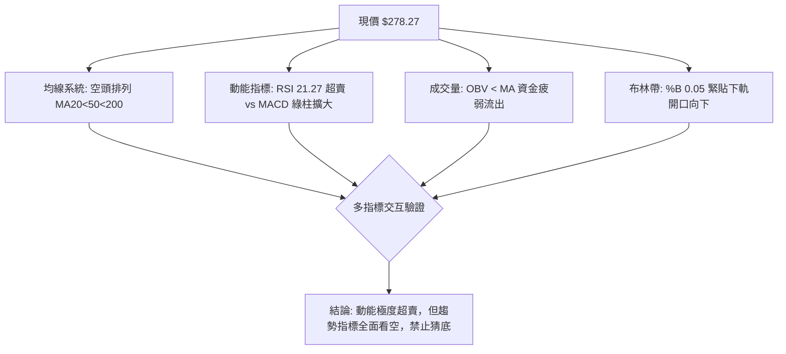

### 📈 移動平均線排列分析

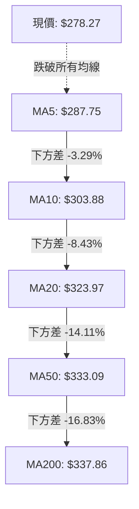

#### 均線系統數據監控表

| 均線名稱 | 當前價格 | 與現價乖離 | 與現價差額 | 均線斜率與歷史走向 |
|----------|----------|------------|------------|--------------------|
| **MA 5** | $287.75 | -3.29% | -$9.48 | ▼ 快速向下俯衝，短期下行均線壓制 |
| **MA 10** | $303.88 | -8.43% | -$25.61 | ▼ 極陡峭下行，短線反彈首道移動壓力 |
| **MA 20** | $323.97 | -14.11% | -$45.70 | ▼ 中期下彎，布林中軌所在，強壓區間 |
| **MA 60** | $334.57 | -16.83% | -$56.30 | ▼ 轉頭向下，中期趨勢徹底反轉為空頭 |
| **MA 120** | $346.95 | -19.80% | -$68.68 | ▼ 下行趨勢確立，長期籌碼套牢深重 |
| **MA 200** | $337.86 | -17.64% | -$59.59 | ▼ 下方跌破，長線牛熊分水嶺正式失守 |
| **MA 240** | $334.17 | -16.73% | -$55.90 | ▼ 長期年線走平後拐頭向下 |

**綜合判定**：呈現典型之「完全空頭排列（Perfect Bearish Alignment）」，短期均線依序在長期均線下方擴散發散，且負乖離率達 -14.11% ~ -19.80%，說明盤面遭遇強大拋售賣壓。

### 📉 RSI(14) 分析

- **當前 RSI(14) 讀數**：`21.27`（Wilder 計算）
- **強度視覺化進度條**：
  ```
  極度超賣 (0)          中軸 (50)          極度超買 (100)
  ├──████░░░░░░░░░░░░░░░░░░░┼────────────────────────┤  21.27%
  ```
- **區間評估**：
  RSI 數值遠低於 30 門檻進入「深度超賣區」，此數值為近 24 個月以來的罕見極值。
- **背離判斷（重要）**：
  - 根據系統近 20 根 K 棒比對與客觀數據標記：「**無明顯背離**」。
  - 數據解讀：自 2026-10-23 之收盤價 $317.28 (週 RSI 30.9) 跌至 2026-10-30 之 $278.22 (週 RSI 21.1) 再到 11-03 之 $278.27 (RSI 21.3)，價格創下低點的同時 RSI 同步創下波段低點，**未出現「價格創新低而 RSI 抬高」之底背離特徵**。動能隨價格崩跌如實釋放，此乃單邊空頭趨勢常態，切不可因超賣誤判為反轉。

### 📊 MACD(12, 26, 9) 訊號解讀

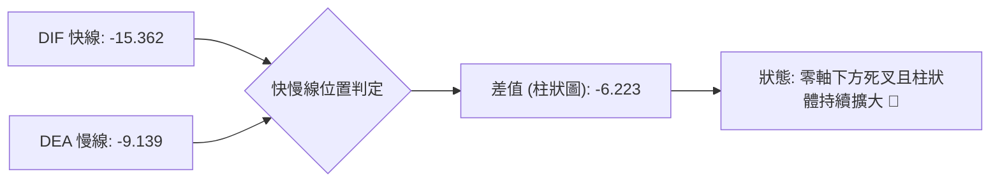

- **精確數值**：
  - DIF（快線）：`-15.362`
  - DEA（慢線/信號線）：`-9.139`
  - MACD 柱狀圖（Hist）：`-6.223`
- **動能解讀**：
  DIF 與 DEA 均處於負值極深之空頭領地（零軸遠端下方），且柱狀圖讀數由 10-30 的 -5.975 進一步擴大至 -6.223，證明空頭動能**尚未出現衰竭或收斂信號**，空方壓制力道依然在加速釋放。

### 📦 布林通道分析

```
GOOG 布林通道示意圖 (日線層級: 20日, 2.0標準差)
══════════════════════════════════════════════════════════════════
  $375.31 ──── 上軌 (Upper Band)
               │
               │
  $323.97 ──── 中軌 (Middle Band = MA20)
               │
  $278.27 ◄─── 現價 (Price, %B = 0.05 處於下軌邊緣)
  $272.62 ──── 下軌 (Lower Band)
══════════════════════════════════════════════════════════════════
```

- **布林參數狀態**：
  - BB 上軌：`$375.31`
  - BB 中軌（MA20）：`$323.97`
  - BB 下軌：`$272.62`
  - **%B 指標**：`0.05`（0.0 代表下軌，0.5 代表中軌，1.0 代表上軌）
- **通道形態分析**：
  現價 $278.27 僅比下軌高出 $5.65，%B 低達 0.05，呈現標準的「沿下軌走低（Riding the Band）」極端空頭弱勢形態。布林帶開口呈現擴張向下，顯示市場波動率正在由下跌主導放大。

### 💹 成交量分析（量價配合度）

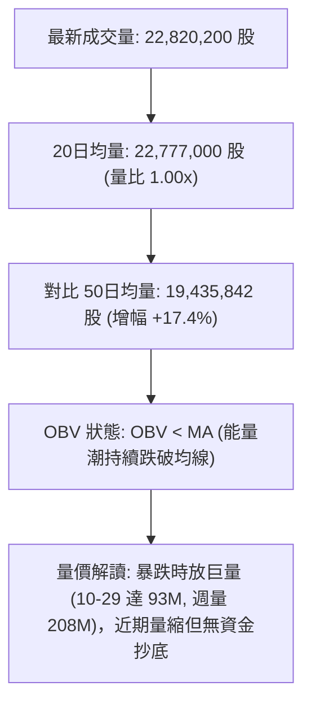

- **量能結構拆解**：
  1. **恐慌放量拋售**：在 2026-10-29 破位大跌當日成交量暴衝至 93,133,900 股（為常態的 4 倍），10-30 當週成交量更達 208,382,100 股，顯現機構資金大規模停損換手出逃。
  2. **量價無背離**：當前 OBV 趨勢明確標記「OBV < MA」，量能持續疲弱，下跌放量、橫盤微幅縮量，符合空頭標準結構，絕無大資金隱密吸籌跡象。

---

## 6. 動能與波動率

### ⚡ 動能評估四象限

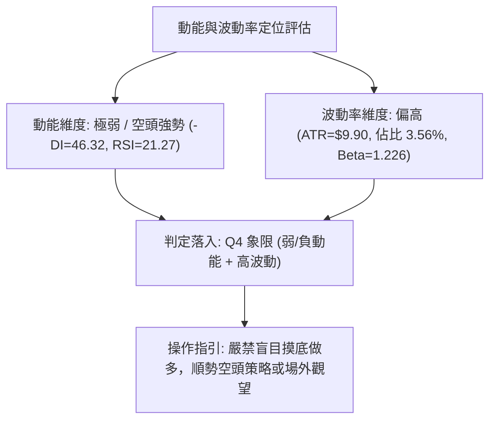

#### 動能與波動率四象限對照表

| 象限標記 | 動能強度 | 波動率水準 | 當前 GOOG 狀態 | 戰略評估與風控建議 |
|----------|----------|------------|----------------|--------------------|
| **Q1** | 強 (多頭) | 低 (穩定) | — | 最理想右側買入區間 |
| **Q2** | 弱 (中性) | 低 (壓縮) | — | 盤整蓄勢，等待方向突破 |
| **Q3** | 強 (多頭) | 高 (劇烈) | — | 擴張牛市，高風險高收益 |
| **Q4** | **弱 / 強負向** | **高 (擴大)** | **✓ (當前處於此象限)** | **下行刀子狀態，左側進場極易受重創，嚴禁重倉抄底** |

### 📊 ATR 波動率分析

- **ATR(14) 讀數**：`$9.90`（佔當前股價之 **3.56%**，Wilder 算法）
- **波動特性分析**：
  GOOG 單日平均波幅接近 10 美元，顯示在破位崩跌後，市場情緒高度敏感且籌碼離散。
- **風控止損距離精算**：
  - 短線交易最低止損距離（1.0 × ATR）：**$9.90**
  - 波段交易安全止損距離（1.5 × ATR）：**$14.85**
  - 趨勢防守容忍距離（2.0 × ATR）：**$19.80**
  - 意涵：任何入場操作若止損區間小於 $9.90，極易在單日正常噪音波動中遭到掃單出場。

### 📐 Beta 與市場相關性

- **Beta 係數**：`1.226`
- **市場屬性解讀**：
  GOOG 展現出較 S&P 500 大盤高出 22.6% 的波動敏感度。在高 Beta (1.226) 特性下，一旦美股整體市場或大型科技股板塊出現系統性回調，GOOG 的下跌放大效應極為顯著；反之，若大盤展開反彈，其超賣修復彈性亦高。

---

## 7. 多時框架總結

### 📋 時框架評分表

| 時框架 | 趨勢方向 | 動能狀態 | 均線排列 | 圖表形態 | 綜合評分 | 戰略建議 |
|--------|----------|----------|----------|----------|----------|----------|
| **長期 (月線)** | 偏空轉弱 🔴 | 走弱 (-18.3% 崩跌) 🔴 | 跌破 MA5/10 均線 🔴 | 頂部大型回撤 🔴 | 35/100 | 長期多頭防線回退至起漲點 |
| **中期 (週線)** | 強烈空頭 🔴 | MACD綠柱擴大至 -6.2 🔴 | 空頭排列 (破MA200) 🔴 | 帶量破位缺口 🔴 | 25/100 | 順應中長線空頭趨勢操作 |
| **短期 (日線)** | 極度超賣 🟡 | RSI=21.27 / KD<10 🟢 | MA20 遙遙在上方 🔴 | 長下影探底十字星 🟡 | 30/100 | 嚴防追空，防備超跌反彈 |

### 🔲 綜合訊號矩陣

```
時框共振度分析
┌──────────────┬──────────────┬──────────────┬──────────────┐
│  維度        │  短期 (日線) │  中期 (週線) │  長期 (月線) │
├──────────────┼──────────────┼──────────────┼──────────────┤
│ 趨勢方向     │  空頭 (Bear) │  空頭 (Bear) │  偏空 (Bear) │
│ 動能方向     │  超賣 (反彈) │  強空 (加速) │  轉弱 (退潮) │
│ 均線架構     │  極弱空排    │  空頭排列    │  高檔死叉    │
│ 量能配合     │  量縮整理    │  暴跌巨量    │  陰包陽量    │
└──────────────┴──────────────┴──────────────┴──────────────┘
訊號共振結論：中長期趨勢完全指向空頭，短期超賣僅具備「技術性反抽」潛力，非反轉。
```

### ⚖️ 多時框收斂結論（嚴格遵守規則 14）

1. **行情類型判定**：當前 ADX(14) 讀數高達 **31.02**（遠高於 25 門檻），且 -DI 達 46.32，**明確收斂判定為「趨勢行情（Trend Market）」而非「盤整行情」**。
2. **多時框優先級裁決**：
   依規則 14 收斂指令：「*趨勢行情（ADX>25）以中長期（週線/MA50、MA200）方向為主，日線只用來尋找進場時機*」。
   - 週線與日線雖然在 RSI 指標上出現「極端超賣（日 RSI 21.27）」，但中長期趨勢（週線帶量長陰、現價遠低於 MA50 $333.09 與 MA200 $337.86）具備絕對統治力。
   - 日線的超賣訊號**不得作為反轉做多的依據**，僅能代表當前價位逼近 S1 支撐，追空風險偏高。
3. **唯一收斂方向結論**：**強烈偏空（Strong Bearish）**。日線的任何反彈均應視為中長期空頭結構中的「次級折返」，反彈遭遇阻力是最佳的高空進場點。此結論直接收斂至第 8 章之主策略規劃。

---

## 8. 交易策略建議

### 🗺️ 策略決策流程圖

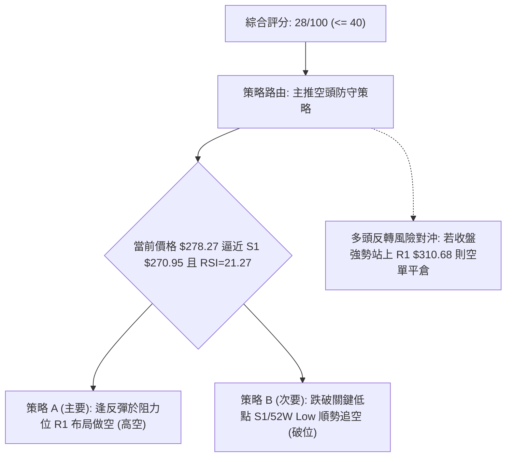

### 🧭 策略路由（依評分卡分流）

**當前主策略方向 = 主推空頭策略（依技術評分卡綜合評分 28/100，評級 ≤ 40 偏空，符合規則要求）**

由於綜合評分僅 28 分，依規定嚴禁主推左側逆勢抄底多單，主策略全數規劃為順應中長期空頭趨勢之放空策略；多頭僅列為風險對沖與反轉防守點。

### 🎯 價格情境階梯（Price Scenarios）

價位嚴格引用第 4 章／技術數據「關鍵價位」區塊之精確數值：

| 觸發條件 | 下一目標 | 後續延伸 | 情境技術含義 |
|----------|----------|----------|--------------|
| **反彈受阻於 R1 $310.68** | S1 $270.95 | $270.70 | 次級超跌反彈結束，重回空頭主跌浪 |
| **強勢突破 R1 $310.68** | R2 $318.83 | R3 $327.81 | 短線跌勢趨緩，展開深幅技術性回抽缺口 |
| **維持於現價 $278.27 震盪** | — | — | 於 52 週低點上方進行超賣修復橫盤 |
| **有效跌破 S1 $270.95** | 52W Low $270.70 | 數據中未偵測到 | 破底崩跌，空頭動能進入未知加速深淵 |

### 📊 情境機率分佈

| 價格情境 | 發生機率 | 主要依據（指標狀態支持） |
|----------|----------|--------------------------|
| **情境一：弱勢反抽後再次下探 (高空)** | **55%** | ADX=31.02 空頭主導，MACD 柱狀圖 -6.223 擴大，RSI 超賣引發微幅反抽 |
| **情境二：直接放量跌破 S1 / 52W Low** | **30%** | OBV < MA 資金疲弱，-DI 達 46.32，週線 2.08 億股拋壓慣性未止 |
| **情境三：V型強勢反轉向上補空** | **15%** | 均線空頭排列形成層層重壓，無底背離支撐，V轉概率極低 |

### 🟢 主策略詳情（方向：做空主導）

所有價位均嚴格基於前述 R1/R2/R3 及 S1/52W Low 數值計算，風險報酬比嚴格符合規則 17 算式：
$$\text{做空風報比} = \frac{\text{進場價} - \text{目標價 T1}}{\text{止損價} - \text{進場價}}$$

| 策略要素 | 策略 A：反彈受阻做空（主推優選） | 策略 B：跌破 S1 順勢追空（破位加碼） |
|----------|---------------------------------|--------------------------------------|
| **戰術類型** | 右側逢高沽空 (Sell on Rally) | 破位追擊空單 (Breakdown Short) |
| **進場條件** | 超賣反抽觸及 R1 遇阻回落收陰日K | 日K實體跌破 S1 與 52W Low 收盤確認 |
| **進場價格** | **$310.68** (精確等於阻力 R1) | **$270.70** (精確等於 52W Low) |
| **目標價 T1** | **$278.27** (回測當前收盤價位) | **$253.18** (由缺口形態推算之目標價) |
| **目標價 T2** | **$270.95** (回測支撐 S1) | N/A (數據中未偵測到更低價位) |
| **止損價格** | **$318.83** (精確等於阻力 R2) | **$278.27** (以當前現價為停損防守) |
| **風險報酬比** | **1 : 3.98（以 T1 計）** <br> *(計算式: (310.68 - 278.27) / (318.83 - 310.68) = 32.41 / 8.15 = 3.98)* <br> [以 T2 計為 1 : 4.87] | **1 : 2.31（以 T1 計）** <br> *(計算式: (270.70 - 253.18) / (278.27 - 270.70) = 17.52 / 7.57 = 2.31)* |
| **成功機率** | 65% | 50% |
| **建議倉位** | 15% 總資金倉位 | 10% 總資金倉位 |

### 🔴 反向風險觸發點（對沖提示）

若出現以下情境，將徹底推翻當前「強烈偏空」之主策略假設，空頭部位必須立即停損平倉或建立多頭對沖：
1. **反轉關鍵價位**：日線收盤價強勢突破並站穩 **$318.83 (R2)** 之上，此舉意味著 2026-10-29 的跳空大陰線缺口被實質回補，空頭結構被嚴重破壞。
2. **動能結構反轉**：日線 MACD 出現零軸下方黃金交叉，且 RSI(14) 重新站回 50 中軸之上。
3. **趨勢衰退訊號**：ADX(14) 數值跌破 25 且 +DI 向上金叉 -DI。

### ⭐ 整體訊號強度評星

```
╔══════════════════════════════════════════════════════════════════╗
║ 做多訊號強度：★☆☆☆☆  (1/5星 - 僅存嚴重超賣，無任何右側訊號)    ║
║ 做空訊號強度：★★★★☆  (4/5星 - 順應大級別均線與破位強空趨勢)    ║
║ 整體可信度：  ★★★★☆  (4/5星 - 價量齊跌、指標高度收斂共振)      ║
╚══════════════════════════════════════════════════════════════════╝
```

---

## 9. 風險提示與監控

### ✅ 關鍵監控指標 Checklist

```
╔══════════════════════════════════════════════════════════════════╗
║                  交易監控與風控 Checklist                       ║
╠══════════════════════════════════════════════════════════════════╣
║ [ ] 價格是否跌破 52W Low $270.70？ (是: 觸發全面恐慌加速度)     ║
║ [ ] RSI(14) 是否脫離 30 以下超賣區？ (是: 短線反彈動能展開)      ║
║ [ ] MACD 柱狀圖是否收斂至 -3.00 以上？ (是: 空頭動能衰退警訊)    ║
║ [ ] 單日成交量是否再度超越 50M 巨量？ (需檢驗為承接盤或恐慌盤)   ║
║ [ ] 股價反彈至 R1 $310.68 時之日K形態？ (出現長上影線即為空點)   ║
║ [ ] 跌破 S1 時有無出現指標底背離？ (有: 嚴禁追空，防誘空陷阱)    ║
╚══════════════════════════════════════════════════════════════════╝
```

### ⚠️ 風險場景分析

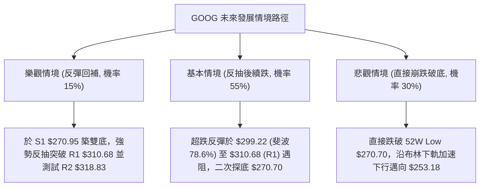

### 🛡️ 風險管理重要提醒

1. **極度超賣下的「放空風險」**：
   當前 RSI 僅 21.27，KD 指標低達 8.21 / 5.06。歷史數據表明，當大型權值股進入如此極端之超賣區，隨時可能因空頭回補（Short Squeeze）或分析師正面評級（如 JP Morgan、TD Cowen 等近期 Overweight 評級刺激）產生 5% ~ 8% 的暴力技術性反抽。因此，**絕對不可在現價 $278.27 附近盲目追空**，必須保持紀律「等待反抽 R1 阻力受阻」方可建倉。
2. **波動率放大的倉位控管**：
   當前 ATR 達 $9.90 (3.56%)，Beta 達 1.226，單日風險暴露遠高於平常。建議單筆交易承擔之淨值風險上限不得超過總資產之 **1.0%**。以 ATR 止損距離 $9.90 計算，每 10 萬美元部位配置之空頭部位不應超過 100 股。
3. **財報與基本面黑天鵝風險**：
   最新季度 EPS 成長為 -25.3%，自由現金流僅 19.75B（因資本支出高達 159.80B），市場正對其 AI 資本支出回報產生強烈質疑。基本面利空主導下，技術面支撐往往容易失效，交易必須嚴格執行機械化止損。

---

## 📋 報告總結

```
╔══════════════════════════════════════════════════════════════════╗
║                   GOOG 技術分析報告總結                          ║
╠══════════════════════════════════════════════════════════════════╣
║ 報告日期：2026-11-04                                             ║
║ 當前收盤價：$278.27                                              ║
║ 綜合技術評分：28 / 100                                           ║
║ 分析評級：🔴 強烈看空 / 逢高做空 (Strong Bearish / Sell on Rally)║
║                                                                  ║
║ 關鍵結構結論：                                                   ║
║ ├─ 長期趨勢：🔴 高位瓦解，自 $381.46 崩跌，回撤逾 27%            ║
║ ├─ 中期趨勢：🔴 ADX=31.02 空頭強趨勢，均線完美空排，破 MA200    ║
║ ├─ 短期趨勢：🟡 極端超賣 (RSI 21.27)，面臨 S1 支撐測試與反抽     ║
║ ├─ 關鍵支撐：S1 $270.95 / 52W Low $270.70                        ║
║ ├─ 關鍵阻力：R1 $310.68 / R2 $318.83 / R3 $327.81                ║
║ └─ 分析師共識：Mean $407.00 (低點 $340.00 / 高點 $460.00)       ║
║                                                                  ║
║ 最優策略組合：                                                   ║
║ 1. 🥇 最佳機會：等待超跌反抽至 R1 $310.68 遇阻建立空單 (風報比 1:3.98)║
║ 2. 🥈 次選機會：日K實體放量跌破 52W Low $270.70 追空 (風報比 1:2.31) ║
║ 3. 🥉 保守選擇：完全空倉觀望，等待日線級別底背離與站回 MA20 確認 ║
╚══════════════════════════════════════════════════════════════════╝
```

---

> ⚠️ **免責聲明**：本報告為技術分析研究，所有數據指標與推算均嚴格基於所提供之歷史交易資訊與量化模型。本報告**僅供研究與學術參考**，**不構成任何要約、招攬或投資建議**。市場具有高度不確定性，交易決策應獨立審慎評估，嚴格控管資金風險。

---

*報告生成時間：2026-11-04 ｜ 數據來源：Yahoo Finance ｜ 分析框架：多時框技術分析體系*