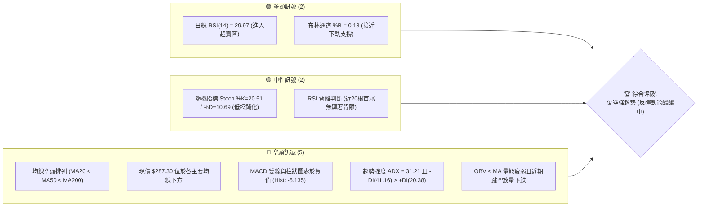
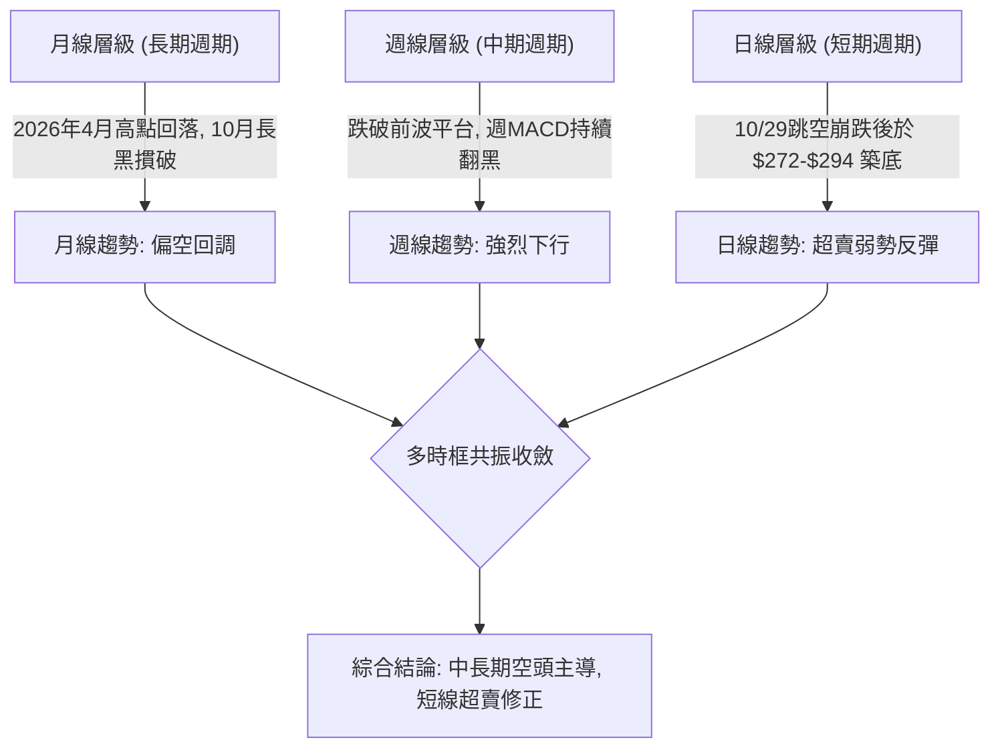
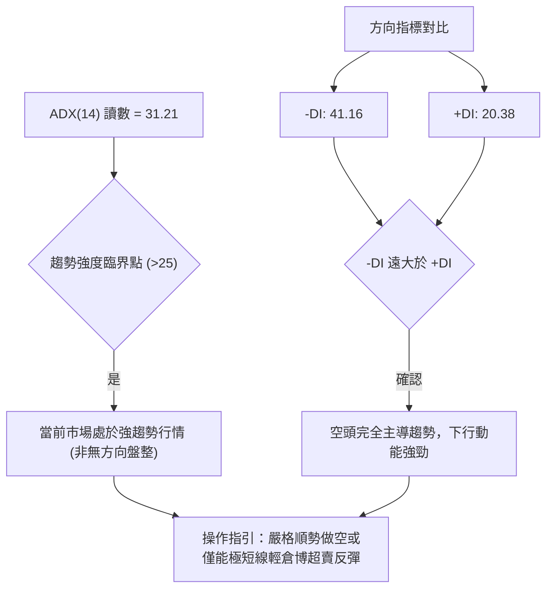
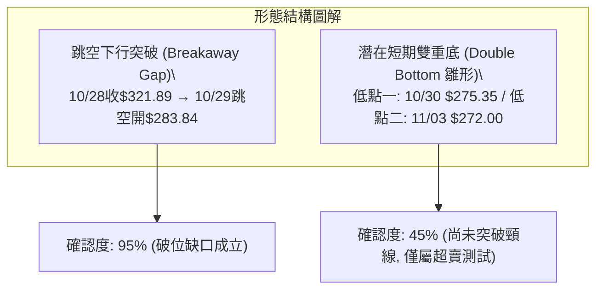
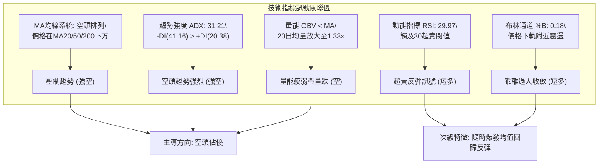
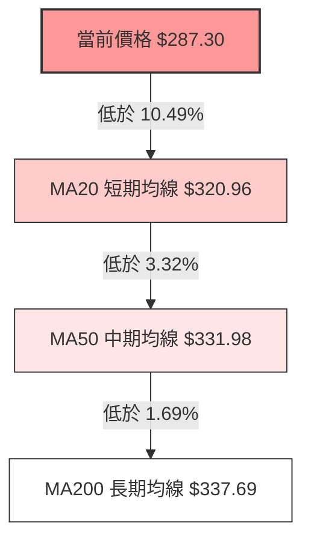
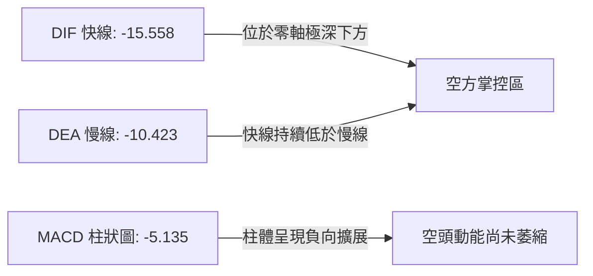
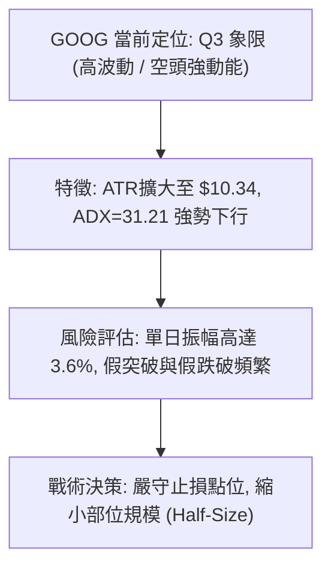
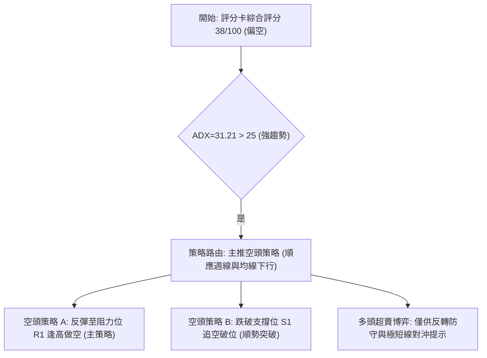
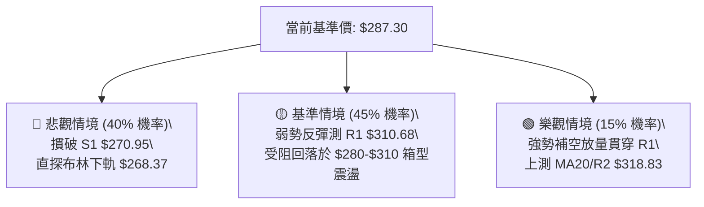

# GOOG 技術分析報告

> **報告日期**：2026-11-05 ｜ **語言**：繁體中文 ｜ **數據來源**：Yahoo Finance ｜ **當前價格**：$287.30

---

## 目錄

| 章節 | 內容 |
|------|------|
| [1. 技術面概覽](#1-技術面概覽) | 訊號儀表板、核心指標、評分卡 |
| [2. 趨勢分析](#2-趨勢分析) | 多時框趨勢、長中短期走勢 |
| [3. 圖表形態分析](#3-圖表形態分析) | 形態識別、K線組合、目標價 |
| [4. 支撐與阻力](#4-支撐與阻力) | 關鍵價位、斐波那契回調 |
| [5. 技術指標深度解讀](#5-技術指標深度解讀) | MA/RSI/MACD/布林/成交量 |
| [6. 動能與波動率](#6-動能與波動率) | 動能評估、ATR、Beta |
| [7. 多時框架總結](#7-多時框架總結) | 時框架評分矩陣 |
| [8. 交易策略建議](#8-交易策略建議) | 多空策略、風險報酬比 |
| [9. 風險提示與監控](#9-風險提示與監控) | 監控指標、風險場景 |

---

## 1. 技術面概覽

### 🎯 技術訊號儀表板



### 📊 核心指標速覽表

| 指標類別 | 指標名稱 | 當前數值 | 訊號 | 解讀 |
|----------|----------|----------|------|------|
| **價格** | 當前收盤價 | $287.30 | 🔴 | 位於 52 週高低區間之 12.5% 低檔區，受制於多重均線壓制 |
| **均線** | 短期 MA20 | $320.96 | 🔴 | 價格低於 MA20 達 -10.49%，空頭主導格局 |
| **均線** | 中期 MA50 | $331.98 | 🔴 | 價格低於 MA50，中期下降趨勢明朗 |
| **均線** | 長期 MA200 | $337.69 | 🔴 | 價格低於 MA200，跌破長期年線支撐轉為重阻力 |
| **動能** | RSI(14) | 29.97 | 🟢 | 指標進入超賣警戒區（<30），隨時具備技術性反彈契機 |
| **動能** | MACD(12,26,9) | -15.558 / -10.423 | 🔴 | 快慢線均在零軸下方發散，柱狀圖 -5.135 呈現空頭動能 |
| **波動** | ATR(14) | $10.34 | 🟡 | 佔現價 3.60%，波動幅度顯著擴大，風險控管難度提高 |

### 🏆 技術評分卡

```
╔══════════════════════════════════════════════════════════════════╗
║                 技術評分卡 — GOOG (2026-11-05)                   ║
╠══════════════════════════════════════════════════════════════════╣
║ 趨勢強度 (ADX=31.21, -DI主導)  ██████████████░░░░░░  70/100 🔴 空 ║
║ 動能指標 (RSI超賣, MACD負值)   ██████░░░░░░░░░░░░░░  30/100 🔴 空 ║
║ 支撐穩定度 (考驗 S1 $270.95)   ████████░░░░░░░░░░░░  40/100 🟡 中 ║
║ 成交量配合 (下跌放量, OBV弱)   ██████░░░░░░░░░░░░░░  30/100 🔴 空 ║
║ 形態完整度 (跳空破位下行結構)  ████████░░░░░░░░░░░░  40/100 🔴 空 ║
║ 均線排列 (完全空頭排列格局)    ████░░░░░░░░░░░░░░░░  20/100 🔴 空 ║
╠══════════════════════════════════════════════════════════════════╣
║ 綜合評分                       ████████░░░░░░░░░░░░  38/100 🔴    ║
║ 評級結論：偏空 (Bearish) — 依規則 18 算術平均四捨五入為 38/100   ║
╚══════════════════════════════════════════════════════════════════╝
```

---

## 2. 趨勢分析

### 🌐 多時框趨勢分析



### 📈 長期趨勢 — 12個月走勢圖（Unicode）

```
GOOG 月線走勢圖（過去12個月：2025-12 至 2026-11）
價格軸 ($)
$390 ┤                                      
$380 ┤                            ●(2026-04 $381.46)
$370 ┤                               ●(05 $375.96)
$360 ┤                                  ●(07 $356.42)
$350 ┤                               ●(06 $353.10)
$340 ┤                    ●(01 $337.87)    ●(09 $340.74)
$330 ┤                                        ●(08 $335.19)
$320 ┤                                      
$310 ┤●(2025-12 $313.19)    ●(02 $310.82)   
$300 ┤                                      
$290 ┤                                              ●(現價 2026-11 $287.30)
$280 ┤                        ●(03 $286.50)     ●(10 $278.22)
     └────────────────────────────────────────────────────────────
       12   01   02   03   04   05   06   07   08   09   10   11 (月份)
```

**過去 12 個月走勢特徵分析表格**：

| 時間區間 | 起訖價格 ($) | 漲跌幅 (%) | 走勢特徵與結構分析 |
|----------|--------------|------------|-------------------|
| 2025-12 ~ 2026-01 | $313.19 → $337.87 | +7.88% | 延續強勢上漲，突破 $330 整數關卡創波段新高 |
| 2026-01 ~ 2026-03 | $337.87 → $286.50 | -15.20% | 獲利了結賣壓湧現，連續回調下測 $286 支撐位 |
| 2026-03 ~ 2026-04 | $286.50 → $381.46 | +33.14% | 出現單月暴力上漲，創下 52 週歷史高點 $403.96 區域 |
| 2026-04 ~ 2026-09 | $381.46 → $340.74 | -10.67% | 高檔橫盤滯漲，高點逐步下移，呈現做頭派發跡象 |
| 2026-09 ~ 2026-10 | $340.74 → $278.22 | -18.35% | 破位崩跌長黑，帶量貫穿所有均線群，直逼 52 週低點 |
| 2026-10 ~ 2026-11 | $278.22 → $287.30 | +3.26% | 觸及 52W 低點 $270.70 前獲買盤支撐，低檔震盪尋求止跌 |

### 📊 中期趨勢（週線分析）

從近 20 週收盤走勢可見，價格於 2026 年 7 月至 10 月中旬長期在 $335 ~ $356 之間箱型盤整。2026-10-16 當週收盤 $336.91 還維持在區間下軌，但 2026-10-23 當週收盤摜破至 $317.28，緊接著 2026-10-30 當週引爆恐慌拋補，週成交量暴增至 208,382,100 股，單週重挫收在 $278.22。

```
中期週線阻力與支撐示意架構：
$356.42 ══════════════════════════════════════ [中期強阻力箱頂]
         │ 7-9月震盪密集套牢區
$336.91 ────────────────────────────────────── [破位頸線阻力 / MA50]
$318.88 -------------------------------------- [R2 阻力 / 前週低點聚類]
$287.30 ══════════════ ◄ 現價
$270.70 ══════════════════════════════════════ [S1 支撐 / 52週低點]
```

### ⚡ 趨勢強度評估（ADX 解讀）



**趨勢強度對照表**：

| 指標名稱 | 數值 | 參考臨界線 | 狀態解讀 |
|----------|------|------------|----------|
| **ADX(14)** | 31.21 | > 25 (強趨勢) | 市場脫離無序整理，展現單邊加速結構 |
| **+DI (多頭方向線)** | 20.38 | < 25 (動能疲弱) | 買盤缺乏承接主動性，多方無進攻力道 |
| **-DI (空頭方向線)** | 41.16 | > 40 (極度強勢) | 空頭賣壓全面宣洩，主導日線與週線週期 |

---

## 3. 圖表形態分析

### 🔍 形態識別系統



**圖表形態信心度表格**（依規則 15）：

| 形態名稱 | 信心度 | 判斷依據（引用數據） | 完成度 | 目標價（附計算式） |
|----------|--------|----------------------|--------|--------------------|
| **巨量向下跳空破位** | 95% | 10/28 最低 $319.68 與 10/29 最高 $286.43 形成達 $33.25 之未補跳空缺口，且伴隨 93,133,900 股巨量 | 100% | 依向下破位幅度測算，已直接貫穿並直達 S1 $270.95 支撐邊界 |
| **潛在雙底測試** | 45% | 訊號不足，僅做指標型解讀。10/30 低點 $275.35 與 11/03 低點 $272.00 於 S1 $270.95 附近獲得支撐 | 35% | 頸線為 10/29 高點 $286.43 或 R1 $310.68；因尚未有效突破，不列幾何測距，維持超賣反彈看待 |

### 🕯️ 重要K線形態分析

依規則 19，完全依據數據中「近 10 根日 K」與「近 8 根週 K」之開高低收進行客觀形態識別：

| 日期（週期） | 開 | 高 | 低 | 收 | K線形態 | 解讀 | 訊號 |
|--------------|----|----|----|----|---------|------|------|
| **10-28 (日K)** | 319.88 | 323.13 | 319.68 | 321.89 | 實體中陽線 | 嘗試反彈測試 MA20，但為財報或突發事件前夕的最後誘多 | 🟡 |
| **10-29 (日K)** | 283.84 | 286.43 | 278.29 | 282.32 | 巨量向下跳空黑K | 跳空低開近 36 點，成交量暴增至 93M，法人無情拋售破位 | 🔴 |
| **10-30 (日K)** | 279.69 | 281.86 | 275.35 | 278.22 | 慣性下挫黑K | 延續前日恐慌，下影線探至 $275.35，收盤創 2026 年新低 | 🔴 |
| **11-02 (日K)** | 280.58 | 285.21 | 277.78 | 278.04 | 墓碑十字星變體 | 開高走低，上影線試圖回補缺口失敗，多頭反撲遭壓制 | 🔴 |
| **11-03 (日K)** | 279.19 | 280.34 | 272.00 | 278.27 | 錘頭線 (Hammer) | 最低探至 $272.00（逼近52W低點$270.70）後拉回，長下影線顯現買盤承接 | 🟢 |
| **11-04 (日K)** | 281.48 | 294.40 | 281.33 | 287.30 | 實體大陽線 | 放量反彈，最高衝至 $294.40，多頭確認 11/03 止跌錘頭結構 | 🟢 |
| **10-30 (週K)** | 318.05 | 323.13 | 275.35 | 278.22 | 破位放量大長陰 | 週跌幅近 40 點，成交量 208M 創數月天量，徹底破壞週線多頭防線 | 🔴 |
| **11-04 (週K)** | 280.58 | 294.40 | 272.00 | 287.30 | 帶下影線反彈週陽K | 於 52 週低點附近止跌回升，試圖在 $280 建立中期防禦支撐 | 🟡 |

### 📉 ASCII 走勢形態示意圖

```
GOOG 近期日K線形態走向（跳空破位與雙底雛形示意）：

$325 ┤       ●[10/28: $321.89]
$320 ┤      / 
$315 ┤     /   
$310 ┤    /    
$305 ┤   /     
$300 ┤  /      
$295 ┤ ░       ══════════════════════════════════ [10/29 跳空缺口未補 $286.43 - $319.68]
$290 ┤ ░                             ●[11/04: $287.30 高點衝至 $294.40]
$285 ┤ ░         ●[10/29: $282.32]   /
$280 ┤ ░          \       ●[11/02]  /
$275 ┤ ░           ●[10/30: $275.35]
$270 ┤ ░                             ●[11/03: $272.00 止跌長下影錘頭]
     └──────────────────────────────────────────────
         10-28   10-29   10-30   11-02   11-03   11-04
```

### 🎯 形態目標價計算

根據形態測算規則，若將 10/30 低點 $275.35 與 11/03 低點 $272.00 視為短期微型雙底，其頸線位以 10/29 反彈高點 $286.43 為基準：
- **雙底頸線位**：$286.43
- **雙底底部低點**：$272.00
- **形態垂直高度**：$286.43 - $272.00 = $14.43
- **形態第一量度上漲目標價**：$286.43 + $14.43 = **$300.86**（落於 78.6% 斐波那契位 $299.22 與阻力 R1 $310.68 之間）
- **形態第二反彈擴展目標價**：回補 10/29 缺口下緣，直接指向 **R1 $310.68**。

---

## 4. 支撐與阻力

### 🗺️ 關鍵價位分布圖（Unicode）

```
GOOG 價位結構分布圖
═══════════════════════════════════════════════════════════════════
$337.69 ║████████████████████████████████████████║ MA200 年線生死線
$327.81 ║████████████████████████████████        ║ 強阻力 R3 (密集套牢頂)
$320.96 ║████████████████████████████            ║ MA20 月線壓力
$318.83 ║██████████████████████                  ║ 阻力 R2 (前波週收盤平台)
$310.68 ║████████████████                        ║ 關鍵阻力 R1 (缺口下軌起跌點)
$299.22 ║▓▓▓▓▓▓▓▓▓▓▓▓                            ║ Fib 78.6% 心理關卡
$287.30 ╠════════════════════════════════════════╣ ◄ 現價收盤 $287.30
$270.95 ║████████████████████████████████████████║ 核心支撐 S1 (波段低點聚類)
$270.70 ║████████████████████████████████████████║ 52週絕對低點 (年度防線)
$268.37 ║▓▓▓▓▓▓▓▓▓▓▓▓▓▓▓▓▓▓▓▓                    ║ 布林通道下軌極限
═══════════════════════════════════════════════════════════════════
```

### 🚧 阻力位分析表

全部嚴格引用「關鍵價位」區塊數值，不得捏造：

| 阻力級別 | 價位 ($) | 距現價幅動 | 形成原因與籌碼特徵 | 突破難度 | 重要性評級 |
|----------|----------|------------|--------------------|----------|------------|
| **R1** | $310.68 | +8.14% | 近一年波段高點聚類點，同時為 10/29 斷崖式跳空缺口下緣與 10/23 收盤密集區 | 🔴 極高 | ★★★★★ (短線反彈首要天花板) |
| **R2** | $318.83 | +10.97% | 波段高點聚類位，貼近 MA20 ($320.96) 與 10/28 破位前平臺低點 ($319.68) | 🔴 極高 | ★★★★☆ (多空波段分水嶺) |
| **R3** | $327.81 | +14.10% | 近一年波段高點聚類，接近 10/22 高點 $327.70，前期多頭密集轉折換手區 | 🔴 極高 | ★★★★☆ (中期結構修復點) |

### 🛡️ 支撐位分析表

全部嚴格引用「關鍵價位」區塊數值：

| 支撐級別 | 價位 ($) | 距現價幅動 | 形成原因與籌碼特徵 | 守住機率 | 重要性評級 |
|----------|----------|------------|--------------------|----------|------------|
| **S1** | $270.95 | -5.69% | 近一年波段低點聚類，與 52 週最低點 $270.70 高度重合，空頭宣洩首要落腳點 | 🟢 70% | ★★★★★ (年度多頭最後防線) |
| **S2** | N/A (數據未提供) | N/A | 原始技術數據中未偵測到次級支撐價位 | N/A | N/A |
| **S3** | N/A (數據未提供) | N/A | 原始技術數據中未偵測到第三級支撐價位 | N/A | N/A |

### 📐 斐波那契回調位分析

依據 52 週區間（低點 $270.70 至 高點 $403.96，波幅達 $133.26）計算之精確斐波那契回調矩陣：

| 回調比率 | 對應價位 ($) | 相對現價位置 | 技術意義與多空攻防解讀 |
|----------|--------------|--------------|------------------------|
| **0.0% (52W High)** | $403.96 | +40.61% | 2026 年度歷史高點，長期牛市極限擴展位 |
| **23.6%** | $372.51 | +29.66% | 強勢回調防守點，5 月高點 $375.96 附近 |
| **38.2%** | $353.06 | +22.89% | 中期關鍵樞紐，7-9 月長達三個月的震盪箱體中軸 |
| **50.0%** | $337.33 | +17.41% | 50% 心理平衡位，高度重合 MA200 ($337.69)，多空長期分水嶺 |
| **61.8%** | $321.61 | +11.94% | 黃金分割強回調位，高度共振 MA20 ($320.96) 與 R2 ($318.83) |
| **78.6%** | $299.22 | +4.15% | 深幅回調警戒線，$300 整數心理大關 |
| **100.0% (52W Low)**| $270.70 | -5.78% | 52 週最低點，與 S1 ($270.95) 形成重疊共振支撐區 |

**位置解讀**：現價 $287.30 處於 **78.6% 回調位 ($299.22)** 與 **100.0% 回調位 ($270.70)** 之間。當價格跌破 61.8% 後通常意味著前波牛市主升浪遭徹底瓦解，直接進入空頭下尋 100% 回撤測試。當前僅距 100% 回調位不到 6%，說明下跌空間已受極值壓抑，隨時展開向上奔向 78.6% ($299.22) 的技術回抽。

---

## 5. 技術指標深度解讀

### 🎛️ 指標訊號總覽



### 📈 移動平均線排列分析



均線系統展現極為標準且發散的**空頭排列**（MA20 < MA50 < MA200）：
- **MA5** ($280.83)：現價高於 MA5（+2.30%），短期超跌後出現極短線轉折線索。
- **MA10** ($299.51) 至 **MA20** ($320.96)：呈現陡峭向下傾斜，顯示過去一個月持有者全數套牢，上方解套賣壓沈重。
- **MA200** ($337.69)：年線遭實體摜破，確立長期技術結構轉弱。

### 📉 RSI(14) 分析

```
RSI(14) 讀數進度條：
0                        30                70              100
├────────────────────────┼─────────────────┼────────────────┤
███████████████░░░░░░░░░░░░░░░░░░░░░░░░░░░░░░░░░░░░░░░░░░░░░░░
▲ 29.97 (進入極度超賣區間)
```

- **超買超賣判定**：RSI(14) 最新收盤讀數為 **29.97**（Wilder 計算），正式跌破 30 超賣臨界點。依歷史經驗，GOOG 的日線 RSI 跌破 30 往往預示下行拋售已進入竭盡階段（Exhaustion phase）。
- **背離分析結論**：數據明確指示「RSI 背離：無明顯背離（僅比較近20根K棒首尾的價格與RSI方向）」。價格從 10/22 的 $320.76 一路破位至 $287.30，RSI 亦同步自 40 以上摔落至 29.97，價跌指標跌，**未出現多頭底背離**，意味著跌勢屬於實質性動能打壓，不可盲目逆勢大舉抄底。

### 📊 MACD(12,26,9) 訊號解讀



- **MACD 線**：-15.558
- **MACD Signal 線**：-10.423
- **MACD 柱狀圖**：-5.135 🔴 看空
- **解讀**：DIF 與 DEA 於負值區深度下行，柱狀圖達 -5.135，顯示空方動能強烈發散。雖然 11/04 單日上漲使負向柱體略微由前幾日的高點鈍化收斂，但在快線未向上金叉慢線之前，中期空頭訊號絕未解除。

### 📦 布林通道分析

```
布林通道 (Bollinger Bands, 20, 2) 結構分布：
$373.56 ┬──────────────────────────────────────────── BB 上軌
        │
        │
$320.96 ┼──────────────────────────────────────────── BB 中軌 (MA20)
        │
$287.30 ┼ - - - - - - - - - - - - - - - - - - - - -  現價 (%B = 0.18)
        │
$268.37 ┴──────────────────────────────────────────── BB 下軌
```

- **通道帶寬與位置**：上軌 $373.56、中軌 $320.96、下軌 $268.37。
- **%B 指標分析**：%B 為 **0.18**。當 %B < 0.20 時，代表價格已緊貼布林下軌運行，屬於極端超賣區域。現價 $287.30 距下軌 $268.37 僅差 $18.93，由於通道在 10/29 放量後呈現喇叭口向下張開，價格具有極強的均值回歸彈性，目標必先測試中軌 $320.96。

### 💹 成交量分析（量價配合度）

- **量比與均量**：最新成交量為 31,638,100 股，相較於 20 日均量 (23,819,275 股) **量比達 1.33x**，相較 50 日均量 (19,799,026 股) 放量更為顯著。
- **OBV 能量潮**：OBV < MA，量能指標疲弱。
- **量價背離與籌碼特徵**：
  1. 10/29 跳空崩跌引爆 93,133,900 股巨量，為典型的**放量破位**，大量籌碼在 $280 附近換手。
  2. 10/30 下跌收 $278.22 伴隨 45M 成交量，量能減半；11/03 探底 $272.00 時成交量縮至 23M；11/04 反彈收陽成交量回升至 31M。量價結構呈現「跌勢量縮、低檔承接轉強」，說明殺跌動能短線減弱，有利多頭展開波段修復。

---

## 6. 動能與波動率

### ⚡ 動能評估四象限

動能評估矩陣（基於動能強度與波動率維度）：

| 象限代號 | 動能強度 | 波動率狀態 | 象限特徵說明 | GOOG 當前定位 | 操作指導意義 |
|----------|----------|------------|--------------|---------------|--------------|
| **Q1** | 強 (多頭) | 低波動 | 穩健上行趨勢，牛市主升浪 | ✕ | 順勢加碼做多 |
| **Q2** | 弱 (無向) | 低波動 | 窄幅盤整，動能匱乏沉悶 | ✕ | 突破前保持觀望 |
| **Q3** | 強 (空頭) | 高波動 | 斷崖破位，單邊恐慌宣洩 | **✓ 當前狀態 (Q3)** | **空方順勢，波段防反彈抽殺** |
| **Q4** | 轉折動能 | 高波動 | 劇烈洗盤，底部巨震築底 | 潛在演變 | 輕倉介入超賣左側反彈 |



### 📊 ATR 波動率分析

- **ATR(14) 數值**：**$10.34**（Wilder 計算）。
- **ATR 佔比**：佔當前收盤價 $287.30 的 **3.60%**，屬於科技巨頭中偏高的單日波動水準。
- **止損與交易距離建議**：
  - **極短線日內動態止損**：1.0 × ATR = **$10.34**。
  - **波段交易安全止損防護**：1.5 × ATR = **$15.51**（若於現價進場，多頭止損需設於 $287.30 - $15.51 = $271.79，剛好覆蓋 11/03 低點 $272.00 與 S1 $270.95）。
  - **追蹤止盈寬容度**：2.0 × ATR = **$20.68**。

### 📐 Beta 與市場相關性

- **Beta 係數**：**1.226**。
- **市場相關性分析**：Beta 為 1.226 顯示 Alphabet 對標普 500 指數與納斯達克 100 指數具有顯著的高彈性放大特徵。當大盤處於選後反彈或風險偏好改善時，GOOG 具有超越指數的彈升動力；但當科技板塊承壓時，其回調下殺力道亦高出大盤 22.6%。近期在大盤道瓊走強而科技股回調背景下，GOOG 跌幅顯著擴大，即受制於其高 Beta 的科技屬性。

---

## 7. 多時框架總結

### 📋 時框架評分表

| 時框架 | 趨勢方向 | 動能狀態 | 均線排列 | 圖表形態 | 綜合評分 | 建議操作策略 |
|--------|----------|----------|----------|----------|----------|--------------|
| **月線 (長期)** | 偏空回調 🔴 | 減弱中 🔴 | MA5 下彎 🟡 | 自 $381 高檔做頭下殺 | 35/100 | 長期投資者減倉或暫停定投 |
| **週線 (中期)** | 強烈下行 🔴 | 空頭擴展 🔴 | 跌破各級均線 🔴 | 208M 巨量破位長陰 | 25/100 | 中線嚴禁盲目摸底做多 |
| **日線 (短期)** | 超賣修正 🟢 | 進入超賣 🟢 | 空頭排列壓制 🔴 | 錘頭反彈測試缺口 | 54/100 | 超短線輕倉參與技術性反彈 |

### 🔲 綜合訊號矩陣

```
時框架共振矩陣 (Consistency Matrix)：
指標系統            短期 (日線)        中期 (週線)        長期 (月線)        共振判定
─────────────────────────────────────────────────────────────────────────────
Trend (趨勢)        偏多 (短線反彈)    極空 (破位下行)    偏空 (高檔回撤)    衝突 (以中長線為主)
Moving Averages     極空 (空頭排列)    極空 (均線下穿)    中性 (近MA20)      偏空主導
Oscillators (RSI)   極多 (超賣<30)     偏空 (週RSI 30.0)  中性 (RSI退潮)     短期超賣反彈共振
Volume (成交量)     偏多 (縮量止跌)    極空 (崩跌放量)    中性               量價結構空方佔優
```

### ⚖️ 多時框收斂結論

依「嚴格要求 14」與「多時框收斂規則」進行終局收斂：
1. **行情性質判定**：ADX(14) 讀數為 **31.21**（大於 25 臨界值），且 -DI(41.16) 呈現絕對壓制。因此，當前市場環境屬於**「強趨勢行情（空頭趨勢）」**，而非無方向的盤整震盪。
2. **時框優先級權重**：在 ADX > 25 的趨勢行情下，必須以**中長期（週線/MA50、MA200）方向為最高依歸**，日線級別的指標超賣只能視為短期逆勢反彈修正與逢高做空的進場時機，嚴禁將日線短彈解讀為大級別趨勢反轉。
3. **最終方向性結論**：**偏空（Bearish，綜合評分 38/100）**。
4. **與交易策略收斂**：雖然日線 RSI 觸及 29.97 醞釀彈升，但週線與均線格局遭毀滅性破壞。第 8 章策略將依第 1 章評分卡（38/100 ≤ 40）嚴格分流，**主推逢反彈阻力位之「空頭順勢策略」**，多頭僅列為極短線超賣博弈與反轉風險對沖考量。

---

## 8. 交易策略建議

### 🗺️ 策略決策流程圖



### 🧭 策略路由（依評分卡分流，不得兩頭下注）

> **當前主策略方向 = 空頭主導 / 逢反彈高空（依技術評分卡綜合評分 38/100 ≤ 40 主推）**

### 🎯 價格情境階梯（Price Scenarios）

價位完全嚴格引用第 4 章及數據計算數值：

| 觸發條件 | 下一目標 | 後續延伸 | 情境含義與技術解讀 |
|----------|----------|----------|--------------------|
| **反彈受阻 R1 $310.68** | 現價 $287.30 | S1 $270.95 | 短線超賣反彈結束，空頭重啟下行主跌浪 |
| **向上突破 R1 $310.68** | R2 $318.83 | R3 $327.81 | 10/29 跳空缺口開始回補，空頭策略面臨止損 |
| **跌破 S1 $270.95** | 52W低 $270.70 | 布林下軌 $268.37 | 52 週年度防線失守，引發停損賣壓加速崩跌 |

### 📊 情境機率分佈

| 情境劇本 | 機率估計 | 主要指標依據與量價邏輯 |
|----------|----------|------------------------|
| **逢高回落 / 再探低點 (主情境)** | **55%** | MA20/50/200 呈死叉空頭排列；ADX=31.21 空頭發散；OBV 持續疲軟；10/29 缺口阻力沉重 |
| **超賣弱勢反彈 / 區間震盪** | **30%** | 日線 RSI(14)=29.97 嚴重超賣；布林 %B=0.18 偏離均線；11/03 出現錘頭線長下影護盤 |
| **強勢反轉 V 型回補** | **15%** | 需連續放量站穩 R2 $318.83 與 MA20，目前量能結構尚不支持直接 V 轉 |

### 🟢 主策略詳情（方向依上方路由：空頭策略）

進場點、止損點、目標價全部依規則 13 引用關鍵價位區塊數值，風險報酬比嚴格按規則 17 計算：
- *空頭風報比公式 = (進場價 − 目標價 T1) ÷ (止損價 − 進場價)*

| 策略要素 | 策略 A：反彈受阻放空（反彈高空） | 策略 B：跌破支撐追空（破位順勢） |
|----------|----------------------------------|----------------------------------|
| **進場條件** | 股價反彈至 R1 遇阻回落，日K收長上影線 | 實體日K放量跌破 S1 支撐位確認破位 |
| **進場價格** | **$310.68** (精確引用 R1) | **$270.95** (精確引用 S1) |
| **目標價 T1** | **$287.30** (當前收盤價位) | **$270.70** (52週最低點) |
| **目標價 T2** | **$270.95** (波段支撐 S1) | **$268.37** (布林通道下軌極限) |
| **止損價格** | **$318.83** (精確引用 R2) | **$272.00** (11/03 止跌錘頭低點) |
| **風險報酬比** | **1 : 2.87（以 T1 計）**<br>*(310.68-287.30)/(318.83-310.68) = 23.38/8.15 = 2.87* | **1 : 0.24（以 T1 計）**<br>*(270.95-270.70)/(272.00-270.95) = 0.25/1.05 = 0.24*<br>*(以 T2 計則為 1 : 2.46)* |
| **成功機率** | 65% | 45% (逼近超賣極限易生假跌破) |
| **建議倉位** | 15% 總資金倉位 | 5% 極輕倉追擊 |

### 🔴 反向風險觸發點（對沖提示）

若出現以下情境，說明空頭趨勢受阻，必須立即執行空頭止損或將部位反手對沖：
1. **關鍵價位逆破**：日線收盤價強勢突破 **R1 $310.68** 並伴隨成交量放大至 4,000 萬股以上。
2. **技術形態破壞**：回補 10/29 缺口上緣 **$319.68**，導致空頭跳空形態失效。
3. **指標翻多**：日線 MACD 柱狀圖由負轉正，且 RSI 突破 50 中性軸。

### ⭐ 整體訊號強度評星

```
╔═══════════════════════════════════════════════╗
║ 做多訊號強度：★★☆☆☆  (2/5星 - 僅屬超賣反彈) ║
║ 做空訊號強度：★★★★☆  (4/5星 - 順應大級別)   ║
║ 整體可信度：  ★★★★☆  (4/5星 - 價量確認度高) ║
╚═══════════════════════════════════════════════╝
```

---

## 9. 風險提示與監控

### ✅ 關鍵監控指標 Checklist

```
╔══════════════════════════════════════════════════════════════════╗
║               GOOG 每日技術風控監控清單 (Checklist)              ║
╠══════════════════════════════════════════════════════════════════╣
║ [ ] 監控 $270.95 (S1) / $270.70 (52W Low)：收盤跌破則開啟新跌浪  ║
║ [ ] 監控 $310.68 (R1)：空頭主力第一道防線，反彈受阻為加空點     ║
║ [ ] 監控 $318.83 (R2)：波段多空反轉關鍵防守點，突破則空單離場   ║
║ [ ] 監控 RSI(14)：觀察由 <30 超賣區回升至 40 時是否再度受阻下彎   ║
║ [ ] 監控 成交量：反彈時成交量若低於 2,000 萬股，視為量價背離弱彈  ║
║ [ ] 監控 ATR(14)：若 ATR 由 $10.34 縮窄，代表波動率即將進入收斂 ║
╚══════════════════════════════════════════════════════════════════╝
```

### ⚠️ 風險場景分析



### 🛡️ 風險管理重要提醒

1. **ATR 波動防禦**：當前 ATR 高達 **$10.34**（3.60%），為防範日內劇烈洗盤，嚴禁使用過緊的止損。建議嚴格執行「以 ATR 決定倉位大小（Volatility-based Position Sizing）」，單筆交易風險敞口（Risk at Market）不得超過投資組合淨資產的 1.0% 至 1.5%。
2. **財報與事件後遺症**：10/29 的 93M 巨量跳空黑 K 顯示機構資金撤離，根據機構調倉規律，籌碼沉澱通常需要 4 至 8 週。在未見築底形態完成前，切勿過早以「撿便宜」心態進行左側重倉抄底。

---

## 📋 報告總結

```
╔══════════════════════════════════════════════════════════════════╗
║                    GOOG 技術分析報告總結                         ║
╠══════════════════════════════════════════════════════════════════╣
║ 報告日期：2026-11-05                                             ║
║ 當前價格：$287.30                                                ║
║ 分析評級：🔴 偏空 (Bearish) — 綜合評分 38/100                   ║
╠══════════════════════════════════════════════════════════════════╣
║ 關鍵結論：                                                       ║
║ ├─ 長期趨勢：🔴 偏空 (月線失守多條均線，自高檔 $381 回落)        ║
║ ├─ 中期趨勢：🔴 強烈下行 (週線崩跌破位，均線全面空頭排列)        ║
║ ├─ 短期趨勢：🟢 超賣反彈 (RSI=29.97 進入極值，短線尋求止跌)       ║
║ ├─ 關鍵支撐：S1 $270.95 (與 52W 低點 $270.70 共振)               ║
║ ├─ 關鍵阻力：R1 $310.68 (跳空缺口下緣與近一年高點聚類)           ║
║ └─ 分析師目標：共識均價 $402.67 (極度分歧，現價嚴重低於均價)     ║
╠══════════════════════════════════════════════════════════════════╣
║ 最優策略組合：                                                   ║
║ 1. 🥇 最佳機會：等待超賣反彈至 R1 $310.68 受阻時順勢建立空單      ║
║ 2. 🥈 次選機會：保守型投資者於 $270.95 - $310.68 區間觀望不操作  ║
║ 3. 🥉 激進選擇：以 11/03 低點 $272.00 為止損，極輕倉博超賣反彈  ║
╚══════════════════════════════════════════════════════════════════╝
```

---

> ⚠️ **免責聲明**：本報告為技術分析專用報告，所有數據及估算均基於歷史價格與量能資訊。本報告**僅供研究與學術參考**，**不構成任何要約、招攬或投資建議**。市場有高度風險，交易決策應審慎評估個人風險承受能力。

---

*報告生成時間：2026-11-05 ｜ 數據來源：Yahoo Finance ｜ 分析框架：資深技術分析師多時框量化模型*