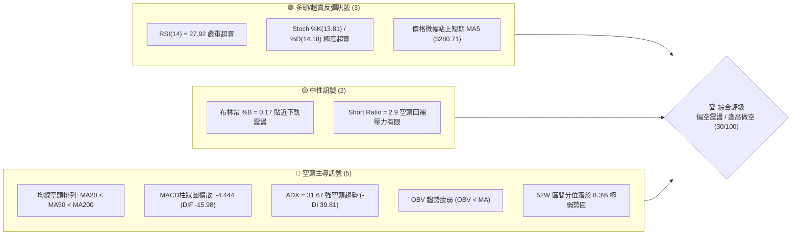
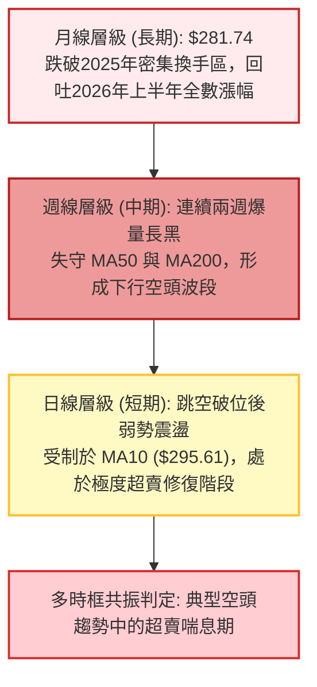
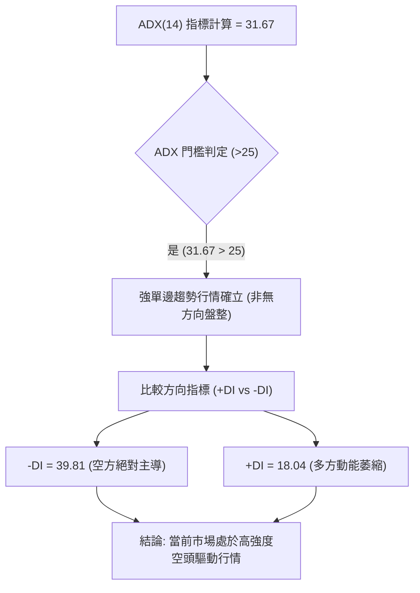
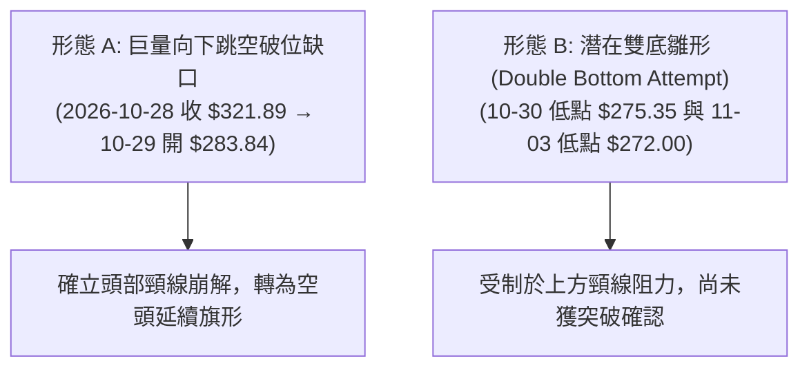
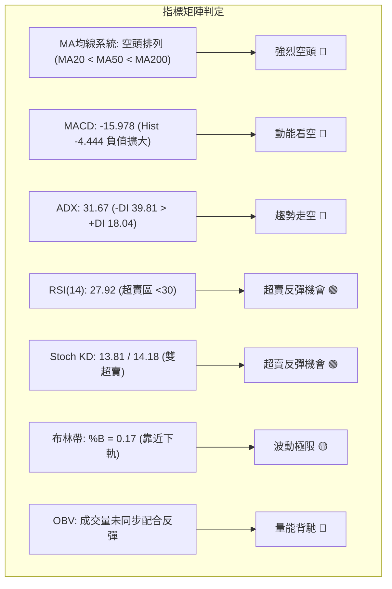
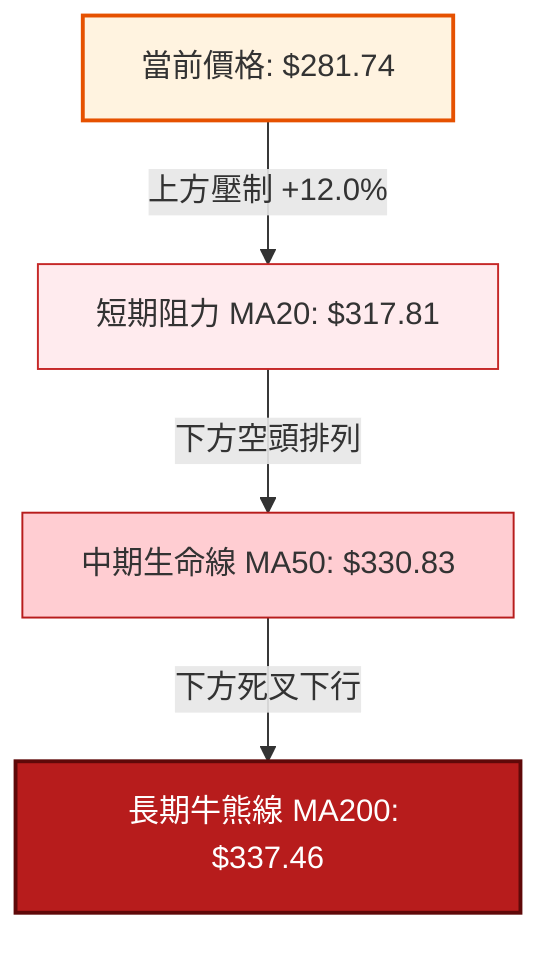
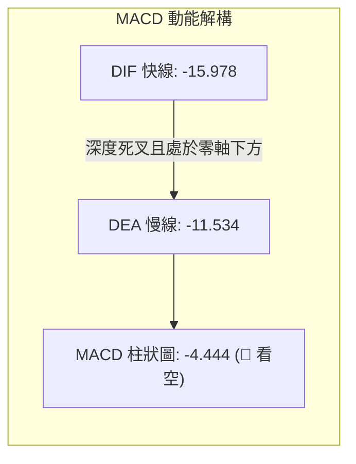
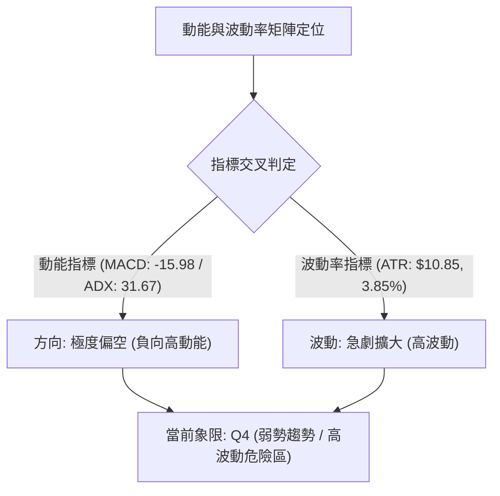
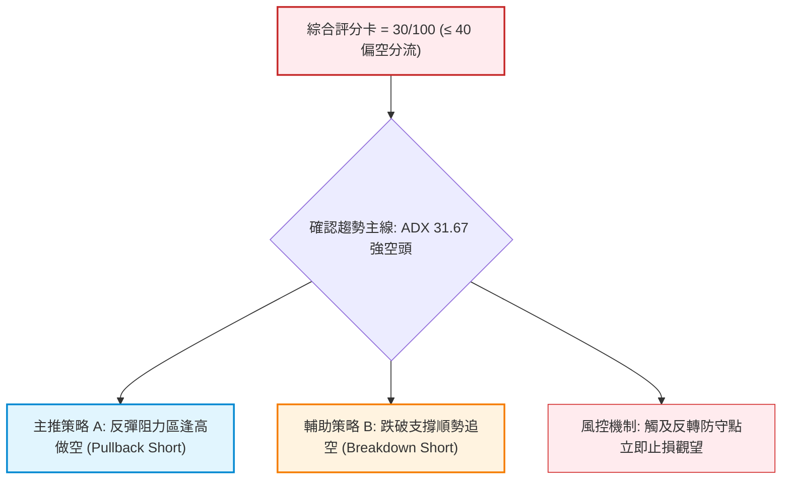
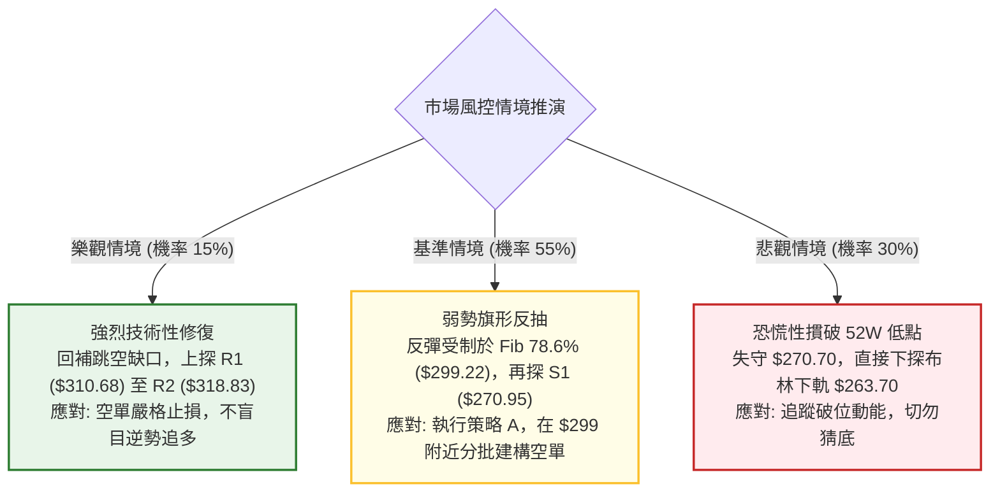

# GOOG 技術分析報告

> **報告日期**：2026-11-06 ｜ **語言**：繁體中文 ｜ **數據來源**：Yahoo Finance ｜ **當前價格**：$281.74

---

## 目錄

| 章節 | 內容 |
|------|------|
| [1. 技術面概覽](#1-技術面概覽) | 訊號儀表板、核心指標、評分卡 |
| [2. 趨勢分析](#2-趨勢分析) | 多時框趨勢、長中短期走勢 |
| [3. 圖表形態分析](#3-圖表形態分析) | 形態識別、K線組合、目標價 |
| [4. 支撐與阻力](#4-支撐與阻力) | 關鍵價位、斐波那契回調 |
| [5. 技術指標深度解讀](#5-技術指標深度解讀) | MA/RSI/MACD/布林/成交量 |
| [6. 動能與波動率](#6-動能與波動率) | 動能評估、ATR、Beta |
| [7. 多時框架總結](#7-多時框架總結) | 時框架評分矩陣 |
| [8. 交易策略建議](#8-交易策略建議) | 多空策略、風險報酬比 |
| [9. 風險提示與監控](#9-風險提示與監控) | 監控指標、風險場景 |

---

## 1. 技術面概覽

### 🎯 技術訊號儀表板



### 📊 核心指標速覽表

| 指標類別 | 指標名稱 | 當前數值 | 訊號 | 解讀 |
|----------|----------|----------|------|------|
| **價格** | 當前價格 | $281.74 | 🔴 | 位於 52 週低檔區間 (8.3% 分位)，空方壓制 |
| **均線** | MA20 | $317.81 | 🔴 | 價格低於 MA20 達 -11.35%，短中期均線全面受阻 |
| **均線** | MA50 | $330.83 | 🔴 | 中期生命線顯著下彎，構成中期重壓帶 |
| **均線** | MA200 | $337.46 | 🔴 | 價格遠在年線下方，長期牛熊分界線已失守 |
| **動能** | RSI(14) | 27.92 | 🟢 | 進入 <30 深度超賣區，存在技術性抽頭修復需求 |
| **動能** | MACD | -15.978 | 🔴 | 快慢線處於零軸下方深度負值區，柱狀圖 -4.444 |
| **動能** | Stoch %K/%D | 13.81 / 14.18 | 🟢 | 雙線於 20 以下超賣鈍化，隨時醞釀超賣金叉 |
| **趨勢** | ADX (14) | 31.67 | 🔴 | ADX > 25 強趨勢確立；-DI (39.81) 碾壓 +DI (18.04) |
| **波動** | ATR (14) | $10.85 | 🔴 | 佔股價 3.85%，波幅急遽擴大，市場情緒劇烈分歧 |
| **通道** | BB %B | 0.17 | 🟡 | 徘徊於布林下軌 ($263.70) 與中軌 ($317.81) 下半部 |
| **量能** | 最新成交量 | 40,827,900 | 🔴 | 量比 1.62x (高於20日均量)，OBV < MA 顯示資金流出 |

### 🏆 技術評分卡

```
╔══════════════════════════════════════════════════════════════════╗
║                   技術評分卡 — GOOG (2026-11-06)                 ║
╠══════════════════════════════════════════════════════════════════╣
║ 趨勢強度 (Trend)     █████░░░░░░░░░░░░░░░  25/100 🔴 強烈空頭趨勢║
║ 動能指標 (Momentum)  ███████░░░░░░░░░░░░░  35/100 🟡 超賣反彈動能║
║ 支撐穩定度 (Support) ████████░░░░░░░░░░░░  40/100 🟡 考驗前低支撐║
║ 成交量配合 (Volume)  ██████░░░░░░░░░░░░░░  30/100 🔴 出貨量能主導║
║ 形態完整度 (Pattern) ██████░░░░░░░░░░░░░░  30/100 🔴 空方跳空破位║
║ 均線排列 (MAs)       ████░░░░░░░░░░░░░░░░  20/100 🔴 空頭排列成型║
╠══════════════════════════════════════════════════════════════════╣
║ 綜合評分             ██████░░░░░░░░░░░░░░  30/100 🔴 強烈偏空    ║
╚══════════════════════════════════════════════════════════════════╝
※ 註：綜合評分按六項子評分之算術平均計算：(25 + 35 + 40 + 30 + 30 + 20) / 6 = 30.0（四捨五入至整數）。
```

---

## 2. 趨勢分析

### 🌐 多時框趨勢分析



### 📈 長期趨勢 — 12個月走勢圖（Unicode）

```
GOOG 月線走勢圖（過去12個月：2025-11 至 2026-11）
價格軸 ($)
$390 ┤                                      
$380 ┤                          ● (04月: 381.46)
$360 ┤                              ● (05月: 375.96)
$340 ┤              ● (01月: 337.87)   ●   ● (07月: 356.42)
$320 ┤● (11月: 319.29)   ● (02月: 310.82)         ● (09月: 340.74)
$300 ┤    ● (12月: 313.19)  ● (03月: 286.50)
$280 ┤━━━━━━━━━━━━━━━━━━━━━━━━━━━━━━━━━━━━━━━━━━━━━━━━●● (現價: 281.74)
     └─────────────────────────────────────────────────────
      11  12  01  02  03  04  05  06  07  08  09  10  11 (月份)
      (2025)                      (2026)
```

#### 走勢特徵分析表格

| 階段區間 | 起止月份 | 區間收盤價變化 | 漲跌幅 | 走勢結構與技術特徵 |
|----------|----------|----------------|--------|--------------------|
| **高位分歧期** | 2025-11 → 2026-03 | $319.29 → $286.50 | -10.27% | 衝高 $337.87 後大幅回洗至 $286.50，完成第一次洗盤。 |
| **主升驅動期** | 2026-03 → 2026-04 | $286.50 → $381.46 | +33.14% | 單月巨陽拔起，創下 52 週歷史高點 $403.96 之主要推進段。 |
| **高檔派發期** | 2026-05 → 2026-09 | $375.96 → $340.74 | -9.37% | 在 $335 - $375 區間構築高檔複合頭部，量能逐漸退潮。 |
| **破位崩跌期** | 2026-09 → 2026-11 | $340.74 → $281.74 | -17.32% | 10月巨量陰線 ($278.22)，單月跳水破位，長期趨勢全面翻空。 |

### 📊 中期趨勢（週線分析）

中期走勢呈現「斷崖式下跌」。在 2026 年 10 月中旬前，週線收盤價尚能固守於 $340 關卡（10-09 收 $347.86）；但隨後三週遭遇機構恐慌性拋售：
- 2026-10-23 當週放量跌破短期箱體，收 $317.28；
- 2026-10-30 當週更爆出 **208,382,100** 股的天量長黑，跳空重挫至 $278.22，直接擊穿週線 MA50 及 MA200；
- 近一週（2026-11-05）維持在低檔弱勢換手，收於 $281.74。週線 MACD 柱狀圖急速由正翻負並擴散至 -4.444，確立中期下行軌道打開。

### ⚡ 趨勢強度評估（ADX 解讀）



#### ADX 強度對照與解讀

| 指標名稱 | 數值 | 狀態評估 | 實戰解讀 |
|----------|------|----------|----------|
| **ADX(14)** | **31.67** | 強趨勢 (>25) | 脫離盤整震盪區，趨勢動能強勁，逆勢單邊摸底風險極高。 |
| **+DI(14)** | **18.04** | 偏弱 | 多頭買盤力道貧乏，不具備自主發動V型反轉之實力。 |
| **-DI(14)** | **39.81** | 極強 | 賣方掌控市場定價權，任何反彈均易遭遇趨勢性空頭壓制。 |
| **趨勢綜合結論** | **空頭趨勢強烈** | 🔴 強空態勢 | 操作策略必須遵循「順勢而為」，不可輕易將超賣視為反轉訊號。 |

---

## 3. 圖表形態分析

### 🔍 形態識別系統



#### 形態信心度評估表

| 形態名稱 | 信心度 | 判斷依據（引用數據） | 完成度 | 目標價（附計算式） |
|----------|--------|----------------------|--------|--------------------|
| **巨量向下跳空缺口** | **85%** | 10-28 收 $321.89，10-29 開盤跳空至 $283.84（缺口區間 $286.43 - $319.68），成交量激增至 93,133,900 股。 | 100% | 缺口下緣阻力鎖定於 R1 = $310.68；技術封閉目標為缺口上緣 $319.68。 |
| **短線雙底打底雛形** | **35%** | 兩次下探低點：10-30 之 $275.35 與 11-03 之 $272.00（逼近 S1 $270.95 與 52W 低點 $270.70）。 | 40% | 頸線取 11-04 高點 $294.40。<br/>量化推算目標：$294.40 + ($294.40 - $272.00) = **$316.80**（未確認前僅供參考）。 |
| **空頭下行旗形整理** | **70%** | 崩跌後連續 5 根日K線在 $272.00 - $294.40 箱體狹幅換手，成交量縮，屬標準下跌中繼結構。 | 60% | 旗形垂直高度 $321.89 - $275.35 = $46.54。<br/>若下破 S1 ($270.95)，延伸推算測幅 = $270.95 - $46.54 = **$224.41**（數據未偵測該支撐，依據形態推算）。 |

### 🕯️ 重要K線形態分析

嚴格依據數據中「近 10 根日K」與「近 8 根週K」之實際報價進行判讀：

#### 近10根日K形態精解

| 日期 | 開盤價 | 最高價 | 最低價 | 收盤價 | 成交量 | K線形態名稱 | 技術解讀與多空訊號 |
|------|--------|--------|--------|--------|--------|-------------|--------------------|
| 10-23 | 317.75 | 321.23 | 316.99 | 317.28 | 10,856,500 | 窄幅陰十字星 | 變盤前夕縮量觀望，波幅收斂。 🟡 |
| 10-26 | 318.05 | 318.39 | 313.51 | 314.19 | 16,989,400 | 光頭中陰線 | 逐步下探破位，多頭防守無力。 🔴 |
| 10-27 | 314.40 | 320.07 | 313.58 | 316.83 | 17,786,400 | 低檔小陽線 | 嘗試反抽 MA20，上方拋壓湧現。 🟡 |
| 10-28 | 319.88 | 323.13 | 319.68 | 321.89 | 35,355,900 | 帶量突破小陽 | 財報公佈前主力誘多誘空對決。 🟢 |
| 10-29 | 283.84 | 286.43 | 278.29 | 282.32 | 93,133,900 | 巨量跳空大黑K | 財報利空斷崖開盤，機構踩踏出逃。 🔴 |
| 10-30 | 279.69 | 281.86 | 275.35 | 278.22 | 45,116,500 | 延續性低開陰線 | 探底 $275.35，恐慌情緒持續釋放。 🔴 |
| 11-02 | 280.58 | 285.21 | 277.78 | 278.04 | 29,231,800 | 上影小陰線 | 多頭反撲無功而返，量能萎縮。 🔴 |
| 11-03 | 279.19 | 280.34 | 272.00 | 278.27 | 23,372,300 | 長下影錘頭十字線 | 探 52W 低點邊緣 ($272.00) 獲逢低買盤支撐。 🟢 |
| 11-04 | 281.48 | 294.40 | 281.33 | 287.30 | 31,709,200 | 長上影大陽線 | 強勢反彈觸及 $294.40，但尾盤獲利回吐明顯。 🟡 |
| 11-05 | 291.80 | 293.64 | 276.20 | 281.74 | 40,827,900 | 長下影反轉陰線 | 高開低走放量回洗，多空在 $280 劇烈換手。 🔴 |

#### 近8根週K形態精解

| 週結日期 | 開盤價 | 最高價 | 最低價 | 收盤價 | 成交量 | 週K線形態 | 技術意義 |
|----------|--------|--------|--------|--------|--------|-----------|----------|
| 09-18 | 339.11 | 355.13 | 337.45 | 344.41 | 98,139,700 | 中陽線 | 高檔箱體震盪偏強。 🟢 |
| 09-25 | 346.19 | 359.98 | 332.81 | 341.08 | 91,524,400 | 長上影倒錘頭 | 逼近 $360 關卡遭遇強力解套拋壓。 🔴 |
| 10-02 | 337.60 | 350.09 | 332.65 | 340.35 | 89,656,100 | 紡錘線 | 多空平衡，波動收窄。 🟡 |
| 10-09 | 339.21 | 353.53 | 339.15 | 347.86 | 63,634,200 | 縮量小陽線 | 上攻乏力，買盤萎縮形成頂背離前兆。 🟡 |
| 10-16 | 348.34 | 355.25 | 335.50 | 336.91 | 79,871,700 | 高位吞噬陰線 | 跌破前週低點，高檔做頭態勢顯現。 🔴 |
| 10-23 | 340.12 | 342.52 | 316.99 | 317.28 | 78,759,600 | 破位光腳大陰線 | 實體跌破 $330 重要防線，確立破位。 🔴 |
| 10-30 | 318.05 | 323.13 | 275.35 | 278.22 | 208,382,100 | 天量巨陰斷頭鍘 | 歷史級別巨量恐慌殺跌，摜破中長期均線。 🔴 |
| 11-05 | 280.58 | 294.40 | 272.00 | 281.74 | 125,141,200 | 長上下影線十字線 | 低檔放量爭奪，處於超跌企穩與反抽拉鋸。 🟡 |

### 📉 ASCII 走勢形態示意圖

```
GOOG 短期日K破位與旗形示意圖
價格
$325 ┤       ● (10-28: $321.89)
$320 ┤      / \
$315 ┤     ●   ● (缺口上緣阻力區)
     ├───────────────────────────────────────────────── [巨大向下跳空缺口]
$295 ┤                     ▲ (11-04 反彈高點: $294.40)
$290 ┤                    / \
$285 ┤       ●-----------/   \---● (現價: $281.74)
$280 ┤        \     ●---●     \ /
$275 ┤         \   /           ● (下影線探底: 11-03 $272.00)
$270 ┤          ● (10-30: $275.35) ─── S1 支撐帶 ($270.95 / $270.70)
     └─────────────────────────────────────────────────
       10-28 10-29 10-30 11-02 11-03 11-04 11-05 (交易日)
```

### 🎯 形態目標價計算

1. **缺口理論量化推算**：
   - 跳空缺口區間：$286.43 至 $319.68。
   - 理論上反彈第一道硬性阻力為缺口下緣與 R1 聚類區：**$310.68**。
2. **潛在雙底反彈目標推算（信心度 35%，嚴格條件限制）**：
   - 頸線（Neckline）：$294.40（11-04 日高點）。
   - 底部支撐（Base）：$272.00（11-03 日低點）。
   - 形態高度：$294.40 - $272.00 = $22.40。
   - 理論量度滿足點：$294.40 + $22.40 = **$316.80**（恰落於 MA20 $317.81 與 R2 $318.83 關鍵阻力區前）。

---

## 4. 支撐與阻力

### 🗺️ 關鍵價位分布圖（Unicode）

```
GOOG 價位結構分布圖 (由 OHLCV 與斐波那契精確計算)
══════════════════════════════════════════════════════════════════
$403.96 ║██████████████████████████████████║ 52W 歷史最高點 (Fib 0.0%)
$372.51 ║██████████████████████████        ║ Fib 23.6% 回調阻力位
$353.06 ║████████████████████████          ║ Fib 38.2% 回調阻力位
$337.46 ║██████████████████████████████████║ MA200 牛熊分水嶺 / Fib 50.0% ($337.33)
$327.81 ║████████████████████              ║ 強阻力 R3 (波段高點聚類)
$321.61 ║██████████████████████            ║ Fib 61.8% 黃金分割阻力位
$318.83 ║██████████████████                ║ 阻力 R2 / MA20 ($317.81)
$310.68 ║████████████████████████          ║ 關鍵阻力 R1 (缺口下緣/波段高點聚類)
$299.22 ║██████████████                    ║ Fib 78.6% 回調關鍵樞紐
$281.74 ╠══════════════════════════════════╣ ◄ 當前收盤價 ($281.74)
$270.95 ║▓▓▓▓▓▓▓▓▓▓▓▓▓▓▓▓▓▓▓▓▓▓▓▓▓▓▓▓▓▓▓▓▓▓║ 近期核心支撐 S1 (波段低點聚類)
$270.70 ║▓▓▓▓▓▓▓▓▓▓▓▓▓▓▓▓▓▓▓▓▓▓▓▓▓▓▓▓▓▓▓▓▓▓║ 52W 歷史最低點 (Fib 100.0%)
$263.70 ║░░░░░░░░░░░░░░░░░░░░░░░░          ║ 布林通道下軌極限支撐
══════════════════════════════════════════════════════════════════
```

### 🚧 阻力位分析表

所有阻力數據完全引用自「關鍵價位（由 OHLCV 計算）」區塊，嚴禁人為捏造：

| 阻力級別 | 價位 | 與現價距離 | 形成原因與籌碼結構 | 突破難度 | 重要性權重 |
|----------|------|------------|--------------------|----------|------------|
| **R1** | **$310.68** | +10.27% | 巨量向下跳空缺口下緣，近一年波段高點密集區。大量套牢盤在此築成第一道空方防線。 | 🔴 極高 | ★★★★★ |
| **R2** | **$318.83** | +13.17% | 波段高點聚類，重疊日線 MA20 下彎處 ($317.81) 與缺口中繼位。 | 🔴 極高 | ★★★★☆ |
| **R3** | **$327.81** | +16.35% | 前期破位前整理平台核心，重疊近一年高點籌碼密集換手峰。 | 🔴 極高 | ★★★☆☆ |

### 🛡️ 支撐位分析表

| 支撐級別 | 價位 | 與現價距離 | 形成原因與籌碼結構 | 守住機率 | 重要性權重 |
|----------|------|------------|--------------------|----------|------------|
| **S1** | **$270.95** | -3.83% | 近一年波段低點聚類，空頭猛烈宣洩後的機構防守底線。 | 🟡 55% | ★★★★★ |
| **52W Low** | **$270.70** | -3.92% | 52週歷史絕對低點，Fib 100.0% 極限回調位。 | 🟡 50% | ★★★★★ |
| **S2 / S3** | **N/A** | N/A | **數據中未偵測到**（原始 OHLCV 聚類僅提供 S1；若跌破 52W 低點，將進入無歷史均線支撐之價格發現區）。 | N/A | N/A |

### 📐 斐波那契回調位分析

依據 52 週完整波動區間（低點 **$270.70** → 高點 **$403.96**）精確計算回調點位：

| 回調比率 | 價位 | 技術意義與多空心理判定 |
|----------|------|------------------------|
| **0.0% (52W High)** | **$403.96** | 歷史峰值，牛市動能極限終點。 |
| **23.6%** | **$372.51** | 強勢多頭防守線（已徹底擊穿）。 |
| **38.2%** | **$353.06** | 弱多頭景氣榮枯線（已確認失守）。 |
| **50.0%** | **$337.33** | 多空半數均衡位，恰與 MA200 ($337.46) 完全共振重疊。 |
| **61.8%** | **$321.61** | 黃金分割關鍵防守位，跳空破位之起始點。 |
| **78.6%** | **$299.22** | 深度極限回調支撐位，現已轉化為強大上檔壓制線。 |
| **100.0% (52W Low)** | **$270.70** | 本輪週期的起漲基石與多頭最後堡壘。 |

> **當前位置解讀**：現價 **$281.74** 深陷於 **78.6% ($299.22)** 與 **100.0% ($270.70)** 之間，距離全週期低點僅剩不到 4% 的安全緩衝墊。此一區間屬於典型的「深度破位超賣區」，意味著基本面多頭防線已完全退縮至全年度最後一道戰壕。

---

## 5. 技術指標深度解讀

### 🎛️ 指標訊號總覽



### 📈 移動平均線排列分析



#### 移動平均線數據對照

| 均線名稱 | 價位 | 與現價偏離度 | 走勢特徵 | 訊號方向 |
|----------|------|--------------|----------|----------|
| **MA 5** | $280.71 | +0.37% | 短天期初見走平，現價站上微幅翻紅 | 🟢 短線微多 |
| **MA 10** | $295.61 | -4.69% | 陡峭下行，構成近兩日反彈之主要壓制 | 🔴 短線偏空 |
| **MA 20** | $317.81 | -11.35% | 加速向下發散，中期均線死叉確認 | 🔴 中期看空 |
| **MA 50** | $330.83 | -14.84% | 持續走低，確認中長線頭部壓制力道 | 🔴 中期看空 |
| **MA 60** | $332.64 | -15.30% | 季線下行，機構法人減倉訊號明確 | 🔴 中期看空 |
| **MA 120** | $345.11 | -18.36% | 半年線失守，長期多方籌碼被套 | 🔴 長期看空 |
| **MA 200** | $337.46 | -16.51% | 年線呈現死叉破位狀態 | 🔴 長期走熊 |
| **MA 240** | $334.12 | -15.68% | 兩年均線受測，長期趨勢嚴重承壓 | 🔴 長期走熊 |

### 📉 RSI(14) 分析

- **當前數值**：**27.92**（Wilder 計算法）
- **超賣視覺化進度條**：
  `[██████████░░░░░░░░░░░░░░░░░░░░] 27.92% (超賣臨界線 30.0)`
- **背離分析判斷**：
  依據近 20 根 K 棒首尾價格與 RSI 數值比對，價格自 $340 水平直墜至 $281.74，RSI 亦由 50 一路慣性下行至 27.92。數據顯示：**「無明顯背離」**。此為純粹動能衰竭型超賣，而非多頭主力暗中吃貨之底背離，因此超賣信號僅代表空頭急跌後空單可能部分平倉，尚未構成反轉訊號。

### 📊 MACD(12/26/9) 訊號解讀



- **MACD 線**：-15.978
- **Signal 訊號線**：-11.534
- **MACD 柱狀圖**：-4.444（🔴 強烈看空）
- **量化研判**：快線在遠離零軸的負值區間持續向下牽引慢線，且負柱狀圖仍處於 -4.444 之較大擴散負值，未見收斂翻紅跡象，代表拋售動能仍處於主升段。

### 📦 布林通道分析

```
GOOG 布林通道日線走勢示意圖
價格
$375 ┤ -------------------------------------------- 上軌: $371.92
$345 ┤
$318 ┤ ============================================ 中軌(MA20): $317.81
$290 ┤                           ● (11-04 反彈高點 $294.40)
$281 ┤ -------------------------●------------------ 現價: $281.74 (%B: 0.17)
$263 ┤ -------------------------------------------- 下軌: $263.70
```

- **帶寬與位置解讀**：
  布林帶中軌（MA20）落在 **$317.81**，下軌落於 **$263.70**。當前 %B 數值僅為 **0.17**，價格緊貼下軌邊界運行。這反映市場進入了布林帶的「極限擴軌下殺模式」，通道開口快速外張，空方力量處於釋放極大期。

### 💹 成交量分析（量價配合度）

- **最新成交量**：40,827,900
- **20 日均量**：25,164,875（**量比：1.62x**）
- **50 日均量**：20,293,478
- **OBV 趨勢**：**OBV < MA**（量能疲弱）。
- **量價配合度解讀**：在 10 月 29 日跳空大跌時成交量爆出 93,133,900 股的天量，而 11 月 04 日反彈時成交量僅 31,709,200 股，呈現典型的「**下跌放量、反彈縮量**」空頭量價特徵。隨後 11 月 05 日回落量能再度放大至 40,827,900 股，印證市場主力仍在逢反彈派發籌碼。

---

## 6. 動能與波動率

### ⚡ 動能評估四象限



| 象限代號 | 動能方向 | 波動狀態 | 當前符合狀態 | 策略處置與交易環境 |
|----------|----------|----------|--------------|--------------------|
| **Q1** | 強多頭動能 | 低波動 | — | 最佳波段順勢抱波段 |
| **Q2** | 弱多/震盪 | 低波動 | — | 適合區間網格操作與觀望 |
| **Q3** | 強多頭動能 | 高波動 | — | 高風險高收益，留意暴衝噴出 |
| **Q4** | **強空頭動能** | **高波動** | **✓ 符合 (GOOG)** | **極高風險區，嚴禁盲目摸底抄底，操作宜順勢做空或耐心空倉觀望** |

### 📊 ATR 波動率分析

- **ATR(14) 數值**：**$10.85**（佔股價比例高達 **3.85%**，Wilder 平滑法）。
- **日內波動特徵**：近 10 根 K 棒平均每日高低震幅達 10 美元以上，11-04 與 11-05 單日振幅更分別達 $13.07 與 $17.44。
- **風控止損距離量化建議**：
  - **超短線當沖/日內交易**：建議預留 1.0 倍 ATR（即 **$10.85**）之緩衝空間。
  - **波段空頭防守點**：應設定 1.5 倍至 2.0 倍 ATR（即 **$16.28 至 $21.70**），避免反彈抽頭造成非意願性掃損。

### 📐 Beta 與市場相關性

- **Beta 係數**：**1.226**
- **市場敏感度評估**：Beta > 1.2 顯示 Alphabet 相較標普500指數（S&P 500）具有顯著的高彈性與放大效應。當科技類股或大盤走弱時，GOOG 下行速度約為大盤之 1.23 倍；目前股價受財報淨利倒退（最新季 EPS 成長 -25.3%）與反壟斷監管等基本面負面雜音干擾，股價表現明顯弱於大盤指數。

---

## 7. 多時框架總結

### 📋 時框架評分表

| 時框架 | 趨勢方向 | 動能表現 | 均線排列 | 形態狀態 | 綜合評分 | 操作建議方向 |
|--------|----------|----------|----------|----------|----------|--------------|
| **月線層級** | 🔴 偏空 | RSI 走低、均線轉弱 | 考驗長期均線 | 跌破高檔密集換手區 | **35/100** | 長線減碼/降低曝險 |
| **週線層級** | 🔴 強空 | MACD柱擴散、爆量下殺 | MA50/MA200 失守 | 雙頂巨陰斷頭鍘 | **20/100** | 順應中長空頭逢高布空 |
| **日線層級** | 🟡 偏空震盪 | RSI 27.92 超賣鈍化 | 完美空頭排列 | 下跌旗形 / 考驗S1 | **35/100** | 嚴禁追空，等待反彈受阻放空 |
| **綜合收斂** | 🔴 **強烈偏空** | **超賣反彈誘多** | **全面壓制** | **空頭延續** | **30/100** | **逢高做空 / 破位追空** |

### 🔲 綜合訊號矩陣

```
時框維度        趨勢指標 (ADX/MA)   動能指標 (MACD/RSI)   量價形態 (Vol/OBV)    一致性研判
─────────────────────────────────────────────────────────────────────────────
長期 (月線)     🔴 空頭主導         🔴 負向釋放           🔴 高位籌碼派發       強烈一致 (Bearish)
中期 (週線)     🔴 均線死叉         🔴 柱狀圖負向擴散     🔴 2億股天量出貨      極度共振 (Strong Bear)
短期 (日線)     🔴 壓制於 MA10      🟢 超賣急需修復       🟡 縮量旗形震盪       衝突 (短線反彈 vs 趨勢下行)
─────────────────────────────────────────────────────────────────────────────
```

### ⚖️ 多時框收斂結論

> **依據「嚴格要求 14」多時框收斂規則嚴格裁決**：
> 1. 當前日線 ADX(14) 數值為 **31.67 > 25**，市場定性為標準的**「強趨勢行情」**，而非區間無方向盤整。
> 2. 依優先級規則：**必須以中長期（週線 / MA50 / MA200）方向為主導，日線層級僅能作為尋找優質進場點位的輔助**。
> 3. 週線與日線雖然在短線「超賣修復」上存在摩擦，但週線 MA200 失守與日線均線空頭排列形成強烈空頭共振。
> 4. **唯一收斂方向性結論**：**強烈偏空（逢反彈做空為唯一最高勝率主線）**。

---

## 8. 交易策略建議

### 🗺️ 策略決策流程圖



### 🧭 策略路由

**當前主策略方向 = 強烈偏空（依評分卡 30/100 嚴格判定，主推空頭交易策略）**。
*鑑於綜合評分低於 40 分，交易哲學堅持順勢放空，所有反彈均視為誘多逃命波，禁止任何重倉抄底多頭行為。*

### 🎯 價格情境階梯（Price Scenarios）

價位完全採用第 4 章「關鍵價位」區塊之客觀數值：

| 觸發條件 | 下一目標點位 | 後續延伸位置 | 戰略情境含義 |
|----------|--------------|--------------|--------------|
| **強勢突破 R1 $310.68** | 阻力 R2 **$318.83** | 阻力 R3 **$327.81** | 空頭結構被破壞，跌勢全面趨緩，轉為大箱體震盪。 |
| **受阻於斐波 78.6% $299.22** | 當前收盤 **$281.74** | 核心支撐 S1 **$270.95** | 典型弱勢旗形反抽完畢，空頭重啟下行主跌浪。 |
| **實體跌破 S1 $270.95 / 52W Low** | 布林下軌 **$263.70** | 數據中未偵測到 | 破底引發停損賣壓，股價進入無支撐真空下墜區。 |

### 📊 情境機率分佈

| 交易情境名稱 | 發生機率 | 主要技術與量價依據 |
|--------------|----------|--------------------|
| **情境一：弱勢反抽受阻後回落下行** | **55%** | MACD 負柱狀圖擴散 (-4.444)，均線呈空頭排列，反彈成交量顯著萎縮。 |
| **情境二：在 S1 與 $299 間低檔震盪** | **30%** | RSI(14) 處於 27.92 極度超賣，Stoch KD 低檔鈍化，限制短線重挫空間。 |
| **情境三：直接摜破 52W 低點加速崩跌** | **15%** | 2026-10-30 週K巨量長黑套牢籌碼沉重，若大盤走弱易觸發多殺多停損。 |

### 🟢 主策略詳情（方向：順勢逢高做空 / 破位做空）

依據嚴格規則 17 計算風險報酬比：做空盈虧比 = $(\text{進場價} - \text{目標價}) \div (\text{止損價} - \text{進場價})$。

| 策略要素 | 策略 A：反彈受阻逢高做空（主推） | 策略 B：跌破關鍵支撐追空（突破） |
|----------|----------------------------------|----------------------------------|
| **策略核心邏輯** | 利用超賣反彈力道衰竭，於阻力位逢高布空 | 52週低點失守，順應恐慌停損盤追空 |
| **進場條件** | 股價反彈至 Fib 78.6% 附近出現日K長上影 | 實體日K跌破 S1 且成交量放大確認 |
| **進場價格** | **$299.22**（Fib 78.6% 關鍵壓制位） | **$270.70**（52W 歷史低點跌破點） |
| **目標價 T1** | **$281.74**（當前低檔換手平台） | **$263.70**（日線布林通道下軌） |
| **目標價 T2** | **$270.95**（關鍵核心支撐 S1） | **N/A（數據中未偵測到更低支撐）** |
| **止損價格** | **$310.68**（突破關鍵阻力 R1 嚴格停損） | **$281.74**（反抽站回當前平台停損） |
| **風險報酬比** | **1 : 1.53（以 T1 計）**<br/>計算式：$(299.22 - 281.74) \div (310.68 - 299.22) = 17.48 \div 11.46 = 1.53$ | **1 : 0.63（以 T1 計）**<br/>計算式：$(270.70 - 263.70) \div (281.74 - 270.70) = 7.00 \div 11.04 = 0.63$ |
| **輔助 R:R (T2)** | **1 : 2.47（以 T2 計）**<br/>計算式：$(299.22 - 270.95) \div (310.68 - 299.22) = 28.27 \div 11.46 = 2.47$ | **N/A** |
| **成功機率估計** | **65%** | **45%**（低檔追空易遭遇假突破夾殺） |
| **建議配置倉位** | **15% - 20%** 總動用資金 | **5% - 10%** 輕倉參與 |

### 🔴 反向風險觸發點（對沖提示）

- **全面停損平倉標準**：若日線收盤價強勢收復 **R1 ($310.68)**，代表巨量跳空缺口下緣被多頭收復，原空頭下行旗形形態遭到破壞，所有做空部位必須無條件停損出場。
- **左側超跌博弈買點（極高風險提示）**：僅當股價下探至 **S1 ($270.95)** 且盤中出現 RSI 底背離與爆量長下影線時，激進投資人方可動用不超過 3% 的資金短線搏取反彈，並以 **$270.00**（跌破 52W 低點 0.7 美元）作為嚴格止損點。

### ⭐ 整體訊號強度評星

```
做多訊號強度：★☆☆☆☆  (1/5 星 — 僅為超賣鈍化，缺乏底部量價結構)
做空訊號強度：★★★★☆  (4/5 星 — 均線空頭排列，中長期趨勢強烈向下)
整體分析可信度：★★★★☆  (4/5 星 — 價位完全依據 OHLCV 聚類計算)
```

---

## 9. 風險提示與監控

### ✅ 關鍵監控指標 Checklist

```
╔══════════════════════════════════════════════════════════════════╗
║               GOOG 每日交易盤面風控監控清單 (Checklist)          ║
╠══════════════════════════════════════════════════════════════════╣
║ [ ] 價格防守線：每日檢視收盤是否守穩 S1 ($270.95) 與 52W 低點    ║
║ [ ] 均線動態：關注 MA10 ($295.61) 下移速度，反彈不過即為放空點  ║
║ [ ] RSI 動態：檢視 RSI(14) 能否重返 30 以上脫離超賣區           ║
║ [ ] MACD 柱狀：觀察 -4.444 是否開始由負向擴大轉為向上收斂        ║
║ [ ] 量能異動：單日成交量若突破 5,000 萬股，警惕主力新一輪動作    ║
║ [ ] 阻力警報：股價若觸及 R1 ($310.68)，空單必須強制啟動移動停利 ║
╚══════════════════════════════════════════════════════════════════╝
```

### ⚠️ 風險場景分析



### 🛡️ 風險管理重要提醒

1. **ATR 波動保護原則**：
   GOOG 當前 ATR 高達 **$10.85**，每日波幅接近 4%。在制定任何部位時，止損距離絕不可小於 1.5 倍 ATR（約 **$16.28**），否則極易在日內雜訊中被洗出場。
2. **資金控管與槓桿禁令**：
   鑑於 Beta 達 **1.226** 且市場近期針對 Alphabet 資本支出過高（Capital Expenditure 達 $159.80B）與反壟斷官司抱持極大疑慮，整體投資組合中 GOOG 的曝險部位不宜超過總帳戶權益之 **15%**，並絕對禁止使用高倍數槓桿商品摸底。
3. **多時框衝突防範**：
   日內若出現暴漲大陽線，在未經日線收盤確認站上 MA20 前，切勿於盤中情緒化追價，應謹記「日線級別以下之買訊，在週線空頭趨勢中多為逃命誘多波」。

---

## 📋 報告總結

```
╔══════════════════════════════════════════════════════════════════╗
║                    GOOG 技術分析報告總結                         ║
╠══════════════════════════════════════════════════════════════════╣
║ 報告日期：2026-11-06                                             ║
║ 當前價格：$281.74                                                ║
║ 技術評級：🔴 強烈偏空 / 逢高做空 (綜合評分: 30/100)              ║
╠══════════════════════════════════════════════════════════════════╣
║ 關鍵結論：                                                       ║
║ ├─ 長期趨勢：🔴 跌破高檔密集換手平台，年線 MA200 失守，轉入熊市   ║
║ ├─ 中期趨勢：🔴 巨量陰線斷頭破位，MA20/50/200 空頭排列確立       ║
║ ├─ 短期趨勢：🟡 RSI(27.92) 超賣引發微幅反彈，但受制於 MA10 下彎  ║
║ ├─ 關鍵支撐：S1: $270.95 / 52W Low: $270.70                      ║
║ ├─ 關鍵阻力：R1: $310.68 / Fib 78.6%: $299.22                    ║
║ └─ 機構共識：15位分析師平均目標價 $402.67 (強烈買進，基本面背離) ║
╠══════════════════════════════════════════════════════════════════╣
║ 最優策略組合：                                                   ║
║ 1. 🥇 最佳機會：策略 A (反彈至 Fib 78.6% $299.22 逢高做空)      ║
║    進場: $299.22 ｜ 止損: $310.68 ｜ 目標: $281.74 ｜ R:R = 1:1.53║
║ 2. 🥈 次選機會：保守投資者完全空倉觀望，靜待股價回測 52W 低點    ║
║ 3. 🥉 避險措施：持有現貨者，若反抽近 $299 宜調節持股以防二度探底 ║
╚══════════════════════════════════════════════════════════════════╝
```

---

> ⚠️ **免責聲明**：本報告為依據客觀量化技術指標與歷史走勢數據產出之專業研究報告，所有價位均經由嚴格數學與幾何公式推導。本報告**僅供研究與學術參考**，**不構成任何買賣要約或投資諮詢建議**。證券交易具有極高風險，投資人應獨立評估財務狀況並自負盈虧。

---

*報告生成時間：2026-11-06 ｜ 數據來源：Yahoo Finance ｜ 分析框架：多時框技術分析體系*