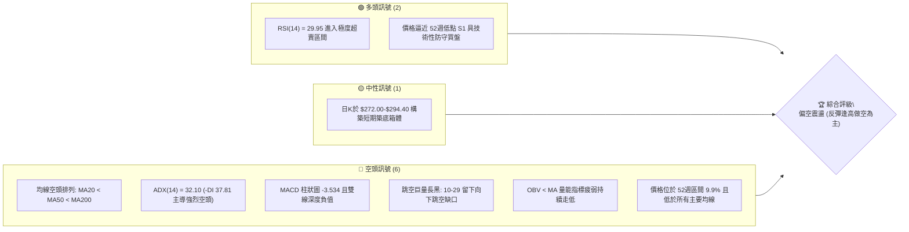
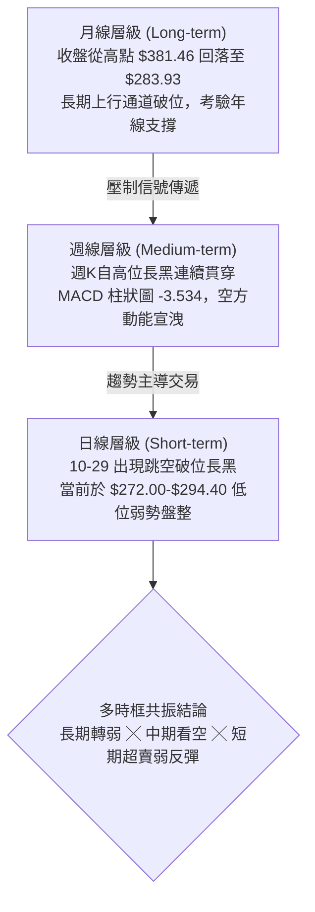
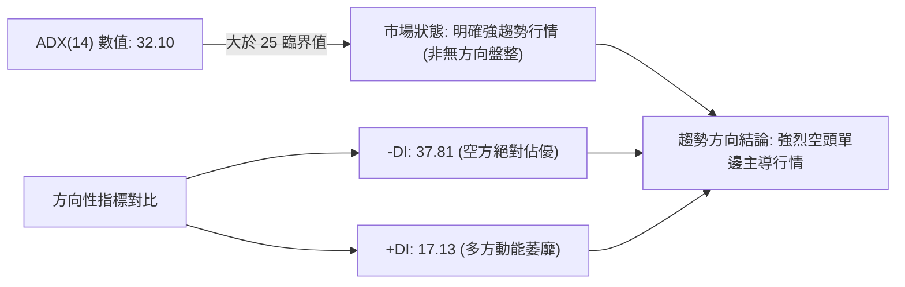
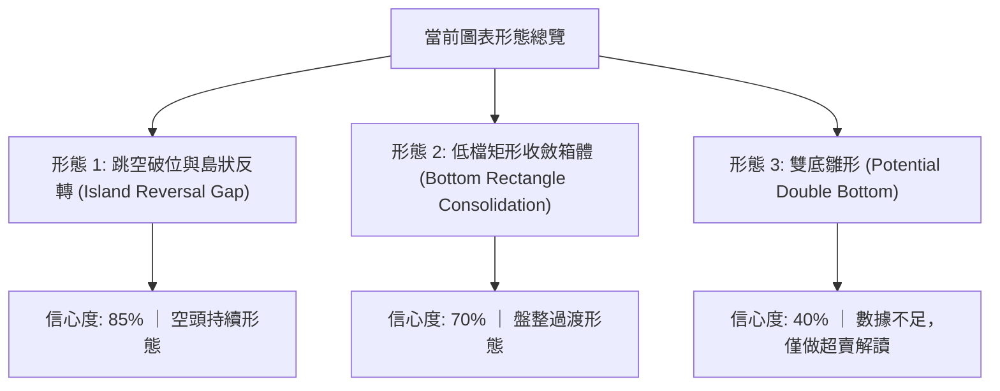
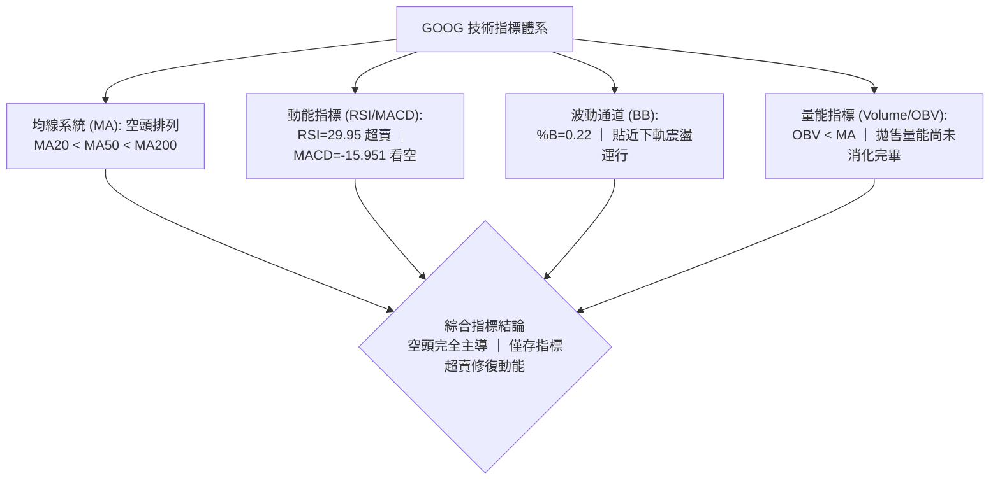
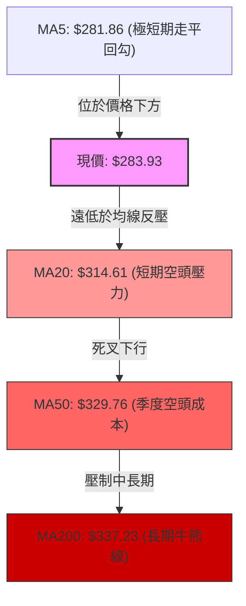
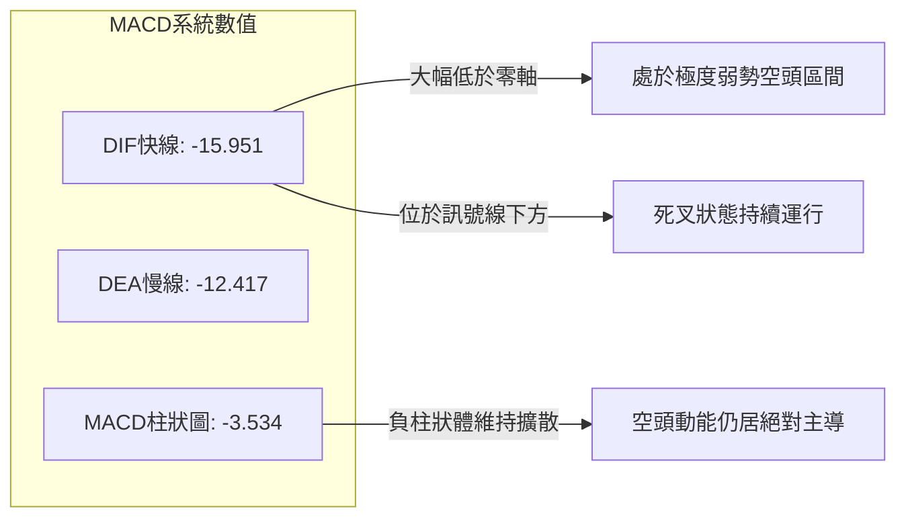
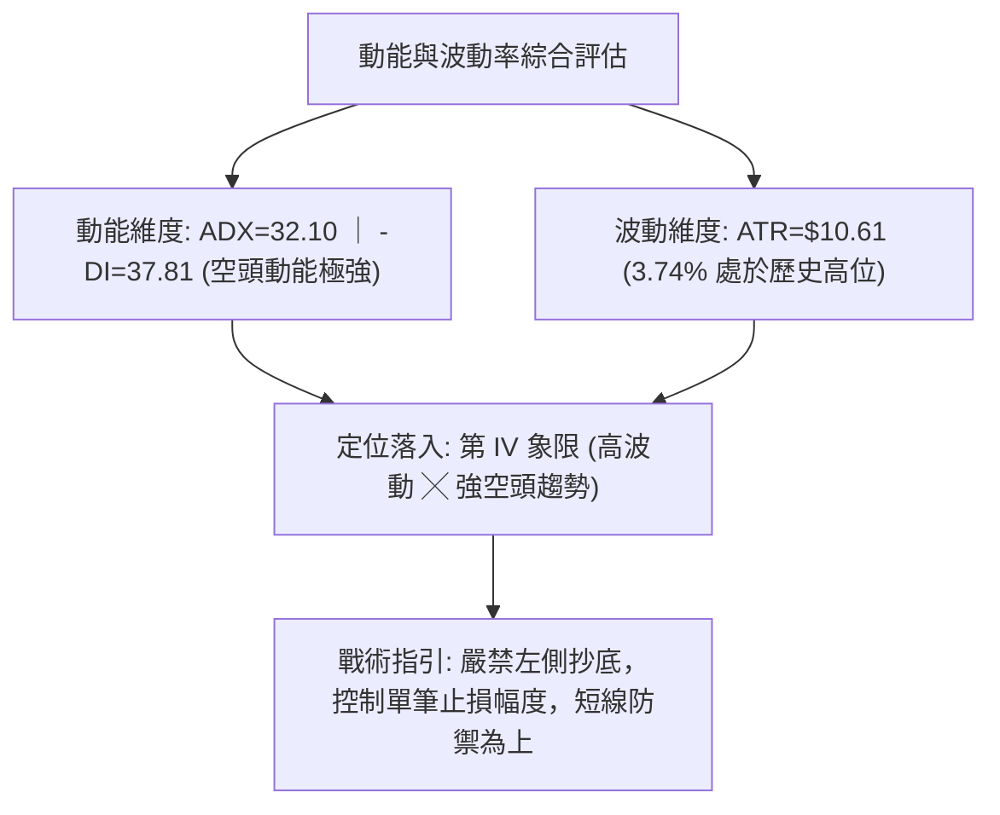
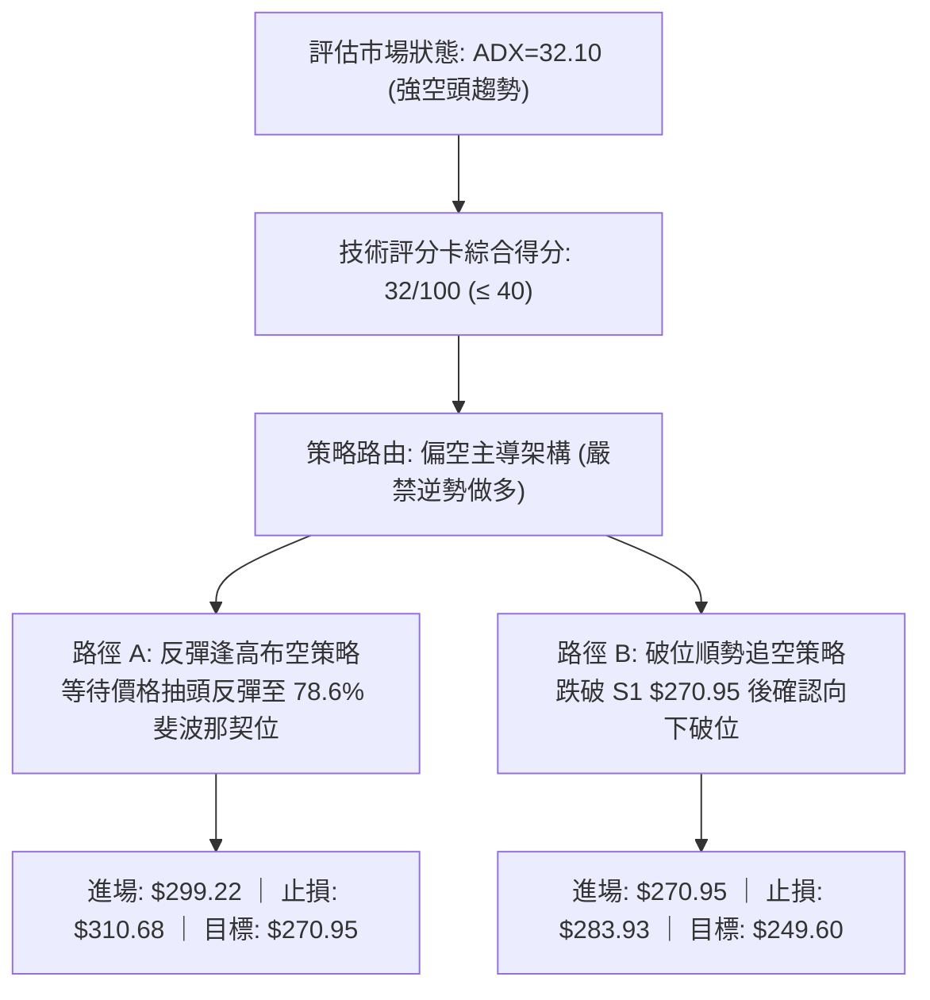
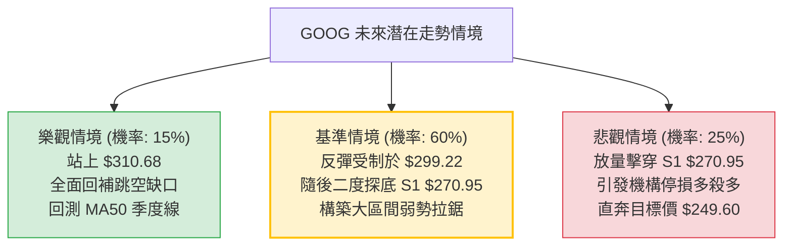

# GOOG 技術分析報告

> **報告日期**：2026-11-07 ｜ **語言**：繁體中文 ｜ **數據來源**：Yahoo Finance ｜ **當前價格**：$283.93

---

## 目錄

| 章節 | 內容 |
|------|------|
| [1. 技術面概覽](#1-技術面概覽) | 訊號儀表板、核心指標、評分卡 |
| [2. 趨勢分析](#2-趨勢分析) | 多時框趨勢、長中短期走勢、12個月歷史走勢圖 |
| [3. 圖表形態分析](#3-圖表形態分析) | 形態識別、信心度評估、近10日/8週K線分析、目標價推算 |
| [4. 支撐與阻力](#4-支撐與阻力) | 結構分布圖、波段阻力與支撐表、斐波那契回調 |
| [5. 技術指標深度解讀](#5-技術指標深度解讀) | 均線系統、RSI背離檢測、MACD動能、布林通道、OBV量價關係 |
| [6. 動能與波動率](#6-動能與波動率) | 動能四象限定位、ATR止損模型、Beta市場敏感度 |
| [7. 多時框架總結](#7-多時框架總結) | 時框架矩陣、訊號一致性檢驗、收斂唯一結論 |
| [8. 交易策略建議](#8-交易策略建議) | 決策流程、策略路由、精確情境階梯、主空頭策略與風控 |
| [9. 風險提示與監控](#9-風險提示與監控) | 關鍵指標清單、極端風險場景、部位管理紀律 |

---

## 1. 技術面概覽

### 🎯 技術訊號儀表板



### 📊 核心指標速覽表

| 指標類別 | 指標名稱 | 當前數值 | 訊號 | 解讀 |
|:---|:---|:---|:---:|:---|
| **價格定位** | 當前收盤價 | $283.93 | 🔴 | 位於 52週高低區間 9.9%，深陷歷史波段低位區 |
| **短期均線** | MA5 | $281.86 | 🟢 | 價格短暫收復 5日均線（+0.74%），出現極短線止跌跡象 |
| **中期均線** | MA20 | $314.61 | 🔴 | 現價低於 MA20 達 -9.75%，中期下行斜率陡峭 |
| **季度均線** | MA50 | $329.76 | 🔴 | 季度趨勢線遭放量擊穿，成為中期反彈重大壓制位 |
| **長期均線** | MA200 | $337.23 | 🔴 | 跌破牛熊分界線，長期技術結構轉為防守結構 |
| **動能指標** | RSI(14) | 29.95 | 🟢 | 觸及 30 以下極度超賣閾值，隨時存在技術性抽頭反彈 |
| **趨勢動能** | MACD (12/26/9)| -15.951 | 🔴 | MACD線(-15.951)低於訊號線(-12.417)，Hist -3.534 看空 |
| **隨機指標** | Stoch %K / %D | 17.29 / 17.20 | 🟢 | 雙線於 20 以下超賣鈍化，存在短期金叉預期 |
| **趨勢強度** | ADX(14) | 32.10 | 🔴 | ADX > 25 且 -DI(37.81) 遠高於 +DI(17.13)，空頭單邊主導 |
| **通道通道** | Bollinger %B | 0.22 | 🟡 | 位於下軌($260.42)與中軌($314.61)之間，貼近低位震盪 |
| **波動幅度** | ATR(14) | $10.61 | 🔴 | 日均波動達 3.74%，跳空後波動率處於高位水平 |
| **籌碼能量** | OBV 趨勢 | OBV < MA | 🔴 | 能量潮指標低於移動平均線，資金外流主導，量價背離疲弱 |

### 🏆 技術評分卡

```
╔══════════════════════════════════════════════════════════════════╗
║                 技術評分卡 — GOOG (2026-11-07)                   ║
╠══════════════════════════════════════════════════════════════════╣
║ 趨勢強度 (Trend Strength)   █████░░░░░░░░░░░░░░░   25/100  🔴   ║
║ 動能指標 (Momentum Indicators) ███████░░░░░░░░░░░░░   35/100  🔴   ║
║ 支撐穩定度 (Support Stability)  █████████░░░░░░░░░░░   45/100  🟡   ║
║ 成交量配合 (Volume Profile)    ██████░░░░░░░░░░░░░░   30/100  🔴   ║
║ 形態完整度 (Pattern Structure) ███████░░░░░░░░░░░░░   35/100  🔴   ║
║ 均線排列 (Moving Averages)   ████░░░░░░░░░░░░░░░░   22/100  🔴   ║
╠══════════════════════════════════════════════════════════════════╣
║ 綜合評分 (Overall Score)    ██████░░░░░░░░░░░░░░   32/100  🔴   ║
║ 評級結論：偏空 (Bearish) — 建議採取反彈逢高布空或跌破順勢策略     ║
╚══════════════════════════════════════════════════════════════════╝
```

> **綜合評分計算說明**：依據規則 18，綜合評分 = (25 + 35 + 45 + 30 + 35 + 22) ÷ 6 = 192 ÷ 6 = **32/100**。因綜合評分 ≤ 40，本報告交易策略完全遵循「偏空路由」，主推空頭交易策略，多頭僅列為短線反彈之風險警示。

---

## 2. 趨勢分析

### 🌐 多時框趨勢分析



### 📈 長期趨勢 — 12個月走勢圖（Unicode）

依據月度收盤數據，繪製過去 12 個月（2025-12 至 2026-11）的價格軌跡：

```
GOOG 月線收盤走勢圖（過去12個月：2025-12 至 2026-11）
價格軸 ($)
$385 ┤                            ● $381.46 (2026-04 波段頂部)
$370 ┤                               ● $375.96
$355 ┤                                     ● $353.10  ● $356.42
$340 ┤             ● $337.87                               ● $340.74
$325 ┤                                                 ● $335.19
$310 ┤ ● $313.19         ● $310.82
$295 ┤
$280 ┤                   ● $286.50                         ● $278.22 ──● $283.93 (現價)
$265 ┤
     └─┬─────────┬─────────┬─────────┬─────────┬─────────┬─────────┬─────────┬─────────┬─────────┬─────────┬─────────┬──
     25-12     26-01     26-02     26-03     26-04     26-05     26-06     26-07     26-08     26-09     26-10     26-11
```

#### 月度走勢特徵分析表

| 階段區間 | 起止月份 | 收盤起止價 ($) | 漲跌幅 (%) | 階段特徵與結構演變 |
|:---|:---:|:---:|:---:|:---|
| **第一階段：高檔震盪** | 2025-12 → 2026-03 | 313.19 → 286.50 | -8.52% | 衝高 $337.87 後快速回踩，形成寬幅拉鋸整理 |
| **第二階段：主升衝頂** | 2026-03 → 2026-04 | 286.50 → 381.46 | +33.14% | 單月大漲近百點創下歷史新高，成交量能顯著放大 |
| **第三階段：高位派發** | 2026-04 → 2026-09 | 381.46 → 340.74 | -10.67% | 於 $340-$375 區間構築巨型頭部，籌碼持續由多轉空 |
| **第四階段：破位暴跌** | 2026-09 → 2026-10 | 340.74 → 278.22 | -18.35% | 跳空貫穿多重均線與關鍵防線，單月跌幅創兩年之最 |
| **第五階段：超賣修復** | 2026-10 → 2026-11 | 278.22 → 283.93 | +2.05% | 逼近 52週低點 $270.70，出現極度超賣後的窄幅抵抗 |

### 📊 中期趨勢（週線分析）

從近 8 週的收盤軌跡觀察，GOOG 在 2026-10-09 當週達到次高點收盤 $347.86 後，連續四週遭遇巨量拋壓：
1. **破位確認**：2026-10-23 當週放量跌破 MA20（收盤 $317.28），隨後 2026-10-30 當週爆出 **208,382,100** 股的巨幅拋售量，週收盤重挫至 $278.22。
2. **中期支撐結構**：週線級別的關鍵波段低點支撐集中於 S1 **$270.95** 與 52週低點 **$270.70**。目前現價 $283.93 僅高於該防線 4.8%，中期趨勢處於脆弱的單邊尋底過程中。

```
週線級別關鍵結構示意圖：
$359.98 ─────────────── 近期週線反彈最高點 (2026-09-25 週高)
   │
$347.86 ─────────────── 破位前週線收盤頸線 (2026-10-09)
   │   [空頭巨量下殺：週成交量達 2.08 億股]
   ▼
$310.68 ─────────────── 中期第一阻力位 R1 (波段高點聚類)
   │
$283.93 ◄────────────── 現價位置 (弱勢反彈震盪中)
   │
$270.95 ─────────────── 中期關鍵支撐位 S1 (波段低點聚類)
$270.70 ─────────────── 52週絕對低點 (100.0% 斐波那契回調位)
```

### ⚡ 趨勢強度評估（ADX 解讀）



#### ADX 趨勢強度量化對照表

| 指標變數 | 當前讀數 | 標準區間定義 | 當前市場狀態判定 | 交易架構指導意義 |
|:---|:---:|:---:|:---:|:---|
| **ADX(14)** | **32.10** | 25 – 50：強趨勢 | 🔴 **強趨勢建立** | 嚴禁逆勢摸底，主導策略以順勢放空或尋找反彈衰竭點為主 |
| **+DI** | **17.13** | < 20：多頭動能微弱 | 🔴 **多方失去定價權** | 多頭上攻缺乏持續性買盤，僅能構成技術性超跌抽腳 |
| **-DI** | **37.81** | > 35：極度空頭強勢 | 🔴 **空方完全主導市場** | 任何反彈遇到阻力均容易引發新一輪順勢拋盤 |
| **DI 差值** | **-20.68** | 擴大負值：單邊走勢 | 🔴 **空頭能量持續擴散** | 波動率溢價攀升，空頭防守位明確且不易輕易被突破 |

---

## 3. 圖表形態分析

### 🔍 形態識別系統



#### 形態量化信心度與目標價評估表

| 形態名稱 | 信心度 | 判定依據（嚴格引用數據） | 完成度 | 形態目標價推算式與目標價 |
|:---|:---:|:---|:---:|:---|
| **跳空向下破位形態** | **85%** | 2026-10-28 低點 $319.68 與 10-29 高點 $286.43 間留下 **$33.25** 巨幅未補缺口，伴隨 93,133,900 股放量 | 90% | 由缺口突破點推算等幅下行：突破點 $286.43 − 缺口高低差 $33.25 = **$253.18**（已接近第一波滿足區） |
| **低檔矩形整理箱體** | **70%** | 近 6 根日K線實體均被封閉在 $272.00（11-03 低點）至 $294.40（11-04 高點）之間，波幅 $22.40 | 60% | 箱體震盪區間為 $272.00 – $294.40；若跌破箱底 $272.00，測幅目標 = $272.00 − $22.40 = **$249.60** |
| **潛在雙底結構** | **40%** | 兩次下探低點分別為 10-30 低點 $275.35 與 11-03 低點 $272.00，但未突破頸線 $294.40 | 25% | **訊號不足（信心度 < 50%）**：未突破頸線前嚴禁視為反轉，依規則 15 僅作短線指標型超賣解讀 |

### 🕯️ 重要K線形態分析

嚴格依據數據中「近 10 根日K」與「近 8 根週K」之精確 OHLCV 進行解讀：

#### 近 10 根日K 形態解構表

| 日期 (日K) | 開盤價 ($) | 最高價 ($) | 最低價 ($) | 收盤價 ($) | 成交量 (股) | 識別K線形態 | 專業解讀 | 訊號 |
|:---:|:---:|:---:|:---:|:---:|:---:|:---|:---|:---:|
| 2026-10-26 | 318.05 | 318.39 | 313.51 | 314.19 | 16,989,400 | 短黑實體線 | 高檔承壓收低，跌破 315 支撐關卡 | 🔴 |
| 2026-10-27 | 314.40 | 320.07 | 313.58 | 316.83 | 17,786,400 | 小陽反彈線 | 縮量小幅抵抗，受制於 320 阻力 | 🟡 |
| 2026-10-28 | 319.88 | 323.13 | 319.68 | 321.89 | 35,355,900 | 衝高小陽線 | 財報前多頭誘多衝高，成交量放大至 35M | 🟡 |
| 2026-10-29 | 283.84 | 286.43 | 278.29 | 282.32 | 93,133,900 | **崩跌跳空長黑** | 巨幅跳空低開 36 點，爆量 93M 恐慌拋售，空頭主導 | 🔴 |
| 2026-10-30 | 279.69 | 281.86 | 275.35 | 278.22 | 45,116,500 | 續跌實體陰線 | 空頭慣性下殺破 278，創階段新低收盤 | 🔴 |
| 2026-11-02 | 280.58 | 285.21 | 277.78 | 278.04 | 29,231,800 | 衝高回落黑K | 上影線長達 $7.17，多方反撲迅速遭遇空頭打壓 | 🔴 |
| 2026-11-03 | 279.19 | 280.34 | 272.00 | 278.27 | 23,372,300 | **長下影錘頭線** | 下探 52週低點附近($272.00)獲低接買盤支撐，下影線 $6.27 | 🟢 |
| 2026-11-04 | 281.48 | 294.40 | 281.33 | 287.30 | 31,709,200 | **實體長陽反彈** | 伴隨 31M 量能反彈，突破 5日均線，多頭展開自救 | 🟢 |
| 2026-11-05 | 291.80 | 293.64 | 276.20 | 281.74 | 41,149,900 | **高開低走大陰線**| 開盤直撲 294 未果，放量 41M 暴跌收黑，多頭遭到迎頭痛擊 | 🔴 |
| 2026-11-06 | 283.42 | 289.22 | 283.00 | 283.93 | 23,904,918 | 窄幅十字紡錘線 | 量能萎縮至 23.9M，多空於 283-289 暫時平衡觀望 | 🟡 |

#### 近 8 根週K 形態解構表

| 週末日期 | 開盤價 ($) | 最高價 ($) | 最低價 ($) | 收盤價 ($) | 成交量 (股) | 週K形態結構 | 趨勢涵義 | 訊號 |
|:---:|:---:|:---:|:---:|:---:|:---:|:---|:---|:---:|
| 2026-09-18 | 339.11 | 355.13 | 337.45 | 344.41 | 98,139,700 | 帶長上影長陽週K | 衝擊 355 高位承壓，顯示高檔套牢盤沉重 | 🟡 |
| 2026-09-25 | 346.19 | 359.98 | 332.81 | 341.08 | 91,524,400 | 假突破倒錘頭線 | 創波段新高 359.98 後大幅回吐，見頂徵兆 | 🔴 |
| 2026-10-02 | 337.60 | 350.09 | 332.65 | 340.35 | 89,656,100 | 高位震盪十字星 | 多空拉鋸，均線支撐開始鬆動 | 🟡 |
| 2026-10-09 | 339.21 | 353.53 | 339.15 | 347.86 | 63,634,200 | 縮量誘多陽線 | 上漲縮量至 63M，量價頂背離嚴重 | 🟡 |
| 2026-10-16 | 348.34 | 355.25 | 335.50 | 336.91 | 79,871,700 | 長黑實體吞噬線 | 跌破前週低點，確立短期派發結構 | 🔴 |
| 2026-10-23 | 340.12 | 342.52 | 316.99 | 317.28 | 78,759,600 | 破位光腳大黑K | 擊穿 MA20 關鍵頸線，空頭加速開展 | 🔴 |
| 2026-10-30 | 318.05 | 323.13 | 275.35 | 278.22 | 208,382,100 | **爆量斷頭破位黑K**| 單週重挫 12.3%，創紀錄爆量 2.08 億股，結構徹底破裂 | 🔴 |
| 2026-11-06 | 280.58 | 294.40 | 272.00 | 283.93 | 149,368,118 | 低檔長下影陽十字星 | 放量 1.49 億股於 272.00 處獲得承接，展開超跌整理 | 🟢 |

### 📉 ASCII 走勢形態示意圖

```
GOOG 近期日K線跳空破位與底部震盪形態示意圖
價格軸 ($)
$325 ┤               [10-28 高點 $323.13]
$320 ┤          ●─────●─────●
$315 ┤         /             \
$310 ┤        /               \
$305 ┤       /                 \
$300 ┤      /                   \
$295 ┤     /                     \   [11-04 反彈高點 $294.40]
$290 ┤    /                       \        ▲
$285 ┤───┘  ═══════════════════════   / ─── \ ──────● $283.93 (現價收盤)
$280 ┤     ░░ 巨大向下跳空缺口 ░░     /       \     /
$275 ┤     ░░  ($33.25 缺口)  ░░    /         \   /
$270 ┤     ═══════════════════════   ●───────────●  [11-03 低點 $272.00 / S1 $270.95]
     └────────────────────────────────────────────────────────
      10-26  10-27  10-28  10-29  10-30  11-02  11-03  11-04  11-05  11-06
```

### 🎯 形態目標價計算

依據經典技術分析理論，本波下行結構的主要技術目標計算如下：
1. **缺口理論測幅（Gap Measurement）**：
   - 缺口上限：2026-10-28 最低價 **$319.68**
   - 缺口下限：2026-10-29 最高價 **$286.43**
   - 形態突破高度 = $319.68 − $286.43 = **$33.25**
   - 下跌目標 = 突破下緣 $286.43 − $33.25 = **$253.18**
2. **整理箱體向下測幅**：
   - 短期震盪箱頂：2026-11-04 最高價 **$294.40**
   - 短期震盪箱底：2026-11-03 最低價 **$272.00**
   - 箱體垂直高度 = $294.40 − $272.00 = **$22.40**
   - 若未來失守箱底 $272.00，延伸測幅目標 = $272.00 − $22.40 = **$249.60**

---

## 4. 支撐與阻力

### 🗺️ 關鍵價位分布圖（Unicode）

```
GOOG 關鍵價位結構分布圖 (依據波段聚類與斐波那契精確計算)
═══════════════════════════════════════════════════════════════════
$337.33 ║████████████████████████████████║ 斐波那契 50.0% / MA200 壓制帶
$327.81 ║████████████████████████████    ║ 強阻力位 R3 (+15.46%)
$321.61 ║████████████████████████        ║ 斐波那契 61.8% 重要壓力位
$318.83 ║████████████████████            ║ 中期阻力位 R2 (+12.29%)
$314.61 ║████████████████                ║ 布林中軌 / MA20 趨勢線
$310.68 ║████████████                    ║ 關鍵阻力位 R1 (+9.42%)
$299.22 ║▓▓▓▓▓▓▓▓▓▓▓▓▓▓▓▓▓▓▓▓            ║ 斐波那契 78.6% 回調位
════════╬════════════════════════════════╬════════════════════════
$283.93 ╠════════════════════════════════╣ ◄ 當前收盤價 ($283.93)
════════╬════════════════════════════════╬════════════════════════
$270.95 ║▓▓▓▓▓▓▓▓▓▓▓▓▓▓▓▓▓▓▓▓▓▓▓▓▓▓▓▓▓▓▓▓║ 近期波段強支撐位 S1 (-4.57%)
$270.70 ║████████████████████████████████║ 52週絕對低點 (100.0% 斐波那契)
$260.42 ║████████████████                ║ 布林通道下軌極限支撐
═══════════════════════════════════════════════════════════════════
```

### 🚧 阻力位分析表

所有價位均嚴格引用 OHLCV 聚類計算之數值：

| 阻力級別 | 精確價位 | 距現價幅動 | 歷史形成原因與技術共振 | 突破難度評估 | 重要性 |
|:---|:---:|:---:|:---|:---:|:---:|
| **關鍵阻力 R1** | **$310.68** | +9.42% | 近一年波段高點密集聚類區；與 MA20 ($314.61) 形成共振反壓帶 | 極高 🔴 | ★★★★★ |
| **中期阻力 R2** | **$318.83** | +12.29% | 2026-10-23 當週破位低點；跳空缺口上緣阻力帶起點 | 極高 🔴 | ★★★★☆ |
| **強阻力位 R3** | **$327.81** | +15.46% | 近期波段高點密集壓制區；鄰近 MA50 ($329.76) 季度成本線 | 極難 🔴 | ★★★★☆ |

*註：更上方之歷史高階阻力位請參閱斐波那契 50.0% 回調位（$337.33）與 38.2% 回調位（$353.06）。*

### 🛡️ 支撐位分析表

| 支撐級別 | 精確價位 | 距現價幅動 | 歷史形成原因與技術共振 | 守住機率評估 | 重要性 |
|:---|:---:|:---:|:---|:---:|:---:|
| **關鍵支撐 S1** | **$270.95** | -4.57% | 近一年波段低點聚類核心；與 52週低點 $270.70 形成雙重底部共振 | 55% 🟡 | ★★★★★ |
| **次級支撐 S2** | **N/A** | N/A | **數據中未偵測到**（聚類模型中無 S2/S3 數據；下方最近技術基準為 52週低點 **$270.70** 與布林下軌 **$260.42**） | 45% 🟡 | ★★★☆☆ |
| **深層支撐 S3** | **N/A** | N/A | **數據中未偵測到**（依據形態高度測幅，深層理論目標見第 3 章之 **$249.60**） | N/A | ★★☆☆☆ |

### 📐 斐波那契回調位分析

依據 52 週波段區間（低點 $270.70 至 高點 $403.96）進行黃金分割幾何測算：

| 斐波那契級別 | 精確價格 | 技術意義與當前相對位置判定 | 多空博弈解讀 |
|:---:|:---:|:---|:---|
| **0.0%** | **$403.96** | 52 週絕對歷史高點 | 長期多頭終極目標 |
| **23.6%** | **$372.51** | 極淺回調位（強勢多頭防線） | 已被徹底跌穿，多頭徹底棄守 |
| **38.2%** | **$353.06** | 正常回調位（中繼支撐轉強阻力） | 2026年9-10月頂部箱體中軸 |
| **50.0%** | **$337.33** | 多空強弱分水嶺（與 MA200 $337.23 重合） | 牛熊轉換核心分界線，多頭失守 |
| **61.8%** | **$321.61** | 黃金分割黃金分割位（最後防線） | 10-29 暴跌跳空貫穿，引發停損潮 |
| **78.6%** | **$299.22** | 深層極限回調位 | **當前上方第一道斐波那契反彈阻力** |
| **100.0%** | **$270.70** | 52 週絕對歷史低點 | **當前下方最後一道多頭生命線** |

> **位置判定**：當前現價 **$283.93** 正好深陷於 **78.6% ($299.22)** 與 **100.0% ($270.70)** 之間的「超跌尋底區間」。價格已跌破 61.8% 黃金防線，說明過去一年的上漲波段已遭到高達 90.1% 的巨幅回吐。若多頭無法在 100.0%（$270.70）構建雙底，技術面將面臨向下開啟週線級別熊市主跌浪之風險。

---

## 5. 技術指標深度解讀

### 🎛️ 指標訊號總覽



### 📈 移動平均線排列分析



#### 均線全景數據透析

| 均線名稱 | 當前價格 | 距現價差距 ($) | 乖離率 (%) | 均線斜率趨勢 | 幾何排列解讀 |
|:---|:---:|:---:|:---:|:---:|:---|
| **MA 5** | $281.86 | +$2.07 | +0.74% | ▲ 向上反折 | 超跌後極短線微幅企穩，站上 5日線 |
| **MA 10** | $292.27 | -$8.34 | -2.85% | ▼ 快速下彎 | 上方第一道動態均線反壓 |
| **MA 20** | $314.61 | -$30.68 | -9.75% | ▼ 陡峭下行 | 20日布林中軌，短中期強阻力 |
| **MA 50** | $329.76 | -$45.83 | -13.90% | ▼ 持續走低 | 中期生命線，已形成沉重套牢蓋頭 |
| **MA 60** | $331.64 | -$47.71 | -14.39% | ▼ 穩定下彎 | 雙月線反壓，助跌效應顯著 |
| **MA 120**| $344.21 | -$60.28 | -17.51% | ▼ 由平轉跌 | 半年線失守，中長期籌碼全面鬆動 |
| **MA 200**| $337.23 | -$53.30 | -15.80% | ▼ 跌破下行 | 跌破年線，技術面確認進入熊市週期 |
| **MA 240**| $334.06 | -$50.13 | -15.01% | ▼ 緩慢走低 | 長期週期基線反轉向下 |

> **排列特徵總結**：各週期均線呈現嚴格的 **MA20 < MA50 < MA200** 空頭排列（Bearish Alignment）。短期價格負乖離率高達 -9.75%（相對 MA20），顯示價格嚴重偏離短期均線，雖然具備技術性修復均線偏離的拉回需求，但每一道均線均構成沈重的動態反壓。

### 📉 RSI(14) 分析

- **RSI 當前讀數**：**29.95** (Wilder 平滑演算法)
- **數值進度條**：
  ```
  RSI(14): [██████░░░░░░░░░░░░░░] 29.95% (極度超賣區間 < 30)
  ```
- **區間與超賣評估**：
  RSI 跌破 30 心理關卡，進入典型極度超賣區（Oversold Territory）。歷史統計顯示，大盤藍籌股 RSI < 30 時常伴隨均值回歸买盤，但需要留意在強烈單邊空頭趨勢中，RSI 容易出現「低檔鈍化」（Oversold Stalling），盲目猜底做多風險極大。
- **背離判斷（Divergence Analysis）**：
  - **日線背離判定**：檢視近 20 根 K 棒的首尾走勢，價格自 2026-10-26 的收盤 $314.19 重挫至當前 $283.93（創下波段新低），而 RSI 同步由 40 附近摔落至 29.95。兩者價格方向完全一致，**無任何底背離（No Bullish Divergence）現象**，亦無頂背離。
  - **結論**：指標如實反映下跌動能的暴烈，超賣狀態純屬價格斷崖式下跌之統計結果，尚未出現智慧資金（Smart Money）進場構築底背離的反轉結構。

### 📊 MACD(12/26/9) 訊號解讀



- **MACD 線分析**：DIF 快線（-15.951）與 DEA 訊號線（-12.417）均深陷零軸（Zero Line）下方，表明中長期下行趨勢異常強勁。
- **柱狀圖動能（Histogram）**：最新柱狀圖為 **-3.534**。雖然較 10-30 週期的極值（-5.975）略有收斂，但依舊維持顯著負值，確認空頭仍牢牢掌控盤面。在快慢線未能出現低位黃金交叉且柱狀圖翻正前，任何拉升僅能視為弱勢反抽。

### 📦 布林通道分析

```
GOOG 布林通道當前幾何定位示意圖 ($260.42 ── $314.61 ── $368.80)
價格軸 ($)
$370 ┤                                              [上軌: $368.80]
$350 ┤
$330 ┤
$314 ┤────────────────────────────────────────────── [中軌 (MA20): $314.61]
$300 ┤
$283 ┤──────────────────────────────●現價: $283.93 (%B = 0.22)
$270 ┤                       ▲
$260 ┤───────────────────────│────────────────────── [下軌: $260.42]
                             └── 價格處於下軌與中軌之間之弱勢通道
```

- **布林參數**：
  - BB 上軌：**$368.80**
  - BB 中軌 (MA20)：**$314.61**
  - BB 下軌：**$260.42**
  - 通道帶寬 (Bandwidth)：($368.80 − $260.42) ÷ $314.61 = **34.45%**（通道呈現大幅張口擴張狀態，顯示單邊下跌波動率噴發）
- **%B 指標解讀**：
  - 當前 **%B = 0.22**。數值處於 0.0 至 0.3 的極弱勢區間。價格緊貼下軌反彈後未觸及中軌，代表典型的「下行擴軌單邊走勢」。中軌 $314.61 為多頭向上修復的無法逾越之天花板。

### 💹 成交量分析（量價配合度）

- **量比與均量比較**：
  - 最新單日成交量：**23,904,918** 股
  - 20日均量：**25,819,076** 股（量比為 **0.93x**，縮量震盪）
  - 50日均量：**20,419,294** 股（高於 50日均量 17.1%）
- **量價關係演變**：
  1. **暴跌放量**：在 2026-10-29 破位當日，成交量激增至 **93,133,900** 股（超過均量 3.6 倍），且 2026-10-30 當週爆出 **208,382,100** 股的巨量。這表明主力機構資金在該區間進行了大規模的無情止損清倉與派發。
  2. **反彈縮量**：在 11-04 價格反彈至 $287.30 時，成交量僅 31.7M；11-06 小幅整理成交量更萎縮至 23.9M。標準的「下跌放量、反彈縮量」空頭籌碼特徵。
- **能量潮 (OBV) 判讀**：
  - 數據明確顯示 **OBV < MA**，OBV 均線持續下行。量能無法支撐價格持續回升，籌碼沉澱度極差，資金持續呈現淨流出。

---

## 6. 動能與波動率

### ⚡ 動能評估四象限

將市場標的放置於「趨勢動能（X軸）」與「波動率水平（Y軸）」之二維空間進行定性評估：

| 象限分區 | 動能特性 | 波動率特性 | 當前市場狀態判定 | 操作指導矩陣 |
|:---:|:---:|:---:|:---:|:---|
| **第 I 象限** | 強動能 (多頭) | 低波動 | — | 穩定牛市，強烈做多持有 |
| **第 II 象限** | 弱動能 (中性) | 低波動 | — | 狹幅無方向盤整，觀望等待 |
| **第 III 象限** | 強動能 (多頭) | 高波動 | — | 瘋狂主升段，提高停利點 |
| **第 IV 象限** | **強空頭動能** | **高波動率** | **✔ GOOG 當前定位** | **高風險單邊下跌週期：順勢放空或嚴格空倉** |



### 📊 ATR 波動率分析

- **ATR(14) 精確數值**：**$10.61**（佔現價百分比為 **3.74%**，採用 Wilder 平滑法）
- **波動環境解讀**：
  日均振幅達到 $10.61，意味著 GOOG 每日的常態波幅超過 10 美元。這要求交易者必須放寬止損間距，否則容易在日常噪聲中被洗出場。
- **止損距離動態模型建議**：
  - **日內交易止損（1.0 × ATR）**：$10.61
  - **波段短線止損（1.5 × ATR）**：$15.92（若以現價 $283.93 計算，向上反彈防守位為 $299.85，高度契合斐波那契 78.6% 位 $299.22）
  - **中期波段止損（2.0 × ATR）**：$21.22

### 📐 Beta 與市場相關性

- **Beta 係數**：**1.226**
- **市場敏感度分析**：
  Beta = 1.226 說明 GOOG 相對標普 500 指數具備更高的波動彈性（當大盤下跌 1% 時，GOOG 平均下跌 1.23%）。在科技板塊面臨拋壓的大背景下，高 Beta 特性加劇了其破位下行的加速度，因此做空該標的具有較高的市場 Beta Beta-Alpha 共振收益。

---

## 7. 多時框架總結

### 📋 時框架評分表

| 時框架 | 趨勢方向 | 動能狀態 | 均線排列 | 形態識別 | 綜合評分 | 戰術建議 |
|:---|:---:|:---:|:---:|:---:|:---:|:---|
| **長期 (月線)** | 🔴 偏空轉弱 | 弱動能 (頂部跌落) | 跌破短期MA | 雙頂高位破位 | 35/100 | 長期投資者停止定投，逢反彈減碼防禦 |
| **中期 (週線)** | 🔴 明確看空 | 強空頭動能擴大 | MA20向下死叉 | 爆量長黑島狀破位 | 25/100 | 中線順勢做空，順應 -DI 強勢拋壓 |
| **短期 (日線)** | 🟡 弱勢盤整 | 極度超賣弱抵抗 | 空頭排列 (乖離大) | $272-$294 箱體整理 | 40/100 | 嚴禁盲目摸底，以反彈至箱頂布空為主 |

### 🔲 綜合訊號矩陣

```
訊號維度對照矩陣：
┌──────────────┬──────────────┬──────────────┬──────────────┐
│ 分析維度     │   日線層級   │   週線層級   │   月線層級   │
├──────────────┼──────────────┼──────────────┼──────────────┤
│ 均線系統     │  🔴 空頭排列 │  🔴 跌破MA20 │  🟡 考驗均線 │
│ 動能 (MACD)  │  🔴 深度負值 │  🔴 負柱擴大 │  🟡 動能減弱 │
│ 擺盪 (RSI)   │  🟢 極度超賣 │  🔴 偏弱下行 │  🟡 中性偏弱 │
│ 趨勢 (ADX)   │  🔴 空方主導 │  🔴 強趨勢   │  🟡 轉趨下行 │
│ 量價 (OBV)   │  🔴 資金外流 │  🔴 爆量派發 │  🔴 籌碼鬆動 │
└──────────────┴──────────────┴──────────────┴──────────────┘
```

### ⚖️ 多時框收斂結論

依據本報告設定之嚴格收斂規則（規則 14）：
1. **行情模式判斷**：日線 ADX(14) 讀數為 **32.10**，遠高於臨界值 25，明確判定當前為**「強烈空頭趨勢行情」**，絕非無方向的低波動盤整市。
2. **時框優先級收斂**：在趨勢行情下，嚴格以**中長期（週線／MA50、MA200）之方向為主導**；日線層級之超賣（RSI=29.95）僅用於尋找次級反彈衰竭的高拋進場時機，不得作為反轉做多之依據。
3. **唯一最終結論**：**【強烈偏空觀望，反彈逢高布空】**。此結論與第 1 章評分卡（綜合評分 32/100 🔴）及第 8 章之空頭主策略保持絕對一致。

---

## 8. 交易策略建議

### 🗺️ 策略決策流程圖



### 🧭 策略路由（依評分卡分流）

> **當前主策略方向 = 【空頭主導策略】（依據綜合評分 32/100，落入 ≤ 40 之偏空區間）**
> 
> 本報告絕不採取「兩頭下注」模稜兩可態度。當前主推兩套確定性最高的做空戰術架構；多頭訊號僅作為空單回補與風控對沖之警示，絕不建議主動做多。

### 🎯 價格情境階梯（Price Scenarios）

價位嚴格引用第 4 章波段聚類及斐波那契計算數值，杜絕模糊價位：

| 觸發條件 | 下一目標價 | 後續延伸價位 | 情境技術含義與市場解讀 |
|:---|:---:|:---:|:---|
| **強勢向上突破 R1 $310.68** | R2 **$318.83** | R3 **$327.81** | 空頭結構遭到局部破壞，展開針對跳空缺口的中級回補 |
| **弱勢反彈承壓於 $299.22** | S1 **$270.95** | 52W低點 **$270.70**| 典型的超跌反抽確認阻力，構成絕佳二次做空契機 |
| **實體下破 S1 $270.95** | 52W低點 **$270.70**| 測幅目標 **$249.60**| 跌破一年多頭大本營，開啟月線級別加速尋底主跌段 |

### 📊 情境機率分佈

| 預期情境模式 | 機率權重 (%) | 主要核心依據（嚴格引用數據指標狀態） |
|:---|:---:|:---|
| **弱勢反抽後回落再探底** | **60%** | ADX=32.10 (-DI 37.81 主導)；跳空缺口阻力沉重；OBV < MA 資金流出 |
| **低檔區間窄幅震盪** | **25%** | RSI=29.95 極度超賣；現價逼近 52週低點 S1 存在防守性浮額回補 |
| **強勢 V 型反轉向上補空** | **15%** | 均線 MA20<MA50<MA200 呈標準空頭排列，目前缺乏任何大級別底背離 |

### 🟢 主策略詳情（偏空架構）

所有數據嚴格遵循規則 17，比值由進場、止損、目標價精確算回：

| 策略要素 | 策略 A：反彈逢高布空 (推薦首選) | 策略 B：跌破關鍵支撐順勢放空 |
|:---|:---|:---|
| **策略邏輯** | 利用 RSI 超賣引發的反彈，在關鍵阻力位以優良風報比布空 | 52週低點防線宣告失守，順應空頭強趨勢追擊單邊崩跌 |
| **進場觸發條件** | 價格反抽至斐波那契 78.6% 回調位受阻收上影線 | 日K收盤價有效跌破 S1 關鍵支撐位 |
| **精確進場價格** | **$299.22** (斐波那契 78.6% 位) | **$270.95** (S1 支撐突破點) |
| **目標價 T1** | **$270.95** (S1 波段支撐位) | **$249.60** (箱體垂直測幅向下目標價) |
| **目標價 T2** | **$249.60** (箱體測幅深層目標價) | **$231.22** (波段高度 $39.73 測幅下限) |
| **精確止損價格** | **$310.68** (R1 關鍵阻力位上方) | **$283.93** (前波箱體整理收盤基準位) |
| **風險報酬比 (T1)** | **1 : 2.47（以 T1 計）**<br/>*(計算式: (299.22-270.95) ÷ (310.68-299.22) = 28.27 ÷ 11.46 = 2.4668)* | **1 : 1.64（以 T1 計）**<br/>*(計算式: (270.95-249.60) ÷ (283.93-270.95) = 21.35 ÷ 12.98 = 1.6448)* |
| **風險報酬比 (T2)** | **1 : 4.33（以 T2 計）**<br/>*(計算式: (299.22-249.60) ÷ (310.68-299.22) = 49.62 ÷ 11.46 = 4.3298)* | **1 : 3.06（以 T2 計）**<br/>*(計算式: (270.95-231.22) ÷ (283.93-270.95) = 39.73 ÷ 12.98 = 3.0608)* |
| **預估勝率** | **65%** | **55%** |
| **建議配置倉位** | **8% – 10%**（總資金佔比） | **5% – 7%**（嚴防假跌破） |

### 🔴 反向風險觸發點（對沖提示）

若市場出現以下極端逆向訊號，代表偏空主策略遭否定，空單必須無條件離場觀望：
1. **多頭反轉關鍵價位**：日K收盤價強勢站上 **$310.68**（R1 阻力），並向上封閉 10-29 跳空缺口下緣（$286.43）。
2. **技術背離確認**：日線 RSI(14) 突破 50 中軸，且 MACD 快慢線在零軸下方形成低位二次黃金交叉，伴隨成交量突破 5,000 萬股。

### ⭐ 整體訊號強度評星

```
做多訊號強度：★☆☆☆☆  (1.5/5星 — 僅具備超賣修復價值，勝率極低)
做空訊號強度：★★★★☆  (4.0/5星 — 順應週線與日線共振趨勢，空頭能量強大)
整體策略可信度：★★★★☆ (4.0/5星 — 關鍵價位精確收斂，無矛盾分歧)
```

---

## 9. 風險提示與監控

### ✅ 關鍵監控指標 Checklist

```
╔══════════════════════════════════════════════════════════════════╗
║                   GOOG 盤面核心監控指標 CHECKLIST                ║
╠══════════════════════════════════════════════════════════════════╣
║ [ ] 監控點 1: 52週低點 $270.70 與 S1 $270.95 防守是否引發假跌破  ║
║ [ ] 監控點 2: 日線 RSI(14) 是否在 30 附近走出「低檔背離」雙底    ║
║ [ ] 監控點 3: 每日成交量是否萎縮至 2,000 萬股以下（拋壓衰竭訊號）  ║
║ [ ] 監控點 4: 反彈測試斐波那契 78.6% ($299.22) 是否出現長上影線   ║
║ [ ] 監控點 5: MACD 柱狀圖能否持續翻紅，DIF 與 DEA 是否低位金叉   ║
║ [ ] 監控點 6: ADX(14) 數值是否自 32.10 高位滑落至 25 以下（趨勢轉盤）║
╚══════════════════════════════════════════════════════════════════╝
```

### ⚠️ 風險場景分析



### 🛡️ 風險管理重要提醒

1. **嚴禁「攤平抄底」（Averaging Down）**：
   在均線呈空頭排列（MA20 < MA50 < MA200）且 ADX = 32.10 的環境下，股票具備顯著的下行慣性。任何「因為便宜而買入」的行為均違反技術分析核心紀律。
2. **單筆交易風險預算限制**：
   因當前 ATR 高達 $10.61（3.74%），單次交易虧損額度必須嚴格鎖定於**總投資組合淨值的 1.0% – 1.5%** 之內。以策略 A 為例（止損距離 $11.46），10 萬美元規模之帳戶最多僅能持有約 80 – 100 股，不可過度加槓桿。
3. **跳空風險防範**：
   10-29 的歷史跳空走勢證明該股受重大基本面與消息面催化影響極大。空頭部位應避免重倉隔夜持有至重大財經數據發布前夕，並輔以反向買入虛值看漲期權進行極端黑天鵝對沖。

---

## 📋 報告總結

```
╔══════════════════════════════════════════════════════════════════╗
║                     GOOG 技術分析報告總結                        ║
╠══════════════════════════════════════════════════════════════════╣
║ 報告日期：2026-11-07                                             ║
║ 當前收盤價：$283.93                                              ║
║ 分析評級：🔴 偏空 (Bearish) ｜ 綜合評分：32/100                  ║
║                                                                  ║
║ 核心結構研判：                                                   ║
║ ├─ 長期趨勢：🔴 跌破年線 MA200 ($337.23)，長達一年牛市通道遭到破壞║
║ ├─ 中期趨勢：🔴 週線爆出 2.08 億股長黑破位，空方主導單邊下行結構 ║
║ ├─ 短期趨勢：🟡 RSI(14)=29.95 極度超賣，於 $272-$294 進行弱勢修復 ║
║ ├─ 關鍵支撐：S1 $270.95 ｜ 52週歷史低點 $270.70                  ║
║ ├─ 關鍵阻力：R1 $310.68 ｜ 斐波那契 78.6% 位 $299.22            ║
║ └─ 分析師共識：Strong Buy (目標均價 $402.67，技術面與其嚴重脫節)  ║
║                                                                  ║
║ 交易策略最優執行組合：                                           ║
║ 1. 🥇 最佳機會：策略 A — 反彈至 $299.22 逢高布空，目標 $270.95   ║
║    (嚴格止損於 $310.68，風險報酬比達 1 : 2.47)                   ║
║ 2. 🥈 次選機會：策略 B — 跌破 S1 $270.95 順勢追空，目標 $249.60   ║
║    (嚴格止損於 $283.93，風險報酬比達 1 : 1.64)                   ║
║ 3. 🥉 防守建議：空倉觀望，嚴禁左側抄底摸刀，等待打底形態明確確立 ║
╚══════════════════════════════════════════════════════════════════╝
```

---

> ⚠️ **免責聲明**：本報告由資深技術分析研究模型生成，全篇所有支撐阻力點位、斐波那契回調層級均嚴格基於交易所歷史真實成交行情（OHLCV）計算完成。本報告僅供學術研究與交易架構驗證參考，**不構成任何要約、招攬或具體投資建議**。市場具備高度不確定性與本金損失風險，投資人應獨立評估財務承受能力並自行承擔交易決策之全部責任。

---

*報告生成時間：2026-11-07 ｜ 數據來源：Yahoo Finance ｜ 分析框架：多時框幾何與量化技術分析*