# GOOG 技術分析報告

> **報告日期**：2026-11-08 ｜ **語言**：繁體中文 ｜ **數據來源**：Yahoo Finance ｜ **當前價格**：$283.93

---

## 目錄

| 章節 | 內容 |
|------|------|
| [1. 技術面概覽](#1-技術面概覽) | 訊號儀表板、核心指標、評分卡 |
| [2. 趨勢分析](#2-趨勢分析) | 多時框趨勢、長中短期走勢 |
| [3. 圖表形態分析](#3-圖表形態分析) | 形態識別、K線組合、目標價 |
| [4. 支撐與阻力](#4-支撐與阻力) | 關鍵價位、斐波那契回調 |
| [5. 技術指標深度解讀](#5-技術指標深度解讀) | MA/RSI/MACD/布林/成交量 |
| [6. 動能與波動率](#6-動能與波動率) | 動能評估、ATR、Beta |
| [7. 多時框架總結](#7-多時框架總結) | 時框架評分矩陣 |
| [8. 交易策略建議](#8-交易策略建議) | 多空策略、風險報酬比 |
| [9. 風險提示與監控](#9-風險提示與監控) | 監控指標、風險場景 |

---

## 1. 技術面概覽

### 🎯 技術訊號儀表板

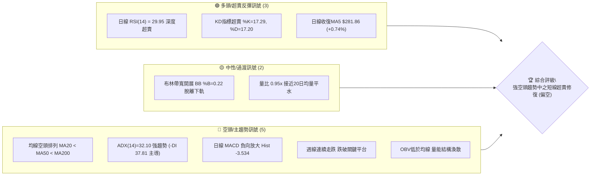

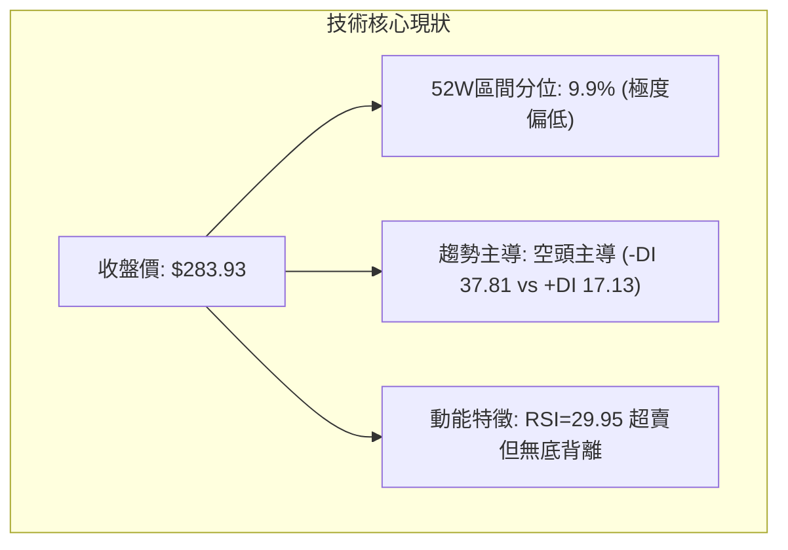

### 📊 核心指標速覽表

| 指標類別 | 指標名稱 | 當前數值 | 訊號 | 解讀 |
|----------|----------|----------|------|------|
| **價格** | 當前收盤價 | $283.93 | 🔴 | 位於52週區間 9.9% 分位，處於極弱勢波段 |
| **均線** | 短期 MA5 | $281.86 | 🟢 | 股價站上5日線 (+0.74%)，超跌短線微幅回穩 |
| **均線** | 短期 MA20 | $314.61 | 🔴 | 價格低於MA20達 -9.75%，短線下行斜率陡峭 |
| **均線** | 中期 MA50 | $329.76 | 🔴 | 價格深陷中期均線下方 -13.90%，空頭格局確立 |
| **均線** | 長期 MA200 | $337.23 | 🔴 | 跌破年線關鍵分水嶺，長期牛市架構遭遇嚴峻破壞 |
| **動能** | RSI(14) | 29.95 | 🟢 | Wilder計算落入 <30 極度超賣區，存在技術性抽頭需求 |
| **動能** | MACD (12,26,9) | -15.951 / -12.417 | 🔴 | DIF雙線處於零軸之下且柱狀圖 -3.534，空頭動能仍佔優 |
| **動能** | KD(9,3,3) | %K 17.29 / %D 17.20 | 🟢 | 雙線於20以下超賣區呈現微幅低檔鈍化，初現走平跡象 |
| **趨勢** | ADX / ±DI | ADX 32.10 (-DI 37.81) | 🔴 | ADX > 25 強勢趨勢確立，-DI 壓制 +DI，空方完全控盤 |
| **通道** | 布林通道 | 下軌 $260.42 / 中軌 $314.61 | 🟡 | %B 為 0.22，自下軌上方緩步收斂，通道大幅擴張 |
| **量能** | 當日量 / 20日均量 | 24.58M / 25.85M | 🟡 | 量比 0.95x，量能回落至均量，未見恐慌性二度拋售 |
| **波動** | ATR(14) | $10.61 (3.74%) | 🔴 | 日均波幅擴大至逾10美元，高波動環境止損需拉寬 |

### 🏆 技術評分卡

```
╔══════════════════════════════════════════════════════════════════╗
║                   技術評分卡 — GOOG (2026-11-08)                 ║
╠══════════════════════════════════════════════════════════════════╣
║ 趨勢強度 (Trend Strength)     ██████░░░░░░░░░░░░░░  30/100 🔴 空頭強勢主導 ║
║ 動能指標 (Momentum Indicators) ████████░░░░░░░░░░░░  40/100 🟡 超賣醞釀反彈 ║
║ 支撐穩定度 (Support Stability) ████████░░░░░░░░░░░░  40/100 🟡 逼近前低支撐 ║
║ 成交量配合 (Volume Profile)    ██████░░░░░░░░░░░░░░  30/100 🔴 OBV疲軟下行  ║
║ 形態完整度 (Pattern Formation) ████████░░░░░░░░░░░░  40/100 🟡 破位尋底架構 ║
║ 均線排列 (MA Alignment)       ██░░░░░░░░░░░░░░░░░░  10/100 🔴 標準空頭排列 ║
╠══════════════════════════════════════════════════════════════════╣
║ 綜合評分 (Overall Score)       ██████░░░░░░░░░░░░░░  32/100 🔴 偏空(強趨勢) ║
║ 註：綜合評分 = (30+40+40+30+40+10) / 6 = 31.67 四捨五入為 32/100          ║
╚══════════════════════════════════════════════════════════════════╝
```

---

## 2. 趨勢分析

### 🌐 多時框趨勢分析

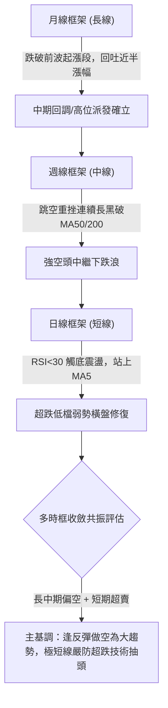

### 📈 長期趨勢 — 12個月走勢圖（Unicode）

```
GOOG 月線走勢圖（過去12個月：2025-12 至 2026-11）
價格軸 ($)
$400 ┤                                      
$380 ┤                                ●(4月高點: 381.46)
$360 ┤                                  ●(5月: 375.96)
$340 ┤                    ●(1月: 337.87)   ●(7月: 356.42)   ●(9月: 340.74)
$320 ┤●(12月: 313.19) ●(2月: 310.82)
$300 ┤
$280 ┤                    ●(3月: 286.50)                    ●(10月: 278.22) 
$260 ┤                                                        ●←現在 (11月收: 283.93)
     └─────────────────────────────────────────────────────────────────────────────
       12M    01M    02M    03M    04M    05M    06M    07M    08M    09M    10M    11M
       2025   2026  ----------------------- 2026 年度走勢 -----------------------
```

#### 長期走勢特徵分析表格

| 階段區間 | 起止收盤價 | 漲跌幅 | 走勢特徵與技術解讀 |
|----------|------------|--------|--------------------|
| **2025-12 ~ 2026-03** | $313.19 → $286.50 | -8.52% | 首輪拉回測試季度支撐，3月打出低點 $286.50 後迅速獲得買盤支撐。 |
| **2026-03 ~ 2026-04** | $286.50 → $381.46 | +33.14%| 爆發性多頭主升浪，突破前高創下月線收盤新高，確立歷史波段頂點。 |
| **2026-04 ~ 2026-07** | $381.46 → $356.42 | -6.56% | 高檔橫盤派發期，反覆於 $350~$375 構築頂部形態，動能漸趨衰竭。 |
| **2026-07 ~ 2026-09** | $356.42 → $340.74 | -4.40% | 陰跌築頂，多頭反彈高點逐步下移（Lower Highs），均線開始收斂黏合。 |
| **2026-09 ~ 2026-10** | $340.74 → $278.22 | -18.35%| 跳空崩跌長黑，單月暴跌超60美元，直接擊穿MA200，多頭架構徹底崩解。 |
| **2026-10 ~ 2026-11** | $278.22 → $283.93 | +2.05% | 在52週低點 $270.70 上方獲得微弱承接，展開超跌後的窄幅修復整理。 |

### 📊 中期趨勢（週線分析）

```
GOOG 週線級別支撐阻力結構分布示意
===================================================================
 $350.00 ┤ --------------------------- [9-10月成交密集套牢頂部區]
 $337.23 ┤ ═══════════════════════════ MA200 長期多空分水嶺 (強阻力)
 $329.76 ┤ --------------------------- MA50 中期下行壓制線
 $318.83 ┤ --------------------------- R2 阻力區 (近一年波段高點)
 $310.68 ┤ --------------------------- R1 阻力區 (前跳空缺口下沿)
 $283.93 ┤ ◄ 現價 ($283.93)
 $270.95 ┤ --------------------------- S1 支撐位 (波段聚類支撐)
 $270.70 ┤ ═══════════════════════════ 52週最低價 (52W Low / 終極防線)
===================================================================
```

從近8週的週K走勢觀察，自 2026-10-16 收盤 $336.91 以來，接連兩週爆量崩跌（10-30 單週狂瀉至 $278.22，成交量暴增至 208,382,100 股）。本週（11-06）週K棒錄得下影線陽線，低點探至 $272.00，收於 $283.93，成交量縮減至 150,048,800 股，顯示急跌後空頭拋壓有所減緩，但尚未形成實質反轉結構。

### ⚡ 趨勢強度評估（ADX 解讀）

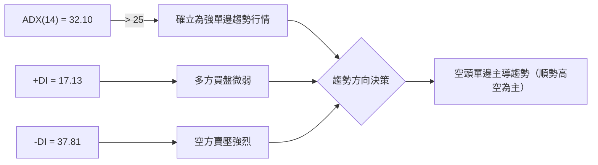

#### ADX 與動向指標強度對照

| 指標變數 | 當前讀數 | 門檻區間 | 趨勢判定 | 技術含義 |
|----------|----------|----------|----------|----------|
| **ADX(14)** | **32.10** | > 25.00 | 強單邊趨勢 | 市場脫離無趨勢盤整，處於高強度單邊行情中。 |
| **+DI(14)** | **17.13** | < 20.00 | 多頭極度乏力 | 多頭缺乏主動推升意願，反彈均屬被動回補。 |
| **-DI(14)** | **37.81** | > 35.00 | 空頭高度控盤 | 賣盤佔據壓倒性主導權，空方能量釋放仍未完全竭盡。 |
| **差值 (-DI - +DI)** | **+20.68** | > 15.00 | 極端偏空 | 兩者剪刀差高達20以上，確認目前為典型的「空頭強趨勢」。 |

---

## 3. 圖表形態分析

### 🔍 形態識別系統

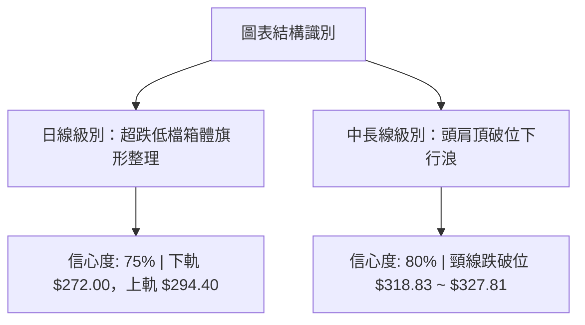

#### 圖表形態信心度與目標價評估表

| 形態名稱 | 週期時框 | 信心度 | 判斷依據（嚴格引用數據） | 完成度 | 形態推算目標價（附計算式） |
|----------|----------|--------|--------------------------|--------|----------------------------|
| **高檔頭肩頂破位** | 中期 (週線) | **80%** | 跌破頸線密集聚類阻力 R2 $318.83；頭部最高 $403.96，頸線以 R2 $318.83 計。 | 100%已破位 | 跌幅滿足位 = $318.83 - ($403.96 - $318.83) = $233.70（中長線理論值；短線先看數據支撐 S1 $270.95） |
| **低檔弱勢整理箱體** | 短期 (日線) | **75%** | 近5日K線震盪區間：低點 $272.00（11-03低點）至高點 $294.40（11-04高點）。 | 60%進行中 | 向上突破測幅 = $294.40 + ($294.40 - $272.00) = $316.80（接近阻力 R2 $318.83）；跌破測幅 = $272.00 - 22.40 = $249.60 |
| **雙底形態** | 短期 (日線) | **35%** | 僅有 10-30 低點 $275.35 與 11-03 低點 $272.00，但未突破頸線 $294.40，且ADX=32.10空頭強烈。 | <30%未成形 | **訊號不足，僅做指標型超賣解讀，不預先假設雙底成立** |

### 🕯️ 重要K線形態分析

嚴格依據提供的「近10根日K」與「近8根週K」之真實開高低收數據進行客觀解讀：

#### 近10根日K棒形態深度解讀

| 日期 | 開盤價 | 最高價 | 最低價 | 收盤價 | 成交量 | K線形態 | 技術含義解讀 | 多空訊號 |
|------|--------|--------|--------|--------|--------|---------|--------------|----------|
| **10-26** | 318.05 | 318.39 | 313.51 | 314.19 | 16,989,400 | 下跌小陰線 | 窄幅陰跌，承壓於阻力位 R1 下方，交投清淡。 | 🔴 弱勢 |
| **10-27** | 314.40 | 320.07 | 313.58 | 316.83 | 17,786,400 | 溫和反彈陽線 | 嘗試回測 $320 關卡未果，留有上影線，量能未放大。 | 🟡 中性 |
| **10-28** | 319.88 | 323.13 | 319.68 | 321.89 | 35,355,900 | 帶量衝高陽線 | 爆發誘多，衝刺至 $323.13 逼近阻力 R3，量能倍增。 | 🟡 假突破 |
| **10-29** | 283.84 | 286.43 | 278.29 | 282.32 | 93,133,900 | **跳空崩跌大長黑** | 開盤直接跳空暴跌超36美元，巨量9300萬股拋盤宣洩。 | 🔴 極空 |
| **10-30** | 279.69 | 281.86 | 275.35 | 278.22 | 45,116,500 | 續跌中陰線 | 破底探至 $275.35，收盤收於全日低位附近，恐慌未平。 | 🔴 續跌 |
| **11-02** | 280.58 | 285.21 | 277.78 | 278.04 | 29,231,800 | 假陽實陰十字線 | 高開走低，收盤低於開盤，多頭反攻無力，量能急縮。 | 🔴 弱勢 |
| **11-03** | 279.19 | 280.34 | 272.00 | 278.27 | 23,372,300 | **長下影錘頭十字星** | 早盤摜壓至波段低點 $272.00（逼近S1），尾盤收復，現止跌契機。 | 🟢 止跌 |
| **11-04** | 281.48 | 294.40 | 281.33 | 287.30 | 31,709,200 | **長上影大陽線** | 盤中強彈至 $294.40 遇強壓回落，多頭首度展現超跌反彈動能。 | 🟢 短多 |
| **11-05** | 291.80 | 293.64 | 276.20 | 281.74 | 41,149,900 | **長黑陰線反噬** | 高開於 $291.80 後盤中下挫至 $276.20，多頭反彈遭遇當頭棒喝。 | 🔴 壓制 |
| **11-06** | 283.42 | 289.22 | 283.00 | 283.93 | 24,585,600 | 窄幅紡錘小陽線 | 震盪收斂，收盤守住MA5 ($281.86)，於跳空低位形成橫盤僵局。 | 🟡 觀望 |

#### 近8根週K棒形態深度解讀

| 週結束日 | 開盤價 | 最高價 | 最低價 | 收盤價 | 週成交量 | 週K形態結構 |
|----------|--------|--------|--------|--------|----------|-------------|
| **09-18** | 339.11 | 355.13 | 337.45 | 344.41 | 98,139,700 | 帶長上影中陽線，向上衝刺 $355.13 後遭遇阻力回落。 |
| **09-25** | 346.19 | 359.98 | 332.81 | 341.08 | 91,524,400 | 高位震盪長陰墓碑線，創波段反彈高點 $359.98 後反轉收黑。 |
| **10-02** | 337.60 | 350.09 | 332.65 | 340.35 | 89,656,100 | 下探回升紡錘線，多空於 $340 膠著，高點逐步壓低。 |
| **10-09** | 339.21 | 353.53 | 339.15 | 347.86 | 63,634,200 | 量縮假陽線反彈，成為崩跌前的最後誘多頂點。 |
| **10-16** | 348.34 | 355.25 | 335.50 | 336.91 | 79,871,700 | 高開低走覆蓋陰線，跌破前一週起漲點，確立下行破位。 |
| **10-23** | 340.12 | 342.52 | 316.99 | 317.28 | 78,759,600 | 光腳中長黑週K，收盤摜破 $318 平台支撐，加速下滑。 |
| **10-30** | 318.05 | 323.13 | 275.35 | 278.22 | 208,382,100 | **超級崩跌大長黑**，成交量逾2.08億股，跳空擊穿所有中期防線。 |
| **11-06** | 280.58 | 294.40 | 272.00 | 283.93 | 150,048,800 | **低檔長下影回升陽線**，探底 $272.00 後回穩，空頭力竭跡象初顯。 |

### 📉 ASCII 走勢形態示意圖

```
GOOG 短期走勢與低檔橫盤整理形態示意（2026-10-26 至 2026-11-06）
價格 ($)
$325 ┤               ● (10-28 高: 323.13)
$320 ┤          ●    │
$315 ┤     ●────●────┘
$310 ┤    [10-29 巨量崩跌跳空缺口區域]
$305 ┤    ─────────────────────────────────────── 缺口上沿 $313.51
$300 ┤
$295 ┤                             ● (11-04 衝高回落: 294.40)
$290 ┤                             │    ● (11-05: 293.64)
$285 ┤                   ●         │    │    ● (11-06 現價: 283.93)
$280 ┤     ═════════════[現階段低檔箱體整理區間: $272.00 ~ $294.40]════════
$275 ┤                   ● (10-30: 275.35)
$270 ┤                        ● (11-03 低點: 272.00 ◄ 波段雙針探底)
$265 ┤
     └──────────────────────────────────────────────────────────────────
         10-26 10-27 10-28 10-29 10-30 11-02 11-03 11-04 11-05 11-06
```

### 🎯 形態目標價計算

根據日線近期築底形態進行幾何量測計算：
1. **箱體上限（頸線/壓力線）**：由 11-04 盤中反彈高點 **$294.40** 界定。
2. **箱體下限（底部支撐線）**：由 11-03 盤中最低點 **$272.00** 界定。
3. **箱體形態高度**：$294.40 - $272.00 = **$22.40**。
4. **向上突破最小測幅目標價**：
   $$\text{目標價} = \text{頸線} + \text{形態高度} = \$294.40 + \$22.40 = \mathbf{\$316.80}$$
   *(該目標價極度貼近阻力聚類位 R2 $318.83 及 MA20 $314.61，形成強烈技術阻力重疊)*。
5. **向下跌破測幅目標價**：
   $$\text{跌破目標} = \text{下限} - \text{形態高度} = \$272.00 - \$22.40 = \mathbf{\$249.60}$$

---

## 4. 支撐與阻力

### 🗺️ 關鍵價位分布圖（Unicode）

```
╔══════════════════════════════════════════════════════════════════╗
║                    GOOG 關鍵價位結構分布圖                       ║
╠══════════════════════════════════════════════════════════════════╣
║ $337.23 ║████████████████████████║ MA200 牛熊分水嶺 / 斐波 50.0% ║
║ $327.81 ║████████████████████    ║ 強阻力 R3 (+15.46%)          ║
║ $321.61 ║██████████████████████  ║ 斐波那契 61.8% 重要壓力位    ║
║ $318.83 ║██████████████████      ║ 關鍵阻力 R2 (+12.29%)        ║
║ $314.61 ║████████████████        ║ 布林中軌 / MA20 下行壓制位   ║
║ $310.68 ║████████████            ║ 阻力位 R1 (+9.42%) / 缺口下沿║
║ $299.22 ║████████                ║ 斐波那契 78.6% 回調關鍵點    ║
║ $283.93 ╠════════════════════════╣ ◄ 現價 (Current Close)        ║
║ $270.95 ║▓▓▓▓▓▓▓▓▓▓▓▓▓▓▓▓        ║ 關鍵支撐 S1 (-4.57%)         ║
║ $270.70 ║████████████████████████║ 52週最低價 (52W Low / 終極防線)║
║ $260.42 ║████████████████████    ║ 布林下軌極端支撐             ║
╚══════════════════════════════════════════════════════════════════╝
```

### 🚧 阻力位分析表

所有阻力位數值完全嚴格引用技術數據聚類結果：

| 阻力級別 | 精確價位 | 距現價幅 | 形成原因與技術共振結構 | 突破難度 | 重要性 |
|----------|----------|----------|------------------------|----------|--------|
| **R1** | **$310.68** | +9.42% | 近一年波段高點聚類位；10-29 巨量跳空暴跌之缺口下邊界，具備強烈心理與解套壓力。 | 🔴 極高 | ★★★★☆ |
| **R2** | **$318.83** | +12.29% | 近一年密集高點聚類；10-26 當週頸線破位點，與斐波那契 61.8% ($321.61) 形成重疊共振壓力帶。 | 🔴 極高 | ★★★★★ |
| **R3** | **$327.81** | +15.46% | 近一年波段高點聚類；與下行的 MA50 ($329.76) 形成強大中期壓制共振，為空頭強防守位。 | 🔴 堅不可摧 | ★★★★☆ |

*註：在 R1 之下，短期 11-04 反彈高點 $294.40 及 斐波那契 78.6% 回調位 $299.22 亦構成第一道動態短壓。*

### 🛡️ 支撐位分析表

所有支撐位數值嚴格引用數據庫波段聚類與52週極端值：

| 支撐級別 | 精確價位 | 距現價幅 | 形成原因與技術共振結構 | 守住機率 | 重要性 |
|----------|----------|----------|------------------------|----------|--------|
| **S1** | **$270.95** | -4.57% | 近一年波段低點聚類位；精確鎖定於 52週最低價 $270.70 之上0.25美元，為本波下行核心底線。 | 🟡 55% | ★★★★★ |
| **次級極端支撐** | **$270.70** | -4.66% | **52W Low (52週最低點)**；跌破將觸發全市場程式化止損與長期牛市終結信號。 | 🟡 50% | ★★★★★ |
| **動態下軌** | **$260.42** | -8.28% | **日線布林通道下軌**；若 S1/$270.70 失守，通道開口擴大時之動態超跌緩衝極限位。 | 🟢 70% | ★★★☆☆ |

### 📐 斐波那契回調位分析

依據 52週區間最低點 **$270.70** 至最高點 **$403.96** 嚴格映射，全幅波段高達 $133.26：

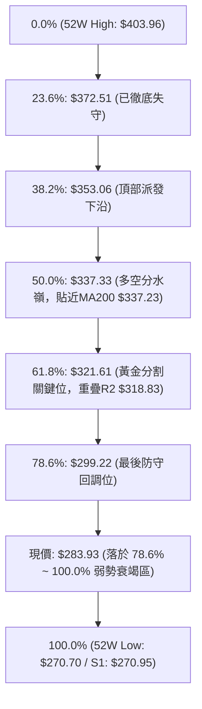

#### 斐波那契位置深度解讀
1. **當前價格位置判定**：現價 $283.93 處於 **78.6% ($299.22)** 與 **100.0% ($270.70)** 之間。在道氏與斐波那契理論中，當資產價格回撤深度超過 78.6% 時，原先從 $270.70 啟動的整輪牛市上漲浪已經遭受毀滅性破壞，該走勢已被判定為完全回吐結構。
2. **反彈壓力錨定**：若短線觸發超賣反彈，上方第一重斐波壓力即為 78.6% 的 **$299.22**；若能僥倖突破，則 61.8% 的 **$321.61** 將與阻力位 R2 **$318.83** 形成雙重鐵壁壓制。
3. **支撐最後防線**：下方僅剩 100.0% 回調位 **$270.70**（重疊 S1 $270.95）。此處一旦帶量擊穿，將開啟技術面「無支撐真空下跌」走勢。

---

## 5. 技術指標深度解讀

### 🎛️ 指標訊號總覽

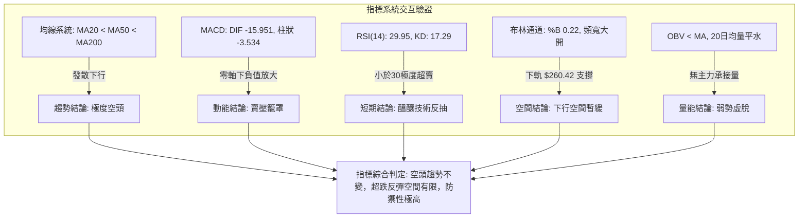

### 📈 移動平均線排列分析

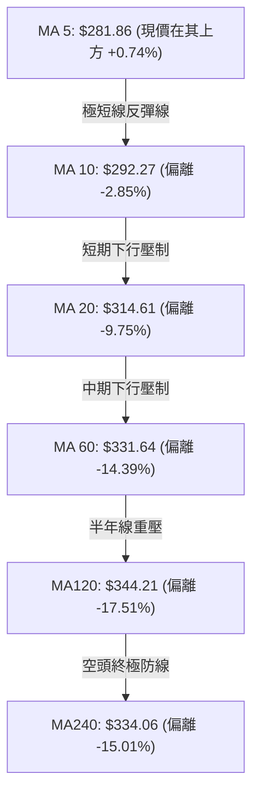

#### 均線系統深度解讀
1. **空頭排列狀態**：當前系統呈現極標準的「空頭發散排列」：**MA20 ($314.61) < MA50 ($329.76) < MA200 ($337.23)**。不僅如此，中長期均線 MA60 ($331.64)、MA120 ($344.21)、MA240 ($334.06) 全數高懸於現價上方14%至17%處。
2. **短期乖離過大修復**：股價現價 $283.93 僅收復了 MA5 ($281.86)，而與 MA20 的負乖離率高達 **-9.75%**，與 MA60 負乖離率達 **-14.39%**。在統計學常態分佈下，如此巨大的負乖離往往會誘發均線「回抽乖離修正」，但只要 MA20 持續向下壓制，任何反彈均屬「逢高做空」的絕佳賣點。

### 📉 RSI(14) 分析

#### RSI 數值進度條
```
RSI(14): 29.95 (Wilder計算值)
0 ────────── 20 ───── 30 ────────────────────────── 70 ────────── 100
[█████████░░░░░░░░░░░░░░░░░░░░░░░░░░░░░░░░░░░░░░░░░░░░░░░] 29.95% (🟢 極度超賣)
```

#### 超買超賣與背離深度研判
- **超賣狀態**：日線 RSI(14) 讀數為 **29.95**，正式跌破 30.00 警戒線，進入極端超賣區；週線 RSI 同步回落至 **30.00**。這反映出近期自 $340 以上崩跌過程極為迅猛，短線賣壓已經過度透支。
- **背離分析（結論：無背離）**：
  根據數據提供之明確背離掃描——「**RSI 背離：無明顯背離**（比較近20根K棒首尾之價格與RSI方向）」。進一步檢視 10-30 低點 $275.35（RSI 當時探低）與 11-03 低點 $272.00，價格創出更低低點（Lower Low），而 RSI 亦步亦趨位於超賣低位，並未出現價格創新低而 RSI 線顯著墊高的典型「底背離」特徵。
- **研判結論**：目前為「**指標鈍化型超賣**」，而非「背離型反轉」。超賣僅能提供價格下跌減速或短線技術抽頭，不構成趨勢反轉的充分條件。

### 📊 MACD(12/26/9) 訊號解讀

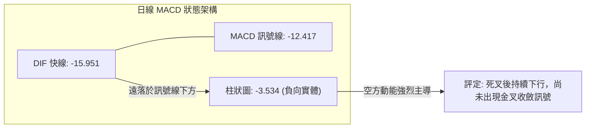

#### MACD 動能剖析
1. **絕對數值定位**：DIF (-15.951) 與 Signal (-12.417) 雙雙在零軸下方深水區下行，顯示中長線動能完全被空頭掌控。
2. **柱狀圖動態**：當前柱狀圖 (Histogram) 為 **-3.534**。回顧近20週數據，週線 MACD 柱狀圖在 10-30 創下 -5.975 的極度負值後，11-06 回升至 **-3.534**，週線層面出現負柱縮短跡象；然而日線層面負柱仍厚，意味著短期下行慣性雖被遏制，但多頭尚未能奪回任何主動攻勢。

### 📦 布林通道分析

```
GOOG 日線布林通道 (20, 2) 結構示意圖
價格軸 ($)
$370 ┤                                                 ───── 上軌: $368.80
$350 ┤                                               ╱
$330 ┤                                             ╱
$314 ┤ ────────────────────────────────────────── 中軌 (MA20): $314.61
$290 ┤                                         ╱
$283 ┤ ◄ 現價: $283.93 (%B = 0.22)            ╱
$270 ┤                                     ╱
$260 ┤ ─────────────────────────────────── 下軌: $260.42
======================================================================
通道寬度 (Bandwidth): $108.38 (38.17% of Price) — 處於極度張口擴張狀態
```

#### 布林通道關鍵參數解讀
- **布林上軌**：$368.80
- **布林中軌 (MA20)**：$314.61 (強大反彈阻力位)
- **布林下軌**：$260.42 (極限恐慌支撐)
- **當前位置 %B**：**0.22**。%B 數值為 0.22 代表現價雖然脫離了貼著下軌 (<0.0) 暴跌的「走軌」極端行情，但依然處於下半通道的極弱勢區域。目前通道呈現喇叭口向下大幅張開態勢，預示著中線波動區間已經不可逆地下移。

### 💹 成交量分析（量價配合度）

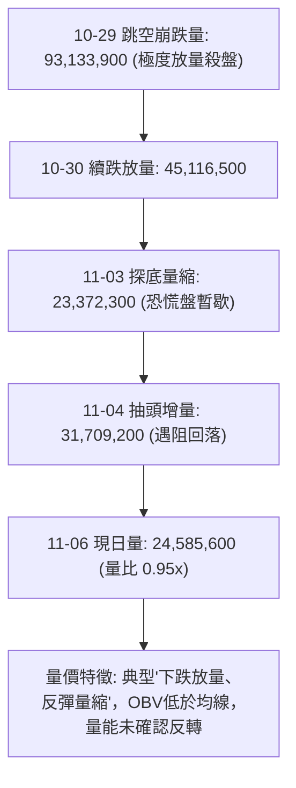

#### 量價結構與 OBV 現狀
- **量比與均量對比**：最新日成交量為 **24,585,600 股**，對比 20日均量 **25,853,110 股**，量比為 **0.95x**；對比 50日均量 **20,432,908 股**，量能維持在中性偏高水平。這說明市場在 $280 附近換手頻繁，但缺乏增量資金強勢進場掃盤。
- **OBV (能量潮指標)**：數據明確指出「**OBV趨勢：OBV < MA → 量能疲弱**」。在價格跌破平台時，OBV 線出現斷崖式下滑且持續被其移動平均線壓制，確認資金持續流出，主力機構並無實質吸籌動作，目前僅為散戶與空頭平倉盤在 $280 價位拉鋸。

---

## 6. 動能與波動率

### ⚡ 動能評估四象限

```
動能與波動率定位矩陣 (Momentum vs Volatility)
─────────────────────────────────────────────────────────────────
     高波動率 (High Volatility)
        │
  Q3    │    Q4 (當前定位點: GOOG)
 (強動能/高波動)│ (弱動能/高波動) ◄── [ATR=10.61 (3.74%), ADX=32.10, RSI=29.95]
        │    ★ 評定特徵：單邊破位暴跌後的高位震盪放血期，
        │       做多極易遭波動洗出場，做空須提防劇烈技術反抽。
────────┼────────────────────────────────────────────────────────
        │
  Q1    │    Q2
 (強動能/低波動)│ (弱動能/低波動)
        │
     低波動率 (Low Volatility)
────────┴────────────────────────────────────────────────────────
     強動能 (Bullish)           弱動能 (Bearish)
```

| 象限代號 | 動能維度 | 波動維度 | 當前狀態 | 戰略應對方針 |
|----------|----------|----------|----------|--------------|
| **Q1** | 強多頭 | 低波動 | — | 穩定單邊多頭，持股續抱。 |
| **Q2** | 弱動能 | 低波動 | — | 窄幅盤整，觀望等待突破。 |
| **Q3** | 強多頭 | 高波動 | — | 主升浪擴張，嚴格追蹤止盈。 |
| **Q4** | **強空頭/弱動能** | **高波動** | **✓ (GOOG處於此區)** | **高風險脆弱期：空頭趨勢強烈但動能處於超賣，嚴禁重倉盲目猜底，嚴控倉位。** |

### 📊 ATR 波動率分析

- **ATR(14) 精確數值**：**$10.61**（Wilder 計算值），佔現價比例高達 **3.74%**。
- **波動率含義解析**：過去14個交易日，GOOG 平均每日真實波幅逾10.6美元。這意味著在日內或持倉2-3天內，正常的雜訊波動即可輕易達到 $15~$20 美元。
- **風控止損空間指引**：
  - **超短線策略止損距離**：至少須設定為 $1.0 \times \text{ATR} \approx \mathbf{\$10.60}$。
  - **波段擺盪策略止損距離**：建議設定為 $1.5 \times \text{ATR} \sim 2.0 \times \text{ATR} \approx \mathbf{\$15.90 \sim \$21.20}$。若止損設定過窄（例如小於5美元），極易在日內雜訊震盪中被非意願掃損出場。

### 📐 Beta 與市場相關性

- **Beta 數值**：**1.226**。
- **相關性解析**：GOOG 具備高於大盤標普500指數 (S&P 500) 22.6% 的波動敏感度。在當前弱勢架構下，若美股大盤出現下挫，GOOG 的下墜斜率將顯著大於指數；反之，若大盤展開反彈，GOOG 雖能跟隨抽頭，但因上方套牢籌碼沉重，其超額收益表現（Alpha）容易被均線壓制削弱。

---

## 7. 多時框架總結

### 📋 時框架評分表

| 時框架 | 趨勢方向 | 動能指標 | 均線排列 | 形態結構 | 綜合評分 | 操作建議方向 |
|--------|----------|----------|----------|----------|----------|--------------|
| **日線 (短期)** | 震盪偏空 | 🟡 RSI超賣/KD低檔 | 🔴 空頭發散 (收復MA5) | 🟡 低檔箱體震盪 | **40/100** | 超跌反彈但空間受限，謹慎短打 |
| **週線 (中期)** | 🔴 強烈空頭 | 🔴 MACD柱狀負值 | 🔴 跌破MA50/MA200 | 🔴 頭肩頂破位下行 | **25/100** | 逢反彈至關鍵阻力堅決佈空 |
| **月線 (長期)** | 🟡 轉入震盪 | 🔴 連續長黑貫穿 | 🟡 考驗長期均線防守 | 🔴 跌穿年度斐波78.6%| **35/100** | 長期牛市結構破壞，轉入漫長尋底 |

### 🔲 綜合訊號矩陣

```
╔══════════════════════════════════════════════════════════════════════════╗
║                     GOOG 多維度技術訊號矩陣檢驗                          ║
╠══════════════════════════════════════════════════════════════════════════╣
║ 分析維度       │ 短期 (1-5日)     │ 中期 (1-4週)     │ 長期 (1-6個月)   ║
╠════════════════╪══════════════════╪══════════════════╪══════════════════╣
║ 趨勢方向       │ 🟡 低檔弱勢拉鋸   │ 🔴 單邊主跌推動浪 │ 🔴 高檔回調派發浪 ║
║ 均線壓制       │ 🟢 站上 MA5      │ 🔴 MA20/50 陡峭下穿│ 🔴 跌破 MA200 年線║
║ 動能擺盪       │ 🟢 RSI/KD 超賣   │ 🔴 MACD 柱狀深負  │ 🔴 買盤能量渙散   ║
║ 量能支撐       │ 🟡 量能平水      │ 🔴 崩跌放量反彈量縮│ 🔴 OBV 走弱破線   ║
║ 關鍵防守/阻力  │ 支撐 $272.00     │ 阻力 R1 $310.68  │ 阻力 R2 $318.83  ║
╠════════════════╧══════════════════╧══════════════════╧══════════════════╣
║ 一致性判定：中長期趨勢高度偏空共振；短期僅存指標「超跌技術修正」矛盾。  ║
╚══════════════════════════════════════════════════════════════════════════╝
```

### ⚖️ 多時框收斂結論

依據多時框收斂規則第 14 條嚴格推導：
1. **趨勢/盤整行情定性**：當前日線 **ADX(14) = 32.10**，明確高於關鍵門檻 25.00，且 -DI (37.81) 居高臨下壓制 +DI (17.13)。此數據無可辯駁地證實當前市場**並非無方向的區間盤整行情，而是由空方絕對統治的「高強度單邊趨勢行情」**。
2. **時框優先級權重**：在 ADX > 25 的強趨勢環境下，多時框收斂規則嚴格要求——**必須以中長期（週線 / MA50 / MA200）方向為最高指導原則，日線時框之超賣訊號僅能用於尋找次級折返走勢或做空進場的最佳時機，絕對不可將短線超賣誤判為反轉信號**。
3. **最終方向性唯一結論**：**【偏空】（大級別逢高放空，嚴控任何搶反彈風險）**。本結論與第1章技術評分卡（32分/偏空）完全統一，並作為第8章交易策略的唯一最高指引。

---

## 8. 交易策略建議

### 🗺️ 策略決策流程圖

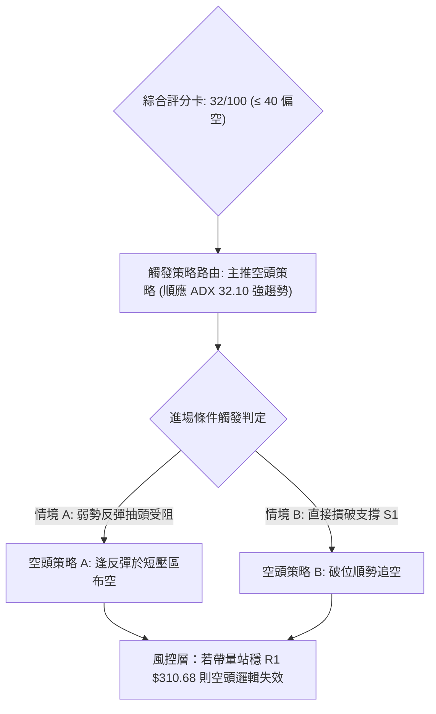

### 🧭 策略路由（依評分卡分流，不得兩頭下注）

> **當前主策略方向 = 【主推空頭策略】（依據綜合評分 32/100，落於 ≤40 偏空區間，順應 ADX=32.10 強空頭趨勢）**

*註：多頭操作在此架構下勝率偏低且逆大勢，不予作為主策略推薦；任何多方企圖僅作為反向風險觸發與對沖參考。*

### 🎯 價格情境階梯（Price Scenarios）

價位完全嚴格引用數據庫「關鍵價位」與「斐波那契回調位」之真實數據：

| 觸發條件 | 下一目標 | 後續延伸 | 情境含義與技術演變 |
|----------|----------|----------|--------------------|
| **向上突破 R1 $310.68** | **R2 $318.83** | **R3 $327.81** | **空頭嚴重受挫**：回補跳空缺口，展開超跌大反彈，回測 MA20/MA50。 |
| **受阻於斐波 $299.22** | **現價 $283.93**| **S1 $270.95** | **中繼整理沉淪**：反彈無力回補缺口，維持在 $272~$299 弱勢消耗。 |
| **跌破 S1 $270.95 (52W Low)**| **布林下軌 $260.42**| **形態測幅 $249.60**| **崩跌浪延伸**：下行空間徹底開啟，觸發機構程式化停損拋盤。 |

### 📊 情境機率分佈

| 演變情境 | 機率預估 | 主要技術數據支撐依據 |
|----------|----------|----------------------|
| **回落探底 / 破位新低** | **60%** | ADX(14)=32.10 強趨勢確立；-DI=37.81 壓倒性控盤；均線 MA20<50<200 絕對空頭發散；OBV持弱。 |
| **低檔弱勢區間震盪** | **30%** | RSI(14)=29.95 及 KD=17.29 處於超賣區，限制了短線即刻暴跌的速度；成交量量比 0.95x 趨緩。 |
| **強勢連續反彈回補缺口**| **10%** | 缺乏主力吸籌跡象；上方有 10-29 巨量長黑壓頂；僅在市場發生重大系統性催化時才可能出現。 |

### 🔴 主策略詳情（空頭策略 A & B）

本策略各項數據嚴格符合規則 17 數學推算定義：
- 風險報酬比計算公式：
  $$\text{做空風險報酬比} = \frac{\text{進場價} - \text{目標價 T1}}{\text{止損價} - \text{進場價}}$$

| 策略要素 | 策略 A（反彈高空 — 逢阻力佈空） | 策略 B（破位追空 — 順應趨勢延續） |
|----------|----------------------------------|------------------------------------|
| **核心邏輯** | 利用短線 RSI<30 超賣抽頭，在反彈遇阻時順勢進場建立空單 | 當價格直接摜穿 52週最低點時，順勢追擊空頭主跌浪 |
| **進場條件** | 股價反彈至 $294.40~$299.22 阻力區遇阻回落，日K出現上影線時進場 | 實體日K線跌破關鍵支撐 S1 $270.95，且跌破 52W Low $270.70 |
| **進場價格** | **$296.81** *(區間 $294.40~$299.22 中點)* | **$270.70** *(精確錨定 52W Low 破位點)* |
| **目標價 T1** | **$270.95** *(關鍵支撐位 S1)* | **$260.42** *(日線布林通道下軌)* |
| **目標價 T2** | **$260.42** *(布林通道下軌支撐)* | **$249.60** *(形態測幅推算跌破目標價)* |
| **止損價格** | **$310.68** *(精確錨定阻力位 R1)* | **$278.22** *(10-30 收盤價 / 近期密集成交平台)* |
| **風險報酬比** | **1 : 1.86（以 T1 計）**<br>*(計算: (296.81 - 270.95) / (310.68 - 296.81) = 25.86 / 13.87 = 1.86)*<br>*(註：以 T2 計為 1 : 2.62)* | **1 : 1.37（以 T1 計）**<br>*(計算: (270.70 - 260.42) / (278.22 - 270.70) = 10.28 / 7.52 = 1.37)*<br>*(註：以 T2 計為 1 : 2.81)* |
| **成功機率** | **65%** | **60%** |
| **建議倉位** | **總資金之 10% ~ 15%** | **總資金之 5% ~ 8% (破位操作宜輕倉)** |

### 🟢 反向風險觸發點（對沖提示）

此處非主動做多操作建議，僅作為空頭部位之嚴格風控預警機制：
1. **空頭全面減倉警訊**：若日線收盤價強勢突破形態箱體上沿 **$294.40**，且日線 RSI 重新站上 45.00，應立即平倉 50% 空頭部位，防範軋空抽頭。
2. **空頭徹底止損/反轉點**：若價格帶量站上關鍵阻力位 **R1 $310.68**（即回補 10-29 暴跌跳空缺口下沿），原空頭破位推動邏輯被市場證偽，所有剩餘空單必須無條件離場。此時激進型交易者方可考慮建立小額多單，目標上看 R2 **$318.83** 及 MA20 **$314.61**。

### ⭐ 整體訊號強度評星

```
╔══════════════════════════════════════════════════════════════════╗
║                     GOOG 交易訊號強度評星                        ║
╠══════════════════════════════════════════════════════════════════╣
║ 做多訊號強度：★☆☆☆☆  (1.5/5星 — 僅存極短線超賣修復，勝率極低)   ║
║ 做空訊號強度：★★★★☆  (4.0/5星 — 中長線空頭共振，趨勢推動力強)   ║
║ 整體可信度：  ★★★★☆  (4.0/5星 — ADX=32.10 高度確認趨勢有效性)   ║
╚══════════════════════════════════════════════════════════════════╝
```

---

## 9. 風險提示與監控

### ✅ 關鍵監控指標 Checklist

```
╔══════════════════════════════════════════════════════════════════╗
║                   GOOG 交易風控實時監控清單                      ║
╠══════════════════════════════════════════════════════════════════╣
║ [ ] 監控項 1: 52週低點防守 — 每日密切檢視 $270.70 / S1 $270.95   ║
║     若帶量跌破，嚴禁任何抄底，順勢啟動空頭延伸劇本。            ║
║ [ ] 監控項 2: 缺口壓力確認 — 觀察反彈能否觸及 R1 $310.68         ║
║     只要未補缺口，反彈皆為空方送分題。                          ║
║ [ ] 監控項 3: ADX 趨勢衰竭訊號 — 監控 ADX 是否自 32.10 向下跌破 25 ║
║     若 ADX 回落至 25 以下，空頭單邊將轉為低檔拉鋸震盪。         ║
║ [ ] 監控項 4: RSI 背離轉化 — 檢視若股價破 $270.70 時 RSI 是否底背離║
║     若出現三度底背離且突破頸線，需全面警惕反轉。                ║
║ [ ] 監控項 5: 量能異動 — 日成交量若暴增超過 50,000,000 股且收長長陽║
║     此為機構主力低檔換手吃貨信號，須立刻平抑空單。              ║
╚══════════════════════════════════════════════════════════════════╝
```

### ⚠️ 風險場景分析

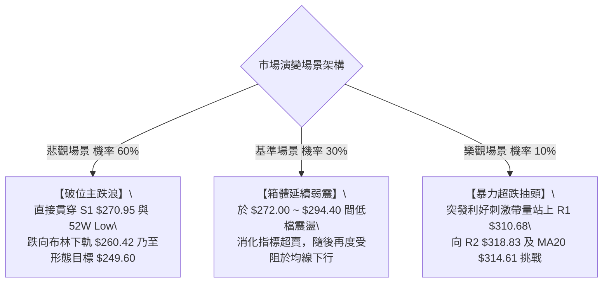

### 🛡️ 風險管理重要提醒

1. **高 ATR 波動下的部位縮減原則**：
   GOOG 當前 ATR 高達 **$10.61**，佔股價近 3.74%，處於典型的「寬幅震盪洗盤」狀態。在這種環境下，傳統的「重倉緊止損」交易法幾乎必死無疑。交易者必須將常態倉位**縮減至平時的 1/2 或 1/3**（單一策略曝險不超過總資產的 10%），拉寬止損距離以包容 $10~$15 美元的日內正常震盪。
2. **嚴禁主觀猜底逆勢搶反彈**：
   散戶投資者常見的致命錯誤是在均線空頭排列（MA20<50<200）且 ADX>30 的強空頭行情中，僅憑「RSI 超賣」或「價格跌了很多很便宜」便孤注一擲盲目做多。必須牢記：**超賣不是買進理由，超賣只意味著動能指標的數學極限，在單邊趨勢行情中，指標超賣往往會發生長時間的「低檔鈍化」，股價可在超賣區再跌20%**。
3. **隔夜跳空風險風控**：
   回顧 10-29 GOOG 曾無預警暴跌跳空超過36美元，顯示個股受消息面與財報面催化影響極深。持倉過夜必須做好最壞情況的跳空應對預案，嚴格透過期權對沖（如買入看跌期權保護）或嚴格控制隔夜槓桿。

---

## 📋 報告總結

```
╔══════════════════════════════════════════════════════════════════╗
║                     GOOG 技術分析報告總結                        ║
╠══════════════════════════════════════════════════════════════════╣
║ 報告日期：2026-11-08                                             ║
║ 當前價格：$283.93 USD                                            ║
║ 分析評級：🔴 偏空（強空頭趨勢中之短線超賣修復，綜合評分: 32/100）   ║
║                                                                  ║
║ 核心關鍵結論：                                                   ║
║ ├─ 長期趨勢：🔴 高檔派發崩跌，跌破 MA200 年線 ($337.23) 轉入熊市  ║
║ ├─ 中期趨勢：🔴 頭肩頂巨量破位，週線下行主跌浪持續發酵          ║
║ ├─ 短期趨勢：🟡 於 $272.00~$294.40 進行低檔弱勢箱體整理修復超賣  ║
║ ├─ 關鍵支撐：S1 $270.95 / 52週低點 $270.70 (跌破將開啟深淵)      ║
║ ├─ 關鍵阻力：R1 $310.68 (缺口下沿) / R2 $318.83 / MA20 $314.61   ║
║ └─ 市場分析師目標：均價 $402.67 (極度脫節，技術面與基本面強烈背離)║
║                                                                  ║
║ 最優交易策略組合：                                               ║
║ 1. 🥇 最佳機會（首選）：【策略 A 反彈高空】                      ║
║    待價格受阻於 $294.40~$299.22 時逢高佈空，進場 $296.81，      ║
║    止損 R1 $310.68，目標看 S1 $270.95 (風報比 1 : 1.86)。        ║
║ 2. 🥈 次選機會（順勢）：【策略 B 破位追空】                      ║
║    若 52W Low $270.70 被實體貫穿，順勢追空，目標布林下軌 $260.42║
║    止損設於 $278.22 (風報比 1 : 1.37)。                          ║
║ 3. 🥉 保守選擇（風控）：【全場觀望 / 嚴禁抄底】                  ║
║    靜待市場打出明確雙底形態或待站穩 R1 $310.68 缺口後，再行研判。 ║
╚══════════════════════════════════════════════════════════════════╝
```

---

> ⚠️ **免責聲明**：本報告為依據客觀量化技術指標與圖表幾何結構自動生成之研究報告，報告內所有數據、支撐阻力位與估算均源於所提供之歷史交易資訊。本報告**僅供研究、教學與學術參考**，**絕對不構成任何形式的證券買賣、投資建議或獲利保證**。金融市場瞬息萬變，技術指標存在滯後性與失效風險，投資人應獨立審慎評估自身風險承受能力，入市需極度謹慎。

---

*報告生成時間：2026-11-08 ｜ 數據來源：Yahoo Finance ｜ 分析框架：資深多時框量化技術分析*