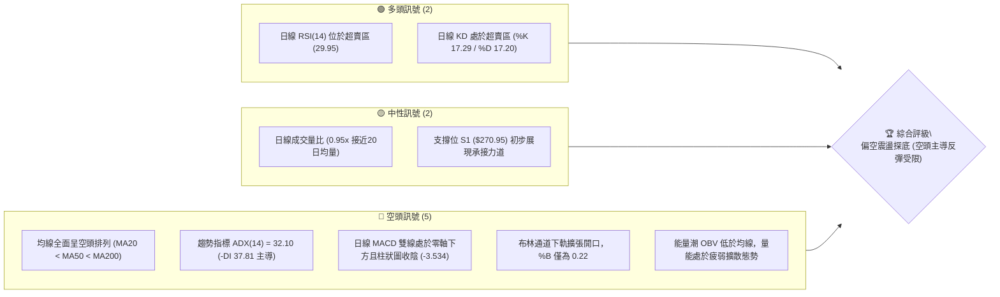
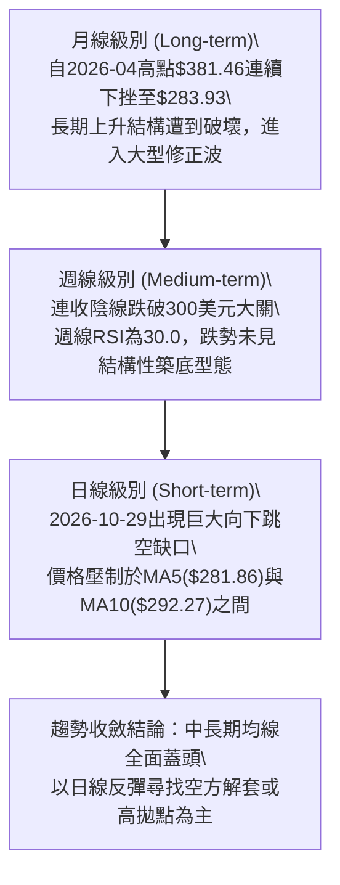
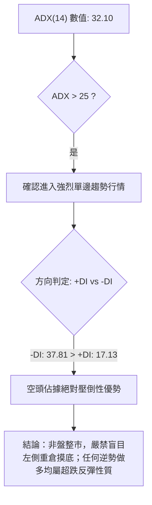
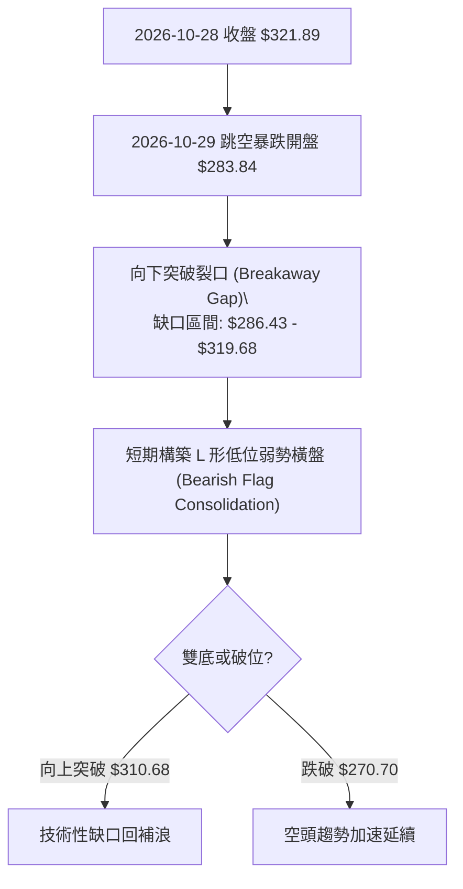
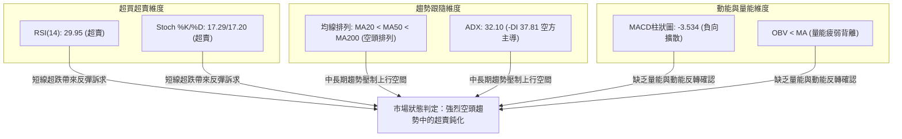
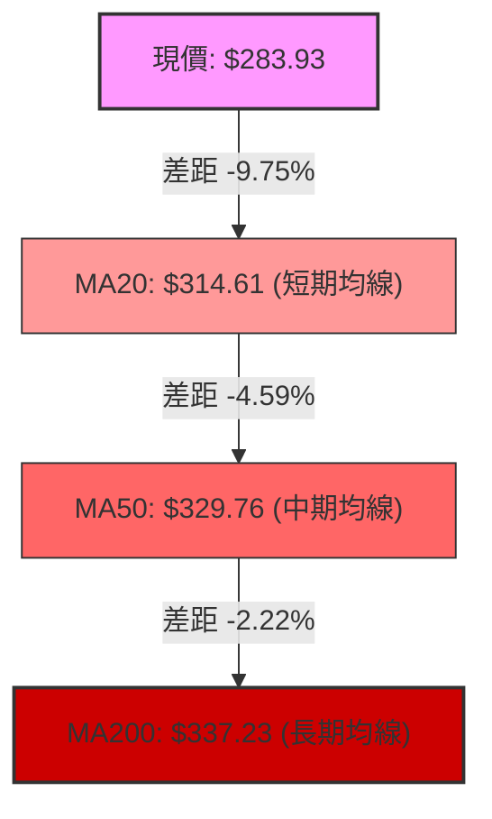
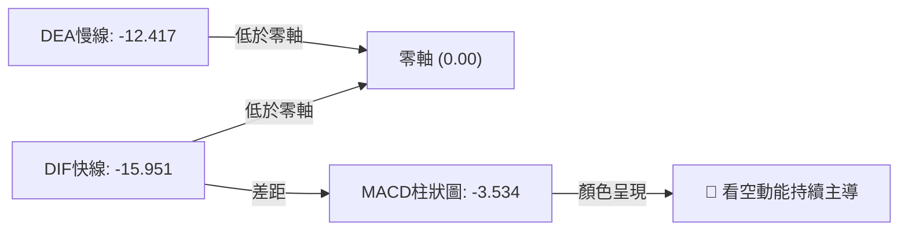
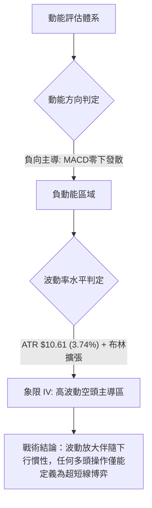
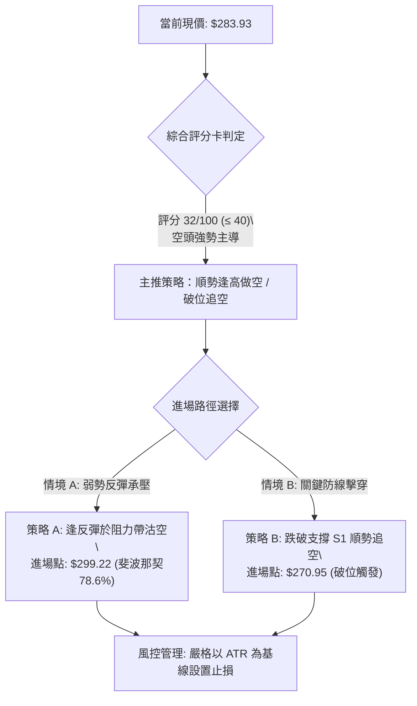
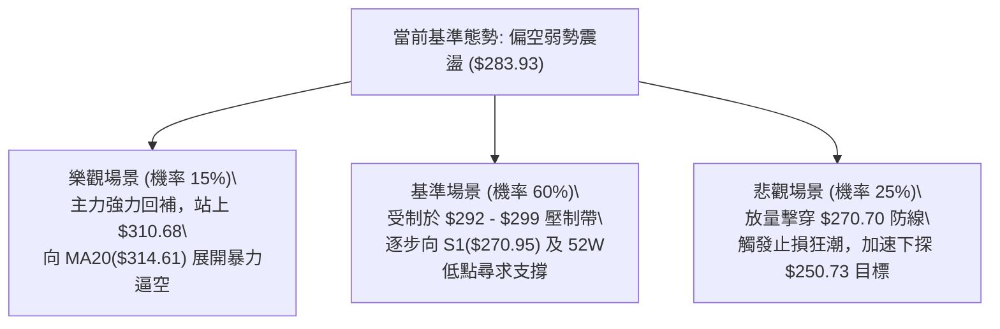

# GOOG 技術分析報告

> **報告日期**：2026-11-09 ｜ **語言**：繁體中文 ｜ **數據來源**：Yahoo Finance ｜ **當前價格**：$283.93

---

## 目錄

| 章節 | 內容 |
|------|------|
| [1. 技術面概覽](#1-技術面概覽) | 訊號儀表板、核心指標、評分卡 |
| [2. 趨勢分析](#2-趨勢分析) | 多時框趨勢、長中短期走勢 |
| [3. 圖表形態分析](#3-圖表形態分析) | 形態識別、K線組合、目標價 |
| [4. 支撐與阻力](#4-支撐與阻力) | 關鍵價位、斐波那契回調 |
| [5. 技術指標深度解讀](#5-技術指標深度解讀) | MA/RSI/MACD/布林/成交量 |
| [6. 動能與波動率](#6-動能與波動率) | 動能評估、ATR、Beta |
| [7. 多時框架總結](#7-多時框架總結) | 時框架評分矩陣 |
| [8. 交易策略建議](#8-交易策略建議) | 多空策略、風險報酬比 |
| [9. 風險提示與監控](#9-風險提示與監控) | 監控指標、風險場景 |

---

## 1. 技術面概覽

### 🎯 技術訊號儀表板



### 📊 核心指標速覽表

| 指標類別 | 指標名稱 | 當前數值 | 訊號 | 解讀 |
|----------|----------|----------|------|------|
| **價格** | 當前收盤價 | $283.93 | 🔴 | 位於52週高低區間底部 9.9% 處，整體結構處於深度回調階段 |
| **均線** | MA20 | $314.61 | 🔴 | 現價低於短期均線 -9.75%，形成第一道動態下壓阻力 |
| **均線** | MA50 | $329.76 | 🔴 | 現價低於中期均線 -13.90%，中期空頭壓制明確 |
| **均線** | MA200 | $337.23 | 🔴 | 現價低於長期均線 -15.80%，牛熊分界線失守，長期走勢轉弱 |
| **動能** | RSI(14) | 29.95 | 🟢 | 跌破 30 閾值進入技術性超賣區，具備短線技術性修復動能 |
| **動能** | MACD(12,26,9) | -15.951 / -12.417 | 🔴 | DIF 與 DEA 雙線深陷零軸下，柱狀體為 -3.534，空頭動能尚未鈍化 |
| **動能** | Stoch %K / %D | 17.29 / 17.20 | 🟢 | 雙線於 20 以下超賣鈍化，存在低檔金叉預期 |
| **趨勢** | ADX(14) | 32.10 | 🔴 | 數值大於 25 且 -DI(37.81) 遠高於 +DI(17.13)，屬於強烈空頭趨勢行情 |
| **波動** | ATR(14) | $10.61 | 🟡 | 佔股價 3.74%，每日波動顯著放大，市場情緒處於高敏感脆弱期 |
| **通道** | 布林通道 | 下軌 $260.42 / %B 0.22 | 🟡 | 價格緊貼下軌運行，尚未完全跌破下軌，但未觸發強勢反彈 |

### 🏆 技術評分卡

```
╔══════════════════════════════════════════════════════════════╗
║                技術評分卡 — GOOG (2026-11-09)                 ║
╠══════════════════════════════════════════════════════════════╣
║ 趨勢強度 (Trend)     ██████░░░░░░░░░░░░░░  30/100  🔴 空頭強勢  ║
║ 動能指標 (Momentum)  ████████░░░░░░░░░░░░  40/100  🟡 超賣醞釀  ║
║ 支撐穩定度 (Support) ████████░░░░░░░░░░░░  40/100  🟡 考驗低點  ║
║ 成交量配合 (Volume)  ██████░░░░░░░░░░░░░░  30/100  🔴 逢高量縮  ║
║ 形態完整度 (Pattern) ██████░░░░░░░░░░░░░░  30/100  🔴 空方跳空  ║
║ 均線排列 (MA System) ████░░░░░░░░░░░░░░░░  20/100  🔴 空頭排列  ║
╠══════════════════════════════════════════════════════════════╣
║ 綜合評分             ██████░░░░░░░░░░░░░░  32/100  🔴 強烈偏空  ║
║ 評分定義：六項算術平均 (30+40+40+30+30+20)/6 = 31.67 ≈ 32/100║
╚══════════════════════════════════════════════════════════════╝
```

---

## 2. 趨勢分析

### 🌐 多時框趨勢分析



### 📈 長期趨勢 — 12個月走勢圖（Unicode）

```
GOOG 月線收盤走勢圖（過去12個月：2025-12 至 2026-11）
價格軸 ($)
$390 ┤
$380 ┤                            ●(2026-04: $381.46)
$370 ┤                               ●(2026-05: $375.96)
$360 ┤                                   ●(2026-07: $356.42)
$350 ┤                                       ●(2026-06: $353.10)
$340 ┤                    ●(2026-01: $337.87)    ●(2026-09: $340.74)
$330 ┤                                               ●(2026-08: $335.19)
$320 ┤
$310 ┤●(2025-12: $313.19)    ●(2026-02: $310.82)
$300 ┤
$290 ┤                        ●(2026-03: $286.50)
$280 ┤                                                   ●(2026-10: $278.22)
$270 ┤                                                       ●(2026-11: $283.93)
     └─────────────────────────────────────────────────────────────
      12   01   02   03   04   05   06   07   08   09   10   11 (月份)
```

**走勢特徵分析表格**：

| 階段區間 | 起止月份 | 區間起止收盤價 | 區間漲跌幅 | 核心結構與量價特徵 |
|----------|----------|----------------|------------|--------------------|
| 第一階段：衝頂擴張 | 2025-12 至 2026-04 | $313.19 → $381.46 | +21.80% | 經歷2-3月拉回後於4月創下波段歷史新高，主力拉抬動能達到極致 |
| 第二階段：高檔震盪 | 2026-04 至 2026-07 | $381.46 → $356.42 | -6.56% | 呈現頂部籌碼派發特徵，多次衝擊高點未果，波動率收窄形成箱型頂 |
| 第三階段：重心下移 | 2026-07 至 2026-09 | $356.42 → $340.74 | -4.40% | 均線開始轉平並向下發散，成交量未見積極承接，高點逐次降低 |
| 第四階段：恐慌殺跌 | 2026-09 至 2026-11 | $340.74 → $283.93 | -16.67% | 10月出現重挫，月線大跌-18.35%，直接跌破各級長短均線支撐 |

### 📊 中期趨勢（週線分析）

在近 20 週的收盤歷程中，GOOG 自 2026-10-09 當週高點 $347.86 起展開跳水式下跌。2026-10-30 當週更爆出 208,382,100 股的天量，週線重挫 -12.31%，收盤跌至 $278.22。近期週線阻力與支撐格局呈現顯著的空頭階梯：

```
GOOG 週線近期壓力與支撐示意圖
══════════════════════════════════════════════════════════
[阻力 3] $327.81 ─── 前期平臺破位頸線 / 密集成交區
[阻力 2] $318.83 ─── 10月下旬反彈高點 / 週線MA20下壓位
[阻力 1] $310.68 ─── 日線波段高點聚類 / 心理防線
──────────────────────────────────────────────────────
[當前價] $283.93 ─── 試圖在超賣區域構築短期煞車平臺
──────────────────────────────────────────────────────
[支撐 1] $270.95 ─── 2026-11-03 低點 $272.00 / 52週低點 $270.70 緩衝區
══════════════════════════════════════════════════════════
```

### ⚡ 趨勢強度評估（ADX 解讀）



| 指標名稱 | 數值 | 臨界標準 | 趨勢性質判定 |
|----------|------|----------|--------------|
| **ADX(14)** | 32.10 | > 25 為趨勢市，> 30 為強趨勢 | 當前處於標準強烈趨勢運作階段，盤整指標失效 |
| **+DI(14)** | 17.13 | 數值偏低，多頭動能萎縮 | 買方缺乏持續推升價格意願 |
| **-DI(14)** | 37.81 | 數值高企，空方主導市場 | 空頭拋壓處於全面掌控狀態 |

---

## 3. 圖表形態分析

### 🔍 形態識別系統



**形態信心度評估表**：

| 形態名稱 | 信心度 | 判斷依據（引用數據） | 完成度 | 目標價（附計算式） |
|----------|--------|----------------------|--------|--------------------|
| 下向突破巨量缺口 | 85% | 2026-10-29 開盤 $283.84 直接跳空脫離前日低點 $319.68，成交量爆量至 93,133,900 股 | 100% | 缺口下緣阻力鎖定在 $286.43，缺口上緣阻力在 $319.68 |
| 低檔潛在雙重底雛形 | 45% | 2026-10-30 低點 $275.35 與 2026-11-03 低點 $272.00 形成低檔雙腳測試 | 35% | 信心度不足50%，僅做指標型超跌解讀；若以阻力R1 $310.68為頸線，高度=310.68-270.95=$39.73，理論多頭量度目標=310.68+39.73=$350.41（數據中未確認成型，暫不採用） |
| 空頭旗形整理 (Bear Flag) | 70% | 在 10-29 巨陰後，近6個交易日均收在 $278.04 至 $287.30 狹幅區間，成交量逐日遞減 | 65% | 旗桿高點 $321.89 跌至 $275.35（跌幅 $46.54）。若跌破支撐 S1 $270.95，形態推算量度跌幅目標 = 270.95 - 46.54 = $224.41（標注：由旗形高度推算） |

### 🕯️ 重要K線形態分析

依據近 10 根日 K 與近 8 根週 K 實際 OHLCV 數據進行精確解讀：

| 日期（週期） | 開盤價 | 最高價 | 最低價 | 收盤價 | K線形態名稱 | 技術解讀與量能驗證 | 訊號方向 |
|--------------|--------|--------|--------|--------|-------------|--------------------|----------|
| 2026-10-28 (日) | $319.88 | $323.13 | $319.68 | $321.89 | 帶上影小陽線 | 試圖上攻 R3($327.81) 失敗，成交量 35,355,900 股，多頭動能衰竭 | 🟡 轉折前兆 |
| 2026-10-29 (日) | $283.84 | $286.43 | $278.29 | $282.32 | 崩跌跳空黑K | 爆量 93,133,900 股下殺，跳空缺口徹底擊穿所有短期技術均線 | 🔴 極度看空 |
| 2026-10-30 (日) | $279.69 | $281.86 | $275.35 | $278.22 | 低檔弱勢陰線 | 恐慌延續，探底至 $275.35，收盤創階段新低，量能 45,116,500 股依然偏大 | 🔴 空方延續 |
| 2026-11-03 (日) | $279.19 | $280.34 | $272.00 | $278.27 | 長下影錘頭星線 | 最低下探至 $272.00 逼近 S1($270.95) 後獲得抄底資金承接拉回，量能萎縮至 23,372,300 股 | 🟢 短線止跌 |
| 2026-11-04 (日) | $281.48 | $294.40 | $281.33 | $287.30 | 長上影大陽線 | 多頭反撲衝高至 $294.40，但受制於 MA10($292.27) 拋壓引發回吐 | 🟡 衝高受阻 |
| 2026-11-05 (日) | $291.80 | $293.64 | $276.20 | $281.74 | 長陰吞噬反轉 | 高開低走，盤中下探 $276.20，量能放大至 41,149,900 股，多頭遭到空頭反撲 | 🔴 空頭壓制 |
| 2026-11-06 (日) | $283.42 | $289.22 | $283.00 | $283.93 | 縮量平衡小陽十字 | 收盤站上 MA5($281.86)，多空在 $283 附近暫時達成微弱平衡 | 🟡 短線猶豫 |
| 2026-10-30 (週) | $318.05 | $323.13 | $275.35 | $278.22 | 破位斷頭巨黑K | 週跌幅極大，成交量爆出 208,382,100 股天量，確認中期趨勢破位 | 🔴 強烈看空 |
| 2026-11-06 (週) | $280.58 | $294.40 | $272.00 | $283.93 | 低檔探底長下影小陽 | 週量 150,048,800 股，測試 52 週低點附近有防守，呈現超賣震盪止血 | 🟡 止血待確認 |

### 📉 ASCII 走勢形態示意圖

```
GOOG 近期日K線跳空破位與低位盤整示意圖
  $325 ┤       [10-28 高: 323.13]
  $320 ┤          █
  $315 ┤         ███
  ────────────────────────────────────── [跳空破位缺口 $319.68 - $286.43]
  $295 ┤                     ┌┬┐ [11-04 高: 294.40]
  $290 ┤                     │█│
  $285 ┤       ┌┬┐          │█│   ┌┬┐
  $280 ┤───────│█│──┌┬┐──┌┬┐─│█│───│█│───│█│── [當前現價: $283.93]
  $275 ┤       │█│  │█│  │█│ └┴┘   │█│   └┴┘
  $270 ┤       └┴┘  └┴┘  └┼┘        └┴┘ [11-03 低: 272.00 / S1: 270.95]
       └─────────────────────────────────────────────────
       日期:   10-29 10-30 11-02 11-03 11-04 11-05 11-06
```

### 🎯 形態目標價計算

根據日線空頭旗形（Bear Flag）結構推算：
1. **旗桿起點**：2026-10-28 波段高點 $323.13（收盤 $321.89）。
2. **旗桿終點**：2026-10-30 恐慌低點 $275.35。
3. **旗桿絕對高度**：$323.13 - $275.35 = $47.78（或以收盤價計：$321.89 - $278.22 = $43.67）。
4. **反彈旗面壓力上限**：2026-11-04 盤中高點 $294.40。
5. **形態下破延續目標價**：
   - 保守測算（以旗面高點 $294.40 扣除收盤價計算跌幅）：$294.40 - $43.67 = $250.73（標注：由旗形高度推算）。
   - 破位量度目標（以支撐位 S1 $270.95 為破位起點）：$270.95 - $43.67 = $227.28（標注：由旗形高度推算）。

---

## 4. 支撐與阻力

### 🗺️ 關鍵價位分布圖（Unicode）

```
GOOG 價位結構分布圖 (Resistance & Support Map)
═══════════════════════════════════════════════════════════════════
$337.33 ║██████████████████████████████║ 斐波那契 50.0% 回調位 / 長期 MA200
$327.81 ║████████████████████████      ║ 強阻力 R3 (近一年波段高點聚類)
$321.61 ║████████████████████          ║ 斐波那契 61.8% 回調位
$318.83 ║██████████████████████        ║ 阻力 R2 (近一年波段高點聚類)
$310.68 ║████████████████████████      ║ 關鍵阻力 R1 (波段高點聚類 / 跳空重壓)
$299.22 ║████████████                  ║ 斐波那契 78.6% 回調位 / 心理整數關卡
════════╠══════════════════════════════╣ ◄ 當前收盤價: $283.93
$270.95 ║▓▓▓▓▓▓▓▓▓▓▓▓▓▓▓▓▓▓▓▓▓▓▓▓▓▓    ║ 關鍵支撐 S1 (近一年波段低點聚類)
$270.70 ║██████████████████████████████║ 52週歷史低點 (斐波那契 100.0%)
═══════════════════════════════════════════════════════════════════
```

### 🚧 阻力位分析表

數據來源嚴格鎖定於波段高點聚類計算所得之關鍵阻力點：

| 阻力級別 | 價位精確值 | 與現價距離 | 形成原因與籌碼結構 | 突破難度 | 重要性 |
|----------|------------|------------|--------------------|----------|--------|
| **R1** | $310.68 | +9.42% | 近一年波段密集高點聚類；與 10-29 跳空巨量缺口下半部強烈共振，為多頭反彈首要考驗 | 🔴 極高 | ★★★★★ |
| **R2** | $318.83 | +12.29% | 2026-10-23 當週破位前收盤價聚類，亦為跳空缺口上緣起始區域，套牢賣壓沉重 | 🔴 高 | ★★★★☆ |
| **R3** | $327.81 | +15.46% | 近一年多次波段頂部聚類；跌破前的盤整平臺底層頸線，已被確認轉化為極強反壓 | 🔴 極高 | ★★★★☆ |

### 🛡️ 支撐位分析表

數據來源嚴格鎖定於波段低點聚類計算所得之關鍵支撐點：

| 支撐級別 | 價位精確值 | 與現價距離 | 形成原因與籌碼結構 | 守住機率 | 重要性 |
|----------|------------|------------|--------------------|----------|--------|
| **S1** | $270.95 | -4.57% | 近一年波段低點聚類；與 52 週最低點 $270.70 形成雙重底部防禦共振帶 | 🟡 55% | ★★★★★ |
| **S2** | 數據中未偵測到 | N/A（數據未提供） | S1 下方在近一年數據中無其他波段低點聚類數據，一旦擊穿將進入無籌碼真空區 | N/A | N/A |
| **S3** | 數據中未偵測到 | N/A（數據未提供） | 數據中未偵測到更低層級波段聚類支撐點 | N/A | N/A |

### 📐 斐波那契回調位分析

依據 52 週極值區間（低點 $270.70 → 高點 $403.96，全波段落差 $133.26）精確對照：

| 回調比例 | 斐波那契價位 | 當前相對位置與技術意義解讀 |
|----------|--------------|----------------------------|
| **0.0% (52W High)** | $403.96 | 52週歷史頂部，牛市終結起跌點 |
| **23.6%** | $372.51 | 高檔防守失敗點，現已退化為遠期歷史阻力 |
| **38.2%** | $353.06 | 2026-06與07月震盪中樞，失守後宣告中長期多頭結構破壞 |
| **50.0%** | $337.33 | 多空分水嶺，與 MA200($337.23) 幾乎完全重合，具極強技術象徵意義 |
| **61.8%** | $321.61 | 黃金分割重要防線，在10月下旬跳空大陰線中被無情摜破 |
| **78.6%** | $299.22 | 深度回調極限防守位，當前價格已跌破此位（落於 78.6% 與 100.0% 之間） |
| **100.0% (52W Low)**| $270.70 | 全年最後防線，距離當前收盤價僅有 4.88% 緩衝空間 |

**現價區間解讀**：
當前收盤價 $283.93 處於斐波那契 78.6% 回調位（$299.22）與 100.0% 低點（$270.70）之間的極度脆弱區間。此處屬於「深度回調衰竭區」，一方面跌破 78.6% 意味著整輪 52 週升浪已瀕臨完全回吐；另一方面，現價逼近 100.0% 回調位 $270.70，該價位與波段低點支撐 S1($270.95) 形成狹窄的共振防禦走廊，若能守穩可誘發雙底技術修復，若放量跌穿則開啟深淵式下跌。

---

## 5. 技術指標深度解讀

### 🎛️ 指標訊號總覽



### 📈 移動平均線排列分析



各週期均線全面呈現發散下行空頭排列（MA20 < MA50 < MA200）：
- **短期均線**：MA5 為 $281.86（現價在其上方 +0.74%），出現極短線走平反彈跡象；但 MA10 高懸於 $292.27（現價在其下方 -2.85%），構成第一波段壓制；MA20 則在 $314.61 呈陡峭下行，斜率為負。
- **中長期均線**：MA60($331.64)、MA120($344.21)、MA240($334.06) 均位於現價上方 14% 至 17% 之遙，形成密集空頭蓋頭群。空頭排列形態完整度極高，均線系統發出的看空訊號毫無疑義。

### 📉 RSI(14) 分析

- **當前 RSI(14) 數值**：**29.95**（Wilder 計算）
  - 超賣進度條：`██████░░░░░░░░░░░░░░` 29.95% 🟢 【觸及超賣閾值】
- **超買超賣狀態解讀**：
  RSI(14) 跌破 30 心理關口，客觀反映市場近兩週拋售情緒達到極端水平。在過去 20 個交易日內，價格由 $320 之上直線墜落，促使動能嚴重耗竭。
- **背離判斷**：
  - **日線背離狀況**：根據提供之數據檢驗，當前「無明顯背離」（近 20 根 K 棒首尾價格方向朝下，RSI 同步走低）。儘管 11-03 低點 $272.00 處 RSI 錄得極低值，11-06 收盤回升至 $283.93 時 RSI 回升至 29.95，兩者步調一致，**未構成日線底背離**。
  - **週線維度比對**：2026-10-30 週收盤 $278.22 時週 RSI 為 21.1；2026-11-06 週收盤 $283.93 時週 RSI 回升至 30.0，價格微幅反彈伴隨指標修復，屬正常同步波動，亦無底背離形成。
  - **結論**：超賣不等於立即反轉，在無背離支持的強空頭環境中，RSI 可能在 20–30 區間反覆鈍化。

### 📊 MACD(12,26,9) 訊號解讀



- **MACD 線**：-15.951
- **訊號線 (Signal Line)**：-12.417
- **柱狀圖 (Histogram)**：-3.534（負值）
- **解讀**：
  DIF 與 DEA 雙雙深墜於負值極深區域，且 DIF 持續運行於 DEA 之下。雖然週線柱狀圖負值自 10-30 當週的 -5.975 收窄至 11-06 當週的 -3.534，顯現週線級別賣壓略有減緩，但日線 MACD 仍未出現金叉收斂跡象，表明中短期動能仍牢牢被空方掌控，任何反彈均需先等待柱狀圖轉正及 DIF 走平。

### 📦 布林通道分析

```
GOOG 布林通道 (20, 2) 結構示意圖
  $370 ┤─────────────────────────────── 上軌: $368.80
       │
  $340 ┤
       │
  $315 ┤─────────────────────────────── 中軌(MA20): $314.61
       │
  $290 ┤       現價: $283.93  [%B = 0.22]
  $260 ┤─────────────────────────────── 下軌: $260.42
       └───────────────────────────────
```

- **通道參數與現狀**：
  - **上軌**：$368.80
  - **中軌 (MA20)**：$314.61
  - **下軌**：$260.42
  - **帶寬 (Bandwidth)**：($368.80 - $260.42) / $314.61 = 34.45%（開口劇烈擴張）
  - **%B 指標**：0.22（處於 0 至 0.5 之間，顯著偏向弱勢下軌區域）
- **通道行為解讀**：
  自 10 月底向下跳空暴跌以來，布林帶急劇「張口」，價格一度刺穿下軌，隨後沿著下軌與中軌下半區運行。%B 為 0.22 說明現價雖未貼壁下軌滑行（未跌破 0），但距離中軌 $314.61 有高達 $30.68 的負乖離率。這種極端擴張的帶寬表明波動率已達極值，短期內價格有向中軌靠攏修復技術乖離的傾向，但中軌 $314.61 將構成強大磁吸與壓制位。

### 💹 成交量分析（量價配合度）

- **最新日成交量**：24,585,600 股
- **20日平均量**：25,853,110 股（量比：0.95x）
- **50日平均量**：20,432,908 股
- **能量潮 OBV**：處於 OBV < MA 狀態，趨勢向下，量能疲弱。
- **量價形態辨識**：
  1. **爆量殺跌**：2026-10-29 跳空崩跌時爆出 93,133,900 股的天量，為 20 日均量的 3.6 倍，顯現主力資金恐慌性奪路而逃與強平籌碼湧出。
  2. **縮量反彈**：在隨後的反彈嘗試中（如 11-04 衝高 $294.40），成交量僅微幅放大至 31,709,200 股；而 11-06 收小陽線時成交量萎縮至 24,585,600 股（量比 0.95x）。
  3. **量價背離結論**：典型的「下跌放量、反彈縮量」空頭量價特徵。OBV 低於其移動平均線進一步印證了市場籌碼處於淨流出通道，缺乏機構級主動買盤進行底部分配。

---

## 6. 動能與波動率

### ⚡ 動能評估四象限

根據 GOOG 當前的動能指標（RSI=29.95、MACD Hist=-3.534）與波動率特徵（ATR 佔比 3.74%、布林帶寬 34.45%），對其在動能/波動率坐標系進行定位：

| 象限 | 動能方向與強度 | 波動率水平 | 當前所處狀態 | 戰略應對評估 |
|------|----------------|------------|--------------|--------------|
| **象限 I** | 強烈正向動能 | 低波動率 | — | 最理想牛市單邊主升浪 |
| **象限 II**| 正向/反彈動能 | 高波動率 | — | 突破與暴拉行情，多頭持股 |
| **象限 III**| 負向/空頭動能 | 低波動率 | — | 陰跌與無量盤跌，資金逐步撤離 |
| **象限 IV**| **極強負向動能** | **極高波動率** | **✓ (當前所處象限)** | **恐慌殺跌與高波震盪，嚴格防範下行風險** |



### 📊 ATR 波動率分析

- **ATR(14) 數值**：**$10.61**（Wilder 計算）
- **價格佔比**：3.74%（高於大型科技股平均 1.5%–2.2% 區間）
- **動態止損與進場安全邊界測算**：
  - **波段交易安全止損距離**：建議設定為 1.5 至 2.0 倍 ATR，即 $15.92 至 $21.22。
  - **日內日內回撤防護位**：以 1.0 倍 ATR（$10.61）作為日內破位過濾器。
  - **意涵解讀**：當前每日價格擺動空間超過 10 美元，意味著市場定價極不穩定，薄弱的買盤深度容易被大額市價單擊穿，任何緊湊止損（< $5.00）極易被市場雜波清洗。

### 📐 Beta 與市場相關性

- **Beta 係數**：**1.226**
- **市場敏感度分析**：
  GOOG 的 Beta 達到 1.226，顯示其波動幅度相較標普 500 指數高出 22.6%。在當前 Communication Services 板塊與科技權重股受整體 AI 投資持續性疑慮（近期新聞聚焦「How sustainable is the AI investment boom after Thursday’s selloff?」）困擾的背景下，高 Beta 意味著若大盤遭遇宏觀流動性收緊或技術性回調，GOOG 將承擔不成比例的放大下行風險。

---

## 7. 多時框架總結

### 📋 時框架評分表

| 時框架 | 趨勢方向 | 動能狀態 | 均線排列 | 核心形態識別 | 綜合評分 | 戰術建議 |
|--------|----------|----------|----------|--------------|----------|----------|
| **月線級別** | 🔴 空頭修正 | 🔴 動能衰竭 | 🟡 跌破MA10 | 高檔雙頂回吐浪 | 35/100 | 長線倉位縮減，暫停定投 |
| **週線級別** | 🔴 明確破位 | 🔴 MACD負向 | 🔴 跌破多條MA | 天量長陰破位下行 | 25/100 | 禁止建立中線做多底倉 |
| **日線級別** | 🔴 跌勢未止 | 🟢 超賣鈍化 | 🔴 空頭排列 | 低檔旗形窄幅震盪 | 35/100 | 僅供激進者輕倉博弈超跌 |

### 🔲 綜合訊號矩陣

```
時框架訊號一致性檢驗矩陣
═══════════════════════════════════════════════════════════════════
維度            短期 (日線)       中期 (週線)       長期 (月線)
───────────────────────────────────────────────────────────────────
趨勢指標 (MA/ADX)   🔴 強烈看空       🔴 強烈看空       🔴 偏向看空
動能指標 (RSI/MACD) 🟡 超賣反彈預期   🔴 空方發散       🔴 轉折向下
量價結構 (VOL/OBV)  🔴 縮量反彈       🔴 破位放量       🔴 高位派發
結構形態 (Patterns) 🟡 旗形震盪       🔴 破位斷頭       🔴 頂部確立
═══════════════════════════════════════════════════════════════════
共振結論：多時框方向性訊號高度共振於「空頭市場」，超賣僅存在於日線微觀層面。
```

### ⚖️ 多時框收斂結論

依據多時框收斂規則（規則 14）：
1. **行情屬性判定**：當前趨勢指標 ADX(14) 數值為 **32.10**（明確 > 25），且 -DI(37.81) 碾壓 +DI(17.13)，系統判定當前處於**典型的強烈單邊趨勢行情（空頭趨勢）**，而非盤整震盪市。
2. **優先級收斂原則**：在單邊趨勢行情下，中長期週線級別及均線系統（MA50 $329.76、MA200 $337.23）的方向佔據最高主導權。日線級別出現的 RSI 超賣（29.95）僅能定性為日線微觀反彈，嚴禁依據日線超賣直接給出「全面翻多」結論。日線級別的任何反彈動作，均被定義為中長期空頭趨勢下的技術性解套波。
3. **唯一方向性結論**：**強烈偏空（逢高做空或反彈減磅為唯一核心邏輯）**。

---

## 8. 交易策略建議

### 🗺️ 策略決策流程圖



### 🧭 策略路由

**當前主策略方向 = 強烈偏空（主推空頭策略，依評分 32/100）**

根據系統規則，第 1 章技術評分卡綜合評分為 **32/100**（≤ 40），系統鎖定主推空頭策略。多頭反彈僅列為反轉風險提示與對沖參考，嚴禁在此評分下兩頭下注。

### 🎯 價格情境階梯（Price Scenarios）

價位嚴格引用數據中 OHLCV 計算之關鍵高低點聚類與斐波那契位：

| 觸發條件 | 下一目標 | 後續延伸 | 情境技術含義 |
|----------|----------|----------|--------------|
| 強勢反彈突破 R1 **$310.68** | R2 **$318.83** | R3 **$327.81** | 空頭陷阱化解，封閉部分跳空缺口，短線轉強 |
| 受制於斐波那契 **$299.22** | S1 **$270.95** | 52W低點 **$270.70** | 反彈確認無力，維持日線空頭旗形弱勢震盪 |
| 放量跌破 S1 **$270.95** | 52W低點 **$270.70** | $250.73（由旗形高度推算） | 擊穿全年最核心防線，開啟新一輪恐慌單邊暴跌 |

### 📊 情境機率分佈

| 情境劇本 | 發生機率 | 主要技術依據 |
|----------|----------|--------------|
| **弱勢回落 / 再探破位 (Bearish)** | **60%** | ADX 高達 32.10，均線空頭排列，OBV 疲軟未見主力抄底，10-29 跳空巨陰壓制沉重 |
| **區間弱勢震盪 (Consolidation)** | **25%** | 日線 RSI(29.95) 與 KD 嚴重超賣，S1($270.95) 處有微弱逢低護盤承接力 |
| **強勢反彈回補缺口 (Bullish Bounce)**| **15%** | 僅依賴分析師平均目標價 $402.67 的長線基本面預期，技術面上缺乏量能與均線配合 |

### 🟢 主策略詳情（空頭主導路由）

嚴格依據規則 17 計算風險報酬比：`(進場價 − 目標價) ÷ (止損價 − 進場價)`：

| 策略要素 | 策略 A（反彈高空 — 逢阻力沽空） | 策略 B（破位追空 — 順勢下行） |
|----------|----------------------------------|--------------------------------|
| **策略類型** | 順勢逢高做空 (Fade the Rally) | 關鍵支撐破位做空 (Breakdown Short) |
| **進場條件** | 價格反彈至斐波那契 78.6% 位遇阻回落，日K收上影線 | 日線收盤價跌破波段低點支撐 S1 |
| **進場價格** | **$299.22**（斐波那契 78.6% 回調位） | **$270.95**（支撐位 S1） |
| **目標價 T1** | **$270.95**（支撐位 S1） | **$250.73**（標注：由旗形高度推算） |
| **目標價 T2** | **$250.73**（標注：由旗形高度推算） | **$227.28**（標注：由旗形高度推算） |
| **止損價格** | **$310.68**（關鍵阻力位 R1） | **$281.86**（當前 MA5 均線位置） |
| **風險報酬比** | **1 : 2.47（以 T1 計）**<br>計算式：(299.22-270.95)/(310.68-299.22) = 28.27/11.46 = 2.4668<br>另附：1 : 4.23（以 T2 計） | **1 : 1.85（以 T1 計）**<br>計算式：(270.95-250.73)/(281.86-270.95) = 20.22/10.91 = 1.8533<br>另附：1 : 4.00（以 T2 計） |
| **成功機率** | 65% | 60% |
| **建議倉位** | 15% - 20% | 10% - 15% |

### 🔴 反向風險觸發點（對沖提示）

若市場出現以下情況，主空頭策略立即失效，空單必須無條件止損離場：
1. **價位警訊**：日線收盤價強勢站穩阻力位 **R1 ($310.68)** 之上，確認回補 10-29 跳空缺口下緣，此時空頭架構遭到破壞。
2. **指標警訊**：日線 MACD 在零軸下方完成「黃金交叉」，且柱狀圖由負轉正；同時 ADX 跌破 25 進入趨勢衰竭狀態。

### ⭐ 整體訊號強度評星

```
做多訊號強度：★☆☆☆☆  (1/5星 - 僅有超賣，無底背離與反轉架構)
做空訊號強度：★★★★☆  (4/5星 - 均線空頭排列，趨勢強度ADX達標)
整體可信度：  ★★★★☆  (4/5星 - 多時框共振度高，量價結構吻合)
```

---

## 9. 風險提示與監控

### ✅ 關鍵監控指標 Checklist

```
╔══════════════════════════════════════════════════════════════╗
║               GOOG 日常交易關鍵技術監控清單                  ║
╠══════════════════════════════════════════════════════════════╣
║ [ ] 監控點 1：收盤價是否跌穿 52 週最低點 $270.70 / S1 $270.95║
║ [ ] 監控點 2：反彈是否於斐波那契位 $299.22 再次出現縮量滯漲   ║
║ [ ] 監控點 3：日線 RSI(14) 是否脫離超賣區（升破 35）形成修復 ║
║ [ ] 監控點 4：ADX(14) 數值是否維持在 30 以上（驗證空頭趨勢）   ║
║ [ ] 監控點 5：單日成交量是否異常超越 5000 萬股（主力異動確認）║
╚══════════════════════════════════════════════════════════════╝
```

### ⚠️ 風險場景分析



### 🛡️ 風險管理重要提醒

1. **左側抄底風險**：
   在 ADX = 32.10 的強烈空頭趨勢中，RSI 超賣往往伴隨「鈍化後再下挫」。技術分析歷史表明，在缺乏明確頭肩底或雙底頸線突破前，任何憑「感覺便宜」的盲目左側進場均面臨極高的破位虧損風險。
2. **倉位與資金控管**：
   鑑於 ATR 高達 $10.61（波動率 3.74%），單筆交易的風險暴露金額不得超過總投資組合淨值的 1.0%。若以策略 A 為例（止損距離 $11.46），持倉規模應嚴格限制於總資產的 15% 以內。
3. **重大宏觀與產業事件對沖**：
   近期科技板塊受 AI 資本開支可持續性辯論（Capex 居高不下而利潤增長放緩，GOOG 最新季度 EPS 年增率為 -25.3%）影響深遠。技術面破位背後隱含基本面預期下修，切勿將分析師目標價（$402.67）視為短期技術保護傘。

---

## 📋 報告總結

```
╔══════════════════════════════════════════════════════════════╗
║                   GOOG 技術分析報告總結                      ║
╠══════════════════════════════════════════════════════════════╣
║ 報告日期：2026-11-09                                         ║
║ 當前價格：$283.93                                            ║
║ 分析評級：🔴 強烈偏空（綜合評分：32/100）                    ║
║                                                              ║
║ 關鍵結論：                                                   ║
║ ├─ 長期趨勢：🔴 跌破MA200，大型高檔派發結構確立              ║
║ ├─ 中期趨勢：🔴 週線爆量長陰摜破平臺，進入單邊下行通道       ║
║ ├─ 短期趨勢：🟡 日線超賣帶來微弱反抽，受制於跳空缺口重壓     ║
║ ├─ 關鍵支撐：S1: $270.95 / 52W低點: $270.70                 ║
║ ├─ 關鍵阻力：R1: $310.68 / R2: $318.83 / R3: $327.81         ║
║ └─ 斐波阻力：78.6% 回調位: $299.22                           ║
║                                                              ║
║ 最優策略組合：                                               ║
║ 1. 🥇 最佳機會：策略 A — 逢反彈至 $299.22 沽空，目標 $270.95 ║
║ 2. 🥈 次選機會：策略 B — 跌破 $270.95 追空，目標 $250.73     ║
║ 3. 🥉 保守選擇：完全空倉觀望，靜待日線級別底背離或結構形成  ║
╚══════════════════════════════════════════════════════════════╝
```

---

> ⚠️ **免責聲明**：本報告為 AI 自動生成之技術分析，所有數據及估算均基於提供的歷史價格資訊。本報告**僅供研究與學術參考**，**不構成任何投資建議**。投資有風險，入市需謹慎。

---

*報告生成時間：2026-11-09 ｜ 數據來源：Yahoo Finance ｜ 分析框架：多時框技術分析*