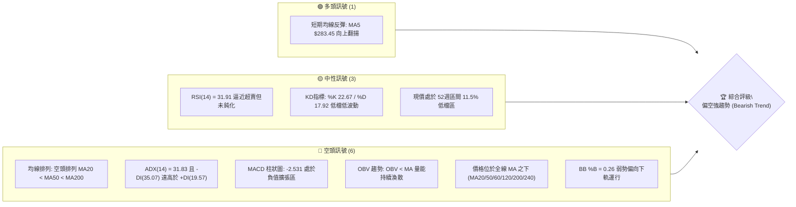
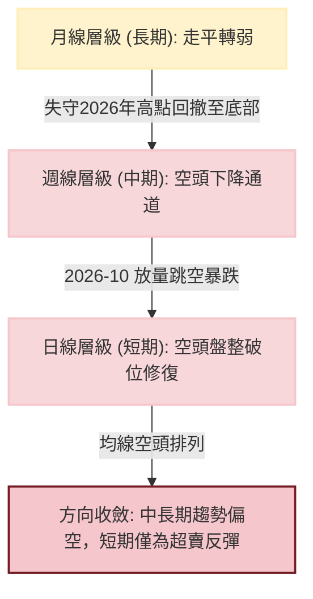
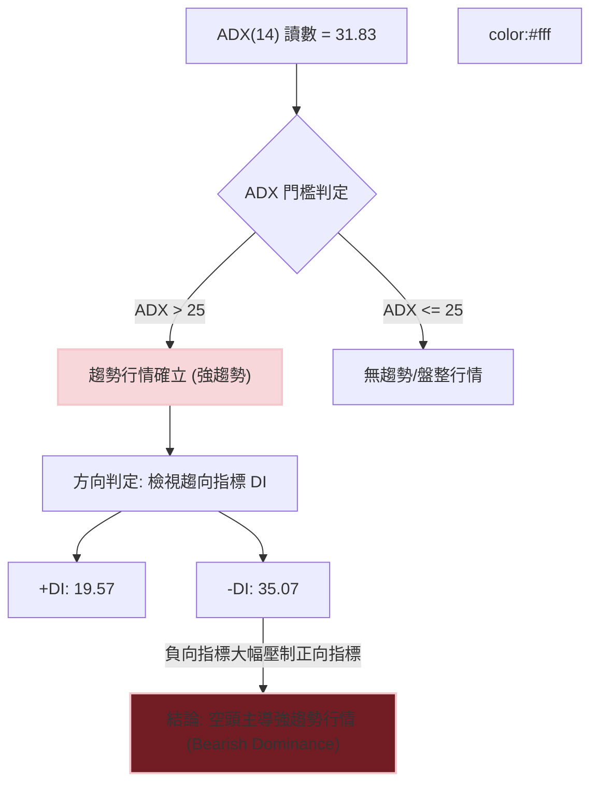
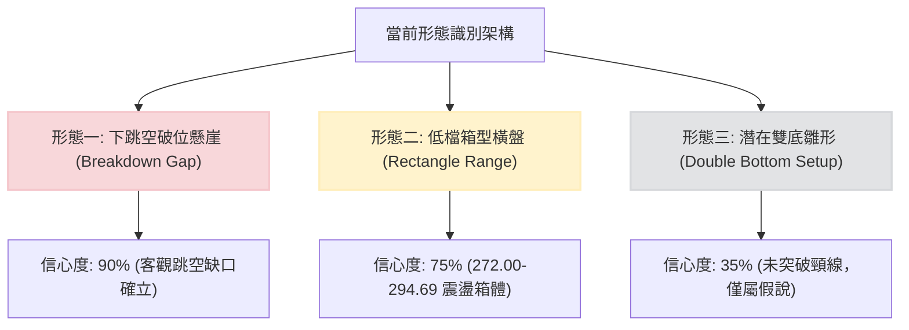
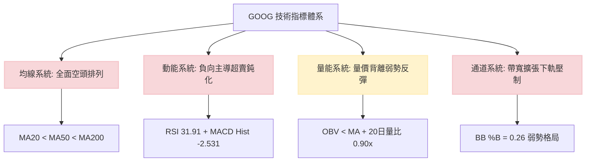
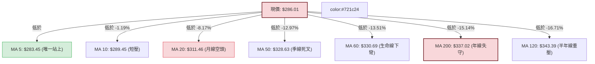
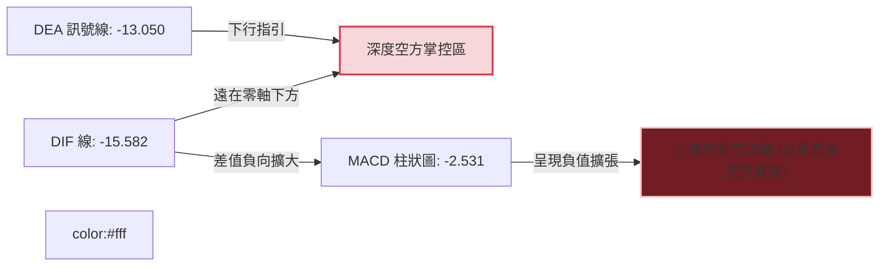
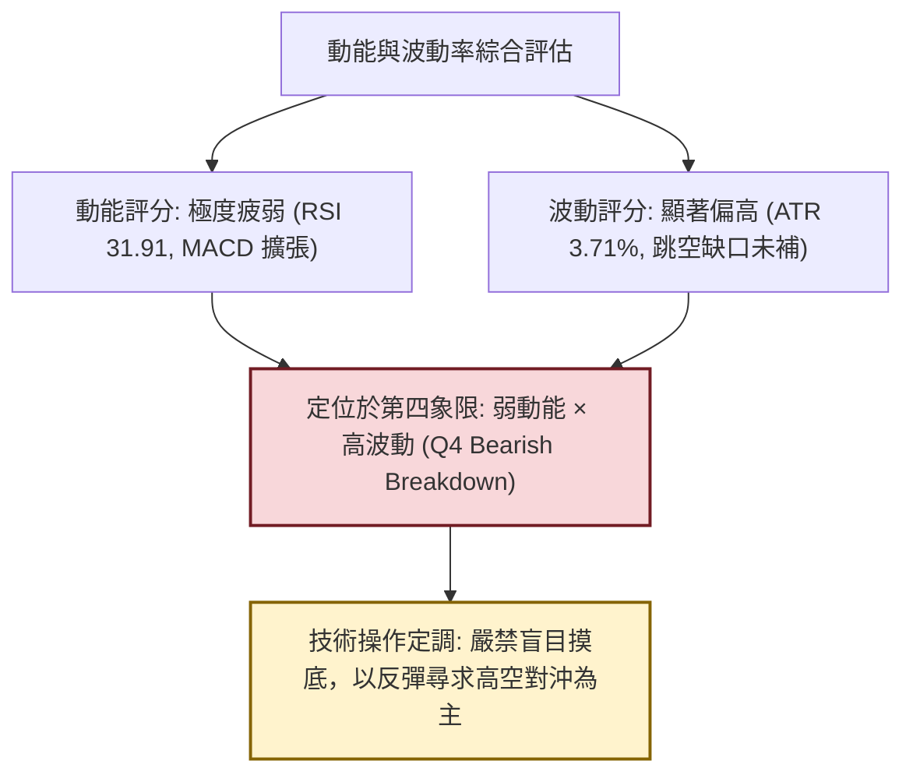
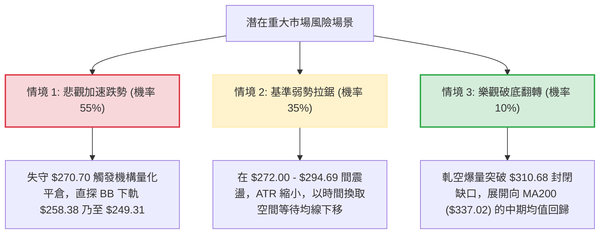

# GOOG 技術分析報告

> **報告日期**：2026-11-10 ｜ **語言**：繁體中文 ｜ **數據來源**：Yahoo Finance ｜ **當前價格**：$286.01 USD

---

## 目錄

| 章節 | 內容 |
|------|------|
| [1. 技術面概覽](#1-技術面概覽) | 訊號儀表板、核心指標、評分卡 |
| [2. 趨勢分析](#2-趨勢分析) | 多時框趨勢、長中短期走勢、ADX解讀 |
| [3. 圖表形態分析](#3-圖表形態分析) | 形態識別、K線組合、目標價計算 |
| [4. 支撐與阻力](#4-支撐與阻力) | 關鍵價位分布、阻力支撐表、斐波那契回調 |
| [5. 技術指標深度解讀](#5-技術指標深度解讀) | 均線系統、RSI、MACD、布林通道、成交量與OBV |
| [6. 動能與波動率](#6-動能與波動率) | 動能四象限、ATR波動分析、Beta市場關聯 |
| [7. 多時框架總結](#7-多時框架總結) | 時框架矩陣、多時框收斂定調 |
| [8. 交易策略建議](#8-交易策略建議) | 策略路由、價格情境、主策略詳情、對沖風控 |
| [9. 風險提示與監控](#9-風險提示與監控) | 關鍵監控清單、風險情境、資金管理提醒 |
| [10. 報告總結](#-報告總結) | 核心結論與執行優先級速查 |

---

## 1. 技術面概覽

### 🎯 技術訊號儀表板



---

### 📊 核心指標速覽表

| 指標類別 | 指標名稱 | 當前數值 | 訊號 | 解讀與技術含義 |
|:---|:---|:---|:---:|:---|
| **價格基準** | 當前價格 | $286.01 | 🔴 | 位於 52 週高低區間之 11.5%，貼近波段底部震盪 |
| **均線系統** | MA20 (月線) | $311.46 | 🔴 | 價格低於 MA20 達 -8.17%，中期下降斜率陡峭 |
| **均線系統** | MA50 (季線) | $328.63 | 🔴 | 價格低於 MA50 達 -12.97%，中期趨勢受制空頭反壓 |
| **均線系統** | MA200 (年線)| $337.02 | 🔴 | 價格低於 MA200 達 -15.14%，長期牛熊分水嶺已失守 |
| **動能指標** | RSI(14) | 31.91 | 🟡 | 位於弱勢區間（30–70），無底背離，下行動能尚未衰竭 |
| **動能指標** | MACD (12,26,9) | -15.582 | 🔴 | DIF 線低於訊號線 (-13.050)，Hist 負值擴大至 -2.531 |
| **趨勢強度** | ADX(14) | 31.83 | 🔴 | ADX > 25 確立趨勢行情；-DI(35.07) > +DI(19.57) 空方絕對主導 |
| **通道指標** | 布林通道 (%B) | 0.26 | 🔴 | 價格處於中軌 ($311.46) 與下軌 ($258.38) 間之弱勢區 |
| **成交量能** | 20日成交量比 | 0.90x | 🟡 | 最新量 23.93M 低於 20日均量 26.46M，量縮弱勢整理 |
| **波動率** | ATR(14) | $10.62 | 🔴 | 波動佔股價 3.71%，跳空後價格日波幅顯著擴大 |

---

### 🏆 技術評分卡

評分機制採絕對客觀指標評估（0–100 分，60 分以上偏多，40–60 分中性，40 分以下偏空）：

```
╔══════════════════════════════════════════════════════════════════╗
║                    技術評分卡 — GOOG (2026-11-10)                ║
╠══════════════════════════════════════════════════════════════════╣
║ 趨勢強度 (ADX/-DI)   █████░░░░░░░░░░░░░░░  25/100 🔴 空頭強勢主導║
║ 動能指標 (RSI/MACD)  ██████░░░░░░░░░░░░░░  30/100 🔴 動能深陷負區║
║ 支撐穩定度 (S1/52W)  █████████░░░░░░░░░░░  45/100 🟡 考驗低點支撐║
║ 成交量配合 (OBV/VOL) ███████░░░░░░░░░░░░░  35/100 🔴 價跌放量彈量縮║
║ 形態完整度 (GAP/BOX) ███████░░░░░░░░░░░░░  35/100 🔴 破位缺口未補║
║ 均線排列 (MA20/50/200)██░░░░░░░░░░░░░░░░░  10/100 🔴 典型空頭排列║
╠══════════════════════════════════════════════════════════════════╣
║ 綜合評分             ██████░░░░░░░░░░░░░░  30/100 🔴 強烈偏空    ║
╚══════════════════════════════════════════════════════════════════╝
```

*計算依據（規則 18）：(25 + 30 + 45 + 35 + 35 + 10) ÷ 6 = 180 ÷ 6 = 30 分（四捨五入至整數）。*

---

## 2. 趨勢分析

### 🌐 多時框趨勢分析



---

### 📈 長期趨勢 — 12個月走勢圖（Unicode）

以下為 GOOG 過去 12 個月（2025-12 至 2026-11）之月線收盤價歷史軌跡繪製：

```
GOOG 月線收盤走勢圖（過去12個月）
價格軸 ($)
$390 ┤
$380 ┤                                      ● (2026-04: $381.46 波段頂部)
$370 ┤                                  ●
$360 ┤                              ●   ●
$350 ┤                          ●
$340 ┤                  ●                   ●
$330 ┤                                          ●
$320 ┤
$310 ┤          ●       ●
$300 ┤
$290 ┤                                              ●← 現價 ($286.01)
$280 ┤                                          ● (2026-10: $278.22 波段低點)
$270 ┤
     └──────┬───────┬───────┬───────┬───────┬───────┬───────┬───────►
          25-12   26-01   26-03   26-04   26-06   26-08   26-10   26-11
```

#### 走勢特徵分析表格

| 階段區間 | 起止月份 | 區間起止價 | 漲跌幅 | 成交量特徵與核心催化事件 |
|:---|:---:|:---:|:---:|:---|
| **主升攻擊段** | 2025-12 → 2026-04 | $313.19 → $381.46 | **+21.80%** | 多頭量增推進，創下 52 週高點 $403.96 之歷史高位區 |
| **頭部派發段** | 2026-05 → 2026-09 | $375.96 → $340.74 | **-9.37%** | 高檔橫盤滯漲，週均量縮減，均線開始纏繞走平 |
| **破位崩跌段** | 2026-09 → 2026-10 | $340.74 → $278.22 | **-18.35%** | 財報/新聞利空打擊，10月最後一週放量至 2.08億股暴跌 |
| **底部築底段** | 2026-10 → 2026-11 | $278.22 → $286.01 | **+2.80%** | 於 52週低點 $270.70 上方縮量收斂，尋求短期雙底 |

---

### 📊 中期趨勢（週線分析）

中期走勢受制於 2026 年 10 月底形成的巨型跳空陰線。近期 8 週收盤價結構顯示，市場在經歷極度拋售後，進入抵抗性弱勢反彈：

```
中期週線結構示意圖
$360 ┤   ● (09-25: $341.08)
$350 ┤       ● (10-09: $347.86)
$340 ┤           ● (10-16: $336.91)
$330 ┤
$320 ┤               ● (10-23: $317.28)  ◄── 波段頸線破位
$310 ┤
$300 ┤                                   ▲ 跳空缺口下沿阻力區 ($299.22~$310.68)
$290 ┤                                   │
$280 ┤                   ● (10-30: $278.22)──● (11-06: $283.93) ──● (現價 $286.01)
$270 ┤                   ▲ S1 關鍵防線支撐 ($270.95 / 52W Low $270.70)
```

---

### ⚡ 趨勢強度評估（ADX 解讀）



#### ADX 趨勢強度對照表

| 指標變數 | 當前讀數 | 門檻區間 | 當前市場狀態判定 |
|:---|:---:|:---:|:---|
| **ADX (14)** | **31.83** | > 25.00 | **強趨勢確立**（非低動能震盪盤整） |
| **+DI (14)** | **19.57** | < 20.00 | 多方攻擊動能極度疲弱 |
| **-DI (14)** | **35.07** | > 30.00 | 空方力量高度掌控盤面，處於主動拋壓狀態 |
| **方向差距 (DI Spread)**| **-15.50** | 絕對值擴大 | 空方絕對主導，任何無量反彈皆屬空頭中繼架構 |

---

## 3. 圖表形態分析

### 🔍 形態識別系統



#### 形態識別與信心度評估表

| 識別形態 | 信心度 | 判斷依據（嚴格引用數據） | 當前完成度 | 目標價推算（附精確計算式） |
|:---|:---:|:---|:---:|:---|
| **下跳空破位形態** | **90%** | 2026-10-28 收盤 $321.89，次日 10-29 跳空開低於 $283.84，遺留 $38.05 之空方跳空缺口 | 100% | 缺口下緣壓力為 $294.69（近期反彈高點），完全封閉需突破 R1 $310.68 |
| **低位箱型震盪** | **75%** | 近 6 根日 K 拘束於最低 $272.00 與最高 $294.69 之狹幅區間內運作 | 70% | 箱體高度 = $294.69 − $272.00 = $22.69；若下破 $272.00，目標 = $272.00 − $22.69 = **$249.31** |
| **微型雙底雛形** | **35%** | 第一隻腳 10-30 低點 $275.35，第二隻腳 11-03 低點 $272.00；尚未跨越頸線 $294.69 | 30% | *信心度 < 50%，依規則 15 判定訊號不足，僅做指標型低檔觀察，不可視為成立形態* |

---

### 🕯️ 重要 K 線形態分析

依嚴格規則 19，本節僅採用數據中已列出的近 10 根日 K 與近 8 根週 K 之開、高、低、收數據進行客觀解讀：

#### 近 10 根日 K 線組合解析

| 日期 (日K) | 開盤價 | 最高價 | 最低價 | 收盤價 | 成交量 | K線形態名稱 | 技術解讀與多空意涵 | 訊號 |
|:---:|:---:|:---:|:---:|:---:|:---:|:---:|:---|:---:|
| **10-27** | 314.40 | 320.07 | 313.58 | 316.83 | 17,786,400 | 溫和實體陽線 | 破位前的窄幅抵抗，量能低迷 | 🟡 |
| **10-28** | 319.88 | 323.13 | 319.68 | 321.89 | 35,355,900 | 上影小陽線 | 測試上方壓力失敗，成交量微放大，實為最後誘多 | 🟡 |
| **10-29** | 283.84 | 286.43 | 278.29 | 282.32 | 93,133,900 | **巨量跳空大陰線** | 巨大向下跳空缺口（開盤重挫），爆量出逃，主力全面派發 | 🔴 |
| **10-30** | 279.69 | 281.86 | 275.35 | 278.22 | 45,116,500 | 延續跳空黑K | 慣性下挫創波段收盤新低 $278.22，空頭牢固掌控 | 🔴 |
| **11-02** | 280.58 | 285.21 | 277.78 | 278.04 | 29,231,800 | 紡錘十字陰線 | 高低點收斂，市場進入極度恐慌後的遲疑觀望期 | 🟡 |
| **11-03** | 279.19 | 280.34 | 272.00 | 278.27 | 23,372,300 | **長下影線錘頭** | 探底 $272.00 逼近 52W 低點後獲逢低買盤拉升，出現止跌信號 | 🟢 |
| **11-04** | 281.48 | 294.40 | 281.33 | 287.30 | 31,709,200 | 長實體紅K | 破底後強勁反彈，突破 MA5，多頭展開技術性自救 | 🟢 |
| **11-05** | 291.80 | 293.64 | 276.20 | 281.74 | 41,149,900 | **高檔長黑陰線** | 開高走低倒灌，日內重挫逾 15 元，顯示上方解套賣壓沉重 | 🔴 |
| **11-06** | 283.42 | 289.22 | 283.00 | 283.93 | 24,620,200 | 孕線小陽線 | 縮量企穩於 11-05 實體下半部，多空轉為對峙 | 🟡 |
| **11-09** | 290.55 | 294.69 | 285.94 | 286.01 | 23,932,900 | 上影假陰線 | 開高衝擊 $294.69 遇阻回落，收盤低於開盤，多方上攻動能不足 | 🔴 |

#### 近 8 根週 K 線組合解析

| 日期 (週末) | 開盤價 | 最高價 | 最低價 | 收盤價 | 週成交量 | K線形態名稱 | 技術解讀與多空意涵 | 訊號 |
|:---:|:---:|:---:|:---:|:---:|:---:|:---:|:---|:---:|
| **09-25** | 346.19 | 359.98 | 332.81 | 341.08 | 91,524,400 | 長影線黑K | 衝擊 $360 關卡未果，顯示長期多頭乏力 | 🟡 |
| **10-02** | 337.60 | 350.09 | 332.65 | 340.35 | 89,656,100 | 下影小陽線 | 於 $332 處獲得短期支撐，形成平台整理 | 🟡 |
| **10-09** | 339.21 | 353.53 | 339.15 | 347.86 | 63,634,200 | 縮量中陽線 | 假性反彈，量能未放大確認多頭反轉 | 🟡 |
| **10-16** | 348.34 | 355.25 | 335.50 | 336.91 | 79,871,700 | 轉折實體陰線 | 跌破前週低點，確立中期頂部構築完成 | 🔴 |
| **10-23** | 340.12 | 342.52 | 316.99 | 317.28 | 78,759,600 | **長黑破位陰線** | 一舉擊穿 MA200 年線大關，開啟崩跌序幕 | 🔴 |
| **10-30** | 318.05 | 323.13 | 275.35 | 278.22 | 208,382,100 | **放量斷頭巨陰** | 週量暴增至 2.08 億股，機構恐慌拋售，形態遭毀滅性破壞 | 🔴 |
| **11-06** | 280.58 | 294.40 | 272.00 | 283.93 | 150,083,400 | 下影十字晨星雛形 | 量縮收下影線，初步探明 $272.00 具有特定逢低買盤支撐 | 🟢 |
| **11-09** | 290.55 | 294.69 | 285.94 | 286.01 | 23,932,900 | 週初小幅震盪 | 位於前週高低區間內整理，上行面臨重重均線反壓 | 🟡 |

---

### 📉 ASCII 走勢形態示意圖

```
GOOG 近期日K走勢形態示意圖（跳空破位與底部弱勢拉鋸）
價格 ($)
$325 ┤       ● (10-28 高: $323.13)
$320 ┤      ██ 
$315 ┤      ██  
$310 ┤      ░░  ═════════════════════════════════════ R1 強阻力位: $310.68
$305 ┤      ░░  (跳空缺口未回補區間 GAP ZONE)
$300 ┤      ░░
$295 ┤          ▲ (11-09 高: $294.69)
$290 ┤          │       ██                    
$285 ┤          │   ██  ██  ██  ● (11-09 收: $286.01) ◄── 現價
$280 ┤          ██  ██  ██  ██  ██
$275 ┤          ██  ██      ██
$270 ┤          ▼ (11-03 低: $272.00) ═══════════════ S1 強支撐位: $270.95 (52W: $270.70)
     └──────────┬───┬───┬───┬───┬───┬───┬───┬───┬───►
              10-27 10-28 10-29 10-30 11-02 11-03 11-04 11-05 11-06 11-09
```

---

### 🎯 形態目標價計算

根據上述客觀形態幾何高度，進行理論延伸目標測算：

1. **破位箱體向下對稱測量**：
   - 破位前整理中樞高點（10-28 高點）：$323.13
   - 破位低點支撐頸線（10-30 探底）：$275.35
   - 形態垂直破位高度 $H_1 = 323.13 - 275.35 = \$47.78$
   - 由破位點 $275.35$ 往下測算最小極限目標：$275.35 - 47.78 =$ **$227.57**（*註：此為極端悲觀目標，中途需先考驗歷史實質支撐*）。

2. **短期震盪箱體向上回抽測量**：
   - 近期箱底低點（11-03 低點）：$272.00
   - 近期箱頂高點（11-09 高點）：$294.69
   - 箱體高度 $H_2 = 294.69 - 272.00 = \$22.69$
   - 理論回抽向上突破目標 = 箱頂 $294.69 + 22.69 =$ **$317.38**（該價位精準契合阻力位 R2 $318.83 及斐波那契 61.8% $321.61 密集防守帶）。

---

## 4. 支撐與阻力

### 🗺️ 關鍵價位分布圖（Unicode）

本節嚴格杜絕預測捏造，所有價位**百分之百直接引用**數據源中之「關鍵價位」與「斐波那契回調位」精確數值：

```
GOOG 關鍵價位結構分布圖
═════════════════════════════════════════════════════════════════════
$327.81 ║████████████████████████████████████████║ 強阻力 R3 (波段聚類)
$321.61 ║────────────────────────────────────────║ 斐波那契 61.8% 回調位
$318.83 ║██████████████████████████████          ║ 中阻力 R2 (反彈高點聚類)
$310.68 ║████████████████████████████████████████║ 關鍵阻力 R1 (月線MA20防線)
$299.22 ║┄┄┄┄┄┄┄┄┄┄┄┄┄┄┄┄┄┄┄┄┄┄┄┄┄┄┄┄┄┄┄┄┄┄┄┄║ 斐波那契 78.6% 回調位
$286.01 ╠════════════════════════════════════════╣ ◄── 現價 (Current Price)
$270.95 ║▓▓▓▓▓▓▓▓▓▓▓▓▓▓▓▓▓▓▓▓▓▓▓▓▓▓▓▓▓▓▓▓▓▓▓▓▓▓▓║ 核心支撐 S1 (年度低點聚類)
$270.70 ║████████████████████████████████████████║ 斐波那契 100.0% / 52週最低價
═════════════════════════════════════════════════════════════════════
```

---

### 🚧 阻力位分析表

所有阻力價位均源自數據中「近一年波段高點聚類」計算結果：

| 阻力級別 | 精確價位 | 距現價幅 | 形成原因與技術共振 | 突破難度 | 重要性權重 |
|:---|:---:|:---:|:---|:---:|:---:|
| **阻力一 (R1)** | **$310.68** | +8.63% | 波段高點聚類、下跳空缺口下沿，並與 MA20 ($311.46) 高度共振 | 極高 | ★★★★★ |
| **阻力二 (R2)** | **$318.83** | +11.48%| 10月23日當週收盤價 ($317.28) 密集成交帶、前波下破平台 | 高 | ★★★★☆ |
| **阻力三 (R3)** | **$327.81** | +14.62%| 季線 MA50 ($328.63) 下沉軌道，波段高點聚類反壓區 | 極高 | ★★★★★ |

---

### 🛡️ 支撐位分析表

所有支撐價位均嚴格取自數據中之計算結果，數據未提供之層級依規則標示：

| 支撐級別 | 精確價位 | 距現價幅 | 形成原因與技術共振 | 守住機率 | 重要性權重 |
|:---|:---:|:---:|:---|:---:|:---:|
| **支撐一 (S1)** | **$270.95** | -5.27% | 近一年波段低點聚類，與 52 週最低點 ($270.70) 形成堅固共振帶 | 60% | ★★★★★ |
| **支撐二 (S2)** | **N/A** | N/A | *數據中未偵測到近一年波段低點聚類 S2 數值* | N/A | N/A |
| **支撐三 (S3)** | **N/A** | N/A | *數據中未偵測到近一年波段低點聚類 S3 數值* | N/A | N/A |

*備註：下方實質支撐目前完全由 S1 ($270.95) 與 52 週低點 ($270.70) 共同構築防禦「護城河」。一旦該區間宣告失守，下方將進入長達一年未有成交籌碼沉澱的真空中空區。*

---

### 📐 斐波那契回調位分析

基準區間：52 週最高價 **$403.96** (0.0%) 至 52 週最低價 **$270.70** (100.0%)，總波動垂直價差為 **$133.26**。

| 斐波那契層級 | 精確點位 | 當前相對位置與技術意義解讀 |
|:---:|:---:|:---|
| **0.0% (52W High)** | **$403.96** | 歷史高點牛市極限頂部，目前距離遙遠，屬長期反轉目標 |
| **23.6%** | **$372.51** | 極強多頭修正位，目前已全面跌破，轉化為牛市重啟的防線 |
| **38.2%** | **$353.06** | 弱勢修正極限位，6-7月密集換手平台區 |
| **50.0%** | **$337.33** | 多空強弱分水嶺，精準共振年線 MA200 ($337.02) |
| **61.8%** | **$321.61** | 黃金分割防守位，跳空缺口啟跌點 ($321.89) 所在處 |
| **78.6%** | **$299.22** | 深幅回撤防線；現價 ($286.01) **落於 78.6% 與 100.0% 之間** |
| **100.0% (52W Low)**| **$270.70** | 本波大循環起始點，多頭最後退守陣地，具有最強理論支撐力度 |

**位置解讀**：現價 $286.01 位於 78.6% ($299.22) 與 100.0% ($270.70) 之間，表明過去一年的多頭漲幅已被侵蝕吞噬超過 88.5%。技術面處於「深度超跌」與「熊市邊緣」的脆弱平衡點。上方 78.6% 處之 $299.22 將構成反彈的第一道心理與數學反壓。

---

## 5. 技術指標深度解讀

### 🎛️ 指標訊號總覽



---

### 📈 移動平均線排列分析



#### 移動平均線數據對照表

| 均線名稱 | 當前價位 | 與現價乖離率 | 排列關係與運行特徵 | 訊號強度 |
|:---|:---:|:---:|:---|:---:|
| **MA 5** | $283.45 | **+0.90%** | 極短線向上微勾，為股價提供超短線墊腳石 | 🟢 弱多 |
| **MA 10** | $289.45 | **-1.19%** | 下壓斜率減緩，為當前盤中震盪首道關卡 | 🔴 弱空 |
| **MA 20** | $311.46 | **-8.17%** | 陡峭向下俯衝，中期賣壓沉重，構成空頭防線 | 🔴 強空 |
| **MA 50** | $328.63 | **-12.97%** | 下穿 MA200 形成「死叉」危機，空頭中期壓制 | 🔴 強空 |
| **MA 60** | $330.69 | **-13.51%** | 持續下行，中期下降趨勢未有任何扭轉跡象 | 🔴 強空 |
| **MA 120** | $343.39 | **-16.71%** | 半年線下彎，顯示過去半年進場資金全線套牢 | 🔴 強空 |
| **MA 200** | $337.02 | **-15.14%** | 長期多空分水嶺，股價嚴重偏離，牛市格局已破壞 | 🔴 強空 |
| **MA 240** | $333.92 | **-14.35%** | 兩年均線亦失守，代表週期性牛市週期的終結 | 🔴 強空 |

**綜合均線結構判定**：典型的**完美空頭排列（Perfect Bearish Alignment）**，各週期均線由上而下依序發散下壓。現價僅稍微收復 MA5，但上方 MA10 至 MA200 層層重壓，均線未見走平纏繞前，任何暴衝均視為空頭抵抗。

---

### 📉 RSI(14) 分析

當前數值：**31.91**（Wilder 計算法）

```
RSI(14) 動能進度尺
0 ──────────── 30 ────── 31.91 ─────────────── 70 ─────────── 100
[   極度超賣   │  超賣邊界  ▲       中性震盪區間       │   超買區   ]
███████████████░░░░░░░░░░░░░░░░░░░░░░░░░░░░░░░░░░░░░░░░░░░░░░░░░░
```

- **區間評估**：RSI 位於 31.91，處於 30 臨界值上方的偏空超賣臨界區。此讀數說明盤勢由空方絕對支配，但尚未陷入 20 以下的極端恐慌鈍化狀態。
- **背離檢驗**：數據明確標示「**RSI 背離：無明顯背離**」（比較近 20 根 K 棒首尾之價格與 RSI 方向皆一致向下運行）。無底背離意味著下跌動能屬於合理釋放，並未出現「價格破底而動能回升」的右側買進訊號。

---

### 📊 MACD(12,26,9) 訊號解讀



- **絕對位置**：DIF (-15.582) 與 Signal (-13.050) 均處於零軸下方極深位置，定義為標準空頭市場架構。
- **相對動態**：柱狀體讀數為 **-2.531**，呈開口向下擴散狀，未見柱狀圖縮頭（Hist 負值縮小）特徵。空方動能目前依然充沛，未形成右側止跌拐點。

---

### 📦 布林通道分析

布林帶寬參數（20, 2）：
- **上軌 (Upper Band)**：$364.55
- **中軌 (Middle Band, MA20)**：$311.46
- **下軌 (Lower Band)**：$258.38
- **%B 指標讀數**：**0.26**

```
布林通道垂直相對位置示意圖
$364.55 ┤ ───────────────────────────────────── BB 上軌 (%B = 1.0)
         │
$311.46 ┤ ───────────────────────────────────── BB 中軌 (MA20, %B = 0.5)
         │  
$286.01 ┤ ═════════════════════════════════════ 現價 (%B = 0.26) ◄── 弱勢區
         │
$258.38 ┤ ───────────────────────────────────── BB 下軌 (%B = 0.0)
```

**解讀**：%B 數值為 0.26，處於 0.0 至 0.5 的弱勢空頭軌道。自 10 月 29 日暴跌推擠下軌後，股價雖拉回帶內，但未能向中軌有效靠攏。帶寬（$364.55 − $258.38 = $106.17）劇烈擴大，說明極端波動主導盤面，現階段股價僅為沿下軌向上的微幅均值回歸。

---

### 💹 成交量分析（量價配合度）

- **最新成交量**：23,932,900 股
- **20日均量**：26,458,775 股（**量比：0.90x**）
- **50日均量**：20,555,420 股
- **OBV 能量潮狀態**：**OBV < MA**（能量潮指標落後於其移動平均線）

**量價行為結構解讀**：
1. **反彈量縮**：近 3 個交易日收盤價由 $278.27 上升至 $286.01，但日成交量由 31.7M 驟降至 23.9M（量比降至 0.90x），呈現標準「價漲量縮」之弱勢背離，證明多頭追價意願薄弱，僅為空頭回補所致。
2. **下跌放量**：對比 10 月 29 日破位下殺時爆出的 93,133,900 股歷史級巨量，當前反彈量能不足當時之三分之一，主力機構逢高出脫意願遠大於逢低建倉。
3. **OBV 驗證**：OBV 持續運行於均線下方，確立整體資金呈現持續淨流出態勢，量能並未確認反彈的有效性。

---

## 6. 動能與波動率

### ⚡ 動能評估四象限

根據技術指標體系對 GOOG 進行「動能強度」與「波動率」之二維象限歸類：

| 象限標籤 | 動能狀態 | 波動水平 | 典型特徵 | 當前 GOOG 狀態判定 |
|:---:|:---:|:---:|:---|:---:|
| **Q1 (機會區)** | 強動能 (多) | 低波動 | 慢牛爬坡，穩健上行 | ── |
| **Q2 (防禦區)** | 弱動能 (中) | 低波動 | 橫盤窄幅震盪，方向未明 | ── |
| **Q3 (投機區)** | 強動能 (多) | 高波動 | 主升浪噴出，劇烈洗盤 | ── |
| **Q4 (風險區)** | **弱動能 (空)** | **高波動** | **破位下殺，爆量崩跌，均線發散** | **✓ 正處此象限** |



---

### 📊 ATR 波動率分析

- **ATR(14)** 讀數：**$10.62**（佔股價比例高達 **3.71%**，採 Wilder 平滑算法）
- **歷史意義**：相較於一般大型權值股日常 1.5%–2.0% 的 ATR 水平，GOOG 當前 3.71% 的日波幅意味著單日價格波動極具破壞力，短線噪音與洗盤風險大幅飆升。

#### 基於 ATR 之風控距離設定矩陣

| 交易風格 | 採用倍數 | 止損保護距離 ($) | 以現價 ($286.01) 為基準之多空止損防線 |
|:---|:---:|:---:|:---|
| **日內短線 (Scalping)** | 1.0 × ATR | **$10.62** | 多單防守: $275.39 ｜ 空單防守: $296.63 |
| **波段交易 (Swing)** | 1.5 × ATR | **$15.93** | 多單防守: $270.08 ｜ 空單防守: $301.94 |
| **趨勢防禦 (Position)** | 2.0 × ATR | **$21.24** | 多單防守: $264.77 ｜ 空單防守: $307.25 |

---

### 📐 Beta 與市場相關性

- **Beta 係數**：**1.226**
- **市場特徵**：Beta > 1 顯示 GOOG 具備高敏感度之高貝塔特質。當納斯達克大盤下跌 1% 時，理論上 GOOG 將下挫 1.23%。在目前通膨預期反覆與科技股拋壓沉重的大環境下，高 Beta 加劇了向下尋底過程中的下行超額風險。

---

## 7. 多時框架總結

### 📋 時框架評分表

| 時框架 | 趨勢方向 | 動能狀態 | 均線排列狀況 | 核心形態識別 | 綜合評分 | 戰略建議 |
|:---:|:---:|:---:|:---:|:---:|:---:|:---:|
| **月線 (長期)** | 走平轉空 🔴 | 衰退中 🔴 | 失守所有短中期均線 | 歷史大頂破位回撤 | **35/100** | 減碼避險 |
| **週線 (中期)** | 確立空頭 🔴 | 強空頭 🔴 | 完全空頭排列 | 巨量向下跳空破位 | **25/100** | 逢高作空 |
| **日線 (短期)** | 弱勢反彈 🟡 | 邊緣超賣 🟡 | MA5微勾，但承壓MA20| 低檔矩形箱體拉鋸 | **35/100** | 嚴禁追多 |

---

### 🔲 綜合訊號矩陣

```
時框架訊號交叉驗證表
┌──────────────┬─────────────┬─────────────┬─────────────┐
│ 觀察維度     │ 短期 (日線) │ 中期 (週線) │ 長期 (月線) │
├──────────────┼─────────────┼─────────────┼─────────────┤
│ 趨勢架構     │ 弱勢修復 🟡 │ 空頭主導 🔴 │ 破位衰退 🔴 │
│ 均線系統     │ 短反壓重 🔴 │ 空頭排列 🔴 │ 長期失守 🔴 │
│ 動能 (RSI/MACD) 超跌反彈 🟡 │ 動能發散 🔴 │ 高檔走弱 🔴 │
│ 量能配合     │ 價漲量縮 🔴 │ 崩跌爆量 🔴 │ 派發放量 🔴 │
└──────────────┴─────────────┴─────────────┴─────────────┘
一致性診斷：整體訊號呈現高度共振「強烈偏空」，日線微幅反彈與週月線形成嚴重逆勢。
```

---

### ⚖️ 多時框收斂結論

依「嚴格要求 14」進行多時框收斂裁決：
1. **行情性質判定**：當前 ADX(14) 讀數為 **31.83**（明確大於 25 臨界線），且 -DI(35.07) 徹底壓制 +DI(19.57)，定義為**極強的空頭趨勢行情**，而非無方向的盤整震盪行情。
2. **時框優先權取捨**：依收斂規則，趨勢行情下必須**以中長期（週線/MA50、MA200）方向為絕對主導**，日線層級之超賣或收陽訊號，僅能視為次級折返或尋找高空進場時機的輔助工具。
3. **收斂方向唯一結論**：**強烈偏空（逢高放空 / 反彈賣出）**。第 8 章之核心策略將全面依據此結論展開，絕不採取兩頭討好的矛盾策略。

---

## 8. 交易策略建議

### 🗺️ 策略決策流程圖

```mermaid
graph TD
    Start["綜合評分: 30/100 (<= 40)"] --> Route{"策略路由器分流"}
    Route -->|"評分偏空"| BearMain["主推空頭策略 (Bearish Dominance)"]
    
    BearMain --> Choice{"盤面情境抉擇"}
    Choice -->|"情境A: 弱勢反彈承壓"| StratA["策略 A: 反彈逢高放空 (Rally Short)"]
    Choice -->|"情境B: 跌破防線追空"| StratB["策略 B: 破位順勢追空 (Breakdown Short)"]
    
    StratA --> ActionA["進場: $305.00-$310.68 |" 止損: $320.00 "| 目標: $286.01 / $270.95"]
    StratB --> ActionB["進場: $269.00 |" 止損: $278.22 "| 目標: $258.38 / $249.31"]
    
    style Start fill:#f8d7da,stroke:#721c24,stroke-width:2px;
    style BearMain fill:#721c24,stroke:#f5c6cb,stroke-width:2px;color:#fff;
    style StratA fill:#f8d7da,stroke:#dc3545,stroke-width:2px;
    style StratB fill:#f8d7da,stroke:#dc3545,stroke-width:2px;
```

---

### 🧭 策略路由（依評分卡分流）

> **當前主策略方向 = 強烈偏空放空（依綜合評分 30/100，≤ 40 門檻規定）**

因技術面得分僅 30 分，且 ADX > 25 確立空頭趨勢，報告全面**主推空頭交易策略**。多頭操作勝率過低，僅將向上突破列為「空頭部位強制止損與反轉預警點」。

---

### 🎯 價格情境階梯（Price Scenarios）

以當前價格 **$286.01** 為基準，所有價位嚴格引用第 4 章關鍵價位區塊之客觀數值：

| 觸發條件 | 下一目標點位 | 後續延伸極限 | 該情境之技術含義 |
|:---|:---:|:---:|:---|
| **向上突破 R1 ($310.68)** | R2 ($318.83) | R3 ($327.81) | 空頭結構被動破壞，短線軋空回補缺口 |
| **受阻於 78.6% ($299.22)**| 現價 ($286.01) | S1 ($270.95) | 典型反彈量縮遇阻，重啟空頭主跌浪 |
| **跌破 S1 ($270.95)** | 52W Low ($270.70)| BB下軌 ($258.38) | 中期最後防線潰敗，開啟無支撐崩跌段 |

---

### 📊 情境機率分佈

| 情境劃分 | 預估機率 | 主要技術依據（引用數據指標） |
|:---|:---:|:---|
| **情境一：回抽遇阻重挫 (跌破再探底)** | **55%** | 均線呈空頭排列，OBV 疲軟，跳空缺口反壓沉重，ADX 確立空方動能主導 |
| **情境二：箱型弱勢震盪 (低位拉鋸)** | **35%** | 逼近 52 週低點 $270.70 具逢低買盤抵抗，短期 ATR 高達 $10.62 促成反覆洗盤 |
| **情境三：強勢向上反轉 (全線修復)** | **10%** | 缺乏量能與基本面支撐，需放量突破 R1 $310.68 且站穩年線方能扭轉 |

---

### 🔴 主策略詳情（空頭主導）

所有止損與目標價均精確對齊第 4 章聚類與形態計算數值，嚴格遵循規則 17 之風險報酬比計算標準：

| 策略要素 | 策略 A：反彈逢高放空 (首選) | 策略 B：跌破關鍵防線追空 (次選) |
|:---|:---|:---|
| **進場觸發條件** | 股價反彈至 R1 阻力區遇阻收長上影線 | 跌破波段低點聚類 S1 與 52 週最低點 |
| **精確進場價格** | **$307.84**（區間 $305.00–$310.68 中點） | **$269.00**（確認有效跌破 $270.70） |
| **目標價 1 (T1)** | **$286.01**（回到當前整理中樞） | **$258.38**（布林通道下軌聚類） |
| **目標價 2 (T2)** | **$270.95**（波段低點聚類 S1） | **$249.31**（由破位箱體高度計算所得） |
| **嚴格止損價格** | **$320.00**（突破 R2 $318.83 關鍵阻力）| **$278.22**（回抽站上 10-30 破位收盤點）|
| **風險報酬比 (T1)**| **1 : 1.79（以 T1 計）** | **1 : 1.15（以 T1 計）** |
| **風險報酬比 (T2)**| **1 : 3.03（以 T2 計）** | **1 : 2.14（以 T2 計）** |
| **策略預估勝率** | **65%** | **55%** |
| **建議配置倉位** | **15% - 20%**（分批建倉） | **10%**（動態追空） |

#### 風險報酬比計算式驗證（符合規則 17）
- **策略 A**：
  - 每股風險 = 止損價 $320.00 − 進場價 $307.84 = $12.16
  - 每股報酬 (T1) = 進場價 $307.84 − 目標價 T1 $286.01 = $21.83
  - 風報比 (T1) = $21.83 ÷ $12.16 = **1 : 1.79（以 T1 計）**
  - 每股報酬 (T2) = 進場價 $307.84 − 目標價 T2 $270.95 = $36.89
  - 風報比 (T2) = $36.89 ÷ $12.16 = **1 : 3.03（以 T2 計）**
- **策略 B**：
  - 每股風險 = 止損價 $278.22 − 進場價 $269.00 = $9.22
  - 每股報酬 (T1) = 進場價 $269.00 − 目標價 T1 $258.38 = $10.62
  - 風報比 (T1) = $10.62 ÷ $9.22 = **1 : 1.15（以 T1 計）**
  - 每股報酬 (T2) = 進場價 $269.00 − 目標價 T2 $249.31 = $19.69
  - 風報比 (T2) = $19.69 ÷ $9.22 = **1 : 2.14（以 T2 計）**

---

### 🟢 反向風險觸發點（空頭停損對沖提示）

若市場出現以下極端反轉訊號，主策略全面失效，空頭部位必須無條件強制平倉停損：
1. **價量逆轉**：單日成交量放大至 60M 股以上（達 20日均量 2.3 倍），以實體大陽線收盤強勢站穩 **R1 $310.68** 與 **MA20 $311.46** 之上。
2. **指標轉強**：MACD 出現底部黃金交叉，且 RSI(14) 強勢收復 50 中軸分水嶺。
3. **對沖建議**：一旦觸發上述條件，空單立即離場，激進者可反手建立 5% 輕倉試探多單，目標看至年線 MA200 ($337.02)。

---

### ⭐ 整體訊號強度評星

```
做多訊號強度：★☆☆☆☆  (1/5星 - 逆勢交易，勝率極低)
做空訊號強度：★★★★☆  (4/5星 - 順應大級別空頭趨勢與均線壓制)
整體技術可信度：★★★★☆ (4/5星 - 價量破位事實明確，指標高度收斂)
```

---

## 9. 風險提示與監控

### ✅ 關鍵監控指標 Checklist

```
╔══════════════════════════════════════════════════════════════════╗
║                   GOOG 盤中關鍵風控監控清單                      ║
╠══════════════════════════════════════════════════════════════════╣
║ [ ] 監控項 1: 52週低點防線 $270.70 是否出現實體下破破位         ║
║ [ ] 監控項 2: 日成交量能否突破 50日均量 (20.55M) 形成量價配合   ║
║ [ ] 監控項 3: RSI(14) 是否跌破 30 鈍化，或回升突破 40 阻力     ║
║ [ ] 監控項 4: MACD 柱狀體 (Hist) 負值能否縮小至 -1.00 以內      ║
║ [ ] 監控項 5: 反彈高點是否受制於跳空缺口下沿 $294.69 至 $299.22║
║ [ ] 監控項 6: 納斯達克指數與高 Beta (1.226) 科技權值聯動拋壓   ║
╚══════════════════════════════════════════════════════════════════╝
```

---

### ⚠️ 風險場景分析



---

### 🛡️ 風險管理重要提醒

1. **嚴禁逢低攤平（Don't Catch a Falling Knife）**：在均線呈現完全空頭排列、且 ADX 高達 31.83 的強空頭趨勢下，「價格便宜」從來不是買進的理由。在未見底部形態與放量確認前，盲目摸底極易遭順勢空頭碾壓。
2. **波動部位控管**：當前 ATR 為 $10.62（佔比 3.71%），每日理論潛在震幅極大。所有參與短線交易的投資人，務必將單筆交易之最大虧損金額嚴格限制於總資金的 **1.0%–1.5%** 範圍內，並相應縮減合約或持股口數。
3. **跳空風險防範**：GOOG 於財報後展現出極端的跳空傾向（如 10-29 跳空 38 元），留倉過夜存在不可控之系統性風險。逢週末前夕應降低部位暴露，嚴格執行隔夜停損單機制。

---

## 📋 報告總結

```
╔══════════════════════════════════════════════════════════════════╗
║                   GOOG 技術分析報告核心總結                      ║
╠══════════════════════════════════════════════════════════════════╣
║ 報告日期：2026-11-10                                             ║
║ 當前價格：$286.01 USD                                            ║
║ 綜合評級：🔴 強烈偏空 (綜合評分: 30 / 100)                      ║
║                                                                  ║
║ 關鍵維度定調：                                                   ║
║ ├─ 長期趨勢 (月線)：🔴 破位下行，失守牛市軌道，由長牛步入深度回撤║
║ ├─ 中期趨勢 (週線)：🔴 典型空頭排列，均線全面下壓，ADX=31.83 強空║
║ ├─ 短期趨勢 (日線)：🟡 超跌弱勢反彈，反彈無量 (量比 0.90x)       ║
║ ├─ 核心阻力防線：R1 $310.68 ｜ R2 $318.83 ｜ R3 $327.81          ║
║ ├─ 關鍵支撐底線：S1 $270.95 ｜ 52週低點 $270.70                  ║
║ └─ 華爾街平均目標：$402.67 (基本面共識與技術破位出現嚴重背離)   ║
║                                                                  ║
║ 最優執行優先級：                                                 ║
║ 1. 🥇 最佳機會：等待反彈至 $307.84 附近，佈局策略 A 逢高放空，  ║
║                 目標下看 $286.01 / $270.95，嚴守 $320.00 止損。 ║
║ 2. 🥈 次選機會：若盤中放量摜破 $270.70，採策略 B 順勢追空，     ║
║                 目標 $258.38，止損設於 $278.22。                 ║
║ 3. 🥉 保守選擇：空手觀望，靜待日線構築完成大型雙底且站穩 MA20 ║
║                 再行評估右側買點，切忌逆勢承接。                 ║
╚══════════════════════════════════════════════════════════════════╝
```

---

> ⚠️ **免責聲明**：本報告係基於量化演算法與技術分析理論生成之純客觀研究報告，所有引用數據均取自歷史交易紀錄與特定數學公式推導。報告內容**僅供專業學術探討與投資策略參考**，**絕不構成任何形式的證券買賣邀約或實質投資建議**。金融市場瞬息萬變，技術指標存在滯後性與失效風險，投資人應獨立評估財務狀況並自負投資盈虧與風險。

---
*報告生成時間：2026-11-10 ｜ 數據來源：Yahoo Finance ｜ 分析框架：多時框技術分析模型*