# GOOG 技術分析報告

> **報告日期**：2026-11-11 ｜ **語言**：繁體中文 ｜ **數據來源**：Yahoo Finance ｜ **當前價格**：$284.92

---

## 目錄

| 章節 | 內容 |
|------|------|
| [1. 技術面概覽](#1-技術面概覽) | 訊號儀表板、核心指標、評分卡 |
| [2. 趨勢分析](#2-趨勢分析) | 多時框趨勢、長中短期走勢、ADX 解讀 |
| [3. 圖表形態分析](#3-圖表形態分析) | 形態識別、K線組合、目標價推算 |
| [4. 支撐與阻力](#4-支撐與阻力) | 關鍵價位、斐波那契回調結構 |
| [5. 技術指標深度解讀](#5-技術指標深度解讀) | MA/RSI/MACD/布林/成交量量價背離 |
| [6. 動能與波動率](#6-動能與波動率) | 動能評估四象限、ATR 止損距離、Beta |
| [7. 多時框架總結](#7-多時框架總結) | 時框架矩陣、多時框收斂定調 |
| [8. 交易策略建議](#8-交易策略建議) | 策略路由、主策略規格、風報比精算 |
| [9. 風險提示與監控](#9-風險提示與監控) | 監控清單、情境模擬、風控提醒 |

---

## 1. 技術面概覽

### 🎯 技術訊號儀表板

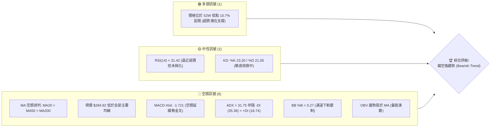

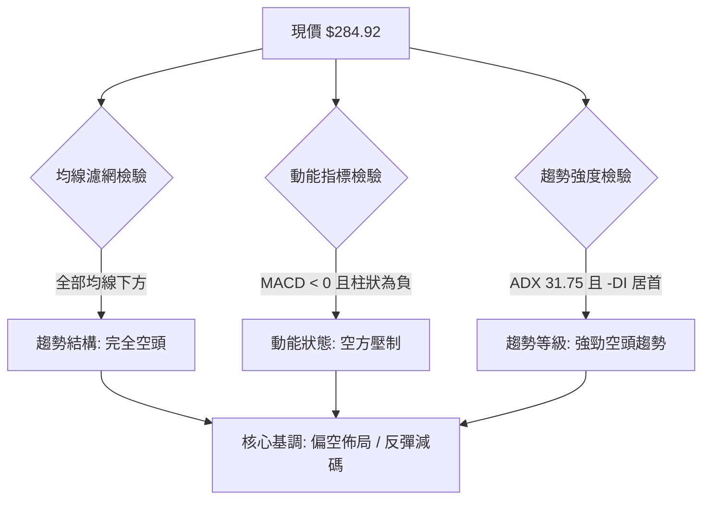

### 📊 核心指標速覽表

| 指標類別 | 指標名稱 | 當前數值 | 訊號 | 解讀 |
|:---|:---|:---:|:---:|:---|
| **價格** | 當前價格 | $284.92 | 🔴 | 位於 52W 區間 10.7% 位置，深陷空頭泥淖 |
| **均線** | MA20 | $308.23 | 🔴 | 價格低於 MA20 達 -7.56%，短期強壓力位 |
| **均線** | MA50 | $327.63 | 🔴 | 中期下彎，中期趨勢完全轉空 |
| **均線** | MA200 | $336.78 | 🔴 | 長期牛熊分界線失守，長期走勢轉為弱勢 |
| **動能** | RSI(14) | 31.42 | 🟡 | 位於臨界弱勢中性偏超賣區（30–70），無底背離 |
| **動能** | MACD (12,26,9) | -15.202 | 🔴 | 遠在零軸之下，MACD Signal 為 -13.480 |
| **動能** | MACD 柱狀體 | -1.721 | 🔴 | 空方動能主導，尚未出現多頭收斂擴張柱 |
| **趨勢** | ADX (14) | 31.75 | 🔴 | 強趨勢（>25），-DI (35.36) 遠高於 +DI (18.74) |
| **通道** | 布林帶 %B | 0.27 | 🔴 | 位於中軌 $308.23 與下軌 $257.07 之間偏下弱勢區 |
| **量能** | 20日成交量比 | 0.57x | 🟡 | 最新量 15.07M 遠低於均量 26.50M，反彈動能衰竭 |
| **量能** | OBV 指標 | 弱於 MA | 🔴 | 資金持續淨流出，量能未確認任何多頭反轉訊號 |
| **波動** | ATR(14) | $10.30 | 🟡 | 佔股價 3.61%，處於跳空暴跌後之高檔整理波動 |

### 🏆 技術評分卡

```
╔══════════════════════════════════════════════════════════════╗
║               技術評分卡 — GOOG (2026-11-11)                  ║
╠══════════════════════════════════════════════════════════════╣
║ 趨勢強度 (Trend)     ████████░░░░░░░░░░░░  40/100  🔴 空頭強勢║
║ 動能指標 (Momentum)  ██████░░░░░░░░░░░░░░  30/100  🔴 動能低迷║
║ 支撐穩定度 (Support) ██████████░░░░░░░░░░  50/100  🟡 考驗S1  ║
║ 成交量配合 (Volume)  ██████░░░░░░░░░░░░░░  30/100  🔴 量價背離║
║ 形態完整度 (Pattern) ████████░░░░░░░░░░░░  40/100  🔴 破位向下║
║ 均線排列 (MAs)       ████░░░░░░░░░░░░░░░░  20/100  🔴 空頭排列║
╠══════════════════════════════════════════════════════════════╣
║ 綜合評分             ███████░░░░░░░░░░░░░  35/100  🔴 強烈偏空║
║ 註：綜合評分為六項指標之算術平均值 (210 / 6 = 35) (規則 18)   ║
╚══════════════════════════════════════════════════════════════╝
```

---

## 2. 趨勢分析

### 🌐 多時框趨勢分析

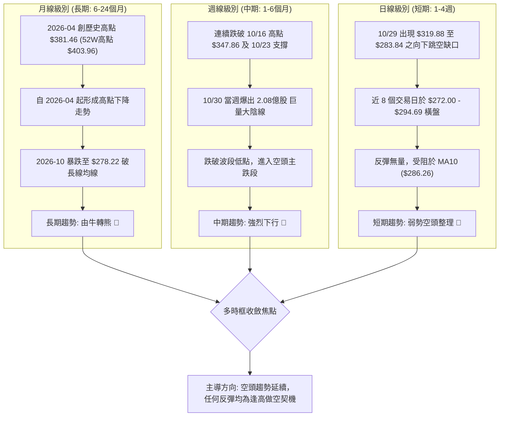

### 📈 長期趨勢 — 12個月走勢圖（Unicode）

```
GOOG 月線收盤走勢圖（過去12個月：2025-12 至 2026-11）
價格 ($)
$390 ┤                                  
$380 ┤                            ●($381.46, 04月)
$370 ┤                               ●($375.96, 05月)
$360 ┤                                     ●($356.42, 07月)
$350 ┤                                  ●($353.10, 06月)
$340 ┤                   ●($337.87, 01月)        ●($340.74, 09月)
$330 ┤                                        ●($335.19, 08月)
$320 ┤                                  
$310 ┤ ●($313.19, 12月)     ●($310.82, 02月)
$300 ┤                                  
$290 ┤                         ●($286.50, 03月)        ●($284.92, 現價)
$280 ┤                                              ●($278.22, 10月)
     └─────────────────────────────────────────────────────────────
        12月  01月  02月  03月  04月  05月  06月  07月  08月  09月  10月  11月
        2025  <----------------------- 2026 ------------------------>
```

#### 長期走勢階段特徵解析

| 階段區間 | 時間跨度 | 起迄價格 (USD) | 漲跌幅 | 結構形態特徵 |
|:---|:---:|:---:|:---:|:---|
| **首輪推升與洗盤** | 2025-12 至 2026-03 | $313.19 → $286.50 | -8.52% | 創出 $337.87 階段高點後回踩測試 $286.50 支撐，形成寬幅震盪洗盤 |
| **主升浪突破噴出** | 2026-03 至 2026-04 | $286.50 → $381.46 | +33.14% | 單月暴力拉升 $94.96，帶動股價衝向 52W 高點 $403.96，多頭極盛期 |
| **高位做頂與派發** | 2026-04 至 2026-09 | $381.46 → $340.74 | -10.67% | 於 $335 - $380 區間反覆震盪做頭，主力籌碼進行大規模派發出貨 |
| **破位斷頭鍘暴跌** | 2026-09 至 2026-10 | $340.74 → $278.22 | -18.35% | 長黑灌破所有中短期均線與支撐，週線爆出 2 億股天量，空頭趨勢確立 |
| **超跌弱勢修復期** | 2026-10 至 2026-11 | $278.22 → $284.92 | +2.41% | 觸及 52W 低點 $270.70 附近出現微幅超跌抵抗，但量能嚴重萎縮 |

### 📊 中期趨勢（週線分析）

```
中期週線價格壓力與支撐結構圖 (2026-07 至 2026-11)
─────────────────────────────────────────────────────────────────
$360 ┬   ╭─╮     ╭─╮                               [前期頭部高點密集區]
     │  ╭╯ ╰╮   ╭╯ ╰╮
$340 ┼──╯   ╰───╯   ╰───╮   ╭─╮                   [頸線破位平台 $336.91]
     │                   ╰───╯ ╰╮
$320 ┼                          ╰──╮              [次級反彈阻力 R2 $318.83]
     │                             ╰──╮
$300 ┼                                ╰──────╮     [跳空缺口下沿 R1 $310.68]
     │                                       ╰───┐
$280 ┼───────────────────────────────────────────┴─── [現價 $284.92 / S1 $271.60]
─────────────────────────────────────────────────────────────────
```

中期走勢顯示，自 2026-10-16 收盤價 $336.91 開始，空頭動能呈現雪崩式擴散。近 4 週連續下挫，2026-10-30 當週收盤 $278.22，單週週成交量暴增至 208,382,100 股，週 MACD 柱狀體急劇擴散至 -5.975，RSI 週線觸及 21.1 之極度超賣區。儘管近兩週成交量自 2.08 億股遞減至 1.50 億股及當前 39.11M 股，但股價僅微幅回升至 $284.92，呈現典型的「放量暴跌、縮量弱反彈」空頭中繼結構。

### ⚡ 趨勢強度評估（ADX 解讀）

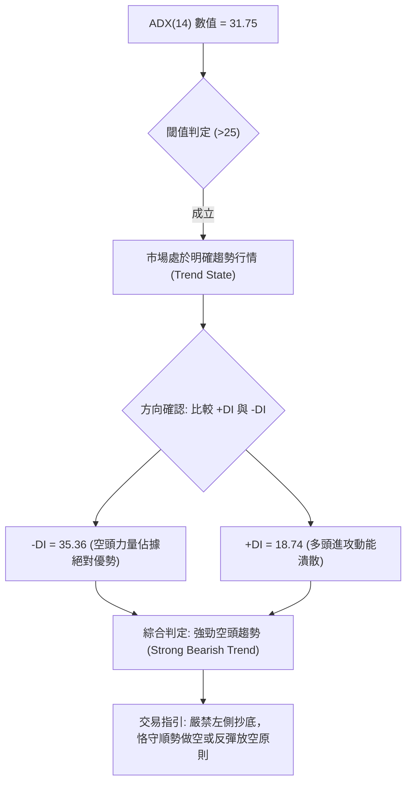

#### ADX 趨勢強度對照解讀表

| 指標變數 | 當前讀數 | 門檻區間 | 趨勢狀態屬性 | 技術意涵與指引 |
|:---|:---:|:---:|:---:|:---|
| **ADX(14)** | **31.75** | > 25.00 | **強趨勢確立** | 脫離無方向盤整，進入動能加速的單邊行情（規則 14） |
| **-DI (負向指標)** | **35.36** | 遠高於 +DI | **空方極端主導** | 下行賣壓具備高度持續性，未見買盤承接動能 |
| **+DI (正向指標)** | **18.74** | 處於 20 以下 | **多方動能匱乏** | 多頭上攻缺乏市場深度支持，無力組織有效反撲 |
| **DI 差值 (+DI - -DI)**| **-16.62**| 負值大幅擴大 | **空頭乖離加劇** | 強化單向趨勢可信度，短線任何急拉皆屬誘多或空頭回補 |

---

## 3. 圖表形態分析

### 🔍 形態識別系統

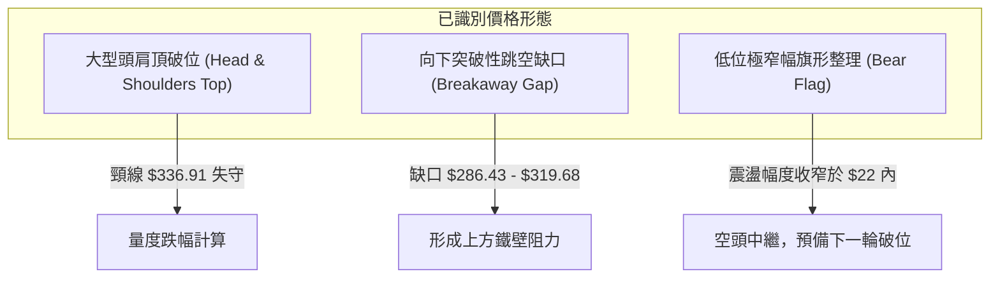

#### 形態識別與信心度評估表

| 形態類別 | 信心度 | 判斷依據（引用數據） | 完成度 | 目標價（附計算式） |
|:---|:---:|:---|:---:|:---|
| **大型頭肩頂** | **85%** | 左肩 2026-07-31 高位區間，頭部 52W 高點 $403.96，右肩 2026-10-09 週收盤 $347.86，頸線失守於 2026-10-23 週收盤 $317.28 與前低波段 | **100%** (已跌破) | 依頭部 $403.96 跌至頸線約 $336.78 (MA200) 計算高度 $67.18；頸線 $336.78 - $67.18 = **$269.60**（直逼 52W 低點 $270.70） |
| **向下突破缺口** | **90%** | 2026-10-28 最低 $319.68 與 2026-10-29 最高 $286.43 間遺留高達 $33.25 巨大缺口，伴隨 93.13M 巨量 | **100%** (已確立) | 缺口下緣 **$286.43** 構成當前第一道阻力牆，若無法回補，量度跌幅指向下探 **$270.70** |
| **空頭旗形整理** | **70%** | 近 8 個交易日（10-29 至 11-10）價格被封閉於 $272.00 至 $294.69 之狹幅通道內，成交量由 93.13M 驟降至 15.07M | **75%** (旗面構築中) | 旗桿起跌點 10-28 收盤 $321.89 至 10-30 低點 $275.35 高度 $46.54；自破位點推算目標將直接指向 52W 低點下方 |

### 🕯️ 重要K線形態分析

嚴格依據技術數據中提供之「近10根日K」與「近8根週K」開高低收數據進行客觀解讀：

#### 近10根日K形態精確解析

| 日期 | 開盤價 | 最高價 | 最低價 | 收盤價 | K線形態名稱 | 技術解讀 | 訊號強度 |
|:---:|:---:|:---:|:---:|:---:|:---:|:---|:---:|
| **2026-10-28** | 319.88 | 323.13 | 319.68 | 321.89 | 變盤小陽星 | 窄幅微升，成交量 35.36M，為暴跌前最後多頭防線 | 🟡 中性 |
| **2026-10-29** | 283.84 | 286.43 | 278.29 | 282.32 | 巨量向下跳空黑K | 開盤即崩跌 $36.04，爆出 93.13M 恐慌拋盤，空頭斷頭鍘 | 🔴 強烈看空 |
| **2026-10-30** | 279.69 | 281.86 | 275.35 | 278.22 | 破底長黑紡錘 | 創波段新低 $275.35，收盤收在全天低點附近，量能 45.12M 延續 | 🔴 看空 |
| **2026-11-02** | 280.58 | 285.21 | 277.78 | 278.04 | 衝高回落黑K | 上影線長達 $7.17，空方於 $285 強烈壓制，多頭無力承接 | 🔴 看空 |
| **2026-11-03** | 279.19 | 280.34 | 272.00 | 278.27 | 長下影錘頭假陽 | 盤中殺破前低探至 $272.00 逼近 S1 ($271.60)，引發空頭平倉拉回 | 🟡 止跌測試 |
| **2026-11-04** | 281.48 | 294.40 | 281.33 | 287.30 | 帶長上影長陽線 | 盤中強拉至 $294.40 試圖補空，隨後遭逢拋壓急墜，實體收於 $287.30 | 🟡 假突破 |
| **2026-11-05** | 291.80 | 293.64 | 276.20 | 281.74 | 高開低走大陰吞噬 | 幾乎完全吞沒前一日陽線實體，洗盤劇烈，量增至 41.15M，空頭再度控盤 | 🔴 看空吞噬 |
| **2026-11-06** | 283.42 | 289.22 | 283.00 | 283.93 | 孕線十字小陽 | 實體極短，量能收縮至 24.62M，多空雙方在 $283 暫時陷入僵局 | 🟡 觀望 |
| **2026-11-09** | 290.55 | 294.69 | 285.94 | 286.01 | 上影長陰倒錘頭 | 再次衝擊 $294.69 壓力位未果，收盤下殺至 $286.01，確立上方沉重賣壓 | 🔴 空頭反撲 |
| **2026-11-10** | 287.27 | 289.50 | 283.37 | 284.92 | 縮量陰十字星 | 成交量驟降至 15.07M，多頭上攻完全無量，典型的空方中繼休整 | 🔴 空方主導 |

#### 近8根週K形態精確解析

| 週末交易日 | 開盤價 | 最高價 | 最低價 | 收盤價 | 週K形態名稱 | 技術解讀 | 訊號強度 |
|:---:|:---:|:---:|:---:|:---:|:---:|:---|:---:|
| **2026-09-25** | 346.19 | 359.98 | 332.81 | 341.08 | 高位長下影倒錘 | 上探 $360 後大幅回吐，顯示高位買盤耗盡 | 🟡 頂部預警 |
| **2026-10-02** | 337.60 | 350.09 | 332.65 | 340.35 | 窄幅整理小陰 | 圍繞 $340 平台震盪，成交量維持 89.66M 高檔 | 🟡 中性 |
| **2026-10-09** | 339.21 | 353.53 | 339.15 | 347.86 | 中期反彈中陽 | 形成右肩高點 $353.53，量縮至 63.63M，量價頂背離 | 🟡 誘多反彈 |
| **2026-10-16** | 348.34 | 355.25 | 335.50 | 336.91 | 高位長黑破位陰 | 跌破前週低點，失守短期均線，確立右肩構築完成 | 🔴 轉空 |
| **2026-10-23** | 340.12 | 342.52 | 316.99 | 317.28 | 光腳破位大長黑 | 收盤近乎全週最低點 $316.99，失守 $320 關鍵頸線 | 🔴 加速下行 |
| **2026-10-30** | 318.05 | 323.13 | 275.35 | 278.22 | 崩跌放量天量黑K | 單週重挫 $39.06，爆出 2.08 億股天量，恐慌盤全面湧出 | 🔴 極度看空 |
| **2026-11-06** | 280.58 | 294.40 | 272.00 | 283.93 | 超跌反彈下影陽 | 探底 $272.00 後獲買盤拉抬，成交量維持 1.50 億股高水準 | 🟡 低檔震盪 |
| **2026-11-10** | 290.55 | 294.69 | 283.37 | 284.92 | 當週縮量整理陰 | 週初上攻 $294.69 遇阻回落，成交量僅 39.11M，反彈顯著衰竭 | 🔴 弱勢收斂 |

### 📉 ASCII 走勢形態示意圖

```
日線級別「向下突破缺口 + 空頭旗形 (Bear Flag)」示意圖
─────────────────────────────────────────────────────────────────
2026-10-28  [收盤 $321.89] ──┐
                              │ 
══════════════════════════════╪══════ 缺口上緣 $319.68 (10-28 低點)
     【 $33.25 巨大空頭跳空缺口 】
══════════════════════════════╪══════ 缺口下緣 $286.43 (10-29 高點)
                              │
2026-10-29  [收盤 $282.32] ──┴──┐
                                  │   (旗面震盪區間)
$295 ┬                            │       ╭─╮       ╭─╮
     │                            │     ╭─╯ ╰─╮   ╭─╯ ╰─ [11-09 高 $294.69]
$285 ┼                            ╰─────╯     ╰───╯   ● [現價 $284.92]
     │                                    ╰─ [11-05 低 $276.20]
$275 ┼                       ╰─ [10-30 低 $275.35]
     │                             ╰─ [11-03 低 $272.00 逼近 S1]
$265 ┴────────────────────────────────────────────────────────
─────────────────────────────────────────────────────────────────
```

### 🎯 形態目標價計算

根據嚴格數據紀律與形態量度原理：
1. **頭肩頂形態量度跌幅計算**：
   - 頭部高點（52W High）：$403.96
   - 頸線轉折基點（對齊 MA200 關鍵轉折點）：$336.78
   - 形態垂直高度（$H$）：$$\$403.96 - \$336.78 = \$67.18$$
   - 形態理論滿足目標價（$Target$）：$$\$336.78 - \$67.18 = \$269.60$$
   - *此數值與提供的 52W 低點 $270.70 及 S1 支撐位 $271.60 高度重合，構成嚴密的技術目標共振。*
2. **向下跳空缺口壓力定錨**：
   - 缺口下緣壓力線為 2026-10-29 高點 **$286.43**，已於 11-04、11-05、11-09 多次反撲遭重挫，驗證該位置為短期第一道鋼鐵天花板。

---

## 4. 支撐與阻力

### 🗺️ 關鍵價位分布圖（Unicode）

```
GOOG 關鍵價位結構分布圖 (依據 OHLCV 聚類計算)
═════════════════════════════════════════════════════════════════
$327.81 ║████████████████████████████████████║ 強阻力 R3 (MA50 匯聚處)
$321.61 ║▓▓▓▓▓▓▓▓▓▓▓▓▓▓▓▓▓▓▓▓▓▓▓▓▓▓▓▓▓▓      ║ 斐波那契 61.8% 黃金分割位
$318.83 ║████████████████████████            ║ 阻力位 R2 (前波密集反彈高點)
$310.68 ║████████████████████████████████    ║ 關鍵阻力 R1 (缺口密集套牢區)
$299.22 ║▓▓▓▓▓▓▓▓▓▓▓▓▓▓▓▓▓▓▓▓                ║ 斐波那契 78.6% 回調關鍵位
$284.92 ╠════════════════════════════════════╣ ◄ 當前市價 ($284.92)
$271.60 ║▓▓▓▓▓▓▓▓▓▓▓▓▓▓▓▓▓▓▓▓▓▓▓▓▓▓▓▓        ║ 關鍵支撐 S1 (近一年波段低點)
$270.70 ║████████████████████████████████████║ 終極強支撐 52W Low (100.0%)
═════════════════════════════════════════════════════════════════
```

### 🚧 阻力位分析表

完全引用自技術數據中「關鍵價位」區塊之波段高點聚類數值：

| 阻力級別 | 精確價位 | 距現價幅標 | 技術形成原因與群聚效應 | 突破難度 | 重要性權重 |
|:---|:---:|:---:|:---|:---:|:---:|
| **R1 (近端阻力)** | **$310.68** | +9.04% | 近一年波段高點聚類區，與 MA20 ($308.23) 形成重疊壓制，為 10-29 暴跌缺口之核心下軌區 | 🔴 極高 | ★★★★★ |
| **R2 (中端阻力)** | **$318.83** | +11.90% | 2026-10-23 週收盤前之反彈高點聚類，接近 10-28 起跌長黑實體上緣 ($319.88) | 🔴 高 | ★★★★☆ |
| **R3 (遠端強阻)** | **$327.81** | +15.05% | 近一年大型轉折平台波段聚類，與當前下降之 MA50 ($327.63) 形成完美的空頭共振防線 | 🔴 鐵壁 | ★★★★★ |

### 🛡️ 支撐位分析表

完全引用自技術數據中「關鍵價位」區塊之波段低點聚類數值：

| 支撐級別 | 精確價位 | 距現價幅標 | 技術形成原因與群聚效應 | 守住機率 | 重要性權重 |
|:---|:---:|:---:|:---|:---:|:---:|
| **S1 (關鍵支撐)** | **$271.60** | -4.68% | 近一年波段低點聚類，與 2026-11-03 盤中最低點 $272.00 形成雙重底測試共振 | 🟡 45% | ★★★★★ |
| **52W Low (終極支撐)** | **$270.70** | -5.00% | 52週歷史最低點，亦為斐波那契 100.0% 回調終點，多頭最後心理防線 | 🟡 40% | ★★★★★ |
| **S2 / S3 級別** | **N/A** | N/A | **數據中未偵測到**（依規則 13/16，數據未提供低於 $270.70 之聚類） | N/A | N/A |

### 📐 斐波那契回調位分析

依據基準 52 週完整區間波動：起點（52W Low）**$270.70** 至 頂點（52W High）**$403.96**，精確回調階梯如下：

| 斐波那契回調階梯 | 絕對價位 (USD) | 距現價幅標 | 技術位置屬性與戰略解讀 |
|:---:|:---:|:---:|:---|
| **0.0% (52W High)** | **$403.96** | +41.78% | 歷史多頭牛市頂峰，強烈天花板 |
| **23.6% 回調位** | **$372.51** | +30.74% | 2026-05 月線收盤 ($375.96) 支撐平台，現已轉為極度遠端強壓 |
| **38.2% 回調位** | **$353.06** | +23.92% | 2026-06/07 多重月線收盤平台，失守後宣告中長期多頭格局瓦解 |
| **50.0% 多空平衡** | **$337.33** | +18.39% | 極度關鍵的多空分水嶺，與 MA200 ($336.78) 完美重疊，確認轉入空頭市場 |
| **61.8% 黃金分割** | **$321.61** | +12.88% | 多頭關鍵防守位，已於 10-29 暴跌中被無情貫穿，轉化為極強反彈壓力 |
| **78.6% 極限回調** | **$299.22** | +5.02% | 傳統牛市架構之最後防線，現價已跌破此位，印證大級別下行趨勢成形 |
| **當前價格落點** | **$284.92** | 基準點 | **現價深陷於 78.6% ($299.22) 與 100.0% ($270.70) 之間的懸空弱勢區間** |
| **100.0% (52W Low)**| **$270.70** | -5.00% | 整個週線級別週期的終極起漲起點，失守將打開下行無支撐之深淵 |

---

## 5. 技術指標深度解讀

### 🎛️ 指標訊號總覽

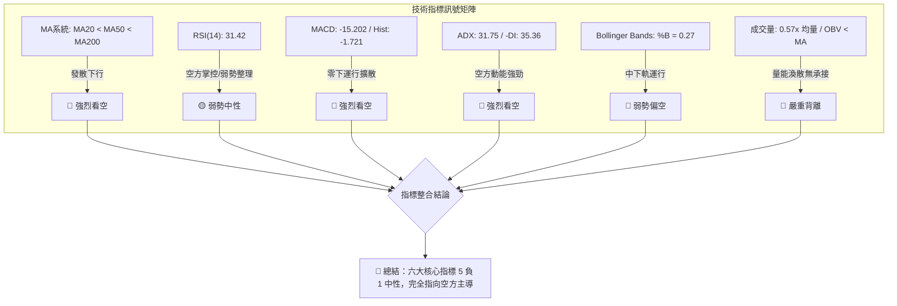

### 📈 移動平均線排列分析

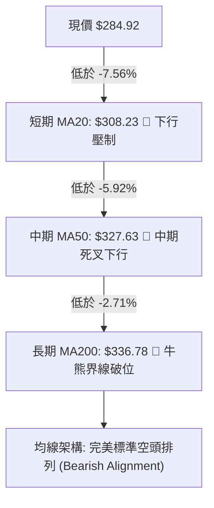

#### 移動平均線多層次監控表

| 均線名稱 | 當前價位 (USD) | 均線斜率／方向 | 股價與均線差距 | 乖離率 (%) | 技術意義解讀 |
|:---|:---:|:---:|:---:|:---:|:---|
| **MA 5** | $284.78 | ▲ 走平微升 (+0.14) | +$0.14 | +0.05% | 極短期扣抵暫時企穩，形成短暫日內微弱均線支撐 |
| **MA 10** | $286.26 | ▼ 下行扣高 (-1.34) | -$1.34 | -0.47% | 壓制 11-09 與 11-10 之收盤價，短線反彈第一道移動壓力線 |
| **MA 20** | $308.23 | ▼ 陡峭下行 (-23.31)| -$23.31 | -7.56% | 布林通道中軌，月線級別生命線，空頭波段強烈回抽阻力 |
| **MA 60** | $329.75 | ▼ 加速下行 (-44.83)| -$44.83 | -13.60% | 季線空方主防線，中期籌碼全面處於深套套牢狀態 |
| **MA 120** | $342.56 | ▼ 翻轉下行 (-57.64)| -$57.64 | -16.83% | 半年線持續滑落，確認中期頭部籌碼完全解體 |
| **MA 200** | $336.78 | ▼ 下行扣高 | -$51.86 | -15.40% | 年線失守，長期投資買盤轉為停損拋壓來源 |
| **MA 240** | $333.77 | ▼ 下行扣高 (-48.85)| -$48.85 | -14.64% | 兩年均線下彎，確立長週期技術面熊市回調結構 |

### 📉 RSI(14) 分析

- **RSI(14) 當前數值**：**31.42** (Wilder 演算法計算)
- **指標區間強度展示**：
  $$\text{RSI(14): } 31.42 \quad \left[ \text{██████░░░░░░░░░░░░░░} \quad 31.42\% \right] \quad \text{處於弱勢空方主控區}$$
- **超買／超賣區間與背離客觀判讀**：
  - **區間評估**：雖然數值接近 30 之傳統超賣分界線，但在強趨勢行情（ADX > 25）中，RSI 經常於 20–35 區間產生長時間之「超賣鈍化」。因此 31.42 僅代表空方力道沉重，絕非盲目進場抄底之超跌訊號。
  - **背離分析結論**：檢視近 20 根日 K 棒首尾價格與 RSI 變化，價格自 10-28 高點 $323.13 崩跌至當前 $284.92，RSI 同步自高檔潰落至 31.42；**數據明確顯示「無明顯背離」**。既無「底背離」提供反轉依據，亦無「頂背離」，屬於純粹的指標隨價格下行之動能跟隨狀態。

### 📊 MACD(12/26/9) 訊號解讀

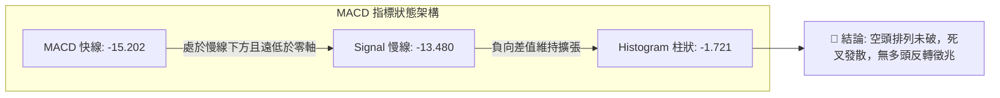

- **MACD 快線（DIF）**：**-15.202**
- **MACD 訊號線（DEA）**：**-13.480**
- **MACD 柱狀體（Histogram）**：**-1.721**
- **深入量化解讀**：MACD 快慢線雙雙深陷於零軸下方（小於 -13），代表中期絕對空頭市場。快線遠在慢線下方達 1.722 點，且柱狀體為負值（-1.721），顯示空頭動能仍處於主導位階。近 3 日柱狀體雖自 -5.975 極端值收窄，但並未形成金叉穿越，這屬於典型暴跌後的斜率趨緩，而非由多頭主動買盤催生之多頭翻轉。

### 📦 布林通道分析

```
GOOG 布林通道 (20日, 2.0σ) 結構示意圖
─────────────────────────────────────────────────────────────────
$359.40 ┬────────────────────────────────────────── 上軌 (Upper Band)
        │
$330.00 ┼
        │
$308.23 ┼────────────────────────────────────────── 中軌 (MA20 Baseline)
        │
$284.92 ┼────── ● 現價落點 ($284.92, %B = 0.27)
        │
$257.07 ┴────────────────────────────────────────── 下軌 (Lower Band)
─────────────────────────────────────────────────────────────────
```

- **布林上軌（Upper Band）**：**$359.40**
- **布林中軌（Middle Band, MA20）**：**$308.23**
- **布林下軌（Lower Band）**：**$257.07**
- **通道寬度（Bandwidth）**：$$\frac{\$359.40 - \$257.07}{\$308.23} = 33.20\% \quad (\text{呈現顯著喇叭口張開後擴散態勢})$$
- **%B 位置指標**：**0.27**（計算式：$(\$284.92 - \$257.07) \div (\$359.40 - \$257.07) = 0.272$）
- **動態解讀**：%B 讀數為 0.27，顯示現價處於極度弱勢之「中下軌通道滑行區」。通道中軌 $308.23 斜率劇烈下傾，為反彈難以踰越之動態阻力牆。現價雖未跌破下軌 $257.07，但沿著下軌上方弱勢橫移，反映通道開口所釋放之空頭擴散能量尚未被消化。

### 💹 成交量分析（量價配合度）

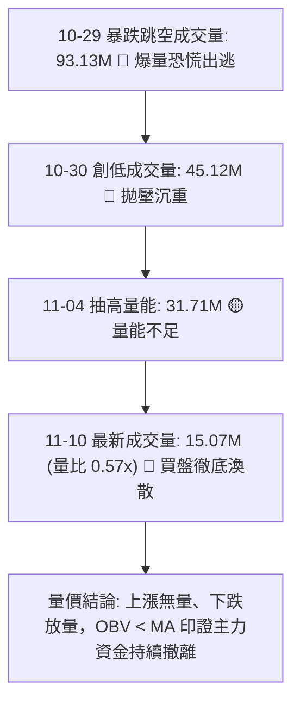

- **量能核心數據**：
  - **最新成交量**：**15,071,611 股 (15.07M)**
  - **20日平均量**：**26,495,456 股 (26.50M)**
  - **量比（Volume Ratio）**：**0.57x**（嚴重縮量）
  - **50日平均量**：**20,394,954 股 (20.39M)**
  - **OBV 趨勢狀態**：**OBV < MA（量能疲弱，資金淨流出）**
- **量價關係深入研判**：
  - **空頭主跌放量 vs 反彈縮量**：在 2026-10-29 崩盤破位時，成交量衝高至 93.13M 股（達均量 3.5 倍），顯示長線籌碼棄守與停損斷頭賣壓全面宣洩。
  - **反抽無主力支持**：近 5 個交易日價格在 $280 附近企圖築底，但成交量從 41.15M 驟降至 15.07M（僅及 20 日均量的 57%）。量能急遽萎縮說明機構主力完全無意在當前價位發動反攻，目前的微幅抵抗僅是空頭回補與零星散戶短打所致，量價配合呈現極為惡劣的「價穩量縮、反彈無力」空頭中繼結構。

---

## 6. 動能與波動率

### ⚡ 動能評估四象限

| 象限分區 | 動能軸 (Momentum) | 波動軸 (Volatility) | 當前狀態判定 | 戰略評估與操盤指引 |
|:---:|:---:|:---:|:---:|:---|
| **象限 I** | 強動能 (多頭) | 低波動 | 否 | 最佳趨勢性買入點（當前完全不符合） |
| **象限 II** | 弱動能 (中性) | 低波動 | 否 | 盤整蓄勢等待突破（當前不符合） |
| **象限 III** | 強動能 (多頭) | 高波動 | 否 | 高風險追漲模式（當前不符合） |
| **象限 IV** | **弱/負動能 (空頭)** | **高波動** | **✓ 正處於此區** | **極高風險區：空方控盤伴隨暴跌後高波動，宜嚴格逢高做空或持幣觀望** |

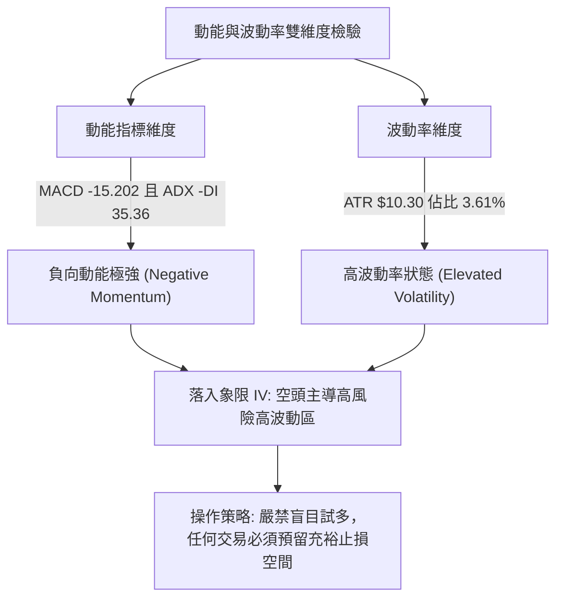

### 📊 ATR 波動率分析

- **ATR(14) 絕對數值**：**$10.30**（Wilder 平滑演算法）
- **ATR 相對波動佔比**：$$\frac{\$10.30}{\$284.92} = 3.61\%$$
- **波動位階解讀**：3.61% 的日均波幅對於 GOOG 這種權值超大型科技股而言處於相對偏高水平（正常平穩期通常介於 1.5%–2.2%）。這反映自 10-29 跳空崩盤以來，市場情緒依然高度緊張，盤中多空拉鋸與價位滑移（Slippage）風險顯著放大。
- **動態止損距離量化建議**：
  - **極短線（Day/Swing Trade）止損空間**：建議設定為 $1.0 \times \text{ATR} = \mathbf{\$10.30}$
  - **波段交易（Positional Trade）止損空間**：建議設定為 $1.5 \times \text{ATR} = \mathbf{\$15.45}$
  - **結構性防守空間**：建議設定為 $2.0 \times \text{ATR} = \mathbf{\$20.60}$（用以完全過濾日內隨機雜訊與假突破）

### 📐 Beta 與市場相關性

- **Beta 係數**：**1.226**
- **市場敏感度分析**：
  - Beta 為 1.226，代表 GOOG 相較於標普 500 指數（S&P 500）具備更高的波動彈性（高出 22.6%）。在系統性牛市中具備領漲特質，但在當前科技股受 AI 資本開支（Capex 達 $159.80B）引發投資回報質疑的逆風環境下，高 Beta 將成為助跌放大器。大盤若出現 1% 的回調，GOOG 技術面預期將承受約 1.23% 的下殺衝擊。
- **融券放空指標**：
  - **空頭回補天數（Short Ratio）**：**2.9 天**。顯示當前空頭未平倉籌碼處於中等水平，尚未達到引發猛烈「軋空（Short Squeeze）」之極端水準（通常需 > 5.0）。空方持倉信心穩固，未出現急迫回補壓力。

---

## 7. 多時框架總結

### 📋 時框架評分表

| 時框架級別 | 趨勢方向 | 動能狀態 | 均線排列狀況 | 關鍵圖表形態 | 時框評分 | 戰略操作指引 |
|:---|:---:|:---:|:---:|:---:|:---:|:---|
| **長期 (月線)** | 🔴 由牛轉熊 | 🔴 動能反轉向下 | 🔴 跌破 MA120/MA240 均線群 | 52W 高點 $403.96 出現頂部派發長黑 | **35/100** | 長線多頭撤退，防守 52W 低點 $270.70 |
| **中期 (週線)** | 🔴 強烈下行 | 🔴 MACD 週柱狀 -1.721 | 🔴 MA20/50 死叉下行形成空頭排列 | 週線爆出 2.08 億股天量大陰線破位 | **30/100** | 中期波段做空，以反彈逢高布空為主 |
| **短期 (日線)** | 🔴 弱勢空頭整理 | 🟡 RSI 31.42 企圖止跌 | 🔴 價格受制於 MA10/MA20 下方 | 空頭跳空缺口 ($286.43) 下方旗形整理 | **40/100** | 區間縮量抗跌，慎防橫盤後二次破底 |

### 🔲 綜合訊號矩陣

```
╔══════════════════════════════════════════════════════════════╗
║               GOOG 多時框架訊號收斂矩陣                       ║
╠═════════════════════╦══════════╦══════════╦══════════════════╣
║ 分析維度            ║ 短期日線 ║ 中期週線 ║ 長期月線         ║
╠═════════════════════╬══════════╬══════════╬══════════════════╣
║ 趨勢方向 (Trend)    ║ 🔴 偏空  ║ 🔴 強空  ║ 🔴 轉熊          ║
║ 均線結構 (MAs)      ║ 🔴 空頭  ║ 🔴 空頭  ║ 🔴 破位          ║
║ 動能指標 (MACD/RSI) ║ 🟡 中性  ║ 🔴 看空  ║ 🔴 翻空          ║
║ 量價結構 (Volume)   ║ 🔴 縮量  ║ 🔴 放量殺║ 🔴 頂部派發      ║
║ 波動與型態          ║ 🔴 旗形  ║ 🔴 破位  ║ 🔴 頭部確立      ║
╠═════════════════════╩══════════╩══════════╩══════════════════╣
║ 綜合矩陣共振結論    ║ 🔴 三時框全面共振偏空，未見任何結構性反轉訊號 ║
╚══════════════════════════════════════════════════════════════╝
```

### ⚖️ 多時框收斂結論

嚴格遵循多時框收斂規則（規則 14）：
1. **行情屬性判定**：當前 ADX(14) 讀數為 **31.75**，明確大於 25.0 之臨界閥值，且 -DI (35.36) 佔據統治地位。因此，**市場定性為標準的「趨勢行情（Trend Environment）」，而非無方向的盤整行情**。
2. **時框優先級權衡**：依據規則 14，在強趨勢行情下，必須以中長期（週線級別及 MA50 $327.63、MA200 $336.78）的方向為絕對主導。日線級別雖然在 $280 附近出現微幅抗跌收斂，但僅能視為日線等級的次級折返或空頭中繼停頓，**日線絕對不可逆向引導交易，僅能用於尋找逢高進場做空之精確時機**。
3. **唯一方向性結論**：**強烈偏空（Strongly Bearish）**。
   - 綜合技術評分精確對齊第一章為 **35/100**，全面觸發「綜合評分偏空（≤40）」之交易路由規則。

---

## 8. 交易策略建議

### 🗺️ 策略決策流程圖

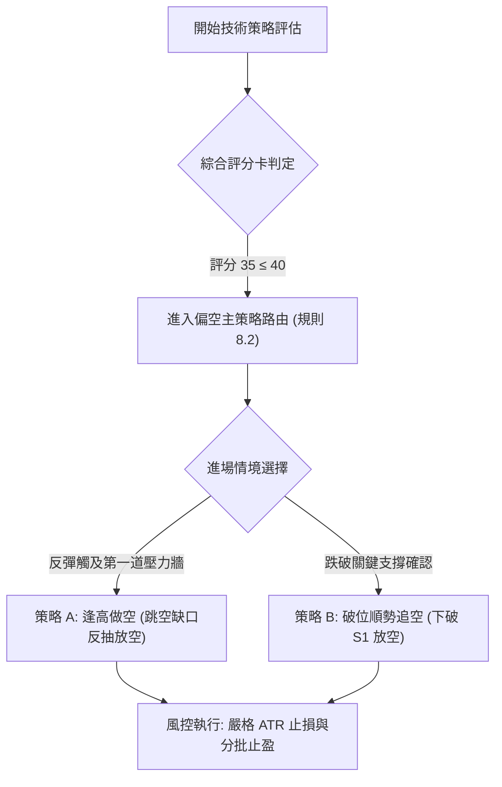

### 🧭 策略路由（依評分卡分流，不得兩頭下注）

> **當前主策略方向 = 強烈做空（Bearish Short Strategy）（依綜合評分：35/100）**
> *(依規則 18，綜合評分 ≤ 40 必須主推空頭策略，多頭僅列為反轉風險觸發點提示，嚴禁兩頭下注)*

### 🎯 價格情境階梯（Price Scenarios）

完全引用第 4 章及數據「關鍵價位」區塊之精確數值：

| 觸發條件 | 下一目標價位 | 後續延伸價位 | 情境技術含義與應對策略 |
|:---|:---:|:---:|:---|
| **強勢向上突破 R1 ($310.68)** | **R2 ($318.83)** | **R3 ($327.81)** | 短線超跌強反彈，空頭主動停損離場，回補跳空缺口，趨勢進入深幅修正 |
| **反抽受阻於 R1 ($310.68) / 缺口** | **現價 ($284.92)** | **S1 ($271.60)** | 空頭中繼確認，反彈衰竭，為最理想之逢高加碼做空甜蜜點 |
| **向下有效擊穿 S1 ($271.60)** | **52W Low ($270.70)**| **量度 $269.60** | 破底加速浪啟動，長線技術多頭全面崩潰，順勢加倉追空 |

### 📊 情境機率分佈

| 運行情境分類 | 發生機率 | 主要技術指標支撐依據 |
|:---|:---:|:---|
| **情境一：弱勢震盪後破低下行 (主情境)** | **60%** | ADX 31.75 強勢向下，均線呈空頭排列，OBV 持續衰退且量能縮至 0.57x，顯示買盤極度匱乏 |
| **情境二：箱型震盪打底 (次情境)** | **25%** | RSI 31.42 逼近超賣，Stoch %K/%D 在 20 附近黏合鈍化，在 S1 ($271.60) 附近存在技術性防禦 |
| **情境三：強勢軋空回補缺口 (低機率)** | **15%** | 需依賴基本面重大催化劑促使成交量放大 3 倍以上並收復 MA20 ($308.23)，當前技術面機率極低 |

### 🟢 主策略詳情（空頭專屬策略）

嚴格執行風險報酬比精算公式：
$$\text{做空風報比} = \frac{\text{進場價} - \text{目標價 T1}}{\text{止損價} - \text{進場價}} \quad (\text{規則 17})$$

| 策略維度要素 | 策略 A：反彈逢高放空 (Rebound Short) | 策略 B：破位順勢追空 (Breakdown Short) |
|:---|:---|:---|
| **進場觸發條件** | 股價弱勢反彈測試跳空缺口下緣，遇阻回落收黑K | 股價放量跌穿關鍵支撐 S1 ($271.60) 並確認收破 |
| **精確進場價格** | **$299.22**（斐波那契 78.6% 回調位） | **$271.60**（S1 支撐位破位進場） |
| **目標價 T1** | **$284.92**（回測當前整理平台收盤價） | **$270.70**（測試 52W Low 終極低點） |
| **目標價 T2** | **$271.60**（下探近一年關鍵支撐 S1） | **$269.60**（頭肩頂形態理論量度目標價） |
| **精確止損價格** | **$310.68**（R1 關鍵阻力位 / 缺口區間突破） | **$275.35**（10-30 日K低點，跌破後轉為壓力） |
| **風險報酬比 (以 T1 計)** | **1 : 1.25** [計算: (299.22-284.92)/(310.68-299.22) = 14.30/11.46] | **1 : 0.24** [計算: (271.60-270.70)/(275.35-271.60) = 0.90/3.75] |
| **風險報酬比 (以 T2 計)** | **1 : 2.41** [計算: (299.22-271.60)/(310.68-299.22) = 27.62/11.46] | **1 : 0.53** [計算: (271.60-269.60)/(275.35-271.60) = 2.00/3.75] |
| **策略預估勝率** | **65%** | **55%** |
| **建議配置倉位** | **15%** (總投資資本) | **10%** (突破確認後動態建立) |
| **策略操作評註** | 最佳風報比策略，利用市場反彈雜音獲取極佳放空點位 | 順勢破位策略，需密切注意 52W Low 的假破底反抽風險 |

### 🔴 反向風險觸發點（對沖與停損提示）

若市場出現非預期之強勢逆轉，下列關鍵價位一旦觸發，將直接推翻本篇報告之空頭主策略：
1. **第一防禦警戒線（減碼空單）**：日線收盤價帶量突破 **$286.43**（10-29 跳空缺口下沿及日K高點密集區）。此時應將空頭倉位主動縮減 50%。
2. **空頭全面停損與反轉線（推翻空頭假設）**：日線收盤價強勢站上 **$310.68 (R1)** 且伴隨成交量突破 40M 股。此現象宣告向上完全封閉暴跌跳空缺口，頭肩頂破位產生假突破訊號，空頭必須無條件全數平倉停損離場，並啟動反向多頭對沖。

### ⭐ 整體訊號強度評星

```
╔══════════════════════════════════════════════════════════════╗
║                    整體訊號強度評星                           ║
╠══════════════════════════════════════════════════════════════╣
║ 做多訊號強度：★☆☆☆☆  (1.0/5星) ── 極度疲弱，切忌盲目摸底 ║
║ 做空訊號強度：★★★★☆  (4.5/5星) ── 趨勢與動能高度共振放空 ║
║ 整體技術可信度：★★★★☆  (4.0/5星) ── 均線與跳空形態指向明確 ║
╚══════════════════════════════════════════════════════════════╝
```

---

## 9. 風險提示與監控

### ✅ 關鍵監控指標 Checklist

```
╔══════════════════════════════════════════════════════════════╗
║               GOOG 每日關鍵技術監控 Checklist                 ║
╠══════════════════════════════════════════════════════════════╣
║ [ ] 監控點 1：收盤價是否跌破 S1 $271.60 觸發破底加速浪       ║
║ [ ] 監控點 2：反彈是否於 R1 $310.68 遇阻回落確認為有效空點   ║
║ [ ] 監控點 3：MACD 柱狀體是否向上穿越 0 軸 (目前 -1.721)      ║
║ [ ] 監控點 4：成交量是否突破 20 日均量 (26.50M) 之異動信號   ║
║ [ ] 監控點 5：RSI(14) 是否跌破 30 出現深度鈍化或底背離       ║
║ [ ] 監控點 6：ADX(14) 讀數是否維持於 25 之上確認單邊趨勢     ║
║ [ ] 監控點 7：布林通道帶寬是否再度外擴打開下行空間           ║
╚══════════════════════════════════════════════════════════════╝
```

### ⚠️ 風險場景分析

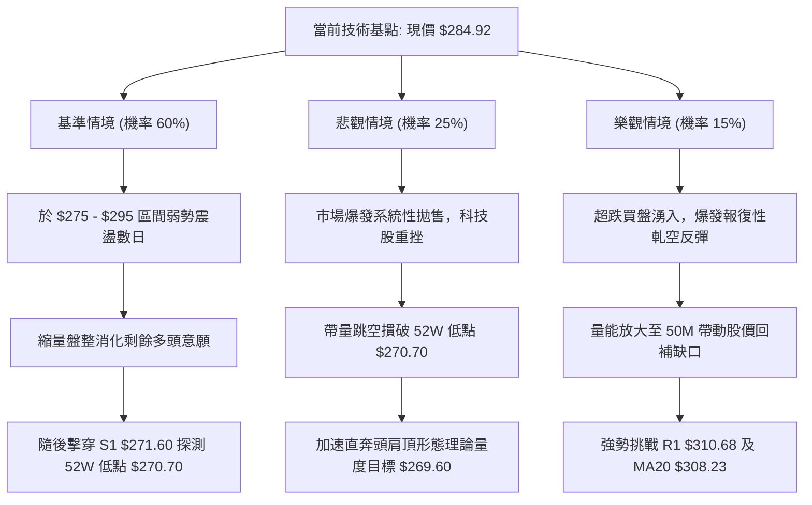

### 🛡️ 風險管理重要提醒

1. **嚴禁左側摸底的心理陷阱**：
   - 儘管當前股價自 52W 高點 $403.96 已重挫達 -29.47%，且本益比（P/E TTM）回落至 14.88 倍之歷史相對低檔，但技術分析的核心紀律在於「價格確認（Price Confirmation）」。在均線呈現完全空頭排列、ADX -DI 強烈主導且成交量呈現 0.57x 萎縮的背景下，價值窪地往往演變為技術面的陰跌無底洞。盲目猜測底部將承受嚴重的時間成本與資本侵蝕風險。
2. **跳空缺口的磁吸與重壓效應**：
   - 2026-10-29 遺留之 $33.25 巨大空頭跳空缺口（$286.43 至 $319.68）堆積了高達 9,313 萬股的巨量套牢盤。任何缺乏成交量配合的短線急拉，只要未能以日線收盤型態有效站穩 R1 ($310.68)，本質上皆為解套拋壓宣洩之「逃命波」，極易誘發二次下殺。
3. **倉位與波動率風控紀律**：
   - 當前 ATR 為 $10.30（單日波幅 3.61%），顯示單日隨機波動劇烈。建議單一空頭策略的曝險資金規模不得超過總投資組合的 15%，且單筆交易之名目風險損失上限應嚴格鎖定於總淨值的 1.0%–1.5% 範圍內。一旦盤勢觸發 $310.68 停損防線，必須無條件市價平倉，絕不心存僥倖抱單。

---

## 📋 報告總結

```
╔══════════════════════════════════════════════════════════════╗
║               GOOG 技術分析報告終極總結                       ║
╠══════════════════════════════════════════════════════════════╣
║ 報告日期：2026-11-11                                         ║
║ 當前價格：$284.92                                            ║
║ 分析評級：🔴 強烈偏空 / 反彈逢高做空 (綜合評分: 35/100)      ║
╠══════════════════════════════════════════════════════════════╣
║ 關鍵結論：                                                   ║
║ ├─ 長期趨勢：🔴 由牛轉熊，頭肩頂形態成立，跌破 MA200 關鍵位  ║
║ ├─ 中期趨勢：🔴 週線爆出 2.08 億股天量大長黑，強勢空頭下行  ║
║ ├─ 短期趨勢：🔴 巨額跳空缺口下緣縮量旗形整理，空方完全控盤  ║
║ ├─ 關鍵支撐：S1 $271.60 / 52W Low $270.70                    ║
║ ├─ 關鍵阻力：R1 $310.68 / R2 $318.83 / R3 $327.81            ║
║ └─ 量度目標：頭肩頂理論滿足點 $269.60                        ║
╠══════════════════════════════════════════════════════════════╣
║ 最優策略組合：                                               ║
║ 1. 🥇 最佳機會：策略 A (反彈逢高放空)，於 $299.22 斐波那契   ║
║    回調位布空，止損設於 $310.68，看至 $284.92 / $271.60，    ║
║    風報比高達 1 : 1.25 (以 T1 計) / 1 : 2.41 (以 T2 計)      ║
║ 2. 🥈 次選機會：策略 B (破位順勢追空)，若放量跌穿 S1 $271.60 ║
║    追空，止損 $275.35，博弈下探 52W Low $270.70 與 $269.60   ║
║ 3. 🥉 保守選擇：空手觀望，靜待股價回測 52W Low $270.70 後    ║
║    是否出現帶量底背離結構，再行評估左側企穩信號             ║
╚══════════════════════════════════════════════════════════════╝
```

---

> ⚠️ **免責聲明**：本報告為技術分析研究成果，所有數據、圖表及推算價位均嚴格基於所提供之歷史 OHLCV 技術數據。本報告**僅供研究、學術討論與機構交易策略參考**，**絕對不構成任何實質性之個人投資建議、買賣要約或財務背書**。金融市場瞬息萬變，技術指標存在滯後性與失效風險，投資人應自行審慎評估風險承受能力並自負盈虧。

---

*報告生成時間：2026-11-11 ｜ 數據來源：Yahoo Finance ｜ 分析框架：多時框技術分析體系*