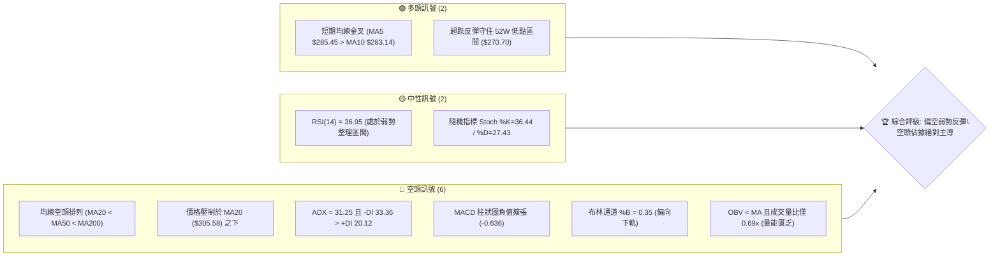
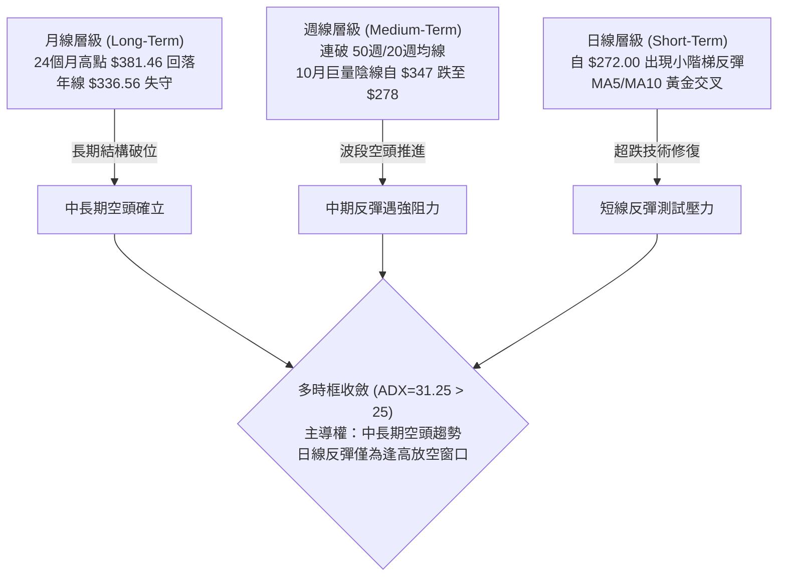
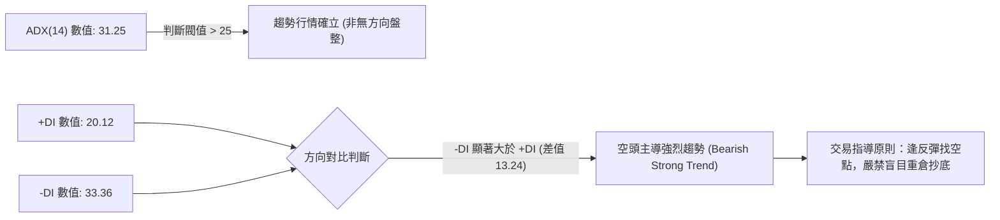
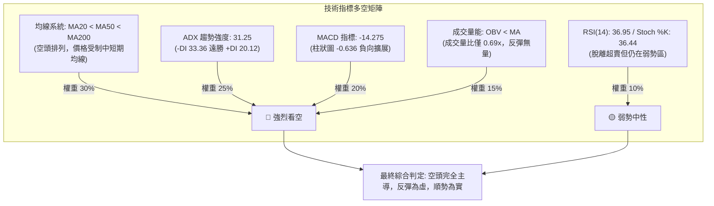
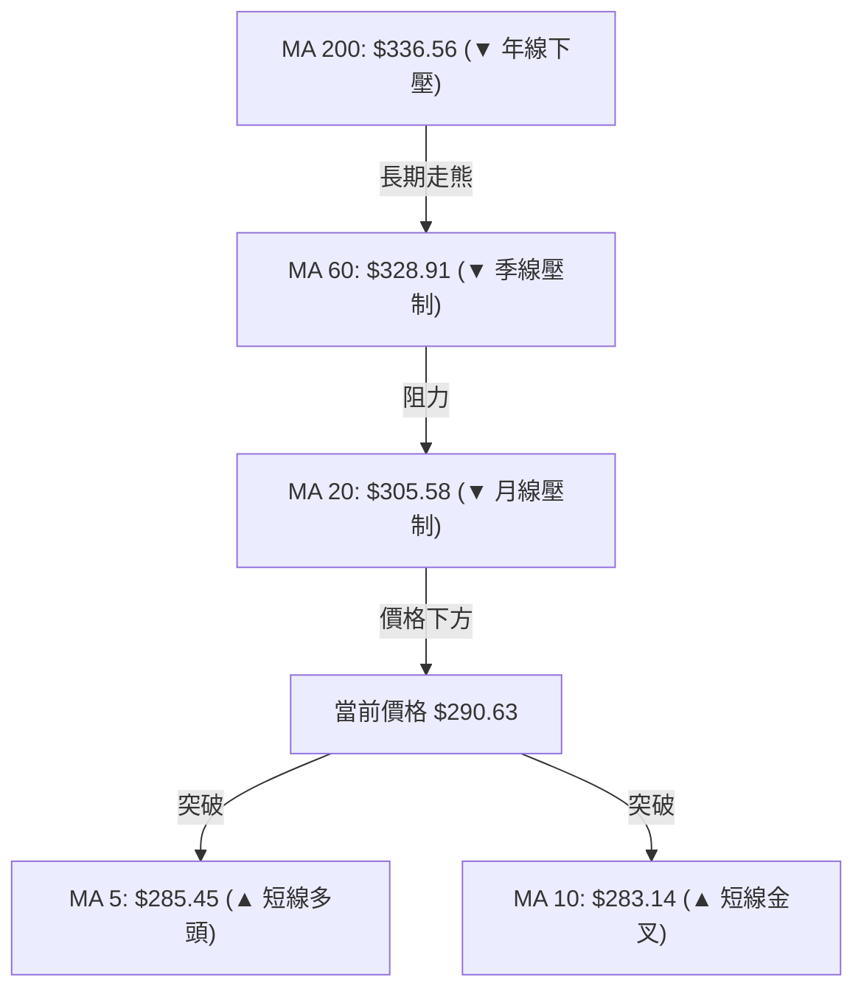
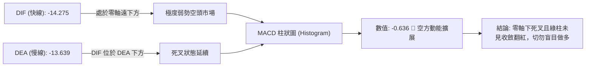
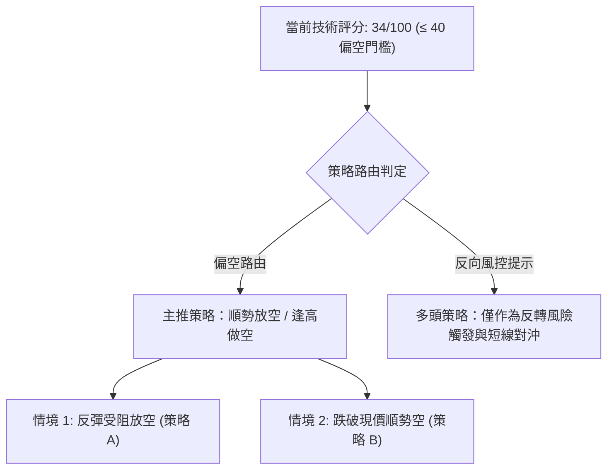
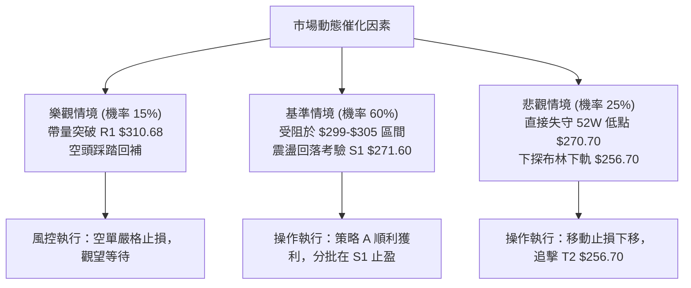

# GOOG 技術分析報告

> **報告日期**：2026-11-12 ｜ **語言**：繁體中文 ｜ **數據來源**：Yahoo Finance ｜ **當前價格**：$290.63 USD

---

## 目錄

| 章節 | 內容 |
|------|------|
| [1. 技術面概覽](#1-技術面概覽) | 訊號儀表板、核心指標、評分卡 |
| [2. 趨勢分析](#2-趨勢分析) | 多時框趨勢、長中短期走勢、ADX 解讀 |
| [3. 圖表形態分析](#3-圖表形態分析) | 形態識別信心度、K線組合、目標價推算 |
| [4. 支撐與阻力](#4-支撐與阻力) | 關鍵價位聚類、斐波那契回調結構 |
| [5. 技術指標深度解讀](#5-技術指標深度解讀) | 均線系統、RSI/MACD背離檢測、布林通道與OBV |
| [6. 動能與波動率](#6-動能與波動率) | 動能四象限、ATR 波動度、Beta 系統風險 |
| [7. 多時框架總結](#7-多時框架總結) | 時框架矩陣、多時框收斂與方向定調 |
| [8. 交易策略建議](#8-交易策略建議) | 策略路由、價格情境階梯、主策略詳情與風報比 |
| [9. 風險提示與監控](#9-風險提示與監控) | 關鍵監控 Checklist、情境樹與部位管理 |
| [📋 報告總結](#-報告總結) | 核心結論與策略清單 |

---

## 1. 技術面概覽

### 🎯 技術訊號儀表板



### 📊 核心指標速覽表

| 指標類別 | 指標名稱 | 當前數值 | 訊號 | 專業技術解讀 |
|:---|:---|:---|:---:|:---|
| **價格** | 當前收盤價 | $290.63 | 🔴 | 位於 52 週高低區間之 15.0%，深陷低檔弱勢區 |
| **均線** | MA20 (月線) | $305.58 | 🔴 | 現價低於 MA20 (-4.89%)，短中期下行壓力沉重 |
| **均線** | MA50 (季線) | $326.80 | 🔴 | 現價低於 MA50 (-11.07%)，中期空頭防線 |
| **均線** | MA200 (年線) | $336.56 | 🔴 | 現價深處年線下方 (-13.65%)，長期牛熊分界失守 |
| **動能** | RSI(14) | 36.95 | 🟡 | 脫離超賣區（21-30）反彈，但受制於 40-50 弱勢中軸 |
| **動能** | MACD 柱狀圖 | -0.636 | 🔴 | DIF(-14.275) 低於 DEA(-13.639)，空方動能尚未翻正 |
| **趨勢** | ADX (14) | 31.25 | 🔴 | ADX > 25 確立強趨勢，-DI(33.36) 遠高於 +DI(20.12) |
| **波動** | ATR(14) | $10.14 | 🟡 | 日內平均振幅達 3.49%，波動率放大，需嚴設止損 |
| **通道** | 布林帶 %B | 0.35 | 🔴 | 現價運行於中軌 ($305.58) 與下軌 ($256.70) 間 |
| **量能** | 20日成交量比 | 0.69x | 🔴 | 成交量 18.16M 顯著低於 20日均量 26.40M，反彈縮量 |

### 🏆 技術評分卡

```
╔══════════════════════════════════════════════════════════════╗
║              技術評分卡 — GOOG (2026-11-12)                   ║
╠══════════════════════════════════════════════════════════════╣
║ 趨勢強度 (Trend)     ███████░░░░░░░░░░░░░  35/100 🔴 空頭強勢  ║
║ 動能指標 (Momentum)  ██████░░░░░░░░░░░░░░  32/100 🔴 動能低迷  ║
║ 支撐穩定度 (Support) ████████░░░░░░░░░░░░  42/100 🟡 考驗低點  ║
║ 成交量配合 (Volume)  ██████░░░░░░░░░░░░░░  30/100 🔴 量能萎縮  ║
║ 形態完整度 (Pattern) ████████░░░░░░░░░░░░  38/100 🔴 弱反彈型  ║
║ 均線排列 (MA Align)  █████░░░░░░░░░░░░░░░  25/100 🔴 空頭排列  ║
╠══════════════════════════════════════════════════════════════╣
║ 綜合評分 (Overall)   ███████░░░░░░░░░░░░░  34/100 🔴 偏空弱勢  ║
║ 算術平均計算驗證：(35 + 32 + 42 + 30 + 38 + 25) ÷ 6 = 33.67 ➔ 34 ║
╚══════════════════════════════════════════════════════════════╝
```

---

## 2. 趨勢分析

### 🌐 多時框趨勢分析



### 📈 長期趨勢 — 12個月走勢圖（Unicode）

下方為 GOOG 自 2025 年 12 月至 2026 年 11 月（含即時數據）之 12 個月收盤走勢 ASCII 映射圖：

```
GOOG 月線收盤走勢圖（過去12個月：2025-12 至 2026-11）
價格軸 ($)
$390 ┤                               
$380 ┤                            ● $381.46 (2026-04 波段高點)
$370 ┤                               ● $375.96
$350 ┤                                   ● $353.10  ● $356.42
$340 ┤                   ● $337.87                       ● $340.74
$330 ┤                                              ● $335.19
$310 ┤ ● $313.19             ● $310.82
$290 ┤                                                       ● $290.63 ◄ 現價
$280 ┤               ● $286.50                           ● $278.22
$270 ┤───────────────────────────────────────────────────────────────
       12M    01M    02M    03M    04M    05M    06M    07M    08M    09M    10M    11M
       25-12  26-01  26-02  26-03  26-04  26-05  26-06  26-07  26-08  26-09  26-10  26-11
```

#### 長期走勢特徵分析表格

| 階段區間 | 時間跨度 | 起訖收盤價 | 漲跌幅 | 走勢特徵與技術成因解讀 |
|:---|:---:|:---:|:---:|:---|
| **第1階段：衝高築頂** | 2025-12 ~ 2026-04 | $313.19 ➔ $381.46 | +21.80% | 強勢主升浪，突破 $350 整數關卡並創下歷史次高收盤，多頭亢奮。 |
| **第2階段：高位盤整** | 2026-04 ~ 2026-07 | $381.46 ➔ $356.42 | -6.56% | 呈現高檔箱型分形派發，量能開始背離，多次上攻 $360 無果。 |
| **第3階段：破位下瀉** | 2026-07 ~ 2026-10 | $356.42 ➔ $278.22 | -21.94% | 瀑布式下跌，帶量跌破 MA60、MA120 與 MA200，形成斷頭空頭排列。 |
| **第4階段：築底掙扎** | 2026-10 ~ 2026-11 | $278.22 ➔ $290.63 | +4.46% | 測試 52 週低點 $270.70 後技術性抽腳反彈，受阻於 $300 整數心理關。 |

### 📊 中期趨勢（週線分析）

```
週線近期架構圖（2026-09 至 2026-11）
價位 ($)
$360 ┤   ● (09-25 高點 $359.98)
$350 ┤       ● (10-09 高點 $353.53)
$340 ┤           ● (10-16 收盤 $336.91)
$320 ┤               ● (10-23 長黑跌破 $317.28)
$300 ┤                     ────── [關鍵頸線阻力 / Fib 78.6%: $299.22]
$290 ┤                         ● (11-11 最新收盤 $290.63)
$270 ┤                   ● (10-30 探底 $275.35 / 11-06 探底 $272.00)
     └─────────────────────────────────────────────────────────────
```

- **週線下行壓力**：近 8 週內，收盤自 2026-10-09 的 $347.86 連續三週跳空下殺至 2026-10-30 的 $278.22，週成交量放大至 208,382,100 股之歷史天量，確立「帶量破位」格局。
- **反彈弱勢特徵**：近兩週成交量驟降（11-06 週 150.08M，本週至今 57.34M），呈現典型的「下跌放量、反彈縮量」，表明多方主力並未大舉進場抄底，僅為空頭回補帶動之技術性修復。

### ⚡ 趨勢強度評估（ADX 解讀）



#### ADX 趨勢強度指標對照表

| 指標變量 | 當前數值 | 參考標準區間 | 趨勢屬性確認 | 市場實質涵義 |
|:---|:---:|:---:|:---:|:---|
| **ADX(14)** | **31.25** | 0 ~ 20: 無趨勢<br/>20 ~ 25: 弱趨勢<br/>**> 25: 強趨勢** | 🟢 強趨勢運作中 | 價格脫離隨機漫步，處於高度單邊定向運動，震盪指標失效機率高。 |
| **+DI** | **20.12** | 數值越高多頭動能越強 | 🔴 多方弱勢 | 買盤力道薄弱，追高意願在反彈中迅速消退。 |
| **-DI** | **33.36** | 數值越高空頭動能越強 | 🔴 空方控盤 | 賣壓佔據盤面絕對優勢，每一次反彈皆誘發解套賣壓。 |

---

## 3. 圖表形態分析

### 🔍 形態識別系統

依據「嚴格要求 15」，所有形態均標注客觀信心度百分比，拒絕憑空臆測：

| 識別形態名稱 | 信心度 | 判斷依據（嚴格引用 OHLCV 數據） | 形態完成度 | 目標價計算式與精確點位 |
|:---|:---:|:---|:---:|:---|
| **下跌中繼旗形 (Bear Flag)** | **75%** | 10-23 至 10-30 巨量長黑下跌形成旗桿（$342.52 跌至 $275.35）；11-02 至今於 $272.00-$294.69 間縮量向上通道蠕動。 | 70% | 旗桿高點 $342.52 - 旗桿低點 $275.35 = $67.17。<br/>跌破通道下軌後測量：$283.00 - $67.17 = **$215.83**（極端目標，數據外僅供中繼參考）。 |
| **潛在雙重底雛形 (Double Bottom)** | **42%** | 兩次低點探測：10-30 低點 $275.35 與 11-03 低點 $272.00，接近支撐位 S1 ($271.60)。信心度 < 50%，因尚未突破頸線。 | 35% | 頸線為 11-09 反彈高點 $294.69。<br/>推算目標：$294.69 + ($294.69 - $272.00) = **$317.38**（接近波段阻力 R2 $318.83）。 |
| **均線死叉壓制形態** | **85%** | MA20 ($305.58) < MA50 ($326.80) < MA200 ($336.56)，指標型均線瀑布壓制。 | 100% | 不適用幾何測幅，視 MA20 ($305.58) 與 R1 ($310.68) 為強阻力區。 |

### 🕯️ 重要 K 線形態分析

嚴格依據數據中「近 10 根日 K」與「近 8 根週 K」之精確 OHLC 數據進行逐日解析（規則 19）：

#### 近 10 根日 K 棒形態解讀表

| 日期（日K） | 開盤價 | 最高價 | 最低價 | 收盤價 | K線形態名稱 | 形態深度解讀 | 方向訊號 |
|:---:|:---:|:---:|:---:|:---:|:---:|:---|:---:|
| **2026-10-29** | 283.84 | 286.43 | 278.29 | 282.32 | 帶下影弱勢實體陰線 | 開高走低，下探 $278 創波段新低，空頭持續主導。 | 🔴 看空 |
| **2026-10-30** | 279.69 | 281.86 | 275.35 | 278.22 | 跳空下行中陰線 | 跌破 $280 關卡，低點觸及 $275.35，成交量 45.11M 顯著釋放。 | 🔴 看空 |
| **2026-11-02** | 280.58 | 285.21 | 277.78 | 278.04 | 假反彈倒轉長上影陰線 | 盤中衝高至 $285.21 後遭全面撲殺，收盤跌破開盤，多頭潰敗。 | 🔴 看空 |
| **2026-11-03** | 279.19 | 280.34 | 272.00 | 278.27 | **長下影錘頭線 (Hammer)** | 觸及 52 週最低支撐邊緣 $272.00 爆發逢低買盤，下影線長達 $6.27。 | 🟢 看多 |
| **2026-11-04** | 281.48 | 294.40 | 281.33 | 287.30 | **大陽線吞噬形態 (Engulfing)** | 開盤即為最低點附近，強勢收高於 $287.30，確認 $272 支撐有效。 | 🟢 看多 |
| **2026-11-05** | 291.80 | 293.64 | 276.20 | 281.74 | **劇烈震盪長下影實體陰線** | 振幅高達 $17.44 (6.2%)，盤中殺至 $276.20 再抽高，洗盤極度激烈。 | 🟡 中性 |
| **2026-11-06** | 283.42 | 289.22 | 283.00 | 283.93 | 低波動縮量紡錘陽線 | 波動收窄，在 $283-$289 區間整固，等待方向抉擇。 | 🟡 中性 |
| **2026-11-09** | 290.55 | 294.69 | 285.94 | 286.01 | **長上影流星線 (Shooting Star)**| 挑戰 $294.69 受阻回落，上方 $295-$300 賣壓極重，衝高無量。 | 🔴 看空 |
| **2026-11-10** | 287.14 | 289.50 | 283.37 | 284.92 | 縮量陰孕線 (Harami) | 成交量驟降至 15.13M，被前一日長上影所包覆，動能暫歇。 | 🟡 中性 |
| **2026-11-11** | 287.57 | 292.97 | 286.90 | 290.63 | **實體增量陽線 (Bullish Day)** | 低點 $286.90 守住 MA5/10，收盤突破 $290，短多再次發起挑戰。 | 🟢 看多 |

#### 近 8 根週 K 棒結構解析表

| 週結算日 | 週開盤 | 週最高 | 週最低 | 週收盤 | 週成交量 | K線形態特徵 | 中期格局影響 |
|:---:|:---:|:---:|:---:|:---:|:---:|:---|:---|
| **09-25** | 346.19 | 359.98 | 332.81 | 341.08 | 91.52M | 高檔長上影陰線 | 衝刺 $360 關卡失敗，高位滯漲信號。 |
| **10-02** | 337.60 | 350.09 | 332.65 | 340.35 | 89.65M | 弱勢整理十字線 | 均線轉平，多空僵持。 |
| **10-09** | 339.21 | 353.53 | 339.15 | 347.86 | 63.63M | 誘多反彈中陽線 | 縮量上行至 $353.53，埋下多頭陷阱。 |
| **10-16** | 348.34 | 355.25 | 335.50 | 336.91 | 79.87M | 實體下破週陰線 | 跌破 20 週均線支撐，轉折向下。 |
| **10-23** | 340.12 | 342.52 | 316.99 | 317.28 | 78.75M | 光腳大黑 K 棒 | 帶量摜破 $320 平台，空頭全面主導。 |
| **10-30** | 318.05 | 323.13 | 275.35 | 278.22 | **208.38M** | **放量斷頭大陰線** | 恐慌性拋售，單週暴跌近 $40，破位確立。 |
| **11-06** | 280.58 | 294.40 | 272.00 | 283.93 | 150.08M | 長下影打底陽線 | 探底 $272.00 獲支撐，迎來初步止跌。 |
| **11-11** | 290.55 | 294.69 | 283.37 | 290.63 | 57.34M | 縮量爬坡週小陽 | 仍在 10-30 巨陰半身下方整理，反彈空間受限。|

### 📉 ASCII 走勢形態示意圖

```
GOOG 短線日 K 形態結構圖（2026-10-29 至 2026-11-11）
價位 ($)
$296 ┤                 ┌─ [流星頂 $294.69]
$294 ┤       ┌─ $294.40│
$292 ┤       │         │       ┌─ $292.97
$290 ┤       │  ●$287  │       ●$290.63 ◄ 現價
$288 ┤       │         │
$286 ┤  ●$282│         ●$286   │
$284 ┤  │    │  ●$281  │   ●$284
$282 ┤  │    │  │      │   │
$280 ┤  ●$278●$278     │   │
$276 ┤         │        │
$272 ┤         └─ [雙底支撐 Low 2: $272.00 / Low 1: $275.35]
     └─────────────────────────────────────────────────────
       10-29 10-30 11-02 11-03 11-04 11-05 11-06 11-09 11-10 11-11
```

### 🎯 形態目標價計算

根據雙重底（潛在反彈）與下跌中繼（順勢破位）推算具體目標價位：
1. **反彈測幅（以日 K 雙底雛形計）**：
   - 形態底部：$272.00（2026-11-03 低點）
   - 形態頸線：$294.69（2026-11-09 高點）
   - 形態高度：$294.69 - $272.00 = $22.69
   - 理論反彈目標價 = 頸線 $294.69 + 高度 $22.69 = **$317.38**（極度接近數據庫所列 R2: $318.83）。
2. **下破測幅（以下跌旗形中繼計）**：
   - 若短線反彈無法突破斐波那契 78.6% 回調位 **$299.22** 或阻力 R1 **$310.68**，並再度跌破 S1 **$271.60** 與 52 週低點 **$270.70**，則空頭趨勢延伸，下一階段下方空間將完全打開直指布林下軌 **$256.70**。

---

## 4. 支撐與阻力

### 🗺️ 關鍵價位分布圖（Unicode）

```
GOOG 價位結構分布圖（嚴格依據 OHLCV 聚類與斐波那契計算）
══════════════════════════════════════════════════════════════════════
$327.81 ║████████████████████████████████████████║ 強阻力 R3 (波段高點)
$321.61 ║▒▒▒▒▒▒▒▒▒▒▒▒▒▒▒▒▒▒▒▒▒▒▒▒▒▒▒▒▒▒▒▒▒▒▒▒    ║ 斐波那契 61.8% 黃金分割
$318.83 ║████████████████████████████████        ║ 關鍵阻力 R2 (反彈測幅極限)
$310.68 ║████████████████████████                ║ 近期強阻力 R1 (+6.90%)
$305.58 ║────────────────────────────────────────║ 布林中軌 / MA20 重壓
$299.22 ║▒▒▒▒▒▒▒▒▒▒▒▒▒▒▒▒▒▒▒▒                    ║ 斐波那契 78.6% 壓力
$290.63 ╠════════════════════════════════════════╣ ◄ 當前收盤價 ($290.63)
$271.60 ║▓▓▓▓▓▓▓▓▓▓▓▓▓▓▓▓▓▓▓▓▓▓▓▓▓▓▓▓▓▓▓▓▓▓▓▓    ║ 核心波段支撐 S1 (-6.55%)
$270.70 ║████████████████████████████████████████║ 52週絕對低點 / Fib 100.0%
$256.70 ║░░░░░░░░░░░░░░░░░░░░░░░░░░░░░░░░        ║ 布林通道下軌動態支撐
══════════════════════════════════════════════════════════════════════
```

### 🚧 阻力位分析表

所有價位均直接引用自數據中「關鍵價位」區塊：

| 阻力級別 | 精確價位 | 距現價幅 | 技術面形成原因與籌碼結構 | 突破難度評估 | 策略重要性 |
|:---|:---:|:---:|:---|:---:|:---:|
| **阻力 R1** | **$310.68** | +6.90% | 近一年波段高點聚類、MA20 ($305.58) 密集成交解套賣壓區。 | 🔴 極高 | ★★★★☆ |
| **阻力 R2** | **$318.83** | +9.70% | 10-23 週暴跌開盤點 ($318.05) 與波段高點聚類，雙底理論反彈目標。 | 🔴 極高 | ★★★★★ |
| **阻力 R3** | **$327.81** | +12.79%| 季線 MA50 ($326.80) 聚結處，中期空頭防守大本營。 | 🔴 難以逾越 | ★★★☆☆ |

### 🛡️ 支撐位分析表

| 支撐級別 | 精確價位 | 距現價幅 | 技術面形成原因與買盤基礎 | 守住機率 | 策略重要性 |
|:---|:---:|:---:|:---|:---:|:---:|
| **支撐 S1** | **$271.60** | -6.55% | 近一年波段低點聚類，11-03 低點 $272.00 處形成強大買盤承接。 | 🟡 55% | ★★★★★ |
| **支撐 S2** | **N/A（數據未提供）** | — | 數據中未偵測到聚類支撐（可參考 52W 低點 **$270.70**）。 | 🟡 50% | ★★★★☆ |
| **支撐 S3** | **N/A（數據未提供）** | — | 數據中未偵測到聚類支撐（可參考布林下軌動態值 **$256.70**）。 | 🟢 65% | ★★★☆☆ |

### 📐 斐波那契回調位分析

依據 52 週高點 $403.96 至 52 週低點 $270.70 之完整波段計算（數據直接引用）：

| 斐波那契回調比例 | 基準價位 | 當前價格相對位置與多空象徵意義 |
|:---:|:---:|:---|
| **0.0% (52W High)** | **$403.96** | 歷史頂部壓力區，本輪宏觀牛市極限點位。 |
| **23.6%** | **$372.51** | 跌破後確立進入中期回檔修正波。 |
| **38.2%** | **$353.06** | 密集派發平台，失守後空方徹底打開下行空間。 |
| **50.0%** | **$337.33** | 強弱多空平衡中軸，目前與年線 MA200 ($336.56) 發生技術重疊。 |
| **61.8%** | **$321.61** | 黃金分割強防守位，10 月下旬帶量跌破後轉為極強中期阻力。 |
| **78.6%** | **$299.22** | **現價上方第一道黃金分割強壓**（現價 $290.63 位於其下方 -2.87%）。 |
| **100.0% (52W Low)**| **$270.70** | **本輪波段下檔終極馬奇諾防線**（現價位於其上方 +7.36%）。 |

- **現價區間解讀**：GOOG 現價 **$290.63** 正處於 **78.6% 回調位 ($299.22)** 與 **100.0% 回調位 ($270.70)** 之間的「超跌脆弱整理帶」。此處既缺乏強大成交量支撐，又面臨 $300 整數大關與 78.6% 斐波那契位的雙重共振阻力。

---

## 5. 技術指標深度解讀

### 🎛️ 指標訊號總覽



### 📈 移動平均線排列分析



#### 均線系統數據全景

| 週期 | 數值 | 距現價差距 | 斜率走勢 | 狀態與技術評估 |
|:---:|:---:|:---:|:---:|:---|
| **MA 5** | $285.45 | +1.82% | ▲ 上揚 | 現價站上 MA5，短線超跌反抽中，提供極短期日內支撐。 |
| **MA 10** | $283.14 | +2.65% | ▲ 上揚 | 5日與10日線形成短線黃金交叉，催化了向 $294 的反彈。 |
| **MA 20** | $305.58 | -4.89% | ▼ 下行 | **布林帶中軌**，空頭第一道天花板，近一個月來從未收復。 |
| **MA 60** | $328.91 | -11.64%| ▼ 下行 | 中期生命線加速下傾，代表中期機構投資者持續換手減倉。 |
| **MA 120**| $341.79 | -14.97%| ▼ 下行 | 半年線下穿，形成沉重中期套牢賣壓。 |
| **MA 200**| $336.56 | -13.65%| ▼ 下行 | 牛熊分界線失守，長期均線排列正式轉為**經典空頭排列 (Bearish Alignment)**。 |

### 📉 RSI(14) 分析

- **當前讀數**：**36.95** (Wilder平滑法)
- **強度進度條**：
  ```
  超賣區 (0-30)          中性弱勢區 (30-50)       強勢區 (50-70)     超買 (70-100)
  [0 ────────── 30]──────[36.95 ────────── 50]──────[50 ────────── 70]──────[100]
  ██████████████░░░░░░░░░░░░░░░░░░░░░░░░░░░░░░░░░░░░░░░░░░░░░░░░░░░░░░░ 36.95%
  ```
- **區間評估**：RSI 脫離 10-30 當週的極度超賣值（週線 RSI 曾觸及 21.1），目前反彈至 36.95，屬於「指標修復」而非「多頭強勢」。在強空頭趨勢中，RSI 常見反彈至 40-45 即再度受阻下行。
- **背離判斷**：
  - **結論**：**無明顯背離（No Divergence）**。
  - **驗證細節**：檢視近 20 根 K 棒走勢，價格於 10-30 至 11-03 創下波段低點 $272.00，RSI 同期探底後同步回升至 36.95；首尾價格與 RSI 斜率一致，並不存在日線級別的標準底背離（即價格創新低而 RSI 不創新低），故反彈純屬超賣引發之自然物理反抽，缺乏反轉底背離結構支持。

### 📊 MACD(12, 26, 9) 訊號解讀



- **MACD 關鍵數據**：
  - 快線 (MACD Line): **-14.275**
  - 慢線 (Signal Line): **-13.639**
  - 柱狀圖 (Histogram): **-0.636**
- **解讀**：雙線深陷零軸負值區（-14 附近），表明市場處於強空頭勢力控制下。柱狀圖雖較 10-30 當週的 -5.975 有所收窄，但近期日線柱狀圖再度錄得 -0.636 的看空數值，代表短線反彈動能再度衰竭，快慢線並未形成黃金交叉。

### 📦 布林通道分析

```
GOOG 布林通道日線走勢示意圖（帶寬 20, 2σ）
價位 ($)
$354.47 ┤─────────────────────────────────────────────── 上軌 (Upper Band)
        │
$330.00 ┤
        │
$305.58 ┤----------------------------------------------- 中軌 (MA20 / Middle Band)
        │
$290.63 ┤....................... ● 現價 ($290.63, %B=0.35)
        │
$256.70 ┤─────────────────────────────────────────────── 下軌 (Lower Band)
```

- **布林參數**：上軌 **$354.47** ｜ 中軌 **$305.58** ｜ 下軌 **$256.70** ｜ 帶寬極度發散。
- **%B 位置分析**：當前 %B 數值為 **0.35**（0 代表下軌，0.5 代表中軌，1.0 代表上軌）。數值 0.35 顯示價格目前受困於下半通道，且中軌 $305.58 呈現陡峭下行態勢，對現價形成蓋頂之勢，通道開口仍未收斂，反映下行趨勢尚未進入窄幅蓄勢階段。

### 💹 成交量分析（量價配合度）

- **成交量指標快照**：
  - 最新單日成交量：**18,159,500** 股
  - 20 日平均成交量：**26,401,310** 股
  - 20 日量比 (Volume Ratio)：**0.69x**
  - 50 日平均成交量：**20,433,156** 股
- **OBV 趨勢解讀**：**OBV < MA 且持續下行**。
- **量價背離診斷**：
  - **價升量縮（短線背離）**：GOOG 從 11-03 低點 $272.00 反彈至現價 $290.63（漲幅 +6.8%），成交量卻自 10-30 的 45.11M、11-04 的 31.70M 逐級萎縮至 11-10 的 15.13M 與今日的 18.16M（僅為均量之 69%）。
  - **籌碼意涵**：主力資金並未進場放量承接，縮量上攻代表市場跟風買盤稀少，純粹是空頭平倉引發的流動性真空上推，這種「無量反彈」在遇及上方阻力時極易引發次級下殺。

---

## 6. 動能與波動率

### ⚡ 動能評估四象限

```
                   動能與波動率象限分析 (Momentum vs Volatility)
      高波動 (High Vol)
           │
   Q3: 高風險高收益 (High Risk)   │   Q4: 弱動能高波動 (High Risk Bear)
   - 趨勢劇烈分歧                  │   ★ GOOG 當前位置 (ATR=3.49%, ADX=31.25)
   - 爆發性突破                    │   - 波動放大多頭衰竭，下行慣性強烈
───────────┼─────────────────────────────────────────────
   Q1: 最佳機會 (Low Risk Bull)   │   Q2: 謹慎觀望 (Low Vol Consolidation)
   - 低波動穩步推升                │   - 窄幅盤整，靜待方向突破
   - 均線多頭發散                  │   - 指標鈍化
           │
      低波動 (Low Vol) ──── 低動能 (Weak Momentum) ────► 高動能 (Strong Bear)
```

| 象限 | 動能強度 | 波動率狀態 | GOOG 評估結果 | 實戰應對策略 |
|:---:|:---:|:---:|:---:|:---|
| **Q1** | 強 (多頭) | 低波動 | 否 | — |
| **Q2** | 弱 (中性) | 低波動 | 否 | — |
| **Q3** | 強 (多頭) | 高波動 | 否 | — |
| **Q4** | **強 (空頭主導)** | **高波動 (ATR=3.49%)** | **✓ 符合當前盤面** | **防守優先，以逢高做空或嚴格控制部位為核心準則**。 |

### 📊 ATR 波動率分析

- **ATR(14) 數值**：**$10.14**（佔當前股價之 **3.49%**，使用 Wilder 平滑法計算）。
- **日內波動特徵**：每日平均波動空間超過 10 美元，顯示期權引發的 Gamma 波動或機構換手劇烈。
- **動態止損建議**：
  - **短線交易止損距離**：建構 1.5 倍 ATR 緩衝空間 = $10.14 × 1.5 = **$15.21**。
  - **波段交易止損距離**：建構 2.0 倍 ATR 緩衝空間 = $10.14 × 2.0 = **$20.28**。
  - **意涵**：任何少於 $10.00 的過窄止損極易被盤中正常雜訊掃出場，部位規模必須依此波動度相應壓縮。

### 📐 Beta 與市場相關性

- **Beta 係數**：**1.226**。
- **市場特徵**：GOOG 表現出高於標普 500 指數 22.6% 的高彈性特徵。在科技板塊面臨拋售壓力時，GOOG 會放大跌幅；若大盤未止跌，GOOG 很難單獨走出反轉走勢。

---

## 7. 多時框架總結

### 📋 時框架評分表

| 時框架 | 趨勢方向 | 動能狀態 | 均線排列狀況 | 形態特徵 | 綜合評分 | 操作建議 |
|:---:|:---:|:---:|:---:|:---:|:---:|:---|
| **長期 (月線)** | 🔴 下行修正 | 🔴 疲弱 | 跌破 12 個月均線 | 自 $381.46 回落派發 | 30/100 | 長期投資者暫緩左側加倉 |
| **中期 (週線)** | 🔴 空頭走勢 | 🔴 柱狀圖負值 | 20週 < 50週線死叉 | 暴跌後弱勢縮量整理 | 32/100 | 逢反彈中軌建立空單避險 |
| **短期 (日線)** | 🟡 超跌反彈 | 🟡 RSI 回升中 | MA5/MA10 短金叉 | 雙底雛形但受制於 $295 | 40/100 | 短線超短多宜快進快出 |

### 🔲 綜合訊號矩陣

```
訊號維度對照矩陣
┌───────────────┬───────────┬───────────┬───────────┬───────────────────┐
│ 分析維度      │ 日線級別  │ 週線級別  │ 月線級別  │ 矩陣綜合收斂      │
├───────────────┼───────────┼───────────┼───────────┼───────────────────┤
│ 趨勢方向 (ADX)│ 弱反彈 🟡 │ 空頭 🔴   │ 空頭 🔴   │ 🔴 空頭主導強趨勢 │
│ 均線架構 (MA) │ 微金叉 🟢 │ 空頭排列🔴│ 破位 🔴   │ 🔴 均線反壓沉重   │
│ 動能震盪 (RSI)│ 36.95 🟡  │ 36.9 🔴   │ 45.0 🟡   │ 🔴 動能處弱勢區間 │
│ 資金成交量(OBV)│ 縮量 🔴   │ 放量下殺🔴│ 派發 🔴   │ 🔴 缺乏機構買盤   │
└───────────────┴───────────┴───────────┴───────────┴───────────────────┘
```

### ⚖️ 多時框收斂結論

依據「嚴格要求 14」收斂規則進行定調：
1. **行情屬性判定**：當前 ADX(14) 讀數為 **31.25**，明確大於 25 臨界值，定義為**標準趨勢行情**而非震盪盤整行情。
2. **多時框優先級權衡**：依規則，趨勢行情必須以中長期（週線、MA50 $326.80、MA200 $336.56）方向為主導，日線短期出現的 MA5/MA10 金叉與超跌反抽，僅能視為次級折返走勢（Secondary Reaction），主要功用在於尋找高勝率的「順勢放空進場點」，絕不可逆勢判定為中長期反轉。
3. **方向性結論**：**偏空（Bearish）**。多時框最終結論完全指向順應中長期空頭趨勢。

---

## 8. 交易策略建議

### 🗺️ 策略決策流程圖



### 🧭 策略路由（依評分卡分流）

> **當前主策略方向 = 順勢逢高做空（依綜合評分 34/100，評級偏空弱勢）**

依據規則 18 與路由規範，綜合評分 34/100 ≤ 40，本報告**主推空頭策略**；多頭邏輯僅作為反向風控對沖與空單停利之參考，嚴禁雙向同等推薦。

### 🎯 價格情境階梯（Price Scenarios）

價位嚴格引用自「關鍵價位」與斐波那契計算數值：

| 觸發條件 | 下一目標 | 後續延伸 | 情境含義與操作指引 |
|:---|:---:|:---:|:---|
| **向上反彈測試 R1 $310.68** | R2 $318.83 | R3 $327.81 | 短線強反彈，遇 MA20 ($305.58) ~ R1 出現滯漲為最佳做空點。 |
| **受阻於斐波那契 $299.22** | $290.63 | S1 $271.60 | 弱勢整理，反彈無力，直接重回破位下跌波段。 |
| **跌破 S1 支撐 $271.60** | 52W低點 $270.70 | 下軌 $256.70 | 中期結構再破位，空頭加速推進尋求新低點。 |

### 📊 情境機率分佈

| 盤面演化情境 | 機率 | 主要依據（指標狀態） |
|:---|:---:|:---|
| **情境甲：衝高受阻回落再探底** | **60%** | ADX=31.25 (-DI主導)；縮量反彈 (量比0.69x)；MA20 ($305.58) 剛性反壓。 |
| **情境乙：弱勢窄幅箱型震盪** | **25%** | S1 ($271.60) 具備初步技術承接力；RSI(14)=36.95 脫離極度超賣。 |
| **情境丙：強勢反轉突破年線** | **15%** | 均線呈空頭排列，MACD 處於零軸深處 (-14.28)，短期極難直接深V反轉。 |

### 🔴 主策略詳情（空頭主推策略）

嚴格執行「規則 17」風險報酬比定義：
$$\text{做空風報比} = \frac{\text{進場價} - \text{目標價 T1}}{\text{止損價} - \text{進場價}}$$

| 策略要素 | 策略 A（逢高佈空 — 阻力反抽做空） | 策略 B（破位追空 — 跌破進場放空） |
|:---|:---|:---|
| **交易邏輯** | 趁反彈至 78.6% Fib 與 MA20 間進場 | 現價失守或跌破短期均線順勢跟進 |
| **進場條件** | 反彈至斐波那契 78.6% 回調位出上影線 | 價格跌破現價區間，確認反彈結束 |
| **進場價格** | **$299.22**（斐波那契 78.6% 價位） | **$290.63**（當前最新收盤價） |
| **目標價 T1** | **$271.60**（關鍵支撐 S1） | **$271.60**（關鍵支撐 S1） |
| **目標價 T2** | **$256.70**（布林通道動態下軌） | **$256.70**（布林通道動態下軌） |
| **止損價格** | **$310.68**（突破關鍵阻力 R1 止損） | **$299.22**（突破 Fib 78.6% 止損） |
| **風險計算** | 止損價 - 進場價 = $310.68 - $299.22 = $11.46 | 止損價 - 進場價 = $299.22 - $290.63 = $8.59 |
| **報酬計算(T1)**| 進場價 - 目標T1 = $299.22 - $271.60 = $27.62 | 進場價 - 目標T1 = $290.63 - $271.60 = $19.03 |
| **風險報酬比** | **1 : 2.41（以 T1 計）**<br/>*(27.62 ÷ 11.46 = 2.41)* | **1 : 2.22（以 T1 計）**<br/>*(19.03 ÷ 8.59 = 2.215)* |
| **次要風報比** | 1 : 3.71（以 T2 計，利潤 $42.52） | 1 : 3.95（以 T2 計，利潤 $33.93） |
| **預估勝率** | **65%** | **58%** |
| **建議配置倉位**| **8% ~ 10%** 總投資資金 | **5% ~ 6%** 總投資資金 |

### 🟢 反向風險觸發點（對沖提示）

若市場出現以下情況，主策略（空頭）必須全面退場或反手對沖：
- **關鍵防守觸發**：日線收盤價帶量突破 **R1 $310.68** 且站穩 MA20 ($305.58) 連續 2 個交易日。
- **指標反轉訊號**：日線 MACD 柱狀圖由負翻正並伴隨單日成交量突破 50 日均量（> 20.43M）。
- **短多對沖目標**：若突破 R1，空單止損後短多可看至 **R2 $318.83** 及 **R3 $327.81**。

### ⭐ 整體訊號強度評星

```
做多訊號強度：★☆☆☆☆  (1/5星 - 僅屬嚴重超跌引發的技術性修復)
做空訊號強度：★★★★☆  (4/5星 - 均線空頭排列 + ADX強空頭趨勢)
整體可信度：  ★★★★☆  (4/5星 - 多指標與量能共振確認下行)
```

---

## 9. 風險提示與監控

### ✅ 關鍵監控指標 Checklist

```
╔══════════════════════════════════════════════════════════════════╗
║               GOOG 每日動態風控監控清單 (Checklist)               ║
╠══════════════════════════════════════════════════════════════════╣
║ [ ] 監控項 1：MA20 ($305.58) 與 Fib 78.6% ($299.22) 阻力反應   ║
║     - 是否出現帶上影流星線或長陰反噬？(確認空頭進場點)           ║
║ [ ] 監控項 2：成交量是否異常放大至 26.40M (20日均量) 之上？       ║
║     - 若縮量反彈延續，則維持做空觀點；若放量大陽突破則空單離場。 ║
║ [ ] 監控項 3：關鍵波段支撐位 S1 ($271.60) 的防守狀態             ║
║     - 是否跌破 52 週最低點 $270.70？(跌破將引發新一輪保證金踩踏) ║
║ [ ] 監控項 4：ADX(14) 讀數是否維持在 25 以上？                   ║
║     - 若 ADX 下降至 20 之下，需預防市場進入長達數週的橫盤洗盤。   ║
║ [ ] 監控項 5：MACD 柱狀圖是否收斂至零軸之上？                    ║
╚══════════════════════════════════════════════════════════════════╝
```

### ⚠️ 風險場景分析



### 🛡️ 風險管理重要提醒

1. **波動率與部位控制**：
   - 當前 ATR 為 $10.14，單日價格波動率高達 3.49%。在如此高波動環境下，嚴格控制單筆交易的風險暴露在總帳戶淨值的 1% - 1.5% 以內。
   - 倉位規模計算公式：
     $$\text{最大持有股數} = \frac{\text{總帳戶資產} \times 1\%}{\text{止損價差 ($11.46)}}$$
2. **隔夜跳空風險**：
   - Communication Services 產業近期受反壟斷調查與 AI 基礎設施巨額資本開支（CAPEX 高達 $159.80B）擠壓現金流等宏觀消息干擾，個股極易在美股盤前出現跳空裂口。嚴禁滿倉操作，必須保留足夠流動性以防跳空逾越止損價。

---

## 📋 報告總結

```
╔══════════════════════════════════════════════════════════════════╗
║                    GOOG 技術分析報告總結                          ║
╠══════════════════════════════════════════════════════════════════╣
║ 報告日期：2026-11-12                                            ║
║ 當前價格：$290.63                                                ║
║ 綜合評分：34/100                                                ║
║ 技術評級：🔴 偏空弱勢（強空頭趨勢中之弱勢反抽）                 ║
║                                                                  ║
║ 關鍵結論：                                                       ║
║ ├─ 長期趨勢：🔴 空頭主導（年線 $336.56 失守，高點回落逾 23%）    ║
║ ├─ 中期趨勢：🔴 弱勢破位（週線巨量長黑，MA20/50/200 空頭排列）   ║
║ ├─ 短期趨勢：🟡 超跌反彈（MA5/10 短金叉，但量比僅 0.69x 屬無量） ║
║ ├─ 關鍵支撐：S1: $271.60 ｜ 52W 低點: $270.70                   ║
║ ├─ 關鍵阻力：Fib 78.6%: $299.22 ｜ MA20: $305.58 ｜ R1: $310.68  ║
║ └─ 外部分析師目標：均價 $393.93（市場情緒與技術面呈現巨大背離）  ║
║                                                                  ║
║ 最優策略組合：                                                   ║
║ 1. 🥇 最佳機會（策略 A）：反彈至 $299.22 逢高做空，止損設 $310.68║
║    目標 T1: $271.60，風險報酬比 1 : 2.41（以 T1 計）             ║
║ 2. 🥈 次選機會（策略 B）：現價 $290.63 順勢跟進做空，止損 $299.22║
║    目標 T1: $271.60，風險報酬比 1 : 2.22（以 T1 計）             ║
║ 3. 🥉 保守選擇：空倉觀望，耐心等待價格下探 $270.70 測試雙底成形  ║
║    或強勢放量站穩 MA20 ($305.58) 後再行定奪。                    ║
╚══════════════════════════════════════════════════════════════════╝
```

---

> ⚠️ **免責聲明**：本報告為 AI 自動生成之技術分析，所有數據及估算均基於提供的歷史價格資訊。本報告**僅供研究與學術參考**，**不構成任何投資建議**。投資有風險，入市需謹慎。

---
*報告生成時間：2026-11-12 ｜ 數據來源：Yahoo Finance ｜ 分析框架：多時框技術分析*