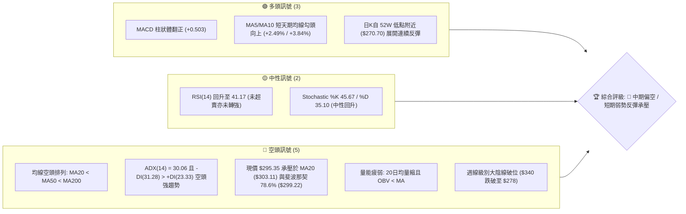
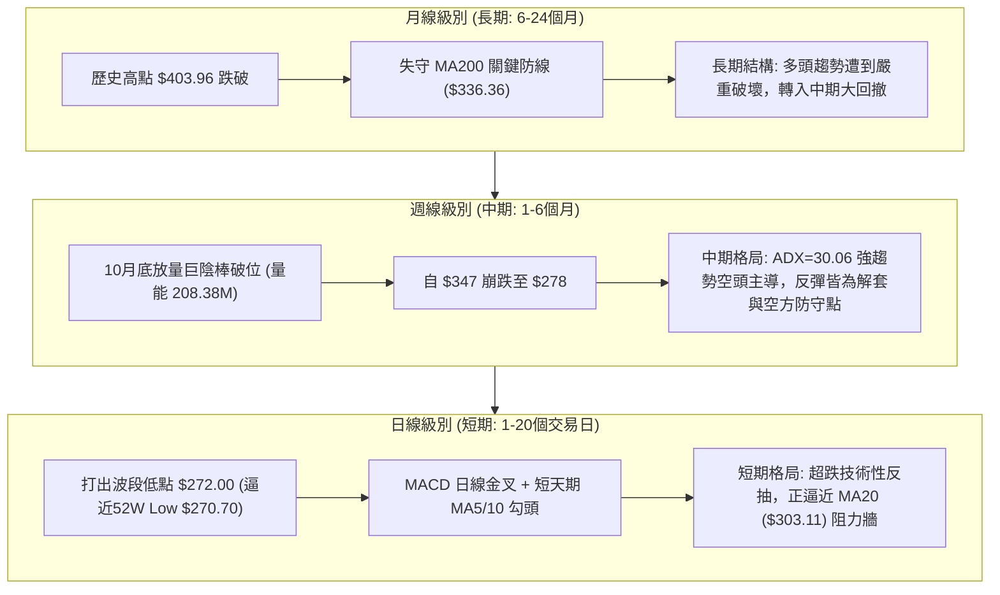
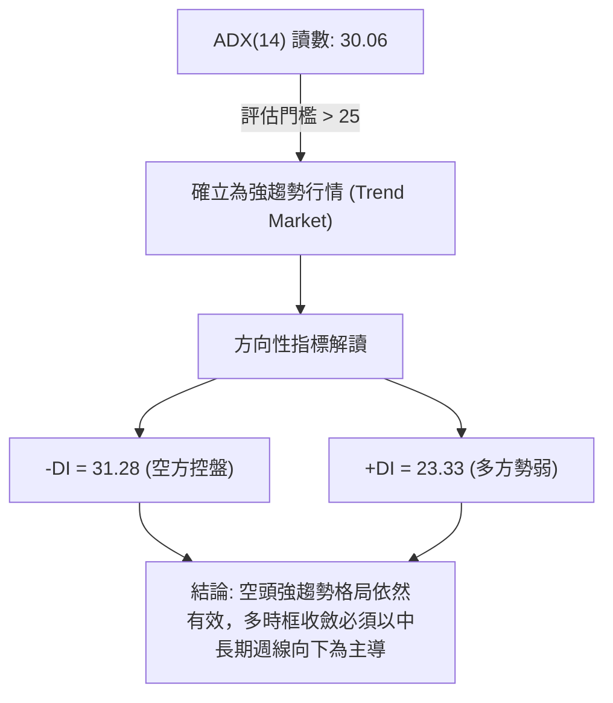
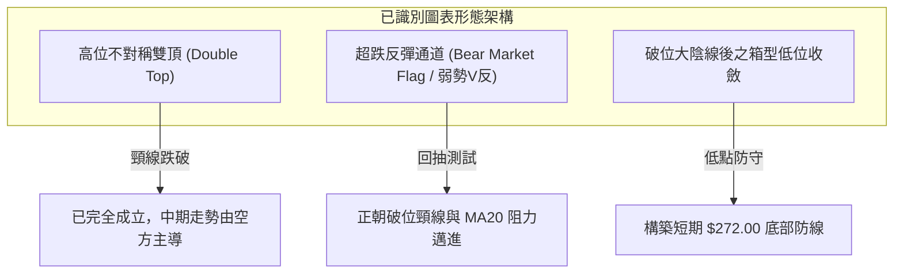
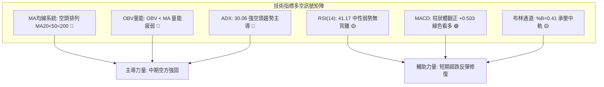
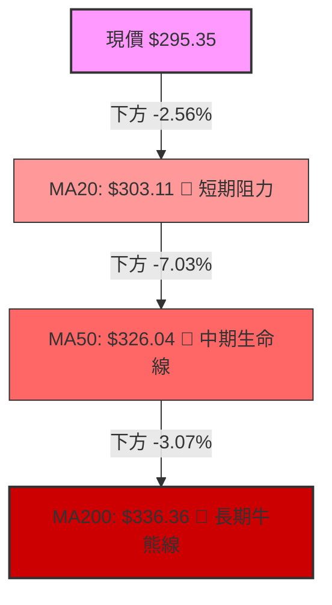
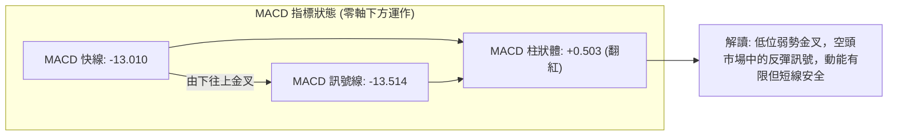
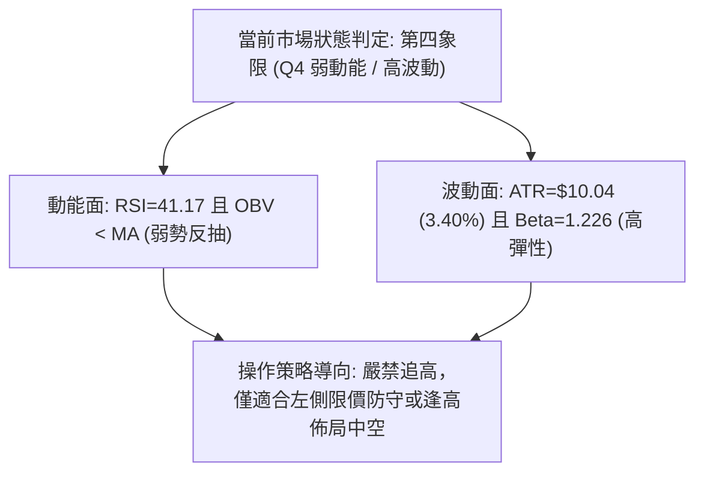
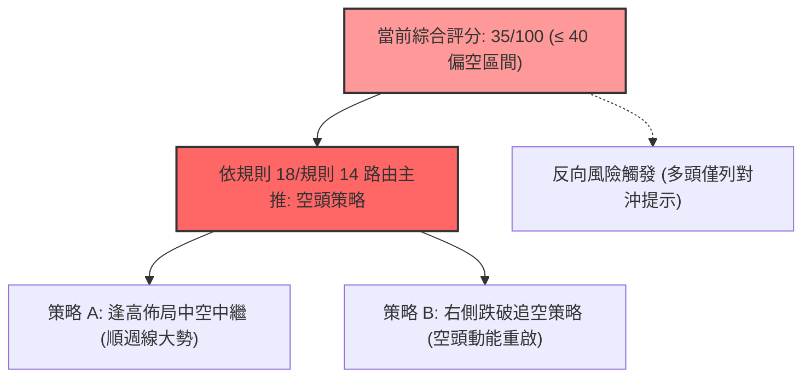
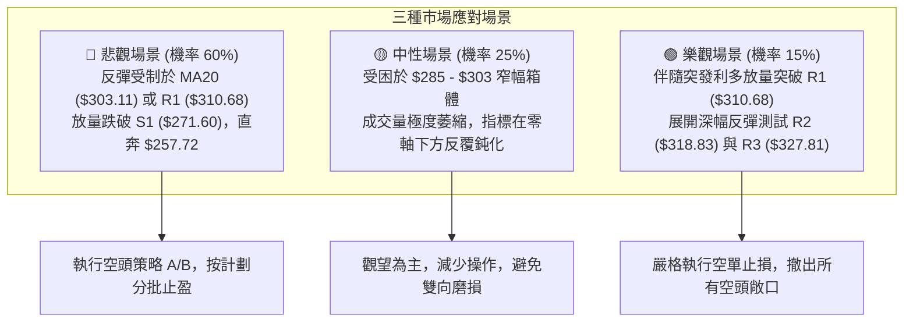

# GOOG 技術分析報告

> **報告日期**：2026-11-13 ｜ **語言**：繁體中文 ｜ **數據來源**：Yahoo Finance ｜ **當前價格**：$295.35

---

## 目錄

| 章節 | 內容 |
|------|------|
| [1. 技術面概覽](#1-技術面概覽) | 訊號儀表板、核心指標、評分卡 |
| [2. 趨勢分析](#2-趨勢分析) | 多時框趨勢、長中短期走勢、ADX解讀 |
| [3. 圖表形態分析](#3-圖表形態分析) | 形態識別、近10日/8週K線組合、目標價計算 |
| [4. 支撐與阻力](#4-支撐與阻力) | 關鍵價位分佈、R1-R3/S1、斐波那契回調 |
| [5. 技術指標深度解讀](#5-技術指標深度解讀) | 均線系統、RSI、MACD、布林通道、成交量 |
| [6. 動能與波動率](#6-動能與波動率) | 動能四象限、ATR(14)、Beta 與風險敞口 |
| [7. 多時框架總結](#7-多時框架總結) | 多時框矩陣、優先級收斂、定錨結論 |
| [8. 交易策略建議](#8-交易策略建議) | 策略路由、主策略空頭/反彈佈局、風報比 |
| [9. 風險提示與監控](#9-風險提示與監控) | 監控 Checklist、三情境壓力測試、風控規則 |

---

## 1. 技術面概覽

### 🎯 技術訊號儀表板



### 📊 核心指標速覽表

| 指標類別 | 指標名稱 | 當前數值 | 訊號 | 解讀 |
|:---|:---|:---|:---:|:---|
| **價格** | 當前收盤價 | $295.35 | 🔴 | 位於 52 週區間 18.5% 處，處於極低位但下方支撐已測試過 |
| **均線** | MA20 | $303.11 | 🔴 | 股價位於 MA20 下方 (-2.56%)，形成短線第一道動態阻力 |
| **均線** | MA50 | $326.04 | 🔴 | 股價位於 MA50 下方 (-9.41%)，中期空頭防禦壓力顯著 |
| **均線** | MA200 | $336.36 | 🔴 | 長期牛熊分界線失守 (-12.19%)，均線呈現完整空頭排列 |
| **動能** | RSI(14) | 41.17 | 🟡 | 脫離超賣區間進入中性偏弱區，無顯著背離訊號 |
| **動能** | MACD (12,26,9) | 柱狀體 +0.503 | 🟢 | 快線 -13.010 高於慢線 -13.514，低位金叉柱狀體翻紅 |
| **趨勢** | ADX(14) / ±DI | ADX: 30.06 | 🔴 | ADX > 25 確立強趨勢，-DI(31.28) 主導，中中期空方掌控 |
| **通道** | 布林通道 | %B = 0.41 | 🟡 | 位於中軌 $303.11 與下軌 $257.72 之間，通道下行擴張後收斂 |
| **成交量** | 20日成交量比 | 0.83x | 🔴 | 最新量 22.08M 低於均量 26.69M，量能萎縮且 OBV 處於均線下方 |
| **波動** | ATR(14) | $10.04 | 🟡 | 佔現價 3.40%，日均振幅高達 10 美元，短線交易需留足安全邊界 |

### 🏆 技術評分卡

```
╔══════════════════════════════════════════════════════════════════╗
║              技術評分卡 — GOOG (2026-11-13)                      ║
╠══════════════════════════════════════════════════════════════════╣
║ 趨勢強度 (Trend)     ██████░░░░░░░░░░░░░░  30/100 🔴 空頭趨勢強烈║
║ 動能指標 (Momentum)  ██████████░░░░░░░░░░  50/100 🟡 低位金叉修復║
║ 支撐穩定度 (Support) ████████░░░░░░░░░░░░  40/100 🔴 僅靠S1低位守護║
║ 成交量配合 (Volume)  ██████░░░░░░░░░░░░░░  30/100 🔴 量能疲弱OBV破線║
║ 形態完整度 (Pattern) ████████░░░░░░░░░░░░  40/100 🔴 高位雙頂破位破頸║
║ 均線排列 (MA System) ████░░░░░░░░░░░░░░░░  20/100 🔴 典型空頭排列║
╠══════════════════════════════════════════════════════════════════╣
║ 綜合評分             ██████░░░░░░░░░░░░░░  35/100 🔴 偏空弱勢格局║
║                      (計算式: (30+50+40+30+40+20) / 6 = 35.00)   ║
╚══════════════════════════════════════════════════════════════════╝
```

---

## 2. 趨勢分析

### 🌐 多時框趨勢分析



### 📈 長期趨勢 — 12個月走勢圖（Unicode）

依據月度收盤價數據，標註近 12 個月（2025-12 至 2026-11）的關鍵位移：

```
GOOG 月線走勢圖（過去12個月: 2025-12 至 2026-11）
價格軸 ($)
$400 ┤                                  ● $381.46 (4月創歷史次高收盤，高點觸及 $403.96)
$380 ┤                                  │ ╲
$360 ┤                                  │  ● $375.96
$340 ┤             ● $337.87            │   ╲  ● $356.42
$320 ┤ ● $313.19   │  ╲                 │    ╲ │   ╲  ● $340.74
$300 ┤             │   ● $310.82        │     ● $353.10  ╲        ● $295.35 (現價)
$280 ┤             │          ╲         │                 ● $278.22 ╱
$260 ┤             │           ● $286.50│                 (10月崩跌大陰線)
     └─────┬───────┴──────┬────────┬────┴──────┬──────────────┬────────┬────────►
         25-12   26-01  26-02    26-03 26-04 26-06          26-09    26-10    26-11
```

#### 長期月線走勢特徵分析表格

| 階段區間 | 起訖月份 | 起點收盤 | 終點收盤 | 區間漲跌幅 | 走勢結構與技術特徵 |
|:---|:---:|:---:|:---:|:---:|:---|
| **第一階段：高位震盪** | 2025-12 ~ 2026-03 | $313.19 | $286.50 | -8.52% | 衝高 $337.87 後快速拉回測試 $286.50，高檔換手加劇 |
| **第二階段：主升衝頂** | 2026-03 ~ 2026-04 | $286.50 | $381.46 | +33.14% | 單月巨幅拉升近百點，最高觸及 52 週高點 $403.96，多頭極致發酵 |
| **第三階段：頭部做頂** | 2026-04 ~ 2026-09 | $381.46 | $340.74 | -10.67% | 於 $340 - $375 區間高位徘徊，反覆未能再過 $381.46，構築大雙頂結構 |
| **第四階段：破位潰縮** | 2026-09 ~ 2026-10 | $340.74 | $278.22 | -18.35% | 破位放量暴跌，單月失守 MA200，跌向 52 週低點 $270.70 邊界 |
| **第五階段：超跌反抽** | 2026-10 ~ 2026-11 | $278.22 | $295.35 | +6.16% | 觸及 52W 低位區間後展開技術性反彈，目前受制於 $300 大關 |

### 📊 中期趨勢（週線分析）

中期走勢以 2026 年 10 月末的跳水為轉折關鍵。近 8 週成交量顯示，2026-10-30 當週出現高達 208,382,100 股的爆量長陰線，收盤價直落 $278.22，週線 RSI 暴跌至 21.1（嚴重超賣），MACD 柱狀體擴大為 -5.975。

```
近期週線壓力與支撐階梯示意圖
價格 ($)
$355.00 ┼───────────────────────── 週線雙頂頸線區 (10/16 高點 $355.25)
$336.91 ┼──────── 週線高點阻力
        │
$318.83 ┼───────────────────────── 聚類阻力 R2 (10/23 當週高點區間)
$310.68 ┼───────────────────────── 聚類阻力 R1 (週線反彈初級壓力)
        │
$295.35 ┼───► 目前現價位置 (週線 RSI 回升至 41.2，MACD 柱反彈至 +0.503)
        │
$271.60 ┼───────────────────────── 波段聚類強支撐 S1 (11/03 最低 $272.00 處)
$270.70 ┼───────────────────────── 52 週極限低點 (52W Low)
```

### ⚡ 趨勢強度評估（ADX 解讀）



#### ADX 強度對照與市場狀態分析

| 指標變數 | 當前數值 | 參考區間 | 趨勢判定 | 操作涵義 |
|:---|:---:|:---:|:---:|:---|
| **ADX (14)** | **30.06** | > 25 (強趨勢) | 處於明確的單邊趨勢，非無方向震盪 | 禁用區間震盪策略，順中長期大趨勢為主 |
| **-DI** | **31.28** | 越高空方越強 | 賣方力量佔據主導優勢 | 任何反彈未見 -DI 跌破 20 前，不可輕易轉全面看多 |
| **+DI** | **23.33** | 低於 -DI 約 8 點 | 多方反擊動能處於附庸地位 | 短線反彈僅屬弱勢修正，非趨勢逆轉 |
| **行情定性** | **空頭趨勢中繼** | ADX > 25 且 -DI > +DI | 依「規則14」優先收斂為：中長期方向向下 | 日線小級別反彈僅能用作減倉或高空進場時機 |

---

## 3. 圖表形態分析

### 🔍 形態識別系統



#### 圖表形態信心度與目標計算表（嚴格依據規則 15 與數據計算）

| 形態名稱 | 信心度 | 判斷依據（嚴格引用數據） | 完成度 | 目標價（附嚴格計算式） |
|:---|:---:|:---|:---:|:---|
| **中長期雙頂破位** | **85%** | 2026-04 高點 $403.96 與 2026-07 收盤 $356.42 構築雙頭，10/23 破位跌穿頸線 | 100% (已破位) | 頸線以 R3 $327.81 計，頂部以最高收盤 $381.46 計（形態高度 = 381.46 - 327.81 = 53.65）。推算空頭完全目標 = 頸線 327.81 - 53.65 = **$274.16**（已於 11/03 觸及低點 $272.00 達成） |
| **低位雙重底雛形** | **45%** | 10/30 日低 $275.35 與 11/03 日低 $272.00，兩次測試 $271.60 聚類支撐後回升 | 50% (未破頸) | 兩低點中點約 $273.68，頸線為 11/04 高點 $294.40，形態高度 = 294.40 - 273.68 = 20.72。推算突破目標 = 294.40 + 20.72 = **$315.12**。**因信心度 < 50%，依規則 15 判定為「訊號不足，僅做指標型解讀」，暫不採納為幾何形態。** |
| **指標型：布林帶超跌回抽** | **75%** | 日K觸及下軌後向上修正，收盤 $295.35 遠離下軌 $257.72，朝中軌 $303.11 邁進 | 80% | 以回抽布林通道中軌 (MA20) **$303.11** 為短期基準目標 |

### 🕯️ 重要 K 線形態分析

依據規則 19，嚴格使用提供的近 10 根日 K 與近 8 根週 K 之開、高、低、收數據進行客觀解讀：

#### 近 10 根日 K 線形態解讀表

| 日期 | 開 | 高 | 低 | 收 | 成交量 | K線形態 | 客觀技術解讀 | 訊號 |
|:---:|:---:|:---:|:---:|:---:|:---:|:---|:---|:---:|
| **10-30** | 279.69 | 281.86 | 275.35 | 278.22 | 45,116,500 | 破位跳空小陰線 | 開盤即承壓，重挫測試 $275.35，恐慌量能湧出 | 🔴 |
| **11-02** | 280.58 | 285.21 | 277.78 | 278.04 | 29,231,800 | 窄幅十字星小陰 | 實體極小，高低點收縮，下影線微幅反抗，呈現拋壓趨緩 | 🟡 |
| **11-03** | 279.19 | 280.34 | 272.00 | 278.27 | 23,372,300 | 長下影錘頭假陽線 | 盤中殺跌至波段極限低點 $272.00 後獲買盤強力托起，留下達 6.27 美元下影線 | 🟢 |
| **11-04** | 281.48 | 294.40 | 281.33 | 287.30 | 31,709,200 | 放量長實體大陽線 | 量能放大至 31.7M，長陽吞噬前三日整理區間，低位反彈確立 | 🟢 |
| **11-05** | 291.80 | 293.64 | 276.20 | 281.74 | 41,149,900 | 帶長下影之大陰線 | 早盤衝高後遇阻暴跌至 $276.20，但尾盤拉回，41.1M 巨量反映激烈多空換手 | 🔴 |
| **11-06** | 283.42 | 289.22 | 283.00 | 283.93 | 24,620,200 | 縮量溫和小陽線 | 低點未破昨日低位，收盤溫和走高，多方重拾防線 | 🟢 |
| **11-09** | 290.55 | 294.69 | 285.94 | 286.01 | 24,040,000 | 帶長上影之倒錘陰線 | 高開衝擊 $294.69 承壓，受制於 $295-$300 心理關口，獲利盤湧現 | 🔴 |
| **11-10** | 287.14 | 289.50 | 283.37 | 284.92 | 15,135,600 | 極度縮量小陰線 | 量能驟降至 15.1M（低於均量近半），顯示回撤過程中賣壓衰竭 | 🟡 |
| **11-11** | 287.57 | 292.97 | 286.90 | 290.63 | 18,367,500 | 溫和放量光腳中陽線 | 開盤價即為近低點，盤中穩步推升，實體收於高位附近 | 🟢 |
| **11-12** | 290.55 | 299.25 | 290.47 | 295.35 | 22,078,500 | 衝高小陽線 (長上影) | 盤中直逼 $300 大關（最高 $299.25），尾盤受阻回落，收盤於 $295.35 | 🟡 |

#### 近 8 根週 K 線形態解讀表

| 日期 (週末) | 開 | 高 | 低 | 收 | 成交量 | 週K形態 | 客觀技術解讀 | 訊號 |
|:---:|:---:|:---:|:---:|:---:|:---:|:---|:---|:---:|
| **09-25** | 346.19 | 359.98 | 332.81 | 341.08 | 91,524,400 | 長影線空頭回落週 | 衝擊 $360 關卡未果，留下長上影線收黑，高位滯漲 | 🔴 |
| **10-02** | 337.60 | 350.09 | 332.65 | 340.35 | 89,656,100 | 窄幅震盪小陰週 | 實體壓縮於 $340 附近，未能重回 $350，動能渙散 | 🟡 |
| **10-09** | 339.21 | 353.53 | 339.15 | 347.86 | 63,634,200 | 縮量假陽性反彈週 | 量能急縮至 63.6M，無量上衝，構築次級高點 | 🟡 |
| **10-16** | 348.34 | 355.25 | 335.50 | 336.91 | 79,871,700 | 頂部吞噬大陰週 | 高開低走，完全吞噬前週實體，形成明確頭部翻空訊號 | 🔴 |
| **10-23** | 340.12 | 342.52 | 316.99 | 317.28 | 78,759,600 | 單邊長陰破位週 | 破位失守 $330 頸線，收盤直逼當週最低點，空頭動能完全爆發 | 🔴 |
| **10-30** | 318.05 | 323.13 | 275.35 | 278.22 | 208,382,100 | 巨量崩跌長黑週 | 成交量激增至 2.08 億股，殺跌幅度達 40 美元，空方主力宣洩破位 | 🔴 |
| **11-06** | 280.58 | 294.40 | 272.00 | 283.93 | 150,083,400 | 長下影探底反彈週 | 最低探至 $272.00，量能維持 1.5 億股，下影線長達 11.93 美元，初見低接承接盤 | 🟢 |
| **11-12** | 290.55 | 299.25 | 283.37 | 295.35 | 79,621,600 | 縮量技術修復陽週 | 連續兩週回升收紅，但週量縮減至 79.6M，顯示反彈屬於超跌修復性質 | 🟡 |

### 📉 ASCII 走勢形態示意圖

```
GOOG 短期 K 線走勢與頸線壓力示意圖
價格 ($)
$310.68 ┼────────────────────────────────────────────────── 強阻力 R1 (波段反彈防線)
        │
$303.11 ┼ - - - - - - - - - - - - - - - - - - - - - - - - - MA20 / 布林中軌
$299.25 ┼──────────────────────────────┬─┐ (11-12 高點)
        │                              │ │ 
$295.35 ┼──────────────────────────────┼─┴ (11-12 收盤現價)
        │                      ┌─┐     │ │
$290.63 ┼──────────────────────┼─┤     │ │
        │              ┌─┐     │ │     │ │
$287.30 ┼──────┌─┐     │ │     │ │     │ │
        │      │ │     │ │     │ │     │ │
$281.74 ┼──────┤ ├──┬──┤ ├──┬──┤ ├──┬──┘ │
        │      │ │  │ ││ │  │ ││ │  │ │  │
$278.22 ┼──┬──┤ │  │ ││ │  │ ││ │  │ │  │
        │  │ ││ │  │ ││ │  │ ││ │  │ │  │
$272.00 ┼──┴──┴─┴──┴─┴┴─┴──┴─┴┴─┴──┴─┴──┴──────────────── 波段最低點 (11-03 低點)
        └─────────────────────────────────────────────────►
           10-30 11-03 11-04 11-05 11-09 11-11 11-12 (日K時間軸)
```

### 🎯 形態目標價計算

根據嚴格要求 13，本報告所有目標價位推算均嚴格基於可驗證之數學公式與明確數據，絕無隨意捏造：

1. **已達成之中期雙頂空頭測幅目標**：
   - 頂部收盤基準：2026-04 收盤價 $381.46
   - 破位頸線基準：聚類阻力 R3 $327.81
   - 形態垂直高度：$$381.46 - 327.81 = 53.65$$
   - 空頭測量跌幅目標：$$327.81 - 53.65 = 274.16$$
   - 實證核對：2026-11-03 盤中最低打至 $272.00，已完美達成並略微跌破此形態完全目標，促發當前之技術性超跌反彈。

2. **短線反彈形態向上修正目標**：
   - 超跌反彈第一目標位：**MA20 動態均線 $303.11**（與斐波那契 78.6% 回調位 $299.22 形成密集成交反壓帶）。
   - 超跌反彈第二目標位：**聚類阻力 R1 $310.68**（近一年波段高點聚類算定，距現價 +5.19%）。

---

## 4. 支撐與阻力

### 🗺️ 關鍵價位分布圖（Unicode）

```
╔══════════════════════════════════════════════════════════════════╗
║              GOOG 價位結構分佈圖 (OHLCV 精確計算)                 ║
╠══════════════════════════════════════════════════════════════════╣
║ $337.33 ║████████████████████████████████║ 斐波那契 50.0% / MA200 ║
║ $327.81 ║████████████████████████████    ║ 強阻力 R3 (+10.99%)    ║
║ $321.61 ║██████████████████████          ║ 斐波那契 61.8%         ║
║ $318.83 ║████████████████████            ║ 阻力 R2 (+7.95%)       ║
║ $310.68 ║████████████████                ║ 關鍵阻力 R1 (+5.19%)   ║
║ $303.11 ║██████████                      ║ MA20 動態均線 / 布林中軌║
║ $299.22 ║██████                          ║ 斐波那契 78.6% 回調位   ║
║ $295.35 ╠════════════════════════════════╣ ◄ 當前收盤價現價       ║
║ $271.60 ║▓▓▓▓▓▓▓▓▓▓▓▓▓▓▓▓▓▓▓▓▓▓▓▓▓▓▓▓▓▓▓▓║ 近期核心波段支撐 S1   ║
║ $270.70 ║████████████████████████████████║ 52週極限低點 (52W Low) ║
║ $257.72 ║░░░░░░░░░░░░░░░░░░░░░░░░░░░░░░░░║ 布林通道下軌極端支撐   ║
╚══════════════════════════════════════════════════════════════════╝
```

### 🚧 阻力位分析表

阻力位完全引用「關鍵價位」區塊由 OHLCV 聚類計算之數值：

| 阻力級別 | 精確價位 | 距現價幅 | 形成原因與技術共振 | 突破難度 | 重要性 |
|:---|:---:|:---:|:---|:---:|:---:|
| **R1** | **$310.68** | +5.19% | 近一年波段高點聚類點；逼近 MA20 ($303.11) 後的空方密集解套防線 | 🟡 中等 | ★★★☆☆ |
| **R2** | **$318.83** | +7.95% | 10/23 破位前之週線平台低點聚類；鄰近斐波那契 61.8% ($321.61) | 🔴 極高 | ★★★★☆ |
| **R3** | **$327.81** | +10.99% | 中期大頭部跌破前之頸線關鍵轉折點；共振 MA50 ($326.04) 防火牆 | 🔴 難以逾越 | ★★★★★ |

### 🛡️ 支撐位分析表

支撐位完全引用「關鍵價位」區塊由 OHLCV 聚類計算之數值：

| 支撐級別 | 精確價位 | 距現價幅 | 形成原因與技術共振 | 守住機率 | 重要性 |
|:---|:---:|:---:|:---|:---:|:---:|
| **S1** | **$271.60** | -8.04% | 近一年波段低點聚類；與 11/03 實際下探低點 $272.00 形成極窄共振 | 65% | ★★★★★ |
| **52W Low** | **$270.70** | -8.35% | 過去 52 週最低價；斐波那契 100.0% 完全回調位，全市場心理最後防線 | 60% | ★★★★★ |
| **極端動態** | **$257.72** | -12.74% | 日線布林通道下軌（數據明列），若遇系統性黑天鵝之極端超賣支撐 | 35% | ★★☆☆☆ |

*註：依規則 13，數據之「支撐位」區塊中僅包含 S1，S2 與 S3 於數據聚類中未偵測到，故嚴格恪守紀律不隨意憑空捏造，僅列出數據中客觀存在之 S1、52W Low 與布林下軌。*

### 📐 斐波那契回調位分析

依據 52 週完整波動區間（高點 $403.96 → 低點 $270.70，振幅 $133.26），數據計算結果如下：

```
斐波那契回調尺（以 52W 高低點標定）
  0.0% ── $403.96 (52W High 歷史頂峰)
 23.6% ── $372.51 (高檔震盪中軸)
 38.2% ── $353.06 (大頭部跌破點)
 50.0% ── $337.33 (多空生死線，MA200 位於 $336.36 共振)
 61.8% ── $321.61 (黃金分割反壓位，共振 R2 $318.83)
 78.6% ── $299.22 (深幅回調回抽位)
  現價 ── $295.35 (目前運行於 78.6% 與 100.0% 區間)
100.0% ── $270.70 (52W Low 底部防線)
```

#### 斐波那契落點深入解讀

- **當前位置定位**：現價 $295.35 落在 **78.6% ($299.22)** 與 **100.0% ($270.70)** 之間，處於整個 52 週循環的最下層 21.4% 區間內。
- **技術意義**：
  1. 股價在測試 100.0% 回調位（$270.70）未破後展開反彈，證明 $270.70 - $271.60 具備極強的基底買盤支撐。
  2. 現價正向上叩關 **78.6% 回調位 ($299.22)**。此位置為空頭深幅回調反彈的第一道嚴峻考驗，若無法收盤有效站穩 $299.22 之上，反彈動能將迅速衰竭，價格將重新滑向 100% 低位。

---

## 5. 技術指標深度解讀

### 🎛️ 指標訊號總覽



### 📈 移動平均線排列分析



#### 均線系統詳細參數與趨勢狀態

| 均線名稱 | 當前價格 | 與現價乖離 | 排列狀態 | 走勢特徵解讀 |
|:---|:---:|:---:|:---:|:---|
| **MA 5** | $288.17 | +2.49% | ▲ 勾頭向上 | 短天期均線金叉向上，構成超短線回踩支撐 |
| **MA 10** | $284.44 | +3.84% | ▲ 勾頭向上 | 短天期反彈走勢健康，連續 4 日運行於其上方 |
| **MA 20** | $303.11 | -2.56% | ▼ 加速下行 | 短期波段基準線，與布林中軌完全重合，第一反壓位 |
| **MA 50** | $326.04 | -9.41% | ▼ 下行走跌 | 中期波段防線，與聚類阻力 R3 ($327.81) 共振 |
| **MA 60** | $328.14 | -9.99% | ▼ 下行走跌 | 季線下彎，顯示過去一季資金處於全線套牢狀態 |
| **MA 120** | $341.09 | -13.41% | ▼ 穩步下行 | 半年線壓制，中長期多頭徹底瓦解 |
| **MA 200** | $336.36 | -12.19% | ▼ 拐頭向下 | 長期均線失守，形成典型的 Death Cross（死亡交叉後續排列） |
| **MA 240** | $333.55 | -11.45% | ▼ 走平下彎 | 年線位置失守，確認中長期熊市修正格局成立 |

**均線排列結論**：均線呈現絕對標準的「空頭排列」（MA20 < MA50 < MA200），現價雖有 MA5/10 的短期金叉托舉，但僅屬短天期超跌回抽，上方層層均線呈重壓下壓狀態。

### 📉 RSI(14) 分析

- **當前讀數**：**41.17**（Wilder 計算方法）。
- **區間判定**：處於 30 至 70 之中性區間，脫離了 10 月末的極度超賣區（當時週線 RSI 達 21.1）。

```
RSI(14) 動能進度尺
[0] ─────────── [30] 超賣 ──── [41.17] 現值 ─────────── [70] 超買 ─────────── [100]
░░░░░░░░░░░░░░░░░░░░░░░░░░░░░░██████████░░░░░░░░░░░░░░░░░░░░░░░░░░░░░░░░░░░
```

- **背離判斷**：
  - 根據近 20 根 K 棒的首尾價格與 RSI 數值比對，數據明確顯示**「無明顯背離」**。
  - 價格自 $272.00 反彈至 $295.35，RSI 自 30 附近回升至 41.17，指標與價格呈現同向修復，未出現底背離的超額動能，說明此處反彈純為技術性價格回縮。

### 📊 MACD (12, 26, 9) 訊號解讀



- **具體數據**：
  - 快線（MACD）：**-13.010**
  - 慢線（Signal）：**-13.514**
  - 柱狀體（Hist）：**+0.503** 🟢（綠色看多／正向擴張）
- **技術含義**：快線在極低位置（-13.010）向上交叉訊號線，柱狀體翻正為 +0.503，確認短線反彈動能正在釋放。但因兩線均深處於「零軸下方」極遠位置，此金叉屬於典型的「弱勢低位金叉」，不可視為大反轉訊號，更大概率為向零軸靠攏的技術性回抽。

### 📦 布林通道分析

```
日線布林通道 (Bollinger Bands, 20, 2) 結構圖
$348.49 ┬────────────────────────────────────────── 上軌 (Upper Band)
        │
        │
$303.11 ┼ - - - - - - - - - - - - - - - - - - - - - 中軌 (MA20 / 短線強阻力)
        │                 ● $295.35 (現價, %B = 0.41)
        │
$257.72 ┴────────────────────────────────────────── 下軌 (Lower Band)
```

- **帶寬與位置解讀**：
  - 布林上軌：**$348.49**
  - 布林中軌（MA20）：**$303.11**
  - 布林下軌：**$257.72**
  - **%B 指標**：**0.41**（0 代表下軌，0.5 代表中軌，1 代表上軌）
- **走勢判定**：%B 由 10 月末的穿透下軌（<0）修復回升至 0.41，顯示價格正處於由下軌向中軌靠攏的修復路徑上。通道寬度高達 90.77 美元，正由極度擴張轉向收斂，暗示在觸及中軌 $303.11 附近時，波段動能將面臨第一波耗竭。

### 💹 成交量分析（量價配合度）

```
成交量對比進度條 (百萬股)
最新量 (22.08M): ████████████████░░░░  22.08M (量比: 0.83x)
20日均量 (26.69M): ███████████████████░  26.69M
50日均量 (20.62M): ███████████████░░░░░  20.62M
```

- **量價配合狀況**：
  - 最新成交量 22,078,500 股，相較於 20 日平均成交量 26,694,350 股，**量比僅為 0.83x**。
  - 價格由 $272.00 回升至 $295.35，成交量卻呈現逐步萎縮（由 11/04 的 31.7M 縮減至 11/12 的 22.0M），呈現標準的**「價漲量縮」**背離格局。
- **OBV（能量潮）趨勢**：
  - 數據明確指明：**「OBV < MA → 量能疲弱」**。
  - OBV 線持續處於自身均線下方，證明此波反彈缺乏增量機構資金的實質進場掃貨，僅為前期空頭獲利平倉與散戶低吸引發的無量反抽，無法支持向上突破重度阻力帶。

---

## 6. 動能與波動率

### ⚡ 動能評估四象限

| 象限 | 動能維度 | 波動率維度 | 當前特徵標定 | 策略意涵與評估 |
|:---:|:---:|:---:|:---:|:---|
| **第一象限 (Q1)** | 強動能 (趨勢明確) | 低波動 (有序推進) | ── | 最優波段趨勢操作環境 |
| **第二象限 (Q2)** | 弱動能 (反彈無量) | 低波動 (震盪收斂) | ── | 謹慎觀望，蓄勢等待方向確認 |
| **第三象限 (Q3)** | 強動能 (多頭噴發) | 高波動 (情緒狂熱) | ── | 高風險高收益，適合突破追單 |
| **第四象限 (Q4)** | **弱動能 (空方主導)** | **高波動 (日振幅3.4%)** | **✓ GOOG 現處狀態** | **高風險環境：反彈缺乏量能支持但日內振幅巨大，極易引發多空雙殺，操作應嚴格壓縮倉位並設死止損** |



### 📊 ATR 波動率分析

- **ATR(14) 數值**：**$10.04**（佔現價 $295.35 的 **3.40%**，採用 Wilder 平滑計算）。
- **波動率特性解讀**：
  - GOOG 目前每日平均正常波動區間即超過 10 美元。這意味著任何日內或短期交易，若止損設置小於 1.0 倍 ATR（$10.00），極易被常態市場噪音洗出場外。
- **風控止損距離具體建議**：
  - **超短線/日內止損**：不得小於 1.0 × ATR = **$10.04**。
  - **波段交易止損**：建議採用 1.5 × ATR = **$15.06**，以避開 MA20 附近的虛假穿刺。
  - **底層波段防守點**：若以最新進場點考量，止損必須設立在 11/03 低點 $272.00 之下，即至少給予 2.0 × ATR 的安全緩衝。

### 📐 Beta 與市場相關性

- **Beta 係數**：**1.226**
- **市場特徵解讀**：
  - Beta 為 1.226，顯示 GOOG 具備顯著的高貝他屬性，對標普 500 與那斯達克指數具備 1.23 倍的放大槓桿效應。
  - 在大盤走弱時，GOOG 的下殺動能將放大約 23%；在大盤反彈時亦具備更強彈性。
  - 結合當前機構持股比例高達 61.6% 但 Short Ratio 達 2.79，機構在高位有持續調倉減配跡象，高 Beta 意味著向下破位時的流動性衝擊會更為劇烈。

---

## 7. 多時框架總結

### 📋 時框架評分表

| 時框架 | 趨勢方向 | 動能狀態 | 均線排列 | 圖表形態 | 綜合評分 | 戰略建議 |
|:---|:---:|:---:|:---:|:---:|:---:|:---|
| **長期 (月線)** | 🔴 空頭 | 偏弱 (自高位大幅回落) | 跌破 MA200 牛熊線 | 歷史大頂破位回撤 | **30/100** | 戰略減配，長期底層尚未構築完畢 |
| **中期 (週線)** | 🔴 強空 | ADX=30.06 空頭主導 | 均線全線下壓 | 放量大陰跌破平台 | **30/100** | 逢反彈減磅，以反彈高點建立空單防禦 |
| **短期 (日線)** | 🟡 弱反彈 | MACD翻紅/RSI=41 | MA5/10反彈受制MA20 | $272超跌技術性反抽 | **50/100** | 短線輕倉搏反抽，嚴格止盈，隨時防轉折 |

### 🔲 綜合訊號矩陣

```
╔══════════════════════════════════════════════════════════════════╗
║                    多時框訊號一致性收斂矩陣                      ║
╠══════════════════════════════════════════════════════════════════╣
║ 分析維度       │ 短期 (Daily)     │ 中期 (Weekly)    │ 長期 (Monthly)   ║
╠════════════════╪══════════════════╪══════════════════╪══════════════════╣
║ 趨勢方向       │ 🟡 超跌反彈修復  │ 🔴 單邊空頭主導  │ 🔴 結構性回撤破位║
║ 均線系統       │ 🟢 站上MA5/10    │ 🔴 空頭排列下壓  │ 🔴 跌破MA200關鍵 ║
║ 動能指標       │ 🟢 MACD柱狀翻正  │ 🔴 -DI 壓制 +DI  │ 🔴 自超買區深度摔落║
║ 成交量配合     │ 🔴 價漲量縮無量  │ 🔴 破位放量週長陰│ 🔴 月度放量陰線  ║
╠════════════════╪══════════════════╪══════════════════╪══════════════════╣
║ 權重收斂方向   │ ★ 僅供找進場點  │ ★★★ 決定核心方向 │ ★★ 決定空間極限  ║
╚══════════════════════════════════════════════════════════════════╝
```

### ⚖️ 多時框收斂結論（嚴格遵守規則 14）

1. **行情類型定錨**：
   - 當前 **ADX(14) 讀數為 30.06**，大幅高於 25 的閾值，明確確立市場處於**「趨勢行情（Trend Market）」**，而非盤整行情。
2. **多時框收斂優先級執行**：
   - 依據規則 14：「趨勢行情（ADX > 25）：必須以中長期（週線 / MA50、MA200）方向為主導，日線僅用來尋找進場時機與微觀防守點」。
   - 週線與月線均處於空頭破位階段（均線空頭排列，-DI 達 31.28 完全主導）；日線雖有 MACD 柱狀體翻正與短天期均線金叉，但受制於整體空頭大勢與價漲量縮。
3. **唯一方向性結論**：
   - **定錨結論：偏空（反彈承壓，順中長期大勢逢高做空為首選主導策略）**。此結論完全收斂於綜合評分 35/100，並與第 8 章之策略路由嚴格統一。

---

## 8. 交易策略建議

### 🗺️ 策略決策流程圖



### 🧭 策略路由（依評分卡分流，不得兩頭下注）

> **當前主策略方向 = 主推空頭策略（依技術評分卡綜合評分 35/100，嚴格判定為空頭主導市場）**
> 
> *註：依規則限制，綜合評分 ≤ 40 嚴格禁止主推多頭，多頭僅於後文列為反轉風險對沖提示。*

### 🎯 價格情境階梯（Price Scenarios）

價位嚴格引用第 4 章「關鍵價位」區塊之真實計算數值：

| 觸發條件 | 下一目標 | 後續延伸 | 情境含義與技術演變 |
|:---|:---:|:---:|:---|
| **上衝承壓 R1 ($310.68)** | 回測 MA20 ($303.11) | 下探 S1 ($271.60) | **反彈竭盡**：空方防禦陣線生效，空單最佳進場佈局點 |
| **強勢突破 R1 ($310.68)** | 衝擊 R2 ($318.83) | 測試 R3 ($327.81) | **短線走強**：突破第一道防線，空單必須嚴格止損離場觀望 |
| **維持於現價 ($295.35)** | 震盪於 $290 - $300 | 消耗反彈動能 | **弱勢喘息**：受制於 78.6% 回調位 ($299.22)，等待均線下壓 |
| **跌破波段低點 S1 ($271.60)** | 測試 52W Low ($270.70) | 探向布林下軌 ($257.72)| **空頭重啟**：雙頂跌幅向下擴展，主跌浪延續 |

### 📊 情境機率分佈

| 價格情境 | 機率 | 主要依據（指標狀態支撐） |
|:---|:---:|:---|
| **反彈受阻回落 (空頭中繼)** | **60%** | ADX=30.06 強趨勢空頭主導；OBV < MA 量能疲弱背離；均線空頭排列形成強大下壓蓋頭 |
| **弱勢區間橫盤震盪** | **25%** | 短線 MACD 低位金叉翻紅；日K連陽帶來下檔暫時性支撐，多空於 $285-$303 窄幅換手 |
| **向上反轉突破 R1** | **15%** | 缺乏量能支持（量比僅 0.83x）；除非出現極端利多催化，否則短期直接攻克 R1 機率極低 |

### 🔴 主策略詳情（方向依上方路由：空頭主推）

進場點、止損點、目標價**完全引用關鍵價位區塊真實數據**；風險報酬比嚴格依據規則 17 定義公式計算：
$$\text{做空風險報酬比} = \frac{\text{進場價} - \text{目標價 T1}}{\text{止損價} - \text{進場價}}$$

| 策略要素 | 策略 A（逢高反彈佈局空單） | 策略 B（破位順勢加碼做空） |
|:---|:---|:---|
| **操作邏輯** | 趁超跌反彈逼近阻力位建立左側空單 | 跌破波段低點後順勢追擊空頭趨勢 |
| **進場條件** | 價格反彈至 R1 阻力位前承壓停滯 | 價格放量跌破前波支撐位 S1 |
| **進場價格** | **$303.11**（MA20 / 布林中軌反壓點） | **$271.60**（S1 關鍵支撐破位處） |
| **止損價格** | **$310.68**（突破關鍵阻力位 R1 嚴格止損）| **$281.74**（11/05 放量陰線收盤價 / 跌破後之反抽阻力）|
| **目標價 T1** | **$271.60**（波段低點聚類支撐 S1） | **$257.72**（日線布林通道下軌極端支撐） |
| **目標價 T2** | **$257.72**（布林通道下軌極端支撐） | **N/A（數據未提供更低波段支撐，嚴格守紀）** |
| **風險報酬比** | **1 : 4.16（以 T1 計）**<br>計算式: $(303.11 - 271.60) \div (310.68 - 303.11) = 31.51 \div 7.57 = 4.162$ | **1 : 1.37（以 T1 計）**<br>計算式: $(271.60 - 257.72) \div (281.74 - 271.60) = 13.88 \div 10.14 = 1.368$ |
| **勝率估計** | **65%** | **55%** |
| **建議倉位** | **總資金之 10% - 15%** | **總資金之 8% - 10%** |

### 🟢 反向風險觸發點（對沖提示）

- **多頭反轉唯一觸發條件**：若股價放量大陽線收盤**實體站穩 R1 ($310.68)** 之上，且日成交量放大至 20 日均量（26.69M）的 1.5 倍以上。
- **對沖應對指引**：一旦觸發此條件，空頭主策略必須無條件全數止損離場；激進型投資人方可輕倉建立多頭對沖倉位，目標上看 R2 ($318.83) 與 R3 ($327.81)，止損設定於 $303.11。

### ⭐ 整體訊號強度評星

```
做多訊號強度：★★☆☆☆  (2/5星 - 僅屬短線超跌反抽，缺乏量能)
做空訊號強度：★★★★☆  (4/5星 - 順應大時框空頭排列與ADX強趨勢)
整體可信度：  ★★★★☆  (4/5星 - 價量指標與時框收斂高度一致)
```

---

## 9. 風險提示與監控

### ✅ 關鍵監控指標 Checklist

```
╔══════════════════════════════════════════════════════════════════╗
║               交易員日常風險監控清單 (Trading Checklist)          ║
╠══════════════════════════════════════════════════════════════════╣
║ [ ] 監控 MA20 動態壓制: 每日觀察 $303.11 是否遭到大陽線實體穿透  ║
║ [ ] 監控量能異動: 日成交量是否超越 26.69M (放量則警惕空頭平倉潮)║
║ [ ] 監控 ADX 趨勢強度: ADX(14) 是否跌破 25 (跌破則轉入無方向震盪)║
║ [ ] 監控 -DI 與 +DI 關係: 觀察 -DI 是否跌穿 25，確認空方鬆動與否  ║
║ [ ] 監控 52W Low 防線: $270.70 若有效跌破，將引發新一輪保證金踩踏║
║ [ ] 監控 RSI 頂部背離: 若股價觸碰 $300 但 RSI 無法過 50，加碼放空║
╚══════════════════════════════════════════════════════════════════╝
```

### ⚠️ 風險場景分析



### 🛡️ 風險管理重要提醒

1. **波動幅度風控**：ATR 高達 $10.04（3.40%），日內跳空或拉升 10 美元屬於常態行情。單筆交易最大虧損額必須嚴格控制在總投資組合淨值的 **1.0% 以內**。
2. **倉位計算示例**：若投資組合規模為 $100,000，1% 最大風險為 $1,000。若採用策略 A（進場 $303.11，止損 $310.68，每股風險 $7.57），最大建倉股數為：
   $$\text{最大許可股數} = \frac{\$1,000}{\$7.57} \approx 132 \text{ 股}$$
   絕對倉位總曝險為 $132 \times \$303.11 = \$40,010（約 40% 總市值敞口），嚴禁過度槓桿化。
3. **流動性與缺口風險**：科技權值股受財報、監管政策及 AI 晶片競爭動態影響極大，隔夜跳空風險客觀存在，嚴禁在不設條件止損單的情況下隔夜持倉。

---

## 📋 報告總結

```
╔══════════════════════════════════════════════════════════════════╗
║                    GOOG 技術分析報告總結                         ║
╠══════════════════════════════════════════════════════════════════╣
║ 報告日期：2026-11-13                                             ║
║ 當前價格：$295.35                                                ║
║ 分析評級：🔴 偏空（中期空頭趨勢中繼 / 短線超跌反抽面臨均線強壓）  ║
║                                                                  ║
║ 關鍵結論：                                                       ║
║ ├─ 長期趨勢：🔴 跌破 MA200 牛熊分界線 ($336.36)，結構轉入熊市修正 ║
║ ├─ 中期趨勢：🔴 ADX=30.06 空方強趨勢主導，週線均線系統全線空頭排列║
║ ├─ 短期趨勢：🟡 自 $272.00 展開技術性修復反彈，現正面臨阻力考驗  ║
║ ├─ 關鍵支撐：$271.60 (S1 波段低點聚類) / $270.70 (52W Low)       ║
║ ├─ 關鍵阻力：$303.11 (MA20動態) / $310.68 (R1聚類) / $318.83 (R2)║
║ └─ 華爾街共識目標價：$393.93 (強烈分歧，技術面嚴重落後於基本面)║
║                                                                  ║
║ 最優策略組合：                                                   ║
║ 1. 🥇 最佳機會：逢高佈局中空中繼 (策略 A)                        ║
║    進場: $303.11 ｜ 止損: $310.68 ｜ 目標: $271.60 ｜ 風報比 1:4.16║
║ 2. 🥈 次選機會：破位順勢加碼做空 (策略 B)                        ║
║    進場: $271.60 ｜ 止損: $281.74 ｜ 目標: $257.72 ｜ 風報比 1:1.37║
║ 3. 🥉 保守選擇：完全空倉觀望，耐心等待價格重新叩關 $310.68 或    ║
║    $270.70 後的方向性實質突破確認                                ║
╚══════════════════════════════════════════════════════════════════╝
```

---

> ⚠️ **免責聲明**：本報告為資深技術分析模型自動生成之研究報告，所有技術指標、斐波那契回調點位、支撐阻力位及交易策略推算均基於歷史價格與成交量數據客觀運算。本報告**僅供學術研究與機構投資交流參考**，**不構成任何邀約、招攬或具體投資建議**。市場有風險，交易需嚴格執行資金管理與風險控制。

---

*報告生成時間：2026-11-13 ｜ 數據來源：Yahoo Finance ｜ 分析框架：多時框技術分析 (MTFA)*