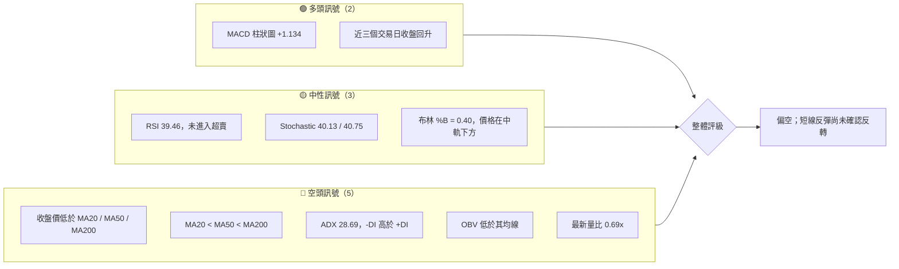
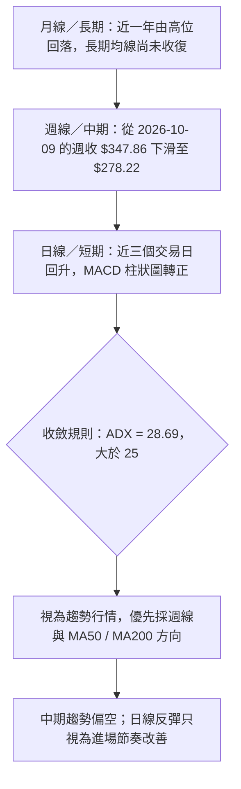
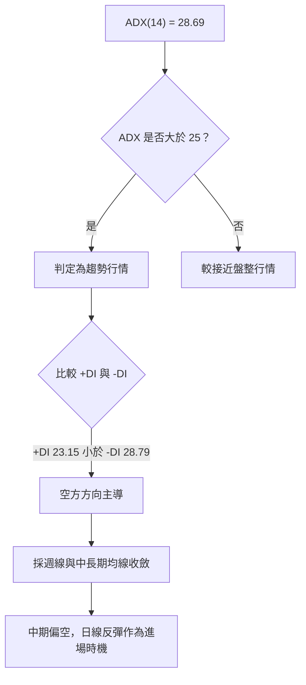
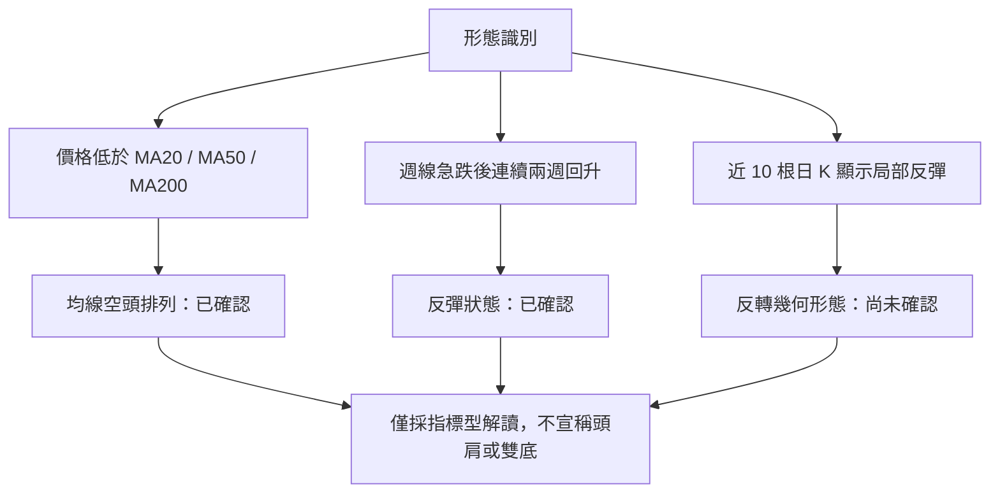
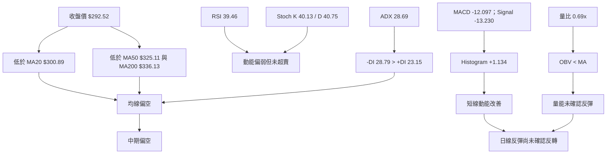
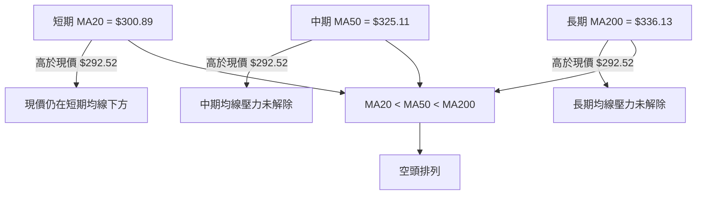
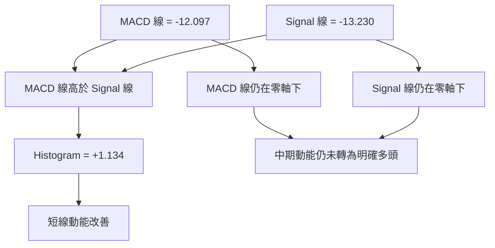
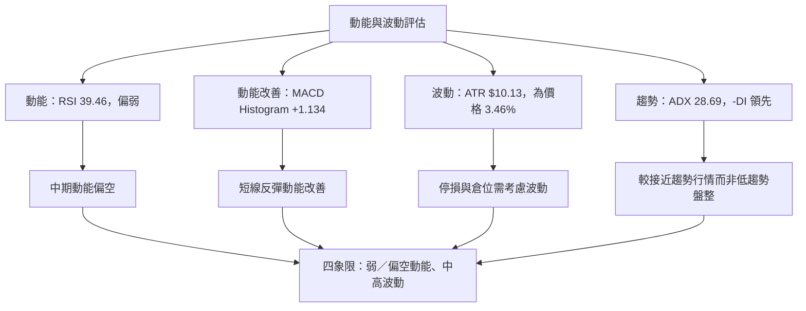
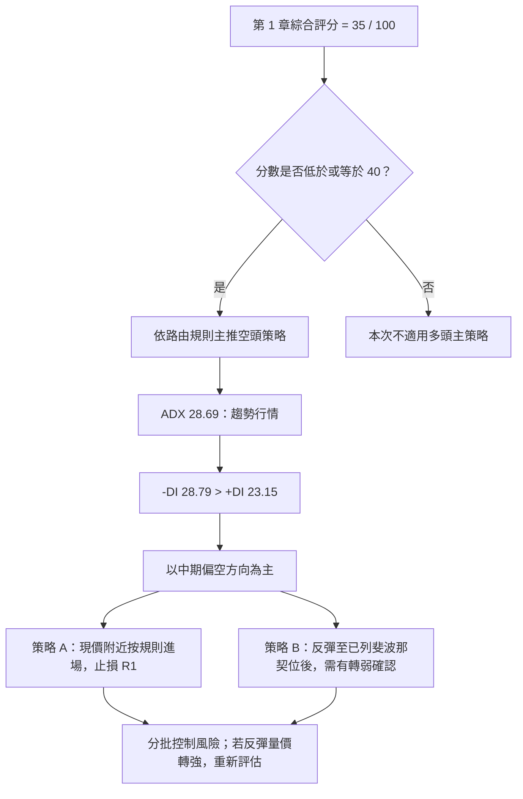
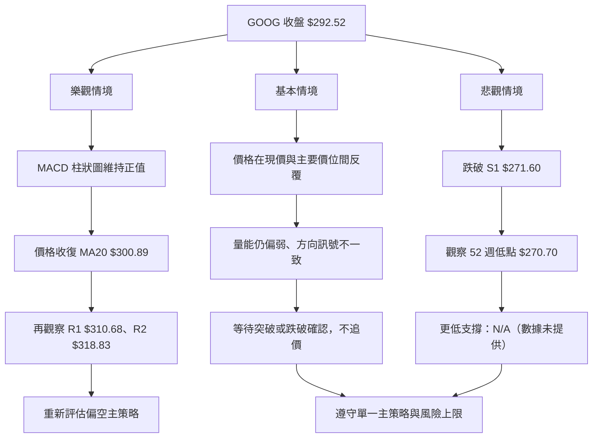

# GOOG 技術分析報告

> **報告日期**：2026-11-14 ｜ **語言**：繁體中文 ｜ **數據來源**：使用者提供之 Yahoo Finance 技術數據  
> **當前價格**：**$292.52**（2026-11-13 收盤價）

---

## 目錄

| 章節 | 內容 |
|------|------|
| [1. 技術面概覽](#1-技術面概覽) | 訊號儀表板、核心指標、評分卡 |
| [2. 趨勢分析](#2-趨勢分析) | 多時框趨勢、長中短期走勢 |
| [3. 圖表形態分析](#3-圖表形態分析) | 形態識別、K線組合、目標價 |
| [4. 支撐與阻力](#4-支撐與阻力) | 關鍵價位、斐波那契回調 |
| [5. 技術指標深度解讀](#5-技術指標深度解讀) | MA、RSI、MACD、布林、成交量 |
| [6. 動能與波動率](#6-動能與波動率) | 動能評估、ATR、Beta |
| [7. 多時框架總結](#7-多時框架總結) | 時框架評分矩陣 |
| [8. 交易策略建議](#8-交易策略建議) | 主策略、風險報酬比 |
| [9. 風險提示與監控](#9-風險提示與監控) | 監控指標、風險場景 |

---

## 1. 技術面概覽

### 🎯 技術訊號儀表板

GOOG 目前呈現「**中期下降趨勢中的短線反彈**」：收盤價低於 MA20、MA50、MA200，均線空頭排列，ADX 高於 25 且 -DI 高於 +DI，趨勢方向仍偏空。另一方面，MACD 柱狀圖轉正，近三個交易日收盤價回升，顯示短線賣壓有減弱跡象，但成交量低於均量，尚未構成可靠的趨勢反轉確認。



**訊號統計口徑**：此處為技術狀態分類，非所有指標加權後的獨立交易訊號。短線反彈與中期偏空可以同時成立，須以較高時框趨勢及 ADX 規則收斂。

### 📊 核心指標速覽表

| 指標類別 | 指標名稱 | 當前數值 | 訊號 | 解讀 |
|----------|----------|----------:|------|------|
| **價格** | 收盤價 | **$292.52** | 🔴 | 低於 MA20、MA50、MA200 |
| **價格區間** | 52 週高／低 | $403.96 / $270.70 | 🔴 | 收盤價位於所列 52 週區間約 16.4% 位置 |
| **均線** | MA20 | $300.89 | 🔴 | 收盤價低於 MA20；短線仍在均線壓力下 |
| **均線** | MA50 | $325.11 | 🔴 | 收盤價低於 MA50；中期結構偏弱 |
| **均線** | MA200 | $336.13 | 🔴 | 收盤價低於 MA200；長期趨勢尚未修復 |
| **均線** | 均線排列 | MA20 < MA50 < MA200 | 🔴 | 空頭排列 |
| **動能** | RSI(14) | 39.46 | 🟡 | 中性偏弱，尚未進入低於 30 的超賣區 |
| **動能** | MACD | -12.097 | 🔴 | MACD 線仍為負值 |
| **動能** | MACD Histogram | +1.134 | 🟢 | 柱狀圖轉正，短線動能改善 |
| **趨勢** | ADX(14) | 28.69 | 🔴 | 強趨勢區；方向由 -DI 領先，偏空 |
| **波動** | ATR(14) | $10.13 | 🟡 | 約為收盤價的 3.46%，單日波動不低 |
| **量能** | 最新量比 | 0.69x | 🔴 | 最新成交量低於 20 日均量 |
| **量能** | OBV | OBV < MA | 🔴 | 量能趨勢未確認反彈 |

### 🏆 技術評分卡

評分採 0–100 分制。六項子評分的算術平均為：

\[
(35+42+45+35+30+20) \div 6 = 34.5
\]

四捨五入後，**綜合評分為 35/100**，屬偏空區間。

```text
╔══════════════════════════════════════════════════════════════════╗
║                   技術評分卡 — GOOG                              ║
║                   2026-11-14｜收盤 $292.52                       ║
╠══════════════════════════════════════════════════════════════════╣
║ 趨勢強度      ███████░░░░░░░░░░░░░  35/100  🔴                  ║
║ 動能指標      ████████░░░░░░░░░░░░  42/100  🔴                  ║
║ 支撐穩定度    █████████░░░░░░░░░░░  45/100  🟡                  ║
║ 成交量配合    ███████░░░░░░░░░░░░░  35/100  🔴                  ║
║ 形態完整度    ██████░░░░░░░░░░░░░░  30/100  🔴                  ║
║ 均線排列      ████░░░░░░░░░░░░░░░░  20/100  🔴                  ║
╠══════════════════════════════════════════════════════════════════╣
║ 六項算術平均  ███████░░░░░░░░░░░░░  35/100  偏空                ║
╚══════════════════════════════════════════════════════════════════╝
```

| 評分維度 | 分數 | 評分理由 |
|----------|----:|----------|
| 趨勢強度 | 35 | ADX 28.69 顯示趨勢有效，但 -DI 28.79 高於 +DI 23.15，現有趨勢方向偏空 |
| 動能指標 | 42 | RSI 39.46、Stochastic 約 40，偏弱；MACD 柱狀圖轉正，故給予部分加分 |
| 支撐穩定度 | 45 | 提供的 S1 為 $271.60，且 52 週低點為 $270.70；目前仍未測試其後續守穩能力 |
| 成交量配合 | 35 | 最新量比 0.69x、OBV 低於均線，反彈缺乏量能確認 |
| 形態完整度 | 30 | 數據不足以確認高信心的反轉形態；只能辨識趨勢與指標狀態 |
| 均線排列 | 20 | 收盤價低於 MA20、MA50、MA200，且 MA20 < MA50 < MA200，明確空頭排列 |

**評分解讀進度條**：

```text
偏空程度（綜合評分 35/100）
███████░░░░░░░░░░░░░░░ 35%
```

---

## 2. 趨勢分析

### 🌐 多時框趨勢分析



本報告的收斂依據如下：

1. ADX(14) 為 28.69，符合使用者指定的趨勢行情判定條件（ADX > 25）。
2. +DI 為 23.15，低於 -DI 的 28.79，趨勢方向偏空。
3. 收盤價 $292.52 低於 MA50 $325.11 與 MA200 $336.13。
4. 日線 MACD 柱狀圖已轉正，但 MACD 線仍為負值；價格也尚未收復 MA20 $300.89。
5. 因此短線反彈不能優先於中期下降趨勢。

### 📈 長期趨勢 — 12 個月走勢圖

以下以資料中 **2025-12 至 2026-11 共 12 個月**的月收盤價繪製。此為文字化示意圖，縱向位置按月收盤價相對排列，標記並非日內 OHLC 價格。

```text
GOOG 月線走勢圖（2025-12 至 2026-11 月收盤）
價格軸（美元）

$390 ┤
$380 ┤                    ● 2026-04 $381.46
$370 ┤                    │
$360 ┤                    ├──● 2026-05 $375.96
$350 ┤                    │      ● 2026-06 $353.10
$340 ┤                    │              ● 2026-07 $356.42
$330 ┤                    │                      ● 2026-08 $335.19
$320 ┤ ● 2025-12 $313.19  ● 2026-01 $337.87
$310 ┤                           ● 2026-02 $310.82
$300 ┤                                  ● 2026-03 $286.50
$290 ┤                                                     ● 2026-11 $292.52
$280 ┤                                             ● 2026-10 $278.22
     └──────────────────────────────────────────────────────────────
       Dec25  Jan26  Feb26  Mar26  Apr26  May26  Jun26  Jul26
                                             Aug26  Sep26  Oct26  Nov26
```

**12 個月走勢解讀：**

- 2025-12 至 2026-01：月收盤由 $313.19 升至 $337.87，兩個月之間呈現上升。
- 2026-02 至 2026-03：月收盤由 $310.82 降至 $286.50，期間回落。
- 2026-04：月收盤跳升至 $381.46，是這 12 個月月收盤序列最高值。
- 2026-05 至 2026-08：由 $375.96 回落至 $335.19；期間 2026-07 有小幅回升。
- 2026-09：月收盤回升至 $340.74。
- 2026-10：降至 $278.22，為該 12 個月序列最低月收盤。
- 2026-11：回升至 $292.52，但仍低於 2026-09 月收盤 $340.74，也低於各主要中長期均線。
- 由 2025-11 月收盤 $319.29 至 2026-11 月收盤 $292.52，未滿整月的比較結果為負；因資料中的 2026-11 為截至 11 月 13 日的收盤，不應視為完整月線。

### 📊 走勢特徵分析表格

| 觀察階段 | 月收盤變化 | 走勢特徵 | 技術含義 |
|----------|------------|----------|----------|
| 2025-12 → 2026-01 | $313.19 → $337.87 | 上升 | 月度價格有所改善，但後續未能持續 |
| 2026-01 → 2026-03 | $337.87 → $286.50 | 回落 | 先回檔，短期趨勢轉弱 |
| 2026-03 → 2026-04 | $286.50 → $381.46 | 明顯反彈 | 月收盤快速抬升；單一月份跳升不足以證明長期趨勢已反轉 |
| 2026-04 → 2026-08 | $381.46 → $335.19 | 高位回落 | 漲勢回吐，收盤逐步走低 |
| 2026-08 → 2026-10 | $335.19 → $278.22 | 連續走弱 | 下跌加速，與目前空頭均線結構一致 |
| 2026-10 → 2026-11 | $278.22 → $292.52 | 反彈 | 有止跌反彈跡象，但未回到 MA20、MA50 或 MA200 之上 |

### 📊 中期趨勢（週線分析）

近 20 週價格由 2026-07-02 收盤 $355.95 至 2026-11-13 收盤 $292.52，整體下滑。特別是 2026-10-09 週收 $347.86 至 2026-10-30 週收 $278.22，週線回落幅度明顯，且 2026-10-30 週成交量達 208,382,100，為所列近期週成交量中的高值之一。

```text
GOOG 週線壓力與支撐示意圖（依已提供價位）
價格（美元）

$403.96 ───────────── 52 週高點
$381.46 ───────────── 2026-04 月收盤高位（非已列阻力聚類）
$343.57 ───────────── 布林上軌（技術指標值）
$327.81 ───────────── R3
$325.11 ───────────── MA50
$318.83 ───────────── R2
$310.68 ───────────── R1
$300.89 ───────────── MA20／布林中軌
$299.22 ───────────── 斐波那契 78.6%
$292.52 ───────────── 現價
$271.60 ───────────── S1
$270.70 ───────────── 52 週低點
$258.20 ───────────── 布林下軌（技術指標值）
```

**中期週線觀察：**

- 週收盤從 2026-10-09 的 $347.86 下滑至 2026-10-30 的 $278.22。
- 2026-10-30 後週收盤回升：$278.22 → $283.93 → $292.52。
- 最新週 RSI 為 39.5，較 2026-10-30 的 21.1 改善；最新週 MACD 柱狀圖為 +1.134。
- 但週線價格仍低於 2026-09-25 及 2026-10-02 的週收盤區間，整體週線修復程度有限。
- 價格仍低於 MA50、MA200，故短線反彈未改變中期偏空判斷。

### ⚡ 趨勢強度評估（ADX 解讀）

| 指標 | 數值 | 解讀 |
|------|----:|------|
| ADX(14) | 28.69 | 大於 25，代表趨勢強度達趨勢行情門檻 |
| +DI | 23.15 | 多方方向指標低於 -DI |
| -DI | 28.79 | 空方方向指標領先 |
| +DI 與 -DI 差值 | -5.64 | 方向偏空；此差值是兩個已提供指標的直接相減 |
| 綜合判讀 | 趨勢強、方向偏空 | 不宜僅因日線反彈就判定趨勢反轉 |



| ADX 區間 | 一般技術解讀 | GOOG 現況 |
|----------|--------------|-----------|
| 低於 20 | 趨勢較弱、容易盤整 | 不適用 |
| 20–25 | 趨勢建立或中等強度 | 不適用 |
| 高於 25 | 趨勢強度增加 | **28.69，符合** |
| 高於 40 | 強趨勢區 | 未達此區間 |

---

## 3. 圖表形態分析

### 🔍 形態識別系統

根據提供的月收盤、近 20 週收盤及近 10 根日 K 資料，能較有把握確認的是**均線空頭排列、價格低於布林中軌、近期低位反彈**等指標型狀態。資料不足以用一致的高低點幾何結構確認頭肩頂、雙底、三角形或旗形，因此不以複雜形態推導目標價。



**形態識別與信心度：**

| 形態／狀態 | 信心度 | 判斷依據 | 完成度 | 目標價（計算方式） |
|------|------:|------|------|------|
| 均線空頭排列 | 90% | MA20 $300.89 < MA50 $325.11 < MA200 $336.13 | 已形成 | 不以圖表形態推算目標 |
| 近期下跌後反彈 | 75% | 週收盤從 2026-10-30 的 $278.22 回升至 2026-11-13 的 $292.52；週 RSI 由 21.1 回升至 39.5 | 反彈進行中 | 不構成形態目標價 |
| 雙底 | 35% | 近資料可見低位反彈，但不足以確認兩個間隔適當且高度相近的低點與頸線 | 未確認 | 數據不足，無形態目標價 |
| 頭肩頂／底 | 20% | 缺少足以驗證左右肩、頭部與頸線的完整結構 | 未確認 | 數據不足，無形態目標價 |
| 旗形／三角形 | 25% | 提供資料不足以確認收斂邊界或旗桿高度 | 未確認 | 數據不足，無形態目標價 |

以上低信心形態均不作交易目標依據。根據要求，**沒有以不足的幾何證據推導形態高度或目標價**。

### 🕯️ 重要 K 線形態分析

以下分析只使用指定資料區塊「近 10 根日 K」與「近 8 根週 K」中的 OHLC。形態名稱採保守描述，不以區塊外日期判斷 K 線形態。

| 日期（日 K／週 K） | 開 | 高 | 低 | 收 | K 線結構 | 解讀 | 訊號 |
|------|------:|------:|------:|------:|------|------|------|
| 2026-11-05（日） | $291.80 | $293.64 | $276.20 | $281.74 | 收低於開，日內區間較大 | 當日價格承壓，收盤落在開盤以下；未構成可確證的反轉 K 線 | 🔴 |
| 2026-11-11（日） | $287.57 | $292.97 | $286.90 | $290.63 | 收高於開，低點距開盤較近 | 多方收復部分日內跌幅，單根 K 線只顯示短線改善 | 🟢 |
| 2026-11-12（日） | $290.55 | $299.25 | $290.47 | $295.35 | 收高於開，收盤高於開盤 | 多方延續反彈；需留意高點未能維持至收盤 | 🟢 |
| 2026-11-13（日） | $299.87 | $301.62 | $290.34 | $292.52 | 收低於開，收盤低於開盤 | 開盤後回落，顯示高位有賣壓；不等同確證反轉 | 🔴 |
| 2026-10-30（週 K） | $318.05 | $323.13 | $275.35 | $278.22 | 大幅收低，週內區間寬 | 顯示該週賣方主導，與週線下跌趨勢一致 | 🔴 |
| 2026-11-06（週 K） | $280.58 | $294.40 | $272.00 | $283.93 | 收高於開，開收幅度相對全週區間較小 | 長上下影相對明顯，反映低位波動與雙向交易；不能單獨視為反轉確認 | 🟡 |
| 2026-11-13（週 K） | $290.55 | $301.62 | $283.37 | $292.52 | 收高於開，週內高低區間大於開收差 | 週線略收高，但上影與下影皆存在，方向確認度有限 | 🟡 |

### 📉 ASCII 走勢形態示意圖

下圖只呈現資料中可支持的「急跌後反彈」及已列出的技術價位，不宣稱為雙底或其他未確認形態。

```text
GOOG 近期週線結構示意（收盤價，美元）

$347.86  ● 2026-10-09
          \
$336.91    ● 2026-10-16
              \
$317.28        ● 2026-10-23
                  \
$278.22             ● 2026-10-30  ← 近期低位收盤
                         \
$283.93                    ● 2026-11-06
                              \
$292.52                         ● 2026-11-13  ← 現價

技術參考：
$310.68 ───────────────────────────────── R1
$300.89 ───────────────────────────────── MA20／布林中軌
$299.22 ───────────────────────────────── 斐波那契 78.6%
$292.52 ───────────────────────────────── 現價
$271.60 ───────────────────────────────── S1
$270.70 ───────────────────────────────── 52 週低點
```

### 🎯 形態目標價計算

目前沒有足夠資料確認頭肩、雙底、三角形或旗形，因此：

- **頸線／形態高度**：數據中未偵測到足以確認的圖表形態。
- **由形態高度推算的目標價**：不適用。
- **後續價格參考**：只使用已提供之波段高點聚類、支撐位及斐波那契價位，詳見第 4 章。
- 不能把近期週線低點後的反彈直接等同雙底，也不以單根 K 線宣稱趨勢反轉。

---

## 4. 支撐與阻力

### 🗺️ 關鍵價位分布圖

以下價位只列出數據包中的波段高低點聚類、斐波那契值、均線與布林值。均線和布林值是指標參考，不等同「關鍵價位」欄的波段高低點聚類。

```text
GOOG 價位結構分布圖（美元）
══════════════════════════════════════════════════════════════

$403.96 ║████████████████████████║ 52 週高點／斐波那契 0.0%
$372.51 ║████████████████████    ║ 斐波那契 23.6%
$353.06 ║██████████████████      ║ 斐波那契 38.2%
$343.57 ║────────────────────────║ 布林上軌
$337.33 ║████████████████        ║ 斐波那契 50.0%
$336.13 ║────────────────────────║ MA200
$327.81 ║████████████████████    ║ R3
$325.11 ║────────────────────────║ MA50
$321.61 ║██████████████████      ║ 斐波那契 61.8%
$318.83 ║██████████████████      ║ R2
$310.68 ║████████████████████    ║ R1
$300.89 ║────────────────────────║ MA20／布林中軌
$299.22 ║████████████████        ║ 斐波那契 78.6%
$292.52 ╠════════════════════════╣ ◄ 現價
$271.60 ║▓▓▓▓▓▓▓▓▓▓▓▓▓▓          ║ S1
$270.70 ║████████████████████    ║ 52 週低點／斐波那契 100.0%
$258.20 ║────────────────────────║ 布林下軌

══════════════════════════════════════════════════════════════
```

### 🚧 阻力位分析表

| 阻力級別 | 價位 | 形成原因 | 突破難度 | 重要性 |
|----------|------:|----------|----------|--------|
| R1 | **$310.68** | 近一年波段高點聚類；亦高於現價與 MA20 | 中等 | 近端第一個明確波段阻力 |
| R2 | **$318.83** | 近一年波段高點聚類 | 中高 | 若 R1 收復，觀察反彈是否延伸 |
| R3 | **$327.81** | 近一年波段高點聚類 | 高 | 高於 MA50 $325.11 的區域，與中期均線壓力相鄰 |
| 斐波那契 78.6% | **$299.22** | 52 週區間回調值 | 中等 | 位於現價上方，與 MA20 $300.89 接近，但兩者來源不同 |
| MA20 | **$300.89** | 20 日移動平均 | 中等 | 價格目前低於此均線，動態壓力參考 |
| MA50 | **$325.11** | 50 日移動平均 | 高 | 中期均線壓力；非波段阻力聚類值 |

> **價位紀律**：R1、R2、R3 僅引用資料包所列 $310.68、$318.83、$327.81。MA 與斐波那契另行標示，不混稱為波段高點聚類。

### 🛡️ 支撐位分析表

| 支撐級別 | 價位 | 形成原因 | 守住機率評估 | 重要性 |
|----------|------:|----------|--------------|--------|
| S1 | **$271.60** | 近一年波段低點聚類 | 中等偏低；尚未提供後續測試結果 | 第一個明確波段支撐 |
| 52 週低點 | **$270.70** | 數據包所列 52 週低點及斐波那契 100% | 重要觀察區；若失守，價格結構可能進一步轉弱 | 與 S1 相距 $0.90，形成相鄰參考區 |
| 布林下軌 | **$258.20** | 布林通道指標值 | N/A（非關鍵價位區塊列示的波段支撐，不作獨立支撐估計） | 僅作波動通道參考 |

資料只提供一個波段低點聚類支撐 S1，**S2、S3：N/A（數據未提供）**。不得自行補充其他波段支撐。

### 📐 斐波那契回調位分析

斐波那契位直接引用資料包列值，不另行重算：

| 回調位 | 價位 | 與現價關係 |
|--------|------:|------------|
| 0.0%（52 週高） | $403.96 | 高於現價 |
| 23.6% | $372.51 | 高於現價 |
| 38.2% | $353.06 | 高於現價 |
| 50.0% | $337.33 | 高於現價 |
| 61.8% | $321.61 | 高於現價 |
| 78.6% | $299.22 | 高於現價 |
| 100.0%（52 週低） | $270.70 | 低於現價 |

**現價 $292.52 位於斐波那契 78.6%（$299.22）與 100.0%（$270.70）之間。**  
現價落在接近 52 週低點的一側，顯示前一段 52 週區間的回落幅度已深；但「接近區間低位」不等同超賣或必然反轉。RSI 為 39.46，未低於 30；同時 ADX 28.69 且 -DI 領先，因此仍須防範低位支撐失守。

---

## 5. 技術指標深度解讀

### 🎛️ 指標訊號總覽



### 📈 移動平均線排列分析

| 均線 | 數值 | 收盤價相對位置 | 斜率／資料所示方向 | 技術解讀 |
|------|------:|----------------|-------------------|----------|
| MA5 | $289.89 | 收盤高於 MA5 | 上升 | 短線價格回升，短均線開始改善 |
| MA10 | $285.87 | 收盤高於 MA10 | 上升 | 短線反彈得到部分均線確認 |
| MA20 | $300.89 | 收盤低於 MA20 | 下降 | 近期趨勢仍未收復短期趨勢中樞 |
| MA50 | $325.11 | 收盤低於 MA50 | N/A（該欄未提供 MA50 斜率變化值） | 中期壓力仍在上方 |
| MA200 | $336.13 | 收盤低於 MA200 | N/A（該欄未提供 MA200 斜率變化值） | 長期均線尚未收復 |
| 整體排列 | MA20 < MA50 < MA200 | 價格低於三者 | 空頭排列 | 中長期趨勢偏空 |



**短期與中期訊號的差異：**

- MA5 $289.89 與 MA10 $285.87 低於收盤價，且資料顯示兩者上升，反映短線反彈。
- MA20 $300.89、MA50 $325.11、MA200 $336.13 均高於收盤價。
- 因此短均線轉強尚不足以抵銷中長期均線空頭排列。
- 後續若價格未收復 MA20，短線反彈容易遭遇均線壓力；即使收復 MA20，也仍需觀察 MA50 與週線方向。

### 📉 RSI(14) 分析

**RSI(14)：39.46**

```text
超賣區                中性區                        超買區
0 ├──────────30──────────────50──────────────70──────────100
                      ▲
                    39.46
                    ████░░░░░░░░░░░░░░░░  39.46 / 100
```

- RSI 位於 30–70 常用中性區間內，但低於 50，動能偏弱。
- RSI 尚未進入傳統超賣區（低於 30），因此不能僅以 RSI 認定下跌已充分消化。
- 週線資料中 RSI 從 2026-10-30 的 21.1 升至 2026-11-13 的 39.5，顯示低位動能修復。
- 日線背離資料明確標示：**無明顯背離**。因此結論為：

| 背離類型 | 判斷 | 依據 |
|----------|------|------|
| RSI 頂背離 | **未偵測到明確訊號** | 指標快照列示「無明顯背離」 |
| RSI 底背離 | **未偵測到明確訊號** | 指標快照列示「無明顯背離」 |
| 總結 | **無明顯背離** | 只比較近 20 根 K 棒首尾價格與 RSI 方向；無法由此推論更細緻的局部背離 |

### 📊 MACD(12/26/9) 訊號解讀

| MACD 項目 | 數值 | 訊號含義 |
|-----------|-----:|----------|
| MACD 線 | -12.097 | 仍在零軸下方，整體中期動能仍弱 |
| Signal 線 | -13.230 | 仍在零軸下方 |
| Histogram | +1.134 | 柱狀圖為正，代表短線動能改善 |
| MACD 與 Signal 的相對關係 | MACD 高於 Signal | 可解讀為短期多頭動能改善，但不代表零軸上方趨勢已成立 |



**背離判斷：**

- **MACD 頂背離：未能由提供資料確認。**
- **MACD 底背離：未能由提供資料確認。**
- 資料只提供目前 MACD、Signal、Histogram 數值，沒有完整逐根 MACD 序列或明確的 MACD 背離判定欄位。
- 因此不推測頂／底背離；目前能確定的是 Histogram 正值與 MACD 線仍在零軸下的混合狀態。

### 📦 布林通道分析

| 布林項目 | 數值 | 現價相對位置 |
|----------|------:|--------------|
| 上軌 | $343.57 | 高於現價 |
| 中軌（MA20） | $300.89 | 高於現價 |
| 下軌 | $258.20 | 低於現價 |
| %B | 0.40 | 位於通道中軸下方、但不在下軌 |

```text
布林通道示意（美元）

$343.57 ─────────────── 上軌
          ╲
$300.89 ───╲─────────── 中軌／MA20
             ● $292.52 現價（%B = 0.40）
          ╱
$258.20 ─────────────── 下軌

現價在布林通道內，低於中軌。
```

- %B 為 0.40，表示價格位於通道下半部，但仍在上下軌之間。
- 價格低於中軌，與空頭均線排列相符。
- 目前並非已知的布林下軌突破狀態，故不宜把它解讀為已確認超跌反轉。
- 布林上軌與下軌為指標數值；本報告不將其冒稱為波段聚類阻力／支撐。

### 💹 成交量分析（量價配合度）

| 成交量資料 | 數值 | 解讀 |
|------------|------:|------|
| 最新成交量 | 18,348,718 | 2026-11-13 交易量 |
| 20 日均量 | 26,765,161 | 最新成交量低於 20 日均量 |
| 量比 | 0.69x | 交易量約為 20 日均量的 69% |
| 50 日均量 | 20,730,932 | 最新量也低於所列 50 日均量 |
| OBV 趨勢 | OBV < MA | 數據包判定為量能疲弱 |

**量價整合：**

- 收盤價從 2026-11-10 的 $284.92 回升至 2026-11-13 的 $292.52，但最新成交量僅為 20 日均量的 0.69 倍。
- 反彈與 MACD Histogram 轉正一致，說明價格動能短線改善。
- OBV 低於其均線、成交量低於均量，則未確認反彈具有足夠資金流入支持。
- 因此量價訊號不是完全一致：**價格動能轉好，量能確認不足**。
- 若後續上漲但 OBV 仍弱，反彈的持續性需保守看待；若價格下跌時成交量重新擴大，則空頭趨勢可能重新取得主導。

---

## 6. 動能與波動率

### ⚡ 動能評估四象限

現有資料未提供可直接計算的標準化波動率分位數，因此四象限以 RSI、MACD、ADX 及 ATR 占價格比率作定性分類，不把「高波動」當作歷史統計分位判斷。

| 象限 | 動能 | 波動 | 當前狀態 | 評估 |
|------|------|------|----------|------|
| Q1 | 強 | 低 | — | 趨勢明確且風險相對較低 |
| Q2 | 弱 | 低 | — | 盤整偏弱，適合等待區間訊號 |
| Q3 | 強 | 高 | — | 趨勢與波動同強，需控管倉位 |
| Q4 | 弱／偏空 | 中高 | **✓** | GOOG 當前較接近此象限：中期方向偏空、ATR 為價格 3.46%，但短線反彈訊號出現 |



### 📊 ATR 波動率分析

- ATR(14) = **$10.13**。
- ATR 占收盤價比例 = **3.46%**（資料包已提供）。
- ATR 是每日平均真實波幅參考，不是價格預測，也不代表每天必然變動 $10.13。
- 以風險管理角度，倉位不宜只按股數等額設定；當 ATR 占價格比率偏高時，應降低名目部位或將單筆可承受損失控制在預先設定上限。
- 交易策略中的止損價格使用已提供的關鍵價位，不另以 ATR 自行推算未列出的精確止損價。
- **ATR 倍數價格止損**：N/A（依數據紀律，不從 ATR 自行製造新的支撐、阻力或交易價位）。

### 📐 Beta 與市場相關性

| 指標 | 數值 | 解讀 |
|------|-----:|------|
| Beta | 1.226 | 歷史敏感度高於市場基準的 1.0 水準 |
| 與大盤相關係數 | N/A（數據未提供） | Beta 不等同相關係數，不能由 Beta 推導確切相關性 |
| 個股波動風險 | 中高 | 市場變動可能被放大，但實際幅度亦會受個股事件影響 |

Beta 1.226 顯示該股票歷史價格對市場波動具有偏高的敏感度指標。Beta 不表示個股每日必然比大盤高漲或下跌 22.6%，也不能單獨用作市場相關性精確估計。配合 ATR 占價格 3.46%，應採保守倉位與明確風險限額。

---

## 7. 多時框架總結

### 📋 時框架評分表

分數採 0–100 分制；各時框評分依該時框可用資料作定性綜合，**第 1 章全局評分仍固定為 35/100**。

| 時框架 | 趨勢方向 | 動能 | 均線排列 | 形態 | 綜合評分 | 建議 |
|--------|----------|------|----------|------|----------:|------|
| 短期（日線） | 反彈中、仍低於 MA20 | MACD Histogram 正值；RSI 39.46 | MA5、MA10 改善，MA20 仍在上方 | 反彈，不足以確認反轉 | 44/100 | 以反彈遇阻作為觀察，不追價 |
| 中期（週線） | 偏空 | 週 RSI 從低位回升；週 MACD 柱狀圖最新轉正 | 價格低於 MA50、MA200 | 急跌後回升，趨勢未確認扭轉 | 36/100 | 中期偏空，等待阻力位反應 |
| 長期（月線／長期均線） | 回落後仍弱 | 月度近期價格低於先前高位 | 收盤低於 MA200 | 長期反轉形態未確認 | 31/100 | 不以短線反彈取代長期趨勢確認 |
| 全局評分卡 | 偏空 | 混合偏弱 | 空頭排列 | 形態不足 | **35/100** | **偏空；反彈視為進場節奏** |

### 🔲 綜合訊號矩陣

| 維度 | 短期（日線） | 中期（週線） | 長期（MA200／月度價格） | 一致性 |
|------|-------------|-------------|--------------------------|--------|
| 價格動能 | 🟡 反彈 | 🟡 低位修復 | 🔴 尚未收復長均線 | 短線與中長線分歧 |
| 均線 | 🔴 低於 MA20 | 🔴 低於 MA50 | 🔴 低於 MA200 | 空頭方向一致 |
| MACD／RSI | 🟢 Histogram 轉正、RSI 非超賣 | 🟡 週 RSI 回升 | N/A（長期指標序列未提供） | 動能改善，但不足以翻轉趨勢 |
| 成交量 | 🔴 最新量比 0.69x | 🔴 OBV < MA | N/A（長期 OBV 資料未提供） | 反彈確認不足 |
| ADX／DI | 🔴 ADX 28.69、-DI 領先 | 🔴 趨勢行情偏空 | — | 支持偏空收斂 |

### ⚖️ 多時框收斂結論

1. **行情分類**：ADX 28.69 > 25，依指定規則判定為趨勢行情，而非低趨勢盤整。
2. **主導時框**：週線及 MA50／MA200 方向主導；日線只用於觀察進場節奏。
3. **時框衝突**：日線 MACD Histogram 轉正、近三日收盤回升，與中期均線空頭排列衝突。
4. **收斂方式**：依趨勢行情優先規則，採週線與中長期均線方向，日線反彈不視為反轉確認。
5. **唯一方向性結論：偏空。**  
   此結論與第 1 章綜合評分 35/100、以及第 8 章主策略方向一致。

---

## 8. 交易策略建議

### 🗺️ 策略決策流程圖



### 🧭 策略路由

> **當前主策略方向 = 偏空（依評分 35/100）。**

依 35/100 的評分，採空頭策略為主；反彈情境只作風險提示，不同時強力推薦做多。以下是技術條件式示例，不是必然交易結果。

### 🎯 價格情境階梯（Price Scenarios）

| 觸發條件 | 下一目標 | 後續延伸 | 情境含義 |
|----------|----------|----------|----------|
| 突破並站穩 R1 **$310.68** | R2 **$318.83** | R3 **$327.81** | 短線轉強；若同步收復 MA20 $300.89 及量能改善，需重新評估空方部位 |
| 價格持續位於 **$292.52** 附近且未觸及 R1 或 S1 | — | — | 價格仍在現價與所列支撐／阻力之間波動；等待方向確認 |
| 跌破 S1 **$271.60** | 52 週低點 **$270.70** | 更低支撐：N/A（數據未提供） | 支撐失守風險升高；不得自行將布林下軌當成已確認波段支撐 |

### 📊 情境機率分佈

以下為基於當前技術訊號的主觀情境估計，不是統計模型回測結果。三種情境合計 100%。

| 情境 | 機率 | 主要依據 |
|------|----:|----------|
| 繼續上行／反彈 | 25% | MACD Histogram +1.134、RSI 自週線低位回升、近幾個交易日反彈；但價格仍低於 MA20、MA50、MA200，成交量未確認 |
| 區間震盪 | 30% | RSI 39.46、Stochastic 接近 40，價格仍在布林通道內；惟 ADX 28.69 表示不宜單純以無趨勢盤整處理 |
| 回落／再探底 | 45% | -DI > +DI、MA 空頭排列、OBV < MA、量比 0.69x，價格接近 S1 $271.60 與 52 週低點 $270.70 |

### 🟢 主策略詳情（空頭方向）

**風險報酬比定義：**  
做空風險報酬比以「（進場價 − 目標價）÷（止損價 − 進場價）」計算，並以 `1 : X.XX` 表示。表中比值可依同列價格回算。

| 策略要素 | 策略 A：現價附近的空頭觀察策略 | 策略 B：反彈阻力區的空頭觀察策略 |
|----------|------------------------------|--------------------------------|
| 進場條件 | 以當前收盤作參考；需控制部位，不把單一收盤價視為保證成交 | 價格反彈至斐波那契 78.6% 後，需出現轉弱確認；未確認前不進場 |
| 進場價格 | **$292.52** | **$299.22** |
| 目標價 T1 | **$271.60**（S1） | **$271.60**（S1） |
| 目標價 T2 | **$270.70**（52 週低點） | **$270.70**（52 週低點） |
| 止損價格 | **$310.68**（R1） | **$310.68**（R1） |
| 風險報酬比（以 T1 計） | **1 : 1.15**；計算：($292.52−$271.60) ÷ ($310.68−$292.52) = $20.92 ÷ $18.16 | **1 : 2.41**；計算：($299.22−$271.60) ÷ ($310.68−$299.22) = $27.62 ÷ $11.46 |
| 風險報酬比（以 T2 計） | **1 : 1.20**；計算：($292.52−$270.70) ÷ ($310.68−$292.52) = $21.82 ÷ $18.16 | **1 : 2.49**；計算：($299.22−$270.70) ÷ ($310.68−$299.22) = $28.52 ÷ $11.46 |
| 成功機率估計 | 45% | 50% |
| 建議倉位上限 | 10% | 10% |

> **進場說明：**策略 B 的 $299.22 是已提供的斐波那契 78.6% 價位，不代表該價位必然形成阻力。需等待實際轉弱確認；若價格直接上破 R1 $310.68，應視為原空頭假設受損，而不是機械式加碼。  
> **成功機率與倉位比例**為風險管理上的主觀建議，不是歷史統計勝率，也不代表可承受損失保證。

### 🔴 反向風險觸發點（對沖提示）

以下訊號會削弱偏空主策略，不構成完整反向做多建議：

- 收盤價有效站上 **R1 $310.68**，而非僅盤中短暫觸及。
- 成交量由目前 0.69x 的低位回升，且 OBV 不再低於其均線。
- 若突破 R1，後續觀察已列 R2 **$318.83**、R3 **$327.81**。
- MACD 線仍在零軸下方，單獨的 Histogram 正值不能作為反轉確認。
- 若價格重新跌破 S1 **$271.60**，則原本的低位反彈假設轉弱；後續已提供參考為 52 週低點 **$270.70**。

### ⭐ 整體訊號強度評星

```text
做多訊號強度：★★☆☆☆  (2/5 星)
做空訊號強度：★★★☆☆  (3/5 星)
整體可信度：  ★★★☆☆  (3/5 星)
```

**星等依據：**

- 做多訊號只有 MACD Histogram 正值、短線價格回升等初步跡象，仍受空頭均線排列及弱量限制。
- 做空方向受到 ADX、-DI 領先、均線排列及 OBV 弱勢支持，但接近低位支撐區，需防止短線急速反彈。
- 綜合可信度為中等，不適合忽略止損或過度放大部位。

---

## 9. 風險提示與監控

### ✅ 關鍵監控指標 Checklist

```text
╔══════════════════════════════════════════════════════════════════╗
║                  GOOG 技術面監控清單                            ║
╠══════════════════════════════════════════════════════════════════╣
║ ☐ 收盤是否有效站上 R1 $310.68？                                 ║
║ ☐ 若站上 R1，是否續看 R2 $318.83 與 R3 $327.81？                ║
║ ☐ 價格是否重新收復 MA20 $300.89？                               ║
║ ☐ 價格是否仍低於 MA50 $325.11 與 MA200 $336.13？                ║
║ ☐ RSI 是否由 39.46 持續回升，或再次跌向 30？                    ║
║ ☐ MACD Histogram 是否維持正值？MACD 線是否仍在零軸下？          ║
║ ☐ +DI 是否有機會反超 -DI？目前 +DI 23.15 < -DI 28.79            ║
║ ☐ OBV 是否仍低於其均線？                                        ║
║ ☐ 成交量是否仍低於 20 日均量？目前量比 0.69x                    ║
║ ☐ S1 $271.60 與 52 週低點 $270.70 是否失守？                     ║
║ ☐ ATR 是否仍在 $10.13 附近，並相應調整部位規模？                ║
╚══════════════════════════════════════════════════════════════════╝
```

| 監控項目 | 當前狀態 | 轉強觀察 | 轉弱觀察 |
|----------|----------|----------|----------|
| MA20 | 收盤低於 $300.89 | 收復後觀察能否站穩 | 持續受壓 |
| MA50／MA200 | 收盤低於 $325.11／$336.13 | 中期結構需逐步改善 | 均線空頭排列維持 |
| RSI | 39.46 | 連續改善並向 50 靠近 | 再度下行或跌入低位區 |
| MACD | 線仍為負、Histogram 正 | 線與柱狀動能持續改善 | 柱狀圖轉負並擴大 |
| ADX／DI | ADX 28.69、-DI 領先 | +DI 反超 -DI | -DI 維持領先 |
| 成交量／OBV | 量比 0.69x、OBV < MA | 上漲伴隨量能回升、OBV 改善 | 跌勢伴隨量能擴大 |
| S1／52 週低點 | $271.60／$270.70 | 守住後形成反彈基礎 | 跌破後數據未提供更低波段支撐 |

### ⚠️ 風險場景分析



### 🛡️ 風險管理重要提醒

1. **趨勢反轉風險**  
   目前價格接近資料中列出的 S1 $271.60 與 52 週低點 $270.70。若支撐有效，價格可能出現快速回升；做空部位不應因 ADX 偏高而忽略支撐附近的反彈風險。

2. **短線反彈風險**  
   MACD Histogram 已轉正，RSI 由週線低位改善，且近幾個交易日收盤上升。若後續收復 MA20 $300.89 並突破 R1 $310.68，空頭交易假設需要重新檢視。

3. **低量反彈風險**  
   最新成交量只有 20 日均量的 0.69 倍，OBV 低於均線，反彈缺乏量能確認。低量反彈不一定立即失敗，但其持續性較難由現有資料確認。

4. **趨勢延續風險**  
   ADX 28.69 且 -DI 高於 +DI，若價格跌破 S1 $271.60，可能增加再測 52 週低點 $270.70 的風險。更低支撐位資料未提供，不應任意填入。

5. **跳空與個股事件風險**  
   技術指標無法預先涵蓋公司公告、監管、競爭或整體市場的跳空變化。若價格跳空越過止損參考價，實際成交價可能與預設價不同。

6. **波動率與倉位管理**  
   ATR(14) 為 $10.13、約占收盤價 3.46%。可依個人可承受損失控制倉位，而不應以固定股數忽略波動差異。單筆交易的總風險應先設定上限，再反推部位大小。

7. **策略失效管理**  
   空頭策略的關鍵風險參考為 R1 $310.68。若價格突破並站穩，應重新檢視空頭假設；不可因目標價尚未達到而忽略止損條件。

8. **模型與數據限制**  
   本報告只有提供的技術快照、部分週線收盤及指定 OHLC K 線資料。未提供完整逐日歷史序列、長期成交量分布或完整指標序列，因此部分形態、背離及歷史勝率無法計算，並已標示為未確認或 N/A。

---

## 📋 報告總結

```text
╔══════════════════════════════════════════════════════════════════╗
║                 GOOG 技術分析報告總結                           ║
║                 報告日期：2026-11-14                             ║
╠══════════════════════════════════════════════════════════════════╣
║ 當前價格：$292.52                                                ║
║ 綜合評分：35/100 — 偏空（六項子評分算術平均後四捨五入）          ║
║ 行情分類：ADX 28.69 > 25，趨勢行情；方向由 -DI 主導              ║
╠══════════════════════════════════════════════════════════════════╣
║ ├─ 長期趨勢：🔴 收盤低於 MA200 $336.13，長期結構未修復           ║
║ ├─ 中期趨勢：🔴 MA50 $325.11 之下，週線仍偏空                    ║
║ ├─ 短期趨勢：🟡 MACD 柱狀圖轉正，日線反彈但低於 MA20              ║
║ ├─ 關鍵支撐：$271.60（S1）；$270.70（52 週低點）                  ║
║ ├─ 關鍵阻力：$310.68（R1）；其上為 $318.83（R2）                  ║
║ └─ 分析師目標均值：$393.93（分析師共識，不是技術推算目標價）      ║
╠══════════════════════════════════════════════════════════════════╣
║ 最優策略組合：                                                    ║
║ 1. 🥇 主策略：偏空交易，但須遵守 R1 $310.68 的風險控制             ║
║ 2. 🥈 次選機會：若反彈至 $299.22 且有轉弱確認，再評估空頭條件       ║
║ 3. 🥉 保守選擇：等待價格突破 R1 或跌破 S1 後再確認方向              ║
╚══════════════════════════════════════════════════════════════════╝
```

> ⚠️ **免責聲明**：本報告為 AI 依據使用者提供之技術數據生成，僅供研究與學術參考，不構成投資建議、買賣要約或任何收益保證。技術分析具有不確定性，實際交易可能因跳空、流動性與市場事件而產生不同結果。投資有風險，入市需謹慎。

---

*報告生成時間：2026-11-14 ｜ 數據來源：使用者提供之 Yahoo Finance 技術數據 ｜ 分析框架：多時框技術分析*