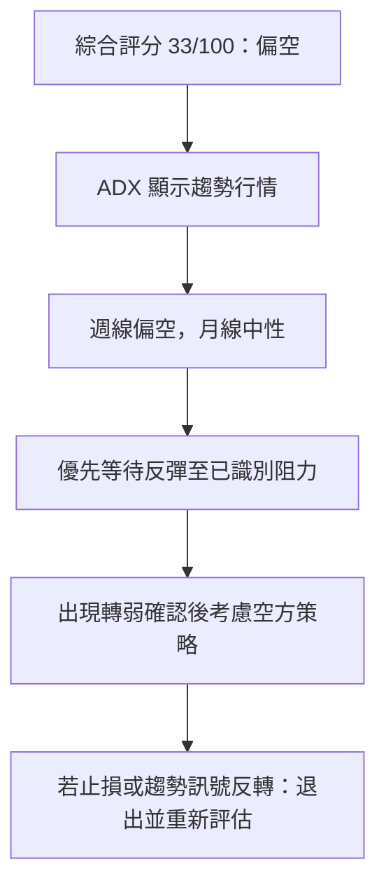

# GOOG 技術分析報告

> **報告日期**：2026-11-15 ｜ **語言**：繁體中文 ｜ **數據來源**：Yahoo Finance ｜ **當前價格**：$292.52（2026-11-13 收盤）

---

## 目錄

| 章節 | 內容 |
|------|------|
| [1. 技術面概覽](#1-技術面概覽) | 核心指標速覽、評分卡 |
| [2. 趨勢分析](#2-趨勢分析) | 長中短期走勢、ADX |
| [3. 圖表形態分析](#3-圖表形態分析) | 形態、K 線、缺口 |
| [4. 支撐與阻力](#4-支撐與阻力) | 關鍵價位、斐波那契 |
| [5. 技術指標深度解讀](#5-技術指標深度解讀) | MA、RSI、MACD、布林、成交量、進階指標 |
| [6. 動能與波動率](#6-動能與波動率) | ATR、Beta、相對強度 |
| [7. 多時框架總結](#7-多時框架總結) | 時框架矩陣 |
| [8. 交易策略建議](#8-交易策略建議) | 歷史基準、策略、風險報酬比 |
| [9. 風險提示與監控](#9-風險提示與監控) | 監控指標、風險場景 |

---

## 1. 技術面概覽

GOOG 的技術面偏空：價格低於中長期均線，均線呈空頭排列，且趨勢強度已達趨勢行情門檻。週線亦偏空，成交量與 A/D 線沒有顯示明確的累積買盤確認。主要反向風險是日線 MACD 柱轉正、價格近期反彈；若價格收復關鍵阻力並改善週線訊號，空方判斷可能需要調整。

### 📊 核心指標速覽表

| 指標類別 | 指標名稱 | 當前數值 | 訊號 | 解讀 |
|----------|----------|----------|------|------|
| **價格** | 當前價格 | $292.52 | 🔴 | 位於中長期趨勢均線下方，反彈尚未扭轉趨勢。 |
| **均線** | MA20 / MA50 / MA200 | 見第 5 章 | 🔴 | 價格低於各均線，排列偏空。 |
| **動能** | RSI(14)（日線） | 見第 5 章 | 🟡 | 未進入超賣區，仍有下行空間；短線動能有修復跡象。 |
| **動能** | MACD 柱（日線） | 見第 5 章 | 🟢 | 柱值轉正，但不足以單獨確認趨勢反轉。 |
| **趨勢** | ADX(14) | 見第 2 章 | 🔴 | 趨勢強度達趨勢行情標準，方向由空方主導。 |
| **波動** | ATR(14) | 見第 6 章 | 🟡 | 日常波動幅度顯著，止損需避免過窄。 |
| **多時框** | 一致性 | 見第 7 章 | 🔴 | 日線、週線偏空，月線中性；多時框整體仍偏空。 |

### 🏆 技術評分卡

分數為技術判斷的相對評估；綜合分數依六項子評分的算術平均計算。

| 維度 | 評分（0–100） | 訊號 | 主要依據 |
|------|---------------|------|----------|
| 趨勢強度 | 30 | 🔴 | 趨勢強度達趨勢行情標準，且空方方向指標占優；詳見第 2 章。 |
| 動能指標 | 45 | 🟡 | 日線動能有修復，但 RSI 未顯示強勢反轉；詳見第 5 章。 |
| 支撐穩定度 | 50 | 🟡 | 下方有已識別支撐，但價格仍受多個上方阻力壓制；詳見第 4 章。 |
| 成交量配合 | 25 | 🔴 | 成交量低於均量參考，OBV 與 A/D 未見買盤累積確認；詳見第 5 章。 |
| 形態完整度 | 35 | 🔴 | 尚無足夠幾何形態證據確認反轉；詳見第 3 章。 |
| 均線排列 | 10 | 🔴 | 均線呈空頭排列，價格低於趨勢均線；詳見第 5 章。 |
| **綜合評分** | **33** | **偏空** | 六項平均為 32.5，四捨五入至整數。 |

---

## 2. 趨勢分析

**結論：** 長期走勢在前期大幅上漲後轉為急跌；週線方向偏空，日線亦低於主要趨勢均線。ADX 顯示目前不是典型低波動盤整，因此趨勢行情的中長期方向優先於日線反彈訊號。

### 📈 長期趨勢（近 12 個月）

下表依月收盤分段整理。漲跌幅以各階段起訖收盤計算，未作股息調整。

| 階段 | 起訖月收盤 | 漲跌幅 | 特徵 |
|------|------------|--------|------|
| 前期整理 | 2025-12：$313.19 → 2026-03：$286.50 | -8.52% | 月收盤走弱，未延續前一階段漲勢。 |
| 急速上行 | 2026-03：$286.50 → 2026-04：$381.46 | +33.14% | 急升幅度大，隨後維持高位震盪。 |
| 高位回落 | 2026-04：$381.46 → 2026-08：$335.19 | -12.13% | 高位逐步回落，反彈未能持續擴大。 |
| 短暫整理 | 2026-08：$335.19 → 2026-09：$340.74 | +1.66% | 月收盤小幅回升，未扭轉後續跌勢。 |
| 加速下跌 | 2026-09：$340.74 → 2026-10：$278.22 | -18.34% | 月收盤急跌，對中期趨勢造成明顯壓力。 |
| 近期反彈 | 2026-10：$278.22 → 2026-11：$292.52 | +5.14% | 收盤較前月回升，但尚未收復上方趨勢阻力。 |

### 📊 中期趨勢（週線）

週線收盤由七月初的 $355.95 下行至十一月中旬的 $292.52。近週反彈未能抵銷前段跌勢；最新週 RSI 為 38.5，週 MACD 柱為 -8.055，且多時框指標將週線方向列為偏空。週成交量在十月底急增，其後逐週下降，量價尚未呈現穩定的反轉確認。

| 週末交易日 | 收盤 | 週 RSI(14) | 週 MACD 柱 | 週成交量 |
|------------|------:|-----------:|-----------:|---------:|
| 2026-07-02 | $355.95 | 56.1 | -3.281 | 81,923,800 |
| 2026-07-10 | $354.80 | 55.7 | -3.695 | 82,642,900 |
| 2026-07-17 | $345.90 | 52.9 | -4.520 | 87,721,900 |
| 2026-07-24 | $318.88 | 45.3 | -6.705 | 122,279,300 |
| 2026-07-31 | $356.42 | 55.0 | -5.493 | 110,473,400 |
| 2026-08-07 | $353.24 | 54.1 | -4.800 | 107,615,100 |
| 2026-08-14 | $343.32 | 51.3 | -4.890 | 72,733,100 |
| 2026-08-21 | $341.53 | 50.8 | -4.935 | 69,772,500 |
| 2026-08-28 | $342.66 | 51.2 | -4.752 | 82,436,000 |
| 2026-09-04 | $335.31 | 48.9 | -4.965 | 78,070,100 |
| 2026-09-11 | $335.45 | 49.0 | -4.927 | 65,716,800 |
| 2026-09-18 | $344.41 | 52.0 | -4.159 | 98,139,700 |
| 2026-09-25 | $341.08 | 50.8 | -3.749 | 91,524,400 |
| 2026-10-02 | $340.35 | 50.5 | -3.410 | 89,656,100 |
| 2026-10-09 | $347.86 | 53.3 | -2.600 | 63,634,200 |
| 2026-10-16 | $336.91 | 49.0 | -2.709 | 79,871,700 |
| 2026-10-23 | $317.28 | 42.3 | -3.936 | 78,759,600 |
| 2026-10-30 | $278.22 | 32.8 | -7.031 | 208,382,100 |
| 2026-11-06 | $283.93 | 35.1 | -8.261 | 150,083,400 |
| 2026-11-13 | $292.52 | 38.5 | -8.055 | 98,188,400 |

### ⚡ 趨勢強度（ADX）

| 指標 | 數值 | 解讀 |
|------|------:|------|
| ADX(14) | 28.69 | 高於趨勢行情判定門檻，趨勢強度偏強。 |
| +DI | 23.15 | 多方方向指標低於空方方向指標。 |
| −DI | 28.79 | 空方方向指標領先，方向偏空。 |
| 行情分類 | 趨勢行情 | 依規則 14，採用中長期週線及主要均線方向作主判斷；日線用於擇時，而非推翻趨勢方向。 |

---

## 3. 圖表形態分析

**結論：** 目前資料支持趨勢與指標型解讀，但不足以可靠確認頭肩、雙底、旗形等幾何形態。近端週線出現放量下跌後的反彈，仍未構成可確認的反轉形態；缺口是明確的上方壓力參考。

### 🔍 形態識別

| 形態 | 信心度 | 判斷依據 | 完成度 | 目標價 |
|------|--------|----------|--------|--------|
| 幾何反轉形態 | 低 | 日線與週線 OHLC 序列未提供足以確認頸線、等高低點或完整結構的證據。 | 訊號不足，僅做指標型解讀。 | N/A（數據未提供） |
| 指標型趨勢延續 | 中 | 價格低於中長期均線，週線方向偏空；日線 MACD 柱轉正形成短線反向訊號。 | 趨勢偏空但短線有反彈，尚待價格走勢確認。 | 不以未列出的形態高度推算目標。 |

### 🕯️ 重要 K 線形態

以下形態判斷只使用「近十根日 K」及「近八根週 K」中的 OHLC。由於選列 K 棒未形成足夠明確的單根反轉形態，不以影線或實體的主觀分類取代整體趨勢判斷。

| 日期（日 K／週 K） | 開 | 高 | 低 | 收 | K 線形態 | 解讀 | 訊號 |
|------|------:|------:|------:|------:|---------|------|------|
| 2026-11-12（日 K） | $290.55 | $299.25 | $290.47 | $295.35 | 收紅，開收價差有限 | 買方推升收盤，但單根 K 棒不足以確認趨勢反轉。 | 🟡 |
| 2026-11-13（日 K） | $299.89 | $301.62 | $290.34 | $292.52 | 收黑 | 收盤低於開盤，反映上方賣壓；仍需後續價格確認。 | 🔴 |
| 2026-10-30（週 K） | $318.05 | $323.13 | $275.35 | $278.22 | 長實體收黑 | 大幅下跌週，且週成交量明顯增加；屬趨勢壓力訊號，不單獨判為反轉形態。 | 🔴 |
| 2026-11-13（週 K） | $290.55 | $301.62 | $283.37 | $292.52 | 收紅 | 週線反彈，但收盤仍未扭轉週線偏空方向。 | 🟡 |

### 跳空缺口

| 日期 | 方向 | 缺口區間 | 狀態 | 技術含義 |
|------|------|----------|------|----------|
| 2026-10-29 | 向下跳空 | $286.43–$319.68 | 未回補 | 缺口形成上方供給區；在缺口回補前，反彈遇壓風險偏高。 |

---

## 4. 支撐與阻力

**結論：** 上方阻力分布較密集，包含波段阻力、斐波那契回調位及未回補缺口；下方第一支撐接近近一年低位區。對空方策略而言，反彈至波段阻力後出現轉弱訊號，較直接追空更有利於控制風險。

### 🚧 阻力位分析表

阻力來自近一年波段高點聚類。價位與距現價幅度依「關鍵價位」計算結果列示。

| 阻力級別 | 價位 | 相對現價 | 形成原因 | 突破難度 | 重要性 |
|----------|------:|---------:|----------|----------|--------|
| R1 | $310.68 | +6.21% | 近一年波段高點聚類 | 中 | 第一觀察阻力；亦是反彈空單候選進場區。 |
| R2 | $318.83 | +8.99% | 近一年波段高點聚類 | 高 | 與上方未回補缺口區域重疊，供給壓力較強。 |
| R3 | $327.81 | +12.07% | 近一年波段高點聚類 | 高 | 上方延伸阻力；突破將削弱空方結構。 |

### 🛡️ 支撐位分析表

支撐價位依「關鍵價位」區塊的波段低點聚類，層級回溯期間以該區塊標示的實際期間為準。

| 支撐級別 | 價位 | 相對現價 | 形成原因 | 守住可能性 | 重要性 |
|----------|------:|---------:|----------|------------|--------|
| S1 | $271.65 | -7.13% | 近兩年波段低點聚類 | 中 | 第一支撐；跌破後下行空間可能擴大。 |
| S2 | $237.94 | -18.66% | 近兩年波段低點聚類 | 低 | 中期延伸支撐，需在 S1 失守後才具較高參考性。 |
| S3 | $197.46 | -32.50% | 近兩年波段低點聚類 | 低 | 長距離下方支撐，現階段僅作風險延伸參考。 |

### 📐 斐波那契回調位分析

斐波那契基準區間為 52 週低點至 52 週高點。

| 回調比例 | 價位 | 技術含義 |
|----------|------:|----------|
| 23.6% | $372.51 | 深度回升時的上方回調阻力參考。 |
| 38.2% | $353.06 | 中段回調阻力；需先收復較低阻力區才具實際參考性。 |
| 50.0% | $337.33 | 中位回調阻力，與中長期均線壓力區相近。 |
| 61.8% | $321.61 | 重要回調位，與波段阻力及缺口區域接近。 |
| 78.6% | $299.22 | 近端回調阻力參考。 |
| 100.0%（52 週低點） | $270.70 | 52 週區間低端。 |

現價位於 78.6% 回調位與 100.0%（52 週低點）之間，反映價格已回落至 52 週區間下方區域；這並不等於必然反彈，須與支撐、成交量及週線方向一併觀察。

---

## 5. 技術指標深度解讀

**結論：** 均線、週線動能、雲層、成交量分布及錨定 VWAP 大致指向偏空；日線 MACD 柱轉正和短期均線回升是反向訊號，但目前尚未足以推翻中期趨勢。

### 📈 均線、RSI、MACD、布林通道

| 指標 | 數值 | 訊號 | 解讀 |
|------|------|------|------|
| MA20 / MA50 / MA200 與排列 | MA20 $300.89；MA50 $325.11；MA200 $336.13；MA20 < MA50 < MA200 | 🔴 | 空頭排列。現價低於三條均線；MA5 與 MA10 回升只能說明短線反彈，並未扭轉中長期排列。 |
| RSI(14)（日線）與背離 | RSI 39.46；程式標記：無明顯背離 | 🟡 | 位於中性區間偏弱，未達超賣。依近二十根 K 棒首尾比較，未見明顯 RSI 頂背離或底背離。 |
| MACD 線／Signal／柱（日線） | MACD -12.097；Signal -13.230；柱 +1.134 | 🟡 | 柱值為正，MACD 線高於 Signal，代表日線動能改善；但兩線仍在零軸下，且週線 MACD 柱仍為負，屬下跌趨勢中的反彈確認，不是中期反轉確認。 |
| MACD 背離 | 未提供完整 MACD 峰谷序列 | 🟡 | 未能確認頂背離或底背離；現有快照不足以驗證價格與 MACD 峰谷是否背離。 |
| 布林上軌／中軌／下軌／%B | 上軌 $343.57；中軌 $300.89；下軌 $258.20；%B 0.40 | 🟡 | 價格位於中軌下方且帶內偏下，但未貼近下軌。與空頭均線方向一致；%B 未顯示極端超賣。 |

**指標整合：** 空頭均線排列、偏弱 RSI、週線負 MACD 柱以及價格低於多項趨勢參考互相確認中期偏空。日線 MACD 柱轉正、短期均線向上與此結論矛盾，較合理的解讀是空頭趨勢中的短線反彈；目前沒有明確背離訊號支持趨勢反轉。

### 💹 成交量（量價配合度）

| 指標 | 數值 | 解讀 |
|------|------:|------|
| 最新成交量 | 18,459,000 | 低於二十日及五十日均量參考，最新反彈未伴隨相對強勁的量能。 |
| 二十日均量 | 26,770,675 | 作為近期成交量比較基準。 |
| 量比 | 0.69 倍 | 低於均量，反彈量能偏弱。 |
| 五十日均量 | 20,733,138 | 最新成交量亦低於較長期均量參考。 |
| OBV 趨勢 | OBV < MA；量能疲弱 | OBV 未確認價格反彈，量能對多方推升缺乏支持。 |
| A/D 線 | 近二十根不高於其二十日均值；A/D 下降、價格下跌 | A/D 與價格下跌同向，確認賣壓，而非顯示明確吸籌。 |

整體量價結論為 **🔴 未確認反彈**：價格近期回升，但成交量低於均量，OBV 偏弱，A/D 與跌勢同向；量能尚未支持趨勢反轉。

### 🧭 進階指標

| 指標 | 數值 | 收盤相對位置 | 解讀 |
|------|------|--------------|------|
| 一目均衡表（轉換線／基準線／雲層） | 轉換線 $286.81；基準線 $313.62；先行帶 A $342.95；先行帶 B $352.95。前方二十六根雲層：A $300.22、B $315.99，A 在 B 下方。 | 雲層下方；轉換線在基準線下方 | 偏空；與中長期均線、週線方向一致。 |
| 成交量分布（POC／價值區） | POC $334.56；價值區 $298.47–$359.54 | 價值區下方 | 收盤低於主要成交密集區，該區間可能構成上方供給壓力；與均線及弱勢價格位置確認。 |
| 錨定 VWAP（自 52 週高點／低點） | 自 2026-05-18 高點起 $339.59；自 2025-11-14 低點起 $329.48 | 均在錨定 VWAP 下方 | 兩條錨定成本參考均高於收盤，顯示由高點或低點進場的平均成本持有者仍面臨價格壓力。 |
| A/D 線 | 近二十根不高於二十日均值；下降、價格下跌 | — | 與價格下跌同向，確認賣壓；與空頭趨勢一致。 |
| 經典樞軸點 | 樞軸 PR2 $382.84；樞軸 PR1 $330.53；樞軸 P $302.94；樞軸 PS1 $250.63；樞軸 PS2 $223.04 | 現價低於樞軸 P | 樞軸 P 低於近期收盤反彈需關注的價格帶；波段支撐與阻力已有多個層級，因此樞軸僅作公式參考，不取代波段價位。 |

---

## 6. 動能與波動率

**結論：** 波動率不低，策略止損不宜只留極窄的日內空間。相對強度顯示 GOOG 同時落後整體市場及 Nasdaq-100，對偏空主策略提供支持；Beta 未提供，不能用單一敏感度數值量化其市場波動關係。

### 📊 ATR 波動率分析

| 指標 | 數值 | 解讀 |
|------|------:|------|
| ATR(14) | $10.13 | Wilder 方法計算的日線平均真實波幅。 |
| ATR 佔價格比例 | 3.46% | 單日典型波動相對價格偏顯著；短線止損需考慮波動噪音。 |
| 1.5 倍 ATR 距離 | $15.20 | 可作為止損距離規劃的波動參考，非指定價位。 |
| 2 倍 ATR 距離 | $20.26 | 較寬的波動緩衝參考；實際止損仍以策略所列的已識別阻力位為準。 |

### 📐 Beta 與相對強度

| 比較基準 | 期間 | GOOG 價格報酬 | 基準價格報酬 | 超額報酬 |
|----------|------|---------------:|-------------:|---------:|
| VTI（美國整體市場） | 一個月 | -15.2% | -1.9% | -13.3% |
| VTI（美國整體市場） | 三個月 | -14.3% | -2.9% | -11.4% |
| VTI（美國整體市場） | 六個月 | -25.6% | +2.3% | -27.9% |
| QQQ（Nasdaq-100） | 一個月 | -15.2% | -6.6% | -8.6% |
| QQQ（Nasdaq-100） | 三個月 | -14.3% | -6.8% | -7.5% |
| QQQ（Nasdaq-100） | 六個月 | -25.6% | -4.1% | -21.5% |

| 補充指標 | 數值 | 解讀 |
|----------|------|------|
| Beta | N/A（數據未提供） | 無法由現有資料量化相對市場的歷史波動敏感度。 |
| 相對 VTI 比值趨勢 | 相對走弱；比值低於其五十日均值 | GOOG 在各列示期間均落後 VTI，支持避免把市場反彈直接視為 GOOG 趨勢反轉。 |
| 相對 QQQ 比值趨勢 | 相對走弱；比值低於其五十日均值 | GOOG 亦落後 Nasdaq-100，對偏空主策略提供相對強度支持。 |

---

## 7. 多時框架總結

**結論：** 多時框一致性為 **2/3 偏空**。日線與週線偏空、月線中性；在趨勢強度達標的情況下，由週線及中長期均線方向主導，日線反彈只用於尋找空方進場時機。

### 📋 時框架矩陣

| 時框架 | 趨勢方向 | RSI(14) | MACD 柱 | 收盤 vs 趨勢均線 | 形態 | 建議 |
|--------|----------|---------|---------|------------------|------|------|
| 日線 | 偏空 | 39.46 | +1.134 | 收盤低於 MA50 $325.11 | 空頭趨勢中的短線反彈，未確認反轉 | 以反彈至阻力後的轉弱訊號尋找空方進場，不追跌。 |
| 週線 | 偏空 | 38.50 | -8.055 | 收盤低於 MA20 $333.30 | 跌勢後有反彈，但週線動能仍偏弱 | 週線方向作為主判斷，優先控制反彈風險。 |
| 月線 | 中性 | 59.93 | N/A（數據未提供） | 收盤低於 MA10 $331.09 | 月線 RSI 尚在中性偏強區，與近月急跌形成不同步訊號 | 月線尚未確認空頭，但亦未收復趨勢均線。 |

### ⚖️ 多時框收斂結論

當前屬趨勢行情，而非以日線布林上下軌主導的盤整行情。週線偏空、月線中性，依優先級採中長期方向為主；日線 MACD 柱轉正視為擇時反彈訊號。**唯一方向性結論：偏空。**

---

## 8. 交易策略建議

**當前主策略方向 = 偏空（依評分 33/100）。** 主策略採反彈遇阻後尋找空方交易，不建議在支撐前追空；若價格收復上方關鍵阻力並令週線方向改善，則應重新評估，而不是機械式加空。

### 📊 歷史基準機率

歷史狀態定義為 RSI(14) 位於 30–50 且收盤低於 MA200；樣本期間為 2016-11-14 至 2026-11-13，共 2,514 個交易日。下表的中位數與分位數是歷史報酬統計，不代表預測機率。

| 持有期 | 相同狀態樣本（段數） | 上漲比例 | 中位數報酬 | 25%–75% 分位 | 全部交易日上漲比例／中位數 |
|--------|----------------------|----------|------------|--------------|---------------------------|
| 五日 | 346（62 段） | 52% | +0.3% | -3.4% 至 +3.4% | 57%／+0.7% |
| 二十日 | 340（60 段） | 56% | +2.1% | -4.2% 至 +7.4% | 63%／+2.5% |
| 六十日 | 332（55 段） | 62% | +5.4% | -7.0% 至 +15.0% | 66%／+6.6% |

**解讀：** 相同狀態的歷史上漲比例在各持有期均低於全部交易日的對照，但差距不大；中位數亦略低於全部交易日。段數雖有數十段，仍非獨立且持有期彼此重疊，故不宜把歷史比例當成成功機率或價格預測。整體而言，歷史基準對偏空策略提供有限支持，但不構成單獨進場理由。

### 🎯 價格情境階梯

| 觸發條件 | 下一目標 | 後續延伸 | 可能性 | 依據 |
|----------|----------|----------|--------|------|
| 突破 R1 並持續站穩 | R2 | R3 | 中 | 突破近端阻力可能引發回補，但上方仍有缺口及中長期趨勢壓力。 |
| 價格維持現有區間、未收復 R1 | — | — | 中 | 日線反彈與中期偏空訊號並存，缺乏有效突破前宜等待方向確認。 |
| 跌破 S1 並延續走弱 | S2 | S3 | 中 | 週線偏空且相對強度弱；若支撐失守，可能進一步測試下方波段支撐。 |

### 🟢 主策略詳情

下列風險報酬比均以做空公式計算：**（進場價 − T1）÷（止損價 − 進場價）**。進場價格為單一指定價位，並要求價格觸及後出現轉弱確認；未達確認條件不執行。

| 策略要素 | 策略 A：第一阻力轉弱做空 | 策略 B：較高阻力轉弱做空 |
|----------|--------------------------|--------------------------|
| 進場條件 | 價格升至 R1 後出現日線轉弱，且未有效收復上方缺口區。 | 價格升至 R2 後遭遇賣壓，並出現轉弱確認。 |
| 進場價格 | $310.68（R1） | $318.83（R2） |
| 目標價 T1 | $271.65（S1） | $271.65（S1） |
| 目標價 T2 | $237.94（S2） | $237.94（S2） |
| 止損價格 | $318.83（R2） | $327.81（R3） |
| 風險報酬比 | 1 : 4.79（以 T1 計）；1 : 8.93（以 T2 計） | 1 : 5.25（以 T1 計）；1 : 9.01（以 T2 計） |
| 把握度 | 中；週線與相對強度偏空，但日線反彈可能延伸。 | 中；較高阻力與缺口供給壓力較明確，但需等待實際轉弱確認。 |
| 建議倉位 | 小倉位；單筆風險控制在總資金 0.5% 以內。 | 小倉位；單筆風險控制在總資金 0.5% 以內。 |

兩項候選策略的風險報酬比均達最低要求，但只有在各自進場條件成立時才可執行；若價格未回升至設定阻力或未見轉弱確認，應維持觀望，不以市價追空。

### 🔴 反向風險觸發點（對沖提示）

| 觸發點 | 對主策略的含義 | 風控處理 |
|--------|----------------|----------|
| 收復 R1 並持續站穩 | 短線空方進場條件轉弱。 | 暫停在第一阻力附近新增空單，等待重新確認。 |
| 突破 R2 並收復未回補缺口的下緣區 | 反彈可能擴展，空方部位面臨擠壓風險。 | 依策略止損執行，避免擴大部位攤平。 |
| 週線動能回升且重新站上其趨勢均線 | 多時框偏空依據削弱。 | 重新評估方向，不因既有偏空評分而忽略新訊號。 |

---

## 9. 風險提示與監控

**結論：** 核心風險是價格可能在日線動能改善下持續反彈，並進入缺口及阻力供給區；另一風險是下方支撐失守後，價格波動快速擴大。財報日期未提供，無法評估是否與預定持有期間重疊，策略執行前應自行確認公司公告日程。

### ✅ 關鍵監控指標

| 監控項目 | 觸發條件／數值 | 觸發後動作 |
|----------|----------------|------------|
| 第一阻力 | R1：$310.68 | 觀察是否遇阻；沒有轉弱確認不執行空方進場。 |
| 缺口區間 | $286.43–$319.68，尚未回補 | 若價格進入缺口區域，注意反彈延伸及空單止損風險。 |
| 第二阻力 | R2：$318.83 | 觀察缺口上方供給與價格反應；若有效收復，暫停新增空單。 |
| 第一支撐 | S1：$271.65 | 觀察是否跌破；若失守，才評估向下一層支撐延伸。 |
| 成交量與 OBV | OBV 低於均線、量能疲弱 | 若上漲量能持續擴大並令 OBV 改善，降低空方信心。 |
| 週線方向 | 週線趨勢指標及週 MACD 柱 | 週線仍偏空時維持順勢框架；若趨勢指標轉向，重新檢視主策略。 |
| 下次財報日 | N/A（數據未提供） | 財報日前後可能出現跳空；日期未確認前，不假設止損可保證成交。 |
| 距最新收盤日的日曆天數 | N/A（數據未提供） | 需待財報日期資料補齊後再核對。 |

### ⚠️ 風險場景

| 情境 | 觸發條件 | 參考價位 | 可能性 | 應對 |
|------|----------|----------|--------|------|
| 樂觀（對多方） | 價格收復近端阻力，且反彈獲得量能確認 | R1、R2 | 中 | 停止追空；依策略止損規則管理既有空單，待週線訊號改善後再評估方向。 |
| 基本（區間反覆） | 價格未能突破阻力，也未有效跌破第一支撐 | R1、S1 | 中 | 控制倉位，等待阻力轉弱或支撐破位的確認訊號。 |
| 悲觀（對多方） | 價格跌破第一支撐並持續走弱 | S1、S2、S3 | 中 | 不在支撐前盲目追空；若有效跌破，依既定目標與停利紀律管理部位。 |

### 🛡️ 風險管理提醒

- 只在策略條件成立後進場；若價格未達指定阻力或未出現轉弱確認，採觀望，不追空。
- 單筆風險應以止損距離及可承受損失反推部位，不以固定股數代替風險計算。
- 價格接近支撐時，應留意反彈與空單回補風險；不因偏空趨勢判斷而忽略支撐反應。
- 若遇財報或重大消息，可能出現跳空；止損單無法保證按指定價格成交。
- 若週線方向及相對強度明顯改善，重新評估原有空方假設，不以既有評分取代新證據。

---

## 📋 報告總結

| 項目 | 結論 |
|------|------|
| 報告日期 | 2026-11-15 |
| 當前價格 | 見標題列（2026-11-13 收盤） |
| 綜合評分／方向 | 33/100，偏空 |
| 長期／中期／短期趨勢 | 🔴 長期急跌後弱勢反彈；🔴 中期週線偏空；🟡 短期日線動能修復但未確認反轉。 |
| 關鍵支撐／關鍵阻力 | 支撐參考 S1；阻力參考 R1，詳細價位見第 4 章。 |
| 🥇 最佳機會 | 策略 A：僅在 R1 附近出現轉弱確認後考慮；未觸發則觀望。 |
| 最大風險 | 日線反彈若延伸並收復阻力及缺口區，可能令空方策略失效或遭遇跳空風險。 |

> ⚠️ **免責聲明**：本報告為 AI 自動生成之技術分析，基於歷史價格與技術指標資料，僅供研究與學術參考，不構成投資建議。技術價位及歷史頻率均不保證未來走勢；投資有風險，入市需謹慎。

---

## 資料與來源

| 項目 | 內容 |
|------|------|
| 價格 | 292.52，2026-11-13 收盤（Yahoo Finance 日線） |
| K 棒 | 501 根日線，2024-11-14 至 2026-11-13（Yahoo Finance）；較長期間的價位與基準機率取自價格資料庫 |
| 關鍵價位回溯期間 | 阻力 近一年、支撐 近兩年 |
| 有回應的資料來源 | Yahoo Finance、Finviz、StockAnalysis、Roic.ai |
| 由程式計算 | 所有指標、R1–S3 與斐波那契價位、多時框方向、相對強度、缺口、歷史基準機率、綜合評分 |
| 撰寫模型 | openai / gpt-6-luna |

> 本區塊由產生報告的程式依實際取得的資料填寫，非模型撰寫。「由程式計算」的數字不是模型的估計；其餘判斷（評分、情境、策略）是模型的分析。
