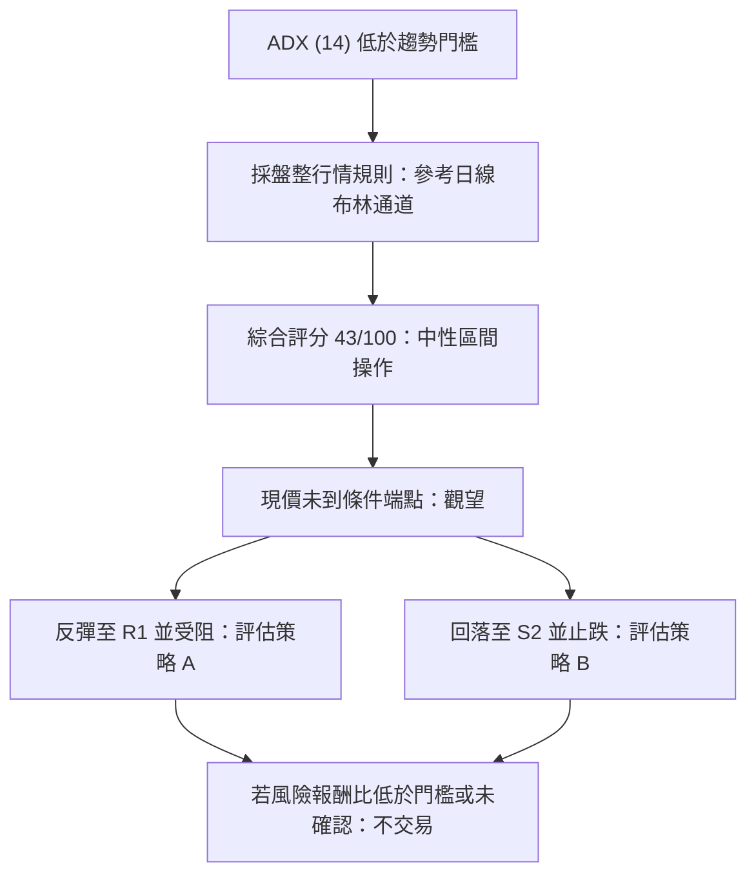

# GOOG 技術分析報告

> **報告日期**：2026-11-25 ｜ **語言**：繁體中文 ｜ **數據來源**：Yahoo Finance ｜ **當前價格**：$276.58 USD（收盤日：2026-11-24）

---

## 目錄

| 章節 | 內容 |
|------|------|
| [1. 技術面概覽](#1-技術面概覽) | 核心指標速覽、評分卡 |
| [2. 趨勢分析](#2-趨勢分析) | 長中短期走勢、ADX |
| [3. 圖表形態分析](#3-圖表形態分析) | 形態、K線、缺口 |
| [4. 支撐與阻力](#4-支撐與阻力) | 關鍵價位、斐波那契 |
| [5. 技術指標深度解讀](#5-技術指標深度解讀) | MA/RSI/MACD/布林/成交量/進階指標 |
| [6. 動能與波動率](#6-動能與波動率) | ATR、Beta、相對強度 |
| [7. 多時框架總結](#7-多時框架總結) | 時框架訊號矩陣 |
| [8. 交易策略建議](#8-交易策略建議) | 歷史基準、策略、風險報酬比 |
| [9. 風險提示與監控](#9-風險提示與監控) | 監控指標、風險場景 |

---

## 1. 技術面概覽

GOOG 短中期技術面偏弱：收盤仍在主要均線下方，多時框方向為偏空，且相對大盤與 Nasdaq-100 均走弱。另一方面，日線 MACD 柱轉正、近段 RSI 出現底背離訊號，且收盤仍高於近期低點聚類支撐，構成反彈風險。最大反向風險是週線空頭動能延續，若支撐失守，技術面可能由盤整轉為再度下行。

### 📊 核心指標速覽表

| 指標類別 | 指標名稱 | 當前數值 | 訊號 | 解讀 |
|----------|----------|----------|------|------|
| **價格** | 當前價格 | $276.58 | 🔴 | 位於主要中長期均線下方，短線處於近期低位區域 |
| **均線** | MA20 / MA50 / MA200 | 見第 5 章 | 🔴 | 收盤在三條均線下方，均線呈空頭排列 |
| **動能** | RSI(14)（日線） | 見第 5 章 | 🟡 | 未進入超賣區，但處於偏弱區間；底背離是反彈警訊而非趨勢反轉確認 |
| **動能** | MACD 柱（日線） | 見第 5 章 | 🟡 | 柱值轉正，顯示短線動能改善，與均線空頭排列相抵 |
| **趨勢** | ADX(14) | 見第 2 章 | 🟡 | 接近趨勢判別門檻但仍屬盤整，依區間規則處理 |
| **波動** | ATR(14) | 見第 6 章 | 🔴 | 每日價格波動幅度偏大，倉位與停損距離須保守 |
| **多時框** | 一致性 | 見第 7 章 | 🔴 | 三個時框中兩個偏空、一個中性，整體偏空但非完全一致 |

### 🏆 技術評分卡

以下子評分依趨勢、動能、支撐、量能、形態與均線狀況評定；綜合評分按六項算術平均計算，四捨五入至整數。

| 維度 | 評分（0–100） | 訊號 | 主要依據（引用數值所在章節） |
|------|---------------|------|------------------------------|
| 趨勢強度 | 45 | 🟡 | ADX 未達趨勢行情門檻，且方向性指標由空方主導，見第 2 章 |
| 動能指標 | 45 | 🟡 | 日線 MACD 柱改善，但 RSI 仍偏弱、週線動能偏空，見第 5、7 章 |
| 支撐穩定度 | 55 | 🟡 | 近期支撐附近曾出現反彈，但中期結構尚未轉強，見第 4 章 |
| 成交量配合 | 35 | 🔴 | OBV 與 A/D 未提供明確累積訊號，近期成交量低於 20 日均量，見第 5 章 |
| 形態完整度 | 40 | 🔴 | 僅見指標型改善及單一缺口，資料不足以確認反轉形態，見第 3 章 |
| 均線排列 | 35 | 🔴 | 均線空頭排列，價格仍受中長期均線壓制，見第 5 章 |
| **綜合評分** | **43** | **中性** | 六項平均：42.5，四捨五入為 43；依本報告分流規則採區間操作並等待確認 |

---

## 2. 趨勢分析

**結論：**長期價格曾快速上升，但近數月已由高位回落；週線與均線結構偏空，日線則處於低位附近的弱勢整理。ADX 低於趨勢行情門檻，因此本報告依規則以日線布林通道區間判斷交易位置，而非將短線反彈直接視為趨勢反轉。

### 📈 長期趨勢（近 12 個月）

以下階段以「近 12 個月收盤走勢」月收盤資料整理；階段報酬以起訖月收盤計算。

| 期間 | 起始月收盤 | 結束月收盤 | 漲跌幅 | 特徵 |
|------|------------:|------------:|-------:|------|
| 2025-12 至 2026-01 | $313.19 | $337.87 | +7.9% | 年初延續上行 |
| 2026-01 至 2026-03 | $337.87 | $286.50 | -15.2% | 高位回檔，月收盤連續走低 |
| 2026-03 至 2026-04 | $286.50 | $381.46 | +33.2% | 強勢反彈並刷新階段高位 |
| 2026-04 至 2026-07 | $381.46 | $356.42 | -6.6% | 高位拉回，仍處相對高檔 |
| 2026-07 至 2026-09 | $356.42 | $340.74 | -4.4% | 弱勢整理，反彈延續性不足 |
| 2026-09 至 2026-11 | $340.74 | $276.58 | -18.8% | 下跌加速，月收盤回落至年內低位區 |

**判讀：**月線收盤從春季反彈高點回落，近兩個月跌勢明顯；這與目前月線中性而非偏多的方向一致。月 RSI 雖仍高於中性分界，但已自先前高位回落，不能單獨抵銷價格跌破月趨勢均線的弱勢結構。

### 📊 中期趨勢（週線）

週線收盤在七月下旬曾下探後反彈，八月至十月中旬大致處於高位整理；十月下旬起下跌加速，十一月的反彈未能形成穩定的高低點上移結構。近週收盤及成交量資料顯示，十月底下跌週成交量明顯放大，之後反彈週量能逐步收斂；最近一個不完整週的成交量低於先前下跌週。

| 週末交易日 | 週收盤 | 週成交量 | 趨勢觀察 |
|------------|-------:|---------:|----------|
| 2026-07-17 | $345.90 | 87,721,900 | 高位區間起點 |
| 2026-07-24 | $318.88 | 122,279,300 | 下跌週，成交量增加 |
| 2026-07-31 | $356.42 | 110,473,400 | 反彈收復部分跌幅 |
| 2026-08-28 | $342.66 | 82,436,000 | 高位整理 |
| 2026-09-25 | $341.08 | 91,524,400 | 整理延續，趨勢未明 |
| 2026-10-16 | $336.91 | 79,871,700 | 高位回落 |
| 2026-10-30 | $278.22 | 208,382,100 | 急跌且成交量顯著放大 |
| 2026-11-13 | $292.52 | 98,255,100 | 跌後反彈，但未扭轉週線偏空方向 |
| 2026-11-20 | $264.00 | 131,312,800 | 再度下跌，成交量高於反彈週 |
| 2026-11-24 | $276.58 | 55,417,400 | 進行中週線反彈，成交量資料尚未完整 |

**週線結論：**趨勢方向依多時框指標列為偏空。週 RSI 仍低於中性分界，週 MACD 柱為負值；短線反彈雖存在，但尚無足夠證據推翻週線偏空判斷。

### ⚡ 趨勢強度（ADX）

| 指標 | 數值 | 解讀 |
|------|------:|------|
| ADX(14) | 24.57 | 低於 25，依本報告規則歸類為盤整／弱趨勢 |
| +DI | 19.20 | 多方方向性力量低於空方 |
| −DI | 26.28 | 空方方向性力量占優 |

**規則收斂：**ADX 尚未確認趨勢行情，故採用規則 14 的盤整處理方式：以日線布林通道上下軌作主要區間參考，等待價格到達區間端點並確認反應。雖然 +DI 與 −DI 顯示空方較強，仍不足以將市場定義為已確認的趨勢行情。

---

## 3. 圖表形態分析

**結論：**目前沒有足夠的價格幾何結構確認雙底、頭肩或旗形等反轉／延續形態。較可靠的訊息是均線空頭排列、價格低於長期均線、日線 MACD 柱轉正，以及近期跳空缺口仍未回補；因此本章以指標型解讀為主，不推算形態目標價。

### 🔍 形態識別

| 形態 | 信心度 | 判斷依據 | 完成度 | 目標價 |
|------|--------|----------|--------|--------|
| 雙底／底部反轉 | 低 | 雖有日線底背離標示及近期低位反彈，但現有日K樣本不足以證明兩個相近低點與頸線結構 | 訊號不足，僅做指標型解讀 | N/A（數據未提供） |
| 頭肩底／頭肩頂 | 低 | 目前價格序列資料不足以辨識完整肩部、頭部與頸線幾何 | 訊號不足，不宣稱形態成立 | N/A（數據未提供） |
| 下降旗形／整理型態 | 低 | 近期跌勢後有反彈，但樣本數不足以確認旗面、旗桿及有效突破 | 尚未完成確認 | N/A（數據未提供） |
| 均線空頭排列 | 高 | 日線價格低於主要均線，且均線順序呈空頭排列 | 已形成的趨勢型指標訊號 | 不適用 |
| 日線 MACD 柱轉正 | 中 | 柱值由空方區域回升至正值，但價格仍低於主要均線 | 短線動能改善，未形成趨勢反轉確認 | 不適用 |

### 🕯️ 重要 K 線形態與缺口

以下 K 線判讀僅使用近十根日K及近八根週K的 OHLC 資料。表格選列具代表性的 K 棒；未列出的 K 棒不作形態宣稱。

| 日期（日K／週K） | 開 | 高 | 低 | 收 | K線形態 | 解讀 | 訊號 |
|------|----:|----:|----:|----:|---------|------|------|
| 2026-11-19（日K） | $290.83 | $292.21 | $270.72 | $271.02 | 長實體下跌 K 棒 | 收盤接近日內低位，反映當日賣壓強；單根 K 棒不能確認延續性 | 🔴 |
| 2026-11-20（日K） | $272.45 | $280.52 | $262.27 | $264.00 | 下跌 K 棒，帶上下影線 | 低位曾出現承接，但收盤仍低於開盤，僅顯示低位有買盤回應 | 🟡 |
| 2026-11-23（日K） | $282.49 | $282.62 | $273.00 | $279.53 | 下影線較明顯的小實體 K 棒 | 低位買盤將收盤拉回，但上方賣壓仍存在；未能單獨確認反轉 | 🟡 |
| 2026-11-24（日K） | $279.05 | $279.05 | $273.91 | $276.58 | 小實體、下影線 K 棒 | 開盤即為當日高點，收盤低於開盤，顯示反彈力道有限 | 🔴 |
| 2026-10-30（週K） | $318.05 | $323.13 | $275.35 | $278.22 | 長實體下跌週K | 週內大幅下跌，且該週成交量放大，屬於明確的賣壓週 | 🔴 |
| 2026-11-06（週K） | $280.58 | $294.40 | $272.00 | $283.93 | 下跌後反彈的窄實體週K | 低位回升但實體有限，僅構成下跌後的暫時穩定 | 🟡 |
| 2026-11-20（週K） | $290.55 | $292.21 | $262.27 | $264.00 | 長實體下跌週K | 收盤靠近週內低位，延續週線賣壓 | 🔴 |
| 2026-11-24（週K，進行中） | $282.49 | $282.62 | $273.00 | $276.58 | 進行中週K，帶下影線 | 尚未收週，不能視為已確認的週線反轉型態 | 🟡 |

### 跳空缺口

| 日期 | 方向 | 缺口區間 | 缺口幅度 | 是否回補 | 技術意義 |
|------|------|----------|---------:|----------|----------|
| 2026-10-29 | 向下跳空 | $286.43–$319.68 | 10.3% | 未回補 | 上方留有明顯供給區；若反彈進入缺口，需觀察是否遭遇賣壓 |

該缺口區間為市場脈絡所列的唯一近六十個交易日、至少達門檻的缺口。本報告不將其他日期推定為缺口。

---

## 4. 支撐與阻力

**結論：**最近的波段支撐位於現價下方，距離不遠，但其下方尚有更深層支撐；上方則有多層波段阻力與未回補缺口重疊。由於價格位於重要均線與成交量價值區下方，支撐附近可能有短線反彈，但反彈仍須面對上方密集供給。

### 🚧 阻力位分析表

阻力位由近一年波段高點聚類計算，來源為程式由日線計算。

| 阻力級別 | 價位 | 形成原因 | 突破難度 | 重要性 |
|----------|------:|----------|----------|--------|
| R1 | $301.62 | 近一年波段高點聚類；亦接近部分趨勢指標所示的上方壓力區 | 中 | 短線第一道波段阻力，需觀察量能與收盤確認 |
| R2 | $310.68 | 近一年波段高點聚類；與上方技術供給區相互呼應 | 高 | 若突破，表示反彈力度改善，但仍未代表中長期轉多 |
| R3 | $318.83 | 近一年波段高點聚類；位於更高的密集阻力區 | 高 | 中期反轉判斷的關鍵上方阻力之一 |

### 🛡️ 支撐位分析表

支撐位為近兩年波段低點聚類，依關鍵價位區塊所列的回溯期間引用。

| 支撐級別 | 價位 | 形成原因 | 守住可能性 | 重要性 |
|----------|------:|----------|------------|--------|
| S1 | $271.65 | 近兩年波段低點聚類，接近近期價格活動區 | 中 | 當前附近的第一層支撐；若失守，短線風險升高 |
| S2 | $237.94 | 近兩年波段低點聚類 | 低 | 若 S1 失守，可能成為下一層較重要的支撐參考 |
| S3 | $197.46 | 近兩年波段低點聚類 | 低 | 深層支撐；需在市場進一步下跌時才會進入觀察範圍 |

### 📐 斐波那契回調位分析

斐波那契水平依關鍵價位區塊所列的五十二週區間直接引用，並非本報告重新計算。

| 回調比例 | 價位 | 技術解讀 |
|---------:|------:|----------|
| 23.6% | $370.52 | 高位回調中的較淺回撤位置；目前遠在現價上方 |
| 38.2% | $349.84 | 中度回撤參考位；若大幅反彈，可能構成阻力 |
| 50.0% | $333.12 | 區間中點參考位，與中長期技術供給區接近 |
| 61.8% | $316.40 | 深度回撤參考位，位於上方重要壓力區 |
| 78.6% | $292.59 | 接近近期反彈可能測試的回撤位置 |

現價位於 78.6% 回調位與五十二週低點之間。這表示價格已回吐前一輪升幅的大部分；此位置可能出現技術性承接，但若支撐失守，單靠回調比例不足以推定底部成立。

### 樞軸點補充

波段支撐與阻力均已提供多個層級，因此不以樞軸點取代或重標 R/S 位。樞軸點只作公式型參考，不能視為實際波段成交低點或高點。

| 樞軸名稱 | 價位 | 用途 |
|----------|------:|------|
| 樞軸 PR2 | $382.84 | 較遠端的公式阻力參考 |
| 樞軸 PR1 | $330.53 | 中期反彈的公式阻力參考 |
| 樞軸 P | $302.94 | 月度樞軸中線參考 |
| 樞軸 PS1 | $250.63 | 公式支撐參考 |
| 樞軸 PS2 | $223.04 | 較遠端的公式支撐參考 |

---

## 5. 技術指標深度解讀

**結論：**技術訊號整體仍偏空，但短線動能有初步改善。均線排列、週線動能及價格所在位置偏弱；日線 MACD 柱轉正、RSI 底背離標示和低位反彈則構成反向訊號。綜合而言，這是弱勢區間中的反彈可能，不是已確認的趨勢反轉。

### 📈 均線、RSI、MACD、布林通道

| 指標 | 數值 | 訊號 | 解讀 |
|------|------|------|------|
| MA20 / MA50 / MA200 與排列 | MA20：$283.52；MA50：$316.65；MA200：$334.12；MA20 < MA50 < MA200 | 🔴 | 收盤低於三條均線，且均線呈空頭排列；各層均線均形成上方壓力 |
| RSI(14)（日線）與背離 | RSI：38.81；指標標示為近二十根K棒首尾比較的底背離 | 🟡 | 尚未進入超賣區；底背離反映下跌動能可能減弱，但比較方法只使用首尾方向，確認力有限 |
| MACD 線 / Signal / 柱 | MACD：-12.024；Signal：-12.639；Hist：+0.616 | 🟡 | MACD 線與 Signal 均仍在零軸下方，但柱值已轉正，表示短線空方動能收斂；尚未構成中期多頭確認 |
| 布林上軌 / 中軌 / 下軌 / %B | 上軌：$306.54；中軌：$283.52；下軌：$260.50；%B：0.35 | 🟡 | 收盤位於中軌下方、接近通道下半部；符合盤整行情中低位區間觀察方式，但不代表價格必然回到中軌 |

**指標整合：**均線與布林中軌位置共同顯示價格仍受上方壓制；RSI 處於偏弱區，亦與空頭均線結構一致。相對地，MACD 柱轉正及 RSI 底背離提示短線賣壓可能減弱，與較大級別偏空訊號形成矛盾。故目前較合理的解讀是「短線反彈訊號出現，但反轉未確認」，需等待價格收復上方均線與阻力區，並觀察成交量是否配合。

### 💹 成交量（量價配合度）

| 指標 | 數值或狀態 | 判讀 |
|------|------------|------|
| 最新成交量 | 23,974,400 股 | 低於二十日均量，當日反彈／整理未見明顯放量確認 |
| 二十日均量 | 30,433,750 股 | 短期基準量 |
| 成交量比 | 0.79 倍 | 低於基準量，量能配合度偏弱 |
| 五十日均量 | 22,183,822 股 | 最新成交量略高於此較長週期基準，但不足以抵銷低於二十日均量的訊號 |
| OBV 趨勢 | OBV 低於其均線 | 量能疲弱，尚未確認價格反彈 |
| A/D 線 | 近二十根不高於其二十日均值；A/D 下降、價格下跌 | A/D 與價格同向，確認近期累積／派發方向偏弱 |

**量價結論：**OBV 與 A/D 均未確認反彈；最新量比低於短期均量，表示價格回升尚缺乏明確量能支持。這與日線 MACD 柱改善形成分歧，故動能回暖的可信度低於「價量同步轉強」的情況。

### 🧭 進階指標

以下進階指標均由日線計算；價位直接引用程式由日線計算結果。

| 指標 | 數值 | 收盤相對位置 | 解讀 |
|------|------|--------------|------|
| 一目均衡表（當前轉換線／基準線／雲層） | 轉換線 $281.94；基準線 $301.63；先行帶 A $345.85；先行帶 B $343.68 | 收盤在雲層下方；轉換線低於基準線 | 偏空。收盤低於整個雲層，且短期線低於基準線，確認均線系統的弱勢解讀 |
| 一目均衡表（前方二十六根雲層） | 先行帶 A $291.79；先行帶 B $311.12，A 在 B 下方 | 前方雲層偏空 | 前方雲層結構未顯示趨勢轉強；與週線偏空方向相符 |
| 成交量分布（近二百五十二個交易日） | POC $336.07；價值區 $297.69–$362.64，含 72% 成交量 | 收盤位於價值區下方 | 價格低於歷史主要成交量聚集區，反彈若進入價值區，可能遭遇供給或解套賣壓 |
| 錨定 VWAP（自五十二週高點） | $335.45 | 收盤在其下方 | 自高點以來的成交量加權成本高於現價，整體持倉成本可能形成壓力 |
| 錨定 VWAP（自五十二週低點） | $274.03 | 收盤在其上方 | 近期低點後的加權成本略低於收盤，提供短線反彈結構的有限支持 |
| A/D 線 | 近二十根不高於其二十日均值；A/D 下降且價格下跌 | — | A/D 與價格同向走弱，未見明確吸籌背離 |

**進階指標整合：**一目雲層、成交量價值區及自五十二週高點錨定 VWAP 均位於收盤上方，與均線、週線 RSI 及週線 MACD 的偏空結論互相確認。自五十二週低點錨定 VWAP 位於收盤下方，對短線反彈提供有限支持；但該單一訊號不足以抵銷上方技術壓力。

---

## 6. 動能與波動率

**結論：**波動幅度偏大，停損若設得過窄，容易被正常日內波動觸及。另一方面，GOOG 相對 VTI 與 QQQ 的多期間表現均落後，且比值趨勢走弱，對偏多交易不利，亦支持以等待確認而非追買反彈為主。

### 📊 ATR 波動率分析

| 指標 | 數值 | 解讀 |
|------|------:|------|
| ATR(14) | $11.14 | 以 Wilder 方法計算的日均真實波幅參考 |
| ATR 佔價格比例 | 4.03% | 單日常態波動相對價格不低，倉位須相應縮小 |
| 1.5 倍 ATR 風險距離參考 | $16.71 | 僅作停損距離尺度參考，不是本報告另行指定的停損價 |
| 2 倍 ATR 風險距離參考 | $22.28 | 較寬的波動容忍尺度；實際停損仍須依可引用的關鍵價位設定 |

**波動管理：**ATR 距離不可獨立取代結構性停損。若交易計畫使用的支撐／阻力位與 ATR 尺度不相稱，應調整倉位而非任意將停損移遠；若因此使風險報酬比低於門檻，則放棄交易。

### 📐 Beta 與相對強度

Beta 為 1.226，表示歷史上對市場波動的敏感度高於市場整體；Beta 不是方向指標，也不能推定未來漲跌。以下相對強度為截至 2026-11-23 的價格報酬，不含股息，來源為市場脈絡程式計算。

#### 相對強度 vs VTI（美國整體市場）

| 期間 | GOOG | VTI | 超額報酬 | 比值趨勢 |
|------|-----:|----:|---------:|----------|
| 1 個月 | -11.9% | -4.8% | -7.1% | 相對走弱；比值低於其五十日均值 |
| 3 個月 | -18.6% | -6.1% | -12.5% | 相對走弱；比值低於其五十日均值 |
| 6 個月 | -27.4% | -3.8% | -23.5% | 相對走弱；比值低於其五十日均值 |

#### 相對強度 vs QQQ（Nasdaq-100）

| 期間 | GOOG | QQQ | 超額報酬 | 比值趨勢 |
|------|-----:|----:|---------:|----------|
| 1 個月 | -11.9% | -7.6% | -4.3% | 相對走弱；比值低於其五十日均值 |
| 3 個月 | -18.6% | -8.4% | -10.2% | 相對走弱；比值低於其五十日均值 |
| 6 個月 | -27.4% | -10.9% | -16.5% | 相對走弱；比值低於其五十日均值 |

**相對強度結論：**GOOG 在兩個比較基準的各期間均落後，且比值低於五十日均值。此狀況不支持追價做多；對本報告的區間策略而言，則支持優先等待上方壓力確認、避免在支撐附近盲目追空。

---

## 7. 多時框架總結

**結論：**日線與週線方向偏空，月線中性；依多時框指標區塊，多時框一致性為兩個時框偏空。由於 ADX 低於趨勢行情門檻，交易執行仍依日線區間規則；但週線與均線方向限制了偏多推論，整體唯一方向性結論為「中性觀望，區間操作偏向反彈遇壓」。

### 📋 時框架訊號表

以下方向、RSI、MACD 柱及趨勢均線照多時框指標區塊列示；週線及月線最後一根 K 棒仍在進行中。

| 時框架 | 趨勢方向 | RSI(14) | MACD 柱 | 收盤 vs 趨勢均線 | 形態 | 建議 |
|--------|----------|--------:|--------:|------------------|------|------|
| 日線 | 偏空 | 38.81 | +0.616 | 低於 MA50 $316.65 | 短線動能改善，但均線仍偏空 | 僅在區間端點等待確認 |
| 週線 | 偏空 | 37.16 | -8.771 | 低於 MA20 $324.79 | 下跌後反彈尚未改變週線方向 | 週線未轉強前，避免追多 |
| 月線 | 中性 | 57.86 | N/A（數據未提供） | 低於 MA10 $329.50 | 月線 RSI 中性，但收盤低於趨勢均線 | 不以月 RSI 單獨判定反轉 |

**多時框一致性：2/3 偏空。**

### ⚖️ 多時框收斂結論

| 收斂步驟 | 結論 |
|----------|------|
| ADX 狀態 | 低於趨勢行情門檻，歸類為盤整／弱趨勢 |
| 主導規則 | 盤整行情以日線布林通道上下軌作主要區間參考 |
| 中長期背景 | 週線偏空、月線中性；價格仍低於週線與月線趨勢均線 |
| 日線角色 | 用於選擇區間端點進場時機，不將短線動能改善升格為趨勢反轉 |
| **唯一方向性結論** | **中性觀望，區間操作偏向反彈遇壓** |

此結論與第 2 章 ADX 盤整判定、第 5 章日線動能與均線的矛盾狀況，以及第 8 章以區間端點為條件的策略一致。

---

## 8. 交易策略建議

**當前主策略方向 = 中性區間操作（依評分 43/100）。**現價並未提供足夠的區間端點風險報酬優勢；優先等待價格抵達預設阻力或更深支撐，再以反應確認是否執行。只有達到最低風險報酬要求的條件策略才列為可執行策略。

### 🧭 策略路由

| 評分分流依據 | 策略安排 |
|--------------|----------|
| 綜合評分落在中性區間 | 以區間操作為主，不採單邊追價 |
| ADX 判定 | 盤整行情，以日線布林通道區間尋找端點 |
| 多時框背景 | 週線偏空、月線中性；反彈遇壓優先於追多 |
| 交易原則 | 僅在條件價位觸發且風險報酬比達標時執行；否則觀望 |

### 📊 歷史基準機率

今日狀態定義為 RSI(14) 位於 30–50 且收盤低於 MA200。歷史樣本期間為 2016-11-23 至 2026-11-24，共 2,514 個交易日；價格報酬不含股息。以下樣本為相同狀態的交易日與段數，持有期互相重疊，非獨立觀測。

| 持有期 | 相同狀態樣本（段數） | 上漲比例 | 中位數報酬 | 25%–75% 分位 | 全部交易日上漲比例／中位數 |
|--------|----------------------|----------|------------|--------------|---------------------------|
| 5 日 | 353（63 段） | 51% | +0.2% | -3.4% 至 +3.3% | 57%／+0.6% |
| 20 日 | 345（62 段） | 56% | +1.8% | -4.7% 至 +7.4% | 62%／+2.5% |
| 60 日 | 332（55 段） | 62% | +5.4% | -7.0% 至 +15.0% | 66%／+6.3% |

相同狀態下，各持有期的上漲比例均低於全部交易日基準，中位數報酬也較低，歷史表現沒有顯示該狀態具有優勢。樣本交易日數不少，但因觀測期間重疊，獨立段數較少；尤其不能把這些頻率解讀為未來預測。對目前區間操作而言，歷史基準不支持積極追多，應以價格觸及技術端點後的確認訊號決定是否交易。

### 🎯 價格情境階梯（Price Scenarios）

以下目標及觸發價只引用第 4 章波段價位與已列出的缺口區間；可能性採高／中／低判斷，不代表統計機率。

| 觸發條件 | 下一目標 | 後續延伸 | 可能性 | 依據 |
|----------|----------|----------|--------|------|
| 有效突破 R1 | R2 | R3 | 低 | 均線、價值區與一目雲層均在上方，且相對強度偏弱；突破需有收盤與量能確認 |
| 在現價區間內穩定整理 | — | — | 中 | ADX 屬盤整狀態，但量能與 OBV 未確認反彈，需等待方向性突破 |
| 跌破 S1 | S2 | S3 | 中 | 週線偏空、空方 DI 占優；若失守近端支撐，較深支撐會成為後續觀察區 |
| 反彈進入未回補缺口 | 缺口區間上緣 | 缺口區間下緣 | 低 | 缺口未回補且上方供給明顯；缺口本身是壓力區，不保證必定回補 |

### 🟢 主策略詳情

策略按中性區間路由設計。進場為觸發後的條件單，不代表目前價格立即進場；交易者須等日線價格行為與成交量確認。表內當前收盤價僅作基準，不作為任一策略進場價。

| 策略要素 | 策略 A：上方阻力區間做空 | 策略 B：深層支撐區間做多 |
|----------|--------------------------|--------------------------|
| 當前收盤基準 | $276.58 | $276.58 |
| 進場條件 | 價格到達 R1，且日線出現受阻或轉弱確認後才考慮 | 價格到達 S2，且賣壓收斂、出現止跌確認後才考慮 |
| 進場價格 | $301.62 | $237.94 |
| 目標價 T1 | $271.65 | $301.62 |
| 目標價 T2 | $237.94 | $310.68 |
| 止損價格 | $310.68 | $197.46 |
| 風險報酬比 | 1 : 3.31（以 T1 計；空方計算為進場價減 T1，再除以止損價減進場價） | 1 : 1.57（以 T1 計；多方計算為 T1 減進場價，再除以進場價減止損價） |
| 比值核算 | (301.62 − 271.65) ÷ (310.68 − 301.62) = 29.97 ÷ 9.06 | (301.62 − 237.94) ÷ (237.94 − 197.46) = 63.68 ÷ 40.48 |
| 把握度 | 中：風險報酬比達標，但須先反彈至阻力並確認受阻；相對強度與週線方向提供背景支持 | 低：風險報酬比達標，但觸發價距現價較遠，且歷史基準不支持積極追多 |
| 建議倉位 | 資金的 0.5%–1.0%；以最大可承受損失控制風險 | 資金的 0.25%–0.5%；屬逆週線方向的條件交易 |

策略 A 為較接近中期偏空背景的區間反彈做空條件；策略 B 只有在價格大幅回落至深層支撐並出現止跌訊號後才考慮。兩者均非現價追單策略。策略 B 的低把握度不等於較低的計算風險；若市場出現跳空或波動擴大，實際損失仍可能超過預設停損風險。

### 🔴 反向風險觸發點（對沖提示）

| 觸發訊號 | 對主策略的影響 | 風控提示 |
|----------|----------------|----------|
| 日線收盤有效突破 R1，且成交量同步改善 | 反彈遇壓的空方區間策略可信度下降 | 不在突破後追空；等待回測或重新評估阻力轉支撐 |
| 收復 R2 並進一步站上 R3 | 中期偏空判斷需要重新檢視 | 停止沿用原有空方假設，重新核對週線與均線方向 |
| 跌破 S1 且週線延續收低 | 區間下緣反彈假設失效，下行風險升高 | 不以原支撐作為必然守住的依據，按預設停損執行 |
| 日線 MACD 柱再度轉負且 RSI 底背離失效 | 短線動能改善訊號撤退 | 不把先前反彈當作趨勢反轉確認 |

### 策略決策流程

---

## 9. 風險提示與監控

**結論：**短線需觀察近端支撐能否維持、中期需觀察價格能否收復阻力與均線壓力；成交量與相對強度目前均未確認轉強。下一次財報事件位於預定持有期限之外，但日期可能調整，仍須於交易前重新核對。

### ✅ 關鍵監控指標

| 監控項目 | 價位／事件 | 觸發後動作 |
|----------|------------|------------|
| 近端支撐 | S1：$271.65 | 觀察日線收盤是否守住；若失守，不假設支撐必然反彈 |
| 下一層支撐 | S2：$237.94 | 僅在抵達且出現止跌確認後，重新評估條件式做多計畫 |
| 上方第一阻力 | R1：$301.62 | 若反彈至此，觀察是否受阻；無受阻訊號不執行區間空方策略 |
| 近期缺口 | $286.43–$319.68，未回補 | 進入缺口區後提高風險警戒，觀察是否出現賣壓或有效回補 |
| 均線結構 | MA20、MA50、MA200 均低於各自空頭排列所需的強勢位置 | 觀察價格能否收復均線並維持，而非只看單日穿越 |
| 日線動能 | RSI 底背離標示、MACD 柱轉正 | 觀察訊號能否延續；若柱值轉弱且價格破支撐，降低反彈假設 |
| 量價確認 | OBV 低於均線、A/D 下降 | 反彈若未伴隨量能改善，不提高做多信心 |
| 相對強度 | 對 VTI 與 QQQ 的多期間比值均偏弱 | 若比值持續走低，避免將大盤反彈等同 GOOG 相對轉強 |
| 下次財報日 | 2027-02-03；距最新收盤日 71 個日曆天 | 財報日期可能調整；交易前核實。預定策略持有期間若跨越財報，須預留跳空風險 |

策略 A 與策略 B 的條件持有期間通常不應跨越表列財報日；若交易者延長持有並跨越財報，財報可能造成跳空，停損不保證按設定價格成交。

### ⚠️ 風險場景

| 情境 | 觸發條件 | 參考價位 | 可能性 | 應對 |
|------|----------|----------|--------|------|
| 樂觀 | 價格守住近端支撐、日線動能延續改善，並伴隨成交量增強 | S1、R1 | 低 | 不預先假設反轉；等待阻力有效突破及相對強度止跌後再調整判斷 |
| 基本 | 價格在支撐與阻力之間震盪，量能仍未確認方向 | S1、R1及日線布林通道 | 中 | 以區間端點和確認訊號執行，區間中段不追價 |
| 悲觀 | 支撐失守、週線賣壓延續，且相對強度繼續走弱 | S2、S3 | 中 | 執行停損與風險限額；不因歷史支撐或背離訊號而攤平 |

### 🛡️ 風險管理提醒

- 進場前先設定停損與可承受損失，再按停損距離調整股數；不要先決定股數後才放寬停損。
- 只在條件價位與價格行為確認同時成立時交易；策略表中的價格不是當下無條件指令。
- 若實際滑價、跳空或波動擴大使預期風險報酬比低於門檻，取消交易，不以擴大目標價補救。
- RSI 底背離及 MACD 柱轉正均屬短線訊號，不能單獨作為中長期反轉依據。
- 相對強度與成交量尚未確認轉強；在訊號改善前，降低偏多交易的資金暴露。

---

## 📋 報告總結

| 項目 | 結論 |
|------|------|
| 報告日期 | 2026-11-25 |
| 當前價格 | $276.58（收盤日期：2026-11-24） |
| 綜合評分／方向 | 43/100，中性 |
| 長期趨勢 | 🔴 近月收盤由高位回落，長期價格動能轉弱 |
| 中期趨勢 | 🔴 週線偏空，週線動能與趨勢均線尚未反轉 |
| 短期趨勢 | 🟡 ADX 顯示盤整；日線動能改善但尚未確認反轉 |
| 關鍵支撐／關鍵阻力 | S1：$271.65；R1：$301.62 |
| 🥇 最佳機會 | 條件式等待反彈至 R1 並確認受阻後評估策略 A；未觸發前觀望 |
| 最大風險 | 週線空方延續並失守近端支撐，令價格進一步下探較深支撐區 |

> ⚠️ **免責聲明**：本報告為 AI 自動生成之技術分析，所有數據及估算均基於歷史價格資訊。本報告僅供研究與學術參考，不構成任何投資建議。投資有風險，入市需謹慎。

---

## 資料與來源

| 項目 | 內容 |
|------|------|
| 價格 | 276.58 USD，2026-11-24 收盤（Yahoo Finance 日線） |
| K 棒 | 501 根日線，2024-11-25 至 2026-11-24（Yahoo Finance）；較長期間的價位與基準機率取自價格資料庫 |
| 關鍵價位回溯期間 | 阻力 近一年、支撐 近兩年 |
| 下次財報日 | 2027-02-03（Yahoo Finance，日期可能調整） |
| 有回應的資料來源 | Yahoo Finance、Finviz、StockAnalysis、Roic.ai |
| 由程式計算 | 所有指標、R1–S3 與斐波那契價位、多時框方向、相對強度、缺口、歷史基準機率、綜合評分 |
| 撰寫模型 | openai / gpt-6-luna |

> 本區塊由產生報告的程式依實際取得的資料填寫，非模型撰寫。「由程式計算」的數字不是模型的估計；其餘判斷（評分、情境、策略）是模型的分析。
